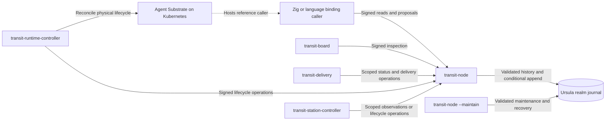

# Architecture

Status: experimental M1 kernel, client, storage adapter, and reference runtime
implemented and verified. Board supplies the qualified M2 inspection UI/API.
M7 state resources and M8 runtime readiness are implemented and qualified in bounded
profiles. M9 adds Station behaviors, shared language bindings and bounded Fuze
Table queries; connectors and downstream applications follow. Use
the [roadmap](roadmap/README.md) for scope and the [test guide](../tests/README.md) for proved behavior and limits.

## Execution model

This monorepo develops Transit, the reusable streaming runtime: its
generic agentic kernel, supporting services, clients, storage/runtime adapters,
Board inspection surface, Station framework and Fuze query engine.
`transit-core` implements the deterministic kernel; the runtime's deployment is packaged in
[charts/transit](../charts/transit/README.md). Station is the OTP-inspired framework
above the kernel. Transit's execution primitive is a process with a durable PID
and an ordered, logically unbounded mailbox. Its
sequence determines valid execution, including lifecycle, input handling,
progress, and authorized effects. Actors are implemented by processes; GenServer
is a Station behavior running in one. Workers are replaceable executors.

The PID survives eligible suspension, worker replacement, and migration;
termination or opted-in process expiry retires it. Each activation has a fresh
ownership generation. A registered name resolves to a PID, while a runtime binding maps it to a
scoped provider resource. Neither naming nor placement grants execution rights.

Transit defines the protocol. Ursula carries and persists its messages via
`ursula-zig`. Station makes that protocol convenient to program; connectors
perform external work; applications compose these facilities. LLM reasoning and
trading rules do not enter the kernel's vocabulary.

The cutoff for starting work and the end of settlement are distinct. Previously
authorized work can finish within recorded finite limits. Connectors choose how
to establish external outcomes; Transit enforces acceptance rights and permanent
closure. A late result cannot reopen a closed attempt, and closing an unknown
outcome makes no claim about what the external system did.

Use the [glossary](GLOSSARY.md) for official names and shared terminology.

## Layers and ownership

| Layer | Owns | Design |
| --- | --- | --- |
| Identity adapters and protocol ingress | Credential verification, authenticated request provenance, and mapping external identities to principals | [SECURITY.md](SECURITY.md) |
| Transit — kernel | Processes/PIDs, lifecycle, legal sequences, ordered commits, realm/grant checks, ownership and effect authority; resource/association contracts | [TRANSIT.md](TRANSIT.md), [STATE.md](STATE.md), [SECURITY.md](SECURITY.md) |
| Durable transport | Persistent history, continuation positions, mailbox storage and delivery | [STREAMS.md](STREAMS.md), [URSULA.md](URSULA.md) |
| Station — framework | GenServer behaviors, Table/association helpers, scoped name registries, request/reply, supervision, timers, worker-pool patterns | [STATION.md](STATION.md) |
| Fuze — query and compute | Shared source/plan/operator model; implemented bounded Table queries, KV/Document adapters next | [FUZE.md](FUZE.md) |
| Query ingress and interchange | IPC/C interfaces; Flight/Flight SQL gateway and ADBC interoperability remain planned | [ARROW.md](ARROW.md) |
| Connectors | Authorized external attempts, request/response capture, bounded reconciliation, outcome and retry/cancellation policy | [CONNECTORS.md](CONNECTORS.md) |
| Runtime adapter | Durable PID-to-provider bindings and reconciliation of lifecycle intents with provider resources/observations | [DEPLOYMENT.md](DEPLOYMENT.md) |
| Retention reconciliation | Enforce Transit-authorized policies and retained boundaries; coordinate checkpoints, dependency checks, and adapter reclamation | [RETENTION.md](RETENTION.md) |
| Board — inspection | Authorized operator/agent API, embedded frontend, evidence-linked views, and optional framework lenses | [BOARD.md](BOARD.md) |
| Applications | Workload policy, agent composition, trading, and application-specific views | [SCOPE.md](SCOPE.md) |

Zig implements the Transit kernel, Station framework, Fuze engine, connectors,
runtime adapters and application backends. TypeScript/Vite+ supplies frontend code and tooling.
Shared contracts use language-neutral schemas and fixtures. Ursula and Agent
Substrate are external infrastructure with their own implementation languages.
Station M9 adds host-language SDK adapters and examples over the shared Zig
client/framework. [M11](roadmap/M11.md) adds language-native public SDKs over
those bindings. That binding glue does not change the service language or move
application handlers into Transit authority; [CLIENT.md](CLIENT.md#language-neutral-boundary)
owns the generated ABI and target-language plan.

## Implemented topology and planned composition

The running profile exposes all application reads and writes through the public
node. The separate maintenance process is trusted infrastructure with storage
access. Clients and provider controllers do not read the journal directly.

Current authority operations serialize across the entire realm, including
processes, grants, and state resources. This supplies the initial atomicity domain;
replicating the HTTP service does not create independent write shards. Mailbox
semantics promise per-process order, not a portable global order between PIDs.

The target architecture decouples durable cardinality from resident memory:
resource data, retained work and control catalogs use paged access and bounded
working sets. The current fixed arrays and complete in-memory resource snapshots
are a temporary implementation profile, not a scalable storage design or a
runtime cache setting. [M10](roadmap/M10.md) must qualify a growing-state path
before public SDKs stabilize; [State](STATE.md#collection-size-and-working-memory)
defines the required boundary. Larger constants alone do not meet it.

Massive-scale deployment also requires an explicit authority-partition and routing
design, including grant/revocation and cross-partition delivery semantics. Measure
the single-realm serialization bottleneck in M10; [M18](roadmap/M18.md) qualifies
broader clustered execution. Additional node replicas do not by themselves create
independent write capacity or a cross-partition transaction guarantee.

Station runs in callers and connectors will submit observations through the
same public boundary. The [delivery courier](../apps/transit-delivery/README.md)
automatically advances committed outboxes with scoped rights; history holds its
progress and retry identity. Station timer/child observers submit authenticated
mailbox observations; separately scoped lifecycle controllers apply recorded
restart intent. They never acquire provider authority implicitly.

Every ingress establishes authenticated provenance before the kernel accepts
an operation. Credential providers stay behind adapters; Transit validates
principal/realm grants alongside ownership and lifecycle. Station helpers and
provider RBAC cannot replace these checks. Read APIs, projections, transcripts,
and administrative operations need their own scoped permissions. Revocation
and replay semantics are defined in [SECURITY.md](SECURITY.md).

## Source of truth

Validated durable history is authoritative for process creation/termination,
mailbox admission, ownership changes, completed turns, pending outputs/effects,
state-resource mutations, and runtime bindings. Station registry operations use
that same authority through ordinary process turns.
State indexes, name lookup caches, ready queues, and UI views are derived; their
loss must not erase accepted work or invent completed work.

Applications opt into finite retention and resource lifetime; unlimited is the
default. Transit owns those contracts independently of Ursula. A logical stream
may span physical segments, and the storage adapter maps checkpoints, trimming,
and deletion onto verified provider capabilities. Suspension must fit the
process/mailbox recovery window; known expiry permanently ends activation
eligibility. Storage GC can happen later without extending that lifetime.

Once history is reclaimed, a validated durable checkpoint and retained tail
become the authoritative recovery basis. Preserve live state, pending work,
ownership, and required control evidence; only derived indexes and runtime
caches remain disposable. [RETENTION.md](RETENTION.md) defines the guarantees
and distinguishes lifetime, history windows, quotas, and physical reclamation.

A committed turn links its input, state transition, outgoing messages, and
effect intents. Only committed outputs become eligible for dispatch. Delivery
across processes is recoverable and deduplicated; an append to one process's
stream does not establish a transaction over another process's stream. Committed
destinations remain bound to PIDs across name rebinding and placement changes.

Kubernetes and Substrate retain operational state for infrastructure and sandbox
management. Transit's runtime adapter reconciles that state with recorded execution
intent. Substrate owns physical worker assignment; a running pod or restored
sandbox is not proof of current process ownership. The first reference mapping
is one Transit process per Substrate Actor, across many activations. The
[deployment design](DEPLOYMENT.md) defines that boundary, provider reconciliation,
and why AX is excluded.

## Caller and enforcement boundary

Application code runs in clients. It receives state and input, computes a
proposal, and submits it through the public protocol. Core validates identity,
current grants, ownership, ordering, revision, and lifetime. It commits opaque
application state without running or verifying the handler's computation.
[CLIENT.md](CLIENT.md) defines that programming model; [SECURITY.md](SECURITY.md)
and [CONFORMANCE.md](CONFORMANCE.md) define trust and bypass obligations.

[M7](roadmap/M7.md) evolves inline application state into versioned resources
accessed through recorded process associations. Core enforces identity,
revision, commit, grants, and lifetime; application values stay opaque. The
client supplies bounded KV access, core rebuilds its bounded materialized catalog
from backend journals/checkpoints,
and Station builds behavior/Table APIs above them. [STATE.md](STATE.md) owns
the design and proof gates; it introduces no separate authoritative database
or automatic cross-resource transaction.

Runtime isolation and restricted credentials must prevent direct effects and
raw journal writes. A well-behaved SDK alone cannot enforce this boundary.
Trusted connectors execute recorded attempts. Replay restores recorded state
and outcomes without reissuing effects; recovery of unfinished work requires
current ownership and explicit attempt policy.

## Planned monorepo decomposition

Library boundaries describe code responsibilities, not processes or pods.
Executables compose libraries with configuration, credentials, and OS lifecycle.
The root build orchestrates packages; each library declares its own dependencies
and checks. See [development](DEVELOPMENT.md#package-workflow).

### Implemented libraries

| Package / module | Owns | Direct package dependencies |
| --- | --- | --- |
| [transit-observability](../packages/zig/transit-observability/README.md) / `transit_observability` | Transit diagnostic vocabulary and optional instrumentation | transit-protocol, telemetry |
| [telemetry](../packages/zig/telemetry/README.md) / `telemetry` | Bounded diagnostic sinks, local metrics and trace context | None |
| [transit-protocol](../packages/zig/transit-protocol/README.md) / `transit_protocol` | Public types, signatures, opaque values, schema, shared fixtures | None |
| [transit-core](../packages/zig/transit-core/README.md) / `transit_core` | Protocol state, validation, conditional authority, recovery | transit-protocol |
| [transit-client](../packages/zig/transit-client/README.md) / `transit_client` | Signed HTTP calls, activation sessions, retry material | transit-protocol, transit-observability |
| [transit-backend-ursula](../packages/zig/transit-backend-ursula/README.md) / `transit_backend_ursula` | Storage/transport, checkpoint, trim, deletion | transit-core, transit-observability, upstream ursula-zig |
| [transit-board-api](../packages/zig/transit-board-api/README.md) / `transit_board_api` | Board response types, OpenAPI generation and evidence projections | transit-protocol, transit-station (framework metadata) |
| [transit-board-client](../packages/ts/transit-board-client/README.md) (TypeScript) | Generated Board models/runtime validators and bounded browser transport | AJV runtime helper |
| [transit-runtime-substrate](../packages/zig/transit-runtime-substrate/README.md) / `transit_runtime_substrate` | Provider identity, template validation, sandbox lifecycle operations | transit-observability; invokes pinned external CLI |
| [transit-station](../packages/zig/transit-station/README.md) / `transit_station` | GenServer, durable calls, scoped names, supervision, Tables and captured queries | transit-client, transit-fuze |
| [transit-fuze](../packages/zig/transit-fuze/README.md) / `transit_fuze` | Source/plan contracts and bounded Zig-native Arrow execution | pinned zarrow, zarrow-compute |

The [binding packages](../bindings/README.md) expose the shared Zig client and
Station through a generated C ABI and owned native-port adapters. Each target
owns runtime scheduling and resource cleanup; protocol and framework semantics
remain in Zig. Fuze has no Station, Ursula or Substrate dependency. It embeds
neither DataFusion nor Acero.

The dependency graph stays acyclic. Core must remain testable without providers
or Station; applications use the public client. `transit-backend-*` names storage
and transport integrations; `transit-runtime-*` names execution placement and
lifecycle integrations. Additional implementations must prove the required
ordering, fencing, recovery, and retention guarantees. Broader interfaces should
follow a second concrete implementation, not a speculative plugin system.

### Implemented executables and examples

| Entry point | Role |
| --- | --- |
| [transit-node](../apps/transit-node/README.md) | Hosts core with Ursula, signed ingress, trusted time; separate maintenance mode |
| [transit-delivery](../apps/transit-delivery/README.md) | Public-client courier for ordered committed outboxes; no storage or handler authority |
| [transit-runtime-controller](../apps/transit-runtime-controller/README.md) | Composes public client and Substrate adapter to reconcile one PID |
| [transit-station-controller](../apps/transit-station-controller/README.md) | Observes Station timers/children or applies separately scoped lifecycle intent |
| [transit-station-host](../apps/transit-station-host/README.md) | Bounded native port for host languages; delegates to the shared ABIs |
| [transit-board](../apps/transit-board/README.md) | Inspection-only API host with embedded [TanStack Router frontend](../apps/transit-board-web/README.md); public client and transit-board-api composition |
| [kubectl-transit](../apps/kubectl-transit/README.md) | Kubernetes installation/workload inspection, service logs and origin-aware Board access |
| [rey-cli](../apps/rey-cli/README.md) | Signs/submits commands and reads scoped views |
| [example-counter](../examples/counter/README.md) | Complete caller, also the reference deployment workload |
| [example-byte-log](../examples/byte-log/README.md) | Independent caller against the same generic authority |
| [example-station-ledger](../examples/station-ledger/README.md) | Three Station processes with Tables, calls, registry, supervision and Arrow replies |

Transit artifacts use the `transit-` prefix, including the `transit-board*`
inspection family, `transit-station*` framework and `transit-fuze*` engine
families. These names denote subsystem membership; core and the public execution
client do not depend on Board, Station or Fuze. Examples are applications, not required infrastructure.
Tests launch their actual binaries; fault injection
and protocol assertions belong under [tests/](../tests/README.md).

### Planned components

- Add typed public APIs, handler runners and installable artifacts to the existing
  language packages in [M11](roadmap/M11.md). Generated/raw bindings remain a
  separate interface over the shared Zig client/framework; the
  [caller design](CLIENT.md#idiomatic-language-sdks) owns that boundary.
- Extend `kubectl-transit` with authorized logical inspection and, later, operator
  controls as scoped in the [full plugin plan](roadmap/M5.md).
- [M14](roadmap/M14.md) adds Document
  changes/CRDTs and KV/Document query adapters. Add further entity adapters only
  with their implementation and qualification; no standalone engine service is required.
- `packages/zig/transit-station-http`, module `transit_station_http`: exchange contracts, capture,
  caller helpers, and trusted dispatch over Station/Transit.
- `packages/zig/transit-station-grpc`, module `transit_station_grpc`: typed call
  contracts/helpers and capture/reconciliation for authorized external RPCs.
  Keep reusable Zig HTTP/2/protobuf transport separate from dispatch authority.
- `packages/zig/transit-station-flight` and `apps/transit-station-flight`: Flight/
  Flight SQL query ingress and gateway composition over Station/public client,
  with an explicit identity boundary and no direct storage access. Existing ADBC
  clients connect through Flight SQL; [ARROW.md](ARROW.md) owns this M17 profile.
- `apps/transit-station-worker`, `apps/transit-station-http-worker` and
  `apps/transit-station-grpc-worker`: compose behaviors or connector execution
  with explicitly supplied runtime capabilities.
- Application libraries and entry points: compose these primitives without
  adding application policy to core. Further TypeScript/Vite+ frontends and
  shared libraries follow concrete consumers.

Keep request/transcript construction separate from effect dispatch. Importing a
library must not acquire credentials or start work. Workload-specific images can
compile behavior selection; dynamic plugins are not implied. Add directories
when implementation starts. Do not duplicate public protocol definitions or
create a generic utility package without a concrete owner.

M7's resource contracts, validation, client operations, storage/index mechanisms,
and inspection extend those existing owners. A separate state package
or executable needs a concrete dependency or runtime boundary; this plan does
not create empty packages or require a new state service. The implemented M7
profile uses those boundaries; numerical limits and wire details live in the
[state contract](../contracts/STATE_V1.md).

## Observation and repository ownership

[Launchers](../launchers/README.md) compose existing executables for native local
development, Docker Compose, and reference qualification. Their configuration,
OS process management, and provisioning are development tooling, not new kernel
or framework layers. Local/Compose ownership is recorded through the public
client; only the Substrate reference supplies the implemented provider binding.

Board starts with kernel identities and lifecycle evidence, then gains optional
Station/connector lenses as those layers land. It reads through the public client;
required discovery/history surfaces belong to Transit, not a Board backdoor into
storage. UI and agent consumers share a versioned OpenAPI contract. Views remain
derived, permissioned, bounded, and explicit about freshness and missing history.
See [BOARD.md](BOARD.md) and [M2](roadmap/M2.md) for the design and proof gates.

[Service observability](OBSERVABILITY.md) is implemented across Board,
Transit services, clients, adapters and callers. Owners define their signals;
executables configure bounded sinks and correlation. Core stays deterministic,
and telemetry remains lossy operational evidence with no execution authority.
[M4](roadmap/M4.md) owns its qualification evidence.
Collectors and remote export are later scope.
Measure latency, throughput, recovery time, and resident memory before choosing
scaling or latency targets. The [pre-Station review](reviews/PRE_STATION.md) maps
current limits and missing framework prerequisites to the next milestone.

`packages/zig/` owns libraries; `apps/` owns platform/application entry points;
`examples/` owns complete sample callers. Exact versioned specifications live in
`contracts/`. Tests, deployment, Nix, and task recipes each own their operational
README. [The documentation index](README.md#where-documentation-lives) explains
where to put design, implementation details, and validation evidence.
