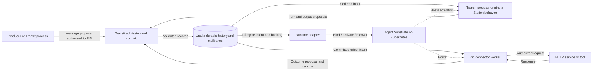

# Architecture

Status: layering, stack, and reference deployment established. Component layout
and protocols below are proposed; no runtime components are implemented yet.

## Execution model

Rey is the monorepo. Transit is its generic agentic streaming kernel, and Station
is the OTP-inspired framework above it. Transit's execution primitive is a
process with a durable PID and an ordered, logically unbounded mailbox. Its
sequence determines valid execution, including lifecycle, input handling,
progress, and authorized effects. Actors are implemented by processes; GenServer
is a Station behavior running in one. Workers are replaceable executors.

The PID survives eligible suspension, worker replacement, and migration;
termination or opted-in process expiry retires it. Each activation has a fresh
ownership generation. A registered name resolves to a PID, while a runtime binding maps it to a
scoped provider resource. Neither naming nor placement grants execution rights.

Transit defines the protocol. Ursula carries and persists its messages via
`ursula-zig`. Station makes that protocol convenient to program; connectors
perform external work; applications compose these facilities. LLM reasoning and
trading rules do not enter the kernel's vocabulary.

Use the [glossary](GLOSSARY.md) for official names and shared terminology.

## Layers and ownership

| Layer | Owns | Design |
| --- | --- | --- |
| Identity adapters and protocol ingress | Credential verification, authenticated request provenance, and mapping external identities to principals | [SECURITY.md](SECURITY.md) |
| Transit — kernel | Processes/PIDs, lifecycle, legal sequences, ordered commits, realm/grant checks, ownership and effect authority | [TRANSIT.md](TRANSIT.md), [SECURITY.md](SECURITY.md) |
| Durable transport | Persistent history, continuation positions, mailbox storage and delivery | [STREAMS.md](STREAMS.md), [URSULA.md](URSULA.md) |
| Station — framework | GenServer behaviors, scoped name registries, request/reply, supervision, timers, worker-pool patterns | [STATION.md](STATION.md) |
| Connectors | Authorized external attempts, request/response capture, outcome and retry policy | [CONNECTORS.md](CONNECTORS.md) |
| Runtime adapter | Durable PID-to-provider bindings and reconciliation of lifecycle intents with provider resources/observations | [DEPLOYMENT.md](DEPLOYMENT.md) |
| Retention reconciliation | Enforce Transit-authorized policies and retained boundaries; coordinate checkpoints, dependency checks, and adapter reclamation | [RETENTION.md](RETENTION.md) |
| Applications and UI | Workload policy, agent composition, trading, inspection and operator commands | [SCOPE.md](SCOPE.md) |

Zig implements Rey's kernel, framework, connectors, runtime adapters, and
application backends. TypeScript/Vite+ supplies frontend code and tooling.
Shared contracts use language-neutral schemas and fixtures. Ursula and Agent
Substrate are external infrastructure with their own implementation languages.

## Proposed flow



The diagram shows authority boundaries, not a singleton kernel service. M1 must
prove how admission and commits are serialized per process and how that authority
recovers. Scale across process sequences without implying a global message order.

Every ingress establishes authenticated provenance before the kernel accepts
an operation. Credential providers stay behind adapters; Transit validates
principal/realm grants alongside ownership and lifecycle. Station helpers and
provider RBAC cannot replace these checks. Read APIs, projections, transcripts,
and administrative operations need their own scoped permissions. Revocation
and replay semantics are defined in [SECURITY.md](SECURITY.md).

## Source of truth

Validated durable history is authoritative for process creation/termination,
mailbox admission, ownership changes, completed turns, pending outputs, and
effects. Registry operations and runtime bindings also have durable histories.
State indexes, name lookup caches, ready queues, and UI views are derived; their
loss must not erase accepted work or invent completed work.

Applications opt into finite retention and resource lifetime; unlimited is the
default. Transit owns those contracts independently of Ursula. A logical stream
may span physical segments, and the storage adapter maps checkpoints, trimming,
and deletion onto verified provider capabilities. Suspension must fit the
process/mailbox recovery window; known expiry permanently ends activation
eligibility. Storage GC can happen later without extending that lifetime.

Once history is reclaimed, a validated durable checkpoint and retained tail
become the authoritative recovery basis. Preserve live state, pending work,
ownership, and required control evidence; only derived indexes and runtime
caches remain disposable. [RETENTION.md](RETENTION.md) defines the guarantees
and distinguishes lifetime, history windows, quotas, and physical reclamation.

A committed turn links its input, state transition, outgoing messages, and
effect intents. Only committed outputs become eligible for dispatch. Delivery
across processes is recoverable and deduplicated; an append to one process's
stream does not establish a transaction over another process's stream. Committed
destinations remain bound to PIDs across name rebinding and placement changes.

Kubernetes and Substrate retain operational state for infrastructure and sandbox
management. Rey's runtime adapter reconciles that state with recorded execution
intent. Substrate owns physical worker assignment; a running pod or restored
sandbox is not proof of current process ownership. The first reference mapping
is one Transit process per Substrate Actor, across many activations. The
[deployment design](DEPLOYMENT.md) defines that boundary, provider reconciliation,
and why AX is excluded.

## Enforcement and replay

Application handlers operate on explicit state and messages. They propose
outputs through the kernel API; external I/O is available through connector
capabilities. Protocol validation, restricted credentials, and runtime isolation
must jointly prevent bypass. Merely providing a well-behaved SDK is insufficient.

The guarantee is legal protocol execution under authenticated authority. It
does not prove arbitrary native computation honest or deterministic. M1 must
demonstrate its chosen handler-execution boundary; reviewed effect executors
are trusted infrastructure. An already authorized external attempt may outlive
revocation, so fencing new authorizations is separate from proving remote
cancellation. The [conformance matrix](CONFORMANCE.md) captures these limits
and the adversarial scenarios required before claiming support.

Replaying committed history rebuilds state and views using recorded outcomes.
It does not reissue HTTP requests, model calls, or orders. Resuming unfinished
live work is a separate recovery operation with explicit ownership and attempt
rules. Replay is bounded by retained history; checkpoint recovery can preserve
current state without every historical transition. Snapshots remain tied to
protocol positions, versions, and compatible dependency lifetimes.

The first slice tests these boundaries on Kubernetes with worker failure. Agent
Substrate is the reference execution target; a runtime interface keeps pod IDs,
sandbox formats, and provider APIs out of the kernel protocol.

## Frontend and observation

An eventual TypeScript/Vite+ operator interface can inspect process sequences,
name registrations, runtime bindings, mailbox lag, supervision, exchange
transcripts, and failures. Its Zig gateway submits authenticated protocol commands
and serves derived views with continuation positions. The frontend framework
and UI milestone remain open.

Measure admission and turn latency, mailbox backlog/age, effect attempts, stale
owner rejections, recovery time, and resident memory. Correlate PIDs, activation
references, registry/runtime binding revisions, and message, turn, effect,
attempt, and stream-group identities across workers. Expose lifetime deadlines,
policy revisions, retained boundaries, terminal expiry, pinned/reclaimable bytes,
and background reclamation lag alongside execution metrics.

## Planned monorepo decomposition

Transit and Station name reusable components. Each will expose a Zig library;
executables will compose libraries with configuration, credentials, and OS
process lifecycle. A library boundary does not imply a Transit process, pod, or
independently deployed service. Runtime isolation still follows the protocol
authority model.

The following package and executable paths are proposals. Transit and Station
are official names; supporting package names and executable names can evolve
as their first implementations establish the interfaces.

### Zig libraries

| Proposed package | Exported module | Responsibility and dependencies |
| --- | --- | --- |
| `packages/zig/transit/` | `transit` | Process/PID types, protocol/lifetime validation, principal/grant contracts, logical storage contracts, and credential/storage/runtime interfaces; independent of Station, Ursula, and deployment providers |
| `packages/zig/transit-ursula/` | `transit_ursula` | Ursula persistence/transport, checkpoint, trim, and deletion mapping; depends on Transit and external `ursula-zig` |
| `packages/zig/station/` | `station` | GenServer, supervision, registries, request/reply, and application retention/state-view helpers; depends on Transit through its public interfaces |
| `packages/zig/station-http/` | `station_http` | HTTP request/response contracts, exchange groups, caller helpers, and executor logic; builds on Station and Transit |
| `packages/zig/runtime-substrate/` | `runtime_substrate` | PID-to-Substrate-Actor binding and lifecycle reconciliation; implements Transit's runtime interfaces without putting provider types in the core protocol |

Keep the dependency graph acyclic: Station builds on Transit; concrete adapters
implement Transit interfaces; connectors build on the framework. Transit core
must remain testable without Ursula, Kubernetes, or Station. Station should
also be testable with a deterministic Transit harness. Real adapter conformance
and cluster checks remain separate requirements.

Within the HTTP package, keep request construction and transcript types separate
from dispatch code. Importing a library must not implicitly acquire credentials,
start a service, or perform an effect. Executable wiring and runtime capabilities
determine which code can actually dispatch requests.

Workload-specific libraries can be added under `packages/zig/` as applications
emerge. They compose Station and connector APIs; Transit never imports them.
Do not duplicate protocol definitions in executable packages or create a generic
utility package before shared code has a concrete owner.

### Zig executables

| Candidate entry point | Composition and role |
| --- | --- |
| `apps/transit-node/` | Transit plus adapters; hosts authenticated ingress, policy/control recovery, admission, sequencing, commit, delivery, and retention reconciliation |
| `apps/station-worker/` | Station plus workload libraries; runs process activations and their behaviors under Transit authority, without raw authoritative storage credentials |
| `apps/http-worker/` | HTTP connector executor; performs authorized fetch attempts and publishes capture/outcomes through the protocol boundary |
| `apps/runtime-controller/` | Transit lifecycle client plus `runtime-substrate`; reconciles durable execution intent with Substrate |
| `apps/rey-cli/` | Protocol client and inspection tooling for processes, registries, runtime bindings, history, and exchange transcripts |

Entry points own startup, configuration, signal handling, and observability.
Reusable execution logic belongs in libraries. Process behavior selection may
initially be compiled into workload-specific worker images; a dynamic plugin
system is not implied. These are responsibilities to allocate as code lands,
with final OS process/deployment topology driven by isolation and measured needs.

### Repository layout

```text
packages/zig/      Reusable Zig libraries, including Transit and Station
packages/ts/       Shared frontend libraries when needed
apps/              Zig executable packages and the eventual web frontend
contracts/         Protocol schemas and language-neutral fixtures
tests/             Conformance, cluster failure and replay scenarios
deploy/            Reference deployment configuration
docs/              Scope, architecture, plans and technical rationale
nix/               Development-tool packaging
flake.nix          Reproducible development shell
justfile           Repository command entry points
build.zig          Planned root orchestration for Zig builds and checks
build.zig.zon      Planned root Zig dependency manifest
```

The root Zig build will compose package builds and tests while each package
declares its own direct dependencies and can be checked in the monorepo on its
own. Vite+ manages frontend packages separately; shared wire contracts connect
the languages. See [development](DEVELOPMENT.md#planned-zig-package-workflow).

Create packages, manifests, and source directories only when their implementation
begins. The current repository remains documentation and development tooling.
