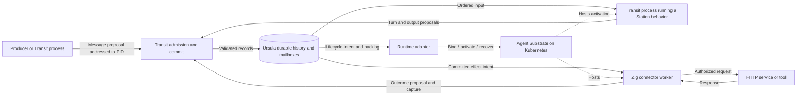

# Architecture

Status: experimental M1 kernel, client, storage adapter, and reference runtime
implemented and verified. Board supplies the qualified M2 inspection UI/API. Station, production
connectors, and trading applications follow. Use the [roadmap](roadmap/README.md)
for scope and the [test guide](../tests/README.md) for proved behavior and limits.

## Execution model

Rey is the monorepo. Transit is its generic agentic streaming kernel, and Station
is the OTP-inspired framework above it. Transit's execution primitive is a
process with a durable PID and an ordered, logically unbounded mailbox. Its
sequence determines valid execution, including lifecycle, input handling,
progress, and authorized effects. Actors are implemented by processes; GenServer
is a Station behavior running in one. Workers are replaceable executors.

The PID survives eligible suspension, worker replacement, and migration;
termination or opted-in process expiry retires it. Each activation has a fresh
ownership generation. A registered name resolves to a PID, while a runtime binding maps it to a
scoped provider resource. Neither naming nor placement grants execution rights.

Transit defines the protocol. Ursula carries and persists its messages via
`ursula-zig`. Station makes that protocol convenient to program; connectors
perform external work; applications compose these facilities. LLM reasoning and
trading rules do not enter the kernel's vocabulary.

The cutoff for starting work and the end of settlement are distinct. Previously
authorized work can finish within recorded finite limits. Connectors choose how
to establish external outcomes; Transit enforces acceptance rights and permanent
closure. A late result cannot reopen a closed attempt, and closing an unknown
outcome makes no claim about what the external system did.

Use the [glossary](GLOSSARY.md) for official names and shared terminology.

## Layers and ownership

| Layer | Owns | Design |
| --- | --- | --- |
| Identity adapters and protocol ingress | Credential verification, authenticated request provenance, and mapping external identities to principals | [SECURITY.md](SECURITY.md) |
| Transit — kernel | Processes/PIDs, lifecycle, legal sequences, ordered commits, realm/grant checks, ownership and effect authority | [TRANSIT.md](TRANSIT.md), [SECURITY.md](SECURITY.md) |
| Durable transport | Persistent history, continuation positions, mailbox storage and delivery | [STREAMS.md](STREAMS.md), [URSULA.md](URSULA.md) |
| Station — framework | GenServer behaviors, scoped name registries, request/reply, supervision, timers, worker-pool patterns | [STATION.md](STATION.md) |
| Connectors | Authorized external attempts, request/response capture, bounded reconciliation, outcome and retry/cancellation policy | [CONNECTORS.md](CONNECTORS.md) |
| Runtime adapter | Durable PID-to-provider bindings and reconciliation of lifecycle intents with provider resources/observations | [DEPLOYMENT.md](DEPLOYMENT.md) |
| Retention reconciliation | Enforce Transit-authorized policies and retained boundaries; coordinate checkpoints, dependency checks, and adapter reclamation | [RETENTION.md](RETENTION.md) |
| Board — inspection | Authorized operator/agent API, embedded frontend, evidence-linked views, and optional framework lenses | [BOARD.md](BOARD.md) |
| Applications | Workload policy, agent composition, trading, and application-specific views | [SCOPE.md](SCOPE.md) |

Zig implements Rey's kernel, framework, connectors, runtime adapters, and
application backends. TypeScript/Vite+ supplies frontend code and tooling.
Shared contracts use language-neutral schemas and fixtures. Ursula and Agent
Substrate are external infrastructure with their own implementation languages.

## Proposed flow

The diagram shows authority boundaries, not a singleton kernel service. M1 must
prove how admission and commits are serialized per process and how that authority
recovers. Scale across process sequences without implying a global message order.

Every ingress establishes authenticated provenance before the kernel accepts
an operation. Credential providers stay behind adapters; Transit validates
principal/realm grants alongside ownership and lifecycle. Station helpers and
provider RBAC cannot replace these checks. Read APIs, projections, transcripts,
and administrative operations need their own scoped permissions. Revocation
and replay semantics are defined in [SECURITY.md](SECURITY.md).

## Source of truth

Validated durable history is authoritative for process creation/termination,
mailbox admission, ownership changes, completed turns, pending outputs, and
effects. Registry operations and runtime bindings also have durable histories.
State indexes, name lookup caches, ready queues, and UI views are derived; their
loss must not erase accepted work or invent completed work.

Applications opt into finite retention and resource lifetime; unlimited is the
default. Transit owns those contracts independently of Ursula. A logical stream
may span physical segments, and the storage adapter maps checkpoints, trimming,
and deletion onto verified provider capabilities. Suspension must fit the
process/mailbox recovery window; known expiry permanently ends activation
eligibility. Storage GC can happen later without extending that lifetime.

Once history is reclaimed, a validated durable checkpoint and retained tail
become the authoritative recovery basis. Preserve live state, pending work,
ownership, and required control evidence; only derived indexes and runtime
caches remain disposable. [RETENTION.md](RETENTION.md) defines the guarantees
and distinguishes lifetime, history windows, quotas, and physical reclamation.

A committed turn links its input, state transition, outgoing messages, and
effect intents. Only committed outputs become eligible for dispatch. Delivery
across processes is recoverable and deduplicated; an append to one process's
stream does not establish a transaction over another process's stream. Committed
destinations remain bound to PIDs across name rebinding and placement changes.

Kubernetes and Substrate retain operational state for infrastructure and sandbox
management. Rey's runtime adapter reconciles that state with recorded execution
intent. Substrate owns physical worker assignment; a running pod or restored
sandbox is not proof of current process ownership. The first reference mapping
is one Transit process per Substrate Actor, across many activations. The
[deployment design](DEPLOYMENT.md) defines that boundary, provider reconciliation,
and why AX is excluded.

## Caller and enforcement boundary

Application code runs in clients. It receives state and input, computes a
proposal, and submits it through the public protocol. Core validates identity,
current grants, ownership, ordering, revision, and lifetime. It commits opaque
application state without running or verifying the handler's computation.
[CLIENT.md](CLIENT.md) defines that programming model; [SECURITY.md](SECURITY.md)
and [CONFORMANCE.md](CONFORMANCE.md) define trust and bypass obligations.

Runtime isolation and restricted credentials must prevent direct effects and
raw journal writes. A well-behaved SDK alone cannot enforce this boundary.
Trusted connectors execute recorded attempts. Replay restores recorded state
and outcomes without reissuing effects; recovery of unfinished work requires
current ownership and explicit attempt policy.

## Planned monorepo decomposition

Library boundaries describe code responsibilities, not processes or pods.
Executables compose libraries with configuration, credentials, and OS lifecycle.
The root build orchestrates packages; each library declares its own dependencies
and checks. See [development](DEVELOPMENT.md#package-workflow).

### Implemented libraries

| Package / module | Owns | Direct package dependencies |
| --- | --- | --- |
| [transit-protocol](../packages/zig/transit-protocol/README.md) / `transit_protocol` | Public types, signatures, opaque values, schema, shared fixtures | None |
| [transit-core](../packages/zig/transit-core/README.md) / `transit_core` | Protocol state, validation, conditional authority, recovery | transit-protocol |
| [transit-client](../packages/zig/transit-client/README.md) / `transit_client` | Signed HTTP calls, activation sessions, retry material | transit-protocol |
| [transit-backend-ursula](../packages/zig/transit-backend-ursula/README.md) / `transit_backend_ursula` | Storage/transport, checkpoint, trim, deletion | transit-core, upstream ursula-zig |
| [board-api](../packages/zig/board-api/README.md) / `board_api` | Board response types, OpenAPI generation, evidence projections and lenses | transit-protocol |
| [board-client](../packages/ts/board-client/README.md) (TypeScript) | Generated Board models/runtime validators and bounded browser transport | AJV runtime helper |
| [transit-runtime-substrate](../packages/zig/transit-runtime-substrate/README.md) / `transit_runtime_substrate` | Provider identity, template validation, sandbox lifecycle operations | None; invokes pinned external CLI |

The dependency graph stays acyclic. Core must remain testable without providers
or Station; applications use the public client. `transit-backend-*` names storage
and transport integrations; `transit-runtime-*` names execution placement and
lifecycle integrations. Additional implementations must prove the required
ordering, fencing, recovery, and retention guarantees. Broader interfaces should
follow a second concrete implementation, not a speculative plugin system.

### Implemented executables and examples

| Entry point | Role |
| --- | --- |
| [transit-node](../apps/transit-node/README.md) | Hosts core with Ursula, signed ingress, trusted time; separate maintenance mode |
| [transit-runtime-controller](../apps/transit-runtime-controller/README.md) | Composes public client and Substrate adapter to reconcile one PID |
| [board](../apps/board/README.md) | Inspection-only API host with embedded [TanStack Router frontend](../apps/board-web/README.md); public client and board-api composition |
| [rey-cli](../apps/rey-cli/README.md) | Signs/submits commands and reads scoped views |
| [example-counter](../examples/counter/README.md) | Complete caller, also the reference deployment workload |
| [example-byte-log](../examples/byte-log/README.md) | Independent caller against the same generic authority |

Transit service executables use the `transit-` prefix. Examples are applications,
not required infrastructure. Tests launch their actual binaries; fault injection
and protocol assertions belong under [tests/](../tests/README.md).

### Planned components

- `packages/zig/station`, module `station`: GenServer, supervision, registries,
  request/reply, and retention helpers over the public client.
- `packages/zig/station-http`, module `station_http`: exchange contracts, capture,
  caller helpers, and trusted dispatch over Station/Transit.
- `apps/station-worker` and `apps/http-worker`: compose behaviors or connector
  execution with explicitly supplied runtime capabilities.
- Application libraries and entry points: compose these primitives without
  adding application policy to core. Further TypeScript/Vite+ frontends and
  shared libraries follow concrete consumers.

Keep request/transcript construction separate from effect dispatch. Importing a
library must not acquire credentials or start work. Workload-specific images can
compile behavior selection; dynamic plugins are not implied. Add directories
when implementation starts. Do not duplicate public protocol definitions or
create a generic utility package without a concrete owner.

## Observation and repository ownership

Board starts with kernel identities and lifecycle evidence, then gains optional
Station/connector lenses as those layers land. It reads through the public client;
required discovery/history surfaces belong to Transit, not a Board backdoor into
storage. UI and agent consumers share a versioned OpenAPI contract. Views remain
derived, permissioned, bounded, and explicit about freshness and missing history.
See [BOARD.md](BOARD.md) and [M2](roadmap/M2.md) for the design and proof gates.
Measure latency, throughput, recovery time, and resident memory before choosing
scaling or latency targets.

`packages/zig/` owns libraries; `apps/` owns platform/application entry points;
`examples/` owns complete sample callers. Exact versioned specifications live in
`contracts/`. Tests, deployment, Nix, and task recipes each own their operational
README. [The documentation index](README.md#where-documentation-lives) explains
where to put design, implementation details, and validation evidence.
