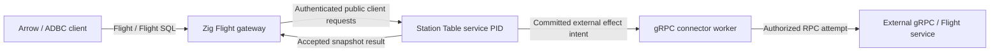

# Arrow execution and interoperability

Status: proposed. [M9](roadmap/M9.md) supplies bounded Station Tables and a Zig
batch engine; [M11](roadmap/M11.md) adds the gRPC connector; [M12](roadmap/M12.md)
qualifies Flight, Flight SQL and ADBC interoperability. None is implemented yet.
[TABLES.md](TABLES.md) owns Table mutations, snapshots, materialization, transactions
and durable result delivery. This document owns the engine and interchange seams.

## Roles in the stack

| Surface | Role in Transit | Boundary |
| --- | --- | --- |
| Arrow arrays and record batches | Typed columnar data for computation and results | Representation does not define durable state or transactional visibility |
| C Data / C Stream | In-process array and batch-reader exchange across bindings | Explicit buffer ownership; distinct from the Transit/Station command ABI |
| IPC | Serialized schema/batches for durable results and cross-process exchange | IPC stream/file formats do not supply admission, recovery or retention |
| Zig query engine | Validate plans and evaluate bounded batches over an authorized Table snapshot | Runs in Station callers/workers, never in `transit-node` |
| Flight RPC | Remote Arrow result discovery and transfer | Network streams/tickets do not replace durable mailboxes or grants |
| Flight SQL | Standard SQL query/metadata interface over Flight | Needs our own planner, capability profile and transaction semantics |
| ADBC | Client/driver API for consuming the query service | Not another wire protocol or the general Transit execution client |

These distinctions follow Arrow's [columnar/IPC format](https://arrow.apache.org/docs/format/Columnar.html),
[C Data interface](https://arrow.apache.org/docs/format/CDataInterface.html),
[Flight](https://arrow.apache.org/docs/format/Flight.html),
[Flight SQL](https://arrow.apache.org/docs/format/FlightSql.html) and
[ADBC API](https://arrow.apache.org/adbc/current/format/specification.html).
The Transit ownership, lifetime and recovery rules below are our design choices.
Keep the engine's batch-reader interface independent of serialization. IPC stream
bytes and Flight's `FlightData` framing need separate codecs; do not assume a
whole IPC stream can be copied into an RPC response unchanged.

The engine, planner, connectors and gateway remain Zig native. Do not embed Acero,
DuckDB or another foreign query engine to implement them. Independent Arrow
libraries and external clients may be used for interoperability tests. Client
driver implementation languages do not change the server language boundary.

## A bounded Zig engine

Take inspiration from [Acero's execution model](https://arrow.apache.org/docs/developers/cpp/acero.html):
plans connect source, transform and sink operators; batches carry work through
the plan; accumulating operators need explicit memory policy. Backpressure and
cancellation must account for work already in flight, and an announced batch
count alone does not establish that all batches have arrived. This is a design
reference, not an Acero API compatibility commitment or runtime dependency.

Start with a small engine in Station's Table implementation:

1. Validate a versioned logical plan against schema, operator/type support,
   permissions and budgets. M9 accepts structured operations; M12 lowers a
   specified SQL subset into that same plan.
2. Bind an authorized, exact resource revision and open a bounded snapshot
   source. Scan committed visible rows, not every historical row version.
3. Evaluate a physical plan of scan, filter, project, limit and selected aggregate
   operators using qualified `zarrow-compute` kernels and `zarrow` batches.
4. Capture the bounded result under [Table publication rules](TABLES.md#arrow-results-and-durable-replies)
   before making it available to a remote consumer. Accepted result identity,
   schema/revision and completeness survive loss of the worker or gateway.

M9 can use a single-worker, demand-driven pipeline. Keep source, operator and
sink interfaces separate so a later scheduler or Flight sink does not change
Table semantics. A physical operator is a local computation object, not a new
Transit PID. Parallel execution, distributed query scheduling and automatic
operator placement are not implied by an execution graph.

Every operator declares allocation/ownership, input/output schema, row/batch/byte
limits and cancellation points. Bound queued batches and in-flight tasks; pause
upstream before exhausting the declared budget and reserve control progress.
Account for variable-width data and decoded/decompressed sizes. Reject an
unsupported plan or oversize result explicitly. Accumulating operators must
prove a whole-input bound; external spill and unbounded sorts/joins remain later
scope. Finishing requires all expected input and a complete result, not merely
EOF on one input or a transport success code.

In M9, compute remains inside a valid bounded read/turn; it cannot keep an
activation-scoped read view alive across turns. Persist the complete accepted
result and its delivery progress, not native execution pointers. Recovery before
acceptance may recompute under a newly validated basis; recovery after acceptance
serves that captured result. Cancellation, retained-source loss and timeout must
not publish partial success or substitute a newer snapshot for an accepted one.

## Durable materialization is separate from batch execution

The first engine queries finite snapshots of tables materialized through accepted
turns. Arrow batch boundaries are not transaction boundaries. Source progress,
insert/update/delete mutations and outputs still obey the one-resource commit
domain; neither SQL nor Flight extends that domain.

Continuous queries would additionally need keyed deltas/retractions, committed
operator state and source offsets, transaction barriers, snapshot-to-tail
handoff, gap handling and bounded lag. Joins across sources require an explicit
consistency model; event-time windows require watermark and late-data policy.
These remain separately scoped work. Acero-style batch processing or a long-lived
gRPC stream cannot establish those guarantees by itself.

## Flight gateway and effect connector

There are two paths, with different authority boundaries:

The gateway submits Table requests and retrieves accepted results through public
Transit/Station interfaces. It cannot scan Ursula or bypass the writer's service
policy. Flight SQL discovery must use an explicitly published, permissioned
Table catalog; association or naming alone does not expose a resource as SQL.

The [gRPC connector](GRPC.md) covers outbound external calls, including calls to
an external Flight service. Responses used by a handler must enter through
recorded observations; calling a Flight client directly from a handler would
bypass the effect boundary. Share Zig HTTP/2, protobuf and codec machinery where
useful, while keeping ingress identity mapping and effect dispatch separate.

## First remote query profile

M12 starts with read-only, finite queries over one Table/resource snapshot.
Read-only refers to application tables; accepting queries and tracking result
delivery still require authorized durable bookkeeping:

- Flight query discovery/schema and `DoGet` retrieval of captured results. Use
  one endpoint per result initially so there is no cross-endpoint ordering or
  consistency promise. Define ticket validation, errors and reconnect behavior.
- Flight SQL statement queries and catalog/schema/capability metadata. Specify a
  bounded `SELECT` grammar with projection, supported predicates, limit and the
  qualified aggregates. Lower it to the same structured plans used by M9.
- No table writes, bulk ingestion, query federation, general SQL, transactions,
  savepoints or durable continuous `DoExchange` in this profile. Reject unsupported
  requests explicitly and report capabilities truthfully. Add prepared statements
  only if the selected client matrix requires them, with scoped handle lifetimes;
  parameter binding must not become arbitrary SQL string interpolation.

Flight SQL defines fixed metadata schemas, including the union/list/map types in
`GetSqlInfo`. Qualify those protocol schemas separately from M9's much smaller
Table type matrix; a successful scalar query is insufficient evidence of driver
compatibility. See the [Flight SQL definitions](https://arrow.apache.org/docs/format/FlightSql.html).

Reuse the existing [ADBC Flight SQL driver](https://arrow.apache.org/adbc/current/driver/flight_sql.html)
as the first client path. Prove pinned C and Python clients against our Zig
endpoint before considering a dedicated Transit ADBC driver. ADBC does not
replace M9's process/GenServer bindings, and support in those bindings does not
prove compatibility with every Arrow client or driver version.

## Identity, lifetime and failure

M12 must select and prove an ingress identity profile. Start with explicitly
configured gateway credentials mapped to dedicated, least-privilege Transit
principals and allowed Table service PIDs. Do not trust principal/PID claims in
request metadata or invent general delegation, which is not implemented. TLS
authentication, service data-sharing policy and current resource permissions
are distinct checks. Board's private shared-viewer policy is not automatically
the Flight gateway's policy; scope this boundary in [Security](SECURITY.md).

Tickets and query handles identify an exact result, realm, principal/service
scope, schema and revision. Bind each fetch to current permission and result
availability; possession alone does not authorize access. Avoid raw provider URLs
and secrets in tickets, logs or catalogs. Revalidate continuing reads at a
declared bounded batch/byte interval, including cached results and metadata.
Revocation prevents further authorization; already released bytes cannot be
recalled. Do not expose hidden tables through names, counts or error distinctions.

Durable result retention follows the application's opted-in policy and defaults
to unlimited. A finite connection timeout or expiring access ticket does not
silently authorize result deletion. A new handle cannot extend a hard result or
source lifetime. Bound admission and resident buffers even with unlimited
retention; sustained backlog may reject new work.

A dropped connection does not cancel durable work or imply remote consumption.
Retrying `DoGet` for the same available ticket restarts retrieval of that captured
result; clients discard their partial copy or use an explicitly qualified resume
extension. No standard offset-resume guarantee is assumed. Gateway restart must
resolve an existing ticket from durable result evidence; unavailable/expired
results fail explicitly. Cancelling a query is an authorized durable disposition,
not a socket-close side effect. Repeated SQL submissions are new queries unless
the client supplies a supported stable request identity; SQL text is not a dedup key.

M12 must budget SQL/protobuf requests, standard metadata schemas, result bytes,
ticket records and pending queries against the profile it actually deploys.
Network streaming cannot conceal a missing durable payload/lifetime contract or
raise M7's limits implicitly. A larger storage/result profile requires an explicit
prerequisite milestone if the selected interoperability fixtures cannot fit.

## Qualification and later work

[M9](roadmap/M9.md) proves batches, operator behavior and IPC/C ownership with
independent consumers. [M11](roadmap/M11.md) proves the gRPC transport and effect
boundary. [M12](roadmap/M12.md) proves actual Flight/ADBC clients, authentication,
schemas, backpressure, cancellation and recovery together. Keep dependency pins,
supported protocol versions and proof commands with the implementing packages.
Flight SQL writes, a native ADBC driver, continuous query maintenance and
cross-resource/distributed transactions need their own future milestones.
