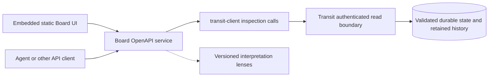

# Board — system inspection

Status: bounded [M2](roadmap/M2.md) inspection profile implemented and qualified
on the reference deployment, before Station. Board is the UI and
OpenAPI surface through which operators and agents comprehend a running Transit
system. M2 is inspection-only; operational controls are later scope. The [Board application](../apps/transit-board/README.md) owns configuration,
commands and access limits; [tests](../tests/README.md#board-qualification) own evidence.

## Purpose and visual language

Board takes inspiration from rail and flight departure/arrival boards: show
what is waiting, what moved, where it is going, and what needs attention. Begin
with kernel primitives so the system remains understandable without Station.
The browser is the first Board API client; agents, CLIs, and other UIs can use
the same documented facts without scraping screens.

Logistics terms organize views; they do not rename protocol identities or create
new execution semantics. Always expose the corresponding Transit term and ID.

| View | Question answered | Kernel evidence |
| --- | --- | --- |
| Board overview | Which processes need attention, and why? | PID, lifecycle, ownership, backlog, blocked input, open effects, observed position |
| Arrivals | What has entered this mailbox and what remains unfinished? | Durable admission, ordered input, consumption/cancellation |
| Departures | What has this process committed for delivery or execution? | Outbox destinations and delivery outcomes; effect intent, authorization, and observations |
| Process detail | What can we establish about this process now? | State revision, activation, runtime binding, deadlines, recovery/retention coverage |
| State resources (planned M7) | Which data does this process depend on, and can it recover? | Associations, resource identity/revision, ownership, lifetime, retained coverage, and committing-turn references |
| Journey | How did this input lead to later work? | Recorded input-to-turn, output-to-admission, and effect-to-result links |

Start with a readable table, a process detail page, and a bounded journey view.
A selected journey can use sequence lanes and a small route graph; avoid making
an unrestricted system graph the only way to find work. Sorting/filtering,
keyboard access, textual status, reduced motion, and stable shareable URLs are
part of comprehension. Color and animation must not carry meaning alone.

A lifecycle of `running` is not proof a worker is executing. Delivered output is
not a completed destination turn. Dispatch authorization is not proof a request
was sent. Closed-unknown is not remote failure or cancellation. Use recorded
positions for order; show timing only where evidence exists. Observation time
is distinct from event time. Do not invent ETAs, processing durations, global
causality, or wall-clock history from polling samples.

## Boundary and packaging

`transit-board` is a Zig executable hosting both API and embedded static assets on one
origin. It is an application alongside `transit-node`, with no raw Ursula,
kernel-internal, or provider API access. Its observations and indexes are derived;
Board cannot grant ownership, dispatch effects, advance consumer progress, or
run application handlers. Transit remains the execution authority.

Use TypeScript and TanStack Router with Vite+. React with file-based routes is
the implemented frontend. TanStack documents a Vite router plugin, and
Vite+ supports the Vite build/configuration model; the embedded build and browser checks qualify Rey's
pinned 0.3.3 toolchain. See
[TanStack's Vite integration](https://tanstack.com/router/latest/docs/framework/react/installation/with-vite)
and [Vite+ production builds](https://viteplus.dev/guide/build).

Build frontend assets first, then embed the complete asset manifest and bytes
into the Zig binary. Shipping the binary must suffice to serve UI and API without
Node.js, a source checkout, a sidecar asset directory, or an asset CDN. Browser
routes need HTML fallback; API and missing asset routes must retain real errors.
Version the assets and API together. Build tooling and dependency pins stay in
the Vite+/pnpm workspace; no production JavaScript server is needed.

Implemented ownership:

| Location | Responsibility |
| --- | --- |
| [apps/transit-board](../apps/transit-board/README.md) | Zig executable, private inspection API hosting, bounded observations, static asset embedding, and lens composition |
| [apps/transit-board-web](../apps/transit-board-web/README.md) | TanStack Router application and browser interaction tests |
| [transit-board-api](../packages/zig/transit-board-api/README.md) | Board response/route definitions and OpenAPI generation, reusing public Transit types |
| [transit-board-client](../packages/ts/transit-board-client/README.md) | Generated typed Board API client shared by the browser and future TypeScript consumers |

The Board executable composes `transit-client` and `transit-board-api`; public Transit
inspection contracts remain in `transit-protocol`. Board belongs to the Transit
subsystem, with `transit-board*` artifact names. The kernel and public execution
client must not depend on Board; inspection consumes their public contracts.

## Public inspection contract

[Inspection v1](../contracts/INSPECTION_V1.md) extends service v2 with signed,
provider-neutral discovery, current-state, mailbox, outbox, effect, payload-metadata
and retained-history queries through the public client. Existing command/view
signatures remain compatible. Board never reads raw storage or core catalogs.

Expose typed, filtered inspection facts, not raw realm journal records containing
other principals' data. Discovery, cross-PID relationships, history, payload
visibility, and aggregates each require an explicit disclosure contract. Current
`inspect` is coarse and includes state bytes; hiding payloads in the UI does not
establish a separate metadata-only permission. Keep public read changes versioned
and preserve existing caller compatibility or declare a deliberate migration.

Board's resource API should be useful independently of its screen layouts.
Implemented resources under `/api/v1/` are capabilities and authorized processes in
the configured realm,
process details, mailbox entries, outbox entries, effects, retained history, and
bounded journeys. Resource references preserve realm/PID, activation generation,
state revision, and effect/output identity. Lists have stable IDs, bounded
pagination/filtering, explicit coverage, and machine-readable reasons/errors.
Agents can retrieve evidence for a condition instead of relying on prose alone.

Generate an OpenAPI 3.1 document from Board's typed contract and reuse generated
Transit schemas for shared values, IDs, enums, and errors. This keeps one owner
for each wire definition. OpenAPI 3.1 supports JSON Schema 2020-12; generator and
validator compatibility must be proved, including integer ranges and union
encoding. See the [OpenAPI specification](https://spec.openapis.org/oas/v3.1.1.html).
Serve the versioned schema from the binary and generate the browser client from
that same artifact. CI must detect schema/client drift; TypeScript typing alone
is not runtime validation. This is a Board SDK, not a complete TypeScript Transit
execution client or a replacement for canonical Transit signing rules.

## Consistency, freshness, and retention

Every response must describe its observation basis: source realm, observed
position, policy revision, retained boundary, and completeness. Multi-source
results expose their separate observations; they do not pretend to be one global
snapshot. Explanations link to the records or current-state fields they use.
Distinguish protocol facts, derived conclusions, provider observations, and
application-declared labels. Unsupported or unavailable evidence is not zero.

M2 uses a conservative stable cut: any authority change expires pagination.
A busy writer can therefore prevent completing a paginated query; clients expose
that limitation rather than combining states. This avoids persistent snapshot
indexes and retention pins. Continuations bind filters,
realm, and view identity but never grant permission; reauthorize each page. If a
stable cut cannot be maintained within bounded resources, expire the query and
require an explicit refresh. Retention overtaking a read returns a defined gap
or resynchronization result, never a fabricated complete history.

A checkpoint can establish current state without retaining every prior turn.
Show missing history and unresolved links explicitly. Causation comes from
recorded links, not adjacent journal positions or matching payloads. A denied
resource must not leak through counts, graph endpoints, search, or pagination.

Start with bounded polling and on-demand history pages. Limit records scanned
as well as records returned, concurrent requests, refresh rate, memory, and
journey expansion. Slow clients must not accumulate unlimited work. Back off on
errors; distinguish stale observations, disconnection, denial, and a healthy
empty result. A signed command protocol does not guarantee read fairness;
qualify Board's load against the current sequential authority server.

M2 needs no durable Board database or second event archive. Small caches are
rebuildable and do not pin Transit history or extend its retention contract.
Do not serve cached sensitive results to a new request when current permission
cannot be checked. Browser data caches are bounded and cleared on known denial;
previously disclosed bytes cannot be recalled. Retained snapshots,
exports, offline operation, and resumable push subscriptions need separate scope.

## Access and trust

Implemented first deployment profile: one configured realm and one read-only Transit
principal per Board instance. Operators/agents who can reach that instance share
that principal's explicit inspection scope; this does not claim per-user Transit
isolation. Bind upstream endpoints and identity in trusted server configuration,
not request-supplied URLs or principal IDs. Store signing seeds only on the server.
Board receives only read grants, with no admin, spawn, execute, send, publish,
or effect authority.

Board relies on a private deployment boundary for viewer admission. It has no
viewer access key, sign-in screen, session cookie, or per-viewer identity. Anyone
who can reach it can inspect the configured shared scope. Network restrictions
or a separately managed authenticated ingress belong to the deployment.
Board's signing identity and Transit read authorization remain independent.

Host/Origin checks, request limits and transport configuration are specified in
the [app guide](../apps/transit-board/README.md). Host/Origin validation is not
authentication. Trusted LAN development can explicitly opt into remote HTTP;
other remote deployments require TLS. API and browser tests qualify direct
access, bounded reads, denial clearing and upstream revocation. The app guide
records the deliberate migration from the original experimental key/session
profile; later operational controls must define their own attributable access.

The node applies current Transit authorization at each read boundary. A reachable
Board endpoint cannot bypass a revoked Transit grant. No Transit mutation routes,
broad credentialed proxy,
provider diagnostics proxy, or automatic remediation are part of M2. Later
controls require attributable principals, explicit grants, preserved retry
identity, and their own adversarial proofs. See [SECURITY.md](SECURITY.md).

Treat payloads, names, and enrichment metadata as untrusted data: render text
safely, constrain previews, and fetch details explicitly. Static asset caching
must never cache inspection API responses or embed installation secrets.

## Higher-level interpretation

A **lens** is a versioned Board interpretation of authorized runtime/framework
evidence. It declares a namespaced kind/version, required capabilities, and how
presented facts link back to their source. Board explains Transit/Station
primitives and their relationships; application-specific value meaning and
interfaces belong to applications.

M2 implemented a statically registered counter lens to prove source provenance
and unknown-version/malformed-data fallback. That decoder remains in the current
API/UI, but is outside the revised boundary. [M7](roadmap/M7.md) removes it and
its launcher mapping while adding generic [state-resource inspection](STATE.md#ownership-in-the-stack-and-inspection).
This plan does not claim the existing lens has already been removed.

Later Station supplies descriptors/fixtures for GenServers, supervisors, and
registries; the HTTP connector adds exchange and attempt views. Identification
must come from explicit, versioned runtime/framework declarations or an
operator-configured mapping with visible provenance. A numeric `code` tag,
process name, or payload shape alone cannot prove a behavior's identity.

Lenses may decode defined framework records and explain recorded relationships,
but do not interpret opaque application values. Generic authorized byte previews
are distinct from declaring a business meaning. No lens may overwrite core
lifecycle, invent causal edges, broaden access, or create execution rights.
An unrecognized framework schema still has a useful kernel view. Keep enrichment
optional and available as structured API data as well as UI presentation.
Dynamically loaded code, remote plugins, and executing application handlers to
interpret history are outside the supported inspection model.

## Qualification and later scope

M2's [implementation sequence and exit criteria](roadmap/M2.md) cover the API,
embedded build, live UI, access control, retention gaps, and lens fallback.
The completed [M4 observability milestone](roadmap/M4.md) instruments
Board's HTTP/service lifecycle and correlates its public client calls with Transit.
These operational signals follow the shared [observability rules](OBSERVABILITY.md)
and do not change Board's evidence-backed inspection API or require a collector.

Operational controls, multi-user delegation/federation, a complete Transit SDK
in another language, arbitrary dashboards, and full observability infrastructure
remain separate work. Metrics or deployment telemetry may enrich later views;
a provider's liveness report can never replace Transit's execution authority.
