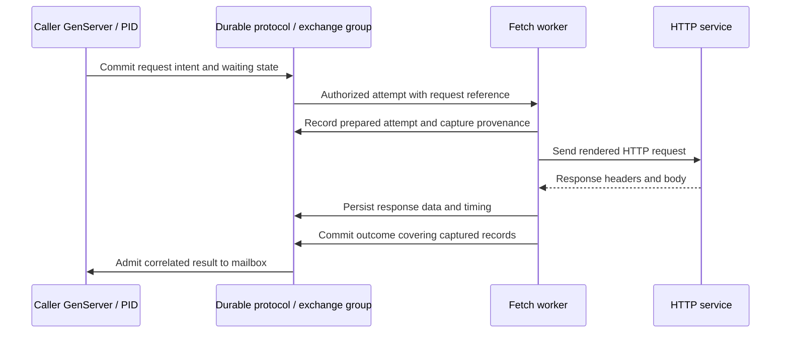

# Connectors and HTTP exchanges

Status: HTTP over the streaming substrate is the first connector direction.
Stream-group layout, interpolation syntax, and attempt protocol are proposed.
No connector is implemented yet.
The [experimental Transit profile](../contracts/TRANSIT_V1.md#effect-intents-and-observations)
implements scalar intent, dispatch, and observation records, including unknown
attempts, explicit reconciliation closure, and evidence after caller retirement
while reconciliation remains open. This proves protocol
ordering and recovery. `just test-service` also compiles a separate synthetic
workload and trusted Zig executor that POSTs to a harness-owned loopback endpoint.
It proves successful delivery, a pause after dispatch authorization, a response
after closure, and a crash after remote acceptance. Restart never resends the
attempt; checkpoint/trim preserves observed or closed-unknown evidence. Closing
before the paused executor sends still allows that already-authorized remote
request, while Transit rejects its result. This is a test executor with a fixed
destination and bounded response/deadline, not the planned HTTP connector.

## Effect boundary

A connector executes a committed effect intent, records its external observations,
and delivers a correlated outcome through the caller's mailbox. Fetch workers
have the HTTP capability and credentials needed for the request. Caller handlers
only produce messages and consume results through [Station](STATION.md), the
framework above [Transit](TRANSIT.md). The proposed HTTP connector library and
fetch-worker executable have separate responsibilities in the
[decomposition plan](ARCHITECTURE.md#planned-monorepo-decomposition).

Each effect has a stable identity; each dispatch attempt has its own identity
and authority. A trusted executor validates committed intent and current policy
at a durable dispatch authorization boundary before I/O. A second attempt
requires an explicit retry decision under connector policy. Ursula transport
retries and HTTP effect retries are separate.

An authorized attempt is potentially in flight even if the worker pauses before
sending. Revocation or expiry prevents new dispatch authorizations; it cannot
prove the old executor will never send. Never retry merely because ownership
changed. The executor is trusted to enforce attempt and credential scope;
untrusted code with its own sockets/secrets would bypass this contract. See
[SECURITY.md](SECURITY.md#effects-and-the-limits-of-revocation).

The caller is identified by its PID and originating turn, independently of its
activation or registered name. Worker recovery does not change that destination
or cancel a committed effect. Dispatch authorization belongs to the attempt;
it is not inferred from the caller's old activation reference. A late outcome
after logical termination remains recorded evidence and follows retirement
policy. It cannot be redirected to a replacement registered under the same name.

## HTTP text and stream groups

Represent the HTTP request itself in durable messages: request line, ordered
headers, and body, with explicit byte framing. Textual messages remain readable;
binary bodies are preserved as bytes. Large bodies use ordered stream records
and bounded worker buffers.

An **exchange stream group** ties one logical request to its attempts, responses,
and metadata. This is a Rey protocol concept over Ursula streams, not an assumed
Ursula API or consumer-group facility. Proposed group members are:

| Member | Content |
| --- | --- |
| Manifest | Effect identity, caller PID and originating turn, schema, member-stream identities, policy and lifecycle |
| Request | Original HTTP text/template, body records, variable bindings and secret references |
| Attempt | Attempt/executor identity, grant/policy revision, dispatch authorization, activation reference where applicable, rendered-request capture and dispatch observations |
| Response | Per-attempt response text, ordered headers/body records, trailers and partial data |
| Metadata | Timing, redirects, failures, byte counts and capture completeness |
| Completion | Terminal status and exact member positions/lengths covered by the outcome |

Member layout may use separate streams or typed records in fewer streams. All
capture data passes through the durable substrate. A completion manifest only
references already durable member data; it provides an explicit visibility
boundary without assuming multi-stream transactions. Partial attempts remain
inspectable and cannot be mistaken for completed responses.

## Lifetime and retention

An exchange declares compatible lifetimes for its caller dependency, attempts,
body streams, completion manifest, and replay window. A caller must not rely on
a response body whose retention ends before its promised recovery window.
Validate those dependencies before admitting the effect. Workload-scoped capture
can retire with the workload, while the minimal evidence needed to reconcile an
already-authorized attempt follows a separate recorded metadata policy.

Caller expiry is terminal for that PID. Apply its declared pending-effect policy;
do not authorize new attempts under the expired contract or treat an unknown
remote outcome as cancellation. Authorized reconciliation can record evidence
while its own window remains open, without reviving a retired caller or
delivering to a replacement name binding. Work authorized before a work cutoff
may settle within its recorded limits; final retirement is a separate boundary.
Keep execution lifetime, transcript replay retention, and physical reclamation
separate, as defined in [RETENTION.md](RETENTION.md).

Group reclamation must validate references and retire the manifest's availability
before reclaiming its members. Readers observe explicit expiry instead of an
apparently complete transcript with missing bodies. Once required capture is
outside its replay horizon, replay fails visibly; it cannot refetch the original
request to manufacture replacement evidence.

## Bounded reconciliation contract

Reconciliation belongs to the connector. Transit provides the durable protocol
guarantees it needs: stable attempt identity, authenticated observations, current
grants, ordered acceptance/closure, duplicate rejection, and checkpoint recovery.
It does not interpret an HTTP status as business success or choose a remote
retry, cancellation, compensation, or polling strategy.

Before dispatch, record who owns reconciliation, when it closes, its attempt and
resource budgets, and the policy for an unresolved outcome. Validate dependent
data lifetimes. A finite application contract cannot hide an unlimited cleanup
loop. Recovery preserves the original window and budgets; starting a new worker
does not renew them. Each polling, cancellation, or compensation request is
itself an authorized connector attempt within that budget, not an unrecorded
network call or an excuse to repeat the original operation.

| Outcome at closure | Meaning |
| --- | --- |
| Confirmed outcome | The connector has sufficient evidence under the remote API contract; record the result once |
| Closed with outcome unknown | Stop automatic reconciliation without claiming remote failure or cancellation |

Result acceptance and closure share a serialized authority boundary. Once
closed, reject new responses and observations, including those from a restored
worker or one whose request began before the cutoff. A previously committed
receipt may be returned under its retry/read policy; this performs no new
acceptance. Closure cannot erase a result that already won the race.

Release active reconciliation resources and permit transcript reclamation under
the recorded retention policy, while preserving compact closure evidence and
rejection floors. Late results cannot reopen the attempt, cause another send, or
revive the caller. New investigation or a responsibility handoff requires separate
explicit authority, preserves lineage, and does not reset the old attempt.

The external system is unaffected by local closure. If the application requires
remote work to stop or be undone, the connector must supply matching remote
expiry/cancellation/compensation support, with its actual limits declared before
admission. Reject guarantees the connector cannot support. Cancellation requests
also need bounded reconciliation and may themselves end with an unknown outcome.

## Variables and secrets

Illustrative request text, with interpolation syntax still to be specified:

```http
GET /v1/items?cursor={{vars.cursor}} HTTP/1.1
Host: api.example.test
Authorization: Bearer {{secrets.connector_token}}
Accept: application/json
```

Record the original template and ordinary variable values or immutable source
references. Define substitutions by field type, encoding, and escaping; reject
header injection and invalid framing. Resolve variables once for each attempt
and record the rendered non-secret request representation, including changes
made by serialization such as content length.

Secret placeholders identify an authorized credential binding. Fetch workers
resolve them at dispatch; record the binding/version used and where substitution
occurred, without writing raw secret values into ordinary transcripts. A retry
must state whether it reuses the binding version or creates an attempt with new
credentials. Apply explicit capture rules to secret-bearing response fields too.

The capture contract must label substitutions, redactions, truncation, and any
normalization. Preserve exact non-secret bytes at the declared application HTTP
boundary. HTTP text for protocols such as HTTP/2 is a documented representation;
it is not a packet/TLS trace. A redacted transcript cannot claim byte-for-byte
reconstruction of secret-bearing wire data. Replay must surface any missing data
needed by a handler instead of silently fabricating it.

## Attempt lifecycle



Record timing per attempt: queue delay, dispatch observation, first response
byte, completion, and timeout/cancellation observations where available. Specify
clock domains and units. Use a worker's monotonic clock for local durations;
do not infer distributed ordering from unsynchronized wall clocks.

Redirects and retries must remain observable as distinct network attempts linked
to the same effect. Define credential forwarding and destination authorization.
Validate scheme, resolved destination, proxy route, and every redirect against
the capability scope; block unauthorized private services, cloud metadata,
storage/admin APIs, and credential forwarding. Authenticate outcome submissions
against their executor and attempt; a matching correlation ID is insufficient.
Evidence from a superseded activation needs separate current permission to report
that still-open attempt, or ingestion by an authorized reconciler. It cannot
restore the old activation's right to commit application state. After closure,
reject the submission rather than maintaining an unbounded late-evidence path.
Timeout and cancellation are observations/requests; neither proves the remote
service did no work. Completion is distinct from receiving an HTTP status line
or a prefix of the body.

A worker can crash after the service accepts a request and before the response
is durably recorded. Persist an unknown outcome and reconcile or retry only
under the endpoint's idempotency contract. Do not promise exactly-once HTTP
execution from durable intent or append deduplication. Test crashes before send,
after send, during capture, and after outcome commit but before caller delivery.

## Replay

Replay reads the captured outcome and timing observations with network dispatch
and secret resolution disabled. Re-executing a request against the current
service is a new authorized effect with explicit lineage to the original.

The first proof uses synthetic HTTP endpoints, deterministic fixtures, secret
placeholders, streamed bodies, and injected failures on the reference deployment.
LLM/tool and data-source libraries can then reuse the same effect/group contract
without embedding provider-specific behavior in the kernel.
