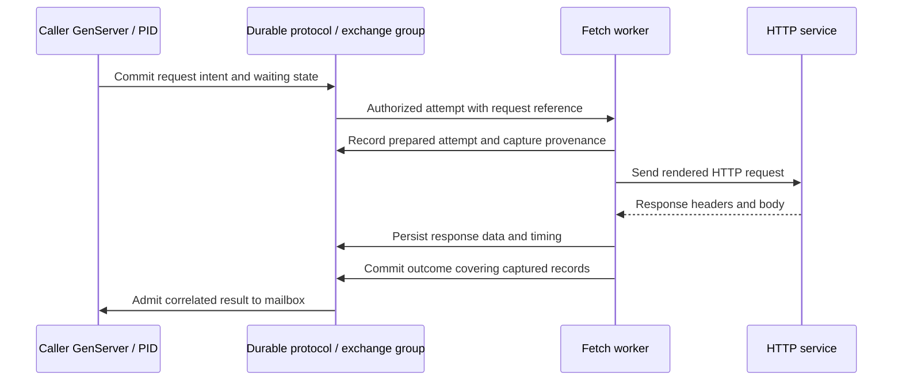

# Connectors and external exchanges

Status: [HTTP M15](roadmap/M15.md) is the first connector, under implementation;
[gRPC M16](roadmap/M16.md) is the second. The broad group, streaming and provider
requirements below remain design intent outside the qualified finite HTTP profile. Transit has
opaque intents, dispatch authorization, observations, and bounded closure in its
[effect contract](../contracts/TRANSIT_V2.md#effect-intents-and-observations).
The [synthetic executor proof](../tests/README.md#authority-effects-and-outbox-evidence)
exercises real loopback I/O and its external limits; it is not a general HTTP
connector implementation.

The initial [exchange library](../packages/zig/transit-exchange/README.md) and
[HTTP package](../packages/zig/transit-station-http/README.md) now implement bounded
capture/coverage and a separately tested single-send HTTP/TLS transport. The
[exchange contract](../contracts/STATION_EXCHANGE_V1.md) fixes intent publication
and terminal availability. The finite worker now qualifies explicit controller
retry/redirect/status/cancel, public root-call admission, immutable request copies,
independent capture lifetime, caller termination and worker/node/store recovery.
Its shared native bridge exposes publication, request/outcome codecs and bounded
replay; replay cannot resolve credentials or refetch external data. The
[test guide](../tests/README.md#m15-connector-work-in-progress) records the actual
fault corpus and limits. All ten public SDKs qualify request publication, calls
and owned replay over that bridge. All ten also qualify authenticated durable
disposal before and after cleanup without transcript read permission or secrets.
The finite Zig service also qualifies caller-requested retries with atomic child
routing, frozen policy checks and recovery of revoked request reads. All ten SDKs
qualify typed followup submission and correlated policy refusal. Board and
deployment qualification remain open; this does not complete M15.

The connector milestones will add [Board](BOARD.md) enrichment for exchanges and
attempts, respecting transcript permissions, secret omissions, retained-body
gaps, and the distinction between authorization and observed remote outcomes.

## Foundation and shared implementation plan

[M14](roadmap/M14.md) qualifies growing immutable publication: 256-byte chunks,
explicit staging quotas, a final publication marker, permanent terminal IDs and
bounded cleanup. Its 64 KiB proof includes real worker/node/store recovery and
source-bound reads. [M15](roadmap/M15.md) is now the first consumer for external
exchanges; Documents are scheduled separately in [M17](roadmap/M17.md).

The following table is the target decomposition. The initial libraries above
implement a subset; the remaining gates belong to M15/M16:

| Owner | Reusable responsibility | Remains outside it |
| --- | --- | --- |
| Transit/client | Generic committed intent, dispatch/observation/closure, grants, fencing and exact signed retry | HTTP methods, RPC status, endpoint policy and honest computation |
| Station publication | Immutable segments, bounded staging/read/cleanup, captured sources | Unknown-length body framing, member dependencies or complete exchange semantics |
| Shared exchange library above Station | Versioned references/coverage, capture budgets, attempt lineage, availability, bounded reconciliation and replay | Protocol parsing, sockets and provider-specific business meaning |
| Protocol adapters | HTTP redirect/text/framing or gRPC message/direction/status semantics | Separate retry databases, independent capture lifecycles or authority |
| Transports | Qualified HTTP/TLS/HTTP2/protobuf bytes, connection bounds and flow control | Durable remote admission or effect permission |
| Provider integrations | Provider schemas, pagination, auth conventions and explicit rate/retry policy | New durability or implicit remote execution |

HTTP must first exercise the common layer with a concrete consumer. gRPC then
runs its unchanged corpus and extends only demonstrated shared needs. Create real
packages with direct manifests when implemented; this plan does not justify empty
directories, a plugin host or a universal protocol abstraction in advance.

Two gaps matter before promising connector support. Publication requires the
length and commitment before staging; receive an unknown-length network body in
bounded segments, seal each, then publish exact ordered coverage at completion.
Keep buffered-but-uncommitted bytes explicitly incomplete after loss. Bodies,
headers and manifests need independent per-operation and total live-work budgets;
the tested record size is neither a whole-exchange maximum nor an unlimited call.

The implemented [growing effect contract](../contracts/TRANSIT_V3.md#integration-obligations)
authorizes one attempt per effect. `observe(null)` records uncertainty, not a new
send permit; a terminal observation closes that attempt. Logical exchange retries
and redirects therefore need linked new committed effects with explicit policy,
or a separately proved generic extension. M16 must additionally map exact future
message/half-close send units to authority; a call's initial permit cannot cover
arbitrary later bytes. Reconciliation after caller termination needs its own
recorded surviving owner and does not revive the caller's ability to dispatch.

M14's opaque references neither grant read rights nor retain other records
automatically. A retained old source can still contain a published body after
current logical retirement. Connector read adapters must separately recheck the
current exchange availability and policy, then read the exact retained content;
old cursors or caches cannot bypass transcript expiry. Dependency admission,
manifest-first retirement, protected roots and member cleanup are M15 proof
obligations. Body publication and generic effect-result acceptance are distinct
decisions unless a qualified contract explicitly composes them.

Use the [M11 shared SDK boundary](CLIENT.md#language-neutral-boundary) and
M13's established current-policy/result-reference patterns. Keep domain APIs
native to each language while Zig owns capture, attempt sequencing and replay.
HTTP and gRPC plans remain unchecked until real independent-peer, deployment,
security and failure proofs run; M14 byte integrity is not that evidence.

## Transport, connector and integration

Three distinct tiers sit outside the kernel, and only the middle one is a
connector in this document's sense. Getting the boundary right now, before a
third or fourth connector exists, is cheaper than re-deriving it later.

**Transport** carries bytes and has no effect-shaped contract of its own: TCP,
QUIC, SCTP, and HTTP/2's own session/framing layer as gRPC uses it. A raw
socket has no application-level outcome to record, no idempotency boundary,
no redirect and nothing to reconcile — there is nothing yet to capture, retry
or close under policy until a connector's own protocol is layered on top of
it. A transport instead owns connection lifecycle (open, reset, close), stream
multiplexing where the protocol has native streams (QUIC, SCTP; TCP has
exactly one ordered byte stream per connection), and wire-level flow control.
[FLOW_CONTROL.md](FLOW_CONTROL.md) is explicit that this last one is never
evidence of durable application admission on its own; see GRPC.md's
[streaming authority and backpressure](GRPC.md#streaming-authority-and-backpressure)
for what a connector must check in addition.
[M16](roadmap/M16.md)'s entry gates already treat HTTP/2 this way — an
immutable, Zig-compatible dependency selected and proved once (generation,
trailers, framing, compression bounds, flow control, cancellation),
independently of the gRPC connector built on it — without naming the tier;
this section names it so a future transport choice (HTTP/3 over QUIC, a raw
transport for a non-HTTP protocol) extends a settled vocabulary instead of
re-deriving this boundary. No transport implementation or interface is
proposed here.

**Connector** is this document's subject: something that executes a committed
effect intent, with attempt identity, dispatch authorization, idempotency,
retry/redirect handling, and a reconciliation policy distinguishing a
confirmed outcome from closed-with-outcome-unknown. HTTP ([M15](roadmap/M15.md))
and gRPC ([M16](roadmap/M16.md)) are the two planned connectors. FTP/SFTP/FTPS,
filesystem, S3, GCS and SSH effects fit the same shape — each has a natural
per-operation attempt/outcome boundary (put, get, list, delete) — and belong
here when they are built, reusing this document's attempt/reconciliation
contract rather than each inventing its own.

**Integration** is a provider-specific library built on top of one connector,
adding that provider's schema, pagination, auth flow and rate-limit knowledge
without owning any new durability contract of its own — it inherits the
connector's attempt/reconciliation machinery. This is already implied by this
document's closing line about LLM/tool and data-source libraries reusing "the
same effect/group contract without embedding provider-specific behavior in
the kernel"; naming it distinguishes "a new connector" (a new effect/attempt
shape, reviewed here) from "a new integration" (a new library over an existing
connector, reviewed at the library boundary only). A Slack or GitHub library
built over the HTTP connector is an integration, not a third connector.

## Effect boundary

A connector executes a committed effect intent, records its external observations,
and delivers correlated observations/outcomes through the caller's mailbox.
Protocol-specific workers have the network capability and credentials needed
for authorized requests. Caller handlers
only produce messages and consume results through [Station](STATION.md), the
framework above [Transit](TRANSIT.md). Connector libraries and worker executables
have separate responsibilities in the
[decomposition plan](ARCHITECTURE.md#planned-monorepo-decomposition).

This document owns the common attempt/reconciliation boundary and HTTP design.
[GRPC.md](GRPC.md) adds binary call descriptors, per-direction messages, half-close,
trailers and bounded streaming authority. [ARROW.md](ARROW.md) separates outbound
Flight calls through that connector from the later inbound Flight query gateway.

Each effect has a stable identity; each dispatch attempt has its own identity
and authority. A trusted executor validates committed intent and current policy
at a durable dispatch authorization boundary before I/O. A second attempt
requires an explicit retry decision under connector policy. Ursula transport
retries and external HTTP/gRPC effect retries are separate.

An authorized attempt is potentially in flight even if the worker pauses before
sending. Revocation or expiry prevents new dispatch authorizations; it cannot
prove the old executor will never send. Never retry merely because ownership
changed. The executor is trusted to enforce attempt and credential scope;
untrusted code with its own sockets/secrets would bypass this contract. See
[SECURITY.md](SECURITY.md#effects-and-the-limits-of-revocation).

The caller is identified by its PID and originating turn, independently of its
activation or registered name. Worker recovery does not change that destination
or cancel a committed effect. Dispatch authorization belongs to the attempt;
it is not inferred from the caller's old activation reference. A late outcome
after logical termination remains recorded evidence and follows retirement
policy. It cannot be redirected to a replacement registered under the same name.

## HTTP text and stream groups

Represent the HTTP request itself in durable messages: request line, ordered
headers, and body, with explicit byte framing. Textual messages remain readable;
binary bodies are preserved as bytes. Large bodies use ordered stream records
and bounded worker buffers.

An **exchange stream group** ties one logical request to its attempts, responses,
and metadata. This is a Transit protocol concept over Ursula streams, not an assumed
Ursula API or consumer-group facility. Proposed group members are:

| Member | Content |
| --- | --- |
| Manifest | Effect identity, caller PID and originating turn, schema, member-stream identities, policy and lifecycle |
| Request | Original HTTP text/template, body records, variable bindings and secret references |
| Attempt | Attempt/executor identity, grant/policy revision, dispatch authorization, activation reference where applicable, rendered-request capture and dispatch observations |
| Response | Per-attempt response text, ordered headers/body records, trailers and partial data |
| Metadata | Timing, redirects, failures, byte counts and capture completeness |
| Completion | Terminal status and exact member positions/lengths covered by the outcome |

Member layout may use separate streams or typed records in fewer streams. All
capture data passes through the durable substrate. A completion manifest only
references already durable member data; it provides an explicit visibility
boundary without assuming multi-stream transactions. Partial attempts remain
inspectable and cannot be mistaken for completed responses.

## Lifetime and retention

An exchange declares compatible lifetimes for its caller dependency, attempts,
body streams, completion manifest, and replay window. A caller must not rely on
a response body whose retention ends before its promised recovery window.
Validate those dependencies before admitting the effect. Workload-scoped capture
can retire with the workload, while the minimal evidence needed to reconcile an
already-authorized attempt follows a separate recorded metadata policy.

Caller expiry is terminal for that PID. Apply its declared pending-effect policy;
do not authorize new attempts under the expired contract or treat an unknown
remote outcome as cancellation. Authorized reconciliation can record evidence
while its own window remains open, without reviving a retired caller or
delivering to a replacement name binding. Work authorized before a work cutoff
may settle within its recorded limits; final retirement is a separate boundary.
Keep execution lifetime, transcript replay retention, and physical reclamation
separate, as defined in [RETENTION.md](RETENTION.md).

Group reclamation must validate references and retire the manifest's availability
before reclaiming its members. Readers observe explicit expiry instead of an
apparently complete transcript with missing bodies. Once required capture is
outside its replay horizon, replay fails visibly; it cannot refetch the original
request to manufacture replacement evidence.

## Bounded reconciliation contract

Reconciliation belongs to the connector. Transit provides the durable protocol
guarantees it needs: stable attempt identity, authenticated observations, current
grants, ordered acceptance/closure, duplicate rejection, and checkpoint recovery.
It does not interpret an HTTP status as business success or choose a remote
retry, cancellation, compensation, or polling strategy.

Before dispatch, record who owns reconciliation, when it closes, its attempt and
resource budgets, and the policy for an unresolved outcome. Validate dependent
data lifetimes. A finite application contract cannot hide an unlimited cleanup
loop. Recovery preserves the original window and budgets; starting a new worker
does not renew them. Each polling, cancellation, or compensation request is
itself an authorized connector attempt within that budget, not an unrecorded
network call or an excuse to repeat the original operation.

| Outcome at closure | Meaning |
| --- | --- |
| Confirmed outcome | The connector has sufficient evidence under the remote API contract; record the result once |
| Closed with outcome unknown | Stop automatic reconciliation without claiming remote failure or cancellation |

Result acceptance and closure share a serialized authority boundary. Once
closed, reject new responses and observations, including those from a restored
worker or one whose request began before the cutoff. A previously committed
receipt may be returned under its retry/read policy; this performs no new
acceptance. Closure cannot erase a result that already won the race.

Release active reconciliation resources and permit transcript reclamation under
the recorded retention policy, while preserving compact closure evidence and
rejection floors. Late results cannot reopen the attempt, cause another send, or
revive the caller. New investigation or a responsibility handoff requires separate
explicit authority, preserves lineage, and does not reset the old attempt.

The external system is unaffected by local closure. If the application requires
remote work to stop or be undone, the connector must supply matching remote
expiry/cancellation/compensation support, with its actual limits declared before
admission. Reject guarantees the connector cannot support. Cancellation requests
also need bounded reconciliation and may themselves end with an unknown outcome.

## Variables and secrets

Illustrative request text, with interpolation syntax still to be specified:

```http
GET /v1/items?cursor={{vars.cursor}} HTTP/1.1
Host: api.example.test
Authorization: Bearer {{secrets.connector_token}}
Accept: application/json
```

Record the original template and ordinary variable values or immutable source
references. Define substitutions by field type, encoding, and escaping; reject
header injection and invalid framing. Resolve variables once for each attempt
and record the rendered non-secret request representation, including changes
made by serialization such as content length.

Secret placeholders identify an authorized credential binding. Fetch workers
resolve them at dispatch; record the binding/version used and where substitution
occurred, without writing raw secret values into ordinary transcripts. A retry
must state whether it reuses the binding version or creates an attempt with new
credentials. Apply explicit capture rules to secret-bearing response fields too.

The capture contract must label substitutions, redactions, truncation, and any
normalization. Preserve exact non-secret bytes at the declared application HTTP
boundary. HTTP text for protocols such as HTTP/2 is a documented representation;
it is not a packet/TLS trace. A redacted transcript cannot claim byte-for-byte
reconstruction of secret-bearing wire data. Replay must surface any missing data
needed by a handler instead of silently fabricating it.

## Attempt lifecycle



Record timing per attempt: queue delay, dispatch observation, first response
byte, completion, and timeout/cancellation observations where available. Specify
clock domains and units. Use a worker's monotonic clock for local durations;
do not infer distributed ordering from unsynchronized wall clocks.

Redirects and retries must remain observable as distinct network attempts linked
to the same effect. Define credential forwarding and destination authorization.
Validate scheme, resolved destination, proxy route, and every redirect against
the capability scope; block unauthorized private services, cloud metadata,
storage/admin APIs, and credential forwarding. Authenticate outcome submissions
against their executor and attempt; a matching correlation ID is insufficient.
Evidence from a superseded activation needs separate current permission to report
that still-open attempt, or ingestion by an authorized reconciler. It cannot
restore the old activation's right to commit application state. After closure,
reject the submission rather than maintaining an unbounded late-evidence path.
Timeout and cancellation are observations/requests; neither proves the remote
service did no work. Completion is distinct from receiving an HTTP status line
or a prefix of the body.

A worker can crash after the service accepts a request and before the response
is durably recorded. Persist an unknown outcome and reconcile or retry only
under the endpoint's idempotency contract. Do not promise exactly-once HTTP
execution from durable intent or append deduplication. Test crashes before send,
after send, during capture, and after outcome commit but before caller delivery.

## Replay

Replay reads the captured outcome and timing observations with network dispatch
and secret resolution disabled. Re-executing a request against the current
service is a new authorized effect with explicit lineage to the original.

The first proof uses synthetic HTTP endpoints, deterministic fixtures, secret
placeholders, streamed bodies, and injected failures on the reference deployment.
LLM/tool and data-source libraries can then reuse the same effect/group contract
without embedding provider-specific behavior in the kernel.
