# Reactive interfaces — notifications and exact snapshots

Status: implemented bounded [M21](roadmap/M21.md) consumer of
[M20 reactive APIs](REACTIVE_API.md) over [M19 serving](SERVING.md).
The selected scope is live views with resumable change notifications and snapshot
refresh, used by Board and an application interface. M20 owns the server/API
contract; this document owns its use in interfaces. M20's int64 Table API is
implemented and qualified. The shared TypeScript view owner, Board metadata/query
views and counter application now run against it in native, Compose and reference
placements. The [proof ledger](../tests/README.md#m21-qualification)
records executed schedules and remaining regression work separately from M20's
protocol harness.

## What changes for the user

An application accepts a command through the published API. Its service commits
new state. A visible view learns that its authorized source changed and refreshes
through the same bounded read/query API. It displays the accepted snapshot's
basis, including while a newer snapshot is being computed. After disconnection
it resumes permitted notifications or explicitly obtains a fresh snapshot.

Board gains live inspection and refresh of an eligible, already submitted query.
Changing SQL still creates a new query generation through the qualified explicit
submission path. Merely typing does not enter a new execution scope. D4's
[Live worksheet](design/board-console/LIVE.md) additionally proposes execution
while editing, speculative scheduling and continuous results. Those remain
separate work; M21 selects the source-change/refresh interface only.

| Mode | Meaning | M21 |
| --- | --- | --- |
| Snapshot | One accepted read/query result with an exact source basis | Reuse the qualified contract |
| Follow changes | M20 notifications invalidate an older view; refresh produces a new complete snapshot | Selected first profile |
| Incremental continuous query | Maintain a relation through inserts, updates, deletes and retractions | Deferred; needs operator state and recovery semantics |
| Live editing / prediction | Schedule exact or speculative queries as the draft changes | Deferred; D4's session, cost and fairness contracts remain necessary |

The UI calls this **Follow changes** or **Auto-refresh**, not D4's continuous
Stream mode. A streamed HTTP response or Arrow batches do not establish continuous
query semantics. Independent panels retain independent observation bases.

## Shared API, separate consumer responsibilities

[M20](REACTIVE_API.md) owns session/message schemas, SSE/WebSocket bindings,
OpenAPI/AsyncAPI descriptions, source/watch acquisition, authorization, leases
and resume/reset. Frontends consume the shared typed, runtime-validated client;
they do not create another transport, cursor or event authority. M21 adds the
selected views, source integration, scheduling and presentation.

```mermaid
%%{init: {'theme': 'base', 'themeVariables': {'primaryColor': '#ffffff', 'primaryTextColor': '#000000', 'primaryBorderColor': '#000000', 'lineColor': '#000000', 'secondaryColor': '#ffffff', 'tertiaryColor': '#ffffff'}}}%%
flowchart LR
    API[M20 reactive API] --> Event[Authorized notification or reset]
    Event --> Schedule[M21 bounded view scheduler]
    Schedule --> Query[Existing finite read or query API]
    Query --> Verify[Verify complete result and generation]
    Verify --> View[Replace displayed snapshot and basis]
```

An application may use M20 without Board. Board keeps private shared admission,
a read-only inspection identity and its separate optional query identity. The
UI need not expose a transport selector; a binding choice does not change which
operations the current principal may perform.

## Snapshot and change handoff

Consume M20's [snapshot/watch operation](REACTIVE_API.md#snapshot-and-change-handoff).
The UI must not substitute “read latest, then subscribe,” which loses changes
between requests. A notification says a view may have changed through a named
source position; it need not carry every intermediate value. A refresh may
produce identical rows. Notification progress and displayed result freshness
remain different facts.

For data queries, retain the submitted plan/schema/source identity and acquire
a new finite query identity for each refresh. Record its actual captured source
basis; there is no invented executable AS OF clause or assumption that current
APIs can request an arbitrary cut. If a commit arrives during evaluation, retain
one newest dirty position and refresh again when capacity permits. Clear dirty
state only when the API proves the completed snapshot covers it; incompatible
positions require resynchronization.

Replace rows and summaries together only after the result's complete manifest
verifies. Paged displays keep one result identity; partial pages never become a
complete answer. A late response cannot replace a newer generation. Under
sustained writes, show the last exact basis and pending refresh; promise convergence
after quiescence and available capacity, not every intermediate revision or an
unmeasured latency bound.

Complete replacement uses a bounded verification pass followed by a reread of
the visible page from that same immutable result. Discard each verification page
before fetching the next; a complete manifest or a displayed prefix alone does
not establish ordered coverage. Recheck current authority on the reread. Denial
between verification and display clears both the candidate and old protected
view. The verification and reread count against the refresh budget.

## Subscription identity and resumption

Use M20's [scope-bound session/subscription and cursor](REACTIVE_API.md#subscription-identity-and-resumption).
The client advances only after processing a notification, ignores qualified
duplicates and never mixes generations. Changes to query, scope or incompatible
schema require a new generation through the API. A new connection is not a new
command and cannot silently renew an expired execution lease.

A reset-required outcome produces an explicit authorized resnapshot. A denied
outcome clears protected state. Temporary unavailability does not fabricate an
empty or current result. Preserve the original request identity for uncertain
query submission/cancellation; do not silently turn transport reconnect into
another durable query. Browser reload may obtain a fresh snapshot without
persisting protected results offline.

Physical restart can outlast the logical session lease. Reopen explicitly after
expiry while recovering old accepted operations independently. A successful
gateway restart does not renew a lease. SSE challenge and attachment requests
need the same gateway until that connection-local challenge is consumed;
portable durable cursors also require the qualified shared signing identity.

## Transport and API consumption

SSE is the initial proposed UI notification binding; ordinary HTTP carries
commands, status and reads. M20 also qualifies a bidirectional WebSocket binding
for application API consumers. Both share message meaning, scope and recovery.
Use the published capabilities and client implementation; protocol framing,
browser admission and description generation belong to M20 rather than UI code.

Generated types alone do not prove runtime validity. Validate received envelopes,
versions, full-width identities and result references before rendering. A ping,
heartbeat or successful socket write is neither current source progress nor
proof of durable application processing.

## Authority, fairness and lifetime

Known revocation/expiry clears protected state and stops further scheduling.
Use M20's current-policy and idle-revalidation behavior for subscriptions; a
cached cursor or old response cannot override denial. Independent queries still
need their service/resource grants. No hidden names or counts enter event-driven
search suggestions or view summaries.

M21's implementation review found that metadata inspection alone cannot stand
in for entry-read authorization. The native `resource_read_access` capability
supplies a narrow current check, revalidated against the caller's key, grants,
PID association scope and resource lifetime. Stored signatures and a stronger
worker credential must not keep selecting queries after read-only revocation.

Pause, hide and close stop new refresh scheduling and subscription renewal;
follow the API's explicit close/cancel rules. Disconnect alone does not cancel
an accepted query. Forgotten browsers cannot renew themselves forever, and a
new visible view cannot inherit a previous user's scope.

Initially retain one active refresh and one latest unsubmitted invalidation per
admitted scope. Share fair scheduling and quotas across tabs/viewers using the
same query principal. The current one-active-query profile cannot be flooded
with durable busy outcomes. Accepted work keeps an observable receipt even if
a newer view makes its result less useful.

Bound browser state, render cadence, pending requests, refresh starts and retained
query cost. Source positions may coalesce only under M20's coverage rules.
Leases bound live work, not durable retention: unlimited remains the default,
with explicit opt-in lifetimes for automatic query results if selected. A new
refresh never implicitly deletes accepted evidence. If durable capture cost makes
the desired refresh rate impractical, qualify a new contract before increasing it.

Account for control history as well as query results: observer clock samples,
renewals, attachments and their committed owner turns are retained work. Lease
expiry bounds future scheduling, not those records. Choose deadlines from the
committed observer clock and revalidate wall-clock expiry at the host; stale
observer progress cannot silently enlarge the logical lease. The initial M21
owner limits each explicit Follow generation to eight selected intents, shared
through one requester admission slot. This is a finite budget, not continuous SQL.

Keep lease maintenance independent of bounded result verification. Traversing
several pages can exceed the remaining lease even when each individual read
finishes within its deadline. Both tasks must join on pause and fence late
publication. Renewal uses a current authorized clock sample through reserved
control capacity; it must not depend on a fresh catalog/schema discovery round.
The M21 browser integration exposed that dependency under simultaneous views.
Shorter-lived transport tasks do not justify extending the logical lease.

Current status means that the displayed basis covers observed progress; it is
not a latency guarantee. M21's final Compose/reference consumer runs measured
about 7.6/6.2 seconds for the counter and 127/155 seconds for a fully verified
20-row query refresh. A bounded page keeps memory finite but does not make full
coverage cheap.
Keep earlier permitted data visibly tied to its own basis while work completes,
and measure each acquisition/delivery/verification phase before adding draft
execution or a freshness target. The [proof ledger](../tests/README.md) distinguishes
these observations from hosted CI cost and broader capacity claims.

## Declarative composition after M21

[M23](roadmap/M23.md) composes these primitives into the
[Board grammar](design/board-grammar/README.md) and a reusable
[reactive application workflow](REACTIVE_APPLICATIONS.md). It owns themeable
monochrome presentation, explicit binding definitions, bounded opt-in draft
execution and application publication/migrations. M21 still supplies snapshot
refresh of an already submitted query; its completed scope does not imply
those later capabilities or incremental continuous SQL.

## Selected proof surface and later scope

M21 qualifies a bounded Board inspection projection, a declared Table query view
and a non-trading application view over the M20 API. Keep a source matrix for KV and
Document: decoder/schema, accepted-change, retention and deletion semantics need
explicit view qualification. Missing source adapters must implement the same
public M20 contract; UI code never reads raw storage or defines its own tail.

[M21's exit criteria](roadmap/M21.md#exit-criteria) cover generation races,
dirty-during-refresh, reset/resnapshot, protected-state clearing, multi-viewer
fairness and actual browser/server recovery in all three placements. Server API
conformance remains M20's proof. Continuous SQL, incremental operators, cross-source
joins, event-time windows, external-source polling and D4's predictive editing
remain separately scoped future milestones.

Consumer timeouts must allow the host's declared joined request budget to finish.
The qualified thirty-second host profile uses thirty-five-second browser request
and stream idle deadlines. This bounds a physical wait; it grants no additional
lease time. Renewal remains independent of page verification. A local Pause first
joins its tasks, then uses a finite closure budget for transient capacity and
exact pending-control recovery. A failed closure remains visible. Scheduler
wakeups belong to state transitions that can make progress, not every received
query fragment; redundant wakes add durable work ahead of clock/lease controls.

Classify known control rejection separately from a lost reply. M21's final
multi-tab schedule found a rejected renewal being retried as disconnection after
a watch change. The shared client now clears pending uncertainty after the
committed rejection and observes current scope to present reset, expiry or denial.
Generated consumers must preserve this distinction; terminal failure cannot
silently reopen a session or renew forever.
