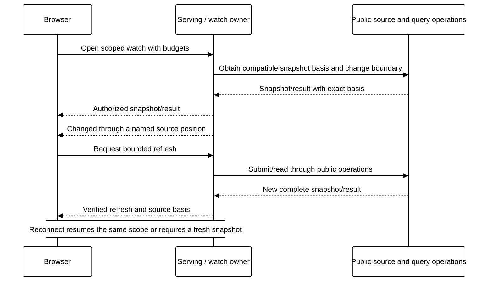

# Reactive interfaces — notifications and exact snapshots

Status: proposed [M20](roadmap/M20.md) profile over [M19 serving](SERVING.md).
The selected first scope is live views with resumable change notifications and
snapshot refresh, used by Board and an application interface. It is not an
implemented subscription API or continuous query engine.

## What changes for the user

An application accepts a command through HTTP. Its service commits new state.
A visible view learns that its authorized source changed and refreshes through
the same bounded read/query API. The view shows the accepted snapshot's basis,
including while a newer snapshot is being computed. After disconnection it
resumes permitted notifications or explicitly obtains a fresh snapshot.

Board gains live inspection and refresh of an eligible, already submitted query.
Changing SQL still creates a new query generation through the qualified explicit
submission path. Merely typing does not enter a new execution scope. D4's
[Live worksheet](design/board-console/LIVE.md) additionally proposes execution
while editing, speculative scheduling and continuous results. Those remain
separate work; M20 implements the source-change/refresh foundation only.

| Mode | Meaning | M20 |
| --- | --- | --- |
| Snapshot | One accepted read/query result with an exact source basis | Reuse the existing qualified contract |
| Follow changes | Notifications invalidate an older view; refresh produces a new complete snapshot | Selected first profile |
| Incremental continuous query | Maintain a relation through inserts, updates, deletes and retractions | Deferred; requires operator state and recovery semantics |
| Live editing / prediction | Schedule exact or speculative complete queries as the draft changes | Deferred; D4's session, cost and fairness contracts remain necessary |

The UI calls this **Follow changes** or **Auto-refresh**, not D4's continuous
Stream mode. A streamed HTTP response or sequence of Arrow batches does not
establish continuous query semantics. Independent panels retain independent
observation bases; there is no invented global snapshot or global “live” bit.

## Shared protocol, separate owners

Serving owns authenticated subscription admission, connection budgets and delivery.
A source owner supplies an authorized snapshot basis and bounded change positions.
The frontend owns only the current view, refresh scheduling and last applied
notification position. Durable source history and qualified retained reads remain
authoritative; no private database tail, independent event bus or WebSocket hub
becomes a second source of truth.

This is a logical sequence, not a wire schema or a cross-service transaction.
M20 must define the missing public snapshot/watch handshake before implementation.
M19's open connection and today's paged inspection cursor cannot provide it.

## Snapshot and change handoff

Each supported source must couple a snapshot/read basis with a change boundary
that cannot miss a commit between the two. A public owner may expose one atomic
snapshot/watch acquisition, or acquire a retained boundary before reading and
catch up with overlap. Prove the chosen algorithm against concurrent commits,
policy changes, retirement, publication and retention; do not read “latest” and
then start listening without closing that race.

The first profile uses one source or explicitly defined projection per watch.
An event means **the view may have changed through this source position**. It
need not carry row values or every intermediate state. Coalescing is permitted
only with a covered-through position that subsumes the replaced invalidations.
It is not an event-history API. A refresh may produce identical rows; notification
progress and result freshness remain different facts.

For data queries, retain the fixed plan/schema/source identity and create a new
finite query identity for a refresh. Record its actual captured source basis;
M20 does not invent an executable AS OF clause or assume the existing API can
request an arbitrary cut. If a commit arrives during evaluation, retain one
newest dirty position and refresh again when capacity permits. Clear that dirty
state only when the source contract proves the completed snapshot covers it.
If positions cannot be compared under that contract, require resynchronization.

Replace rows and related summaries together only after the new result's complete
manifest verifies. Paged displays use the same result identity throughout;
partial pages never become a complete answer. An old response cannot replace a
newer generation. Under sustained writes, show the last exact basis and pending
refresh; promise convergence after quiescence and available capacity, not an
unmeasured latency bound or every intermediate revision.

## Subscription identity and resumption

A watch binds realm, current principal/admission profile, published service
revision, source/projection/filter identity, schema/decoder version, generation,
lease and budgets. Resume state binds that watch to an ordered source position
and the source's retention epoch/availability evidence. Tokens are opaque and
validated; they grant neither reads nor execution. A changed scope, filter,
credential principal or incompatible schema starts a new watch generation.

The protocol needs explicit snapshot-ready, changed/progress, reset-required and
closed outcomes. Names are semantic requirements, not wire tags selected here.
Delivery can repeat after reconnect; the client advances its position only after
processing the notification and never regresses within a generation. A cursor
from the future, another source/realm/principal or a retired generation rejects.

If retained change coverage is missing, return **reset required** with a currently
authorized resnapshot path. Never silently jump the cursor to latest, label an
old view current, or reconstruct missing history from telemetry. Reconnecting
retrieves the same permitted watch basis or creates an explicitly new one; it
does not repeat a command or silently resubmit an uncertain query.

Snapshot/results and change coverage have independent availability. A watch
cannot pin all historical results forever or extend a hard source lifetime.
Recover subscription metadata/cursor meaning from the public owner after server
loss; connection-local buffers may be discarded. A browser reload may choose a
new snapshot without persisting protected results offline.

## First HTTP delivery

Propose Server-Sent Events (SSE) framing for one-way notifications, with ordinary
HTTP requests for commands, reads and renewal. SSE specifies event IDs and a
`Last-Event-ID` reconnect mechanism; it does not define Transit's source retention,
authorization or snapshot handoff. These are the contracts above.
[WHATWG Server-sent events](https://html.spec.whatwg.org/multipage/server-sent-events.html).

Qualify a bounded streaming reader over browser fetch where the selected auth
profile needs headers and explicit resume control. Native EventSource is an
alternative only if its credential/reconnect behavior fits that profile. Do not
put credentials in a query string to make a browser transport convenient.
Test the real deployment proxy's buffering, idle timeouts and disconnect behavior,
along with fragmented UTF-8/events, heartbeats and bounded retry backoff.
WebSockets and general bidirectional sessions are not required for M20.

A transport write or browser event receipt is not durable application admission.
Notification resumption is a read protocol. If a later consumer needs durable
processing acknowledgements, define its own admitted unit and credit contract
under [Flow control](FLOW_CONTROL.md); do not interpret TCP credit or an SSE ID
as that acknowledgement.

## Authority, fairness and lifetime

Recheck current authority before each bounded batch and at a declared maximum
interval, including idle watches and cached metadata. Route authentication does
not replace source policy. Revocation/expiry clears protected browser state and
stops further authorized disclosure; already released bytes cannot be recalled.
Hidden resources must not leak through changed counts, event sizes/names or
inverse dependencies. Notifications carry only permitted metadata.

Each watch has finite live-work lease and delivery budgets. Define explicit
renewal, close, expiry and cancellation of any owned refresh job; hide/pause
stops new refresh scheduling and subscription renewal. Disconnect alone does not
cancel an accepted query. Forgotten browsers cannot renew themselves forever,
and reconnect never silently renews an expired execution lease.

Keep one active refresh and one latest unsubmitted invalidation per admitted
scope initially. Share fair scheduling and quotas across tabs/viewers using the
same configured query principal; the current one-active-query profile must not
be flooded with durable busy outcomes. Accepted work retains its own observable
receipt even when a newer view makes its result less useful.

Bound active watches, scan work, events/bytes, reconnects, response buffers and
retained-query cost. A slow client either coalesces covered invalidations or
receives an explicit reset/closure. Control and revocation progress must continue
under stalled readers and reconnect storms. Do not retain an unbounded per-client
queue or silently drop necessary change coverage.

Leases bound live work, not durable retention. Unlimited retention remains the
default; automatic refresh results may use an explicitly opted-in lifetime
policy, never implicit eviction on the next refresh. If durable result cost makes
the proposed rate impractical, change and qualify that contract before increasing
frequency. No “reactive” label justifies bypassing query admission/capture.

## Selected proof surface and later scope

Qualify a bounded Board inspection projection, a declared Table query view and
a non-trading application view through one watch contract. Keep a source matrix
for KV and Document: their schema/decoder, accepted-change, retention and deletion
semantics require explicit qualification before advertising follow support.
Do not enlarge M18's completed scope or assume all source adapters supply tails.

M20's [exit criteria](roadmap/M20.md#exit-criteria) require no-gap handoff,
duplicate-safe resume, explicit gaps, current-policy reads, generation fencing,
server/browser recovery and measured overload behavior in all three placements.
Continuous SQL, incremental operators, cross-source joins, event-time windows,
external-source polling, arbitrary websocket handlers and D4's predictive editing
remain later scope with their own numbered milestones when selected.
