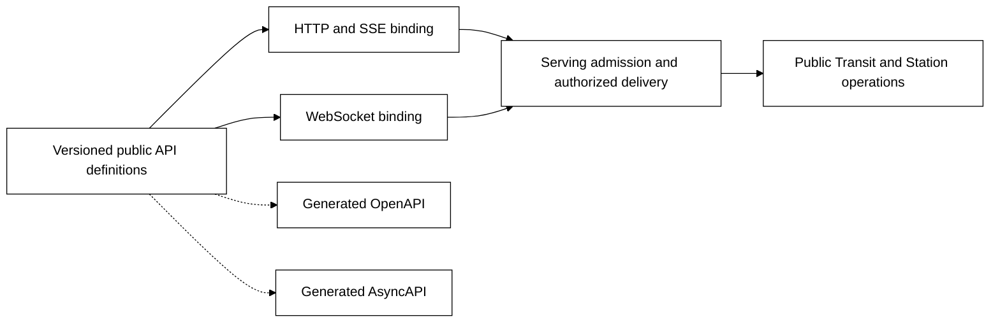

# Reactive APIs — SSE, WebSocket and described contracts

Status: [M20](roadmap/M20.md) implementation in progress over [M19 serving](SERVING.md).
The [v1 contract](../contracts/REACTIVE_V1.md) and [example guide](../examples/serving/docs/reactive.md)
record the implemented int64 Table/SSE/WebSocket profile, native TLS evidence and
remaining qualification. Broader design below remains intent where not qualified.
This layer hosts reactive application APIs before [M21 interfaces](REACTIVE.md)
consume them. It is not an implemented protocol, generated specification or
claim that opening a socket creates a durable session.

## What it means to host a reactive API

Publish a versioned service operation and message contract, bind it to SSE or
WebSocket, and enforce its identity, admission, delivery, recovery and resource
rules throughout the interaction. Application/domain behavior remains in the
service; the adapter handles protocol mechanics over public Transit operations.
A client can use the API without Board or any particular frontend framework.

| Surface | First profile | Meaning supplied by Transit |
| --- | --- | --- |
| HTTP plus SSE | Ordinary HTTP commands/control with server-to-client events | Typed subscription, current authorization, event/source identity, bounded delivery and resume or reset |
| WebSocket | Versioned bidirectional message subprotocol over a qualified HTTP upgrade | Typed commands, correlated receipts/results, subscription/control messages and events; each has its own admission rules |
| OpenAPI | Generated description of HTTP operations, SSE responses, schemas, security and errors | Discoverable supported API contract; a specification is not another runtime or permission grant |
| AsyncAPI | Generated WebSocket channels, messages, operations and protocol bindings | Description of the same typed message contract, not an independent schema authority or event broker |

Binding an API does not expose arbitrary PIDs, turn a Source into a subscription,
or grant a service general network access. Replies/events on an admitted client
connection use the serving response contract. A webhook/callback to a different
destination is an outbound connector effect with its own committed intent.

## Published contract and logical identities

Extend M19's service binding with supported message kinds/directions, codec and
subprotocol versions, exact operation/source targets, current policy, delivery
class, ordering scope, replay/reset rules, deadlines and budgets. Keep accepted
binding, observed listeners and local configuration drafts distinct. Pin the
binding revision for an interaction; upgrades cannot reinterpret an old cursor
or retry. Retiring a publication stops new admissions while preserving the
qualified receipt recovery path for already accepted work.

Distinguish these identities:

- A **connection** is disposable transport state and is never a PID or grant.
- An **API session** is a scoped logical interaction with a generation, finite
  live-work lease and bounded ownership. Recoverable metadata lives with a public
  Station owner; a replacement connection cannot silently acquire a new scope.
- A **subscription** binds a source/projection/filter, schema and ordered change
  position to that session or an explicitly qualified independently owned watch.
- An **operation ID** identifies one accepted command independently of connections,
  sessions and transports. M19's exact retry and receipt rules still apply.
- An **event ID/resume cursor** locates delivery or source progress under a named
  subscription generation. It is neither an operation ID nor a read grant.

Session admission or initial authentication cannot authorize all future messages.
The first contract must define open, subscribe, renew, resume, unsubscribe, close,
command admission and result/status operations with typed errors. These are
semantic families, not wire tag names fixed by this review. Keep connection,
subscription, command and event state machines separately testable.

## Commands and acknowledgements

A WebSocket command carries the same stable caller operation ID and canonical
request meaning as its qualified HTTP equivalent. Authorize each new command
against the current published service and public operation. Bind its digest,
original target and revision before durable acceptance. The deduplication scope
must not include the current connection or transport, or reconnect/fallback could
execute the command again. Conflicting reuse rejects; old unsupported retry
horizons never become permission for fresh admission.

A transport acknowledgement, parsed message, accepted ingress command, target
admission and final domain result are distinct observations. A typed receipt
names its durable stage. A lost WebSocket reply recovers the same outcome through
the same API, including an explicitly qualified HTTP status/read path. Closing a
socket or expiring a session does not retract accepted work. Commands requiring
cancellation use the owning durable operation, not a WebSocket close code.

Prove canonical schema/codec agreement across the bindings, including full-width
identities, malformed/unknown versions and conflicting payloads. Wire framing
need not be byte-identical, but the canonical admitted request must be. No frame
can invoke arbitrary application code inside the authority node.

## Events, ordering and acknowledgement policy

M20 first qualifies change invalidations/progress and notifications of recorded
operation outcomes. Each event describes either a public source basis or a
recoverable receipt/result reference. It does not manufacture events from lossy
logs or uncommitted handler memory. Authorization covers referenced content too.

Declare ordering per subscription/source, never a global order across all
subscriptions sharing a socket. Duplicate delivery is possible after reconnect;
consumers deduplicate or refresh using the declared generation and position.
A received event or WebSocket pong does not prove durable client processing.

For invalidations, coalescing is allowed only when a covered-through position
subsumes the omitted invalidations. A stream of domain events that requires every
message is a different delivery class: it needs retained event identities,
coverage, replay and an explicit gap on exhaustion. The first profile does not
claim generic lossless event streaming or exactly-once client consumption.
Operation outcomes remain recoverable from their accepted records even if their
notification is missed. No slow reader can force an unbounded in-memory queue.

Transport backpressure regulates bytes. If a future contract acknowledges durable
application processing, define an authenticated accepted unit and credit under
[Flow control](FLOW_CONTROL.md); socket writes and event IDs do not provide it.

## Snapshot and change handoff

M20 owns the public source/watch primitive that closes the race between acquiring
a snapshot basis and following changes. Qualify one authorized source/projection
first. Either obtain a compatible snapshot/watch boundary atomically or acquire
a retained boundary before reading and catch up with overlap. Prove concurrent
commits, duplicates, schema changes, policy changes, retirement and retention.
Reading latest and then listening is not sufficient.

Return an exact authorized snapshot/reference and a compatible change position.
A progress/invalidation event may mean that a view changed through that position;
it does not contain an incremental query answer. Public source adapters own the
retained read/change evidence. No raw Ursula subscription or independent event
store can supply authority missing from those adapters.

M21 selects Board/application views, schedules fresh finite queries and renders
their results using this API. A finite source adapter or existing paged inspection
cursor is not automatically a watch adapter. Keep a truthful source matrix.

## Subscription identity and resumption

Bind resume state to realm, principal/admission profile, service binding,
source/projection/filter, codec/schema, session/subscription generation, position
and availability/retention evidence. Reauthenticate the new connection and check
current policy before disclosing resumed content. Reject foreign, forged, future,
retired and incompatible cursors. An expired lease requires an explicit new
admission; resuming reads cannot silently renew execution rights.

A valid retained position permits duplicate-safe continuation. Missing coverage
returns reset-required with an authorized snapshot path; do not silently jump to
latest or replay commands. Keep accepted command/result evidence independent of
notification delivery. Server restart must reconstruct cursor/session meaning
through the public owner rather than a lost socket buffer.

The protocol distinguishes source unavailable, reset required, authorization
lost, lease expired, graceful completion and transport interruption. A network
failure alone cannot select a durable outcome. A replacement connection must
fence the old attachment's new admission/delivery at a declared boundary, while
already authorized bytes may finish. Do not promise atomic live-socket transfer.

## SSE hosting

SSE defines UTF-8 event framing and event IDs with `Last-Event-ID` reconnection.
It does not specify Transit's retention, source progress or application admission.
[WHATWG Server-sent events](https://html.spec.whatwg.org/multipage/server-sent-events.html).

Qualify bounded event serialization/parsing, partial UTF-8, field/newline handling,
heartbeats, disconnects, retry backoff and the deployed proxy's buffering/timeouts.
An open response must not occupy the only serving slot. Commands, subscription
creation/renewal and status remain ordinary HTTP operations in this binding.

Choose a browser fetch streaming reader when the credential profile needs explicit
headers/resume control; native EventSource is allowed only when its credential
and reconnect behavior fits. No bearer credential in URL query parameters.
After response headers are sent, failures use the typed stream disposition or
close-and-recover path, not an invented new HTTP status inside the stream.

## WebSocket hosting

The first binding proposes RFC 6455 over M19's qualified TLS/HTTP/1.1 boundary,
with an explicitly versioned application subprotocol and bounded UTF-8 JSON
messages. Compression, binary codecs and HTTP/2 extended CONNECT are later
profiles unless independently added and qualified. WebSocket defines a handshake,
message framing and control frames; these do not define Transit's durable command
or subscription semantics. [RFC 6455](https://www.rfc-editor.org/rfc/rfc6455.html).

Qualify upgrade validation, masking, fragmentation/reassembly bounds, UTF-8,
control-frame interleaving, ping/pong and close-handshake behavior with independent
peers. Bound message bytes across fragments, pending sends, subscriptions per
connection, frame work and both directional queues. A slow outbound stream cannot
block revocation, unsubscribe, heartbeat processing or bounded inbound admission.
Decline unqualified extension offers without breaking ordinary browser handshakes;
reject compressed frames unless that extension was explicitly negotiated.

Authenticate before admitting application messages. Browser WebSocket handshakes
expose URL and subprotocol arguments rather than arbitrary request headers.
[Browser WebSocket interface](https://websockets.spec.whatwg.org/#the-websocket-interface).
Choose and prove a trusted same-origin admission or short-lived, single-use
bootstrap exchange bound to the intended API/session. Unauthenticated bootstrap has its own tight deadline
and quota. Never misuse the subprotocol field or URL as a bearer-token store.
Check browser Origin and the trusted proxy/TLS channel independently; Origin alone
is not service-client authentication. Board retains its private shared access
profile, with no implicit human session or administrative grant.

## OpenAPI and AsyncAPI are generated views of one contract

OpenAPI 3.2 supports sequential media types and `itemSchema`, including SSE.
Use the proposed 3.2.1 baseline for new streaming descriptions, subject to pinned
validator/generator compatibility proof. Model the event envelope and its typed
data, HTTP security/errors, subscription controls, status/results and resume/gap
behavior. [OpenAPI 3.2.1](https://spec.openapis.org/oas/v3.2.1.html#complete-vs-streaming-content),
[SSE media type guidance](https://spec.openapis.org/registry/media-type/sse).

OpenAPI describes HTTP exchanges, not the complete bidirectional WebSocket
message state machine. Propose AsyncAPI 3.0 plus its WebSocket binding for
channels, message directions and operations. Both outputs reference the same
versioned definitions and correlation/error types.
[AsyncAPI 3.0](https://www.asyncapi.com/docs/reference/specification/v3.0.0),
[WebSocket binding](https://www.asyncapi.com/docs/reference/bindings/websockets).

Generate descriptions, validators and runtime codecs from owning public types
and registered operation metadata; test them against shared wire fixtures. Never
maintain separate hand-edited schemas or infer server support from a generated
client. Serve versioned descriptions through authorized discovery, tied to the
accepted service revision and content digest, so clients can identify exactly
which contract the listener supports. Serve only that declared capability profile;
documentation must not disclose hidden operations or credentials. HTTP callbacks/
webhooks in a description do not dispatch themselves or bypass connectors.

Board's existing generated OpenAPI 3.1 contract is not silently replaced. M20
must define additive/versioned publication and a compatibility matrix for schema
validators, browser transport and independent clients. A tool that buffers an
entire SSE body or ignores `itemSchema` has not passed streaming qualification.
No generated production API artifact is changed by this design review.

## Authority, resource bounds and operator meaning

Recheck current rights for every new command/subscription and each bounded read
batch, with a maximum idle revalidation interval. Session renewal cannot expand
scope. Enforce aggregate per-principal quotas across all connections and both
bindings; switching protocols cannot multiply admission capacity. Denial clears
protected client state; already released bytes cannot be recalled.

Bound connection/session/subscription counts, lease duration, inbound work,
fragments/events/bytes, scans, resume work and control capacity. Disconnect,
explicit close, cancellation and source retirement remain distinct. Leases bound
live work; they do not delete durable receipts, retained snapshots or source
history. Retention defaults to unlimited, with explicit opt-in policies only.

The shared typed contract owns service/message/subscription declarations. Any
future Board form, SQL or SDK builder must use that same validation. There is no
current `CREATE SUBSCRIPTION` or reactive endpoint SQL grammar, and OpenAPI is not
a second configuration authority. Operations can inspect declared capabilities,
active/expired sessions, budgets and receipt/source evidence without decoding
arbitrary application values. M21 separately owns the interactive live views.
