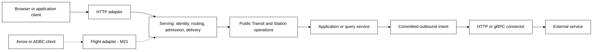

# Serving — inbound protocols over Transit services

Status: proposed system design for [M19](roadmap/M19.md), not an implemented
server framework. HTTP is the first protocol profile, exercised by application
APIs and Board. [M20](roadmap/M20.md) adds reactive views over it;
[Flight/Flight SQL M21](roadmap/M21.md) is the second protocol profile.
The existing node and Board HTTP listeners remain qualified only under their
[current contracts](../contracts/SERVICE_V2.md) and component limits.
The [D1 serving review](design/serving/D1.md) records the selected scope and
remaining design decisions.

## Purpose and ownership

A serving layer publishes an authorized Transit service to external callers.
It owns the boundary between a live protocol request and the service's public
operations: routing, authenticated context, admission, bounded response delivery
and recovery. The application's behavior still owns its domain operations;
Transit owns durable acceptance, grants, ownership and lifecycle.

Connectors and serving are complementary. A connector starts with a committed
outbound intent and records an external attempt. Serving starts with an external
request and obtains authorized admission or a bounded read. An accepted command
may later produce connector intents through ordinary application turns. Receiving
an HTTP request never grants permission to dial an external service.

| Part | Owns | Does not establish |
| --- | --- | --- |
| Transport / protocol adapter | Connections, HTTP framing or later gRPC frames, TLS boundary, cancellation signals and wire pressure | Durable acceptance, permission or client consumption |
| Serving | Published service/route binding, authenticated request context, operation mapping, admission budgets and response lifecycle | A new execution engine, authority database or arbitrary user-code host |
| Station service / public query client | Durable calls, exact requests/results and application service policy | Ambient permission from a socket or route name |
| Transit | Current grants, admitted work, fenced turns, outboxes and recovery evidence | HTTP route semantics or correctness of application computation |
| Connector | Authorized outbound attempts and captured outcomes | Inbound identity, HTTP server admission or general delegation |
| Board / application frontend | Presentation of permitted results and operations | An independent configuration or execution authority |

The arrows describe responsibility, not a mandatory central gateway deployment.
Board and an application server can embed the same libraries in separate
executables with different credentials, listeners and budgets. Neither reads
Ursula directly. Core imports no serving, Station or protocol-adapter package.

## Reuse and the missing boundary

Board already supplies bounded HTTP parsing, origin checks, API routing, static
assets and diagnostics. `transit-client` supplies signed operations and exact
retry. Station and `transit-query` supply durable calls and captured results.
M15/M16 supply qualified outbound framing, TLS verification and capture patterns.
Those are reusable foundations, not proof of an inbound server.

In particular, Board currently handles one request at a time. A long-lived
response in that loop would block inspection and control. M19 must qualify
bounded concurrent scheduling, per-request ownership, joined cancellation and
fairness before M20 opens live subscriptions. The outbound gRPC transport has
no server implementation; inbound TLS and HTTP/2 cannot be inferred from client
qualification.

Extract only demonstrated shared code. The proposed ownership is a neutral
`transit-http-server` package for HTTP mechanics and `transit-serving` for
Transit/Station admission and delivery. Board's projections stay in
`transit-board-api`; application codecs stay with the application; Fuze stays
in `transit-fuze`. Names are package proposals, not directories to add now.
M21 should test the common contract with Flight before generalizing adapter APIs.
Migrating the authority node's listener is not an M19 prerequisite.

## What is published

A **service binding** is a versioned, realm-scoped declaration of what may be
served. It names a stable service identity, protocol/profile, explicitly
published operations, exact target identities and codec versions, admission and
read policies, budgets, and response/recovery behavior. An HTTP route binds a
method and bounded path template to one such operation. It is not a URL-to-any-PID
proxy, a resource association, a Source/Sink, or a grant.

Separate the accepted declaration, a proposed revision, and observations of a
listener actually serving that revision. Resolve names to exact PIDs and schema/
policy revisions before acceptance. Updating a route changes future admissions;
previously admitted work, retries and replies retain their original target.
Unpublishing a route stops fresh admissions but preserves authorized receipt/
result recovery for accepted work under its own lifetime contract.

M19 must version public typed declaration/inspection operations and their
Station-owned durable representation. Bootstrap installs listeners, trust roots
and private key references through trusted deployment configuration; it does not
make an independent editable route database authoritative. No general plugin
loader or dynamic executable code deployment is implied by publishing a binding.

## Three request classes

| Class | First HTTP examples | Required behavior |
| --- | --- | --- |
| Bounded read | Board inspection, application metadata, operation status, exact result page | Current read authorization and explicit observation/result basis; no durable job per harmless GET |
| Durable operation | Application command/call or explicit finite query submission | Stable caller request identity, frozen proposal, one admitted operation and recoverable outcome |
| Follow / subscription | M20's scoped change notifications | Versioned watch/cursor, bounded lease, current reads and explicit resynchronization; not part of M19's live profile |

M19 proves a small non-trading application API with a durable command, status
and result read, alongside Board's existing inspection and explicit query APIs.
Board reuses the serving machinery while preserving private viewer admission,
its read-only inspection identity and separately provisioned query identity.
It gains no general administrative route or application-value decoder.

Pure projections need not be captured as commands. Queries that already create
durable work keep their query contract even when their result is read-only.
No generic HTTP method grants arbitrary state writes or direct handler execution.

## Authentication and public ingress

Every application route declares its credential-to-principal mapping and exact
allowed service scope. Start with explicitly provisioned service callers and
current Transit grants; choose and independently qualify the concrete signed-
request or mTLS mapping at M19 entry. Do not default all callers to an unrestricted
gateway identity. General user delegation and federated human sessions are not
prerequisites for this bounded profile.

Authentication, route admission, service policy, resource reads and execution
ownership remain distinct checks. A route cannot broaden any of them. Preserve
authenticated provenance through forwarding: a Station outbox has the ingress
process as its origin, not a fabricated external-user origin. If the application
needs the original caller, define a versioned verifiable ingress record bound to
that admission; a caller-name field in an ordinary payload is insufficient.

Server TLS credentials are private deployment references. Select direct TLS or
a pinned authenticated termination boundary and prove it with the actual
launchers; outbound server-certificate verification does not supply inbound TLS.
An untrusted forwarded identity/host header is never authoritative. Preserve
Board's exact Origin/Host and JSON requirements, and qualify proxy normalization,
credential isolation and browser request-forgery defenses for the selected profile.
No credential appears in URLs, receipts, durable request bodies or diagnostics.

D6's [authentication and SECRET proposals](design/board-console/OPERATIONS_SQL.md)
can supply later operator configuration. M19 does not implicitly implement OIDC,
managed secret stores, secret issuance or the entire Operations UI. Attributable
human administration needs its own selected identity/session/recovery scope.

## Durable admission and HTTP outcomes

Before accepting a command, bind its realm, authenticated caller, stable service
and operation identity, client request ID, request digest, codec/route revision,
resolved target, budgets and reply policy. A caller must retain its request ID
before sending. Reusing it with conflicting content rejects; a lost response
retries or recovers that same operation under current permission.

The lookup key cannot depend on whichever route revision is current on retry.
Keep the original binding and exact target with the accepted request. Otherwise a
route edit could turn a retry into a different command. HTTP request IDs used only
for tracing are not durable deduplication identities; repeated payloads are not
implicitly the same operation either.

Where an ingress behavior mediates commands, commit the request mapping and
fixed-destination outbox intent in one ordinary Station turn. Its accepted receipt
means the ingress has durably accepted responsibility; destination admission and
application completion are later recorded stages. There is no atomic commit
across the ingress and target PID. Reuse outbox delivery and durable reply
correlation instead of a second queue or a local idempotency cache. M19 must prove
how caller request identity maps to those records and existing principal sequences,
including concurrent clients, ingress restart and retained retry horizons.

| Observed state | Proposed new HTTP operation behavior |
| --- | --- |
| Definitively rejected before admission | Typed error with no admitted operation; identify conflict, invalid input, denial or pre-admission capacity refusal |
| Durably admitted, application outcome pending | `202` with an authorized status/receipt reference and the precise accepted stage |
| Application outcome durably recorded | Return that outcome or a reference to its exact result; HTTP success alone is not evidence of a downstream business effect |
| Upstream acceptance is uncertain | Explicit uncertainty with the original retry identity; a timeout/`503` must not be presented as proof of nonacceptance |
| Response connection is lost | Accepted work remains; recover the same receipt/result, without claiming the client consumed any bytes |

These are new application-route semantics; do not silently rewrite existing
node/Board status contracts. HTTP's `202` is non-final, and automatic retry of
non-idempotent requests needs an application guarantee. The durable mapping above
is Transit's additional design, not something HTTP supplies.
[RFC 9110, idempotent methods](https://www.rfc-editor.org/rfc/rfc9110.html#section-9.2.2)
and [202 Accepted](https://www.rfc-editor.org/rfc/rfc9110.html#section-15.3.3).

Result retrieval rechecks current permission, exact identity, completeness and
availability. A result handle is not a grant. Bounded synchronous waiting is an
optional presentation of the same admitted work, never its lifetime. Socket
close, HTTP timeout and explicit durable cancellation have separate meanings.
A response write is authorized disclosure, not an outbound connector attempt;
a callback/webhook to another destination is a separate connector effect.

## Resource and recovery contract

Bound connection count, headers, body/decoded bytes, parse work, active requests,
queued admission, per-principal work, response buffers and overall/idle deadlines.
Reject unsupported compression, ambiguous framing and oversized work explicitly.
Do not create an unbounded durable mailbox backlog just to return `202` quickly.
The admission owner must enforce outstanding-work quotas before accepting more.

Reserve control capacity and test slow uploads/readers against other callers.
Use bounded pages and backpressure; retained result size must not determine
resident memory. Listener shutdown drains or closes transport work within a
finite budget without deleting accepted operations. Keep socket state disposable;
workers recover from accepted request/outbox/result evidence.

Retention defaults to unlimited. Explicit request/result lifetimes, retry horizons,
listener deadlines and later subscription leases are different contracts. Quota
pressure can refuse new work, not erase receipts or make a late retry execute
again. An unavailable receipt past its horizon rejects explicitly rather than
silently creating a new operation.

## Declarative and operator mapping

| Surface | Owning model | SQL status |
| --- | --- | --- |
| Published service and HTTP routes | Shared typed service-binding declaration and conditional revision | No current grammar; `CREATE SERVICE` / `CREATE ENDPOINT` are naming candidates only |
| Credential/trust references | Identity ingress and D6's proposed secret/trust contracts | Existing SECRET option syntax is reference-only; management remains proposed |
| Finite query operation | `transit-query` and the qualified Fuze compiler | Existing qualified SELECT profiles; route publication adds no SQL features |
| Operation status / active listener evidence | Authorized public serving inspection | No executable system catalog or generic UPDATE is implied |
| Reactive watch | M20's typed subscription contract | No `SUBSCRIBE` or continuous SELECT syntax introduced |

Formalizing serving includes its typed contracts and generated schema/fixtures,
not completing every administrative SQL spelling. Any future SQL and Board form
must lower to the same owning operation and validation. Operations can inspect
service definitions and observed listeners; Workspace can show dependency links.
Detailed route-editing screens and administrative DDL remain separate review work.

## Handoffs

M19 exits only when application HTTP and Board exercise the same serving contract
with independent clients, restart/lost-response tests, auth/overload checks and
local/Compose/reference deployment evidence. [M20](roadmap/M20.md) then supplies
[reactive interfaces](REACTIVE.md). [M21](roadmap/M21.md) reuses the admission,
identity, budget and result seams for Flight while qualifying its own inbound
gRPC/TLS, standard metadata and client compatibility. ADBC remains a client API,
not a third wire protocol. None of these steps moves Fuze or application handlers
into the authority node.
