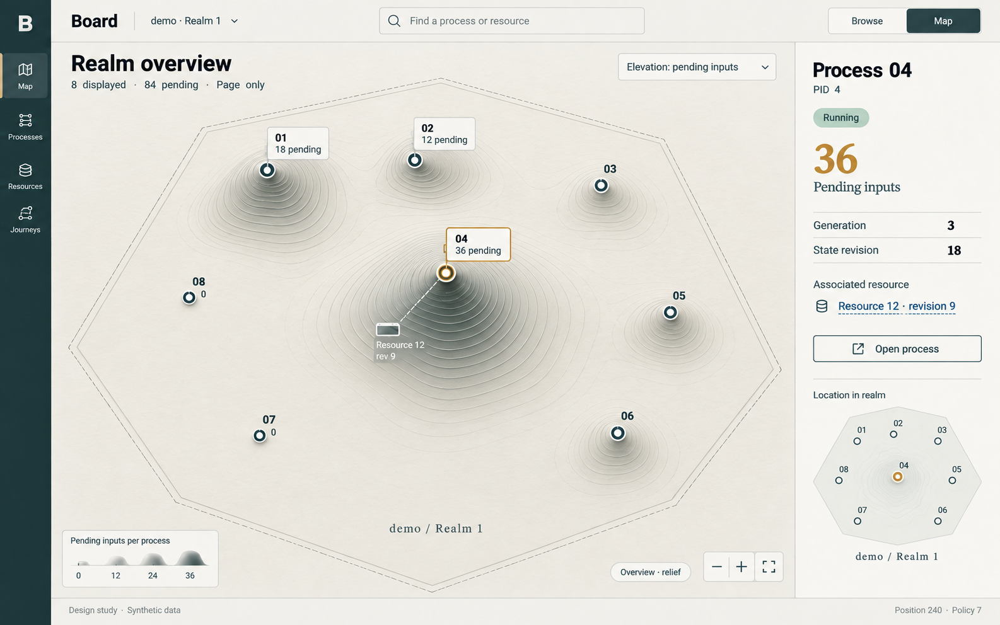
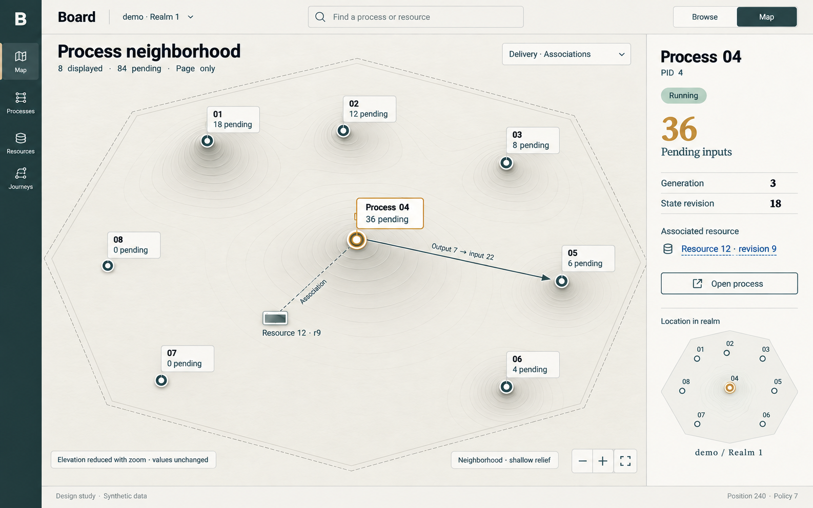
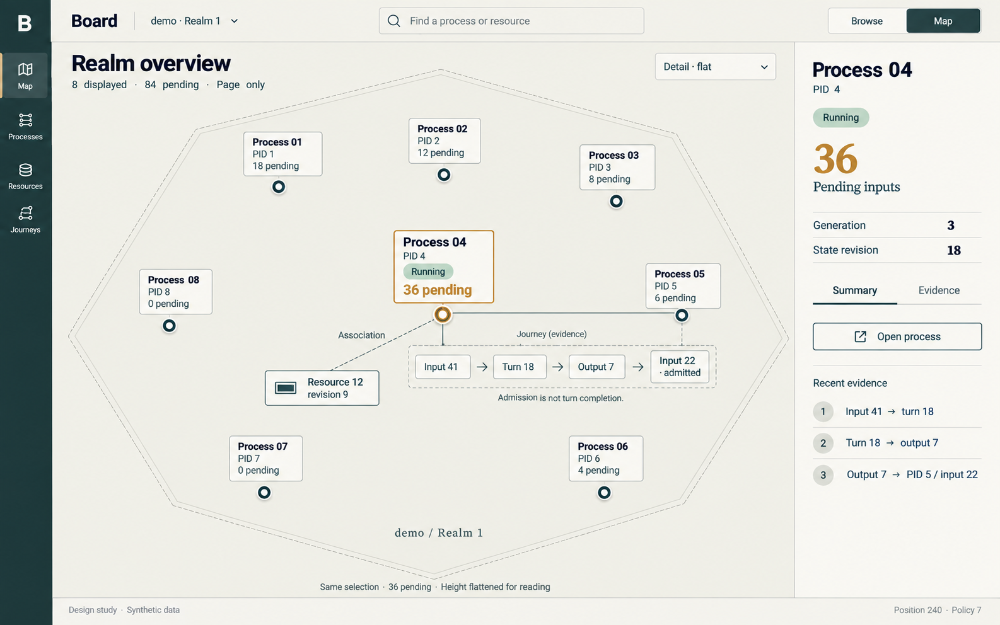
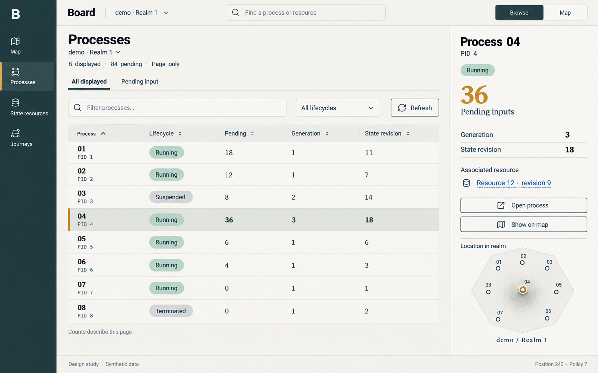
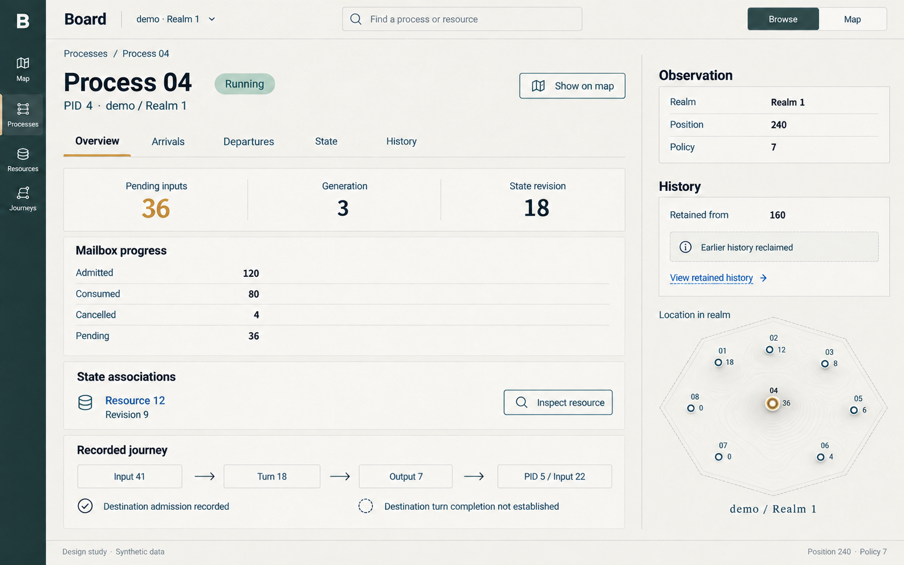
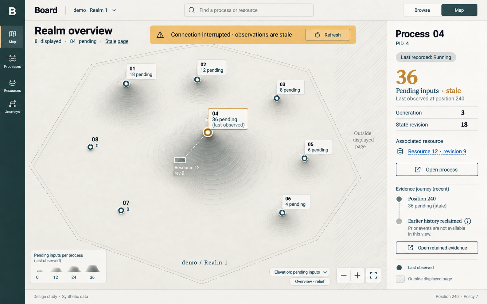

# D1 — Board browser and relief atlas

[Review index](README.md) · Next: [D2 — Inbox, outbox and age](D2.md)

Status: **Reviewed**. Implementation: **Not implemented**.
The two-view direction continues; [D2](D2.md) extends the initial relief encoding.

## Question

How should Board combine conventional browser pages with a map that flattens
into readable evidence as the viewer zooms in?

## Proposal

Browse and Map share selection, filters and inspection evidence. At a distance,
pending inbox counts form a relief surface. On approach, that surface flattens
into cards and documents. The [interaction specification](board-atlas/INTERACTIONS.md)
records the proposed navigation and evidence rules.

## Visual studies

Read the first three images as successive views of the same region. Process 04
stays selected, with 36 pending inputs, generation 3 and state revision 18.
Changing elevation is a presentation transition, not changing backlog.

### Figure 1: Relief overview

The central peak represents Process 04's 36 pending inputs. Processes 07 and 08
sit at zero elevation. The summary describes the eight displayed processes,
not a realm-wide total. Height, selection and lifecycle have separate meanings.

### Figure 2: Process neighborhood

As relief decreases, process labels and relationships appear. The dashed
association to Resource 12 differs from the directed delivery to Process 05.
Neither spatial proximity nor an association grants authority.

### Figure 3: Flat investigation

At reading distance, terrain yields to flat cards and evidence. Destination
admission remains distinct from completion of the destination's turn.
The inspector preserves the same identity and values across the descent.

### Figure 4: Browser overview

The browser supports scanning, sorting and precise navigation. Switching to Map
keeps the selection and filters. The miniature locator connects the two modes.

### Figure 5: Process document

A readable document exposes the exact facts behind the map. Its mailbox
accounting is 120 admitted minus 80 consumed minus 4 cancelled, leaving 36 pending.
The resource link opens separately authorized inspection.

### Figure 6: Stale observations and coverage

This is an existing viewer's last observation after a transport failure.
Unknown coverage is not zero. Known denial is a different state: it removes the
affected data, including relief and relationships; it is not represented by
stale terrain or identifiable silhouettes.

## Review outcome

The discussion established browser and map modes as the direction to explore.
The six compositions remain the reference for coordinated navigation and
semantic zoom. D2 extends the initial inbox-only relief with a separate
outbox well; [D3](D3.md) explores grouping at larger populations.

The images do not settle the renderer, camera behavior or accessibility details.

## Open questions

- Does the transition preserve orientation, selection and readable labels?
- Can the map and browser expose the same bounded evidence and keyboard actions?
- Which rendering approach satisfies the embedded application's constraints?

## Evidence and limits

The images use synthetic data, not a deployment or a captured Transit transcript.
They are review material, not assets to embed in the Board executable.
[Board's design contract](../BOARD.md) remains authoritative.

The selected PNGs are original generated outputs, copied into this directory
without raster post-processing. Subsequent screens used the selected overview
as a visual reference. Image generation is nondeterministic; the prompts record
intent, not a byte-reproducible build.

These are independent raster compositions, not frames captured from a working
camera. Small placement, font and control differences remain. In particular,
the close view illustrates semantic disclosure at approximately the same
framing; the exact zoom trajectory, anchored selection, numeric height ratios,
contrast, responsive behavior and keyboard interaction need a real prototype.
The written specification takes precedence over pictorial geometry.

The single-realm header is a scope label. Its generated chevron does not propose
multi-realm discovery. Search, the mode switch and map navigation are proposed
controls, not claims about the current frontend.

### Synthetic reference scene

All counts are for one displayed page in realm 1. Process aliases are explanatory
labels, not Station registry names. IDs and counts below are design examples,
not wire fixtures or evidence of a valid execution schedule.

| Label | PID | Lifecycle | Pending inputs | Map location |
| --- | --- | --- | --- | --- |
| Process 01 | 1 | Running | 18 | Upper left |
| Process 02 | 2 | Running | 12 | Upper middle |
| Process 03 | 3 | Suspended | 8 | Upper right |
| Process 04 | 4 | Running | 36 | Center, selected |
| Process 05 | 5 | Running | 6 | Right |
| Process 06 | 6 | Running | 4 | Lower right |
| Process 07 | 7 | Running | 0 | Lower left |
| Process 08 | 8 | Terminated | 0 | Left |

The page sum is 84 pending inputs. Process 04's associated Resource 12 has
revision 9. Its example observation is position 240, policy revision 7, retained
from position 160. Resource observations must retain their own source basis in
an implementation; this shared illustration footer is not a global snapshot.

The journey illustrates recorded links from PID 4 input 41 through turn 18 and
output 7 to PID 5 input 22. Identifiers are not timestamps or journal positions.
No duration, throughput, worker-liveness or external-outcome claim is implied.

### Milestone relationship

This study is grounded in the completed [M2 inspection boundaries](../roadmap/M2.md)
and [M7 state-resource inspection](../roadmap/M7.md). The scale follow-up is
rebased onto completed [M9 Station qualification](../roadmap/M9.md), using
its authorized framework evidence as a candidate grouping basis. It does not reopen their
exit criteria or claim completion of a new interface.

Implementation is not scheduled by this design-only change. Select a new
numbered milestone using the [roadmap sequencing rule](../roadmap/README.md#maintaining-the-sequence)
before implementing the canvas or expanding the read profile. The study does
not require Station for a generic view, multi-realm discovery, deployment topology
or application value decoding. Station grouping is optional; aggregate discovery
and the larger populations remain outside the implemented inspection profile.

## Supporting material

- [Interaction and evidence specification](board-atlas/INTERACTIONS.md).
- [Exact generation prompts](board-atlas/prompts.json).
- [Figures 1–6 and the later review images](board-atlas/images/).
- [Board frontend and its current limits](../../apps/transit-board-web/README.md).

[Review index](README.md) · Next: [D2 — Inbox, outbox and age](D2.md)
