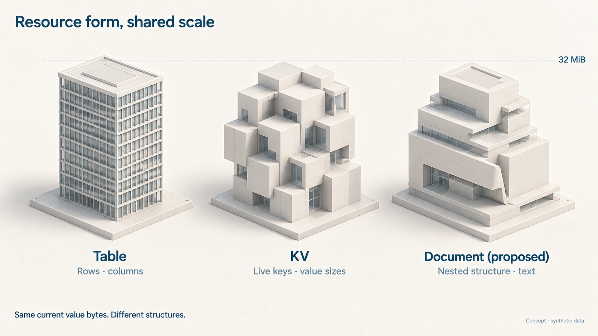
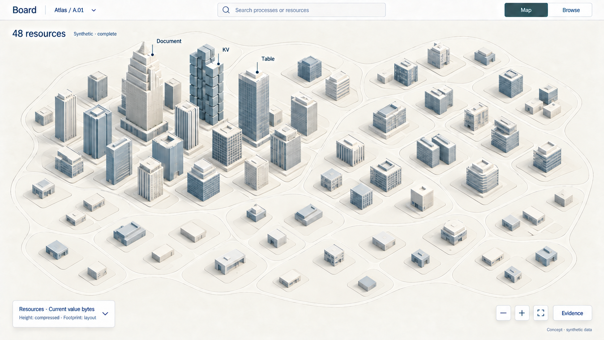
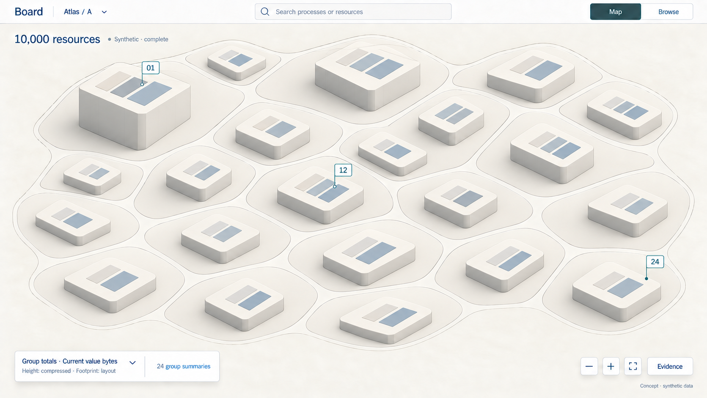
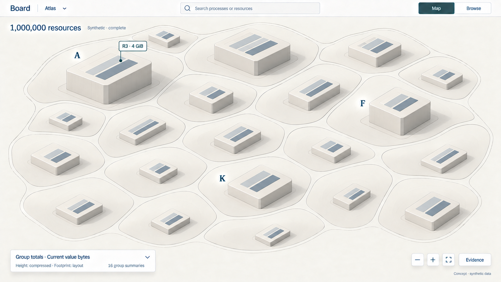
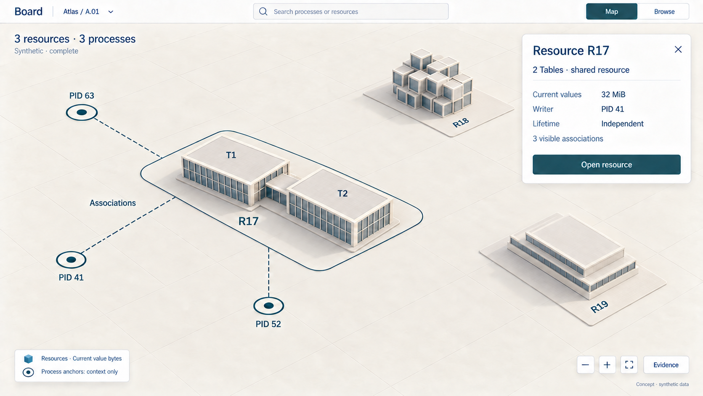

# D5 — Resources as a cityscape

Previous: [D4 — Million-to-billion scale](D4.md) · [Review index](README.md) · Next: [D6 — Canvas emphasis and zoom](D6.md)

Status: **Accepted in part**. Implementation: **Not implemented**.
All five images use synthetic resource populations, sizes and observations.

## Question

How should Table, KV and Document state appear beside the process fabric, and
what replaces individual resource buildings at larger scales? Can a cityscape
make both structure and concentration legible without crowding the interface?

## Proposal

The city analogy fits: processes deform the fabric as work arrives and leaves;
resources give durable state a distinct architectural form. Manhattan, boroughs
and suburbs describe patterns of concentration and spacing. They should not
assign skyscrapers exclusively to Tables or small houses to Documents. A large
KV resource or Document can be the tallest landmark.

Give each backing resource one stable plot. Use its declared structure to shape
the building, and a named metric to set its height. Start with **current value
bytes** across resource kinds. Keep footprints stable for navigation; do not
make height, width, roof detail and color all compete to describe size.

| Declared structure | Architectural character | Useful dimensions on inspection |
| --- | --- | --- |
| Table | Regular slabs and a grid facade | Live rows, declared columns/types, current value bytes, schema and resource revision |
| KV | Modular blocks and compartments | Live keys, value-byte distribution, current value bytes and resource revision |
| Document, proposed | Nested or stepped terraces | Materialized nodes/text length, structural depth, accepted change basis and conflict metadata |

The motifs identify structure. Windows are not literal rows; cubes are not
individual keys; terraces do not prove a document's exact depth. Those metrics
need explicit, authorized evidence and their own labeled views.

Build on [D4's spacious frame](D4.md): one header, full-width map, combined
legend and temporary selection card. **Processes** and **Resources** are
emphases within Map, selected through that legend. Keep the same camera,
landmarks and selection when changing emphasis. Show a bounded amount of
process context around a resource selection, rather than drawing both complete
landscapes at full strength.

## Visual studies

### Figure 1: Different structures, comparable height

All three examples have **32 MiB** of current value bytes. Their different
silhouettes identify structure; their common height is intended to make the
selected size measure comparable. Roof details and footprints are not extra
numeric axes. This is a grammar study, not a calibrated plot.

**Review:** the regular, modular and nested forms are distinguishable without
three bright colors. A shipping map still needs text/type markers, especially
when near top-down or viewed without depth.

### Figure 2: A neighborhood of resources

The **48-resource** scenario explores a dense center, medium blocks and a quiet
outer neighborhood. The large Document and KV landmarks make the point that
kind does not prescribe size. Small resources remain visible as low buildings
on persistent plots.

**Review:** this is where the city metaphor is most literal. The drawing
approximates the population rather than proving one building per fixture row.
A prototype should remove facade detail as soon as it competes with labels,
and flatten the buildings when approaching reading distance.

### Figure 3: Districts replace buildings

At **10,000 resources**, request a bounded set of group summaries; the fixture
has 24. Each primary mass now represents a group, with height based on the sum
of its unique resources' current value bytes. Opening Group 01 reveals the
preceding 48-resource neighborhood.

**Review:** one aggregate mass gives a clearer contract than a miniature city
of invented child buildings. The roof inlays suggest mixed structure only;
their illustrated areas are not measured percentages. Exact kind composition,
member count and largest members belong in the group card and Browse.

### Figure 4: A metropolitan overview

At **1,000,000 resources**, the fixture uses 16 primary groups. Group A contains
the preceding 10,000-resource scope. The **R3 · 4 GiB** flag preserves a route
to one large Document inside that group. It adds no extra building or bytes.

Beyond this, keep adding hierarchy rather than objects on screen: a billion
resources would still begin with a bounded regional view. Resource and process
populations are independent; a billion processes does not imply a billion
resources or one resource per process.

**Review:** this view makes concentration readable, but deliberately loses
individual architecture. Selection needs both resource count and size
distribution to distinguish many small resources from a few large ones.
A tall group total alone cannot establish crowding.

### Figure 5: One resource, several processes

R17 contains Tables T1 and T2 and has **32 MiB** of current values. Three
processes associate with it. There is one R17 plot and one resource total.
The wings identify logical tables; their individual heights are not separate
measurements in this view.

The card distinguishes **writer PID 41** from **independent lifetime**.
An associated process is a third role. The dashed lines mean recorded
associations, not measured traffic, access grants or ownership.

**Review:** a shared site makes co-location visible. Tables inside one resource
share its transaction and lifetime boundary; separate buildings on separate
resource plots do not acquire atomicity by being adjacent. At this close scale,
the process fabric has flattened to simple anchors.

## Design details

### Visual mapping reference

This table records the proposed mappings in one place. The city analogy describes
concentration and architectural character, not geography or deployment topology.
[D6](D6.md) studies how these meanings survive a change of canvas emphasis.

| Visual element | Proposed meaning | Reading rule |
| --- | --- | --- |
| Soft process shoulder | Pending inbox count lifts the fabric | [D2, Figure 7](D2.md#figure-7-queue-counts-with-age-on-the-well-walls); keep inbox and outbox independently readable |
| Well within the shoulder | Pending outbox count sets depth below the local inbox surface | A well can remain below the neutral fabric when the inbox is empty; never collapse both counts into one net height |
| Amber inner well walls | Oldest pending output age on the active age scale | Synthetic here; age is not encoded by resource height or selection color |
| One bounded resource plot | One realm-qualified backing resource identity | Stable navigation footprint, not size, access, ownership or number of associated processes |
| Regular Table slabs | Declared tabular structure; named wings for Tables sharing a resource | Grid marks are not row counts; the underlying KV and its Table view count once |
| Modular KV blocks | Key/value structure | Compartments are not individual keys or measured value sizes |
| Nested Document terraces | Proposed document structure | Terraces suggest nesting, not a measured depth or finalized Document storage model |
| Resource height above neutral ground | Current value bytes, using one disclosed compressed scale | Exact definition below; independent of nearby inbox elevation; all kinds can be tall |
| District or regional mass | Sum over unique resources in a disclosed group | Sum raw bytes before compression; parent and children are never additive |
| Dense skyline, medium blocks, sparse low plots | Concentration in the stable layout at the displayed grouping level | Manhattan/borough/suburb analogy; no automatic type, health or capacity classification |
| Dark teal perimeter | Current selection | Separate from process age; retain a visible label and keyboard focus |
| Dashed association path | Disclosed recorded association between separate identities | Not traffic, a grant, writer authority or lifetime ownership |
| Flat plate or circular context anchor | Identity retained while relief is inactive or flattened for reading | Flatness here says nothing about the measured value; consult the active legend/card |

### Choose what the skyline measures

The proposed default metric is the sum of **decoded value-payload byte lengths
of live entries at the stated resource revision**. Hex or transport encoding
does not double the count. Include current framework, causal and captured-result
values when stored there; show a breakdown when authorized. Exclude keys,
tombstones, retained journal history, physical replicas and provider overhead.
Derived index allocations outside those live values are excluded too.

This measures the current value set, not physical storage consumption or just
user content. A tiny Document can have substantial causal metadata. A Table
resource can contain captured query results as well as rows. Keep those parts
visible in the breakdown rather than attributing every byte to application data.

| Optional lens | Possible mapping | Constraint |
| --- | --- | --- |
| Table population | Height = live rows; declared columns in a schema detail | Compare Tables under the same units; never add rows to keys or text characters |
| KV population | Height = live keys; value-size distribution on selection | Distinguish a few large values from many small ones; opaque keys do not supply semantic grouping |
| Document structure | Height = a specified node or text-length measure; bounded nested detail | Fix the model, Unicode unit and version; do not infer structure from arbitrary application bytes |
| Recent mutation activity | Accent = accepted mutations in a disclosed time window | Requires complete, deduplicated observations; revisions and associations do not establish reads or throughput |
| History and retention | Explicit timeline/breakdown on inspection | Separate live state, retained history, logical expiry and physical reclamation |

Use one quantitative height measure at a time, with a disclosed compression
function and units. Apply it after summing raw group values. Keep it fixed while
panning within a comparison scope; a changed aggregation scale must be explicit.
A zero-byte resource keeps a flat identity anchor. A known resource with
unavailable size gets an explicit unavailable treatment, never a zero-height
measurement or an invented tower.

Keep resource accents neutral in the default view. D2's amber well walls
continue to mean pending-output age when the process layer is active. Time
since a resource mutation is a different metric; old unchanged data can be
valid. Observation freshness is different again. None is a health score or
automatic expiry rule. Avoid putting history beneath the fabric: downward
deformation already has an outbox meaning.

### Stable homes and shared resources

Group by declared collections or a stable resource-identity layout within the
authorized scope. Use the same high-level atlas landmarks as the process view,
but establish resource membership independently. Association changes do not
move or clone buildings. Shared or unclassified resources retain a discoverable
home even when no visible process associates with them.

A plot identifies one backing resource, including realm and resource ID.
The M9 [Table model](../TABLES.md#programming-model) permits several logical
Table identities in that resource. Reveal those as named wings or an inset
after selection. A Table keyspace and its underlying KV bytes are two views
of the same state, not two resources to sum. Proposed Document packaging must
follow its eventual identity/storage contract; this image does not settle it.

For a type breakdown, partition bytes once among recognized logical keyspaces
and an explicit framework/unclassified remainder. Overlapping views cannot
both receive the same bytes. If evidence cannot establish a disjoint
classification, show the resource total with an unavailable breakdown.
A generic fallback remains useful when a descriptor is unknown or not disclosed.

For R17, the fixture assigns 24 MiB to T1, 6 MiB to T2 and 2 MiB to shared
framework state. The total is 32 MiB regardless of how many processes reference
it. Parent summaries, component breakdowns, aliases and association lines add
no further bytes. Group maxima retain a resource identity so a large individual
does not disappear inside a larger total.

### Keep the surface navigable

At resource scale, draw authorized individual plots. At district and regional
scales, draw disjoint groups with one primary aggregate level. Reveal children
inside their parent's footprint on descent, then retire the parent mass.
At reading distance, relief flattens into resource metadata and the existing
explicit entry-read flow. This does not introduce a spreadsheet or Document
editor that decodes application values.

[D7](D7.md) subsequently explores a separately scoped data workspace beyond
this metadata descent; query composition and execution are new proposed capabilities.

Resource height starts at a neutral plot datum, independent of nearby inbox
elevation. In process emphasis, resource plots can remain quiet flat landmarks;
in resource emphasis, process anchors provide selected context. Adding the two
heights together would confuse queue pressure with data size.

Keep the default camera sufficiently overhead to limit occlusion. Offer reset
and flat mode; selection and search can expose a hidden plot without raising
every building. Reduced motion, keyboard group/member navigation and Browse
must reach the same details. Plot positions and shared-resource routes remain
stable across refresh and Map/Browse changes.

Show association lines only for a selected resource or process, with a bounded
returned set and explicit coverage. A future reverse-association lookup needs
a public bounded read path; the browser must not scan every PID. Count only
currently disclosed associations, as the card's **3 visible associations**
indicates. Inspecting either endpoint alone does not authorize the other.

The images add a compact **Synthetic · complete** state. Real observations need
their actual source basis, freshness and coverage, with partial/stale/unavailable
states visible before opening Evidence. Critical status is not hidden to save
space. Denied resources and their contributions disappear immediately; fixed
neutral layout space must not reveal undisclosed membership.

## Review outcome

The reviewer welcomed the cityscape direction, requested an explicit record of
the mappings, and asked how the process fabric transitions into it. The mapping
reference above records this proposal; [D6](D6.md) compares continual zoom with
an explicit canvas emphasis and visualizes the recommended combination.

The reviewer subsequently endorsed D5's visual work and asked how to enter a
building to explore its data. The architectural visual direction is accepted;
exact size metrics, resource grouping, Document packaging and implementation
behavior remain open. [D7](D7.md) explores the resource doorway and data workspace.

## Open questions

- Do the regular, modular and nested forms communicate resource structure
  clearly enough, especially after the view flattens?
- Should current value bytes be the default height, or should resource count
  lead at regional scale with size available as a separate lens?
- Are the aggregate blocks too austere? What minimum roof/type detail preserves
  the city character without suggesting nonexistent individual resources?
- Does the shared-site model make one resource with several Tables clear?

## Evidence and limits

The [M7 state profile](../../contracts/STATE_V1.md#bounds-and-storage) supports
four resource slots, 32 live keys per resource, values up to 256 bytes and
eight returned entries per page. [M9](../roadmap/M9.md) adds bounded Table helpers
and declared-framework inspection; it does not establish the populations,
MiB/GiB values or aggregate metrics pictured here. The planned Document work
remains in the [roadmap](../roadmap/README.md), with its model and storage gates
still open. Completed profiles keep their existing qualification limits.

The current [Board resource views](../../apps/transit-board/README.md#state-resources)
expose metadata, associations and explicit bounded entry reads. They do not
publish live-byte totals, row/key distributions or a scalable resource summary
service. A resource metadata grant does not disclose values or typed descriptors.
Any future derived metric needs an explicit disclosure contract and current
authorization before aggregation; these pictures do not justify background
value enumeration or application decoding in Board.

Retain source resource/schema revisions, membership/layout versions, coverage
and observation bases. Multi-resource observations are not a global snapshot.
If only a page or sample is known, label that scope and do not claim a complete
total or largest resource. Keep request/scan/render/cache work bounded, with
clear invalidation on revocation or changed cuts. Board remains a public-client,
inspection-only application with no raw-provider storage access.

The [fixture](board-atlas/d5-fixture.json) holds 48 resource summaries and 40
group summaries. The wider scopes inherit the preceding view as their first
group; the rest are unexpanded synthetic assertions. R3 remains the largest
individual, and R17's components and associations allow explicit double-count
checks. These are not execution records or measured storage distributions.

Generated geometry, inlays, height alignment and building counts approximate
the design. They do not audit the fixture, prove renderer performance or show
a working zoom transition. A prototype needs equal-size cross-kind comparisons,
one shared resource, uneven groups, unknown sizes/types, denial, partial
coverage, tall-building occlusion and flat/keyboard use before qualification.
Scope implementation in a new numbered milestone under the
[sequencing rule](../roadmap/README.md#maintaining-the-sequence).

## Supporting material

- [Five PNG studies](board-atlas/images/), with `d5-` filenames.
- [Exact built-in image prompts and refinements](board-atlas/d5-prompts.json);
  final images are saved without raster post-processing.
- [Synthetic resource hierarchy and shared-resource fixture](board-atlas/d5-fixture.json).
- [State identity, association and lifetime roles](../STATE.md#concepts-and-identity).

Previous: [D4 — Million-to-billion scale](D4.md) · [Review index](README.md) · Next: [D6 — Canvas emphasis and zoom](D6.md)
