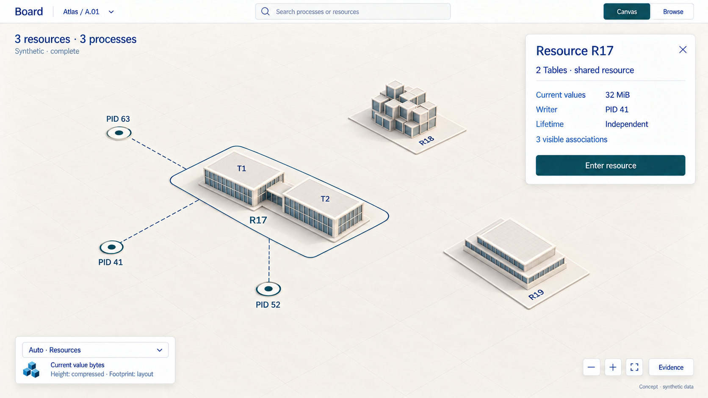
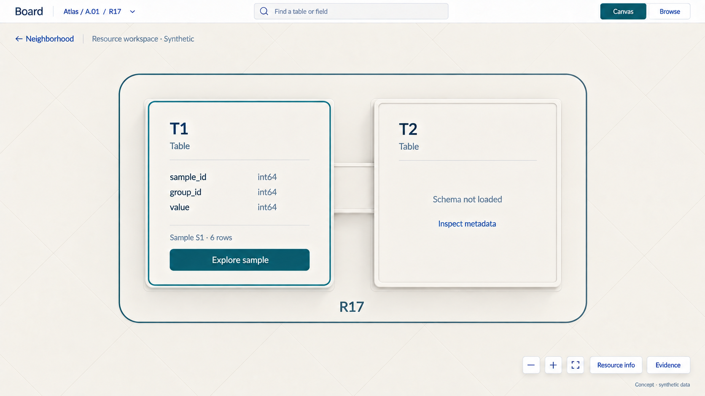
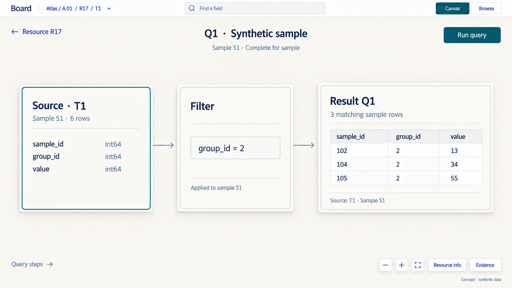
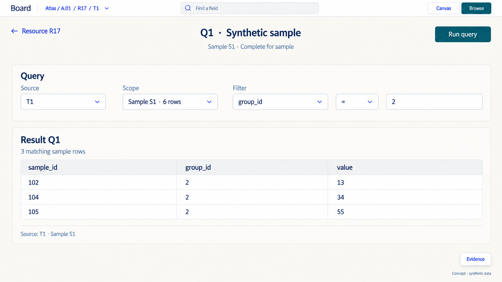

# D7 — Neighborhoods, resource portals and data workspaces

Previous: [D6 — Canvas emphasis and zoom](D6.md) · [Review index](README.md)

Status: **In review**. Implementation: **Not implemented**.
Four new generated images explore navigation and a future data workspace.
All data is synthetic; the query views extend beyond current Board inspection.

## Question

If processes read as fine-grained activity around resource landmarks, how do
we move between them? Can D6's overhead resource view become a doorway into
the data, with a query interface in Browse and a useful equivalent on Canvas?

## Proposal

Keep the subtle fabric of [D6, Figure 1](D6.md#figure-1-processes-in-front-resources-as-landmarks)
and the readable overhead footprint of
[D6, Figure 4](D6.md#figure-4-zoom-within-resources-reveals-flat-detail).
Let the experience move through **neighborhood → resource → data workspace**.
Processes provide local activity; resource architecture supplies landmarks.
Inside a resource, its declared structures become flat work areas. A selected
Table then opens a visual query worksheet or conventional query form.

This is a hierarchy of presentation. A process is not a child of its associated
resource: it can reference several resources, and several processes can share
one. A tiny resource and a busy process must remain discoverable too. The atlas
groups each population independently; a resource's logical Tables share its
actual backing identity, rather than merely appearing nearby.

| Move | What it should feel like | Intent |
| --- | --- | --- |
| Pull back from local process fabric | Lift your attention to the neighborhood; resource landmarks become more legible | Understand surrounding structure |
| Follow a process's chosen resource | Trace a disclosed association, then gently frame the existing resource plot | Go somewhere specific |
| Approach the building | Settle overhead as the roof becomes a readable footprint | Inspect and choose an entrance |
| Enter resource | Expand that footprint into a flat workspace, retaining its identity | Explore declared structure and data capabilities |
| Canvas / Browse inside | Recompose the same query and result | Choose spatial relationships or precise forms and rows |

Use **Canvas / Browse** as the two view names in this study: Canvas now includes
both the outer atlas and an inner workspace. Resource entry is navigation;
**Run query** is a separate deliberate action. Scrolling, selecting, entering
and changing representation do not execute a query.

## Visual studies

The first image follows the shared R17 neighborhood from D6. The remaining
three show the proposed interior and two representations of one sample query.
Use the original D6 figures as the approach views; their images are unchanged.

### Figure 1: Pull back to the neighborhood

The camera pulls back modestly while retaining the same six identities and
their relative layout. Resource architecture becomes the primary relief;
processes remain small context anchors. R17 is still one shared site with
32 MiB of current values. The quiet fabric remains the setting.

The combined legend introduces **Auto · Resources**. This is a candidate
extension to D6: Auto can adjust emphasis with navigation scale, while the
same dropdown can pin Processes or Resources. A pinned process atlas still
supports D4's regional and billion-process views.

**Review:** resource structure becomes easier to notice without replacing the
neighborhood. The raster is an approximate camera study; no extra population
or hidden ownership is implied by the wider view. Only resource height is
quantitative at this endpoint.

### Figure 2: Enter the building as a flat data room

After **Enter resource**, the two wings become work areas within the same R17
boundary. T1 exposes declared fields; T2 says **Schema not loaded**. Their area
does not encode bytes, row counts or physical storage. The three associated
processes stay outside the resource workspace.

The breadcrumb gains R17, and **Neighborhood** returns to the previous camera
and selection. Resource metadata moves behind **Resource info** rather than
occupying a second permanent panel. This is an overhead plan for choosing what
to explore, not a simulation of walking through a building.

**Explore sample** prepares a query workspace for the explicitly supplied
six-row sample S1. It does not execute a query. The sample is part of this
synthetic fixture, not a result of scanning values when the doorway opens.

**Review:** the footprint provides continuity, then gets out of the way of
reading. Keep the room metaphor light: logical Table identity matters; corridors,
floors and room sizes carry no additional data meaning.

### Figure 3: Canvas becomes a visual query worksheet

This shows Q1 **after an explicit Run query**. The worksheet makes the source,
condition and result visible together. Its arrows mean query dependencies,
distinct from the outer map's dashed process/resource associations. The result
is readable data, not another building or an unlabeled cloud of points.

The filter is `group_id = 2`. From the six illustrated source rows, it returns
sample IDs 102, 104 and 105 with values 13, 34 and 55. **Complete for sample**
is deliberately narrower than complete for Table T1. It establishes no full-Table
count, distribution or relationship to R17's 32 MiB resource total.

**Review:** this is a spatial worksheet for understanding a query. A later
result lens could show a chart, selected records or comparisons, but only with
explicit axes, types and coverage. Keep those choices driven by the data and
question rather than forcing every result into city geometry.

### Figure 4: Browse shows the same query and result

The source, filter, sample and completed result are identical to Figure 3.
The spatial cards become conventional controls and a wide result table. This
study uses a structured query form; it selects no SQL dialect or new textual
query language.

Changing the view must retain the draft, result identity, source revisions,
coverage and selected records. It does not rerun a query, refresh the snapshot
or silently translate to a different plan. An edited draft must mark an earlier
result as belonging to its previous execution until Run produces a new result.

**Review:** Browse provides precise composition and inspection. Canvas provides
room to understand relationships and, later, arrange bounded result views.
They should feel like two arrangements of one workspace.

## Design details

### Three scales, separate kinds of relationship

| Space | What is organized | What proximity or containment means |
| --- | --- | --- |
| Realm / neighborhood | Separate process and resource identities within an authorized scope | Stable presentation layout; neither distance nor adjacency grants access or establishes a dependency |
| Resource interior | Authorized logical structures and metadata of one backing resource | T1/T2 are Table keyspaces in R17; this example does not settle Document packaging |
| Query workspace | A source, allowed operations and their result | Explicit data dependencies and result provenance, not runtime process execution or resource ownership |

Processes can be visually finer-grained without becoming the bottom of a single
resource tree. Their group hierarchy and counts remain independently navigable.
Resource rooms organize declared structure; query cards organize a particular
analysis. A result tile is not a new durable resource unless a separately scoped
contract explicitly creates one.

### Auto is a proposal, with an explicit way to pin emphasis

D6 kept emphasis independent of zoom. D7 explores **Auto** as the default
navigation policy, while preserving explicit Processes and Resources choices.
Use the existing combined legend for this; do not add another toolbar.

In an unfocused neighborhood, zooming out can retire unreadable process detail
and favor resource landmarks. Zooming in reveals local process fabric when
that is the navigation target. **Focus on resource** follows that resource's
detail path instead; proximity to its center cannot turn it into a process.
An ordinary selection still opens its card without moving the camera.

Base detail thresholds on projected readability, with different entry/exit
thresholds to avoid flicker. Keep the resolved emphasis visible in the legend.
A pin wins over Auto and survives zoom, Back and return from a resource. Auto
does not override filters, select an object, enter a resource or run a query.
Exact thresholds and the default policy remain review questions.

Maintain D6's one-quantitative-relief rule. During a handoff, temporarily suspend
geometry-based metric picking and identify the presentation change. Preserve
exact authorized values and stable identity anchors. Loading, partial coverage
and unavailable metrics never become zero-valued landforms. Keep request,
scan, render and context budgets bounded at every level.

### How the movement should feel

| Trigger | Suggested sequence | Boundary |
| --- | --- | --- |
| Scroll out | Camera retreats around the user's focus; labels thin; emphasis settles at a readable neighborhood scale | No automatic selection, resource entry or query |
| Process → resource link | Resolve the chosen association; show its existing endpoint; frame both endpoints when practical; settle on the target plot | Choose explicitly when there are several resources; missing or denied targets cannot be guessed |
| Zoom toward a process center | Relief flattens into process queues and source evidence | The outbox well stays an outbox; it is not a portal into state |
| Focus a resource | Frame its existing footprint and approach overhead | Keep its identity and current selection legible; do not relocate it under the originating process |
| Enter resource | Hold the R17 label/perimeter while its footprint expands into the flat workspace; reveal declared structures | Intentional navigation after capability and access checks; no data query |
| Neighborhood / Back | Restore the preceding outer camera, emphasis, selection and applicable filters | Revalidate access and observation state; history does not grant permission |

For nearby associations, a short lateral glide should keep source and target
in view. For distant targets, use a brief orientation step at their common
authorized group before focusing the target; offer an immediate locate path
instead of flying across every intervening group. Missing intermediate evidence
cannot be filled with invented scenery or association endpoints.

At the doorway, favor a gentle expansion of the footprint into a readable
plane. The camera should settle before the workspace asks for attention.
Prototype roughly 250–400 ms for short explicit focus/entry moves; this is a
candidate range, not a measured animation. Let pan, wheel and keyboard actions
interrupt motion. Reduced motion uses the same endpoints immediately.

Use **Enter resource** as the clear keyboard and pointer action. A double-click
on the selected building could invoke the same navigation, but repeated scroll
alone should stop at its readable exterior. Once inside, wheel gestures navigate
the workspace; **Neighborhood** exits it. Entry needs no confirmation dialog.
The visible breadcrumb and Back target carry the sense of crossing a boundary.

### The interior follows declared structure

| Resource view | Canvas interior candidate | Browse counterpart |
| --- | --- | --- |
| Table | Named Table rooms, typed field source card, query steps and bounded result tiles | Declared schema, structured query form and read-only typed rows |
| KV | Bounded key/range cards and explicit lookup results; namespace grouping only when declared | Authorized paged keys and explicit value reads; opaque values remain opaque |
| Document, proposed | Declared outline/path cards and bounded materialized subtrees | Structured/text inspection at a stated accepted change basis |
| Unknown or undisclosed structure | Generic resource metadata and available read capabilities | The same explicit metadata/read surface, without invented rooms or fields |

These interiors do not change D5's external height measure. Once inside, layout
area is organizational; the skyline's byte scale is inactive. Resource info
retains the full-resource metadata. A query result carries its own units and
coverage. Neither a sample nor a result's row count replaces the resource total.

### One query state across Canvas and Browse

Keep one typed draft and one explicitly identified result, with source/resource
and descriptor revisions, parameters, sample/page boundaries and completion
state. Both views edit the same allowed operations and display the same result.
Unsupported operations remain unavailable in both; Canvas cannot silently lose
parts of a query on the way to Browse. A textual editor is a later qualified
frontend choice, not an alternate source of query semantics.

Run is explicit and bounded. Preserve the previous result's execution basis
when a draft changes; cancel or supersede requests without accepting late results
for a newer draft. Partial batches and failed reads cannot be reported as complete.
Current authorization applies to source discovery, schemas, values and results
separately. Known denial clears protected data in both representations and in
return state. Remembering a workspace creates no offline copy or retention pin.

## Review outcome

The reviewer endorsed D5's visual work and D6 Figures 1 and 4: subtle process
fabric with resource landmarks, then an overhead view for focused inspection.
They proposed a building portal leading to query mode in Browse and asked what
the Canvas equivalent could be. These are the accepted visual starting points.

**No D7 behavior is selected yet.** Auto emphasis, resource entry, a visual query
worksheet and its transitions are new proposals. This review extends D6's
explicit emphasis model; it does not retroactively accept its neutral handoff
or establish that processes belong inside resource buildings.

## Open questions

- Should Auto be the initial atlas policy, or should emphasis remain explicitly
  selected until the viewer chooses Auto?
- Does the resource footprint expanding into a workspace feel continuous enough
  without a literal tunnel or interior architecture?
- Is the visual query worksheet the useful first Canvas interior, or should a
  single result lens receive more space and keep query steps on demand?
- Does an explicit Enter resource action feel natural at the end of the approach?

## Evidence and limits

The images are static concept frames, not a working portal or evidence of motion
quality. Camera paths, geometry, typography and hit areas still need a prototype.
The [fixture](board-atlas/d7-fixture.json) reuses D5/D6 resource and association
facts, then supplies a separate six-row synthetic sample and an exact filter
result. It does not derive a full Table population or byte total from that sample.
Q1, S1 and revision labels are fixture identities, not a new public wire schema.

Current [Board](../BOARD.md#public-inspection-contract) and
[Table inspection](../TABLES.md#access-lifetimes-and-inspection) do not provide
this query workspace. Board remains inspection-only. In particular, M9's
durable request/captured-reply query path consumes inputs and records results;
it cannot be hidden behind an existing Board read grant or a navigation gesture.

The data workspace requires a separately scoped public query/read capability
and an explicit decision about its service boundary before implementation.
Keep query semantics with [Fuze](../FUZE.md), use only qualified operations and
authorized typed projections, and bound execution and result delivery. Board
must not decode opaque application values, invent column meanings, dispatch
handlers, write results into source resources or access providers directly.
The mockup's generic typed rows are supplied evidence for a future capability,
not permission to reinstate an application-specific lens.

KV/Document query adapters and text/SQL frontends retain their own
[roadmap](../roadmap/README.md) gates. This design grants no current source access,
cross-resource snapshot, query language, capacity, export or editing capability.
Scope any implementation through a new numbered milestone under the
[sequencing rule](../roadmap/README.md#maintaining-the-sequence).

A future prototype must qualify reversible camera/selection restoration,
several/shared/unassociated resources, distant targets, missing descriptors,
permission changes during entry or queries, partial/expired results, switching
views with a dirty draft, rapid interruption and reduced-motion/keyboard use.
Choose the transition by observing those interactions, not by the still images.

## Supporting material

- [Four new PNG studies](board-atlas/images/), with `d7-` filenames; all earlier images remain unchanged.
- [Exact built-in image prompts](board-atlas/d7-prompts.json); final images are copied without raster post-processing.
- [Scene, navigation and sample-query fixture](board-atlas/d7-fixture.json).
- [D5 mapping reference](D5.md#visual-mapping-reference).
- [D6 visual starting points](D6.md#visual-studies).

Previous: [D6 — Canvas emphasis and zoom](D6.md) · [Review index](README.md)
