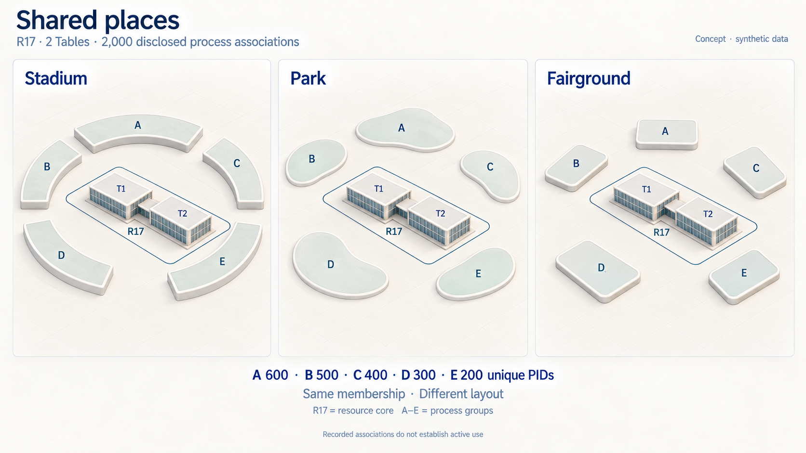
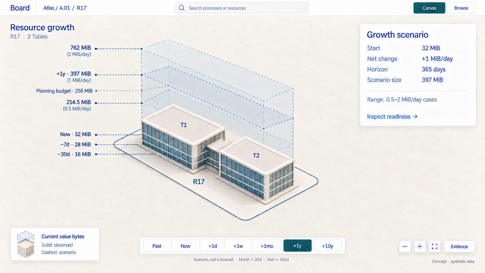
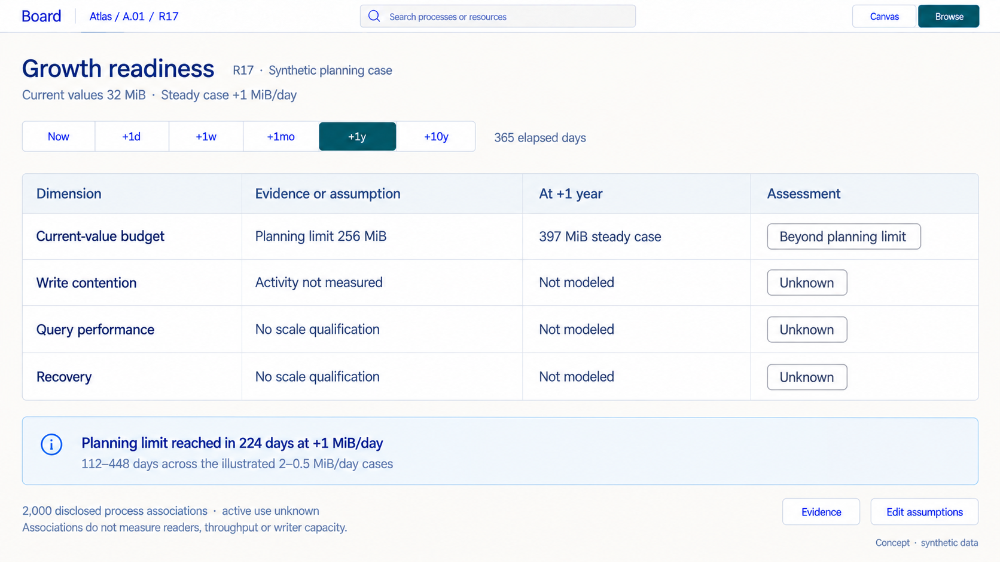

# D8 — Shared venues, growth and resource readiness

Previous: [D7 — Resource portals and data workspaces](D7.md) · [Review index](README.md)

Status: **In review**. Implementation: **Not implemented**.
Three generated studies compare venue layouts, growth over time and a planning
assessment. All populations, observations, rates and budgets are synthetic.

## Question

What does a resource with many associated processes look like in the cityscape?
Could stadiums, parks and fairgrounds express that shared use? How can the same
building show its past, current size and possible growth over a day, week,
month, year or decade—and whether it is ready for that growth?

## Proposal

Let a heavily shared resource become a **shared place**. Its Table, KV or
Document architecture remains recognizable at the center; bounded groups of
associated processes give its surroundings the character of a stadium, park
or fairground. This adds a presentation category, not a new resource kind.

Keep three dimensions distinct:

| Dimension | Visual expression | Meaning |
| --- | --- | --- |
| Structure | The resource building and its declared wings or modules | Resource identity, kind and logical structures |
| Participation | Disclosed process groups around that building | Distinct processes with recorded associations; activity requires separate evidence |
| Change over time | Solid observed levels and a dashed future envelope | Known size at stated observations, then conditional size under explicit assumptions |

A stadium is a promising first candidate: the resource is the shared focus,
and its surrounding sectors give many groups a readable address. A park offers
more open space for distributed groups. A fairground emphasizes distinct group
clusters. Compare them using the same facts before assigning automatic rules.

Growth should feel like an outline of what this same place could become.
Keep its location and footprint stable. Show current mass solid, historical
measurements as dated levels, and the selected future case as a dashed shell.
A readiness view then asks separate questions about size, writes, queries and
recovery. It must be able to answer **Unknown**.

## Visual studies

### Figure 1: One resource, three shared-place layouts

Each panel repeats **the same R17**, its two logical Tables and the same five
disjoint groups: A 600, B 500, C 400, D 300 and E 200 processes. These are three
layout alternatives, not three resources or three populations.

The stadium uses a segmented ring; the park uses separated open islands; the
fairground uses distinct plaza cells. The process groups sit outside the
resource boundary. Their size, spacing and number of drawn sections are
schematic: counts come from the labels, not seats or occupied floor area.
R17's byte-height scale is inactive in this participation comparison.

**Review:** the resource can feel socially large while remaining small in
bytes. Preserve the building's identity and arrange its surroundings to make
sharing legible. The association count alone says nothing about active users,
concurrent readers, writer contention or throughput.

### Figure 2: The current building inside a future envelope

The selected horizon is **one year, or 365 elapsed days**. Starting at 32 MiB,
a chosen net increase of 1 MiB/day gives 397 MiB. Two alternative rates,
0.5 and 2 MiB/day, give 214.5 and 762 MiB. These are conditional cases, with
no assigned probabilities. The rates are not fitted to the three past samples.

The grey 256 MiB line is a **planning assumption**, not an enforced quota or
measured physical capacity. It lies between the low and steady year cases.
Historical marks show supplied observations at −30 days, −7 days and now;
missing intervals are not invented.

**Review:** the solid building answers “what has been observed?” and the
dashed shell answers “what follows from this assumption?” The selected horizon
gets the space. Other horizons stay on one strip rather than producing seven
competing buildings. Geometry is illustrative; the table below supplies exact
values.

### Figure 3: Readiness is a set of evidence-backed questions

At the selected rate, the resource reaches its 256 MiB planning level after
224 days and exceeds it thereafter. Across the three rate cases, that crossing
ranges from 112 to 448 days. This calculation compares like units: current
live value bytes against a planning budget in current live value bytes.

The other rows remain **Unknown** because this fixture supplies no workload
measurements or scale qualification. Two thousand associations cannot establish
two thousand active readers, and they cannot establish two thousand writers.
There is no overall health score.

**Review:** a concrete planning mismatch is useful even when other evidence
is absent. “Below planning limit” would still not establish that a resource
is ready for its workload. **Edit assumptions** changes this local comparison;
it does not resize, migrate or mutate a resource.

## Design details

### Venue vocabulary and grouping

| Layout | Suggested use | What must be explicit |
| --- | --- | --- |
| Stadium | One shared focus with a small number of readable surrounding sectors | Each sector's grouping rule, disclosed membership and count |
| Park | Groups that benefit from more separation and open space | Gaps are layout space; they do not mean spare capacity or lower load |
| Fairground | Several distinct cohorts sharing the same resource | Pavilions are process summaries, not extra resources or inferred applications |

Use these as candidates for arranging a known relationship. Do not infer
business roles from opaque values or choose an entertainment shape merely
because a count crossed an arbitrary threshold. R17 remains a Table-backed
resource in every candidate; KV modules and Document terraces could retain
their own resource architecture inside the same surrounding venue vocabulary.

At greater scale, replace individual process marks with bounded, disjoint
cohort summaries. Refine one selected cohort as space permits; keep its parent
and resource anchor stable. Labels disclose the counted scope and coverage.
The renderer must not create one mesh, request or client-side scan per PID.

A process can associate with several resources. Its appearance near R17 and
R18 does not make two processes or two owners. Resource-local association
counts cannot simply be summed into a realm-wide unique-process count.
A global view needs its own deduplicated aggregation and disclosed basis.
Incomplete or undisclosed membership stays incomplete; absence is not zero.

Groups should retain stable addresses as membership changes. A changed count
can update a label without rearranging every plot. Opening a venue should use
the selected resource's existing location, not move it toward the originating
process or expand its physical footprint according to audience size.

### Exact growth cases

The [fixture](board-atlas/d8-fixture.json) uses:

`size at d days = 32 MiB + net MiB per day × d`

One MiB is 1,048,576 bytes. Month means 30 elapsed days, year 365, and decade
3,650; these are disclosed planning conventions, not calendar arithmetic.

| Horizon | Elapsed days | Low: +0.5 MiB/day | Steady: +1 MiB/day | High: +2 MiB/day |
| --- | ---: | ---: | ---: | ---: |
| Now | 0 | 32 MiB | 32 MiB | 32 MiB |
| Next day | 1 | 32.5 MiB | 33 MiB | 34 MiB |
| Next week | 7 | 35.5 MiB | 39 MiB | 46 MiB |
| Next month | 30 | 47 MiB | 62 MiB | 92 MiB |
| Next year | 365 | 214.5 MiB | 397 MiB | 762 MiB |
| Next decade | 3,650 | 1,857 MiB | 3,682 MiB | 7,332 MiB |

The supplied past samples are 16 MiB at −30 days, 28 MiB at −7 days and
32 MiB now. Each has its own synthetic source revision. These do not establish
a trend, a complete history or the availability of values from those dates.

Keep one disclosed compressed height mapping across the time comparison.
Changing the horizon must not silently renormalize every building. Exact
values and units remain available; a subtle day-scale difference can be
numerically meaningful without exaggerating it into a new skyscraper.
A decade case is a sensitivity exercise: it assumes the selected net rate
persists for 3,650 days. It is not a ten-year forecast.

Real change can involve bursts, compaction, deletions, metadata, changing
workloads and schema or topology changes. Those mechanisms need separate
models and evidence. This example holds the association population and
resource structure fixed; it predicts no future PIDs, rows or Table wings.
Low/high cases are neither confidence intervals nor best/worst guarantees.

Keep past observations above the same ground plane as current resource size.
Depth in the process fabric already has an outbox meaning. Do not reuse a
basement or depression to mean old data, negative growth or resource debt.

### Growth has more than one measure

D5's current live value-payload bytes remain this study's size measure. They
include stored framework, causal and captured-result values, and exclude
physical storage accounting. Growth readiness needs other measures too:

| Resource dimension | Useful additional measure | Interpretation limit |
| --- | --- | --- |
| Table | Live rows/keys, typed widths, query selectivity and working set | Byte growth alone cannot predict query cost or index effectiveness |
| KV | Live keys, value-size distribution, hot-key concentration and mutation rate | More associations do not establish contention or operations per second |
| Document, proposed | Materialized content, retained causal metadata and change rate as separate measures | A short visible document may still have substantial causal state |
| Shared participation | Disclosed associated PIDs, then separately measured active readers and writer activity | Association is neither access permission nor recent use |
| Recovery and retention | Retained state/history, replay work and applicable lifecycle policy | Live value bytes are not disk use, recoverability or a retention guarantee |

Use a selected metric with named units, basis and coverage. Do not combine
these into one implied “building size” score. Cohort count changes, data growth
and writer pressure can move independently.

### What “fit for growth” should require

| Question | Required comparison | This example |
| --- | --- | --- |
| Does the selected size fit the planning budget? | Same byte metric and horizon, explicit assumed budget and rate | Year case 397 MiB exceeds assumed 256 MiB; current headroom is 224 MiB |
| Does it fit physical capacity? | Actual physical accounting, enforced limits and applicable capacity evidence | Unknown; logical live bytes cannot answer this |
| Can the writer sustain the workload? | Current writer role plus measured commit rate, contention and a stated workload target | Unknown; R17's writer PID is 41, regardless of its 2,000 associations |
| Will the intended queries remain usable? | Qualified operations, data distribution, concurrency, memory and an explicit performance requirement | Unknown |
| Can it recover within the required time? | Retained state and tail, replay/recovery proof, environment and recovery requirement | Unknown |
| Is the lifecycle policy appropriate? | Explicit application policy, supported retention/expiry rules and preserved recovery evidence | No policy change proposed |

Distinguish a user's planning assumption, an enforced limit, an observation
and a measured qualification. A “ready” claim needs an explicit requirement
and evidence for the matching workload, version and environment. A result
outside tested coverage remains unqualified even if an arithmetic budget fits.

An eventual mismatch could prompt investigation of data shape, query plans,
workload or architecture. This review chooses no automatic scaling action.
Splitting resources can change commit boundaries; it is not a cosmetic way
to add another wing. Capacity pressure does not authorize expiry, deletion
or discarding accepted work. [Retention](../RETENTION.md) remains explicit
application policy, with unlimited retention by default.

### Keep time contextual and preserve the resource doorway

Time controls belong to the selected resource's growth view. Keep one horizon
strip and one compact assumptions surface, with detail available in Browse.
Reuse the existing metric/legend area for participation or size instead of
adding permanent dashboards around the map. Show historical coverage and
missing samples when Past is selected.

Canvas and Browse retain the same resource, horizon, cases, metric and
observation basis. **Edit assumptions** changes local scenario state only.
Switching views must neither refresh the underlying observation silently nor
execute a query. The current example's participation population stays fixed
while its size cases change.

The [D7 portal](D7.md) still enters a real, stated observation of the resource.
A future shell has no future rows to query. Entering from a scenario view should
open the current observed basis by default and make that basis visible.
A historical interior requires an explicitly supported, currently authorized
historical read; a past size sample alone does not supply one. Changing this
time overlay cannot rerun Q1 or turn its sample into a different dataset.

## Review outcome

The reviewer proposed stadiums, parks and fairgrounds for resources with many
processes, and asked for past/future growth and readiness across day through
decade horizons. This review visualizes those questions.

**No D8 layout or time interaction is selected yet.** Stadium is the initial
recommendation to compare with Park and Fairground. D5's resource mappings,
D6's selected subtle fabric/overhead detail and D7's proposed resource doorway
remain the starting points; this study changes neither resource ownership
nor the meaning of the process outbox.

## Open questions

- Does a stadium's shared focus make groups easier to read than the park or
  fairground, and which declared grouping should define its sectors?
- Is one future envelope enough, or would a pinned second horizon help compare
  two planning choices without crowding the main canvas?
- Which actual workload, budget and recovery requirements should readiness
  assess first?
- Should historical comparison emphasize selected observed levels or a small
  time series beside the building when samples become dense?

## Evidence and limits

The images are static, uncalibrated concept studies. The fixture defines exact
counts, byte arithmetic and cases; pixels do not establish quantitative height
ratios, capacity, motion quality or readable interaction at scale.

D8 supplies an independent expanded participation scenario for R17. It reuses
D5/D6 resource metadata but does not claim the earlier three-process scene
grew into 2,000 processes. The PID ranges are reproducible fixture membership,
not a proposed production grouping policy. Observed samples are synthetic,
and the generation prompts preserve the targeted correction that places the
planning line between the low and steady year envelopes.

Current [Board inspection](../BOARD.md#public-inspection-contract) provides
neither this history/scenario model nor a qualified scalable participation
and readiness surface. Future aggregation must use bounded public reads or
summaries with explicit revisions, coverage and current scoped authorization;
Board cannot scan providers or decode opaque application values to infer use.
Association endpoints and counts must respect disclosure. Known revocation
must remove protected contributions, including remembered historical views.
Independent samples do not imply a global transactional snapshot.

[State](../STATE.md), [Tables](../TABLES.md), [Fuze](../FUZE.md) and
[Retention](../RETENTION.md) retain their contracts. Associations do not grant
access or imply lifetime ownership. Resource history, monitoring and future
query workspaces need separately scoped public capabilities; arithmetic and
rendering do not supply them. Existing paging/boundedness work is not evidence
of Board qualification for these populations.

Implementation and its adversarial/scale proofs belong in a separately scoped
roadmap milestone; [M13](../roadmap/M13.md) explicitly excludes this review's
venue layout and growth/readiness treatment pending further review, rather
than scheduling them. This review introduces no query execution, resource
mutation, retention change, new public
schema, deployment action or capacity claim.

## Supporting material

- [Three new PNG studies](board-atlas/images/), with `d8-` filenames; all earlier images remain unchanged.
- [Exact built-in image prompts and refinement](board-atlas/d8-prompts.json); final images are copied without raster post-processing.
- [Participation, observations, growth cases and readiness fixture](board-atlas/d8-fixture.json).
- [D5 resource mapping reference](D5.md#visual-mapping-reference).
- [D7 resource entry and shared query state](D7.md#one-query-state-across-canvas-and-browse).

Previous: [D7 — Resource portals and data workspaces](D7.md) · [Review index](README.md)
