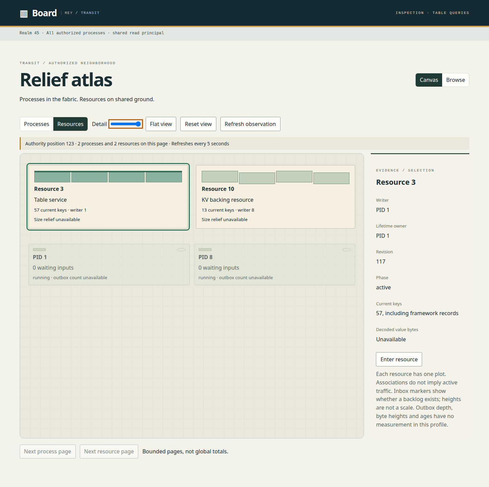
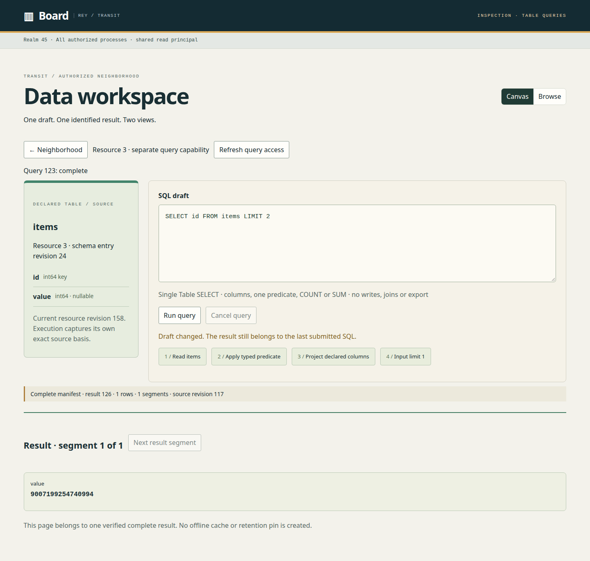

# D9 — Implemented bounded atlas and Table workspace

Previous: [D8 — Shared venues, growth and resource readiness](D8.md) · [Review index](README.md)

Status: **In review**. Implementation: the M13 engineering baseline is implemented;
qualification is recorded in [M13](../roadmap/M13.md) and the
[test guide](../../tests/README.md#m13-public-query-access). This is not a new
reviewer acceptance of D7 or D8.

## Question

Which part of the accepted D5/D6 visual foundation and D7 workspace can ship
with today's authorized, bounded metadata and M12's Table SQL compiler?

## Proposal

Use explicit Processes/Resources emphasis, a flat overhead detail level, and a
separate Enter resource action. Keep one SQL draft, frozen submission identity
and verified result across Canvas and Browse. Execution is an explicit action.
This focused baseline follows the user's instruction to implement M13; the
optional interaction preference has no recorded reviewer response.

Each authorized backing resource has one stable plot. A configured Table service
has a Table landmark; generic backing KV resources remain inspectable without
an application decoder. Subtle process markers show whether inputs are pending.
Unavailable byte sizes, outbox counts and ages remain labeled unknown, with no
fabricated quantitative relief. Selection exposes exact IDs, writer/lifetime
ownership, revisions and current key counts including framework metadata.

## Visual studies

The runnable implementation is the study, using the real embedded Board and
public growing inspection/query routes. `just transit-board::query-browser`
produces `.cache/verification/m13-board-atlas.png` and
`.cache/verification/m13-board.png` from the 41-row qualification fixture.
These are implemented UI screenshots, not capacity or production-workload claims.

### Figure 1 — Authorized neighborhood at overhead detail

The fixture has two processes and two resources. Size relief is explicitly
unavailable, and key counts include framework metadata. The selected plot has
an explicit entry action; other resource types acquire no query adapter.

### Figure 2 — One identified result with an edited draft

The result belongs to the last submitted SQL while the draft is being edited.
Browse renders the same segment as typed rows. The displayed source revision is
captured evidence, not a promise that a later query would see the same data.

## Review outcome

The implementation uses the focused baseline above. No new visual acceptance is
recorded. D5/D6's earlier selected architecture and overhead detail remain the
foundation; D7 and D8 retain their existing review status and alternatives.

## Open questions

- Auto emphasis and animated entry remain D7 design follow-ups.
- Venue layouts, growth envelopes and readiness remain D8 proposals.
- Quantitative relief needs a versioned metric/coverage contract before heights
  can represent bytes, outbox size or age.
- Larger populations require qualified summaries and grouping; eight-item pages
  do not establish a scalable global map.

These proposals are outside the implemented M13 baseline. If selected for
implementation, give the additional work its own numbered milestone following
[the sequencing rule](../roadmap/README.md#maintaining-the-sequence); do not silently
fold it into M15's document/query scope.

## Evidence and limits

The first growing Board profile supports one unscoped inspection principal with
separate resource grants, one configured Table and one distinct query principal.
The default legacy inspection profile and grant remain unchanged. Query hosts
run outside Board. Current authorization gates each result read; no opaque
application values are decoded by inspection. All typed result cells come from
verified complete query manifests and bounded Arrow segments.

Switching Canvas/Browse preserves draft/result and makes no submission. A changed
draft is labeled while the previous result remains identified. Unknown mutation
outcomes retain exact tokens for explicit retry. Known denial or expiry clears
protected workspace state. No offline persistence, saved query or retention pin
is introduced. Reference-deployment capacity and hosted CI timing for this new
profile remain unmeasured.

## Supporting material

- [Atlas implementation](../../apps/transit-board-web/src/atlas.tsx).
- [Shared workspace](../../apps/transit-board-web/src/query-workspace.tsx).
- [Real browser proof](../../apps/transit-board-web/browser/query.spec.ts).
- [Public query contract](../../contracts/PUBLIC_QUERY_V1.md).
- [Configuration and deployment](../../apps/transit-board/docs/configuration.md#growing-atlas-and-optional-table-queries).

Previous: [D8 — Shared venues, growth and resource readiness](D8.md) · [Review index](README.md)
