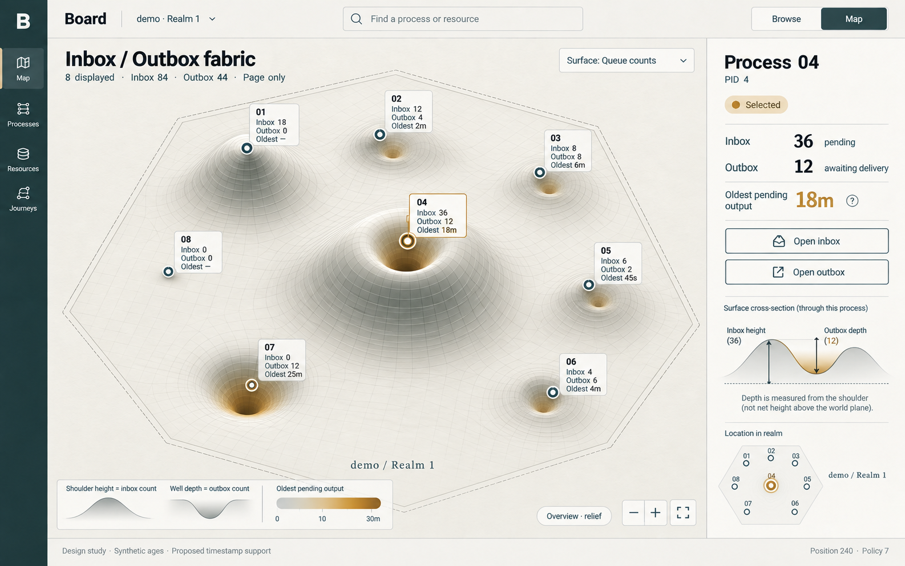
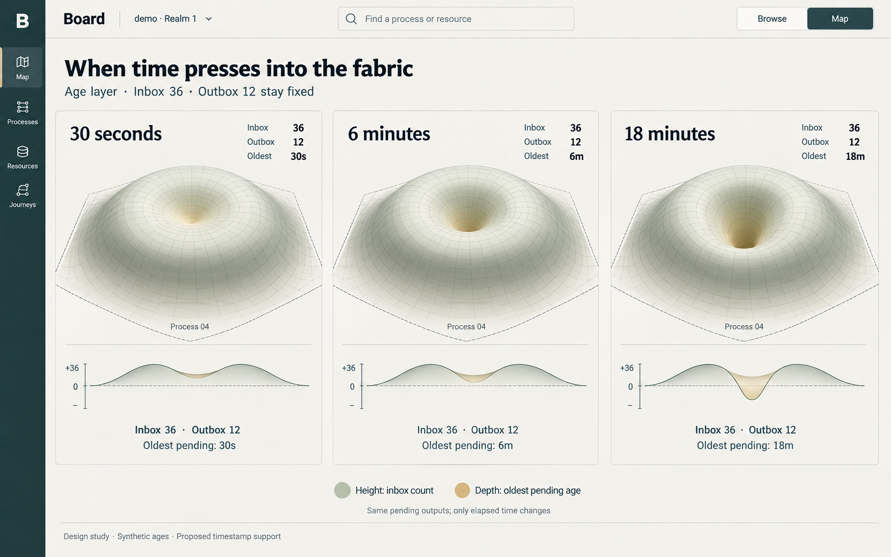
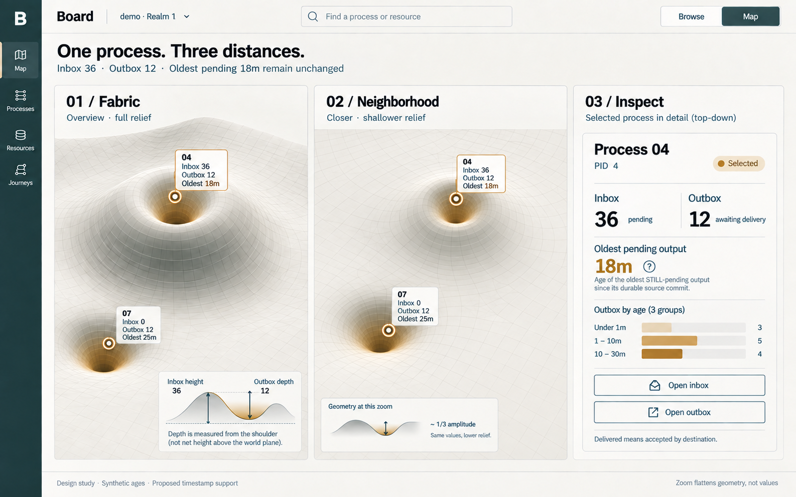

# D2 — Board inbox, outbox and age

Previous: [D1 — Browser and relief atlas](D1.md) · [Review index](README.md) · Next: [D3 — Process scale](D3.md)

Status: **Accepted in part**. Implementation: **Not implemented**.
Figure 7 is the selected visual direction; the other figures remain exploratory.

## Question

How can one fabric show an inbox, an outbox and the age of pending outputs
without hiding one queue inside the other?

## Proposal

An inbox lifts a broad shoulder. An outbox presses a narrower well into it.
The selected queue-count view colors the well walls by age. A separate
alternative uses age to control depth. Both sides flatten near reading distance.

## Visual studies

### Figure 7: Queue counts with age on the well walls

This is the selected visual direction. A process's broad shoulder height represents
its pending inbox count. A narrower central well represents its pending outbox
count, with depth measured down from the shoulder. Age is an additional tint
on the inner walls, accompanied by a number.

Process 01 has 18 inputs and no pending outputs: a mound. Process 07 has no
pending inputs and 12 pending outputs: a depression below the neutral sheet.
Process 04 has both: a raised mound with a hollow crown. Process 08 is flat.
This separates incoming work from outgoing delivery without subtracting one
queue from the other.

**Review:** the silhouette communicates the two queues more clearly than the
original hills. The inset section helps explain why a raised process can also
have a deep outbox. Age tint adds a third measure without changing the count
geometry, although material shadows and tint need contrast testing.

### Figure 8: An alternative: age controls depth

Here the layer explicitly changes: height still represents inbox count, but
depth now represents the oldest pending output's age. Outbox count remains a
numeric label. The same 12 outputs remain pending at three hypothetical
observation times; their oldest age grows from 30 seconds to 6 minutes to
18 minutes. Inbox 36 and shoulder height stay fixed.

The common baseline and sections show the depression eventually reaching
below the neutral fabric. These are synthetic observation stages, not a
history playback feature or a physically simulated process.

**Review:** this most directly explores time pressing into the fabric. It makes
a small but old outbox visually prominent. It must be a distinctly named age
layer: users must not mistake a deeper well for more messages. A change in
layer changes the depth legend and preserves the numeric count.

### Figure 9: Both sides flatten into an inspector

The selected process retains Inbox 36, Outbox 12 and oldest pending age 18m.
Both the upward shoulder and downward well lose amplitude on approach. At
reading distance, two balanced sections expose the queue counts and an age
distribution: 3 outputs under one minute, 5 from one to ten minutes, and 4 from
ten to thirty minutes.

**Review:** the flat card keeps the concept useful when geometry is no longer
legible. The section view is explanatory review material; a shipping inspector
may not need that much geometric explanation.

## Design details

### Proposed language

Use **Inbox** and **Outbox** in navigation, with the technical identity and exact
disposition available in details. Inbox is the display name for the process's
durable mailbox; this does not rename a protocol type.

- **Inbox pending:** admitted minus consumed minus cancelled inputs.
- **Outbox awaiting delivery:** disclosed committed output records still in the
  pending phase. This can include an output already admitted at its destination
  whose resolution has not yet been recorded at the source.
- **Delivered:** destination admission, not destination turn completion.
- **Oldest pending output:** the oldest durable source commit among the
  displayed still-pending outputs, measured at an explicit observation time.

The outbox includes terminal delivery records too. Delivered, denied, expired,
retired and cancelled records do not contribute to the pending well. Their
outcomes remain inspectable; a shrinking well is not proof of successful
delivery. External effects keep their separate inspection model.

### Keep the encodings independent

| Layer | Broad shoulder height | Central well depth | Age presentation |
| --- | --- | --- | --- |
| Queue counts | Pending inbox count | Pending outbox count | Labeled inner-wall tint |
| Outbox age | Pending inbox count | Oldest pending output age | Depth scale plus exact value |
| Flat inspection | Numeric inbox count | Numeric outbox count | Exact oldest value and age groups |

Counts and ages have independently labeled scales. A signed net count would
hide a busy process with equally large queues. Depth is relative to the raised
shoulder, so both signals survive even if the well's floor reaches the neutral
plane. One consumed input may produce zero or many outputs.

Use fixed scales across a view, rather than rescaling to whichever process is
visible. The illustration's 0–30 minute tint scale is a comparison range, not
an expiry limit, incident threshold or SLA. If a rendered scale saturates,
show an explicit over-range value; never silently truncate the number.

Keep selection as a shape/outline as well as color. The generated images retain
some amber selection treatment from their reference; production styling should
separate that from age tint. Unknown age needs a neutral labeled treatment,
not the color assigned to a young output.

Both deformations multiply by the same presentation-only relief factor as
zoom increases. Counts, ages and selection do not change when that factor
reaches zero. Mesh bends between anchors are illustrative interpolation, not
additional measured work or causal relationships. Do not let a continuous
fabric imply observations beyond the authorized query window.

## Review outcome

The reviewer selected **Figure 7: Queue counts with age on the well walls** as
the concept to carry forward, with tuning deferred. Use **Inbox** and
**Outbox** as the interface labels.

Figure 8's age-driven depth is an explored alternative, with no selection
recorded. Figure 9 illustrates the proposed transition to a flat inspector.
Neither is a claim that motion or implementation has been approved.

[D3](D3.md) carries Figure 7 forward into the scale exploration.

## Open questions

- Can viewers distinguish inbox-only, outbox-only, both busy and empty processes?
- Are age tint and selection clear under shading, reduced motion and flat viewing?
- Is an explicit age-depth layer useful enough to keep alongside queue counts?

## Evidence and limits

All illustrated ages are synthetic. The selected visual direction still needs
the timestamp support and qualification described below.

### Age requires a new evidence contract

The current [outbox type](../../../packages/zig/transit-protocol/src/root.zig)
has no durable creation timestamp. Its resolved-at field is a journal position,
not elapsed time. [Inspection events](https://github.com/spoke-sh/transit/blob/425b7243595f46397be2f4165bd8f6b2ecc2b6ee/packages/zig/transit-protocol/src/Inspection.zig)
only expose event time for recorded authority clock samples; most operations
have none. The [inspection contract](../../../contracts/INSPECTION_V1.md) does not
promise historical snapshots or a clock timestamp for each output.

Consequently, every age in this study is synthetic. A running implementation
must show **Age unavailable** with today's unsupported evidence. Neither
journal distance, first appearance in Board, refresh time nor process uptime
can be substituted for source-commit age.

Before enabling the proposed age layer, define and qualify:

1. A durable source-commit time for each output, with an explicit authority
   clock basis and error bounds. Retry or worker replacement does not reset it.
2. A compatible as-of observation time and pending set. Compute oldest age
   over that set, not a mixture of query cuts.
3. Retention/checkpoint behavior for timestamps while outputs remain pending,
   so lost source-history pages do not silently reset or invent age.
4. Clock uncertainty, rollback and unavailable-time presentation. Invalid or
   missing evidence does not become zero seconds.
5. Authorization of both source and destination. Age extrema, distributions,
   geometry and labels reveal nothing about hidden routes.
6. Coverage: partial views say oldest in displayed outbox, not oldest for the
   process. Unknown timestamps make the oldest age unknown unless the response
   explicitly qualifies a partial estimate.

Age is evaluated at the reported observation, not continuously fabricated from
the browser clock. During transport failure, hold the last-observed age and
mark it stale. A successful refresh can recompute it from qualified evidence.
Known denial clears age-derived colors and geometry along with counts.

When the oldest output resolves, the maximum age can drop abruptly; that does
not mean another message became younger. An empty pending set has no oldest
age (display an em dash), whereas a nonempty set without timestamp evidence has
unknown age. These cases must stay distinct.

### Synthetic scene extension

The first study's inbox counts and positions are unchanged. All example outbox
routes are assumed authorized and completely represented for each displayed
process; this is not a claim that a process-list page alone supplies these facts.

| Process | Inbox pending | Outbox pending | Oldest pending output |
| --- | --- | --- | --- |
| 01 | 18 | 0 | None |
| 02 | 12 | 4 | 2m |
| 03 | 8 | 8 | 6m |
| 04 | 36 | 12 | 18m |
| 05 | 6 | 2 | 45s |
| 06 | 4 | 6 | 4m |
| 07 | 0 | 12 | 25m |
| 08 | 0 | 0 | None |

The displayed sums are Inbox 84 and Outbox 44. The selected process's 12 pending
output ages, in seconds, are 10, 20, 45, 120, 180, 240, 360, 480, 660, 720, 900
and 1080. They yield the 3/5/4 age groups and the 18-minute oldest value in the
flat card. The separate age-depth comparison uses a hypothetical pending set
at three instants; it is not a replay of those twelve ages.

The pictures are generated design compositions. Exact curve proportions,
interpolation, camera anchoring, occlusion, legibility and motion still require
a prototype. They preserve the current inspection-only, bounded-read and
single-realm boundaries.

Age support needs an explicitly versioned evidence contract and a newly scoped
numbered milestone before implementation. The completed M2 profile is unchanged;
see the [milestone relationship](D1.md#milestone-relationship).

## Supporting material

[Exact prompts and refinement](fabric-prompts.json) record the
built-in image tool calls. Figures 7 and 8 used the original relief overview as
a style reference; Figure 9 used the fabric overview. The selected
[images](images) have no raster post-processing.

Previous: [D1 — Browser and relief atlas](D1.md) · [Review index](README.md) · Next: [D3 — Process scale](D3.md)
