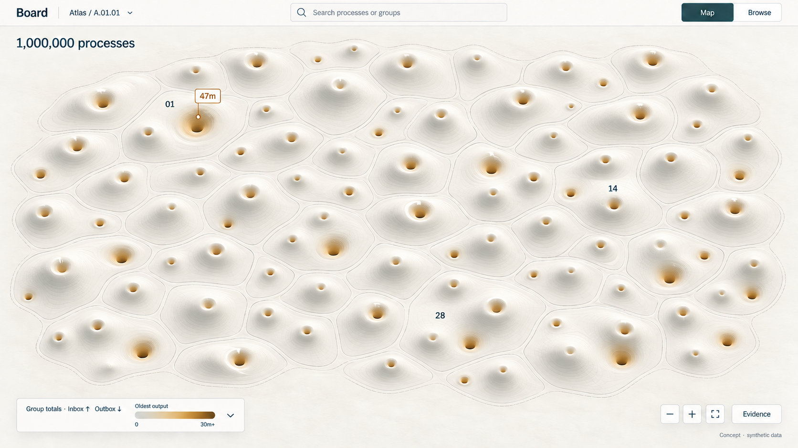
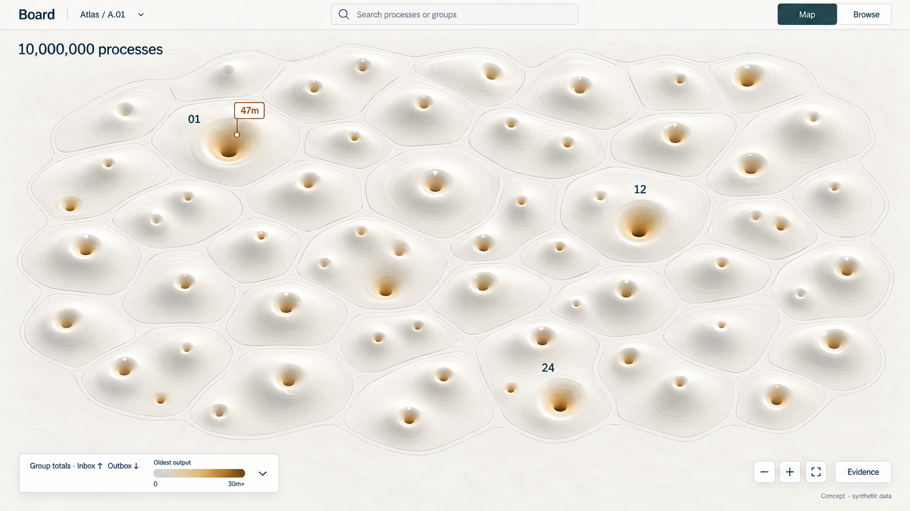
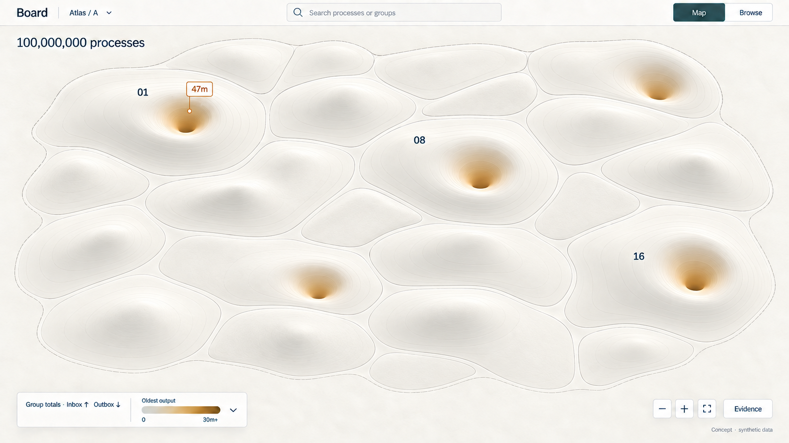
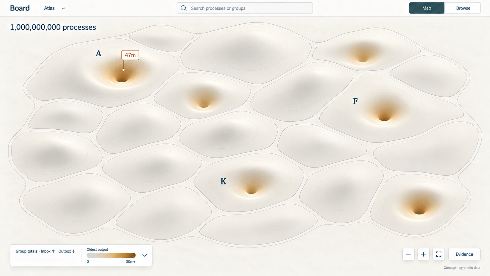
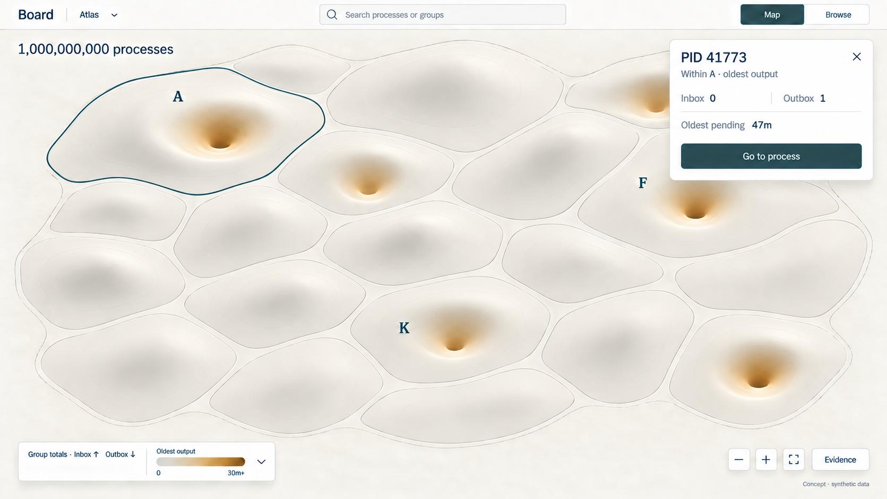

# D4 — Board fabric from one million to one billion processes

Previous: [D3 — Process scale](D3.md) · [Review index](README.md) · Next: [D5 — Resource cityscapes](D5.md)

Status: **Reviewed**. Implementation: **Not implemented**.
All five images use synthetic populations and ages.

## Question

How should the cellular fabric extend to 1,000,000, 10,000,000, 100,000,000 and
1,000,000,000 processes? Can we give the map more room while keeping an exact
route back to a process?

## Proposal

Yes: the increasingly organic appearance in [D3](D3.md) is intentional.
Rounded group boundaries and broad landforms replace individual marks as the
view widens. The geometry becomes simpler; inspected identities, counts and
evidence keep their precision within the disclosed scope. Shape helps us find
a place to look. Selection tells us exactly what is there.

At these scales, draw progressively fewer primary summaries. A billion-process
overview should be quieter than a hundred-thousand-process view. Preserve
[D2's selected Figure 7](D2.md#figure-7-queue-counts-with-age-on-the-well-walls):
inbox totals lift the fabric, outbox totals indent that same shoulder, and
oldest pending output age colors the inner well walls. Keep a bounded route to
individual age outliers even when their counts barely affect the group.

Give the surface the full window below one slim header. Search and Map/Browse
stay at the top; a combined legend and navigation controls occupy the bottom
corners. Show a small detail card only when something is selected. These
studies replace the persistent sidebar and repeated statistics of D3.

## Visual studies

The images share a frame and follow one nested synthetic scope. The upper-left
group in each wider scene contains the whole preceding scene. The 47m flag
follows the same old output throughout; its anchor identifies a containing
group, not a precise process location. Open an image for the full-size view.

### Figure 1: One million — a field of cells

Individual processes have disappeared from the overview. Small groups form
recognizable rounded cells, with enough local contour detail to distinguish
inbox shoulders and outbox wells. A few labels orient the reader; the rest
appear on focus or selection.

**Review:** the additional width makes the material easier to read. This is
the densest of the new studies; its numerous little wells are deliberately
reduced in the later views.

### Figure 2: Ten million — connected cellular fields

The cells grow broader and their shared seams become stronger landmarks.
Population increases through aggregation, rather than by adding ten times as
many marks. The map still has local texture, but no process dots or connection
graph compete with the surface.

**Review:** this remains visibly cellular. We should test whether the multiple
small wells within some generated cells suggest extra measurements; a working
overview should render one primary summary per chosen cell.

### Figure 3: One hundred million — regional relief

Child-cell outlines fade away. Each primary territory becomes a broad
deformation, with quieter regions remaining legible beside the deeper wells.
This is where the visual language shifts from a field of objects to a relief
map. Minor contours no longer earn their screen space.

**Review:** the larger smooth shoulders make inbox concentration easier to
see. Basin tint continues to describe oldest age, separately from count depth.

### Figure 4: One billion — a small number of landforms

A few expansive landforms replace the dense field. The view helps choose
where to descend; it does not attempt to display a billion entities. Group A
contains the hundred-million scope from Figure 3. Its oldest output stays
visible even though the responsible process has only one pending output.

**Review:** this is the proposed direction at extreme scale: broad shoulders,
wide wells, sparse boundaries and almost no contour texture. The organic
appearance comes from the layout, not a biological simulation or inferred
relationships between neighbors.

### Figure 5: One precise result, on demand

Selecting the old-output flag opens a temporary card for **PID 41773**:
Inbox **0**, Outbox **1**, oldest pending output **47m**. The containing group
is outlined, and **Go to process** descends to its actual anchor and flat
inspection view. The card owns these values; the duplicate 47m flag is removed.
Closing the card restores the overview without moving the camera.

**Review:** exact inspection need not cost a permanent column. Group selection
would instead show explicitly labeled group totals and an Explore action.
Longer histories, member lists and source documents belong in Browse or an
explicitly opened inspector.

## Design details

### Keep screen complexity bounded

| Population in scope | Fixture's primary groups | Proposed visual emphasis |
| --- | --- | --- |
| 1,000,000 | 40 | Distinct cells and local shoulders |
| 10,000,000 | 32 | Broader cells and connected fields |
| 100,000,000 | 20 | Regional relief and primary seams |
| 1,000,000,000 | 16 | Expansive landforms and a few landmarks |

These are composition targets, not population thresholds or audited counts of
drawn shapes. Choose detail by projected size, viewport and interaction needs.
Keep D3's stable grouping rules: queue changes deform existing homes rather
than repacking neighbors. Semantic groups can span several layout cells.
The grouping basis remains visible in the expanded legend and in Browse.

The fixture deliberately uses uneven populations. Area provides room for a
stable layout; it does not encode population, queue count or physical distance.
Adjacency establishes no causal connection. Keep a neutral seam between groups
and never interpolate across an authorization or coverage boundary.

The primary summaries cover disjoint members. Sum counts before applying a
disclosed compressed height scale; retain separate Inbox and Outbox totals.
Parent totals, child totals and outlier pins must not be counted together.
The compact legend expands to show the grouping basis, scale units and exact
count-to-height mapping. Hold that mapping fixed within a comparison scope;
when descending changes it, disclose the change before comparing heights.

Oldest age uses a qualified maximum with a source reference. A dark well does
not mean every output is old. Selection must expose age coverage and, when
available, the distribution; the fixture does not supply a full histogram.
Unknown ages remain unknown. The 30m+ color endpoint does not cap the displayed
47m age, establish an incident threshold or authorize expiry.

### Give each piece of information one place

| Earlier composition | D4 proposal |
| --- | --- |
| Left rail plus Map/Browse navigation | One header with scope, search and Map/Browse |
| Large title, scope subtitle and repeated population totals | One scope breadcrumb and one population label |
| Permanent inspector repeating selected counts and age | One temporary selection card; fuller inspection on demand |
| Mini-map, scale diagram and explanatory inset | Breadcrumb, Back and pointer-anchored zoom preserve place |
| Separate layer selector and several legends | One expandable legend combining group totals and age |
| Ranked list beside pins with the same values | A few overview flags; full ranked results in Browse |

The map uses the available width even with no selection. A card overlays a small
area temporarily; it does not reserve an empty sidebar. On narrow screens,
selection can open a dismissible bottom sheet. Switching Map/Browse preserves
scope, filters, selection and observation basis. Browser documents can use the
same quiet header without inheriting map controls.

Critical evidence state cannot disappear into the Evidence button. A real view
needs a compact, always-visible coverage/freshness state, expanding inline for
partial, stale or unavailable observations. Evidence opens source references
and cuts. Denied content is cleared immediately, without revealing hidden group
silhouettes. The pictures show only the synthetic normal state and do not yet
resolve this status treatment.

Selection works by click or keyboard, with Escape closing the card and restoring
focus. Hover is supplementary. Search should locate an authorized identity and
its group path without downloading the population. The bounded ranked outlier
view remains available in Browse; a few pins never claim to represent every
exception. Reduced motion can replace the descent animation, and flat Browse
must offer the same inspection actions without interpreting height or color.

## Review outcome

The reviewer endorsed these visuals and asked to extend the exploration to
resources, proposing a cityscape analogy with dense skylines, boroughs and
suburbs. [D5](D5.md) explores resource forms, measures and aggregation within
this roomier interface.

Figure 7 remains the selected process-fabric baseline. This feedback does not
settle the exact grouping basis, layout density, metric scales or evidence
control; those questions remain open for a working prototype.

## Open questions

- Does the transition from cells to broad landforms still feel like one surface?
- Does the temporary card provide enough context, or should users be able to
  explicitly pin a fuller inspector while comparing groups?
- How little contour detail can remain while both inbox shoulder and outbox
  well stay readable? Does the billion-process view simplify too far?

## Evidence and limits

These are generated design references, not implemented views or capacity
results. The current protocol still bounds its catalog to
[64 processes](../../../packages/zig/transit-protocol/src/root.zig).
[M9](../../roadmap/M9.md) did not introduce billion-process discovery, aggregate
inspection or durable output creation timestamps. The
[public inspection contract](../../../contracts/INSPECTION_V1.md) retains 16-slot
pages and continuation cuts that expire on authority changes.

**Atlas** is a proposed presentation scope. It establishes no cross-realm
federation, global snapshot or new security boundary. Board's implemented M2
profile remains single-realm and inspection-only. Future summaries must use
public client reads, filter by current authorization before aggregation, bound
server and browser work, and disclose source coverage and observation bases.
Approximate or sampled totals must say so; unknown coverage cannot become zero.
D3's [read-path requirements](D3.md#scaling-the-read-path-as-well-as-the-picture)
continue to apply at every scale.

The [fixture](d4-fixture.json) contains only 108 group summaries,
four scene totals and the selected PID, not a billion generated process rows.
Its first group at each level inherits the entire narrower scene, beginning
with D3's 100,000-process summary. Other groups are unexpanded synthetic
assertions with disjoint PID ranges. This preserves the 47m outlier and permits
arithmetic checks without claiming a valid execution transcript.

The raster shapes, areas, colors and exact number of wells are illustrative;
they are not calibrated plots of that fixture. The scenes are independent
compositions, not screenshots from a working zoom transition. Some boundaries
and type vary between frames. A prototype must test landmark continuity,
outlier discovery, evidence states, keyboard navigation and rendering cost
before this direction can be qualified. Renderer choice remains open.
Implementation needs its own numbered milestone under the
[roadmap sequencing rule](../../roadmap/README.md#maintaining-the-sequence).

## Supporting material

- [Five full-size PNG studies](images), with `d4-` filenames.
- [Exact prompts, references and refinements](d4-prompts.json), using
  the built-in image tool; final PNGs saved without raster post-processing.
- [Synthetic hierarchy, totals and construction rules](d4-fixture.json).

Previous: [D3 — Process scale](D3.md) · [Review index](README.md) · Next: [D5 — Resource cityscapes](D5.md)
