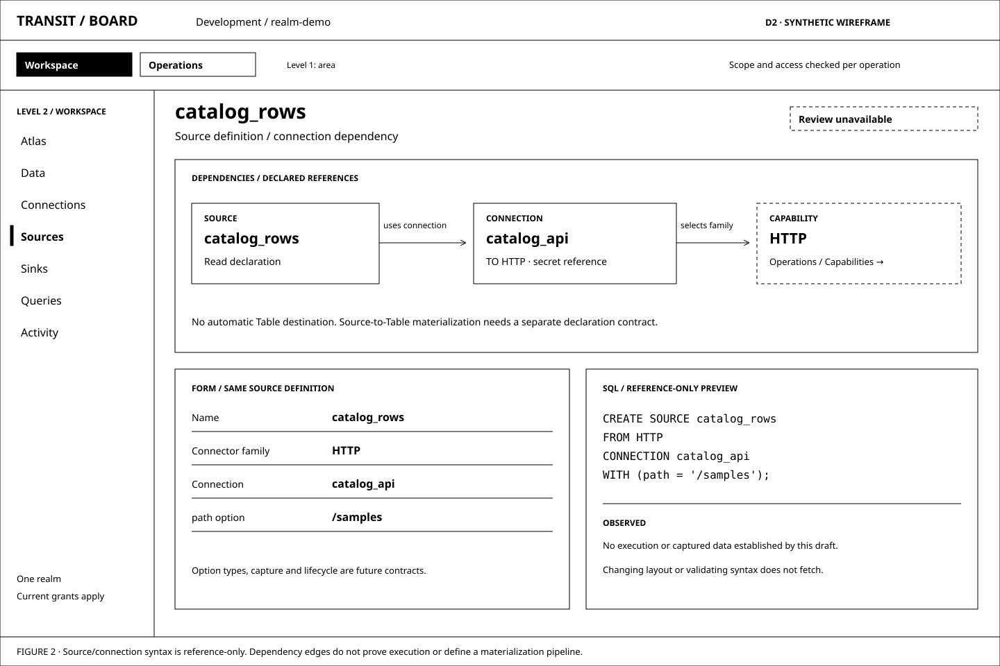
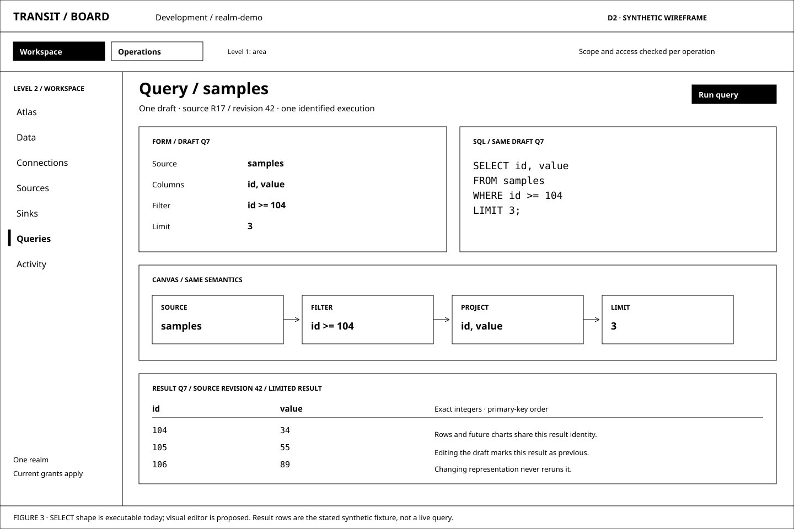
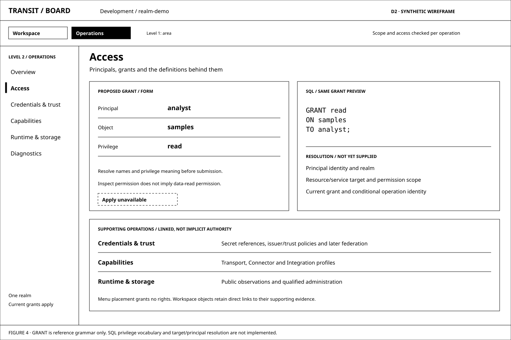

# D2 — Visualizing the declarative system

Previous: [D1 — One Board for operations and data](D1.md) · [Review index](README.md) · Next: [D3 — A quieter Transit shell](D3.md)

Status: **Reviewed**. Implementation: **Proposed, not implemented**.
The reviewer requested black-and-white wireframes, two levels of administration
and a UI designed over Transit's SQL grammar. This review explores those
constraints. It introduces no grammar, compiler, control API or application code.

## Question

What does Board look like when its primary material is the system's declarations
and their relationships, with a separate place for the operations that support
them, rather than a collection of configuration forms?

## Proposal

Treat Board as a visual interface to Transit's declarative model. Users inspect
**what is defined, what it depends on, what a proposed change means, and what has
actually been observed**. Forms, SQL and diagrams are representations of the
same typed semantics. SQL is a working design foundation, not an export format
added after the UI is designed.

Use two navigation levels: choose **Workspace** or **Operations**, then choose
the destination within that section. Workspace contains data, connection, source
and sink declarations and queries. Operations contains access, credential/trust
bindings, available transport/connector/integration capabilities, runtime/storage
administration and diagnostics. These names and exact groupings remain proposals.

Keep the atlas as Workspace's spatial system view, with resource entry leading
to the same definition and exploration workspace as Browse. A declaration graph
has typed dependency edges; the atlas retains its separate process/resource
evidence. Neither diagram invents ownership or an executable pipeline.

Make all structural wireframes black and white. Use labels, borders, solid/dashed
lines and typography to establish hierarchy. Color, shadows and branded styling
are outside this review. D1's original layouts have also been neutralized without
rewriting their design history.

## Visual studies

All figures are synthetic SVG wireframes. **Definition previews for DDL are
future design, not screens supported by the current product.** The query study
uses the implemented SELECT shape; its visual editor is still proposed. Study
labels identify those limits without filling the product interface with parser
or implementation details.

### Figure 1: Workspace / Data, organized around a definition

The first two levels answer **which area am I working in?** and **which kind of
object am I working with?** The resource catalog then selects an object; it is
content within Data, not a third global administration menu. Table, Document and
KV remain explicit kinds. Their detail views expose Definition, Explore,
Dependencies and Changes when those capabilities exist.

The Table shape and its SQL describe the same fields. The backing resource,
writer and observed revision are evidence about the realization, not extra
`CREATE TABLE` clauses. This study does not pretend that the reference grammar
already resolves a Table name to its resource or executes creation.

### Figure 2: A source declaration makes a dependency visible

`CREATE SOURCE ... CONNECTION catalog_api` has a visible edge labelled
**uses connection**. Selecting it opens the same connection definition found in
Workspace / Connections. HTTP names the connector family; its installed profile
can be inspected through Operations / Capabilities. Provider-specific integration
details appear only through a declared, versioned mapping.

This is a dependency graph, not a streaming-job editor. It shows no automatic
edge from the source to a Table: the current grammar lacks a source-to-Table
materialization declaration. Likewise, `CREATE SINK` currently names a connector
and connection but not an input query. Missing semantics are design work, not
edges Board may synthesize. Opening the graph or validating its syntax causes
no external fetch.

### Figure 3: A query's declarative meaning across views

The draft selects `id, value` from `samples`, filters `id >= 104`, and limits the
result to three rows. Form controls, SQL text and Canvas describe that one query.
The compact plan is a semantic view, not an editable runtime topology or an
implemented `EXPLAIN` statement. Changing a column, predicate or limit updates
the draft and marks the previous result as belonging to its earlier execution.

The synthetic input is D1's six rows with the first field named `id`:
`(101, 8)`, `(102, 13)`, `(103, 21)`, `(104, 34)`, `(105, 55)`, `(106, 89)`.
The illustrated result is `(104, 34)`, `(105, 55)`, `(106, 89)`, in the current
Fuze profile's primary-key order. A result chart would use those same rows and
label its scope; visualizing them does not run another query or aggregate.

### Figure 4: Operations / Access uses the same declarative discipline

Access lives behind the scenes, outside the daily data workspace. The visual
policy editor still has a declarative counterpart; moving it to Operations
does not justify a separate UI permission model. The figure previews
`GRANT read ON samples TO analyst`, which the reference grammar accepts.
The privilege vocabulary and name-to-principal/resource resolution remain
unspecified for SQL execution. The preview therefore cannot grant access.

Operations navigation is organizational, not an authorization boundary. A user
may be permitted to inspect an object's support dependencies without being an
administrator. Current grants decide disclosure and actions at every public
boundary; a hidden menu supplies no security guarantee.

## Two levels of administration

| First level | Second-level destination | Primary material |
| --- | --- | --- |
| Workspace | Atlas | Authorized processes/resources, declared relationships and observed progress; Browse remains available |
| Workspace | Data | Table, Document and KV definitions, typed/opaque data capabilities and exact read bases |
| Workspace | Connections | Named declarations for how a workload reaches an external system, including connector/profile and secret references |
| Workspace | Sources | External read declarations and their connection/schema/capture dependencies |
| Workspace | Sinks | External write declarations and their connection/attempt policy; input binding is an explicit grammar gap |
| Workspace | Queries | One query draft, representations, identified execution and retained-result evidence; saved catalogs remain future work |
| Workspace | Activity | Recorded work, changes, exchanges and outcomes within the selected scope |
| Operations | Overview | Supporting-system conditions with links to their evidence and affected declarations |
| Operations | Access | Principals, current grants and proposed grant/revoke changes |
| Operations | Credentials & trust | Secret references, trust profiles and later identity federation; never resolved secret values |
| Operations | Capabilities | Transport, Connector and Integration inventories, versions, profiles and supported operations |
| Operations | Runtime & storage | Public runtime/storage observations and permitted administration; no raw provider proxy |
| Operations | Diagnostics | Bounded service diagnostics, their freshness and coverage, distinct from durable activity |

The primary section switch and its contextual menu are the two navigation
levels. Local filters, a selected object and detail tabs do not add another
global menu tier. Breadcrumbs retain installation/realm and stable object identity.
The hierarchy is not a new tenant, role or resource ownership model.

Common work starts in Workspace: select a supported family, define a named
connection, then inspect its source/sink dependents. Operations supplies and
maintains the underlying capabilities. A direct HTTP connection does not require
a provider integration; a named connection is not an open socket. Keep direct
links to supporting objects so diagnosis does not require memorizing the menu.

On Atlas, collapse the secondary menu and preserve one header/legend and the
prior camera. Return from Operations to the same authorized Workspace selection.
Back, scope changes and denied access retain D1's clearing/revalidation rules.
Keyboard navigation and a textual dependency list must reach everything drawn.

## What the SQL grammar actually supports

This audit follows [the reference grammar](../../../contracts/sql/TransitExtensions.g4),
[its contract](../../../contracts/sql/README.md), the
[production parser/compiler](../../../packages/zig/transit-fuze/src/Sql.zig),
[SQL guide](../../../packages/zig/transit-fuze/docs/sql.md), and
[query shell](../../../apps/transit-cli/README.md). No grammar extension is made
for this review.

| Surface | Current state | Design consequence |
| --- | --- | --- |
| Single-Table SELECT | Parses and compiles to Fuze; M13 exposes explicit query submission | Query controls must stay within the actual source/schema and plan capabilities |
| Projection, one typed predicate, LIMIT, COUNT/SUM | Qualified bounded profile; limited aggregate input uses a specific subquery | No generic filter tree, joins, arbitrary calculations or drag-to-aggregate semantics |
| CREATE TABLE / DOCUMENT / KV | Reference grammar only; production returns `UnsupportedStatement` | Useful definition studies; execution and catalog binding need their own contract |
| CREATE CONNECTION / SOURCE / SINK | Reference grammar only; accepts connector identifiers and string/SECRET options | Grammar acceptance does not validate an endpoint, connector, option key, capability or lifecycle |
| GRANT / REVOKE | Reference grammar only; privileges and object/principal names are identifiers | Need explicit scope resolution and mapping to current typed authority operations |
| SHOW TABLES / SOURCES / SINKS / CONNECTIONS, DESCRIBE | Reference grammar only | Future catalogs should share authorized facts with Browse; current CLI `/tables` and `/schema` are not SQL implementations |
| FOR SYSTEM_TIME AS OF revision | Standalone reference fragment, not part of SELECT | Do not enable a SQL time-travel slider or append this clause to today's executable query |
| INSERT / UPDATE / DELETE | Absent from this grammar and SQL runtime; typed Table mutations exist separately | Writes need SQL lowering and qualified UI scope; row editing cannot appear as a read convenience |
| ALTER / DROP / rename / idempotent apply / migration | Absent | D1's revision-edit flow is target behavior, not something CREATE already supplies |
| Transport/integration declarations, credential/trust definitions, runtime controls | No productions | Do not invent CREATE TRANSPORT, CREATE INTEGRATION or pause/restart SQL in a runnable editor |
| System relations such as connector.attempts, transport.connections or journey views | Proposed prose, not source resolution or executable grammar | Dotted column qualification is not a system namespace; preserve inspection-source consistency separately |
| EXPLAIN, saved views, materialization and continuous queries | Not implemented by this grammar | A diagram is a presentation of known semantics, not proof these statements or runtimes exist |

The executable SELECT profile has one caller-supplied Table and at most two
columns, one predicate, explicit limits 0–32 or no limit, and checked aggregates.
Names/types and exact source authorization are separate from parsing. No limit
means bounded incremental delivery of all selected rows, not an implicit 32-row
total. M13 adds its own 207-byte encoded-plan frame limit. These constraints
must be discoverable before Run; browser form validation cannot replace the
shared compiler or current service checks.

The administrative reference grammar is deliberately thinner than a declaration
model. It has no object catalog/resolver, versioned option schemas, lowerer,
dependency lifecycle, principal mapping, migration or apply reconciliation.
`connectionOptions` accepts arbitrary keys with string or `SECRET(...)` values;
even timeout units or a provider name need an owning semantic contract. A quoted
name containing a dot does not manufacture namespace resolution. A script with
several statements is also outside the grammar's single-statement entry rule.

### Mapping syntax to a visual representation

| Declaration/query element | Form or detail | Canvas relationship |
| --- | --- | --- |
| Object kind and identifier | Kind, name and resolved stable identity displayed separately | One node per identified object; labels may change without retargeting accepted work |
| TABLE column definitions | Typed field list and nullability | Schema inside a resource landmark; no independent lifetime for each column |
| DOCUMENT / KV declaration | Kind-specific definition; no fabricated Document fields or KV decoder inferred from bytes | Explicit Document/KV identity; richer model waits for its owner |
| CONNECTION TO connector | Connector/profile choice, declared option values and secret references | Dependency on an installed capability; implementation details stay in Operations |
| SOURCE/SINK CONNECTION reference | Connection selection and resolution evidence | Labelled dependency edge to that exact connection |
| SELECT FROM / WHERE / projection / LIMIT | Supported source, predicate, columns and limit | Source → filter → project → limit; result links to the frozen execution |
| GRANT/REVOKE privilege ON object TO/FROM principal | Privilege, target and principal resolution | Scoped policy relationship; association never substitutes for the grant |
| Presentation settings | Camera, collapsed sections, chart axes, selected rows | Change layout only; no SQL or durable mutation invented |

For the restricted aggregate-input subquery, show filter → input limit →
aggregate in its actual semantic order. Never turn an outer aggregate-output
limit into an input limit. Chart placement, graph layout or visually moving a
card cannot enable an optimizer rewrite that the engine has not qualified.

## One definition, several representations

SQL, Form and Canvas share a versioned semantic model and one draft identity.
The raw text buffer may temporarily be invalid; keep the last valid semantic
snapshot visibly stale and prevent it from overwriting or applying the newer
invalid text. Structured edits produce a new draft and matching text through a
shared formatter/lowerer contract. A bidirectional DDL editor is new work; there
is no current production DDL AST or canonical formatter to reuse by assumption.

When a statement is valid but a visual editor cannot represent a construct,
preserve the full text and provide a read-only semantic view. Never discard
unknown options, change quoted names, drop clauses, reorder fallible operations
or silently normalize literals. Define how comments/formatting are preserved or
show an explicit formatting diff. Typed option schemas and semantic validation
belong beside the owning capability, not in a second browser parser.

The definition pane is the anchor. Dependencies explain its references; Explore
uses its authorized data capabilities; Changes compare a draft with its exact
accepted basis; Observed state shows executor/resource evidence. Retain relevant
times, positions and coverage for each. A source definition is not proof it has
ever fetched data, and a rendered CREATE statement cannot reconstruct missing
historical configuration or secrets from runtime observations.

SQL need not remain visible for a person working with a form. It should remain
inspectable, and the meaning must be identical. APIs can use typed operations
rather than transporting SQL text. Queries still lower to Fuze's plans;
administration lowers to its own public operations. The UI does not route every
action through Fuze or become a second execution authority.

## Declarative changes and operational reality

The target workflow is **edit definition → validate → inspect change and
dependencies → explicitly submit → follow acceptance and observed application**.
A validation result identifies its grammar, capability/schema versions and
resolution basis. It is not a current grant or a durable acceptance receipt.

For a new object, a qualified CREATE lowering could supply that workflow once
specified. For an existing object, preserve a stable ID and base revision in a
typed change proposal. **Do not implement Save as another CREATE, or DROP then
CREATE.** The language/operation design must first decide conditional alteration,
replacement, migration, dependency handling and retirement. These are explicit
gaps behind D1's edit/rollback illustrations.

Multiple declarations may be displayed together for understanding, but each
reference-grammar example is an independent statement. A multi-object review
does not imply atomic apply. Future change sets require dependency ordering,
partial-progress receipts and a declared transaction boundary. SQL options may
contain sensitive literals even when credentials use references, so URL/log,
export and draft-storage policies apply to the whole text, not just SECRET.

Desired configuration and observed runtime state can disagree. Show accepted
revision, the last observation, pending work and unknowns separately. A controller
may reconcile only under its qualified contract. Declarative presentation does
not authorize automatic probing, new attempts, remote retries or silent data
materialization. Pause, drain, cancellation and receipt recovery remain explicit
typed actions with their own evidence until a corresponding language is designed.
They must not be hidden inside a SELECT or presented as an unqualified DML write.

Forensic exploration remains based on exact retained revisions and recorded
causal links. A future revision selector must name the resource/source basis,
coverage and current permission. The checked AS-OF fragment grants no historical
read capability or cross-source snapshot. Diagnostics and current transport
observations remain different source classes from snapshot Table data.

## Design and delivery gates

Start subsequent UI reviews from a grammar/contract map: object, supported verbs,
semantic owner, identity/resolution, permission, consistency and failure state.
Then show its declaration, relationships, change review and observed result.
If any mapping is missing, register a language/operation design question before
presenting an enabled control. Do not expand the grammar merely to justify a
screen that has already invented semantics.

The [AGENTS.md rule](../../../AGENTS.md#implementation-rules) now captures this
principle, and [Query language](../../QUERY_LANGUAGE.md#declarative-model-and-visual-interfaces)
owns the shared rationale. The requirement applies to visual, textual and typed
surfaces while preserving their separate semantic owners.

M12/M13 supply the executable Table-query baseline. M15/M16 supply connector
evidence, not declarative configuration execution. M17/M18 supply planned
Document/unified-data capabilities; M21 supplies planned remote query access.
Administrative lowering, catalog resolution, typed change plans, operational
grammar and this navigation require their own numbered implementation scope
under the [sequencing rule](../../roadmap/README.md#maintaining-the-sequence).
No milestones are added or silently expanded by this review.

Future interaction proofs should compare Form/SQL/Canvas semantics, invalid-text
preservation, unknown options, quoted identifiers, case folding, source changes,
revision conflicts, lost apply acknowledgements and denied references. Verify
that navigation, graph layout, syntax checking and chart rendering perform no
query or external I/O, and that denied data clears across representations. These
are planned proofs, distinct from the syntax checks for this document's examples.

## Review outcome

The reviewer explicitly requested black-and-white wireframes, two administration
levels with behind-the-scenes operations, and a UI grounded in the SQL grammar;
they identified the missing principle in AGENTS.md. Those are recorded inputs.

The reviewer described D2 as good progress, then requested a less cluttered
shell: a compact toggle with Workspace on the left and Operations on the right,
meaningful icons, Transit-only branding, and a realm dropdown named around
cooperating applications/products rather than environment labels. They asked
to remove the hierarchy heading, bottom footer and sidebar scope/grant slogans.
[D3](D3.md) owns those refinements; these figures retain the earlier proposal.

This feedback does not settle every grouping, definition/dependency interaction
or editing contract. D2's declarative foundation and grammar audit remain inputs
to D3. D1's capability inventory, data emphasis and authority boundaries remain
useful. No board-atlas acceptance or implementation claim is changed.

## Open questions

- Do Workspace and Operations describe the two levels' purposes clearly, with
  Access, Credentials & trust and implementation capabilities in Operations?
- Should Sources and Sinks remain separate second-level destinations, or appear
  within Data with the same declaration identities and direct links?
- Which missing contract should be formalized first: declarative catalog/name
  resolution, connection option schemas, or conditional alteration/change plans?
- Should the next interaction review focus on defining one connection/source,
  or on visual/SQL editing of the already executable Table SELECT profile?

## Evidence and limits

The audit uses checked-in sources at base `fee62f5`; the grammar, compiler and
query-language sources also match the contemporaneous local main `168eb34`.
Syntax examples and their expected status are in the [fixture](d2-fixture.json).
Reference-parser acceptance establishes syntax only. The existing SQL proof
compares ANTLR, PostgreSQL and Zig for the qualified SELECT corpus and asserts
production rejection of administrative statements. It does not prove DDL
execution, UI round-tripping or namespace resolution.

All figure data, identities, policy references and connection options are
synthetic. Endpoint/path/privilege examples choose no real provider or qualified
option schema. The UI layouts, dependency graph and result drawing have no
runtime evidence. The supporting check record below distinguishes parser/plan
checks from the proposed product behavior; no new runtime or capacity claim is
made. D1's security, retention, bounded memory and evidence requirements remain.

Checks performed for this review:

- `nix develop -c just check` passed, including documentation links, generated
  contracts, Zig unit tests and Board frontend checks.
- `nix develop -c just test::sql` passed: 103 SELECT ASTs agreed across the
  qualified parsers; 91 plans, codec round trips and paged Arrow results were
  checked independently; 17 syntax exclusions and 13 extensions were checked.
- A one-off check passed all 15 fixture acceptance expectations using the
  generated reference parser and existing Zig SQL proof driver. The illustrated
  SELECT also agreed with PostgreSQL's AST and compiled/codec-round-tripped.
  The driver uses its own input; the six-row illustration was checked separately
  against the fixture, not executed through a Board screen or Transit service.
- All seven D1/D2 SVGs parsed as XML with titles/descriptions and black/white
  fills/strokes. Rendered figures were inspected for legibility and clipping.

These checks do not qualify the proposed UI or administrative operations.
Full clean-checkout CI qualification is reported with the pull request.

## Supporting material

- [SQL examples and synthetic query data](d2-fixture.json).
- SVG sources: [Figure 1](images/d2-01-definitions.svg),
  [Figure 2](images/d2-02-dependencies.svg), [Figure 3](images/d2-03-query.svg),
  [Figure 4](images/d2-04-operations.svg). Authored directly as vectors.
- [Grammar and proof contract](../../../contracts/sql/README.md) and
  [query-language design](../../QUERY_LANGUAGE.md).
- [D1's future capability inventory](CAPABILITIES.md); classification remains
  applicable, while D2 changes how capability definitions and workload declarations
  are organized in the UI.

Previous: [D1 — One Board for operations and data](D1.md) · [Review index](README.md) · Next: [D3 — A quieter Transit shell](D3.md)
