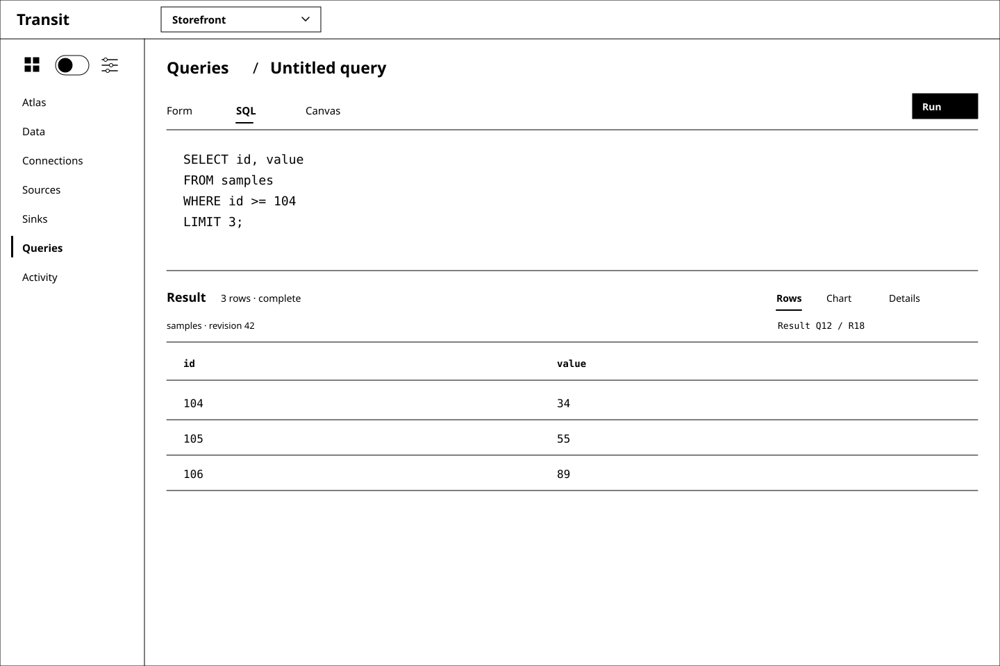
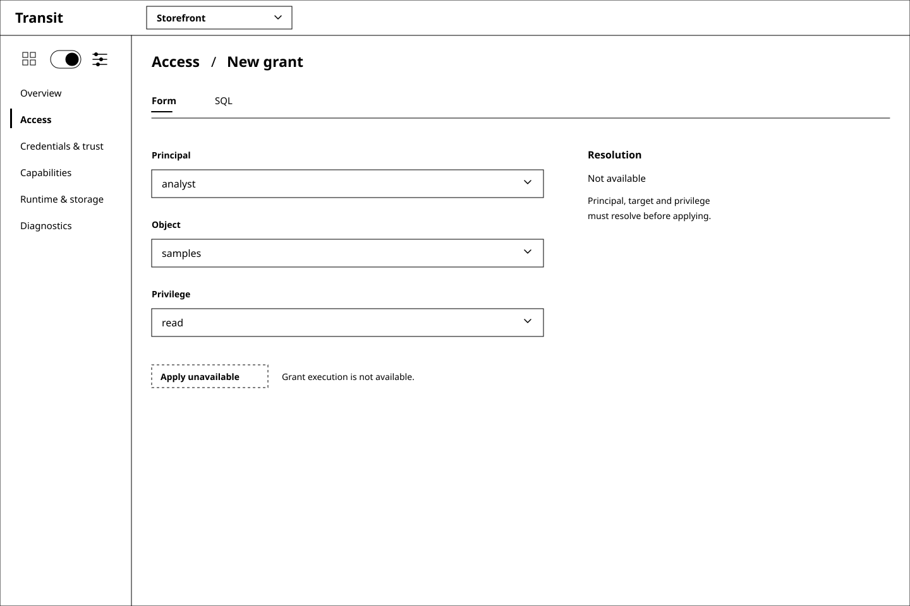
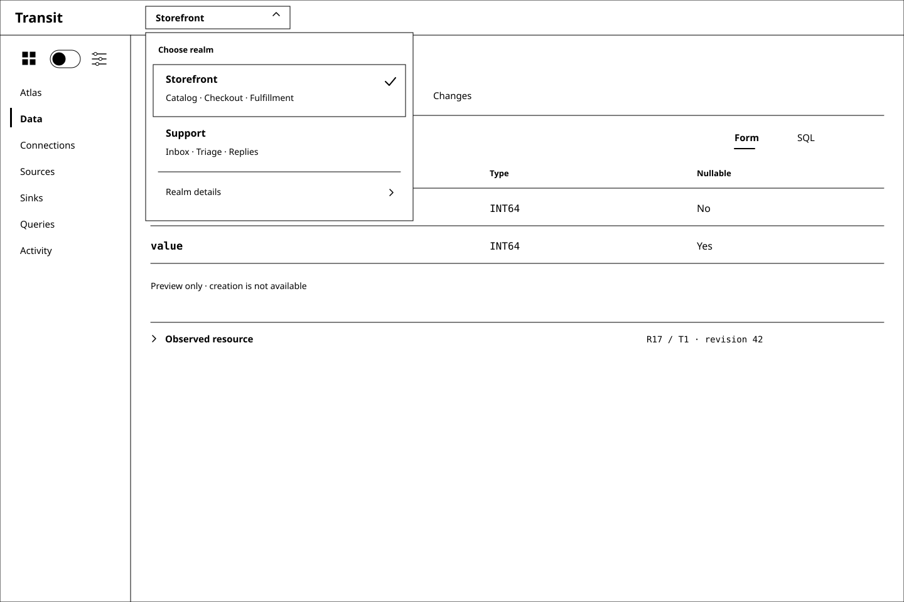

# D3 — A quieter Transit shell

Previous: [D2 — Visualizing the declarative system](D2.md) · [Review index](README.md)

Status: **In review**. Implementation: **Proposed, not implemented**.
This review refines the shell and information density. D2's declarative model,
grammar audit and operational boundaries remain the foundation.

## Question

How can Board give the working view more space while keeping area navigation
and the selected product context easy to recognize?

## Proposal

Use one compact header: **Transit** at the left, followed by a realm dropdown.
Place a small two-position icon toggle at the top of the sidebar: a workspace
grid on the left, operations sliders on the right. The menu below changes with
that selection. These are still the two navigation levels from D2, without
another horizontal bar or headings that explain the hierarchy.

Use a product or cooperating-application label for the realm, such as
**Storefront**, with **Catalog · Checkout · Fulfillment** as supporting context
inside the dropdown. Do not require an environment prefix or a `realm-*` slug.
The examples are labels for this study, not a new naming convention or a change
to Transit's realm identity model.

Remove the bottom footer, the sidebar's “One realm / Current grants apply” text,
and the global access reminder. Put material status next to the object or action
it explains. Review captions and implementation qualifications belong in this
document, outside the application frame.

Give each task one main working surface. Form, SQL and Canvas remain equivalent
representations, but only the selected representation occupies the editor.
Details and evidence expand when needed. The space recovered from navigation
and repeated explanations belongs to the schema, query, result or diagram.

## Visual studies

All four studies are black-and-white vectors at the same 1440 × 960 viewport as
D2. Names, application groups, identities and observations are synthetic. DDL
and grant forms remain future previews; the query reuses D2's qualified SELECT
shape and [synthetic fixture](d2-fixture.json).

### Figure 1: Workspace with a compact shell

The current object is selected beside **Data**, replacing the always-open object
list in this detail study. The object selector retains kind labels and a route
back to the catalog; Tables, Documents and KV keep equal access through Data.
This changes the detail layout, not the need for a browsable catalog.

The schema is the active representation. Selecting SQL exposes the same
definition in text without editing or applying it. Observed resource details
are collapsed, with the exact identity/revision still visible in their summary.
The two-field fixture does not need filler panels to occupy the remaining space.

### Figure 2: Space for the query and its result

The editor shows SQL, with Form and Canvas one selection away. The result gets
its own full-width surface. Result identity, source revision and completion
remain visible; extended execution evidence sits behind Details. Rows and a
future Chart view consume the same result. Editing or switching representation
does not submit work, and a changed draft must visibly mark an older result.

The illustrated query and rows are unchanged from D2: `id >= 104 LIMIT 3`
returns `(104, 34)`, `(105, 55)`, `(106, 89)` for that synthetic input. The chart
affordance remains proposed. This review introduces no query capability.

### Figure 3: The same shell in Operations

The right-hand toggle position changes the menu to the supporting operations.
Access stays here. The grant form and its resolution state occupy the main
surface; the former duplicate SQL panel and supporting-operations card are gone.
Those other destinations already exist in the menu. The local reason Apply is
unavailable remains useful and visible.

### Figure 4: Realm selection around the product

The closed selector shows only the current product label and a chevron. Opening
it shows available realm choices with concise application context. **Realm
details** exposes the exact stable identity and deployment information when
needed. The menu is an overlay, so it does not add a persistent header row.

These application labels are supplied descriptive metadata, not relationships
inferred from traffic, names or provider namespaces. Selecting a realm chooses
one exact configured scope; it does not combine its applications with another
realm or confer rights. Naming collisions require a visible secondary identifier
in the affected choices, and in the closed selector if needed to disambiguate.
If a label is missing, show the stable identifier instead of inventing a name.

## Space and interaction rules

| Element | D2 | D3 proposal |
| --- | --- | --- |
| Header and area navigation | 130 px across the viewport | One 56 px header; area toggle inside the sidebar |
| Sidebar | 222 px, hierarchy heading and scope text | 208 px, toggle and contextual destinations |
| Bottom shell | 42 px persistent footer | No footer; working area extends to the bottom |
| Data detail | Separate object rail and framed representations | Compact object selector, one active representation |
| Supporting explanation | Repeated cards, captions and grant reminders | Local state, expandable details and external review captions |

The available rectangle to the right of the sidebar grows from
1218 × 788 to 1232 × 904 pixels, approximately 16% at this viewport. That is a
geometric comparison of the drawings, not a measured usability improvement.
Use the space for working content and readable spacing, rather than adding
another dashboard. Atlas can continue to collapse contextual navigation as
proposed in D2.

The toggle is an area selector, not an on/off setting. The left grid selects
Workspace; the right sliders select Operations. Either icon or its half of the
control is a direct target, with a clear thumb position and visible focus.
Hover/focus reveals the full name. A future implementation should expose an
“Area” radio group with named Workspace/Operations choices and arrow-key access;
touch and keyboard users must not depend on hover to identify the destinations.
Keep hit areas at least 44 px high despite the smaller visible glyphs. Do not
put a replacement hierarchy title above the menu.

Changing areas keeps the selected realm and returns to the previous authorized
destination in that area. It does not run a query or apply a draft. Realm
selection is a separate context change: stop old reads, clear protected content
and resolve the new scope before showing data. Late responses remain bound to
their original realm; failures must not leave the old product's rows under the
new product label. Handle an unsaved draft at the transition without silently
discarding or applying it, and preserve any uncertain operation's original
identity without retrying it in the new realm. These are future interaction
requirements, not implemented switching behavior.

Removing global slogans does not remove useful state. Unknown, stale, denied,
incomplete and unavailable states stay beside the relevant data or control.
Observed state remains distinct from a definition, and a query result retains
its exact basis. D2's semantic and authorization requirements still apply.

## Review outcome

The reviewer requested five refinements: less clutter and a left/right icon
toggle, Transit-only branding, a product/application-oriented realm dropdown,
no “Level 2” heading, and no bottom footer or sidebar scope/grant slogans.
These are recorded inputs. D3 applies them in four new studies; the precise
icons, selector layout and content-density choices await review. D2's original
figures remain intact as the previous review.

## Open questions

- Are the grid and sliders clear enough as Workspace and Operations once their
  names are available through focus, touch and accessible labels?
- Does the object dropdown give Data enough room, or should an optional catalog
  rail be available for repeated object-to-object comparison?

## Evidence and limits

This is a documentation and wireframe change, based on `3371a8b`. The deployed
Board still uses one configured realm/upstream; the multi-choice selector needs
a future authorized configuration/discovery contract and display-metadata owner.
The application-group captions do not claim an implemented application catalog.
The [security realm](../../SECURITY.md#principals-realms-and-grants) remains an
explicit authority scope, distinct from application naming and provider placement.

The figures reuse D2's declarations and data. No SQL grammar, parser, operation,
runtime control or frontend behavior changes. M2/M13 keep their qualification;
implementation must receive its own scope under the
[roadmap sequencing rule](../../roadmap/README.md#maintaining-the-sequence).
Keyboard, touch, responsive layout, switching failures and usability remain
proposed behavior requiring an interactive prototype and later implementation
proofs. SVG rendering establishes only the legibility of these static studies.

`nix develop -c just check` passed. All four SVGs were parsed and checked for
accessible descriptions, black/white fills and strokes, and the requested
removal of shell copy; their rendered output was visually reviewed. D2's SQL
qualification remains its recorded evidence and was not rerun for this layout
change. Clean-checkout qualification is reported with the pull request.

## Supporting material

- SVG sources: [Workspace](images/d3-01-workspace.svg),
  [Query](images/d3-02-query.svg), [Operations](images/d3-03-operations.svg),
  [Realm selector](images/d3-04-realm-selector.svg).
- [D2's grammar audit and semantic rules](D2.md#what-the-sql-grammar-actually-supports).
- [D2 SQL examples and synthetic query data](d2-fixture.json).
- [Current Board configuration and limits](../../../apps/transit-board/README.md).

Previous: [D2 — Visualizing the declarative system](D2.md) · [Review index](README.md)
