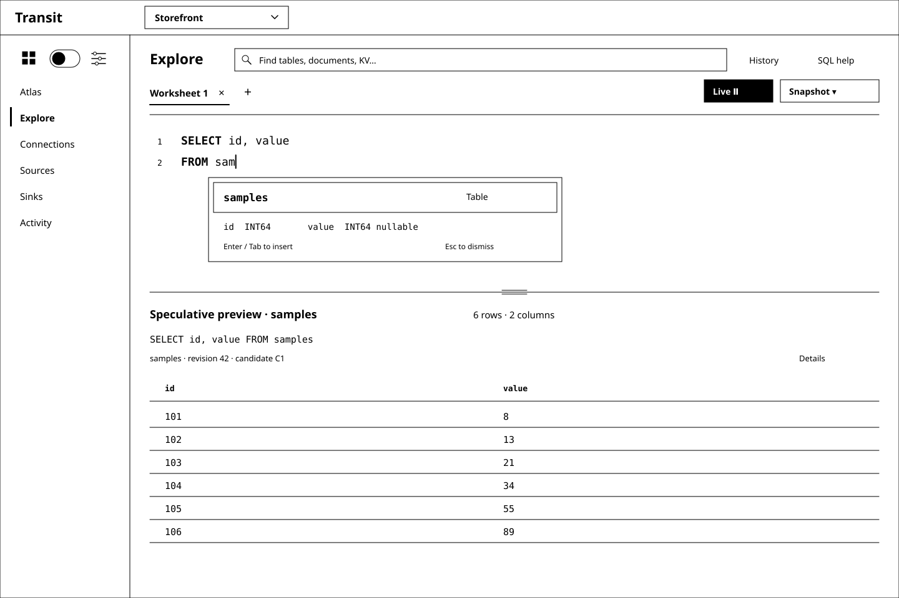
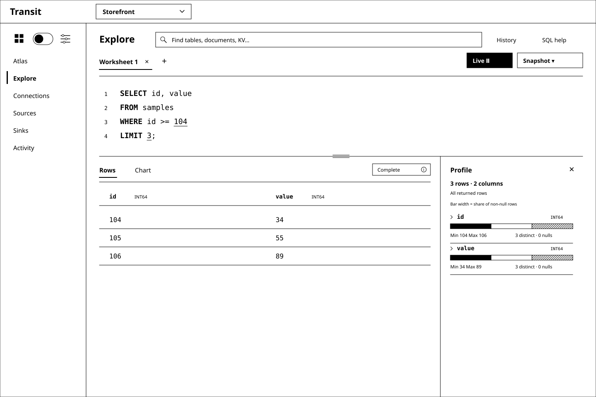
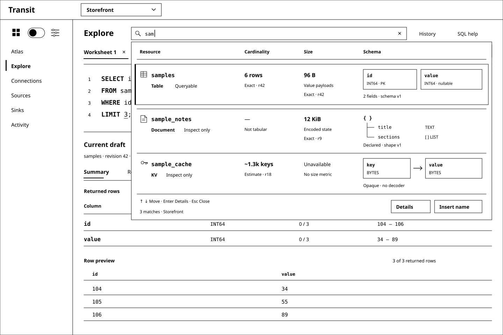

# D4 — Explore: a SQL-first workspace

Previous: [D3 — A quieter Transit shell](D3.md) · [Review index](README.md)

Status: **In review**. Implementation: **Proposed, not implemented**.
D3's compact shell remains the frame. This review replaces its separate Data
and Queries destinations with Explore and makes the SQL console the main task.

## Question

How should a power user move directly from writing SQL to understanding its
result, with the grammar and catalog helping at every keystroke?

## Proposal

Merge **Data** and **Queries** into **Explore**. The Workspace menu becomes
Atlas, Explore, Connections, Sources, Sinks and Activity. Entering Explore opens
a SQL worksheet ready for typing. Users do not first choose an object, open a
form or switch into an advanced mode. Entry from an atlas resource opens the
same console with that source context, without executing a query.

The target is a full browser SQL shell for Transit's supported language:
multiline editing, keyboard-driven completion, contextual diagnostics,
worksheets, execution controls, history and result exploration. The shell can
grow with the language; its first executable profile remains the qualified
single-Table SELECT. “Full shell” does not imply PostgreSQL compatibility or
execution of today's reference-only DDL. Unsupported text stays editable with
a precise explanation, rather than being silently rewritten or discarded.

SQL is the primary representation. Move catalog browsing, object definitions,
dependencies and history into optional drawers or contextual detail views.
Form/Canvas representations can remain available from the relevant object or
query, but they do not compete with the console for the default working area.
Tables, Documents and KV stay discoverable in Explore; their query affordances
follow each source's actual capabilities.

Treat completion as deterministic language assistance: grammar context supplies
valid constructions, catalog context supplies visible names and types, and
capability/semantic rules remove unsupported choices. Suggestions and syntax
highlighting should respond locally while the user types. A grammar is a useful
input to this system; it is not an already implemented completion engine.

After execution, lead with a **result summary**: outcome, rows, columns, source
basis and coverage, with column profiles and a row preview. Rows and Chart are
views of that execution. Keep editor and result together with a resizable split.

## Visual studies

All four figures are synthetic black-and-white wireframes using D3's Transit
header, product realm dropdown and left/right area toggle. Bold keywords and
underlined numeric literals stand in for token highlighting; no color scheme is
selected. The console, completion, drawers and summaries are future UI behavior.

### Figure 1: Write SQL immediately

Typing `FROM sam` offers the matching authorized Table. The popup is attached
to the edit location, with a concise kind/schema preview. Enter or Tab accepts
the highlighted candidate; Escape dismisses it. Accepting a suggestion changes
text only. Run remains unavailable while the statement is incomplete.

### Figure 2: Follow the grammar into the schema

After `WHERE samples.`, the editor resolves the qualifier and offers its fields.
At other positions it offers the permitted keywords, functions, operators or
literal shapes. Completion can inspect the statement after the caret too:
editing `SELECT va| FROM samples` can resolve `value` even though FROM occurs
later. It must also work through incomplete and temporarily invalid input.

The editor knows both syntax and capability. For example, the reference grammar
accepts a numeric LIMIT greater than 32, but the current compiler rejects it.
Suggestions must respect the executable bound and report the actual limitation
when a user types another value. Grammar-only commands belong in SQL help with
their support status, not among apparently runnable suggestions.

### Figure 3: A summary of the returned data

The [existing fixture](d2-fixture.json) yields `(104, 34)`, `(105, 55)`,
`(106, 89)`. The summary reports two INT64 columns, no nulls, an `id` range of
104–106 and a `value` range of 34–89. Those are facts about the returned result,
not the six-row source Table. The visible LIMIT keeps that distinction clear.

The default summary pairs small, useful profiles with a preview. Rows offers
paged inspection; Chart visualizes the same identified result with an explicit
coverage label. Larger results may have complete execution but only a loaded
page available for profiling. Show that scope beside each profile; do not call
it complete-result statistics or fetch all pages merely to fill the summary.
Submission, capture/delivery progress and verified completion are separate states.

### Figure 4: Catalog discovery supports the console

Catalog is a tool within Explore, not a replacement Data destination. Selecting
an object shows its authorized definition and dependencies; **Insert name** is
an explicit text edit. Nothing runs just because the user browses a Table.
Inspection-only kinds stay visible without becoming invalid FROM suggestions.
Document and KV querying can join this workflow when their source contracts
exist; opaque KV bytes do not acquire an inferred schema from the UI.

## Console behavior

| Action | Proposed behavior |
| --- | --- |
| Open Explore | Focus a worksheet; retain its authorized context and draft |
| Type / Ctrl+Space | Offer grammar- and catalog-aware completion at the caret |
| Enter / Tab with completion open | Insert the selected candidate as one undoable edit; never run |
| Escape | Dismiss completion and preserve text; never cancel durable work |
| Ctrl/Cmd+Enter | Explicitly run the complete selected statement, or the statement containing the caret |
| Browse catalog / open object details | Inspect metadata without querying rows or modifying the draft |
| Open History | Inspect this session's execution records; restoring text never reruns it |
| Switch Summary / Rows / Chart | View the same execution and identify any narrower coverage |

Worksheet tabs are editing contexts, not independent query principals. The
first implementation must still admit only one active query per configured
principal. Each Run freezes the exact statement range, text, source/schema
basis and durable submission identity. Editing afterward marks the displayed
result as belonging to an earlier draft. Multiple statements selected together
are rejected in the current profile; do not invent a transaction or implement
Run All as silent sequential submissions.

The long-term shell can support administrative SQL when its owning lowerers and
change contracts are qualified. It must then distinguish a row result from a
change receipt and observed application. A worksheet cannot grant execution
rights or turn a CREATE preview into an enabled operation.

History begins as bounded, in-memory session history with no stored row cache;
persistent worksheets/history require their own retention and access design.
Switching realms or observing denial clears protected drafts, completion data,
history, profiles and results under the existing rules. Frozen uncertain work
keeps its original identity while reconciliation remains authorized; an unknown
submission is never replaced by rerunning the SQL.

## Instant assistance and truthful summaries

The [console design notes](CONSOLE.md) specify the missing editor-service
boundary, completion examples, generation strategy, latency/memory targets,
catalog invalidation and summary coverage. These are supporting details for D4,
not a separate review sequence or a claim of working autocomplete.

The main choices are local syntax work in a worker, bounded authorized catalog
metadata, versioned capability filtering, and server-side compilation at Run.
Keystrokes never prepare/submit queries or scan data. The current `prepare`
operation freezes a signed mutation; it is not a harmless diagnostics endpoint.
Warm completion has a proposed 50 ms p95 end-to-end budget, to be measured on
declared browser/hardware fixtures before describing the implementation as instant.

Summary generation uses bounded, typed computation over verified result pages.
It preserves int64 values exactly and identifies loaded-page versus whole-result
coverage. SQL highlighting, a fast suggestion and a chart are useful views;
none establishes authorization, executable grammar or result completeness.

## Review outcome

The reviewer described D3 as cleaner and easy to review, then requested merging
Data and Queries under Explore. They selected a query-first direction for power
users, a full browser SQL shell with grammar/catalog typeahead and highlighting,
and a result-set summary inspired by Snowflake. These are recorded design inputs.

D4 proposes the concrete layout, completion behavior, execution controls and
summary contract for review. Their details are not accepted or implemented yet.
D3's compact shell carries forward; its separate Data/Queries menu and default
representation tabs are superseded by this proposed Explore flow.

## Open questions

- Is the default combination of column profiles and row preview sufficient,
  with full rows and charts one selection away?
- Should the first interactive prototype prioritize completion while editing
  invalid SQL, or profile/row exploration after a verified query completes?

## Evidence and limits

The repository audit uses base `4ce4fb1`: the checked reference grammar, Zig SQL
compiler, query model and current Board/CLI guides. The [console notes](CONSOLE.md)
identify their actual capabilities and missing contracts. No grammar, engine,
public API or application behavior changes in this review. M12/M13 remain the
executable Table baseline; M17/M18 own planned Document/unified-query foundations.
Editor generation, catalog search, worksheet/history support and profiles need
their own implementation scope under the [roadmap sequence](../../roadmap/README.md#maintaining-the-sequence).

Snowflake's [workspace documentation](https://docs.snowflake.com/en/user-guide/ui-snowsight/workspaces-working)
describes a SQL editor with highlighting/completion and interactive result-column
statistics. This supplies the editor-to-result interaction reference. Transit's
source, authority, retention and coverage semantics remain its own; this review
does not select Snowflake's backend or claim matching SQL features.

The figures use synthetic data; performance targets are unmeasured. Completion
expectations and result-profile arithmetic are recorded in the
[study fixture](d4-fixture.json). Static syntax/fixture checks cannot prove
keystroke latency, accessible editing, incremental recovery or current-policy
catalog invalidation. Those require an interactive implementation and its proofs.

Checks performed for this review:

- `nix develop -c just check` and `nix develop -c just test::sql` passed.
- A one-off fixture check verified eight proposed text replacements and all
  14 completed-statement grammar/compiler expectations. The executable examples'
  ASTs agreed with PostgreSQL and compiled through the existing Zig proof driver.
  Added validation suffixes only finish the test examples; they are not proposed
  autocomplete insertions. Suppression behavior and partial-input recovery remain
  unimplemented and untested.
- Result-profile counts and ranges matched a separate calculation over D2's
  synthetic input. The proof driver uses its own data; no live summary UI was tested.
- All four SVGs passed XML, accessible-description, monochrome and navigation-copy
  checks, then were rendered and visually reviewed.

Clean-checkout qualification is reported with the pull request. These checks
establish neither an implemented console nor measured response-time performance.

## Supporting material

- SVG sources: [Table completion](images/d4-01-typeahead.svg),
  [Column completion](images/d4-02-columns.svg),
  [Result summary](images/d4-03-result-summary.svg),
  [Catalog drawer](images/d4-04-catalog.svg).
- [Console design notes](CONSOLE.md) and [study fixture](d4-fixture.json).
- [D2 grammar audit](D2.md#what-the-sql-grammar-actually-supports) and
  [existing SQL/data fixture](d2-fixture.json).

Previous: [D3 — A quieter Transit shell](D3.md) · [Review index](README.md)
