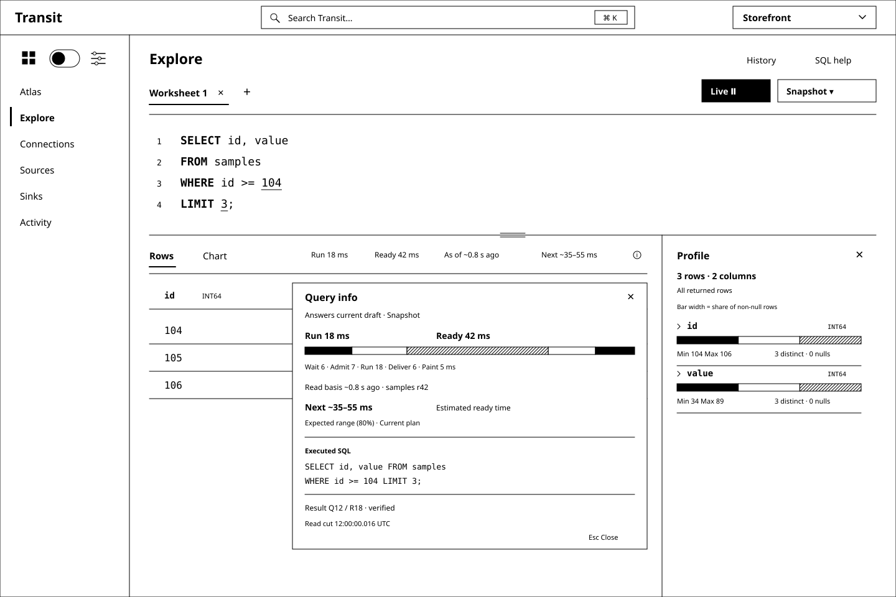
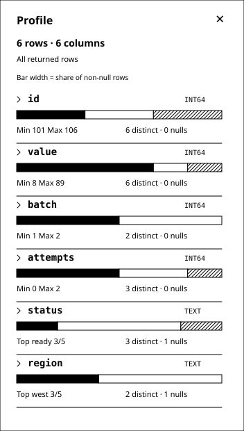

# D4 — Explore: a SQL-first workspace

Previous: [D3 — A quieter Transit shell](D3.md) · [Review index](README.md)

Status: **In review**. Implementation: **Proposed, not implemented**.
D3's compact shell remains the frame. This review replaces its separate Data
and Queries destinations with Explore and makes the SQL console the main task.
Figure 1's layout is the **selected direction**. At the reviewer's request,
this D4 is updated in place to make the worksheet execute as the user types,
keep counts and compact distributions inside Profile, and illustrate Chart and
Query info. Its latest refinement moves discovery into context-aware,
Transit-wide power search in the top navigation, with the realm at the right.
Result timing now replaces the Earlier draft and Complete badges with execution/
readiness, freshness and an estimated next-answer duration.
The earlier Run-only and tree/drawer recommendations are superseded, not
implemented behavior.

## Question

How should a power user's worksheet answer as they type, using grammar, catalog
context and prediction to schedule useful work while keeping snapshots,
speculative previews and continuous results understandable?

## Proposal

Merge **Data** and **Queries** into **Explore**. The Workspace menu becomes
Atlas, Explore, Connections, Sources, Sinks and Activity. Entering Explore opens
a SQL worksheet ready for typing. Users do not first choose an object, open a
form or switch into an advanced mode. Entry from an atlas resource opens the
same console with that source context. The proposed worksheet opens in a visible
**Live** session: a valid eligible draft can execute immediately without Run.
An empty draft or metadata-only browsing causes no query by itself.

The target is a full browser SQL shell for Transit's supported language:
multiline editing, keyboard-driven completion, contextual diagnostics,
worksheets, execution controls, history and result exploration. The shell can
grow with the language; its first executable profile remains the qualified
single-Table SELECT, with a separately designed live scheduling layer. “Full
shell” does not imply PostgreSQL compatibility or execution of today's
reference-only DDL. Unsupported text stays editable with
a precise explanation, rather than being silently rewritten or discarded.

SQL is the primary representation. A centered **Search Transit** field in the
top navigation opens power search via click or **⌘K / Ctrl+K**; resource discovery
does not require a navigation tree. The realm dropdown moves to the right.
Search spans Workspace and Operations, grounded in Explore, Connections, Sources
or the focused object to improve relevance. Context is a soft ranking signal;
explicit filters narrow the available kinds. Exact names and IDs stay predictable.
Keep object definitions, dependencies and history in contextual detail views.
Form/Canvas representations can remain available from the relevant object or
query, but they do not compete with the console for the default working area.
Tables, Documents and KV stay discoverable in Explore; their query affordances
follow each source's actual capabilities.

Treat completion as grammar-grounded language assistance: grammar context supplies
valid constructions, catalog context supplies visible names and types, and
capability/semantic rules remove unsupported choices. Suggestions and syntax
highlighting should respond locally while the user types. Resource search and
SQL completion share authorized metadata, with different presentation and actions.
A grammar is a useful input to the editor; it is not an already implemented
completion engine.

Global search classifies typed objects and commands, then combines eligible
matches from bounded specialized indexes. Its [search notes](SEARCH.md) separate
retrieval, scoring, ranking, grouping, freshness and cost, including proposed
stream-maintained lexical and semantic projections. HNSW is an optional retrieval
candidate, not a relevance or authorization policy.

Alongside completion, an adaptive scheduler can execute the exact valid draft or a
plausible, fully specified candidate before the user finishes typing. It may
execute on every keystroke when useful and within budget; a fixed debounce or
manual Run gate is not the product model.

After execution, lead with the **returned rows** and a compact toolbar: Rows/Chart
and a compact timing line with query information. Put row/column counts once,
in **Profile**.
The closable right panel uses compact horizontal distribution bars with
distinct-value cardinality, nulls and min/max. The information icon opens a clearly
titled **Query info** popover with executed SQL, source revisions and query or
candidate IDs. Provisional results use a pale grey surface instead of a Preview
label; an information icon retains their exact relationship to the draft on demand.
Measured Run/Ready durations, source age or stream lag and a predicted Next range
replace the other result-state badges. Query info preserves exact draft/result
relationships. Keep editor and result together
with a resizable split; the profile panel only takes width from the result area.
A streaming result adds its committed progress and changing coverage.

## Visual studies

The figures are synthetic monochrome wireframes using D3's Transit
header, product realm dropdown and left/right area toggle. Bold keywords and
underlined numeric literals stand in for token highlighting; no color scheme is
selected. At the reviewer's request, pale grey marks provisional results.
The console, live execution, completion, resource search and summaries are
future UI behavior. Figure 5 adds the proposed Stream mode to the selected layout.

### Figure 1: Write SQL immediately

Typing `FROM sam` offers the matching authorized Table. The popup is attached
to the edit location, with a concise kind/schema preview. Enter or Tab accepts
the highlighted candidate; Escape dismisses it. The live scheduler treats an
accepted completion as another edit. Before acceptance, it may already have run
`SELECT id, value FROM samples` as a plausible candidate. Remove the large
**Speculative preview · samples** heading, repeated SQL and
**samples · revision 42 · candidate C1** metadata line from the result surface.
Remove the **Preview** label too. A pale grey background (`#f2f2f2` in this study)
across the result region, including its profiles, signals the provisional state
as results change while typing. Keep text and controls fully legible and active.
The standalone information icon opens **Query info**, which holds the exact
candidate SQL, source basis and IDs. Its accessible description explains that
the answer belongs to the suggested completion. The surface returns to white
only when the result qualifies as the current exact answer, not simply because
typing stopped. If no candidate is worth its cost, the result area waits.

The **Profile** panel is open in this study. It describes the same six rows as
the grid: both columns have six distinct non-null values and zero nulls; `id`
ranges from 101 to 106 and `value` from 8 to 89. Compact horizontal bars show
the row share in each ordered value range; focus reveals exact range/count labels.
Min/max are explicit statistics, not an implied axis on that proportion bar.
Each column now uses about 76 px rather than a tall chart/card. These are
result-column statistics, distinct from the resource metrics in Search Transit.
Profiling does not issue another source query.

The panel's **×** closes it; **Profile** in the result toolbar opens it again.
Rows expand into the released width, while SQL, selection, scroll position and
the admitted query remain unchanged. The editor always keeps its full width.

### Figure 2: Follow the grammar into the schema

After `WHERE samples.`, the editor resolves the qualifier and offers its fields.
At other positions it offers the permitted keywords, functions, operators or
literal shapes. Completion can inspect the statement after the caret too:
editing `SELECT va| FROM samples` can resolve `value` even though FROM occurs
later. It must also work through incomplete and temporarily invalid input.
While a predicate is incomplete, an earlier answer may remain visible with an
pale grey surface, original timing/data age and executed text in Query info,
without an Earlier draft badge. Here Next is unavailable because no new statement
is eligible. Do not silently drop
WHERE and label the unfiltered result as current. A separate speculative candidate must be a
complete, compiled query with its own identity.

The editor knows both syntax and capability. For example, the reference grammar
accepts a numeric LIMIT greater than 32, but the current compiler rejects it.
Suggestions must respect the executable bound and report the actual limitation
when a user types another value. Grammar-only commands belong in SQL help with
their support status, not among apparently runnable suggestions.

### Figure 3: Profile the returned data beside its rows

The [existing fixture](d2-fixture.json) yields `(104, 34)`, `(105, 55)`,
`(106, 89)`. The profile reports two INT64 columns, three distinct values in each,
no nulls, an `id` range of 104–106 and a `value` range of 34–89. Those are facts
about the returned result, not the six-row source Table. The visible LIMIT keeps
that distinction clear.

The right panel replaces the separate Summary tab and duplicated row preview.
Rows offers paged inspection; Chart visualizes the same identified result with an
explicit coverage label. Larger results may have complete execution but only a loaded
page available for profiling. Show that scope beside each profile; do not call
it complete-result statistics or fetch all pages merely to fill the summary.
Submission, capture/delivery progress and verified completion are separate states.
Cardinality means distinct non-null values in a column; row count describes the
relation. Estimates and unavailable statistics remain explicit. Panel controls
and chart interactions do not alter SQL or rerun the query.

The old **Details** link referred to execution provenance, not another data view.
Remove it from the result toolbar. Clicking or keyboard-activating the information affordance
at the end of the timing line opens **Query info**: the exact
executed SQL, whether it answers the current draft, its source read basis, mode
and result identity. This is especially useful when a predicted or earlier query
differs from the editor. The popover closes back to its trigger without a query.

### Figure 4: Data results in the global search

Move discovery into the shared top navigation. The centered field and ⌘K / Ctrl+K
open the same power search from any section; the realm dropdown is at the right.
This figure explicitly filters to **Data**, preserving the earlier informative
resource rows. Explore context improves relevance without being a hidden filter.
Typing `sam` illustrates simple prefix retrieval; richer queries use the search
stages below. The popup overlays the worksheet without changing its width or
draft. Escape restores focus to the invoking control or SQL caret.

Each result is a readable, aligned row: **name and resource type**, **cardinality**,
**size**, and a **small schema visualization**. A kind icon plus a text label
distinguishes Table, Document and KV. Field cells show Table column names/types
and nullability; a small branching diagram shows a declared Document shape;
a key-to-value diagram describes a KV encoding. These are previews of registered
metadata, not inferred application values. Open the object to inspect additional
fields or nested levels. Metrics and diagrams stay inside the row, with whitespace
and shared column headings instead of separate cards.

The synthetic `sam` search illustrates three different kinds. `samples` has six
source rows, distinct from the three returned by the worksheet's LIMIT. Its 96 B
counts only the twelve INT64 value payloads, excluding keys, encoding and storage
overhead. `sample_notes` shows a declared shape and size but no row cardinality;
`sample_cache` has an estimated key count and unavailable size. The
[search fixture](d4-catalog-fixture.json) records these proposed observations.
Size always names what is measured. Counts carry units and exact/estimate status;
revision/coverage details remain accessible. Unknown is never rendered as zero.
The current API does not supply this general statistics or schema-search service.

Arrow keys move a stable selection; Enter or clicking a row opens its definition,
metric evidence and dependencies. **Insert name** is a separate action available
at a valid SQL source position. It restores the captured editor selection and
makes one undoable edit, which is eligible for live scheduling. Typing in resource
search, highlighting results and opening details only inspect metadata; they do
not alter SQL or dispatch data queries. Unlike FROM completion, discovery includes
inspection-only resources, visibly labelled. Document and KV querying join when
their source contracts exist; opaque bytes never acquire an inferred schema.

### Figure 5: The same worksheet follows changes

The SQL is unchanged from Figure 3. Stream starts with its snapshot, then follows
committed changes. In this synthetic example, revision 43 updates `105` to `60`,
deletes `104` and inserts `(107, 144)`. The current limited relation becomes
`(105, 60)`, `(106, 89)`, `(107, 144)`. Its timing line shows the 6 ms incremental
update, 14 ms to ready and approximately 120 ms of source coverage lag. Next
estimates a new eligible query generation, not when the source will emit a change.
Progress through revision 43 remains in Profile and Query info. Source updates
and text edits remain separate causes of change.

### Figure 6: Chart the same returned rows

Chart is a view of Figure 3's exact result, with **Scatter**, **X: id** and
**Y: value** selected. The three points are `(104, 34)`, `(105, 55)` and `(106, 89)`.
A point tooltip names the exact typed values; there is no interpolated trend or
time-series claim for `id`. Axes, ticks and coverage make the plot interpretable.
Counts live in Profile, with the same distinct/null/range statistics as Rows.

Changing axes or chart type uses the loaded result and preserves SQL. Returning
to Rows preserves row position. For a partial page the plot visibly says Loaded
page even with Profile closed; it cannot claim a complete relation or silently
fetch it. Unsupported type pairs are explained instead of coerced, and full-width
integers remain exact in tooltips even when plotting needs a safe numeric mapping.

### Figure 7: More dimensions in the same space

This synthetic wider-result study makes the density benefit visible: six columns
fit vertically without six expanded charts. `id`, `value`, `batch` and `attempts`
use ordered numeric ranges; `status` and `region` use labelled category shares.
Nulls have a separate count and are excluded from the bar's denominator. Repeated
values demonstrate why distinct cardinality is different from row count.
Selecting one column can expand its distribution while others stay compact.

This inset is a layout study, not an executable wider Table query. Its six-field
result and text types need future qualified schema/query support; today's sample
query still returns only `id` and `value`. The [fixture](d4-fixture.json) records
all synthetic rows and bar counts. No hidden source scan or new SQL is implied.

### Figure 8: Power search across Transit

⌘K / Ctrl+K brings the same search into focus from the editor or any other page.
The synthetic query `checkout retries` returns a Table, a semantically related
Table description, a connector, an exchange and a navigation command. Groups
come from declared object kinds; semantics can retrieve or rank a candidate,
not manufacture its type or assert a dependency. The focused selection stays
stable when slower enrichment arrives. Enter opens the selected object; command
activation navigates or opens its workflow, never dispatches a retry by typing.

The selected realm is an explicit scope. Global placement means product-wide
discovery, with future cross-realm federation requiring deliberate scope and
authorization. The Data filter in Figure 4 is the richer resource view of this
same search. No second catalog field is needed in Explore.

### Figure 9: Ground relevance in the current task

Explore favors data and declared schema; Connections favors configured instances
and their operations; Sources favors ingestion and its resource relationships.
The illustration holds query, realm and eligible objects fixed and changes only
context. A bounded context signal changes relevance rather than imposing an
invisible type filter. Strong query intent and exact identity/name matches can
lead users out of the current section. Explicit filters narrow scope; users can
disable the context boost. No worksheet SQL or selected row values are sent as
implicit context.

## Rich search: retrieval through presentation

The [search design](SEARCH.md) breaks the system into scope/interpretation,
retrieval, scoring, fusion/ranking, classification/diversity, freshness/stability,
presentation and evaluation. It keeps candidate recall separate from final
ranking and category layout. Exact/name and lexical metadata retrieval are the
baseline; declared schema and relationship indexes add specialized recall.
Optional vector retrieval adds meaning-based candidates, with rank fusion and
bounded reranking evaluated independently. A score is not a probability of truth.

Streaming can keep these specialized indexes current as rebuildable projections
of committed owner metadata. The design records snapshot/changefeed boundaries,
idempotent replay, per-source frontiers, late embeddings, renames/deletes,
revocation, rebuilds and model-version changes. HNSW is a candidate approximate
vector index whose recall, resident memory, filtering and update/recovery costs
must be qualified; it is not a commitment to a library or service. Metadata
search does not imply indexing private payloads or running data queries.

## Time is the primary result metadata

Use the existing toolbar space for **Run 18 ms · Ready 42 ms · As of ~0.8 s ago ·
Next ~35–55 ms**, rather than Earlier draft or Complete. These synthetic values
answer four different questions: engine execution time, eligibility-to-visible
readiness including waits, age of the data's read basis, and a predicted duration
for the next eligible answer. Prediction uses an approximate range; it is not a
measured duration or countdown. Query info expands the observations into phase
timings and names the forecast's target and uncertainty alongside the executed SQL.

The [timing notes](TIMING.md) define each clock/boundary, unavailable cases,
retained/reused-result attribution and prediction calibration. A source revision
is not a timestamp, a recent network response is not data freshness, and an
engine time does not include the user's whole wait. Source age needs qualified
clock evidence; otherwise show `—`. The incomplete predicate in Figure 2 has
no eligible next statement, so its Next estimate is unavailable.

Stream shows **Update / Ready / Lag / Next**. Lag comes from committed source
progress, including progress with no changed rows. Next forecasts a new query
generation's readiness, including initial snapshot/rebind, rather than the
arrival time of a future source event. Grey identifies a speculative or retained
answer that does not match the current draft; even a white exact snapshot can
age. Timing cannot replace explicit errors, denied access, paused state or gaps.
The [fixture](d4-timing-fixture.json) makes all four illustrated cases and the
42 ms phase breakdown reviewable; no runtime produced these timings.

## Live execution, Snapshot and Stream

**Live / Paused** controls scheduling. **Snapshot / Stream** controls the answer's
time semantics. Keep these independent, compact and visible in the worksheet.
Live is the proposed default for an eligible read worksheet in a provisioned live
session; the user does not have to repeatedly press Run or approve each query.

| Mode | Text changes | Source changes | Result basis |
| --- | --- | --- | --- |
| Live + Snapshot | Evaluate eligible new drafts; optionally speculate on a complete candidate | Do not mutate an accepted snapshot; Refresh explicitly asks for a new basis | One immutable result per actual execution |
| Live + Stream | Bind a new query generation, replacing the old subscription under its handoff contract | Maintain the current relation from committed deltas and progress | Query generation plus snapshot/frontier; continually advancing |
| Paused | Continue completion/highlighting without scheduling reads | Stop following; mark the last visible basis held/stale | Last authorized view; no retention pin or cancellation guarantee |

The scheduler considers each edit, including completion acceptance, paste and
history restoration. Cheap valid edits can execute per keystroke. Coalescing,
brief adaptive waits, cancellation and reuse serve responsiveness and budget;
they are not a mandatory “wait until typing stops” workflow. Once a valid draft
stabilizes, exact execution gets priority; speculative work must not starve it.

This creates a useful probabilistic problem: which candidate is likely to remain
useful when its result arrives, and is the expected latency saving worth its
compute, capture, storage and visual churn? Grammar, edit timing, catalog matches
and plan cost can inform that decision. Start with measurable heuristics and
compare predictors; do not claim a calibrated probability before measuring one.
Probability chooses work, never permission or the truth of a computed result.

An exact current answer, a speculative candidate and an earlier-draft answer
have distinct identities and accessible descriptions. A prediction may complete `sam` to `samples`,
but it cannot edit the user's text, quietly drop a filter or pretend to answer
an invalid statement. Use the pale grey provisional surface and make the candidate SQL
available in Query info. If the text later matches it, reuse is allowed only with
matching semantics, source/schema basis and current
authority. A late result from an older generation cannot overwrite a newer one.

Automatic work covers qualified read-only plans over authorized data. DDL, DML,
grants, sink writes and external effects retain explicit operations. SELECT alone
does not prove purity: source adapters/functions must declare their effect and
cost properties. A live session needs shared admission, execution/retention
budgets and a lifecycle contract; per-keystroke durable capture is real work.

Repeated snapshots are not a continuous query. Stream needs snapshot-to-tail
handoff, updates/deletes, consistent progress, gaps/resumption and query-generation
replacement. A finite Arrow result delivered in batches is still a snapshot.
There is no current SUBSCRIBE syntax or continuous-query contract to enable by
adding a switch. The mode must be part of a shared typed request and inspectable
execution specification; its eventual SQL spelling remains open.

## Console behavior

| Action | Proposed behavior |
| --- | --- |
| Open Explore | Focus the visible Live worksheet; a valid restored draft is eligible within its session scope |
| Type | Update completion and schedule useful eligible exact/speculative work; possibly every keystroke |
| Ctrl+Space | Request completion without itself scheduling a query |
| Enter / Tab with completion open | Insert as one undoable edit; live scheduling sees the resulting draft |
| Escape | Dismiss completion and preserve text; never cancel durable work |
| Ctrl/Cmd+Enter | Prioritize an exact evaluation now; in Paused, request one bounded snapshot without resuming Live |
| Live / Paused | Enable scheduling or stop new work and request the qualified stop of in-flight work/subscription |
| Snapshot / Stream | Choose finite answers or a continuous relation; capability-gated and included in execution identity |
| Type in Search Transit / open a hit | Retrieve and rank authorized metadata with section context; no data query or draft edit |
| Insert name from resource search | Revalidate the source and captured SQL position; insert one undoable edit eligible for Live |
| Open History | Inspect session records; restoring text is an edit and is live when the session is live |
| Switch Rows / Chart | View the same answer/frontier; do not independently dispatch queries |
| Close / reopen Profile | Resize only the result area; restore column selection and profile the same loaded result/frontier without rerunning SQL |
| Open timing information | Show measured phase boundaries, source age/lag, conditional forecast, executed SQL and result identity without a query |

Worksheet tabs are editing contexts, not independent query principals. The
current M13 path admits only one active query per configured principal, shared
across viewers. It has no live session, supersession or stream API. An initial
live adapter over it must honor that limit; a faster admission path requires a
new qualified contract. Each admitted evaluation freezes statement range, text,
candidate/draft generation, source/schema basis and durable identity. Editing
afterward marks the displayed result as an earlier draft or a named speculation.
Multiple statements selected together
are rejected in the current profile; do not invent a transaction or implement
Run All as silent sequential submissions.

The long-term shell can support administrative SQL when its owning lowerers and
change contracts are qualified. It must then distinguish a row result from a
change receipt and observed application. A worksheet cannot grant execution
rights or turn a CREATE preview into an enabled operation.

History begins as bounded, in-memory session history with no stored row cache;
persistent worksheets/history require their own retention and access design.
Switching realms or observing denial clears protected drafts, completion data,
history, profiles and results under the existing rules. Frozen uncertain work
keeps its original identity while reconciliation remains authorized; an unknown
submission is never replaced by rerunning the SQL.

## Instant assistance and truthful summaries

The [console design notes](CONSOLE.md) specify the missing editor-service
boundary, completion examples, generation strategy, latency/memory targets,
catalog invalidation, resource-search rows and summary coverage. These are
supporting details for D4, not a separate review sequence or a claim of working
autocomplete. The [live notes](LIVE.md) extend them with predictive scheduling,
admission/retention costs and continuous-query semantics for this refinement.

The main choices are local syntax work in a worker, bounded authorized catalog
metadata, capability filtering and complete server-side compilation for each
actual evaluation. Keystrokes may lead to query execution through the live
scheduler. The current `prepare` operation freezes a signed mutation; it is not
a harmless diagnostics endpoint or an already qualified live scheduling API.
Warm completion has a proposed 50 ms p95 end-to-end budget, to be measured on
declared browser/hardware fixtures before describing the implementation as instant.

Summary generation uses bounded, typed computation over verified result pages.
It preserves int64 values exactly and identifies loaded-page versus whole-result
coverage. SQL highlighting, a fast suggestion and a chart are useful views;
none establishes authorization, executable grammar or result completeness.

## Review outcome

The reviewer described D3 as cleaner and easy to review, then requested merging
Data and Queries under Explore. They selected a query-first direction for power
users, a full browser SQL shell with grammar/catalog typeahead and highlighting,
and a result-set summary inspired by Snowflake. These are recorded design inputs.

The reviewer then selected **Figure 1: Write SQL immediately** as essentially
the desired interface and requested this in-place D4 update: execute as the user
types, potentially every keystroke, explore the probabilistic scheduling problem,
and distinguish streaming from snapshots. Figure 1's layout and the live direction
are recorded selections. The original Run-only policy is superseded.

The reviewer next requested a text field with fast typeahead, a list beneath it,
clear resource types, inline size/cardinality and schema visualizations. This
refinement replaces the catalog drawer in Figure 4 and adds the search field to
all five studies. The selected SQL-first layout and Live behavior carry forward;
the precise row content and metadata contracts remain proposed.

The reviewer then approved Figure 1's direction and requested removing its
prominent speculative/source labels and adding a closable right panel for returned
data dimensions, citing MotherDuck. This refinement makes rows primary, puts
cardinality/ranges/distributions in Profile and moves query provenance into
Details. A small result-state indicator preserves the meaning of a preview.
The additional closed-panel view demonstrates recovering the result width.

The reviewer next requested counts inside Profile, denser horizontal column
visualizations, an explanation of Details and a Chart example. This revision
moves counts out of the result toolbar, replaces its Details link with Query info
on the state control, and adds chart and wider-profile studies. The expanded
vertical histograms are superseded by compact horizontal summaries with details
on selecting a column; the earlier review inputs remain recorded above.

The reviewer then requested moving the realm dropdown to the right and search
to the center of the top navigation, with ⌘K activation and intelligent typed
grouping across Transit. They asked to separate retrieval, scoring and ranking
and explore specialized indexes maintained through streaming, including semantic
vectors and HNSW where useful. They clarified that global search should be
grounded in Explore, Connections, Sources and other section context. Figures 8/9
and the search notes develop that direction; Figure 4 becomes its Data-filtered
view. The former Explore-only location and prefix-only product scope are
superseded. Index selection, ranking weights and implementation remain open.

The reviewer next requested removing the visible Preview label and using a shade
of grey for results that change as they type. Figure 1 and its closed-panel view
now use a pale grey result surface with an unlabelled information icon. Candidate
identity and the relationship to the current draft remain in Query info and
accessible descriptions. This supersedes the earlier Preview badge direction.

The reviewer then requested removing Earlier draft and Complete from results in
favor of the time dimension: how long execution and generation took, how fresh
the result is, and how quickly another answer could be generated. D4 now uses
the compact timing line throughout Rows/Chart and expands it in Query info.
The previous statement remains distinguishable through grey treatment and
accessible/query metadata. Timing and prediction contracts remain proposed.

The exact speculative policy, mode defaults, progress contract and resource
budgets remain in review. No implementation or latency claim is accepted by
selecting the layout. D3's compact shell carries forward; its separate Data/Queries
menu and default representation tabs are superseded by Explore.

## Open questions

- When a source supports both, should a new Live worksheet default to Snapshot
  or Stream? This study starts with Snapshot and makes Stream a visible choice.
- How aggressively should a partial draft trigger speculative execution, and
  what measured latency benefit justifies its compute and retained-output cost?
- Which operators and source-update semantics qualify the first Stream profile,
  especially replacement of a limited result after updates/deletes?
- Which metadata publishers can supply a qualified snapshot/changefeed for search,
  and which measured semantic/context gains justify indexing and model cost?
- Which query/source observations qualify execution time and data age, and what
  prediction calibration is useful across cold, loaded and changed-plan cases?

## Evidence and limits

The initial repository audit uses base `4ce4fb1`: the checked reference grammar,
Zig SQL compiler, query model and current Board/CLI guides. The [console notes](CONSOLE.md)
identify their actual capabilities and missing contracts. No grammar, engine,
public API or application behavior changes in this review. M12/M13 remain the
executable Table baseline; M17/M18 own planned Document/unified-query foundations.
Editor generation, catalog search, worksheet/history support and profiles need
their own implementation scope under the [roadmap sequence](../../roadmap/README.md#maintaining-the-sequence).
The live refinement audits `e736c68` and additionally needs session admission,
supersession, speculative result identity and continuous-query qualification.
The existing streaming runtime does not itself supply those query semantics.
The resource-search refinement audits `afec86b`: current atlas entry counts include
framework keys and are not logical Table rows, and general resource size metrics
are unavailable. New summaries need owner-produced, authorized metadata; neither
the browser nor Board may scan storage to manufacture these figures.

Snowflake's [workspace documentation](https://docs.snowflake.com/en/user-guide/ui-snowsight/workspaces-working)
describes a SQL editor with highlighting/completion and interactive result-column
statistics. This supplies the editor-to-result interaction reference. Transit's
source, authority, retention and coverage semantics remain its own; this review
does not select Snowflake's backend or claim matching SQL features.

MotherDuck's [Column Explorer](https://motherduck.com/blog/introducing-column-explorer/)
provides the requested reference for compact per-column distributions and summary
statistics, with more detail available by selecting a column. D4 adopts that
interaction direction; it does not adopt MotherDuck's execution/cache architecture
or claim its performance. Transit's profiles stay bound to the returned result
or stream frontier and explicitly disclose their coverage.
The [DuckDB local UI](https://duckdb.org/2025/03/12/duckdb-ui#column-explorer)
also places result-column exploration in its right panel. These are interaction
references; D4's monochrome bar encoding and its coverage rules are its own.

The figures use synthetic data; performance targets are unmeasured. Completion
expectations and result-profile arithmetic are recorded in the
[study fixture](d4-fixture.json). Static syntax/fixture checks cannot prove
keystroke latency, accessible editing, incremental recovery or current-policy
catalog invalidation. Those require an interactive implementation and its proofs.

Checks recorded for the initial D4 at `e736c68`:

- `nix develop -c just check` and `nix develop -c just test::sql` passed.
- A one-off fixture check verified eight proposed text replacements and all
  14 completed-statement grammar/compiler expectations. The executable examples'
  ASTs agreed with PostgreSQL and compiled through the existing Zig proof driver.
  Added validation suffixes only finish the test examples; they are not proposed
  autocomplete insertions. Suppression behavior and partial-input recovery remain
  unimplemented and untested.
- Result-profile counts and ranges matched a separate calculation over D2's
  synthetic input. The proof driver uses its own data; no live summary UI was tested.
- The original four SVGs passed XML, accessible-description, monochrome and
  navigation-copy checks, then were rendered and visually reviewed.

For the live refinement, `nix develop -c just check` passed. All five current
figures were checked as XML, for accessible descriptions, monochrome styling
and Live controls, then rendered and visually reviewed. A one-off calculation
checked the six-row speculative preview and the synthetic revision-42/43 result
and profile values, including the unchanged snapshot. Scheduling/race scenarios
remain expected behavior in a fixture, not executed tests. The existing SQL
examples/grammar were unchanged; the SQL qualification above was not repeated.

For the resource-search refinement, `nix develop -c just check` passed. All five
SVGs were checked for XML, accessible descriptions, monochrome styling and a
labelled search field, then rendered and visually reviewed. A one-off calculation
checked the six-row count and 96-byte value payload against D2's source fixture,
the Document size conversion, search ordering and captured SQL insertion range.
Other metrics are declared synthetic inputs. Search interaction, freshness,
schema discovery and response-time behavior remain unimplemented and untested.
No grammar or executable query examples changed in this refinement.

For the profile-panel refinement, `nix develop -c just check` passed. All six
current SVGs, including the closed-panel view, passed XML, accessible-description,
monochrome and metadata-removal checks, then were rendered and visually reviewed.
Independent calculations checked all six illustrated column profiles and their
18 histogram bins against the identified preview, snapshot and stream rows.
Panel interactions, profile computation and update/delete maintenance remain
proposed; these static checks do not establish runtime behavior or latency.

Clean-checkout qualification is reported with the pull request. These checks
establish neither an implemented console nor measured response-time performance.

For the compact-profile and chart refinement, `nix develop -c just check` passed
after rebasing onto `origin/main` at `5b8f53e`. All nine D4 SVGs passed XML,
accessible-description, monochrome and Profile-only count checks, then were
rendered and visually reviewed. A separate calculation checked 12 column profiles
and 34 numeric/category buckets across the preview, snapshot, stream and wider
layout fixtures. The three chart points match the snapshot, fit their axes and
retain the exact executed SQL shown in Query info. These are static design
checks; chart interactions, compact profiling and keyboard behavior remain
proposed and untested at runtime. No grammar or executable SQL examples changed.

For the global-search refinement, documentation links/fences and
`git diff --check` passed. All 11 D4 SVGs passed XML, accessible-description and
monochrome checks and rendered successfully; the changed header and search views
were visually reviewed. Static checks verified centered search and right-hand
realm placement in nine full-shell figures. Independent fixture arithmetic
verified three context-dependent orderings with identical eligible sets and
exact-name precedence in each context. These are synthetic ranking inputs, not
retrieval-quality or interaction evidence. At the reviewer's request, full CI
was stopped for design work and was not rerun for this refinement.

For the provisional-state refinement, documentation and whitespace checks
passed. All 11 D4 SVGs were checked for absence of visible Preview labels; only
Figure 1 and its closed-panel view gained a pale grey result background. Both
were rendered and visually reviewed. Static checks confirmed their other text,
rows and profiles were unchanged and accessible Query info remained available.
This is presentation evidence only; no live interaction was implemented or tested.

For the timing refinement, documentation links/fences and whitespace checks
passed. All 11 D4 SVGs passed XML, accessible-description and monochrome checks
and rendered successfully; the timing line, retained-result treatment and expanded
Query info were visually reviewed. Independent arithmetic verified the four
synthetic cases' execution/readiness intervals, phase sums and source ages, plus
the nine toolbar mappings and removal of the state badges. Retained rows preserve
their original timings. These checks do not measure latency, freshness or
prediction calibration. Full CI remains skipped at the reviewer's request.

## Supporting material

- SVG sources: [Table completion](images/d4-01-typeahead.svg),
  [Profile closed](images/d4-01b-profile-closed.svg),
  [Column completion](images/d4-02-columns.svg),
  [Result summary](images/d4-03-result-summary.svg),
  [Query info](images/d4-03b-query-info.svg),
  [Resource typeahead](images/d4-04-catalog.svg),
  [Live stream](images/d4-05-live-stream.svg),
  [Chart](images/d4-06-chart.svg),
  [Wider profile](images/d4-07-wide-profile.svg),
  [Power search](images/d4-08-power-search.svg),
  [Context comparison](images/d4-09-search-context.svg).
- [Console design notes](CONSOLE.md) and [study fixture](d4-fixture.json).
- [Search system notes](SEARCH.md) and [search ranking/context fixture](d4-search-fixture.json).
- [Result timing and prediction notes](TIMING.md) and [synthetic timing fixture](d4-timing-fixture.json).
- [Resource-search observations and interaction expectations](d4-catalog-fixture.json).
- [Live scheduling and stream semantics](LIVE.md) and
  [synthetic live scenarios](d4-live-fixture.json).
- [D2 grammar audit](D2.md#what-the-sql-grammar-actually-supports) and
  [existing SQL/data fixture](d2-fixture.json).

Previous: [D3 — A quieter Transit shell](D3.md) · [Review index](README.md)
