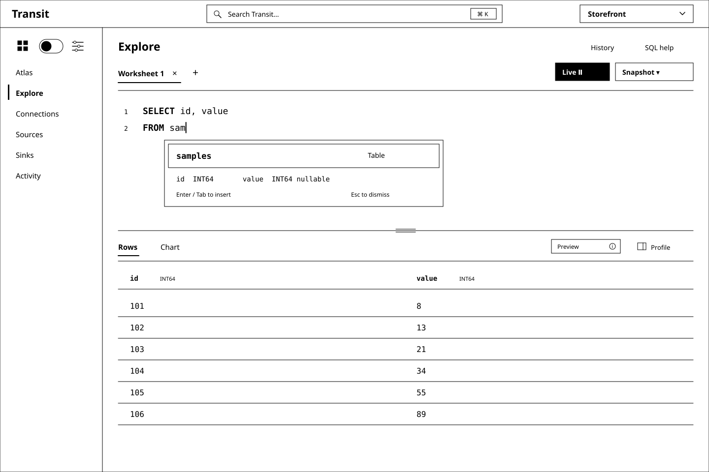
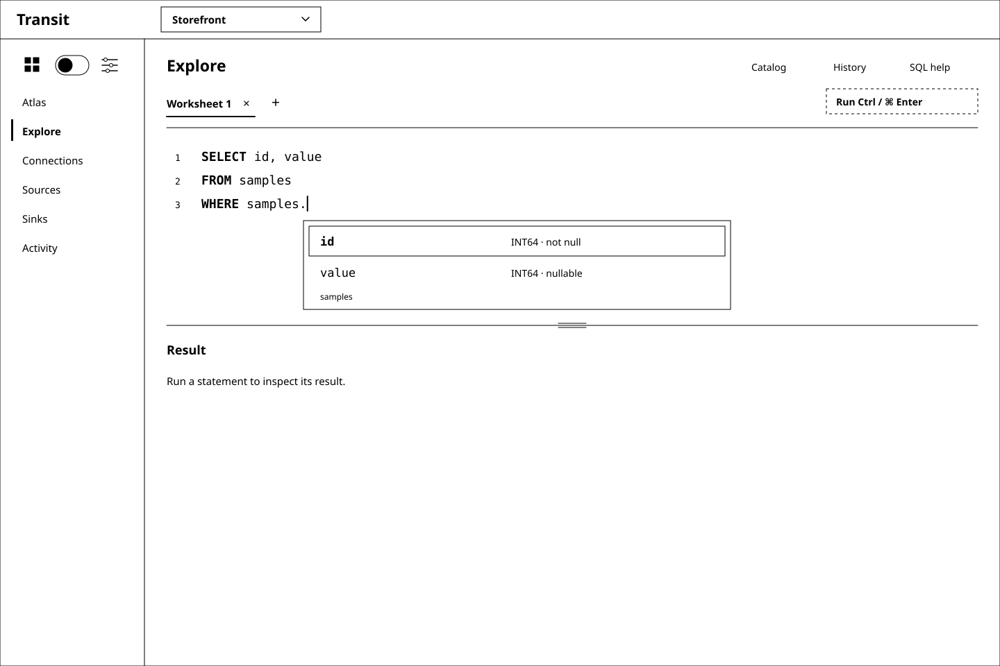
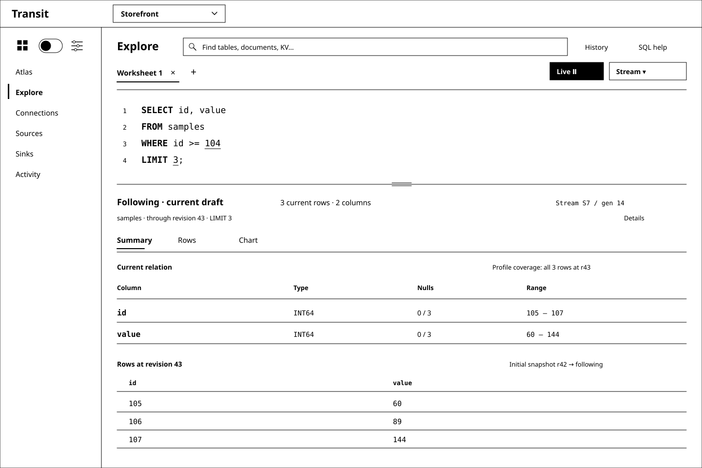

# D4 — Explore: a SQL-first workspace

Previous: [D3 — A quieter Transit shell](D3.md) · [Review index](README.md)

Status: **In review**. Implementation: **Proposed, not implemented**.
D3's compact shell remains the frame. This review replaces its separate Data
and Queries destinations with Explore and makes the SQL console the main task.
Figure 1's layout is the **selected direction**. At the reviewer's request,
this D4 is updated in place to make the worksheet execute as the user types
and replace the catalog drawer with fast resource search. Its latest refinement
cleans up results and moves column profiles into a closable right panel.
The earlier Run-only and tree/drawer recommendations are superseded, not
implemented behavior.

## Question

How should a power user's worksheet answer as they type, using grammar, catalog
context and prediction to schedule useful work while keeping snapshots,
speculative previews and continuous results understandable?

## Proposal

Merge **Data** and **Queries** into **Explore**. The Workspace menu becomes
Atlas, Explore, Connections, Sources, Sinks and Activity. Entering Explore opens
a SQL worksheet ready for typing. Users do not first choose an object, open a
form or switch into an advanced mode. Entry from an atlas resource opens the
same console with that source context. The proposed worksheet opens in a visible
**Live** session: a valid eligible draft can execute immediately without Run.
An empty draft or metadata-only browsing causes no query by itself.

The target is a full browser SQL shell for Transit's supported language:
multiline editing, keyboard-driven completion, contextual diagnostics,
worksheets, execution controls, history and result exploration. The shell can
grow with the language; its first executable profile remains the qualified
single-Table SELECT, with a separately designed live scheduling layer. “Full
shell” does not imply PostgreSQL compatibility or execution of today's
reference-only DDL. Unsupported text stays editable with
a precise explanation, rather than being silently rewritten or discarded.

SQL is the primary representation. A **Find resources** text field opens a
typeahead list beneath it; resource discovery does not require a navigation tree.
Keep object definitions, dependencies and history in contextual detail views.
Form/Canvas representations can remain available from the relevant object or
query, but they do not compete with the console for the default working area.
Tables, Documents and KV stay discoverable in Explore; their query affordances
follow each source's actual capabilities.

Treat completion as grammar-grounded language assistance: grammar context supplies
valid constructions, catalog context supplies visible names and types, and
capability/semantic rules remove unsupported choices. Suggestions and syntax
highlighting should respond locally while the user types. Resource search and
SQL completion share authorized metadata, with different presentation and actions.
A grammar is a useful input to this system; it is not an already implemented
completion engine.
Alongside it, an adaptive scheduler can execute the exact valid draft or a
plausible, fully specified candidate before the user finishes typing. It may
execute on every keystroke when useful and within budget; a fixed debounce or
manual Run gate is not the product model.

After execution, lead with the **returned rows** and a compact toolbar: Rows/Chart,
row/column counts, a short result-state indicator and Details. A closable **Profile**
panel on the right visualizes the returned columns' distributions, distinct-value
cardinality, nulls and min/max. Move executed SQL, source revisions and query or
candidate IDs into Details. A compact Preview or Earlier draft indicator keeps
the answer's relationship to the editor clear. Keep editor and result together
with a resizable split; the profile panel only takes width from the result area.
A streaming result adds its committed progress and changing coverage.

## Visual studies

The figures are synthetic black-and-white wireframes using D3's Transit
header, product realm dropdown and left/right area toggle. Bold keywords and
underlined numeric literals stand in for token highlighting; no color scheme is
selected. The console, live execution, completion, resource search and summaries are
future UI behavior. Figure 5 adds the proposed Stream mode to the selected layout.

### Figure 1: Write SQL immediately

Typing `FROM sam` offers the matching authorized Table. The popup is attached
to the edit location, with a concise kind/schema preview. Enter or Tab accepts
the highlighted candidate; Escape dismisses it. The live scheduler treats an
accepted completion as another edit. Before acceptance, it may already have run
`SELECT id, value FROM samples` as a plausible candidate. Remove the large
**Speculative preview · samples** heading, repeated SQL and
**samples · revision 42 · candidate C1** metadata line from the result surface.
One compact **Preview** indicator identifies the provisional answer; Details
holds its exact candidate SQL, source basis and IDs. A keyboard-accessible
description explains that it answers the suggested completion, not the unfinished
text. If no candidate is worth its cost, the result area waits.

The **Profile** panel is open in this study. It describes the same six rows as
the grid: both columns have six distinct non-null values and zero nulls; `id`
ranges from 101 to 106 and `value` from 8 to 89. Small, labelled histograms show
their distributions. These are result-column statistics, distinct from the
resource metrics in Find resources. Profiling does not issue another source query.

The panel's **×** closes it; **Profile** in the result toolbar opens it again.
Rows expand into the released width, while SQL, selection, scroll position and
the admitted query remain unchanged. The editor always keeps its full width.

### Figure 2: Follow the grammar into the schema

After `WHERE samples.`, the editor resolves the qualifier and offers its fields.
At other positions it offers the permitted keywords, functions, operators or
literal shapes. Completion can inspect the statement after the caret too:
editing `SELECT va| FROM samples` can resolve `value` even though FROM occurs
later. It must also work through incomplete and temporarily invalid input.
While a predicate is incomplete, an earlier answer may remain visible with an
**Earlier draft** indicator and executed text in Details. Do not silently drop
WHERE and label the unfiltered result as current. A separate speculative candidate must be a
complete, compiled query with its own identity.

The editor knows both syntax and capability. For example, the reference grammar
accepts a numeric LIMIT greater than 32, but the current compiler rejects it.
Suggestions must respect the executable bound and report the actual limitation
when a user types another value. Grammar-only commands belong in SQL help with
their support status, not among apparently runnable suggestions.

### Figure 3: Profile the returned data beside its rows

The [existing fixture](d2-fixture.json) yields `(104, 34)`, `(105, 55)`,
`(106, 89)`. The profile reports two INT64 columns, three distinct values in each,
no nulls, an `id` range of 104–106 and a `value` range of 34–89. Those are facts
about the returned result, not the six-row source Table. The visible LIMIT keeps
that distinction clear.

The right panel replaces the separate Summary tab and duplicated row preview.
Rows offers paged inspection; Chart visualizes the same identified result with an
explicit coverage label. Larger results may have complete execution but only a loaded
page available for profiling. Show that scope beside each profile; do not call
it complete-result statistics or fetch all pages merely to fill the summary.
Submission, capture/delivery progress and verified completion are separate states.
Cardinality means distinct non-null values in a column; row count describes the
relation. Estimates and unavailable statistics remain explicit. Panel controls
and chart interactions do not alter SQL or rerun the query.

### Figure 4: Find resources as you type

Replace the Catalog button and side drawer with one persistent search field in
Explore's header. Focus reveals recent authorized resources; typing immediately
filters warm matches and requests a bounded fresh page. The list opens below the
field over the worksheet, without squeezing the editor into a second column.
Escape or returning focus to SQL dismisses it. Closing restores the full worksheet;
resource search never becomes a separate Data destination.

Each result is a readable, aligned row: **name and resource type**, **cardinality**,
**size**, and a **small schema visualization**. A kind icon plus a text label
distinguishes Table, Document and KV. Field cells show Table column names/types
and nullability; a small branching diagram shows a declared Document shape;
a key-to-value diagram describes a KV encoding. These are previews of registered
metadata, not inferred application values. A short preview expands through
Details when more fields or nested levels exist. Metrics and diagrams stay inside
the row, with whitespace and shared column headings instead of separate cards.

The synthetic `sam` search illustrates three different kinds. `samples` has six
source rows, distinct from the three returned by the worksheet's LIMIT. Its 96 B
counts only the twelve INT64 value payloads, excluding keys, encoding and storage
overhead. `sample_notes` shows a declared shape and size but no row cardinality;
`sample_cache` has an estimated key count and unavailable size. The
[search fixture](d4-catalog-fixture.json) records these proposed observations.
Size always names what is measured. Counts carry units and exact/estimate status;
revision/coverage details remain accessible. Unknown is never rendered as zero.
The current API does not supply this general statistics or schema-search service.

Arrow keys move a stable selection; Enter or clicking a row opens its definition,
metric evidence and dependencies. **Insert name** is a separate action available
at a valid SQL source position. It restores the captured editor selection and
makes one undoable edit, which is eligible for live scheduling. Typing in resource
search, highlighting results and opening details only inspect metadata; they do
not alter SQL or dispatch data queries. Unlike FROM completion, discovery includes
inspection-only resources, visibly labelled. Document and KV querying join when
their source contracts exist; opaque bytes never acquire an inferred schema.

### Figure 5: The same worksheet follows changes

The SQL is unchanged from Figure 3. Stream starts with its snapshot, then follows
committed changes. In this synthetic example, revision 43 updates `105` to `60`,
deletes `104` and inserts `(107, 144)`. The current limited relation becomes
`(105, 60)`, `(106, 89)`, `(107, 144)`. It is labelled **Following**, with progress
through revision 43, not globally Complete. Source updates and text edits are
separate causes of change; Details identifies the query generation and frontier.

## Live execution, Snapshot and Stream

**Live / Paused** controls scheduling. **Snapshot / Stream** controls the answer's
time semantics. Keep these independent, compact and visible in the worksheet.
Live is the proposed default for an eligible read worksheet in a provisioned live
session; the user does not have to repeatedly press Run or approve each query.

| Mode | Text changes | Source changes | Result basis |
| --- | --- | --- | --- |
| Live + Snapshot | Evaluate eligible new drafts; optionally speculate on a complete candidate | Do not mutate an accepted snapshot; Refresh explicitly asks for a new basis | One immutable result per actual execution |
| Live + Stream | Bind a new query generation, replacing the old subscription under its handoff contract | Maintain the current relation from committed deltas and progress | Query generation plus snapshot/frontier; continually advancing |
| Paused | Continue completion/highlighting without scheduling reads | Stop following; mark the last visible basis held/stale | Last authorized view; no retention pin or cancellation guarantee |

The scheduler considers each edit, including completion acceptance, paste and
history restoration. Cheap valid edits can execute per keystroke. Coalescing,
brief adaptive waits, cancellation and reuse serve responsiveness and budget;
they are not a mandatory “wait until typing stops” workflow. Once a valid draft
stabilizes, exact execution gets priority; speculative work must not starve it.

This creates a useful probabilistic problem: which candidate is likely to remain
useful when its result arrives, and is the expected latency saving worth its
compute, capture, storage and visual churn? Grammar, edit timing, catalog matches
and plan cost can inform that decision. Start with measurable heuristics and
compare predictors; do not claim a calibrated probability before measuring one.
Probability chooses work, never permission or the truth of a computed result.

An exact current answer, a speculative candidate and an earlier-draft answer
have distinct labels and identities. A prediction may complete `sam` to `samples`,
but it cannot edit the user's text, quietly drop a filter or pretend to answer
an invalid statement. Keep a compact Preview indicator and make the candidate SQL
available in Details. If the text later matches it, reuse is allowed only with
matching semantics, source/schema basis and current
authority. A late result from an older generation cannot overwrite a newer one.

Automatic work covers qualified read-only plans over authorized data. DDL, DML,
grants, sink writes and external effects retain explicit operations. SELECT alone
does not prove purity: source adapters/functions must declare their effect and
cost properties. A live session needs shared admission, execution/retention
budgets and a lifecycle contract; per-keystroke durable capture is real work.

Repeated snapshots are not a continuous query. Stream needs snapshot-to-tail
handoff, updates/deletes, consistent progress, gaps/resumption and query-generation
replacement. A finite Arrow result delivered in batches is still a snapshot.
There is no current SUBSCRIBE syntax or continuous-query contract to enable by
adding a switch. The mode must be part of a shared typed request and inspectable
execution specification; its eventual SQL spelling remains open.

## Console behavior

| Action | Proposed behavior |
| --- | --- |
| Open Explore | Focus the visible Live worksheet; a valid restored draft is eligible within its session scope |
| Type | Update completion and schedule useful eligible exact/speculative work; possibly every keystroke |
| Ctrl+Space | Request completion without itself scheduling a query |
| Enter / Tab with completion open | Insert as one undoable edit; live scheduling sees the resulting draft |
| Escape | Dismiss completion and preserve text; never cancel durable work |
| Ctrl/Cmd+Enter | Prioritize an exact evaluation now; in Paused, request one bounded snapshot without resuming Live |
| Live / Paused | Enable scheduling or stop new work and request the qualified stop of in-flight work/subscription |
| Snapshot / Stream | Choose finite answers or a continuous relation; capability-gated and included in execution identity |
| Type in Find resources / open resource details | Filter authorized metadata and show inline metrics/schema; no data query or draft edit |
| Insert name from resource search | Revalidate the source and captured SQL position; insert one undoable edit eligible for Live |
| Open History | Inspect session records; restoring text is an edit and is live when the session is live |
| Switch Rows / Chart | View the same answer/frontier; do not independently dispatch queries |
| Close / reopen Profile | Resize only the result area; restore column selection and profile the same loaded result/frontier without rerunning SQL |
| Open result Details | Inspect executed SQL, candidate/draft identity, source revisions and coverage without a query |

Worksheet tabs are editing contexts, not independent query principals. The
current M13 path admits only one active query per configured principal, shared
across viewers. It has no live session, supersession or stream API. An initial
live adapter over it must honor that limit; a faster admission path requires a
new qualified contract. Each admitted evaluation freezes statement range, text,
candidate/draft generation, source/schema basis and durable identity. Editing
afterward marks the displayed result as an earlier draft or a named speculation.
Multiple statements selected together
are rejected in the current profile; do not invent a transaction or implement
Run All as silent sequential submissions.

The long-term shell can support administrative SQL when its owning lowerers and
change contracts are qualified. It must then distinguish a row result from a
change receipt and observed application. A worksheet cannot grant execution
rights or turn a CREATE preview into an enabled operation.

History begins as bounded, in-memory session history with no stored row cache;
persistent worksheets/history require their own retention and access design.
Switching realms or observing denial clears protected drafts, completion data,
history, profiles and results under the existing rules. Frozen uncertain work
keeps its original identity while reconciliation remains authorized; an unknown
submission is never replaced by rerunning the SQL.

## Instant assistance and truthful summaries

The [console design notes](CONSOLE.md) specify the missing editor-service
boundary, completion examples, generation strategy, latency/memory targets,
catalog invalidation, resource-search rows and summary coverage. These are
supporting details for D4, not a separate review sequence or a claim of working
autocomplete. The [live notes](LIVE.md) extend them with predictive scheduling,
admission/retention costs and continuous-query semantics for this refinement.

The main choices are local syntax work in a worker, bounded authorized catalog
metadata, capability filtering and complete server-side compilation for each
actual evaluation. Keystrokes may lead to query execution through the live
scheduler. The current `prepare` operation freezes a signed mutation; it is not
a harmless diagnostics endpoint or an already qualified live scheduling API.
Warm completion has a proposed 50 ms p95 end-to-end budget, to be measured on
declared browser/hardware fixtures before describing the implementation as instant.

Summary generation uses bounded, typed computation over verified result pages.
It preserves int64 values exactly and identifies loaded-page versus whole-result
coverage. SQL highlighting, a fast suggestion and a chart are useful views;
none establishes authorization, executable grammar or result completeness.

## Review outcome

The reviewer described D3 as cleaner and easy to review, then requested merging
Data and Queries under Explore. They selected a query-first direction for power
users, a full browser SQL shell with grammar/catalog typeahead and highlighting,
and a result-set summary inspired by Snowflake. These are recorded design inputs.

The reviewer then selected **Figure 1: Write SQL immediately** as essentially
the desired interface and requested this in-place D4 update: execute as the user
types, potentially every keystroke, explore the probabilistic scheduling problem,
and distinguish streaming from snapshots. Figure 1's layout and the live direction
are recorded selections. The original Run-only policy is superseded.

The reviewer next requested a text field with fast typeahead, a list beneath it,
clear resource types, inline size/cardinality and schema visualizations. This
refinement replaces the catalog drawer in Figure 4 and adds the search field to
all five studies. The selected SQL-first layout and Live behavior carry forward;
the precise row content and metadata contracts remain proposed.

The reviewer then approved Figure 1's direction and requested removing its
prominent speculative/source labels and adding a closable right panel for returned
data dimensions, citing MotherDuck. This refinement makes rows primary, puts
cardinality/ranges/distributions in Profile and moves query provenance into
Details. A small result-state indicator preserves the meaning of a preview.
The additional closed-panel view demonstrates recovering the result width.

The exact speculative policy, mode defaults, progress contract and resource
budgets remain in review. No implementation or latency claim is accepted by
selecting the layout. D3's compact shell carries forward; its separate Data/Queries
menu and default representation tabs are superseded by Explore.

## Open questions

- When a source supports both, should a new Live worksheet default to Snapshot
  or Stream? This study starts with Snapshot and makes Stream a visible choice.
- How aggressively should a partial draft trigger speculative execution, and
  what measured latency benefit justifies its compute and retained-output cost?
- Which operators and source-update semantics qualify the first Stream profile,
  especially replacement of a limited result after updates/deletes?

## Evidence and limits

The initial repository audit uses base `4ce4fb1`: the checked reference grammar,
Zig SQL compiler, query model and current Board/CLI guides. The [console notes](CONSOLE.md)
identify their actual capabilities and missing contracts. No grammar, engine,
public API or application behavior changes in this review. M12/M13 remain the
executable Table baseline; M17/M18 own planned Document/unified-query foundations.
Editor generation, catalog search, worksheet/history support and profiles need
their own implementation scope under the [roadmap sequence](../../roadmap/README.md#maintaining-the-sequence).
The live refinement audits `e736c68` and additionally needs session admission,
supersession, speculative result identity and continuous-query qualification.
The existing streaming runtime does not itself supply those query semantics.
The resource-search refinement audits `afec86b`: current atlas entry counts include
framework keys and are not logical Table rows, and general resource size metrics
are unavailable. New summaries need owner-produced, authorized metadata; neither
the browser nor Board may scan storage to manufacture these figures.

Snowflake's [workspace documentation](https://docs.snowflake.com/en/user-guide/ui-snowsight/workspaces-working)
describes a SQL editor with highlighting/completion and interactive result-column
statistics. This supplies the editor-to-result interaction reference. Transit's
source, authority, retention and coverage semantics remain its own; this review
does not select Snowflake's backend or claim matching SQL features.

MotherDuck's [Column Explorer](https://motherduck.com/blog/introducing-column-explorer/)
provides the requested reference for compact per-column distributions and summary
statistics, with more detail available by selecting a column. D4 adopts that
interaction direction; it does not adopt MotherDuck's execution/cache architecture
or claim its performance. Transit's profiles stay bound to the returned result
or stream frontier and explicitly disclose their coverage.

The figures use synthetic data; performance targets are unmeasured. Completion
expectations and result-profile arithmetic are recorded in the
[study fixture](d4-fixture.json). Static syntax/fixture checks cannot prove
keystroke latency, accessible editing, incremental recovery or current-policy
catalog invalidation. Those require an interactive implementation and its proofs.

Checks recorded for the initial D4 at `e736c68`:

- `nix develop -c just check` and `nix develop -c just test::sql` passed.
- A one-off fixture check verified eight proposed text replacements and all
  14 completed-statement grammar/compiler expectations. The executable examples'
  ASTs agreed with PostgreSQL and compiled through the existing Zig proof driver.
  Added validation suffixes only finish the test examples; they are not proposed
  autocomplete insertions. Suppression behavior and partial-input recovery remain
  unimplemented and untested.
- Result-profile counts and ranges matched a separate calculation over D2's
  synthetic input. The proof driver uses its own data; no live summary UI was tested.
- The original four SVGs passed XML, accessible-description, monochrome and
  navigation-copy checks, then were rendered and visually reviewed.

For the live refinement, `nix develop -c just check` passed. All five current
figures were checked as XML, for accessible descriptions, monochrome styling
and Live controls, then rendered and visually reviewed. A one-off calculation
checked the six-row speculative preview and the synthetic revision-42/43 result
and profile values, including the unchanged snapshot. Scheduling/race scenarios
remain expected behavior in a fixture, not executed tests. The existing SQL
examples/grammar were unchanged; the SQL qualification above was not repeated.

For the resource-search refinement, `nix develop -c just check` passed. All five
SVGs were checked for XML, accessible descriptions, monochrome styling and a
labelled search field, then rendered and visually reviewed. A one-off calculation
checked the six-row count and 96-byte value payload against D2's source fixture,
the Document size conversion, search ordering and captured SQL insertion range.
Other metrics are declared synthetic inputs. Search interaction, freshness,
schema discovery and response-time behavior remain unimplemented and untested.
No grammar or executable query examples changed in this refinement.

For the profile-panel refinement, `nix develop -c just check` passed. All six
current SVGs, including the closed-panel view, passed XML, accessible-description,
monochrome and metadata-removal checks, then were rendered and visually reviewed.
Independent calculations checked all six illustrated column profiles and their
18 histogram bins against the identified preview, snapshot and stream rows.
Panel interactions, profile computation and update/delete maintenance remain
proposed; these static checks do not establish runtime behavior or latency.

Clean-checkout qualification is reported with the pull request. These checks
establish neither an implemented console nor measured response-time performance.

## Supporting material

- SVG sources: [Table completion](images/d4-01-typeahead.svg),
  [Profile closed](images/d4-01b-profile-closed.svg),
  [Column completion](images/d4-02-columns.svg),
  [Result summary](images/d4-03-result-summary.svg),
  [Resource typeahead](images/d4-04-catalog.svg),
  [Live stream](images/d4-05-live-stream.svg).
- [Console design notes](CONSOLE.md) and [study fixture](d4-fixture.json).
- [Resource-search observations and interaction expectations](d4-catalog-fixture.json).
- [Live scheduling and stream semantics](LIVE.md) and
  [synthetic live scenarios](d4-live-fixture.json).
- [D2 grammar audit](D2.md#what-the-sql-grammar-actually-supports) and
  [existing SQL/data fixture](d2-fixture.json).

Previous: [D3 — A quieter Transit shell](D3.md) · [Review index](README.md)
