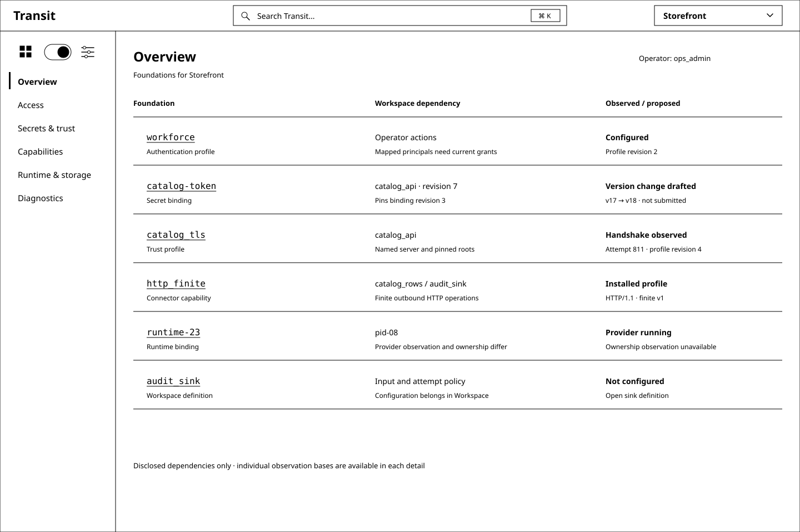
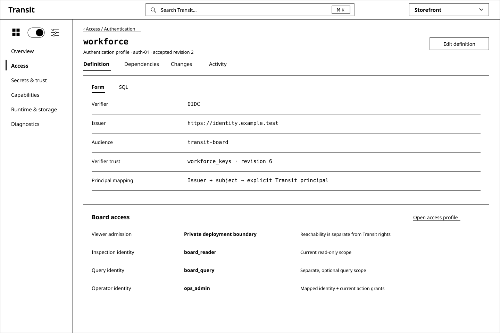
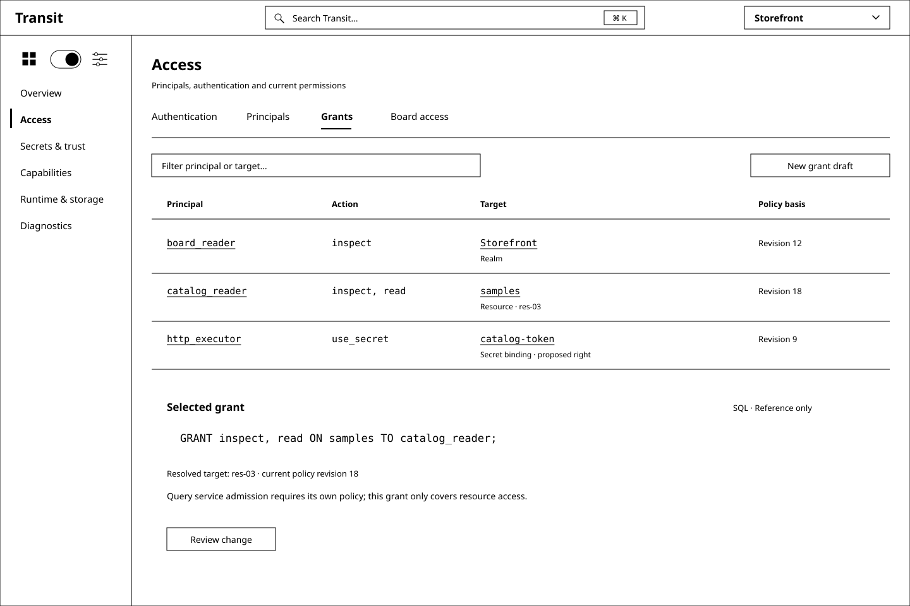
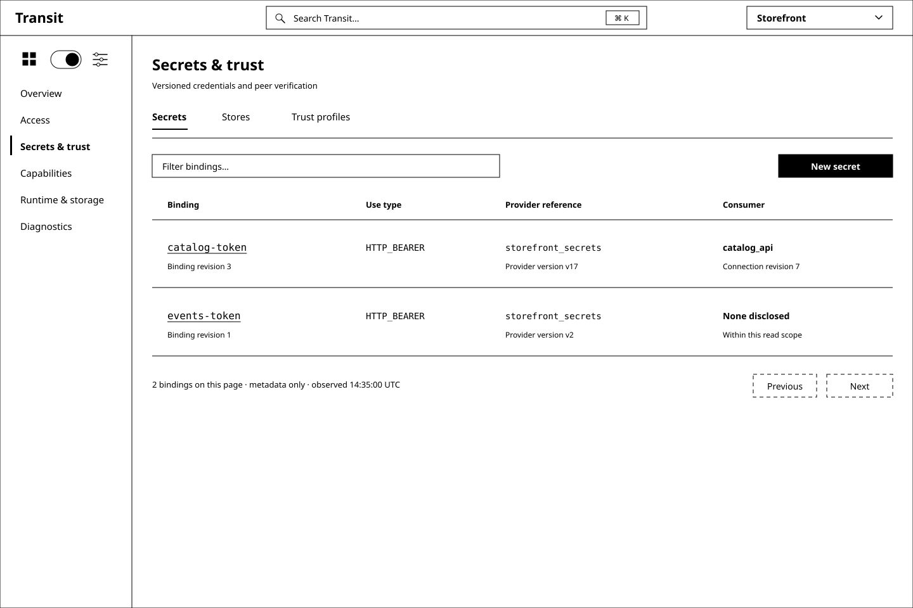
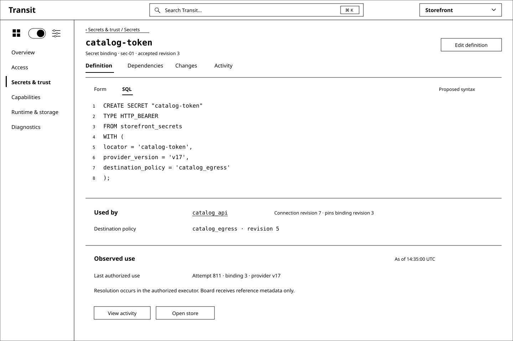
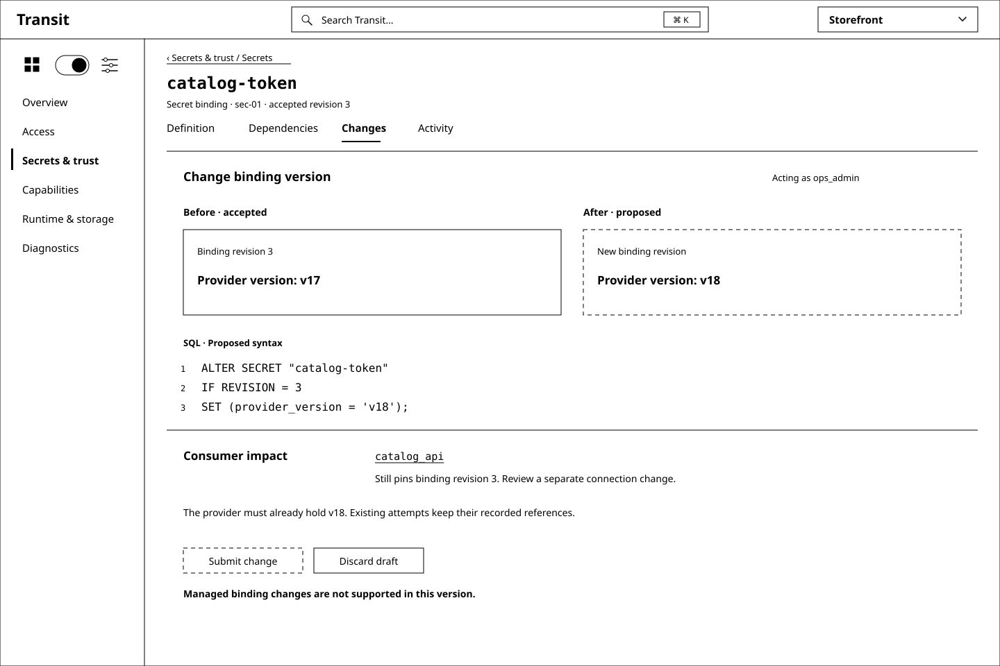
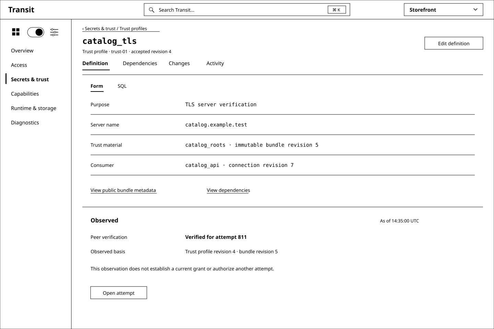
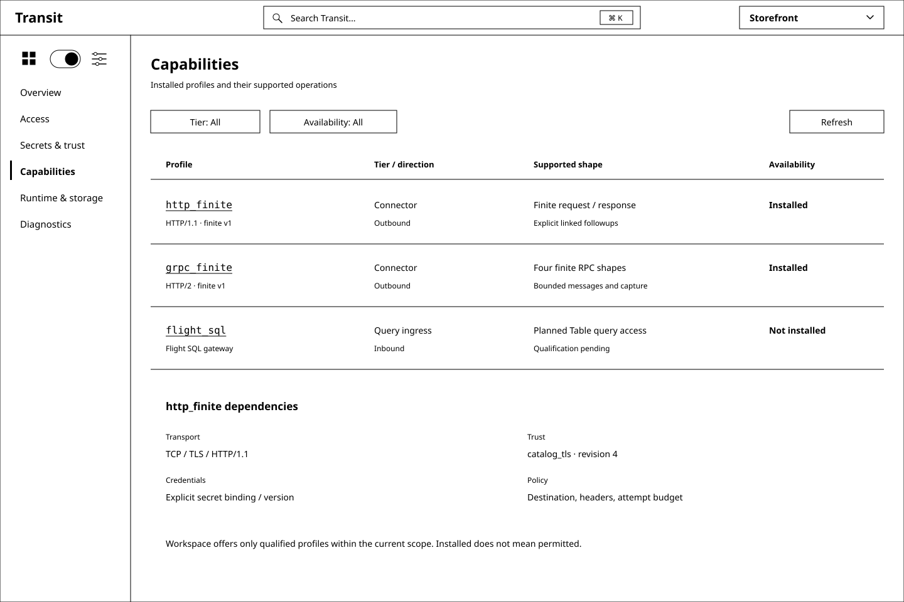
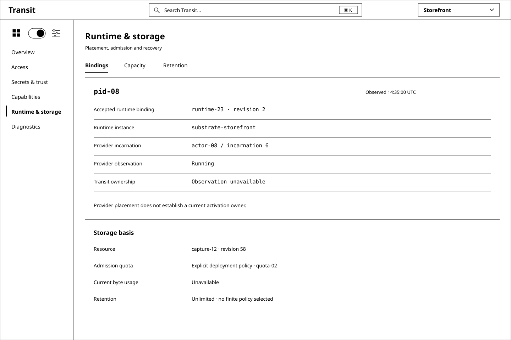
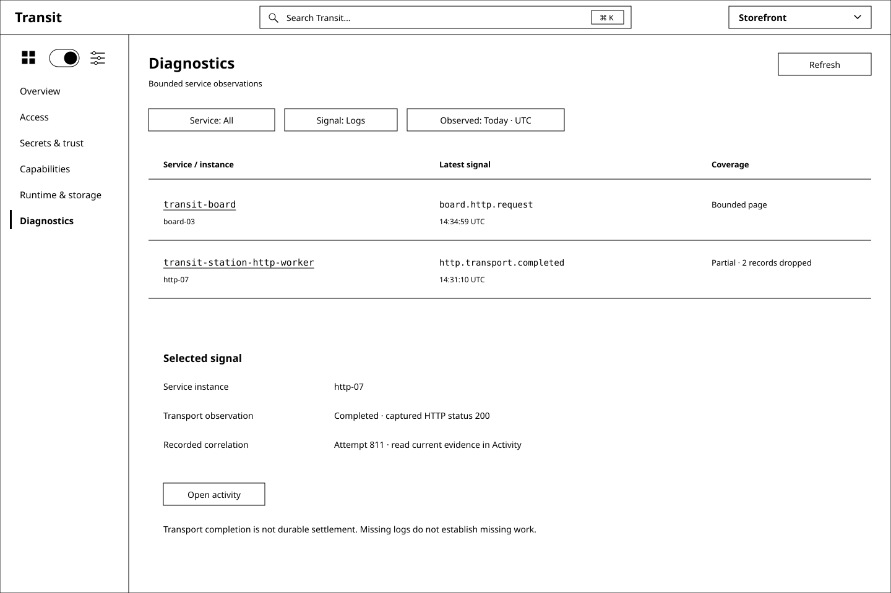

# D6 — Operations: the foundation beneath Workspace

Previous: [D5 — Connections, Sources, Sinks and Activity](D5.md) · [Review index](README.md)

Status: **In review**. Implementation: **Proposed, not implemented**.
The reviewer endorsed D5, requested its merge, and asked for an operator-surface
review covering authentication, secret management and the foundations of
Workspace. A subsequent request adds an explicit SQL-grammar mapping, with
DuckDB's secret manager as a reference.

## Question

How should an operator establish and understand what Workspace can do, without
turning occasional administration into another daily dashboard or hiding the
authority and credential boundaries behind generic settings?

## Proposal

Keep **Operations** as the second position of the existing area toggle. Entering
it preserves the realm and returns to the last authorized destination; first
entry opens Overview. Workspace remains the primary daily area. A blocked
connection, source, sink or query links directly to the exact supporting object,
with a route back to its original context.

Use D5's [monochrome structure](STRUCTURE.md): paged collections, full object
details, one active representation, separate accepted/draft/observed state and
evidence links. Operations adds depth about foundations, not a different visual
language. Avoid counters, global health scores and provider dashboards.

| Destination | Operator's question | Effect on Workspace |
| --- | --- | --- |
| Overview | Which foundations need attention, and what depends on them? | Bounded, named dependencies and concrete next steps |
| Access | Who can authenticate, which principal results, and what may it do? | Distinguishes viewer admission, inspection, query and administrative authority |
| Secrets & trust | Which credential references and peer identities can work use? | Connections can name exact credential and trust revisions |
| Capabilities | Which installed profiles and operations are actually available? | Defines selectable connector/transport/integration features and their limits |
| Runtime & storage | Where is work hosted, and what admission/recovery limits apply? | Explains placement, capacity and retained evidence without granting execution rights |
| Diagnostics | What do the services currently report? | Helps investigate problems; durable outcomes remain in Activity |

Access has **Authentication, Principals, Grants and Board access** collection
views. Secrets & trust has **Secrets, Stores and Trust profiles**. These are
local categories; opening an object restores Definition, Dependencies, Changes
and Activity. Rename D2's “Credentials & trust” destination to “Secrets & trust”
to make this common task discoverable. Transit principal/key bindings live in
Access; private external credentials live behind Secret references. Certificate
credentials are secrets; public peer-verification rules are trust profiles.

The [operator SQL map](OPERATIONS_SQL.md) names the declarative meaning of every
component and audits its current support. It proposes a complete SECRET lifecycle.
**Managing a SECRET means managing a versioned binding to externally held
credential material.** SQL and forms describe its type, provider reference,
version, permitted use and lifetime; the executor alone resolves its value for
an authorized attempt. Authentication, permission and credential possession
remain three separate facts.

## Visual studies

Ten black-and-white SVG studies use D5's 1440 × 960 frame. All definitions,
identities, observations and provider references are synthetic. They describe a
future operator surface, including future attributable admission. Today's Board
still has private shared viewer access and no general administration capability.
No installed identity or secret-management provider is selected by these examples.

### Figure 1: Overview explains the foundation through its dependents

Start with named foundations and affected work, not totals or a wall of metrics.
The proposed credential-version change names `catalog_api` as its disclosed
consumer. The incomplete sink remains a Workspace definition task; Operations
does not fabricate an input binding for it. Each row keeps its own observation
basis; this is not a globally consistent readiness report.

### Figure 2: Authentication is a chain of explicit boundaries

The verifier establishes an identity; an explicit mapping establishes the
realm-bound Transit principal. Current grants then decide access. A matching
email, group claim, successful login or accessible Board URL does not create a
grant. **Board access** makes the configured admission and upstream identities
discoverable without displaying signing keys or embedding a login workflow
inside the configuration page.

This study uses a candidate OIDC profile to make the fields concrete. Its
configuration, sessions, logout, key rotation, mapping and outage behavior need
their own public contracts. Editing an issuer is a local draft; switching it
cannot silently disable the operator's last recovery path.

### Figure 3: Grants show who can do what, to which exact object

Scope is part of each row. Distinguish realm/PID authority, resource reads,
service query policy and proposed secret-use policy. A readable Table is not
automatically a queryable service, and `use_secret` does not mean reveal-value.
One generic “Admin” or “Connected” badge would conceal those differences.

The existing GRANT grammar accepts privilege identifiers, but has no semantic
catalog or SQL execution. The `use_secret` row is a proposed permission family,
not a newly implemented Transit bit. The selected resource grant's SQL is
**Reference only**, and changing representations does not grant anything.

### Figure 4: Secrets are discoverable bindings

An operator can find the credential dependency by name, type or authorized
consumer. **New secret** means a local binding draft. It does not accept a token
paste or create a remote credential. A separate store detail explains the
configured resolver and bootstrap binding; it is not a server file browser.
Only disclosed consumers appear, without hidden-object counts.

### Figure 5: The same SECRET definition has a SQL representation

This deliberately selects SQL in the shared object detail. Its **Proposed
syntax** label is local to the representation. There is no Run or Live control;
administrative declarations never enter Explore's read scheduler. The CREATE
text represents the current definition and cannot be resubmitted to replace it.

Binding revision 3 names provider version `v17`. `catalog_api` revision 7 pins
that binding. A last authorized use is evidence about a particular attempt,
not a promise that the provider is reachable now. Secret metadata inspection,
binding management and executor use require separate rights.

### Figure 6: A version change makes consumer impact explicit

**Change binding version** would publish a new immutable metadata revision;
the credential at `v18` must already exist or have its own provisioning outcome.
The UI names the difference between binding rotation, consumer rebinding and
remote credential rotation. They are not one transactional button.

Existing attempts keep their frozen destination, policy and credential reference.
New work cannot fall back to a different secret when a version is unavailable.
The proposed Submit remains unavailable in this study. Future lost responses
retain exact operation identity for receipt recovery, not another rotation.

### Figure 7: Trust is a separate, versioned dependency

Peer verification answers whether the remote identity matches the configured
trust rules. It does not grant a Transit operation or select a private credential.
Client certificates, if later supported, reference Secrets; public roots and
server-name policy belong here. A handshake observation names the profile it
used. A new profile draft does not relabel an old handshake or an in-flight attempt.

### Figure 8: Capabilities connect supported profiles to Workspace choices

Keep installed, configured and permitted distinct. The connector family alone
does not establish protocol version, inbound/outbound direction, streaming
support or effect permission. Planned profiles cannot become enabled choices
in Workspace just because they appear in an inventory. There is no “Install
plugin” action or arbitrary code loading through SQL.

### Figure 9: Runtime & storage keeps authority, placement and capacity separate

An observed running provider instance does not prove Transit ownership. Binding,
activation and provider-incarnation identities remain separate. Capacity reports
the named budget and its observation, not a global free-space promise. Quota
pressure may refuse new work; it never implies expiry or deletion of accepted
work. Retention remains unlimited unless an application opted in.

### Figure 10: Diagnostics leads to evidence without becoming the audit record

Service identity and observation time belong beside each signal. Omitted and
dropped telemetry stay visible. A local transport observation links to Activity
when an authorized recorded correlation exists; it cannot declare a durable
result. Provider consoles, raw logs, bodies and credentials are not proxied
through Board merely because this page exists.

## SQL and interaction contract

[The SQL map](OPERATIONS_SQL.md#map-every-operations-component) is the companion
to every screen, not an export appendix added to unrelated forms. It separates
existing reference productions from candidate declarations and controls, names
their semantic owners and supplies concrete SECRET creation, inspection,
authorization, use, version change and retirement examples.

The principal interaction is **find dependency → inspect definition and evidence
→ draft one change → review its scope and effects → explicitly submit → follow
its receipt and observed application**. SQL, Form and the public API must share
one typed proposal, validation and conditional revision. Switching representations
never applies or probes. A dependency diagram cannot invent a grant, credential
flow or cross-object transaction.

| Situation | Required behavior |
| --- | --- |
| Workspace links to an operator dependency | Open its exact authorized identity/revision; keep the return target and distinguish an older pinned revision from latest |
| Operator lacks metadata permission | Clear the affected content; do not disclose names through dependency counts, search, draft previews or errors |
| Verifier, policy authority or required provider metadata is unavailable | Preserve “Unavailable”; no cached allow, invented ready state or fallback credential |
| Secret value is needed for dispatch | Only the authorized executor resolves the frozen reference; Board receives metadata only |
| Draft targets an old revision | Preserve the draft and show a conflict; require a new comparison before submission |
| Change was accepted but the response was lost | Retain frozen proposal and operation identity; read/recover the same receipt |
| Secret use is revoked | Fence new use at the defined policy boundary; already-authorized remote work may still occur |
| Binding is retired | Preserve historical reference/receipt evidence; no provider deletion, history erasure or automatic revival |
| Authentication configuration would remove operator access | Require a qualified recovery path and explicit impact review; bootstrap is independently provisioned, not circularly dependent on this UI |
| Service telemetry is missing | Mark its coverage; do not convert absent diagnostics into a durable failure or success |

## Admission and bootstrap

Today's Board admits every reachable viewer to one configured shared inspection
scope and optionally a separate shared query scope. It has no per-human session
or general administrative route. D6 must not turn the area toggle, a hidden
menu or the inspection principal into administrator authority.

Future controls require an attributable operator identity and current,
operation-specific grants at public ingress. An external sign-in must be bound
to the actual request principal and realm. Issuer/key validation, session expiry,
revocation freshness, identity mapping and outages need explicit contracts.
The change review shows **acting as**, exact target, base revision, consequences
and operation identity. It cannot inherit a previous viewer's cached permission.

Initial identity roots, operator recovery access and secret-provider bootstrap
remain trusted deployment inputs. The UI may inspect permitted references and
propose later changes, but it cannot manufacture its own first root grant or
depend on a secret it needs authority to resolve in order to authenticate.
No recovery design or external identity provider is selected by this review.

## Review outcome

The reviewer requested an operator foundation used less often than Workspace,
with authentication and secret-management detail, and then requested an explicit
SQL-grammar mapping informed by DuckDB. These are recorded inputs. The proposed
navigation, ten studies and SECRET lifecycle are now available for review; no
acceptance of those new details or SQL spellings is recorded yet.

## Open questions

- Does one Secrets & trust destination with local categories remain easy to find,
  or should Secrets and Trust become separate Operations destinations?
- Should the first managed SECRET contract support only references to immutable
  provider versions, as proposed, before adding credential issuance/renewal?
- Are explicit `SECRET(name, REVISION n)` and conditional ALTER clear enough,
  or should version selection use another spelling with the same frozen semantics?

## Evidence and limits

This review starts from merged D5 at `b56e8a3`. Its
[fixture](d6-fixture.json) records synthetic definitions and SQL support status.
DuckDB's official current documentation was inspected on 2026-09-27; the
[comparison](OPERATIONS_SQL.md#duckdb-as-a-reference) links the exact sources.
No upstream source code, credential values or copied documentation is vendored.

The [M2](../../roadmap/M2.md) inspection, [M4](../../roadmap/M4.md) telemetry,
[M8](../../roadmap/M8.md) lifecycle and [M13](../../roadmap/M13.md) query contracts
remain unchanged. M15/M16 provide finite connector scope, private credential
resolution and capture evidence, not managed secret stores or an operator
catalog. M22's planned gateway does not supply these declarations either.
Implementation requires new public contracts and its own place in the
[linear roadmap](../../roadmap/README.md#maintaining-the-sequence).

At the reviewer's request, CI is not required for this design review. Validation
is limited to document links, fixture/asset consistency, monochrome SVG structure
and rendered visual inspection. Those checks do not qualify authentication,
secret resolution, SQL parsing/execution, accessibility or runtime behavior.

## Supporting material

- [Operator SQL map and SECRET lifecycle](OPERATIONS_SQL.md),
  [synthetic fixture](d6-fixture.json) and [shared structure](STRUCTURE.md).
- SVG sources: [Overview](images/d6-01-overview.svg),
  [Authentication](images/d6-02-authentication.svg), [Grants](images/d6-03-grants.svg),
  [Secrets](images/d6-04-secrets.svg), [Secret SQL](images/d6-05-secret-sql.svg),
  [Version change](images/d6-06-secret-change.svg), [Trust](images/d6-07-trust.svg),
  [Capabilities](images/d6-08-capabilities.svg), [Runtime & storage](images/d6-09-runtime.svg),
  [Diagnostics](images/d6-10-diagnostics.svg).
- Owners: [Security](../../SECURITY.md), [service contract](../../../contracts/SERVICE_V2.md),
  [query language](../../QUERY_LANGUAGE.md), [connector credential rules](../../CONNECTORS.md#variables-and-secrets),
  [runtime boundary](../../DEPLOYMENT.md), [observability](../../OBSERVABILITY.md)
  and [current Board configuration](../../../apps/transit-board/docs/configuration.md).

Previous: [D5 — Connections, Sources, Sinks and Activity](D5.md) · [Review index](README.md)
