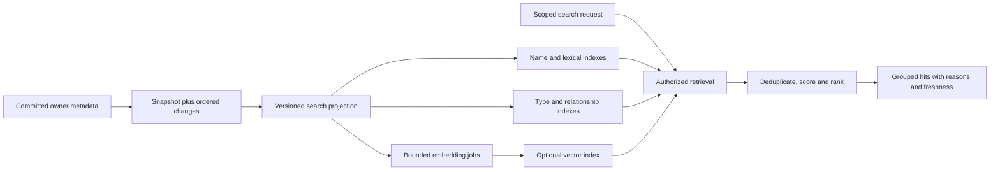

# Transit-wide search

Status: **Proposed D4 design, not implemented**. The current Board catalog and
query workspace do not provide this service. [D4](D4.md) owns the visual review;
[CONSOLE](CONSOLE.md) owns worksheet completion and result behavior. This note
defines the rich search system behind the shared header, without choosing an
engine, embedding provider or implementation milestone.

## One entry point across Transit

Keep Transit at the left of the top navigation, **Search Transit** in its center
and the product-oriented realm dropdown at the right. Search is available from
Workspace and Operations, including Atlas, Explore, Connections and Access.
Remove the additional resource search beside Explore's title. Its informative
data rows become one view of the global search, not another search surface.

Click the field or press **⌘K** on macOS / **Ctrl+K** elsewhere to focus it and
open power search beneath the header. The shortcut works from the SQL editor
without changing its text or losing its captured selection. Escape dismisses
search and returns focus; already admitted Live work can continue. Empty search
offers bounded session recents and navigation commands, subject to current
authorization. No durable search history is implied.

The initial scope is the selected realm, with all available kinds included.
Transit-wide means one entry across the product, not an invisible cross-realm
read. A visible **Storefront** scope control can explicitly broaden to authorized
realms when a federated search contract exists; show the realm on every such hit.
Choosing a hit in another realm explicitly changes context and clears/revalidates
protected worksheet state. Do not mix per-realm revisions into a global snapshot.
Changing the header realm resets search generations and protected cached results.

Ground relevance in the current section and focused object. This is a soft,
visible context signal, not an automatic kind filter: **Explore context · All
sections** means all eligible kinds remain searchable. A user can turn off the
context boost or explicitly narrow kinds. Do not require a global/context toggle
before typing. Strong query intent and exact matches can cross the current
section; context must not strand users in the page they are trying to leave.

| Current context | Useful relevance signals and shortcuts |
| --- | --- |
| Explore | Tables, Documents, KV, registered fields and the active source; Insert name only at a valid SQL position |
| Connections | Configured integrations, connectors, transports and their declared dependencies or recorded operations |
| Sources | Ingestion sources, producers, destination resources and declared source-to-resource relationships |
| Sinks | Output bindings, destination connectors, source resources and recorded delivery state |
| Atlas / Activity | Focused process/resource neighbors or correlated records, respecting the declared graph and time scope |
| Operations | Authorized access, runtime, credential-reference and diagnostic objects, without changing grants |

Capture section, focused typed identity and applicable safe view scope with each
search generation. Send only necessary authorized identifiers; do not send the
worksheet's SQL or selected data values as implicit search context. Navigation
updates context for the next query/opening. Keep an active keyboard selection
stable if context changes underneath it. Context-aware grouping can put Data
first in Explore and Connections first on its page, while an exact match stays
above either arrangement. Measure the same queries from multiple sections.

Use discrete scope, kind and match-mode controls. Free text remains discovery
text, not SQL or a hidden command language. A future advanced search grammar
would need a versioned shared parser; this design does not invent executable
`SEARCH`, `CREATE INDEX` or vector SQL forms. A Commands filter selects navigation
and explicit actions without turning prose into instructions.

## Objects, categories and actions

Every result has a stable typed identity, a realm/scope, an owner-provided title,
an authorized excerpt, a destination and a visible match reason. Classification
comes from the owning type contract. A predictor can suggest useful filters or
infer intent, but cannot invent object kinds, authority or observed state.

| Group | Examples and compact evidence | Activation |
| --- | --- | --- |
| Data | Tables, Documents, KV; declared schema, measured cardinality/size and their coverage | Open definition/inspection; explicit Insert name only with a valid captured SQL context |
| Connections | Transport, connector and integration instances, source/sink bindings; declared protocol, dependencies, observed state with its basis | Open the canonical configuration/operation view |
| Activity | Processes, queries, exchanges and recorded outcomes; stable identities, time window and status | Open the exact source-backed record; telemetry remains separately labelled |
| Operations | Authorized grant, credential-reference, runtime and diagnostic objects; kind and scope | Open inspection or a proposed change form; no direct apply from search |
| Commands | Available destinations and context-valid actions, labelled as commands rather than data | Explicitly navigate or open a workflow; mutation/effect confirmation belongs to that workflow |

Do not fabricate categories for unavailable capabilities. In an all-kinds view,
show the best relevant groups with a few useful hits in each and a More control.
Within a Data filter, retain D4's richer name/kind, cardinality, size and schema
columns. A mixed list uses a compact kind-specific second line; schema details
expand for a selected data hit. Avoid empty metric columns on command rows.
There is no obligation to populate a category with weak or irrelevant matches.

An exact identity/name match has a prominent, predictable position. Related
results may use labels such as **Name match**, **Description match** or **Related
meaning**, with inspectable reasons, not confidence percentages. Kind badges and
group headings remain stable even when query intent is uncertain. Group order
can follow the strongest eligible match; deterministic ties use the documented
kind order and then stable identity. A kind filter gives a deeper ranked list.

Arrow keys navigate selectable hits across labelled groups; Enter opens the
selected object. Tab reaches separate filter/action controls. Use a labelled
combobox/listbox with announced groups, result kind and match reason; do not put
buttons inside options. Escape clears the popup, not the worksheet. On narrow
screens, move this same search into a full-width dialog with focus management
and stack each hit's information. Retain the selected identity across fresh
metadata, and never silently move keyboard selection to a different object.

## Constraining properties and stages

Retrieval determines which candidates can be considered. Scoring measures
signals for each candidate. Ranking orders and groups the eligible candidates.
These have different budgets and correctness obligations; a better reranker
cannot recover a relevant object that retrieval missed.

| Stage / property | Required contract | Design consequence |
| --- | --- | --- |
| Scope and disclosure | Requested realm/kinds, current principal or configured identity, authorized fields and capability profile | Apply as hard constraints before disclosure; semantics cannot broaden scope |
| Interpretation | Normalized query, exact identifier handling, tokenization/language version, explicit filters and optional soft intent | Preserve original text; exact IDs bypass fuzzy reinterpretation; never execute inferred instructions |
| Retrieval / recall | Independent bounded candidate sets from exact/prefix, lexical/schema, relationship and optional vector indexes | Preserve exact matches; declare which sources participated, timed out or lagged |
| Scoring | Versioned per-source signals: field match, lexical relevance, vector distance, declared relationship and bounded section/object context boost | Context improves relevance without hiding other sections; scores are not directly comparable across retrievers; absent vectors are not zero relevance |
| Fusion and ranking / precision | Deduplicate by realm/kind/identity, reserve exact tier, fuse other candidates, optional bounded reranking, stable ties | Related meaning complements names; recency/popularity cannot bury an exact destination |
| Classification and diversity | Authoritative kinds, measured intent, relevant group representation and per-group caps | Mixed results remain understandable; no quota forces irrelevant groups into the list |
| Freshness and stability | Content revisions, index checkpoints, query generation, embedding/model versions and authorization observation | Old revisions cannot masquerade as current; late work cannot reorder a keyboard target |
| Presentation and activation | Match reasons, original object evidence, bounded pages and context-checked actions | Discovery does not mutate configuration or submit SQL; all destinations use owning public APIs |
| Cost and availability | Candidate, token, byte, time, memory, fan-out and index-maintenance budgets | Lexical results remain useful when semantic work is unavailable; partial coverage is explicit |
| Evaluation | Judged relevance by intent/kind, recall and ranking quality, update lag, tail latency, access/recovery tests | Choose indexes and models from measured benefit, not the presence of a vector feature |

The first baseline is deterministic exact/name-prefix and field-weighted lexical
retrieval over published metadata. Split identifiers carefully (`checkout_http`,
paths and IDs), preserve exact spellings and qualify typo tolerance separately.
Schema-field and declared dependency matches use their own index fields, not
payload inspection. Broader semantic retrieval can add candidates that use
different language, such as “checkout retries” finding a registered description
of payment attempts. It does not assert a dependency or causal relationship.

Start hybrid evaluation with a rank-based fusion baseline such as reciprocal
rank fusion: sum `1 / (k + rank)` for the retrievers that returned a candidate,
then apply stable ties. Keep the exact-match tier outside this sum. Version and
measure candidate windows, `k`, any weights/context boosts and a later reranker;
do not add raw lexical scores to vector distances. Elastic's [RRF reference](https://www.elastic.co/docs/handbook/reference/elasticsearch/rest-apis/reciprocal-rank-fusion)
describes rank-based combination of otherwise different retrieval signals. It
is an algorithm reference, not a proposed Elasticsearch dependency.

Optional reranking consumes only a bounded, authorized candidate set. It must
not synthesize objects or actions. Any model-produced reason must be grounded
in disclosed fields; prefer deterministic match explanations. Session recency
can be a bounded tie-break, not a hidden popularity loop. Cross-user behavioral
ranking needs its own privacy, retention and bias evaluation before adoption.

## Specialized indexes maintained through streaming

Treat search indexes as rebuildable materialized views of authorized, committed
owner metadata. The indexing service is above the kernel, implemented through
public contracts; Board never reads journals or provider storage directly. Search
is not a second catalog authority. Opening a result rechecks its owning surface.

The source contract must specify a snapshot and gap-free continuation, stable
object identities, revisions, update/delete events and durable positions. Use
per-source/partition frontiers where appropriate; do not assume a total order
across independent producers. The current general catalog does not already
supply this search changefeed contract. M18's source work is relevant intent,
not evidence that metadata indexing or continuous SQL is implemented.

For each projection, commit derived updates and the consumed position together,
or make replay idempotent with revision checks before acknowledging progress.
Duplicate events must not duplicate hits. A rename retracts old name postings;
an update replaces the prior field/vector revision; a delete hides the identity
and invalidates pending embedding work. Index cleanup can follow its own safe
reclamation process without serving a deleted object in the meantime.

Embedding jobs bind identity, content revision, projection version, model,
dimension and distance metric. A late job for revision 8 cannot overwrite
revision 9 or resurrect a deleted object. Bound active jobs and retry work;
coalesce pending revisions per identity while recording how consumed positions
are covered. Do not advertise a complete vector frontier across unresolved jobs.
Publish lexical and semantic coverage separately when embedding lags. A query
can use current lexical evidence while semantic search says Updating.

Persist recoverable index checkpoints and source positions. Gaps or compacted
history require an explicit resnapshot/rebuild, with old coverage labelled or
unavailable. Build a new projection/model version beside the old one, catch up
to its declared frontier and switch atomically; never mix vector spaces. Bound
temporary rebuild storage, work queues, caches and catch-up I/O independently
of total catalog size. No browser download of the full search corpus is implied.
Maintenance pressure may delay index freshness; it cannot stall kernel control
progress, discard accepted source work or cause unauthorized data expiry.

## Where HNSW helps, and what it does not solve

HNSW is a candidate **approximate nearest-neighbor retrieval index** over vectors;
it does not create embeddings, define relevance, classify authoritative kinds
or replace final ranking. The [original paper](https://arxiv.org/abs/1603.09320)
describes an incrementally constructed hierarchical proximity graph. That makes
it a plausible candidate for semantic retrieval, not an already qualified
Transit index or a guarantee of complete matches.

Compare exact vector scans on small authorized candidate sets with HNSW and
other bounded/disk-backed strategies at the intended scale. Measure recall at
the returned cutoff, latency, memory, build time, update/delete cost and behavior
under selective realm/kind/access filters. Qualify graph connectivity, tombstones,
compaction, crash recovery and replacement embeddings under sustained churn.
Tuning graph degree and construction/search effort trades resources against
recall; defaults from a library are not a Transit qualification.

Do not satisfy a growing-catalog requirement with a graph that requires all
vectors/edges resident in one process. Select a paged, bounded-partition or
other disk-backed plan and account for shard fan-out and merge quality before
acceptance. HNSW remains optional if those costs do not beat the baseline.
Embedding/model choice is a separate decision with vocabulary, multilingual,
quality, dimensionality and compute implications. Re-embedding is a versioned
derived computation, not an in-place semantic change to user data.

Only declared, authorized metadata fields are eligible for the initial corpus:
names, kinds, descriptions, registered schema and disclosed relationships.
Application rows, Document bodies, KV values, SQL literals, secrets and transcript
payloads are excluded. Future content search needs explicit source adapters,
field policies and retention/cost contracts. External embedding calls, if chosen,
are separately authorized connector effects with recorded intent/outcome;
search typing does not implicitly permit sending private metadata to a provider.

## Authorization, freshness and response stability

Build candidate filtering into retrieval and recheck current access before
returning labels, snippets, reasons, facets or counts. Overfetching globally then
filtering a small top-K is not enough: it can underfill results and harm recall
under selective grants. Test permission-aware retrieval or partitioning with a
bounded refill strategy; exhausted budgets return partial coverage, not “none”.
Counts and lexical statistics require a defined disclosure policy; never expose
hidden-corpus sizes or hidden matches in reasons. Index ACL copies are hints,
not current authority. Known revocation removes hits immediately from display;
unavailable current policy suppresses protected results. Cleanup of an index is
not the authorization boundary.

Bind requests and caches to search text/generation, realm, identity, policy,
capability, section/object context, filters, projection/index versions and model. A new query invalidates
late responses. During a stable query, preserve selected identity and ordering
once keyboard navigation starts; indicate fresh matches and apply them on an
explicit refresh or next edit. Revoked/deleted selected hits disappear immediately
without automatically selecting their successor. Async metrics cannot reorder
hits. Pagination binds a ranking session, index basis and tie-break; current
authorization is rechecked for each page even when ranking is stable.

Distinguish No matches from Searching, More available, Partial coverage,
Index updating and Semantic unavailable. A healthy index and approximate
retrieval still do not prove exhaustive semantic coverage. Show age/coverage
only where it helps interpret a result; index algorithms and model settings
belong in Operations diagnostics, not the main search flow. Diagnostics can
report source/frontier lag, index size, failures and query cost without retaining
private query text or result payloads in telemetry.

## Budgets, evaluation and implementation boundary

Initial experiment budgets are **unmeasured design targets**, not public limits:
reuse the console's 50 ms warm-feedback target; target a useful lexical page in
150 ms p95 and optional semantic enrichment in 300 ms p95 on named fixtures and
hardware. Cap a study request at 20 visible hits, 100 candidates per retriever,
300 deduplicated candidates and 50 reranked hits; measure byte/token/CPU and total
memory budgets before implementation acceptance. Budget exhaustion can reduce
coverage, never relax authorization. Huge catalogs use bounded pages/indexes.

Evaluate exact names/IDs, prefixes, typos, schema fields, natural-language
intents, rare types, ambiguous commands, empty/no-match cases and multiple realms.
Repeat shared queries from Explore, Connections and Sources; test that context
improves useful early hits without burying exact matches or excluding other kinds.
Use judged relevance sets for recall@K, reciprocal rank and nDCG@K; compare lexical
alone, hybrid fusion and reranking. Include filtered ANN recall against an exact
baseline, update-to-search lag, tail latency, resident memory, rebuild duration,
storage and embedding cost. Assess stability under concurrent updates, not only
a static benchmark. Any numeric release gates require workload-specific review.

Replay duplicate/out-of-order updates, rename/delete, revocation while searching,
late embeddings, model migration, source gaps, unavailable indexes and restart
from checkpoints. Verify no SQL edit/submission from search; command activation,
realm changes and insertion recheck their contexts. Keyboard and screen-reader
proofs require an interactive implementation. [The fixture](d4-search-fixture.json)
records illustrative ranking and race expectations, not executable evidence.

M2/M13 remain the inspection/catalog and finite-query baseline. M17/M18 provide
planned data/source context, not delivery of this global index. Select a new
numbered implementation milestone under the [roadmap sequence](../../roadmap/README.md#maintaining-the-sequence)
before building the service. The first scope should prove authorized metadata
projection, exact/lexical retrieval, grouping, freshness and recovery; semantic
retrieval and reranking join only with measured benefit and qualified budgets.
