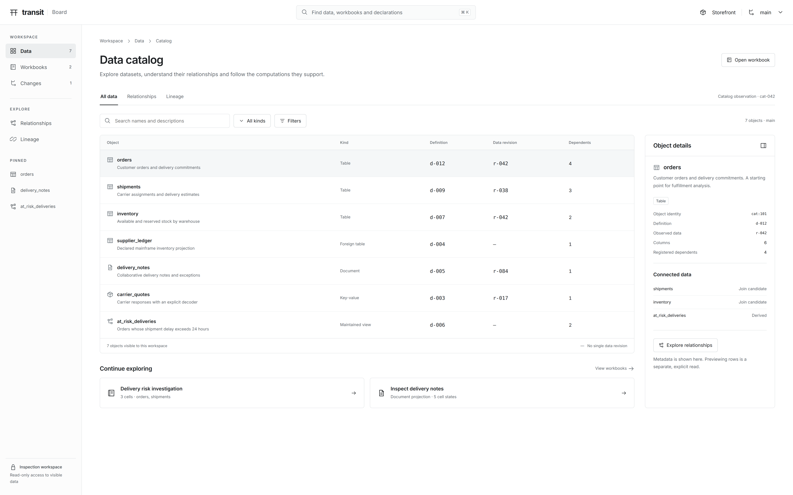
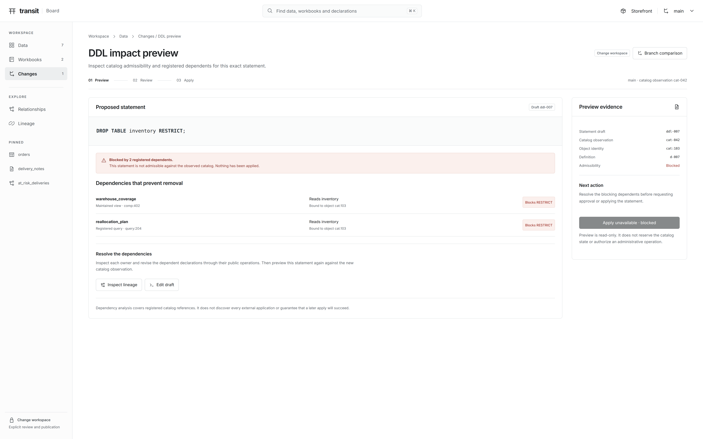
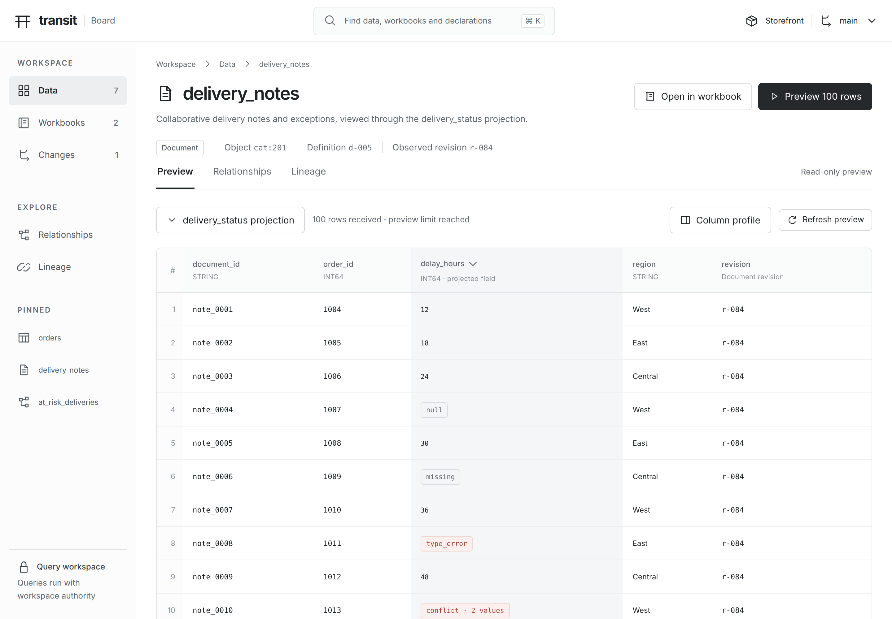

# D2 — A focused data workbench, with monochrome visual styling

[Review index](README.md) · [Previous: D1](D1.md)

Status: **In review**. Implementation: **Repository HTML/CSS prototype and
synthetic screenshots; proposed Board workflows, not the running Board application**.

## Question

How can Board retain D1's data-first direction while making ordinary exploration,
analysis and change review legible on a large display and usable on a laptop?

The reviewer endorsed the major concepts, requested better screenshots at larger
screen sizes, and selected “a crisp monochrome design with subtle use of color
to highlight impact areas.” This review addresses that explicit styling request
as well as the information hierarchy. It preserves D1 as the earlier proposal.

## Proposal

Make the catalog the starting point. Give each task one primary working surface
with an optional contextual inspector. Keep navigation and realm/branch context
stable across dataset inspection, relationships, workbooks, lineage and changes.
Use white, graphite, fine rules and typography for hierarchy. Reserve restrained
color for a changed draft, pending progress, a data problem or a proposed impact.

D1's central concepts are useful. Its simultaneous ERD, SQL dock and column
explorer compete for space, and enlarging the same composition would preserve
that competition. D2 proposes these changes:

| Design decision | Reason and tradeoff |
| --- | --- |
| Open on a searchable catalog; open a focused graph when requested | Most exploration starts with finding an object. A graph stays useful without becoming the only way to navigate a large catalog. One extra navigation step buys a substantially larger working surface. |
| Select metadata first; request a bounded row preview explicitly | The user can inspect a definition without starting a scan. Preview remains a simple action that requires no SQL authoring. |
| Profile one selected column beside its result | The profile has an explicit denominator and observation basis. Encoding and collation details are available on demand rather than repeated on every cell or graph field. |
| Keep narrative, SQL and the corresponding result together | A workbook records reasoning as well as queries. Editing a cell visibly separates the new draft from its earlier result. |
| Separate schema relationships from directed computation lineage | A potential join and a registered dependency have different meanings. Direction, focus and limited expansion are easier to inspect than orbital decoration. |
| Separate branch comparison from DDL admissibility | Branch review concerns a specific proposal and its evidence. DDL preview concerns a statement against a catalog observation. Both need space for their own blockers and next actions. |
| Collapse secondary detail on smaller screens | The grid retains useful width. The tradeoff is another action to open a profile, rather than smaller type or four crowded panes. |

### What the prior art contributes

These are workflow adaptations, not copies of another product's theme or
authority model. The recommendation column is design judgment, not a measured
usability result. Sources were consulted on 2026-10-24.

| Primary source | Observed pattern | Recommendation for Board |
| --- | --- | --- |
| [Snowflake Workspaces](https://docs.snowflake.com/en/user-guide/ui-snowsight/workspaces) | Optional object/file explorers, split editors and results, and result comparison | Keep navigation persistent and give the editor/results room. Offer comparison as an explicit layout choice. A result pinned visually must not imply a durable source-data retention pin. |
| [Databricks Catalog Explorer](https://docs.databricks.com/aws/en/catalog-explorer/) and [Unity Catalog lineage](https://docs.databricks.com/aws/en/data-governance/unity-catalog/data-lineage) | Asset discovery and object inspection; lineage for upstream explanation and downstream impact, with focused expansion | Separate the catalog, schema relationships and lineage. Start with a selected object's neighborhood and expose scope. Transit must show the limits of its registered evidence rather than imply universal lineage capture. |
| [DuckDB Local UI](https://duckdb.org/2025/03/12/duckdb-ui) | Table previews, SQL notebooks and a contextual Column Explorer | Make exploration quick and local to the selected result. Keep preview distributions tied to the exact rows used to calculate them. |
| [Hex Data browser](https://learn.hex.tech/docs/explore-data/data-browser) and [Explore](https://learn.hex.tech/docs/share-insights/explore) | Searchable data discovery, a wider 100-row preview, a path into SQL, and inspectable generated SQL | Connect discovery to a workbook with visible SQL and a readable result. Keep the explanation alongside the query; let the user inspect a generated join before running it. |

## Visual studies

Figures 1–7 use a **2560 × 1600 CSS-pixel viewport**, captured at **2×** to
produce **5120 × 3200 PNGs**. This increases both working area and pixel density;
it is not an upscale of D1's images. Figure 8 uses **1440 × 1000**, captured at
2×. Follow an image link to inspect the full-resolution file.

The [local prototype](d2.html) contains all seven views. Text, SQL, graph edges,
tables and charts are browser-rendered from source. The screens use synthetic
fixtures and illustrate different workflow states; they are not observations
of a deployment. No runtime timings or performance claims are shown.

### Figure 1: Catalog first, details in context



**Figure 1.** Object names and descriptions lead. Definition identity and observed
data revision have separate columns; a maintained view does not acquire a fake
single source revision. The selected object's inspector adds useful context
without embedding a graph, editor or histogram in the list.

Search, recent work and pinned objects provide ordinary routes into the catalog.
The fixture deliberately avoids whole-table row-count badges whose observation
basis is unavailable. A larger catalog would require bounded pagination and
authorized search; the prototype's seven-row filter is only local navigation.

### Figure 2: A bounded preview with an honest column profile


**Figure 2.** A selected Document projection supplies the five-state example.
Ordinary Table cells are not arbitrarily assigned Document conflicts. The grid
shows the first 12 rows of the 100-row fixture; the profile uses all 100 received
rows. State counts sum to 100. The distribution uses only the 82 typed values,
and its six bars sum to 82. Minimum, maximum and distinct count use that same
typed-value population.

“Preview limit reached” and “dataset coverage unknown” remain visible. These
100 rows are neither a whole-dataset profile nor a statistically random sample.
Selecting another column can recompute a profile from already received rows;
starting a new scan requires an explicit action with a visible scope and budget.
Physical encoding and collation sit behind a disclosure control. Type errors
and conflicts receive restrained color as well as explicit labels.

### Figure 3: Relationships that explain the proposed join


**Figure 3.** The canvas shows three objects and two candidate joins around
`orders`. Dashed edges mean candidates, not declared foreign keys. Key labels
identify declared keys on individual objects without asserting a relationship
between them. The inspector names both fields, shows SQL and leaves cardinality
unverified. Compatible types do not establish uniqueness, referential integrity
or business meaning.

Opening the graph and selecting an edge are metadata operations. The proposed
**Insert into workbook** action inserts a draft; it does not run SQL. Dependency
edges belong in Lineage. A future declared relationship needs an owning typed
contract before the UI can label it as authoritative. The prototype's insert
link only navigates to the representative workbook screen.

### Figure 4: A workbook with visible result provenance


**Figure 4.** The edited threshold is 48 hours; the displayed result belongs to
the earlier draft using 24 hours. A visible strip explains that difference
before the table. Completion evidence, the accepted query identity and source
observations belong to the result, not to whatever text happens to occupy the
editor now. Independent source revisions are not labeled an atomic snapshot.

Keep D1's suffix-aware assistance and non-destructive history as interaction
requirements, using the shared assistance/session semantics. The screen does
not claim that the terminal's model checking proves the browser editor. This
prototype does not implement assistance, history, SQL execution or persistence.
Its outline includes a placeholder for a finding or a next query.

Explicit run is the baseline. Live execution, where supported and enabled,
needs its own visible session scope and finite budget. A shared workbook basis
must remain a separate contract-backed capability; keeping a result on screen
does not preserve its underlying source data.

### Figure 5: Directed lineage, with progress attached to the data


**Figure 5.** A selected path explains what feeds the computation, which result
is available, and what consumes it. The prior result remains complete for its
recorded basis while an upstream revision is pending. Color draws attention to
that gap. “Recorded effect” and “remote outcome unknown” are distinct states;
the graph does not equate an accepted intent with successful delivery.

This replaces D1's orbit layout as the proposed default. It shows registered,
visible relationships and recorded execution evidence, not every possible
external consumer. Source connectors can appear one hop upstream and sinks
downstream when expanded; they need not occupy the initial canvas. The workbook
consumer here is a different workbook from Figure 4's direct two-table query.

### Figure 6: A proposal, its modeled impact and a review gate


**Figure 6.** Source, target and common base identify the comparison. Changed
values use amber; favorable modeled outcomes use restrained green and explicit
delta labels. The scenario outputs are not claims about observed deliveries.
The `reallocation_plan` scenario is a separate model from Figure 4's delayed
shipment query; its output counts are not derived from that three-row result.

The displayed one-reviewer requirement is an example configured policy, not a
universal human-approval requirement. Requesting review, recording approval and
publishing are separate steps. A changed target or proposal requires refreshed
evidence and satisfaction of the current policy. The proposed **Change workspace**
requires separately authorized public operations; the read-only inspection
identity cannot apply the proposal.

### Figure 7: DDL preview with specific blockers



**Figure 7.** The statement, observed catalog, object identity and blockers are
inspectable together. A blocked preview cannot appear as a ready-to-apply
confirmation. The next useful step is to inspect and revise the dependent
declarations through their owners, then preview again. No destructive fallback
or automatic dependency removal is suggested.

Preview remains read-only and does not reserve catalog state, grant permission
or guarantee later application. Registered dependencies also do not discover
all external readers. This surface uses existing catalog concepts while leaving
browser administration and its authorization as proposed work.

### Figure 8: A laptop layout that keeps the data readable



**Figure 8.** The profile is collapsed below 1650 CSS pixels. It can be opened
explicitly. The page scrolls vertically instead of squeezing every row into the
viewport. This is a responsive companion study, not a second visual theme. The
seven-screen layout check covers both viewport sizes; this figure records the
dataset's initial laptop state.

## Design details

### Visual system

| Element | Proposed treatment |
| --- | --- |
| Canvas | White with near-white navigation and graph surfaces; no decorative gradient |
| Hierarchy | Inter for UI text, monospace for SQL and exact identities; restrained weights and thin dividers |
| Scale | 36px desktop page heading, 15–18px primary text, 12–14px supporting metadata; deliberate reduction of secondary panes at laptop width |
| Selection | Graphite border or a neutral surface, not a semantic success color |
| Changed or pending | Muted amber with the changed value, pending revision or earlier-result explanation |
| Blocking or uninterpretable | Muted red with a blocker, `type_error` or `conflict` label |
| Favorable modeled impact | Muted green with a signed or verbal delta; never a substitute for a verified outcome |
| Five states | Literal labels and distinct geometry/patterns as well as restrained color; null and missing stay separate |
| Graphs | Edges attach to the relevant field or node; candidates are dashed; computation flow has arrowheads |

The screenshots review a visual direction, not a completed accessibility audit.
Text contrast, focus order, screen-reader announcements, non-color state
recognition, reduced motion and the open laptop inspector require implementation
verification. The prototype supplies semantic tables, navigation landmarks,
focus styles and a working disclosure as review material.

### Actions and their owners

| Surface/action | Owning meaning and boundary |
| --- | --- |
| Catalog, object inspector, relationship selection | Authorized metadata reads. The unified browser catalog/search projection is proposed; selecting metadata must not create a data query. |
| Preview rows | An explicit bounded query through the shared query owner, using an accepted projection/decoder. A display window or preview cap does not prove dataset completion. The proposed 100-row experience does not change current wire-batch or browser-route limits. |
| Column profile | Bounded aggregation of a named result window with explicit state counts. Whole-source statistics would need separately scoped evidence and a supported public operation. Board must not read `.tseg` or provider state directly. |
| Insert SQL / run cell | Draft creation is local editing; submission and result consumption use the shared SQL owner and accepted identity. Command receipts remain distinct from row-returning results. Stop-wait, cancellation and write recovery must preserve their contract distinctions. |
| Lineage and progress | Project catalog dependency/computation evidence and authorized process/effect reads. A unified live graph and the modeled maintained flow are proposed, not established by drawing them. |
| DDL preview | Existing catalog preview/admissibility concepts; a browser adapter must use the public owner. Preview and administrative application have separate authorization and outcomes. |
| Branch comparison, review, publication | Proposed versioned branch and reviewed-publication operations. Bind evidence to the exact proposal, base, target and policy. No hidden mutations through Board's inspection identity. |

The dataset preview and workbook show the query workspace; the catalog and
metadata graphs use inspection. A preview requires the separately configured
query capability even though the read remains non-mutating.
The shell's workspace labels communicate an authority boundary. They do not
introduce per-viewer login, grants or a second configuration authority. Current
Board admission uses its private deployment boundary and configured upstream
identities. Query and change capabilities must be absent when their separately
configured public operations are unavailable. The synthetic prototype shows
all workspaces together to make the proposed navigation reviewable.

### Alternatives and remaining tradeoffs

Retaining D1's permanent three-pane layout would reduce navigation between
graph, editor and profile. It makes each pane smaller and gives no clear answer
to which task is primary. D2 favors focused views, with split comparison as an
optional later layout. A graph-first landing remains useful for a small known
schema, so a saved entry point could open it directly.

Automatic row preview would save a click, but couples navigation to execution
and authorization-sensitive data reads. D2 keeps metadata selection cheap and
uses explicit preview. The 100-row cap is an illustrative interaction default,
not a new service limit or a whole-source profiling policy.

One shared workbook snapshot would simplify some analyses. It also requires an
atomicity/retention contract that a UI toggle cannot create. Per-cell observation
evidence is the baseline; a future shared basis should show its actual guarantee,
scope and retention rather than hide those differences.

## Review outcome

Recorded feedback selects the data-first direction and crisp monochrome styling
with subtle impact color. The reviewer specifically rejects D1's visual theme
and requests more spacious, higher-resolution studies.

D2 implements that request as review artifacts. Its catalog-first default,
focused graphs, panel behavior and separate change workflows are recommendations
awaiting review. No runtime capability, milestone completion or full interaction
design acceptance is claimed.

## Open questions

- Does the catalog-first landing fit everyday work, with saved workbooks and
  relationship views available as direct entry points?
- Should a laptop inspector open beside the grid or overlay it temporarily?
  The prototype uses a toggleable adjacent inspector; a keyboard/mouse usability
  pass should decide whether keeping the grid's width is more valuable.
- Which whole-dataset profiling operations, if any, should be offered after the
  bounded preview? Their source basis, state treatment and resource budget must
  be designed with the query owner.

## Evidence and limits

This review was prepared against repository base `76293c71` on 2026-10-24.
It changes design documentation and supporting assets only. D1's figures and
fixture remain intact. D2 supersedes their proposed layout and theme for this
review and corrects the cues described above; it does not retroactively certify
D1's SQL, statistics or runtime claims.

The [D2 fixture](d2-fixture.js) deterministically constructs a 100-row Document
projection with the five state counts. The profile and histogram are calculated
from those rows. Object identifiers, catalog observations, revisions, result
completion, branch comparisons, policies, scenario results and log positions are
synthetic illustration inputs, not service responses or executed simulations.
The scenario's currency values are display strings; this does not establish a
monetary storage type or arithmetic policy. No private dataset or credentials
are used.

Current behavior and limits remain owned by the
[Board guide](../../handbook/guides/inspect-board.md),
[Board API](../../handbook/reference/board-api.md),
[data model](../../handbook/reference/data-model.md),
[Table semantics](../../handbook/reference/tables.md),
[Document semantics](../../handbook/reference/documents.md),
[queries](../../handbook/reference/queries.md),
[SQL session contract](../../../contracts/SQL_SESSION_V1.md) and
[query assistance contract](../../../contracts/QUERY_ASSISTANCE_V1.md).
Catalog implementation evidence includes
[`previewDdl`](../../../packages/zig/transit-catalog/src/TableCatalog.zig) and
[`inspectComputation`](../../../packages/zig/transit-catalog/src/DeclarativeCatalog.zig).
Their existence does not supply the proposed unified browser routes.

The [Board reimplementation milestone](../../roadmap/19-board-reimplementation.md)
owns delivery of the installed workbench and real browser qualification.
Its backend delivery owners are
[statement results](../../roadmap/04-statement-results-and-consumption.md),
[transactions and consistent snapshots](../../roadmap/05-transactions-and-atomic-composition.md),
[maintained dataflows](../../roadmap/08-sql-and-dataflows.md),
[multi-model and foreign data](../../roadmap/09-multi-model-and-foreign-relations.md),
[branches](../../roadmap/10-branches-merges-and-restore.md),
[investigations](../../roadmap/17-published-resources-and-investigations.md) and
[reviewed publication](../../roadmap/18-reviewed-data-collaboration.md).
This review changes none of their scope or status.

### Reproduction and checks

Open [d2.html](d2.html) locally; it requires no server or network access.
The catalog filter, screen navigation, laptop profile toggle and type-details
disclosure work. Controls for execution, sharing, history and publication are
illustrative and show a prototype notice; they never call Transit. The workbook
is a captured scenario, not an editable SQL application.

With the repository's locked handbook dependencies and Playwright Chromium
installed, reproduce the captures from the repository root:

```sh
nix develop --command node docs/design/board-data/d2-render.mjs
nix develop --command python3 -B tests/docs.py
git diff --check
```

The renderer uses the handbook's pinned `@playwright/test` dependency, with
Chromium `153.0.8010.12` in the recorded run, installed Inter and DejaVu Sans
Mono fonts, no remote assets and no animation. Different font availability can
change wrapping; the source remains editable. It emits viewport/overflow checks
to stdout rather than committing a changing generated report.

Executed checks cover seven screens at both viewport sizes, absence of browser
script errors and horizontal overflow in the inspected layouts, the preview's
100-state/82-value totals, catalog filtering, navigation and the laptop profile
toggle. The eight captured figures were visually inspected. Documentation link
and fence validation and whitespace checks are run with the final files. These
checks concern the artifacts; they do not establish accessibility conformance,
query correctness, authorization enforcement or the proposed runtime behavior.
No runtime suite or CI wait is required for this design-only change.

## Supporting material

- [Prototype entry point](d2.html), [screen source](d2.js) and [visual styles](d2.css).
- [Synthetic fixture](d2-fixture.js) and [Playwright capture script](d2-render.mjs).
- [Figures 1–8](#visual-studies) and the full-resolution files in [images](images).
- [D1](D1.md), [board-console D3](../board-console/D3.md),
  [board-console D4](../board-console/D4.md),
  [board-console D5](../board-console/D5.md) and
  [board-grammar D2](../board-grammar/D2.md).

[Review index](README.md) · [Previous: D1](D1.md)
