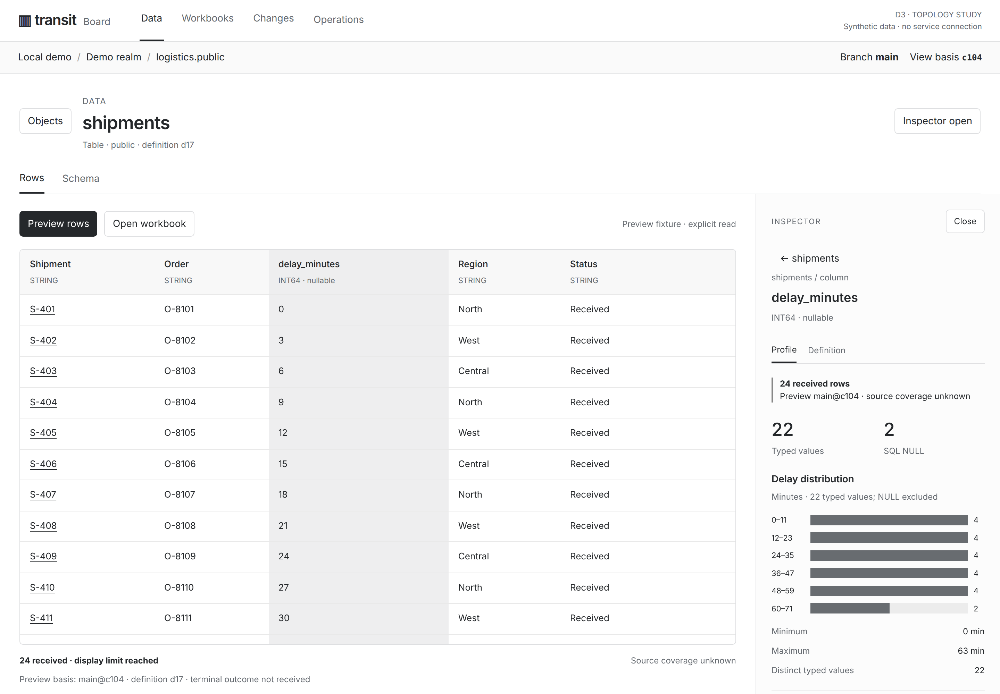
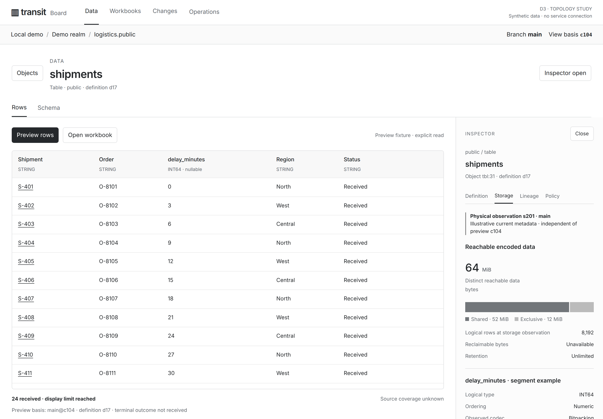
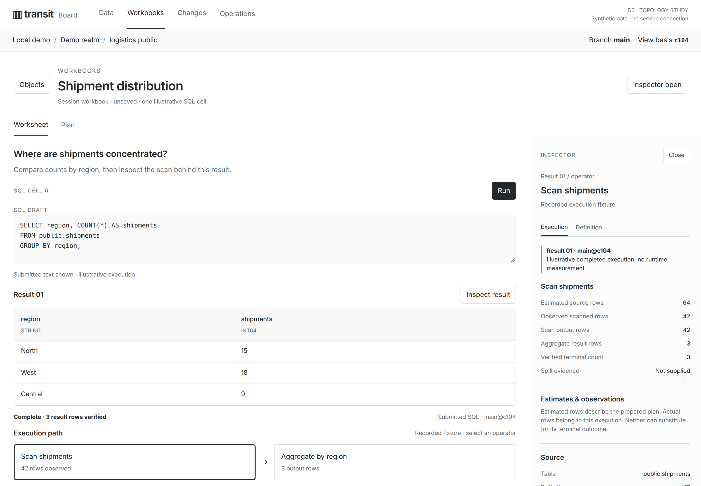
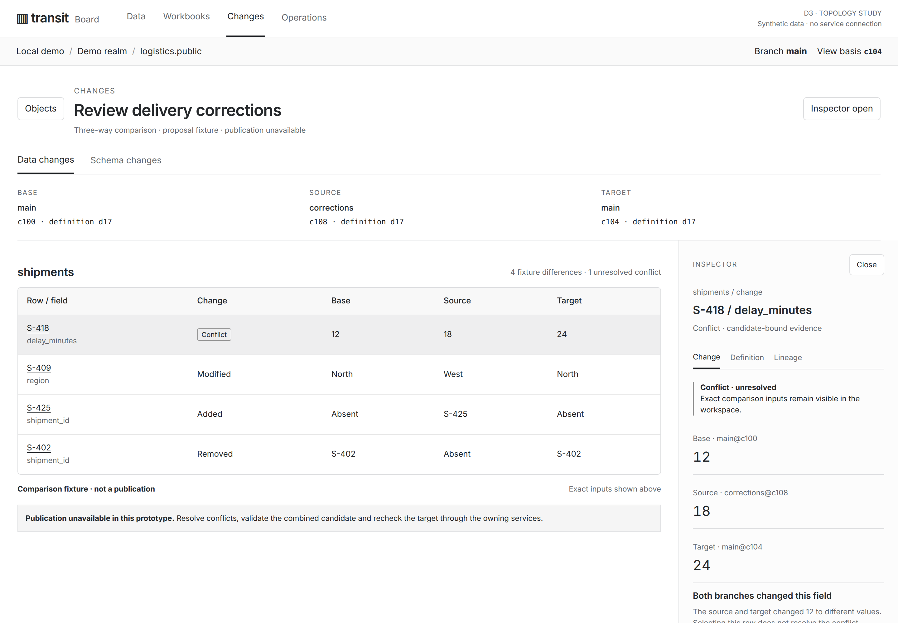
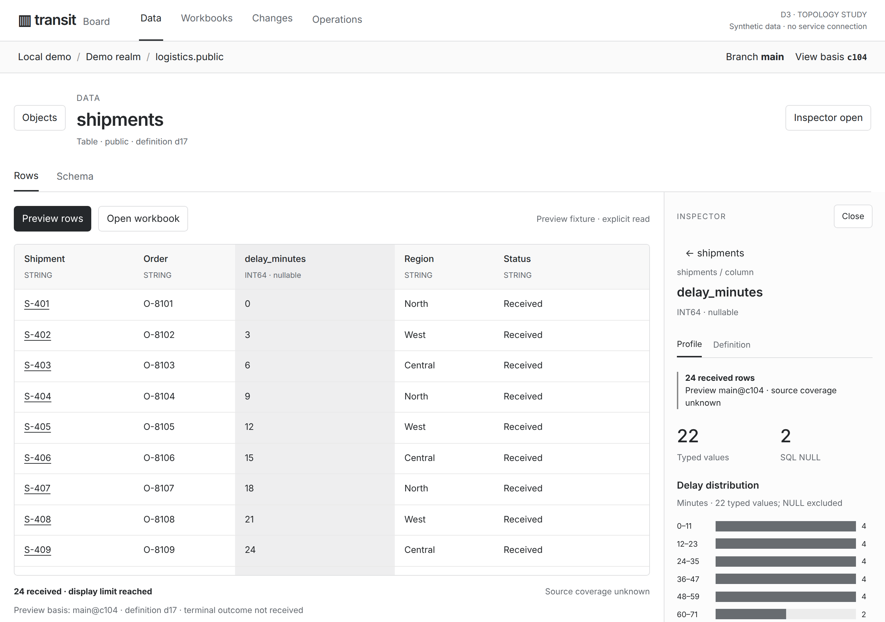
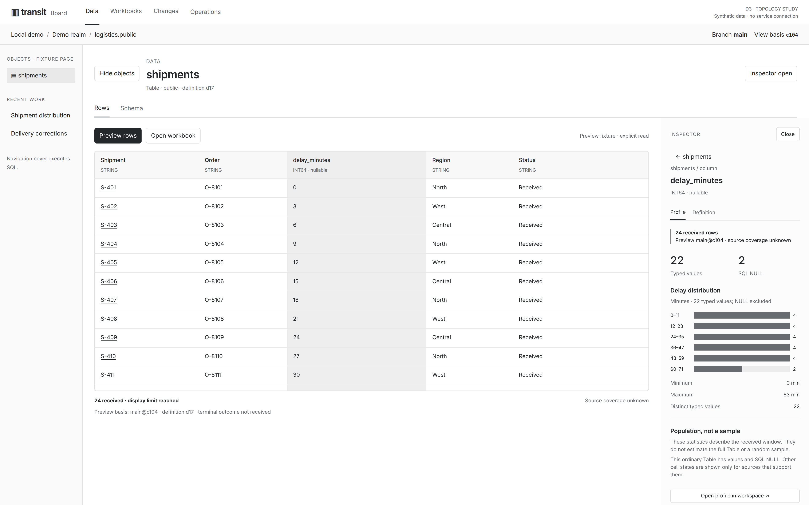

# D3 — Horizontal workbench and one contextual Inspector

[Review index](README.md) · [Previous: D2](D2.md)

Status: **Accepted in part**. Implementation: **Horizontal activities and one Inspector are implemented for
existing dataset metadata and SQL results. The figures below remain synthetic
studies; storage accounting, measured execution and comparisons remain proposed.**

## Question

How should Board organize navigation, data, query work and contextual explanation
while branch and historical-data capabilities are being developed?

The reviewer retained the current color theme and requested a topology review.
They endorsed one contextual Inspector, persistent branch/time context and three
follow-up studies: a selected dataset column, a workbook result/operator, and a
selected branch conflict. This review makes that direction inspectable. Precise
panel dimensions and responsive behavior remain proposed.

## Proposal

Keep [D2's](D2.md) monochrome baseline. Establish four spatial responsibilities:

| Location | Responsibility | Boundary |
| --- | --- | --- |
| Top | Choose activity and identify connection, realm, database/schema and branch/time context | A context label does not establish a common snapshot for every result |
| Left, optional | Find objects and return to recent work | Bounded, authorized navigation; opening metadata does not scan data |
| Center | Read data, compose SQL, inspect a plan or compare changes | One primary task; coverage, completion and comparison inputs stay visible |
| Right, optional | Explain the selected object, column, row, result, operator or change | One shared Inspector; selecting another subject replaces its content |

Use horizontal **Data / Workbooks / Changes / Operations** activity navigation.
Catalog discovery remains the Data entry point; these studies begin after an
object has been selected. Objects is a contextual navigator, not a second
permanent list of application sections. Operations and original recovery routes
remain reachable in the installed interface, including inspection-only deployments.
Activities depend on actual configured capabilities and authority.

The right panel contains details and evidence, with no chat composer. Its header
always identifies the selected subject and parent. Applicable dimensions change
with selection; the panel never becomes a collection of unrelated dashboards.
Opening a new inspector does not create another dock.

## Visual studies

All figures use browser-rendered text and synthetic local fixtures. Figures 1–4
use **1440 × 1000 CSS pixels at 2×**, Figure 5 uses **1280 × 900 at 2×**, and
Figure 6 uses **1920 × 1200 at 2×**. Open the image links for full resolution.
These are structure studies, not observations of a running Transit service.

### Figure 1: A column beside the data it explains



**Figure 1.** The selected column and its profile remain adjacent. The Inspector
offers Profile and Definition, with a parent link to the Table. The main surface
retains the preview's incomplete outcome and unknown source coverage even when
the Inspector closes. There is no nested dataset-details panel.

The profile is calculated from 24 fixture rows: 22 typed values and two SQL NULLs.
Six distribution bins contain 4, 4, 4, 4, 4 and 2 values. It describes the received
window, not the full Table or a random sample. An ordinary Table preview does
not acquire Document-only missing/conflict states to fill a chart.

### Figure 2: Storage as a dimension of the selected object



**Figure 2.** Selecting the parent changes the subject to the Table. Storage uses
the same dock and clearly identifies an independent metadata observation,
s201, rather than borrowing preview cut c104. The physical and logical counts
are separate; unavailable evidence is not zero.

The illustrative shared/exclusive breakdown is a proposed owner projection.
Exclusive bytes are not automatically reclaimable, and summing branch totals
would double-count shared objects. Node-wide memory/cache/disk counters belong
to Operations; they do not become per-Table facts.

### Figure 3: SQL and results retain their working space



**Figure 3.** Narrative, submitted SQL and its result remain together. The selected
scan uses Execution and Definition dimensions. Estimates, actual operator counts
and verified result completion have distinct labels. The figures are illustrative,
not measured performance.

Editing the SQL visibly marks an earlier result without changing its basis.
The prototype's Run control announces that no SQL was submitted. Opening the
Plan view enlarges the plan in the center; it does not turn the Inspector into
a second SQL editor or execute EXPLAIN/ANALYZE implicitly.

### Figure 4: Branch comparison with explicit inputs



**Figure 4.** The comparison is the primary task. Its base, source and target
remain above both panes, including when a narrow screen replaces the grid with
the Inspector. A selected conflict explains the differing values and their
origins. Selection does not resolve it.

The fixture has four logical differences, including one unresolved conflict.
It makes publication unavailable and describes the required candidate validation
and target recheck. Physical segment rewrites must not manufacture logical
changes; schema comparisons preserve stable object/column identity.

### Figure 5: The Inspector open on a laptop



**Figure 5.** The proposed laptop layout keeps the Inspector docked at 320 CSS
pixels, leaving a 960-pixel working pane before internal padding. The navigator
relinquishes its width. Table scrolling is contained; text is not scaled down.
This revises D2's default laptop collapse as a design proposal, not a measured
usability improvement.

At widths at or below 1000 CSS pixels, explicitly opening the Inspector replaces
the working pane while keeping context and a concise result status visible.
Close or Escape restores the selected control. This avoids an obscuring overlay
and avoids placing detail far below a long table.

### Figure 6: Optional navigation on a wide display



**Figure 6.** Additional width supports the object navigator without changing
the meaning of the center or right panel. There is still only one Inspector.
At laptop widths, opening the navigator closes the Inspector; selecting a subject
opens the Inspector and collapses navigation.

## Design details

### Selection and dimensions

The shell owns one active inspection target: its stable identity, kind, applicable
definition/data/result basis, and selected dimension. A result column must bind to
its result identity and column, not merely the same-named catalog column. A query
operator binds to the corresponding plan/execution. A conflict binds to the exact
comparison inputs and candidate. Reusing a name cannot retarget an old observation.

| Dimension | Content | Likely subjects |
| --- | --- | --- |
| Definition | Description, logical schema, constraints, type, collation and exact identities; full typed cell value | Object, column, row/cell, result |
| Profile | Distribution, distinct count, range and applicable cell-state counts, with population, coverage and exclusions | Column or result window |
| Storage | Encodings, reachable/shared/exclusive bytes, partition/segment and index coverage, retained history and maintenance evidence | Data object or physical partition |
| Lineage | Registered sources/dependents, attributable impact and links into a larger graph | Object, computation, candidate |
| History & changes | Definition/data revisions, value provenance, comparison inputs and logical differences | Object, selected change/conflict |
| Execution | Prepared estimates, observed operator counts, budgets, progress, failure and completion | Statement result or operator |
| Policy & lifetime | Current applicable permissions, masking, retention, expiry and retained-root evidence | Authorized object or operation |

Show only applicable dimensions. Profile/Definition is sufficient for the example
column; a Table can expose Definition/Storage/Lineage/Policy. The Change label is
the selected-conflict specialization of History & changes. A full history browser
is not included in this prototype.

Every dimension needs an owner and observation basis. Preserve logical type,
ordering/collation and physical encoding independently. Observed physical codecs
may differ by segment; one encoding badge must not pretend to describe an entire
heterogeneous Table. Missing fields say unavailable or not supplied.

### What stays in the center

Keep full dataset profiles, query plans, relationship/lineage graphs, spatial
views and three-way comparisons in the primary workspace. The Inspector gives
a concise explanation of their selected part. **Open in workspace** expands the
same subject/dimension; **Return** preserves its selection and basis. In this
prototype it expands the existing detail, not a newly implemented analysis.

Result coverage, incomplete/failed/complete status, earlier-draft attribution,
and exact comparison inputs never exist only inside a closed Inspector.
Large identifiers and deeper evidence can be disclosed there without replacing
the concise status beside the data.

### Branch, time and storage

Branch context selects a durable history; it is not a transaction or permission
boundary. The fixed main/c104 labels in the prototype are illustrative context,
not functioning branch or snapshot controls. The production design must show
only owner-supplied choices.

Changing navigation context applies to newly opened work. Existing results keep
their original attribution and cannot silently rerun or be relabeled. Scope
changes clear observations that cannot be reauthorized; they must not preserve
protected data through cached inspector state. Independent source cuts remain an
explicit vector rather than a fabricated global snapshot.

Two-way comparison names from/to; three-way review names base/source/target.
Stale-target refusal, uncertain publication, current authority and original
operation recovery come from their public owners. Restore publishes a forward
successor and must not imply rollback of external effects.

Storage distinguishes logical rows/bytes, deduplicated reachable physical data,
shared versus exclusive bytes, and owner-established reclaimability. Declare the
scope of each total, including whether indexes, WAL and retained history are
included. The fixture's 64 MiB total covers encoded data only; it is not total
installation usage. Independent current storage metadata may differ from an
earlier preview and does not inherit its snapshot.

### Interaction and responsive rules

- Selecting a column, row, object, operator or change updates one Inspector.
  Selection of already received data is local; metadata reads remain bounded.
  Selection never starts a scan, reruns SQL, resolves a conflict or dispatches
  effects. Full-source analysis needs an explicit scope and budget.
- Opening the Inspector reclaims optional navigation width. The prototype uses
  352 pixels on desktop and 320 on laptop; these are review choices, not final
  responsive thresholds. Narrow widths replace the working pane, with context
  and a return path still visible.
- Use native buttons and visible labels. Escape closes the Inspector; closing
  returns focus to the selected control. Table scroll position survives selection.
  A future animated slide must respect reduced-motion preferences.
- Retain one selected subject; defer pinning/multiple inspectors. A visually
  pinned subject would not establish durable source retention.
- Preserve the installed explicit-submit and separately enabled finite Live
  profiles. The layout does not extend execution, publication or authorization.

### Alternatives and tradeoffs

| Alternative | Assessment |
| --- | --- |
| Separate dataset and column side panels | Rejected direction: the panels compete with the same grid and duplicate context |
| Permanent wide navigation plus Inspector | Useful at large widths; makes a laptop pay for navigation during analysis |
| Right panel containing every statistic | Hides selection relevance and mixes unrelated observations; use conditional dimensions |
| Overlay on laptop | Preserves grid width but obscures the selected data; reserve reconsideration for usability evidence |
| Inspector below the grid | Simple flow, but loses proximity on long results |
| One dock, expanded detail in center | Recommended; trades an explicit navigation step for a useful primary working area |

These assessments are design judgments. No comparative usability study or
performance measurement is claimed.

## Review outcome

On 2026-10-30 the reviewer endorsed the preceding topology recommendation and
authorized this follow-up design review and PR. Accepted direction: retain the
theme, use horizontal activity navigation, one selection-driven Inspector,
persistent branch/time context, and full central surfaces for substantial
analysis. The right panel is for contextual evidence.

This record does not claim acceptance of these newly rendered figures, exact
widths, breakpoint behavior, labels or a production implementation. D2's artifacts
and prior outcome remain intact. D3 develops its panel/navigation topology;
[Milestone 30](../../roadmap/30-board-reimplementation.md) owns delivery.

## Open questions

- Are 320/352-pixel inspectors sufficient for realistic long identifiers and
  nested values, or should a bounded resize control be offered?
- Does replacing the working pane below 1000 pixels provide a better return
  path than an overlay at high zoom and on tablets?
- Which richer Storage, History and Execution projections should land first
  as their owner contracts qualify? Whole-source statistics need their own
  explicit budget, population and completion model.

## Evidence and limits

Prepared from origin/main at **4adae5c04012983ff222fae8ab145317ddb85cdf** on
2026-10-30. The existing
[dataset composition](../../../apps/transit-board-web/src/data-workbench.tsx),
[result panel](../../../apps/transit-board-web/src/workbench-result.tsx) and
[styles](../../../apps/transit-board-web/src/workbench.css) permit independent
dataset and column inspectors, each 256 pixels, beside the
[208-pixel navigation](../../../apps/transit-board-web/src/shell.css).
That source observation motivates the single-dock proposal.

| Surface | Current owner/boundary | D3 proposal or gap |
| --- | --- | --- |
| Catalog/definition and received-window profile | [Workbench guide](../../../apps/transit-board/docs/workbench.md), public catalog and shared result reader | Recompose existing facts into one selection model |
| Statement/result attribution | [Logical results](../../../contracts/SQL_RESULTS_V1.md), [SQL session](../../../contracts/SQL_SESSION_V1.md) | Shared basis/completion remain authoritative; no new Board result protocol |
| Table versus node storage | [Board storage API](../../handbook/reference/board-api.md#storage-inspection), SQL session storage reads | Rich branch-sharing/reclaimability projection needs its owner; no provider/raw-storage inspection |
| Plans and measured execution | [Query reference](../../handbook/reference/queries.md), shared diagnostics and result owners | Per-operator metric layout is synthetic and not proof that every field is exposed |
| Branch comparison, merge and restore | [Milestone 20](../../roadmap/20-branches-merges-and-restore.md), [state model](../../handbook/internals/state-model.md) | Component evidence does not establish installed Board comparison or publication |
| Proposal review and policy | [Reviewed publication](../../roadmap/29-reviewed-data-collaboration.md), [security](../../handbook/reference/security.md) | Candidate validation and current disclosure stay with their owners; no UI-only authority |

Milestone 19 remains In Progress at this source. Its delivered component work
does not enable all future workflows through Board. Milestone 29's initial
workbench and remaining qualification are preserved. The
[Board guide](../../handbook/guides/inspect-board.md) and
[API reference](../../handbook/reference/board-api.md) remain the implemented
behavior owners; these design artifacts establish no new runtime guarantees.

Fixtures contain only invented shipment IDs and data. Dataset, workbook and
comparison are illustrative scenarios; their displayed revisions are not a
captured deployment history. No private source material or credentials are
included. Counts/histograms derive from the local fixture; storage accounting,
comparison inputs and execution counts are illustration inputs.

### Reproduction and checks

Open [d3.html](d3.html) locally. It requires no server or remote assets. The
prototype supports activity navigation, optional object navigation, column/row/
operator/change selection, dimensions, full-detail expansion/return, SQL draft
editing and keyboard Inspector close. Execution controls only explain their
prototype boundary. Operations retains a visible destination but has no study
screen.

With locked handbook dependencies and Playwright Chromium installed:

```sh
nix develop --command node docs/design/board-data/d3-render.mjs
nix develop --command python3 -B tests/runner/docs.py
git diff --check
```

The renderer checks all three scenarios at 1920, 1440, 1280, 720 and 390 CSS-pixel
widths, produces the six figures, and reports browser version and geometry to
stdout. It checks viewport overflow, a single Inspector, profile/storage fixture
totals, selection, expansion/return, keyboard close/reopen, narrow-screen context,
focus return, unchanged original SQL/result attribution and no HTTP(S) requests.
It uses local Inter/Arial and DejaVu Sans Mono fallbacks; installed fonts can
affect wrapping.

The recorded Chromium **153.0.8010.12** run passed 51 geometry observations
and the interaction assertions above, with zero script errors and zero HTTP(S)
requests. All six figures were visually inspected. The documentation checker
passed 9,332 local links across 695 Markdown files; whitespace checks passed.
These artifact checks do not prove installed query correctness, authorization, service
recovery, complete accessibility conformance or improved usability. No runtime
suite or handbook build is required for these design-only assets and roadmap
links.

## Supporting material

- [Prototype](d3.html), [interaction source](d3.js), [styles](d3.css),
  [synthetic fixture](d3-fixture.js) and [capture/check script](d3-render.mjs).
- [D2](D2.md), [review sequence](README.md) and
  [Board milestone](../../roadmap/30-board-reimplementation.md).

[Review index](README.md) · [Previous: D2](D2.md)
