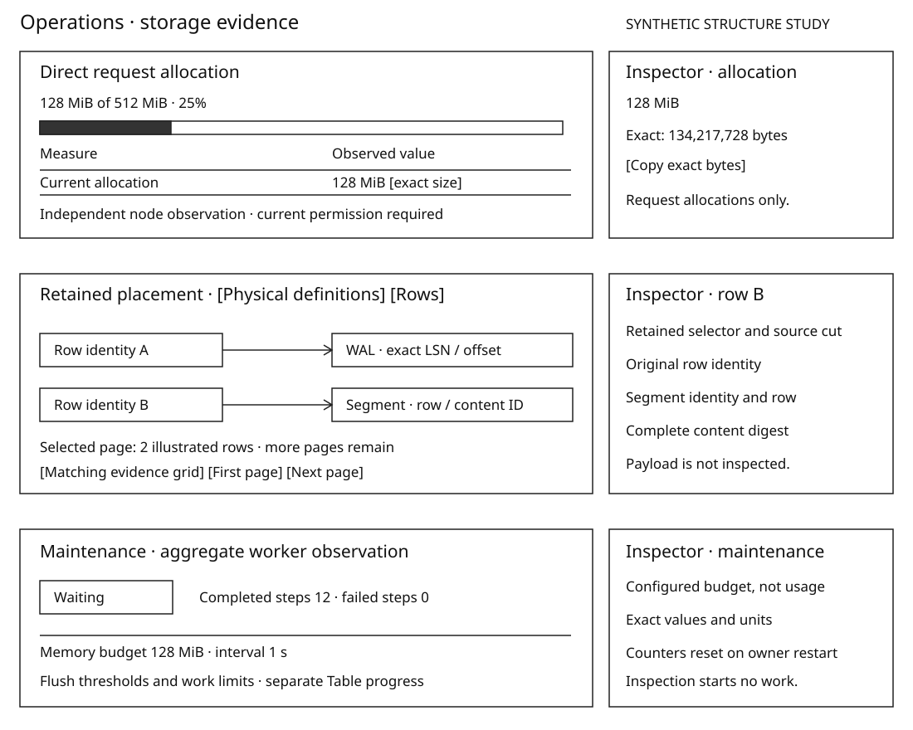
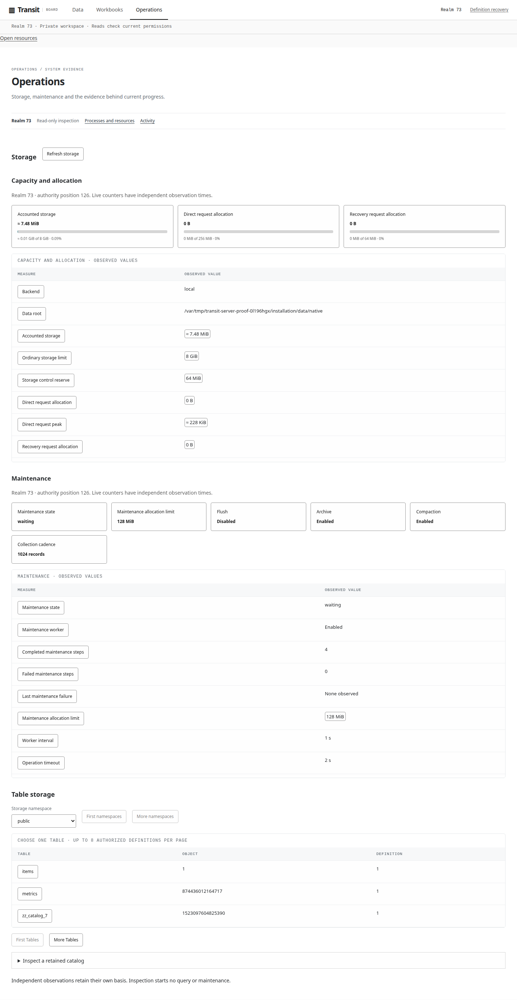
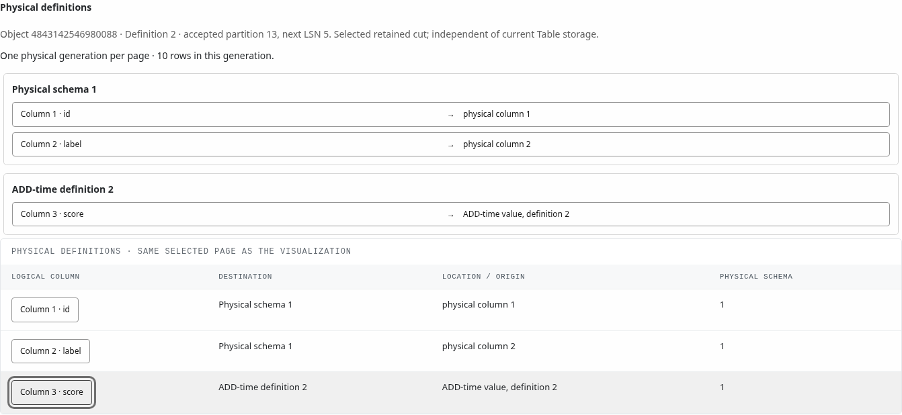
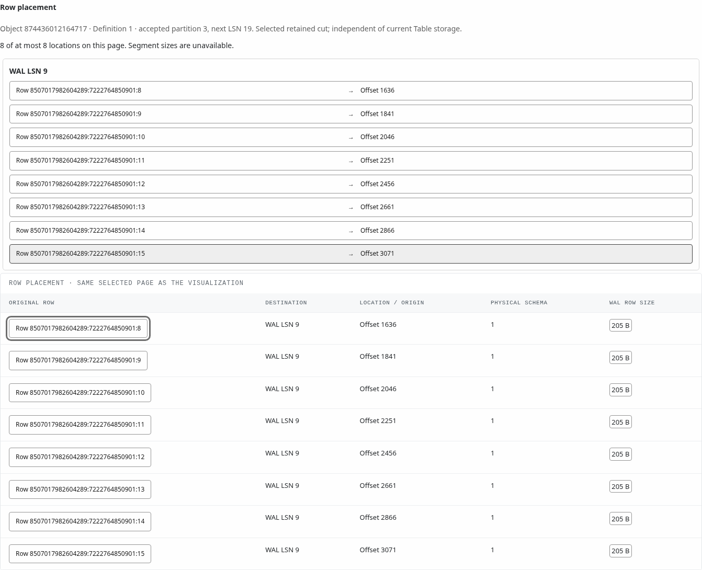
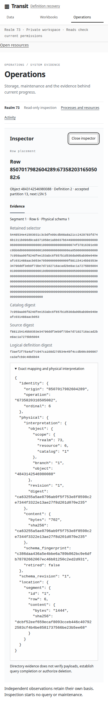

# D4 — Readable quantities and storage evidence

[Review index](README.md) · [Previous: D3](D3.md)

Status: **Accepted in part**. The reviewer approved readable binary quantities,
linked storage placement and maintenance inspection through the R2 implementation
plan. The precise layouts below remain reviewable. Implementation and installed
evidence are tracked separately in the [Board milestone](../../roadmap/30-board-reimplementation.md#r2--explain-retained-storage-placement-and-maintenance).

## Question

How can the human database interface make magnitude, placement and maintenance
understandable while retaining exact source evidence and incomplete coverage?

## Proposal

Use B/KiB/MiB/GiB/TiB and larger binary units for byte quantities. Show concise
precision and mark rounding with ≈. Exact decimal bytes remain available through
keyboard/touch details and copy. Capacity labels identify their owner and limit;
counts, positions, IDs and durations retain their distinct units.

Reuse D3's single Inspector. Physical definitions and row placement are separate
modes with independent continuations, current permissions and the selected
retained source. Diagram, grid and Inspector share one authorized page. Node
maintenance settings and aggregate activity remain separate from Table progress.

## Visual studies

**Figure 1 — Storage structure.** Synthetic values illustrate interaction only.
The capacity bar has a documented denominator. Row-placement connections establish
identity relationships on this page, with no implied segment size or time axis.
The state card reports aggregate activity; it does not claim that a particular
Table is currently flushing. The exact Inspector sits beside the selected value.

On narrow screens, the existing Inspector replaces the canvas and returns focus
on Close/Escape. The placement rows stack source and destination vertically;
tables retain bounded horizontal scrolling. Empty pages say no entries in this
page. Denied, expired and unavailable reads replace the affected evidence and
Inspector; unrelated authorized node observations remain visible. Partial pages
keep their continuation and coverage label beside the diagram and grid.

## Installed figures

These unedited Chromium captures come from the focused installed run at
`fa1a36844`, using Board's embedded production assets and a disk-backed fixture.
The fixture provisions its data through public callers; these are observed values,
not the synthetic study above. The [qualification account](../../history/qualification/interfaces.md#board-readable-storage-and-deferred-features--2026-11-02)
records source, checks and limits. Screenshots establish layout at these points,
not latency, whole-store coverage or a manual screen-reader review.

**Figure 2 — Magnitude and maintenance.** The 1440-pixel desktop view separates
observed allocation from configured limits. Flush is disabled by this fixture;
the aggregate worker remains enabled. A waiting state is not per-Table progress.

**Figure 3 — Retained interpretation.** The first physical generation has two
stored columns. The logical `score` column comes from its ADD-time definition.
The diagram and grid describe the same generation and selection.

**Figure 4 — Bounded row placement.** The retained `metrics` page connects eight
row identities to segment positions. Segment sizes remain explicitly unavailable;
the diagram does not invent a storage-volume denominator.

**Figure 5 — Exact evidence at 390 pixels.** The Inspector replaces the canvas,
keeps the Close control focused and wraps long identities. Escape returns focus
to the selection. The fixture checks CSS zoom at 200% separately; this capture
uses 100% CSS zoom and is not a native browser-zoom qualification.

## Review outcome

The user described Board as the human ↔ database interface and requested KiB,
MiB and GiB in place of raw byte magnitudes, then approved the implementation
plan. This records that direction, not acceptance of unreviewed screenshots.

## Open questions

The installed figures make the final density and narrow-screen layout reviewable.
Computation neighborhoods follow in a separate implementation over their owning
public projection. No speculative storage inventory or per-Table memory model
is introduced here.

## Evidence and limits

The [storage observation types](../../../packages/zig/transit-protocol/src/Storage.zig)
and [retained coverage contract](../../../contracts/HISTORICAL_CATALOG_V1.md#historical-interpretation-coverage)
own the facts. Definitions use metadata rights; locations require SELECT. Row
placement returns at most eight entries. Reading never acquires retention,
executes SQL, loads payloads or starts maintenance. Directory exhaustion is not
payload verification. Figure 1 contains no measured runtime values; Figures 2–5 retain their installed observation basis.

## Supporting material

- [Editable monochrome SVG](d4-storage.svg).
- [D3 topology](D3.md) and [current Board guide](../../handbook/guides/inspect-board.md).

[Review index](README.md) · [Previous: D3](D3.md)
