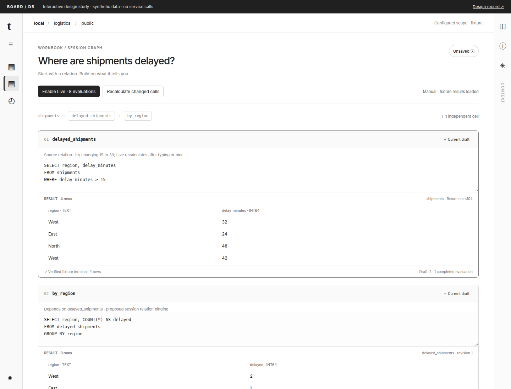
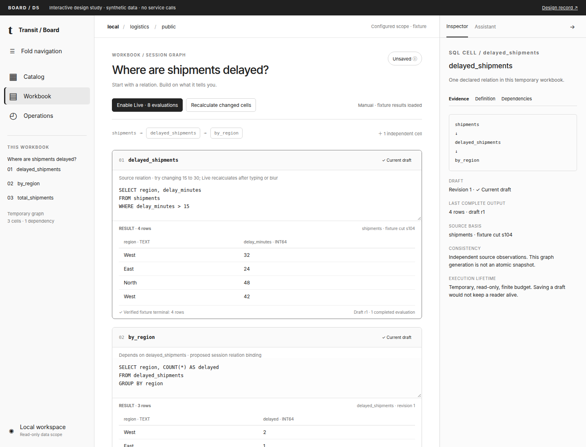
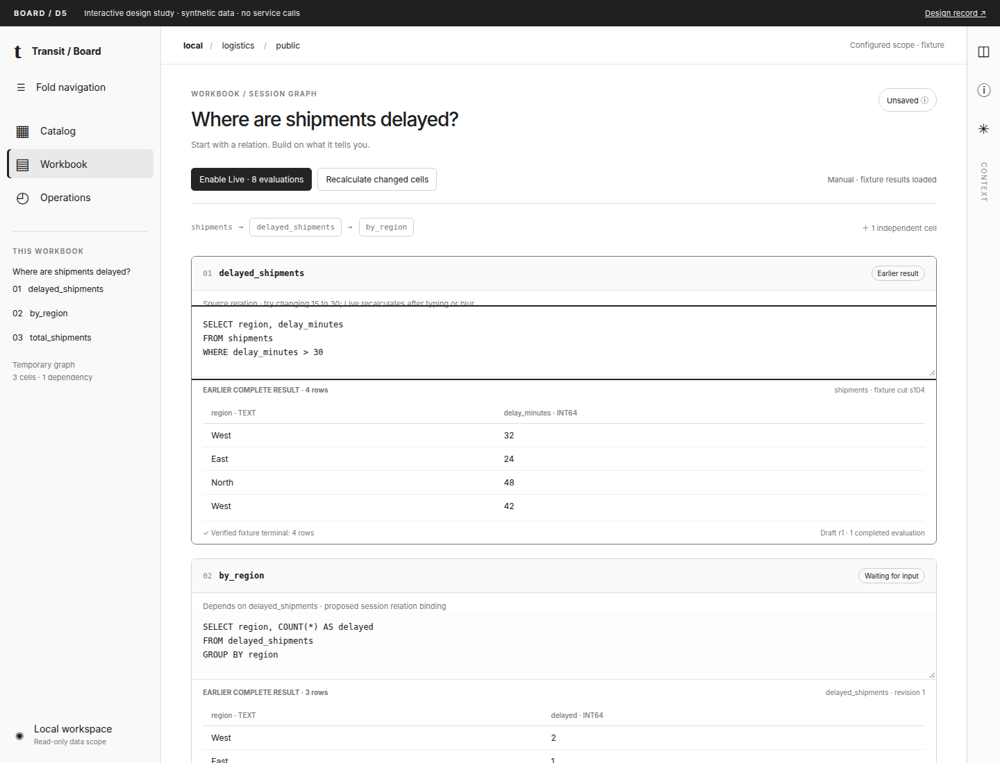
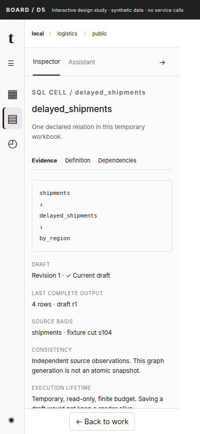
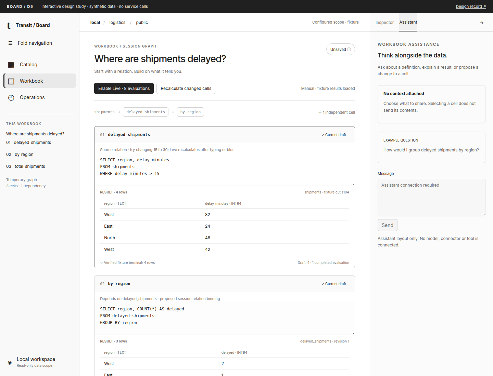
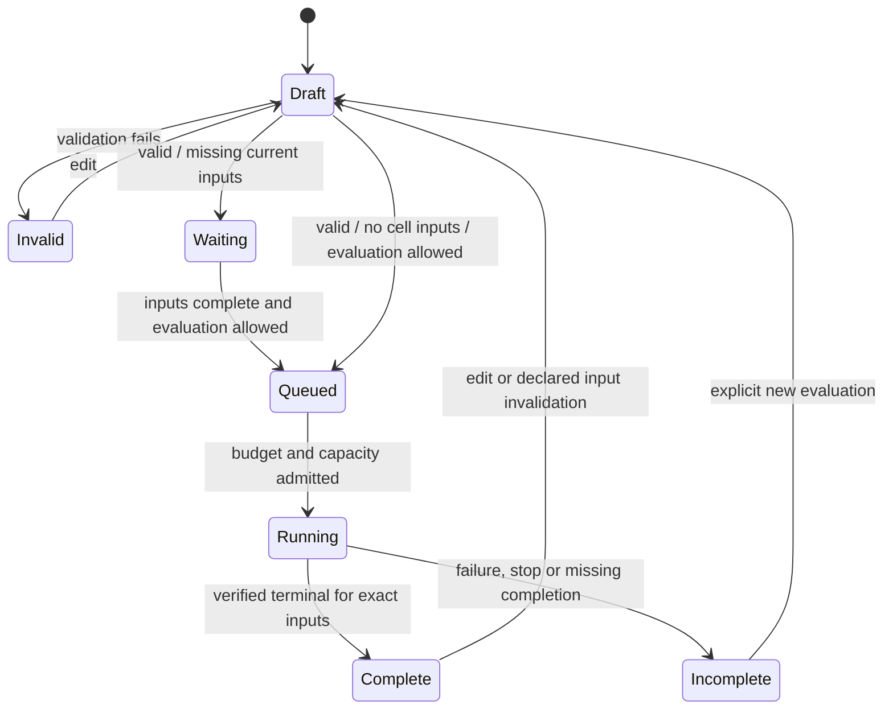

# D5 — Accordion workbench and reactive workbook state

[Review index](README.md) · [Previous: D4](D4.md)

Status: **Accepted in part**. The reviewer requested an accordion root layout,
reactive dependent SQL cells and removal of the temporary-session paragraph,
then selected separate Inspector and Assistant tabs and a design/interactive
study before implementation. Exact geometry, scheduling and the proposed shared
workbook execution contract remain **in review**. No installed behavior changes.

## Question

How can Board keep navigation, working data and explanation on one folding plane,
and make a workbook feel like a temporary reactive computation without confusing
an edit, an execution and a completed result?

## Proposal

Retain Catalog's data presentation and Operations' evidence. Replace the root
horizontal activity strip with a left accordion rail. Keep one central work
surface and one right accordion with **Inspector / Assistant** tabs. Both edges
fold independently when space permits. Route changes, selection, pane visibility
and computation have separate state owners.

A workbook declares a temporary graph of named SQL cells. Changing one cell
invalidates that cell and its transitive dependents immediately. In an enabled
Live session, complete valid edits recalculate after a short quiet period or
editor blur. Unrelated cells keep their results. This is a proposed session
computation lifetime over shared SQL owners; it is not implemented by issuing
`CREATE DATAFLOW` on every edit.

This revises [D3's](D3.md) activity placement and the workbook interaction. It
retains its one Inspector, persistent context, central substantial analysis and
evidence beside the result. [D4's](D4.md) quantities and storage semantics remain.

## Visual studies

Open [the interactive study](d5.html). All data and computation are local fixtures.
There are no Transit calls or assistant requests. The draft recognizer accepts
only the displayed threshold example; it is not a SQL compiler.

### Figure 1: Closed edges, uninterrupted work

**Figure 1.** The center gains the width released by the edges. The left rail
retains named navigation through accessible buttons; the right rail retains
Inspector and Assistant. A compact **Unsaved** label replaces the paragraph
“Temporary session. Leaving this page discards its cells and closes its result
views. Each Run has its own source basis.” Lifetime detail belongs behind that
label and in an actual discard transition. Result basis stays beside each output.

### Figure 2: Open plane with one contextual pane

**Figure 2.** Expanded navigation combines activities and the current activity's
objects or cells. There is no additional permanent object sidebar. The right
pane explains the selected cell. Switching to Assistant changes the pane's
content while preserving the Inspector selection; neither action executes SQL.

### Figure 3: Recalculation preserves attribution

**Figure 3.** The previous output remains attributable to its old draft. The
dependent summary cannot acquire a Current label until the new upstream relation
and its own result complete. A generation is a scheduling identity, not an atomic
snapshot. This study shows independent source observations explicitly.

### Figure 4: A narrow pane has a return path

**Figure 4.** At narrow widths a requested pane occupies the work area. Returning
restores the same editor and selection. No squeezed three-column layout, text
scaling or horizontally scrolling document is needed. Tables scroll internally.

### Figure 5: Assistant shares the accordion, not the Inspector's context

**Figure 5.** The right tab changes without replacing the workbook. The selected
cell remains available on returning to Inspector. A disabled composer makes the
missing assistant capability explicit; selecting or editing a cell sends nothing.

## Root layout and navigation

| Region | Responsibility | Proposed geometry |
| --- | --- | --- |
| Left edge | Catalog, Workbook, Operations; current objects/cells; connection controls | 64 px rail / 232 px open |
| Center | Current route and its working data; editable SQL and outputs | Fluid, target at least 640 px before internal padding |
| Right edge | Inspector / Assistant; one active tab, independent retained tab state | 48 px rail / 360 px open |
| Context line | Configured connection/namespace, supported branch/time context, activity and result status | Remains visible across folds |

These are study dimensions. At 1440 px both edges fit. Below 1232 px the most
recently opened side takes precedence and the other folds; its requested state
is remembered for a wider viewport. Below 800 px an open side occupies the center
area with a clear Back control. Browser zoom follows available CSS width. Do not
animate width when reduced motion is requested. Resizing must not change query
state, trigger a read, discard a selection or rewrite a user preference.

Route state belongs in URLs: activity, authorized stable object IDs and supported
selectors. Pane preferences and focus are presentation state. SQL, rows, assistant
context and credentials never enter a URL. The study keeps all state in memory;
durable preferences and workbook saving remain the milestone's Document work.

Changing activities retains an open temporary workbook in the proposed shell
lifetime. Its execution pauses when it is inactive; it does not compute in the
background because a route is cached. **Close workbook**, scope replacement and
browser exit are explicit lifetime boundaries. Unsaved changes receive a discard
decision at those boundaries. This is a change from today's route-local cells;
removing the banner alone must not imply navigation preservation is delivered.

Keyboard toggles expose `aria-expanded` and target names. Collapsed icons have
accessible names and tooltips. Inspector/Assistant use tab semantics. Escape
first closes a local popup, otherwise folds the active side and restores its
trigger; focus falls back to the activity heading if the trigger was removed.
Hidden panels leave the tab order. Opening a narrow pane moves focus into it.

## Composed interface state machine

Use the existing `state + event -> state + effects` direction, with explicit
product states rather than one global loading flag. These are design types,
not new wire declarations. React renders state; effects call the shared owners.

| Owner | State | Identity / invariant |
| --- | --- | --- |
| Scope | discovering, usable, unavailable, denied, incompatible | Deployment/connection generation; configured is distinct from authorized |
| Navigation | route, subject, history | Stable IDs; a same-named replacement does not inherit selection |
| Plane | requested left/right expansion, last opened side, effective layout, active tab, return focus | Geometry never starts or cancels accepted work |
| Selection | subject kind/ID, definition, result/comparison basis, dimension | References to evidence owned elsewhere, not another data cache |
| Workbook | local ID, ordered stable cell IDs, draft graph revision, dirty/save state | Cell reorder does not change dependency identity |
| Evaluation | disabled, enabled, paused, exhausted, closing, closed | Session generation, authorization scope, remaining finite budget |
| Cell draft | editing, invalid, valid, blocked | Cell revision, compiled dependency binding, diagnostics |
| Cell execution | idle, queued, running, failed, cancelled, unresolved | Original attempt, graph generation, input revisions, cleanup state |
| Cell output | none, streaming, complete, incomplete, unavailable | Shared result identity, schema, observation, terminal evidence; current/earlier is derived |
| Assistant | unavailable, idle, composing, requesting, interrupted, answered | Explicit context attachment IDs/revisions and original request identity |

This diagram is the evaluation projection, not the whole cell: an earlier
complete output can coexist with Draft, Waiting or Running. There is no transition
from transport EOF to Complete. Queued work has no accepted execution identity;
running work retains its original identity even after a newer edit supersedes it.

| Event | State transition | Permitted effects |
| --- | --- | --- |
| Fold/unfold, select tab, resize | Update plane only | Focus/geometry only |
| Select catalog object or Operations measure | Replace scoped selection | Existing bounded metadata read when needed; no preview or execution |
| Edit SQL | Increment draft and graph revisions; invalidate transitive dependents; retain authorized older output | Validate through shared compiler; replace queued candidate; debounce only in enabled Live |
| Blur editor / quiet period | Flush the latest valid candidate once | Coalesce the two triggers by graph/revision; no duplicate admission |
| Upstream completes | Attach exact result to its submitted revision | Queue eligible dependents in topological order under the same finite budget |
| Late response | Match scope/session/cell/attempt/input revisions | Clean up obsolete readers; never install an obsolete result as current |
| Pause | Stop new scheduling; label current work accurately | Cancel queued candidates; already accepted work settles/cleans up through its owner |
| Run / Recalculate | Freeze the selected valid cell and needed upstream closure | Explicit finite execution; do not run unrelated cells |
| Scope replacement / denial | Fence requests; clear protected cells, rows, profiles and context attachments as the owner requires | Abort reads, close readers, preserve original unresolved recovery privately |
| Browser hidden / activity left | Pause evaluation, invalidate pending callbacks; clear disclosure where required | No automatic new query on return; revalidate access before restoring evidence |
| Close workbook | Check unsaved draft decision; enter closing | Release readers/session via owners; closing is distinct from confirmed remote release |

Every async reply must match its scope generation, workbook/session ID, cell ID,
submitted revision, graph binding and original attempt. An input fingerprint
includes exact upstream result revisions and relevant base-source definitions.
Local generations fence presentation; they never substitute for upstream current
authorization checks or invent a policy epoch.

**Current draft** means the output matches the submitted draft and exact input
bindings. It does not claim that the underlying database has not changed since
that observation. An earlier complete result retains both its original completion
and its earlier-draft label; those facts are independent.

## Reactive SQL cells as a temporary graph

### Cell identity and SQL binding

A SQL cell has a stable ID, an editable relation name, SQL text and a compiled
output schema. Dependencies are resolved by the shared compiler in an explicit
workbook namespace. The first proposal uses qualified local relation references;
the study displays short names to make the graph readable. Exact spelling is
contract work, not runnable SQL promised by this review. A catalog object with
the same name cannot silently shadow a cell. Renaming needs an atomic validated
binding update; deleting an input blocks its dependents. Reject cycles with the
cycle path. Display order is independent of evaluation order.

Example graph: `shipments → delayed_shipments → by_region`, with independent
`shipments → total_shipments`. An edit to `delayed_shipments` recalculates that
relation and `by_region`; it does not rerun `total_shipments`. Narrative edits
affect neither the graph nor execution. Downstream SQL consumes the full typed
relation through the shared engine, never the first 100 rows displayed in Board.
Start with admitted relational SELECT cells. SHOW, DESCRIBE and EXPLAIN remain
standalone typed results; using metadata as a graph input needs explicit shared
binding/observation semantics and must not invent a data snapshot.

### Scheduling and last complete output

Recommend a **300 ms quiet period plus blur flush** after entering Live mode.
Every keystroke immediately marks affected output earlier; it does not issue one
server query. During IME composition, update the draft but wait for compositionend
before validation/admission. Unchanged blur adds no work. Start with one running
graph evaluation and one replaceable queued candidate; retain the existing global
request/cleanup scheduler and deployment quotas. Numeric limits must be owned and
qualified before implementation; the prototype's eight cell evaluations are an
illustration, not reuse of an existing budget contract by implication.

Invalid, incomplete, unsupported or effectful SQL never runs automatically.
Current typed read admission decides eligibility; text prefixes do not. A failed
input blocks dependents and leaves authorized earlier output visibly earlier.
Complete empty relations are valid inputs; partial prefixes, interrupted streams
and display windows are not complete relations. Fan-out should reuse one exact
upstream relation; a diamond must not mix predecessor generations.

Edits during execution supersede presentation and queued work. Cancellation, when
supported, requests cancellation of the original attempt and does not prove it
stopped. Budget is charged at accepted admission, never refunded by edit, pause,
failure or reconnect. Exhaustion pauses evaluation with an explicit new-budget
action; typing, opening a pane and returning to a page cannot renew it.

Live mode authorizes a bounded sequence of reads in one visible workbook. Manual
Run remains available. The desired enabled experience is reactive; the current
installed explicit-submit profile stays until the shared session graph is qualified.
An optional future source-follow mode is separate: edit reactivity does not imply
continuous queries or polling base Tables. External source change notifications,
subscriptions and refresh budgets need their own owner before they can invalidate
and rerun this graph.

### Relation to DATAFLOW and persistence

| Capability | Current evidence | Proposed workbook use |
| --- | --- | --- |
| Read-only statement results | Shared SQL result/reader with verified terminal and observation | Reuse unchanged for cell output and bounded display |
| Finite Live draft | Explicit bounded Table draft generation; no arbitrary cell graph | Reuse its principles; qualify composition and budgets through a shared owner |
| Managed DATAFLOW | Existing output Table, durable declaration/control, one source; managed chaining refused | Useful declaration/lifecycle model; not a temporary workbook execution adapter |
| Session-local cell relations | No current public graph/binding/lifetime contract | Required before dependent cells can execute |
| Saved workbook | Document persistence planned separately | Save definitions, names, ordering and text; reopening starts no query |
| Publish as durable computation | Separately authorized declaration, output and lifecycle operations | Explicit reviewed promotion of a frozen graph, only where supported |

The session graph needs shared public operations for bind/validate, evaluate,
inspect progress/result, pause and close; exact names and messages remain open.
Its service owner must provide bounded relation memory/spill, exact inputs,
lease/cleanup behavior and current authorization before exposing the Board adapter.
Put reusable execution/lifetime semantics in SQL/query owners and application
workbook validation in the proposed shared workbook library. Board owns editing,
presentation and intent. Do not add a JavaScript SQL evaluator, concatenate cells
into unchecked SQL, or create hidden output Tables.

One graph evaluation does not by itself make independent base reads atomic. The
first profile may expose an exact independent-source vector; a common snapshot
requires the qualified snapshot owner and its lifetime. Saving a draft, retaining
a completed output, and publishing a durable DATAFLOW are three separate actions.
Do not invent `CREATE TEMP DATAFLOW` syntax or promise automatic promotion of a
multi-cell graph into today's single-source managed profile.

## Inspector and Assistant

Inspector follows the selected data/cell/result and retains applicable Definition,
Profile, Evidence, Storage and Execution dimensions. Assistant is a distinct tab
with its own draft/conversation state. Both occupy the same right accordion.
Switching tabs retains the other tab's state without mounting hidden read loops.
Large plans and substantial analysis still open in the center.

Selecting a row or editing SQL does not silently send it to an assistant. The
Assistant composer names explicitly attached context and its revision; a later
selection does not rewrite an already sent prompt. A response is an attributed
suggestion. **Insert into cell** changes a draft and follows the workbook's visible
mode; **Apply/publish** remains a separate operation with its own authority.
Model/tool access belongs to connectors/application owners. Until those capabilities
exist, show an honest unavailable state; the study's composer is visibly disabled.
No new assistant endpoint, viewer identity, retention or tool authorization is
established here. Known denial clears affected attachments and rendered evidence.

## Alternatives and tradeoffs

| Alternative | Assessment |
| --- | --- |
| Keep horizontal activities and add another sidebar | Preserves today's header, but does not deliver the requested folding plane and duplicates navigation |
| Execute every keystroke immediately | Gives the shortest trigger delay but admits incomplete drafts and unnecessary work; immediate invalidation plus coalesced evaluation preserves feedback |
| Recalculate only on blur | Predictable request count, but no response during a long editing session; keep blur as an immediate flush alongside debounce |
| Re-run all cells in display order | Simple notebook behavior, but wastes unrelated work and makes visual reordering change semantics |
| Create a durable DATAFLOW per cell | Reuses a familiar name but requires output Tables, publication authority and unsupported chaining; define the temporary shared lifetime first |
| Separate Inspector and Assistant docks | Allows simultaneous detail/chat but consumes another column; use tabs and preserve each tab's state |

These are design judgments based on the requested interaction and current owner
contracts, not comparative usability or throughput measurements.

## Review outcome

Reviewer feedback on 2026-11-03 retains the overall Catalog and Workbook direction,
values the Operations data, requests the folding root layout and specifically
removes the long temporary-session notice. The reviewer selected a design and
interactive study before UI changes, and Inspector/Assistant as separate tabs.
These are accepted inputs. The figures, proposed geometry, debounce duration,
cross-route session lifetime and graph contract are newly reviewable proposals.

## Open questions

- Does the proposed folding behavior preserve enough center width at laptop zoom?
- Should a new qualified workbook offer Live as the prominent entry action or
  start Live after a one-time scope/budget choice? Opening saved work starts no work.
- Which shared session-relation binding spelling and retention profile should
  qualify first? No syntax choice is implied by the short fixture cell names.

## Evidence and limits

Source basis: `796599b58` on 2026-11-03. User-provided `closed.png` and `open.png`
show collapsed/expanded edge panels in another application. They support layout
intent only; their business content and assets are not copied into this repository.
All figures here use invented shipment data and monochrome repository assets.

Current owners: [Board guide](../../handbook/guides/inspect-board.md),
[workbench lifecycle](../../../apps/transit-board/docs/workbench.md),
[Board API](../../handbook/reference/board-api.md),
[SQL results](../../../contracts/SQL_RESULTS_V1.md),
[SQL sessions](../../../contracts/SQL_SESSION_V1.md),
[draft evaluation](../../../contracts/QUERY_DRAFT_V1.md),
[managed computations](../../handbook/reference/queries.md#managed-table-computations)
and [DATAFLOW](../../../contracts/DATAFLOW_V1.md). Current frontend owners are
[workbook](../../../apps/transit-board-web/src/workbook.tsx),
[layout](../../../apps/transit-board-web/src/workbench-layout.tsx) and
[observation](../../../apps/transit-board-web/src/observation.ts).

[Milestone 30](../../roadmap/30-board-reimplementation.md#accordion-and-reactive-workbook-design--2026-11-03)
owns contract prerequisites, implementation sequencing and installed acceptance.
The study models folding, local route preservation, invalidation, coalescing,
finite scheduling and obsolete-response refusal on a fixed three-cell graph.
It establishes no SQL execution, authorization, durability, arbitrary graph
correctness, assistant behavior or installed performance evidence.

### Study verification

The Chromium 153.0.8010.12 study run checks six widths (390, 720, 1024, 1280,
1440 and 1920 CSS pixels), both pane states, both context tabs and all three
activities, with 30 geometry observations. It checks dependent recalculation,
blur coalescing, route-retained drafts and paused return, and asserts no browser
errors or HTTP(S) requests. Reducer checks cover obsolete replies, exact dependent
inputs, complete empty relations, invalid drafts, pause/resume and finite budgets.
The five figures are visually reviewed. These checks exercise a fixed local
fixture; arbitrary graphs, real authorization, accessibility conformance, browser
zoom and installed execution remain unqualified.

Documentation links/fences and diff whitespace are checked separately. No runtime
suite or handbook build is required for these design assets and roadmap edits.

## Supporting material

- [Interactive study](d5.html), [styles](d5.css), [presentation](d5.js),
  [fixture/state model](d5-model.js), [browser capture/check script](d5-render.mjs).
- Reproduce with locked handbook Playwright dependencies and Chromium:
  `nix develop --command node docs/design/board-data/d5-render.mjs`.
- Run `nix develop --command python3 -B tests/runner/docs.py` and `git diff --check`.

[Review index](README.md) · [Previous: D4](D4.md)
