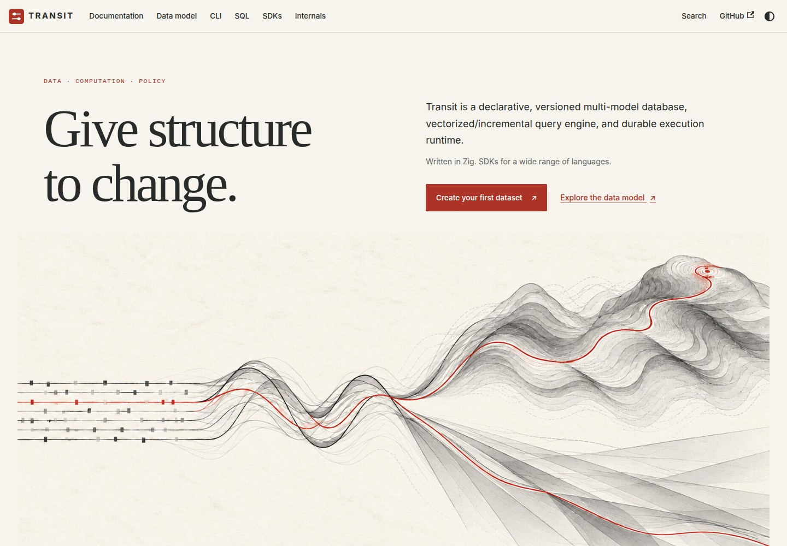
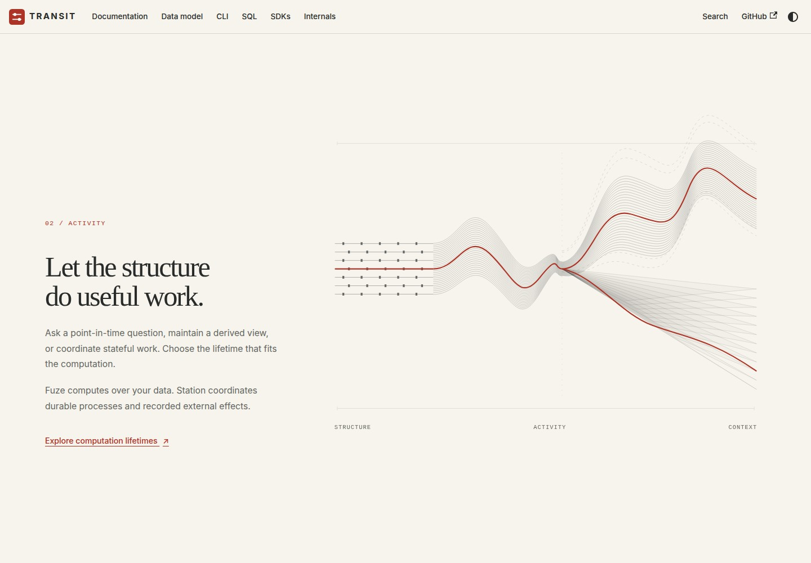
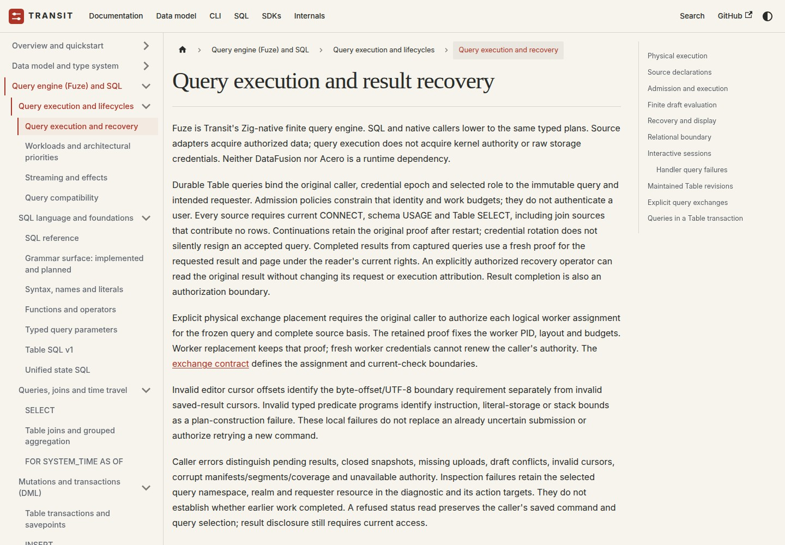
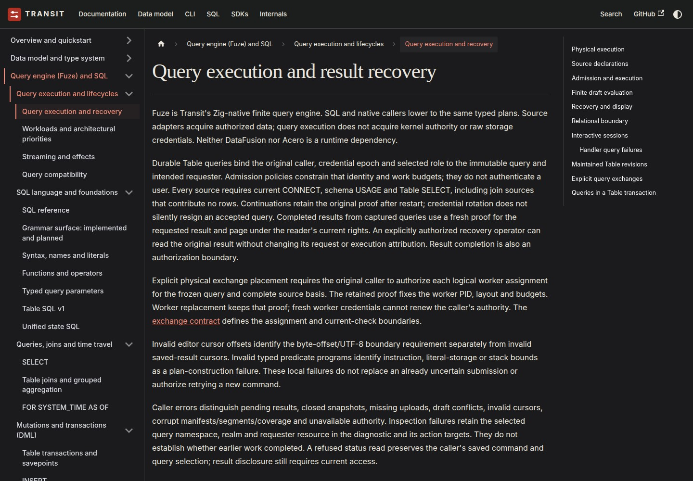
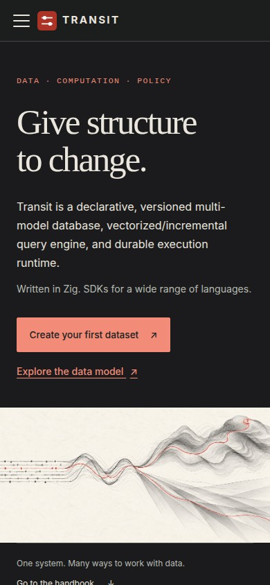
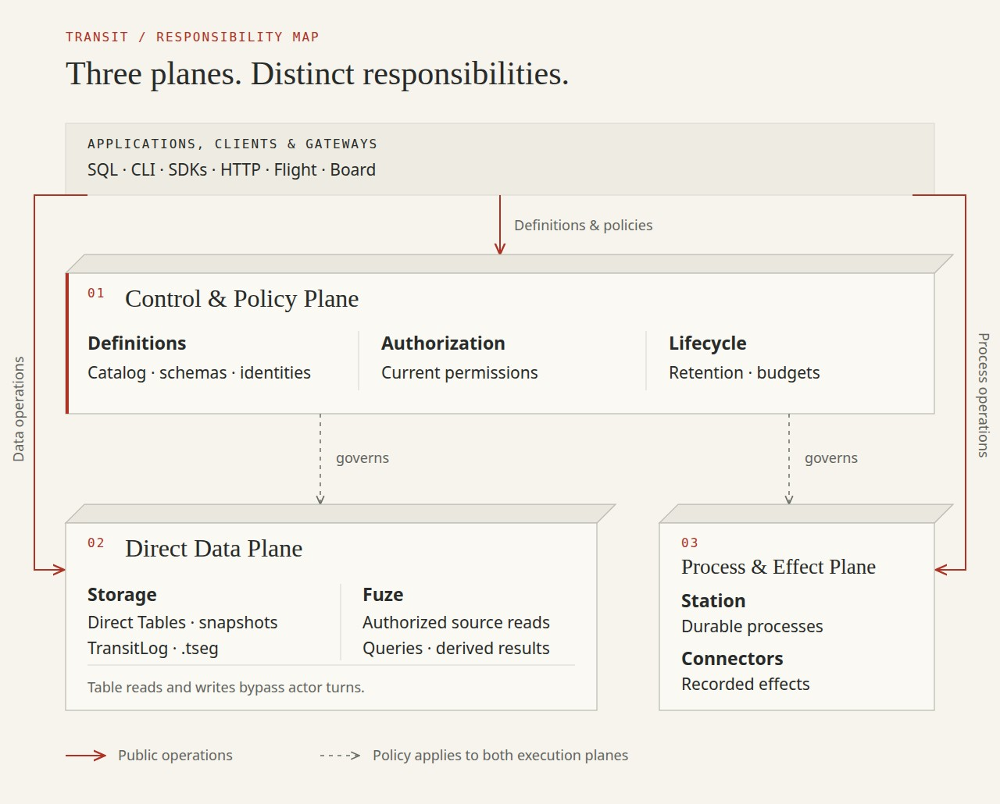

# D1 — Refraction

[Review index](README.md)

Status: **In review**. Implementation: a working Docusaurus theme extension and
scrolling homepage, available on the proposal branch. Not deployed by this review.

## Question

How can the handbook inherit the visual grammar of **transit-artwork D1,
Figure 10 — P4 Refraction**, with an expressive homepage and readable reference pages?
How much can Docusaurus's layout and rendering change?

## Proposal

Use the existing classic theme as the documentation foundation, with site-owned
color and typography tokens, navigation treatments and a custom React homepage.
The accepted [artwork](../transit-artwork/D1.md#direction-and-palette-comparison) supplies
the visual vocabulary:

| Artwork element | Interface interpretation |
| --- | --- |
| Warm paper and graphite | Reading surfaces, text, quiet dividers and code surroundings |
| Measured score marks | Chapter numbering and active navigation markers |
| Continuous vermilion thread | Links, focus, selected navigation and the main action |
| Waves opening into terrain and planes | A layered homepage composition responding to scroll |
| Offset history contours | A slower background layer, suggesting continuity through change |

The mappings are visual metaphors, not a new runtime model. Existing data,
computation and policy references remain the semantic owners.

The homepage starts with the selected artwork and immediate quickstart/data-model
links. Three text sections introduce structure, activity and context beside a
sticky vector scene. Terrain, refraction and history layers move at different
rates. A direct handbook jump leads to seven numbered reading paths.

Reference pages share the palette, serif titles, fine rules and restrained
navigation marks. Their content stays stationary. Dark mode uses charcoal,
warm light text and a lighter vermilion accent. The original artwork retains its
paper palette in both modes.

## Visual studies

### Figure 1 — Homepage

The original image is imported directly from its owner, without a duplicate asset.
The introductory text names the product; the illustration carries the metaphor.

### Figure 2 — Scrolling composition

This is a new vector interpretation of the visual grammar. It is not a layered
extraction of the flattened README image. The screenshot captures one scroll
position; the local page demonstrates the motion.

### Figure 3 — Reading surface

The theme carries across existing sidebars, breadcrumbs, links and the table of
contents without introducing decorative motion into reference pages.

### Figure 4 — Dark reading surface

Dark mode translates the palette instead of inverting the artwork.

### Figure 5 — Mobile

The narrow layout stacks content, keeps the complete artwork, and uses a static
scene. Reduced-motion preference also disables the sticky motion on desktop.

### Figure 6 — The three planes

The introduction now uses an [editable vector figure](../../handbook/static/img/architecture/three-plane-architecture.svg).
Small perspective edges make the planes tangible, while exact labels and solid
versus dashed arrows explain their responsibilities. Gateways sit outside the
planes; data requests do not route through Station. The surrounding introduction
names existing owners and links their capability boundaries, replacing the old
figure's mixture of current behavior and proposed storage/query features.

## Structure and rendering flexibility

Docusaurus supports several levels of customization:

| Surface | Available control | This proposal |
| --- | --- | --- |
| Colors, typography, spacing and surfaces | Global variables, CSS and CSS modules | Site-owned light/dark tokens and reading styles |
| Homepage and standalone pages | Full React trees and responsive layouts | Custom homepage, seven entry paths and an SVG scene |
| Navigation, sidebar, footer and article shell | Wrap or replace theme components through swizzling | Existing accessible components, styled through stable classes |
| Rich content | React components, MDX, SVG, canvas or client-only browser rendering | Ordinary Markdown remains CommonMark; interactive homepage is React |
| Scroll and motion | CSS positioning and browser animation APIs | Native scrolling; one requested animation frame per scroll update |
| Hosting | Static output with a configurable base path | Existing GitHub Pages workflow and prefixed routes |

A separate published theme package is possible if multiple sites need the same
components. Site-local customization avoids that packaging overhead for one
handbook. Selective component wrappers would be the next step if layout changes
outgrow CSS. Copying an entire upstream theme would increase upgrade work.

A more cinematic alternative could reveal score, wave and landscape in successive
full-screen scenes. This first pass keeps all text in normal document flow and
leaves the handbook reachable before the scroll sequence. Sound could be an
explicit optional interaction in a later study; this proposal adds none.

## Review outcome

No theme or motion decision recorded yet. The earlier selection of the graphite
artwork remains accepted; it does not imply acceptance of these layout, typography
or motion choices.

## Open questions

- Does the serif title treatment feel right alongside the technical body text?
- Is the subtle layered motion enough, or should a later study use a more
  cinematic transformation between full-screen scenes?

## Evidence and limits

The screenshots come from the actual local production build, not a generated
interface mockup. Browser checks cover navigation, search, exact downloads,
Mermaid and architecture-image rendering, accessibility, scroll response, reduced motion and no-JavaScript
homepage navigation. The site guide owns reproduction commands.

Local Chromium evidence does not establish Safari/Firefox behavior, GitHub CDN
behavior or low-end-device frame-rate performance. This styling change adds no
runtime capabilities. The artwork is decorative; the text and links remain usable
without animation or JavaScript.

## Supporting material

- [Theme and homepage maintenance](../../handbook/README.md#visual-theme-and-homepage).
- [Homepage](../../handbook/src/pages/index.tsx), [scroll scene](../../handbook/src/components/RefractionStory.tsx), [theme styles](../../handbook/src/css/custom.css) and [homepage styles](../../handbook/src/css/home.css).
- [Browser proof](../../handbook/browser/site.spec.ts).
- Docusaurus: [custom pages](https://docusaurus.io/docs/creating-pages), [styling and layout](https://docusaurus.io/docs/styling-layout), [theme component customization](https://docusaurus.io/docs/swizzling).
- MDN: [reduced-motion preference](https://developer.mozilla.org/en-US/docs/Web/CSS/Reference/At-rules/@media/prefers-reduced-motion).

[Review index](README.md)
