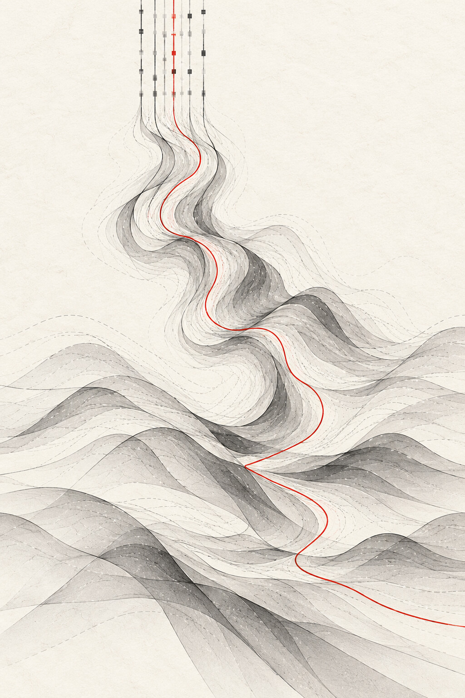
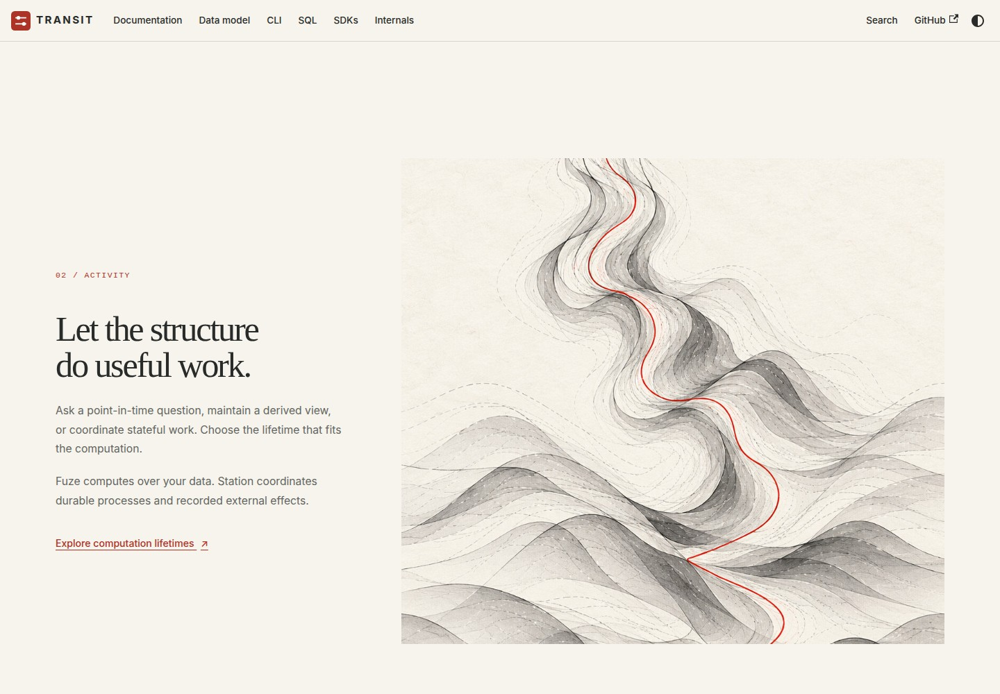
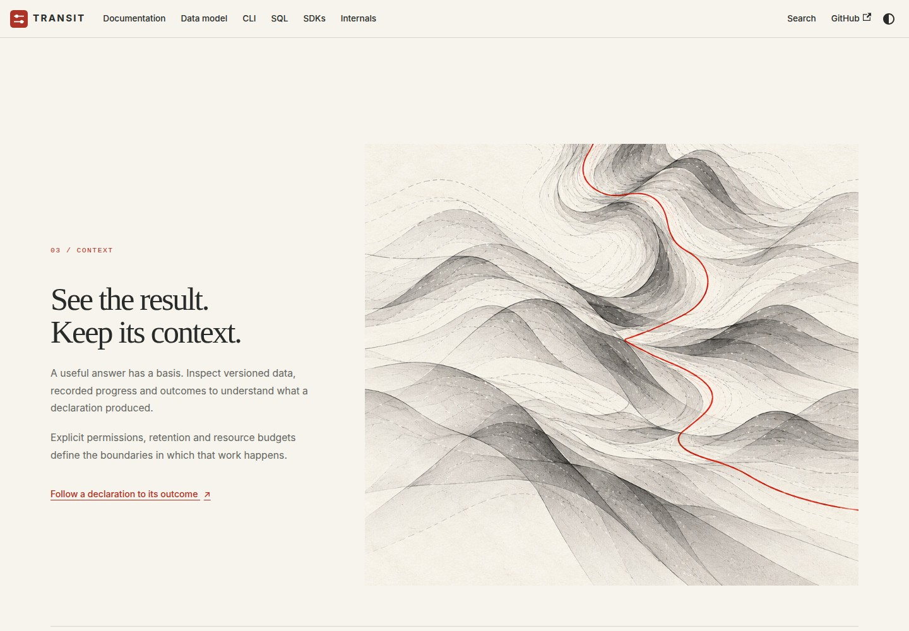

# D2 — Vertical flow and depth

[Review index](README.md) · [Previous: D1 — Refraction](D1.md) · [Next: D3 — Falling waves and lateral resonance](D3.md)

Status: **Accepted in part**. Implementation: the homepage's scrolling scene now uses
a portrait illustration and vertical scroll travel. The accepted D1 Figure 1
homepage composition is unchanged. This review does not deploy the site.

## Question

How should the scrolling scene express a primarily vertical flow with a hint of
depth, while preserving the material richness of the accepted homepage artwork?

## Proposal

The reviewer liked **D1 Figure 1 — Homepage**, found **D1 Figure 2 — Scrolling
composition** too schematic, and asked for movement that is "vertical with a
hint of Z". Here, Z is interpreted as spatial depth: translucent surfaces overlap,
fold toward the viewer and recede behind one another.

Replace the procedural vector scene with a new portrait companion to the selected
Refraction artwork. Measured filaments enter at the top, become waves through the
middle, and open into graphite terrain and translucent folds below. One vermilion
thread follows that downward movement. Paper grain, irregular contours, shading
and occlusion carry the depth.

On desktop, normal scrolling moves a view down the portrait beside the existing
three text sections. The image supplies the three-dimensional cues; the page
moves along the vertical axis. Narrow screens, reduced-motion preference and
no-JavaScript rendering show the full static portrait. The original horizontal
artwork and D1 Figure 1's layout remain unchanged.

## Visual studies

### Figure 1 — Vertical study

The portrait is a new generated companion using the original artwork as a style
and material reference. It is not a rotation of the horizontal artwork. Depth is
subtle and comes from overlapping surfaces and shaded folds, without diagram axes,
labels or a literal letter Z.

### Figure 2 — Activity

The middle scroll position shows the transition from measured flow to a spatial
landscape. The screenshot is captured from the production site build.

### Figure 3 — Context

Further scrolling reveals the lower layers. The illustration's actual rendered
height determines how far it can travel inside its viewport, preserving the
picture's bounds at both ends.

## Review outcome

D1 Figure 1 remains selected. D1 Figure 2's schematic treatment is replaced in the
proposal implementation. The reviewer likes "the vertical waves falling down"
and requests transformation on the horizontal dimension, with resonance like
the earlier artwork revisions. The reviewer also selected the text in
**Figure 2 — Activity**: "I love the text" and "We just need to nail the visual
and experience". [D3](D3.md) preserves those parts and explores the horizontal
transformation. The particular artwork and scroll framing remain open.

## Open questions

- [D3](D3.md) carries the horizontal transformation, resonance and scroll-framing questions.

## Evidence and limits

The artwork was generated with the built-in image-generation tool, then encoded
as a 1024 × 1536 JPEG for the site. The exact prompt and reference role are
recorded below. The existing hero artwork and its source bytes are unchanged.
A fresh 1440 × 1000 homepage screenshot matched the accepted D1 Figure 1 screenshot exactly
(ImageMagick absolute-error pixel count: 0).

Browser checks cover loading the portrait, vertical scroll response, reduced
motion, no-JavaScript navigation and the existing site navigation/accessibility
checks. These are local Chromium observations, not Safari/Firefox or live
hosting qualification. The scene is an abstract illustration, not a runtime or
architecture diagram. It adds no runtime capability claim.

## Supporting material

- [Exact prompt and reference role](d2-prompt.json).
- [Selected horizontal reference](../transit-artwork/images/d1-refraction-graphite.jpg).
- [Scrolling component](../../handbook/src/components/RefractionStory.tsx), [homepage styles](../../handbook/src/css/home.css) and [browser checks](../../handbook/browser/site.spec.ts).
- [Theme maintenance](../../handbook/README.md#visual-theme-and-homepage).

[Review index](README.md) · [Previous: D1 — Refraction](D1.md) · [Next: D3 — Falling waves and lateral resonance](D3.md)
