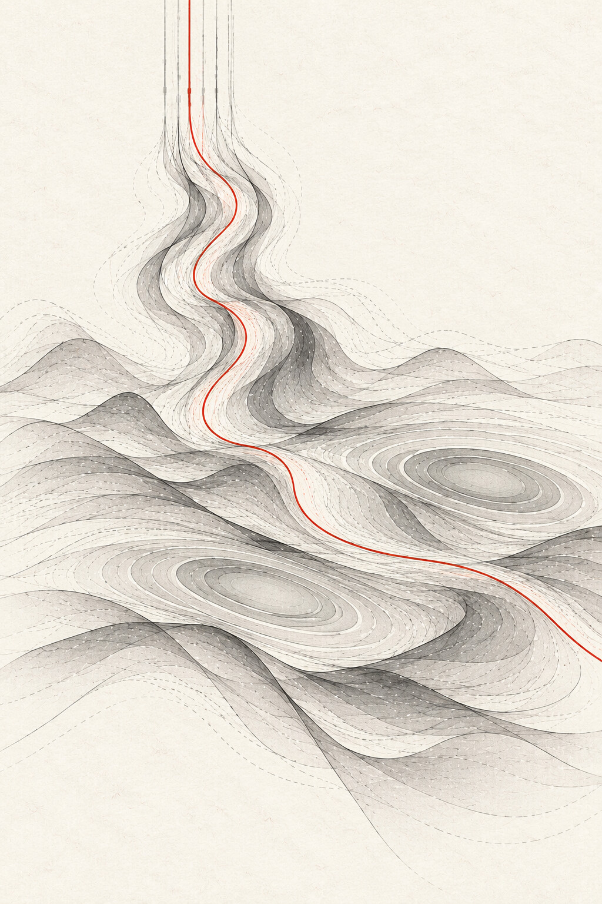
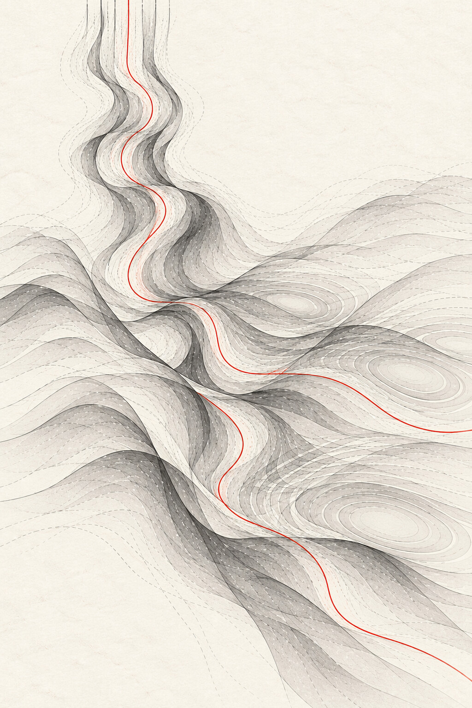
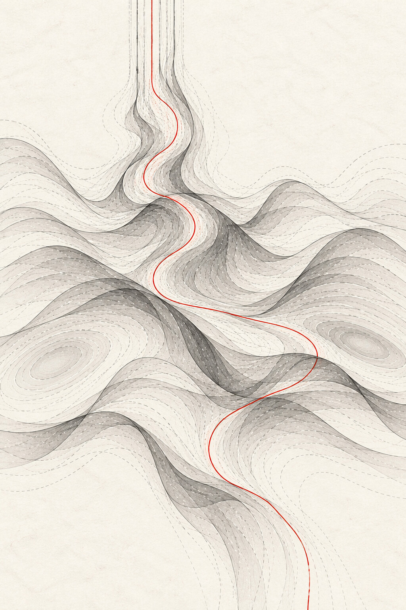
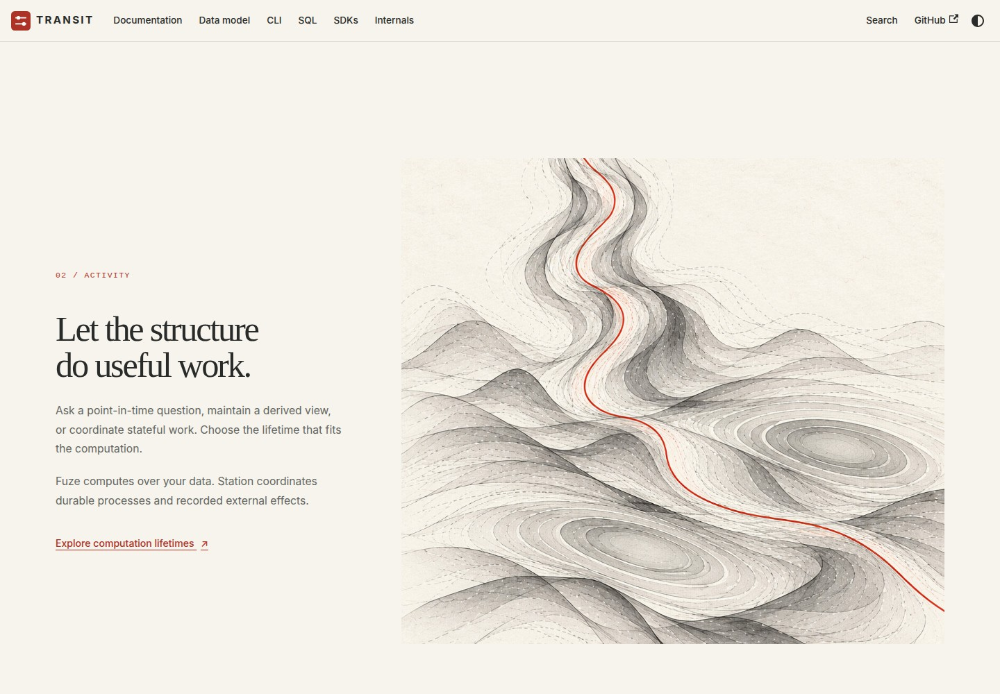
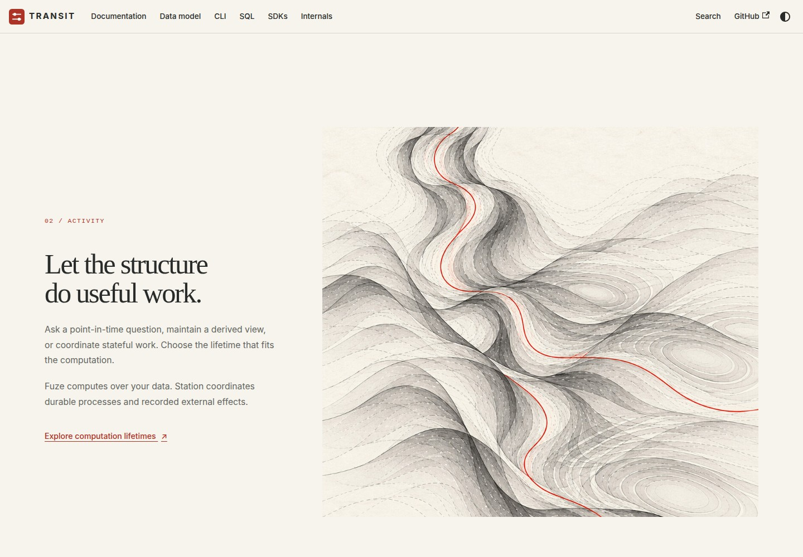
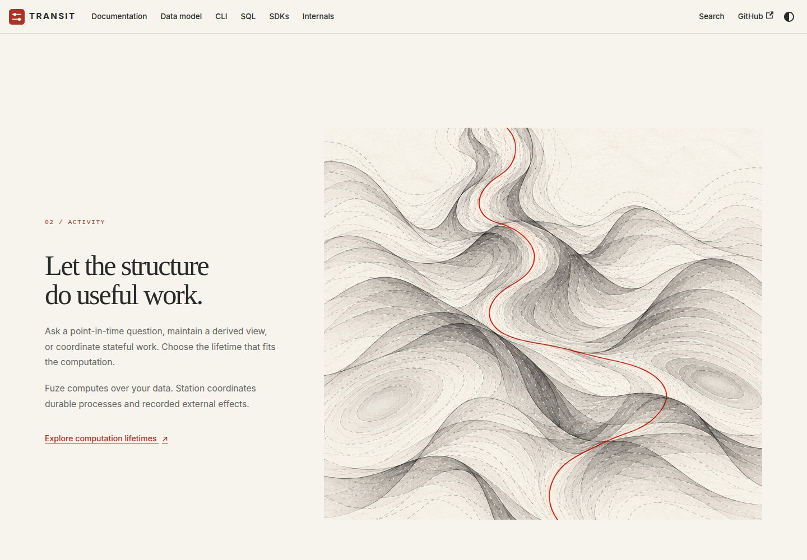

# D3 — Falling waves and lateral resonance

[Review index](README.md) · [Previous: D2 — Vertical flow and depth](D2.md) · [Next: D4 — Context echoes and graphite diagrams](D4.md)

Status: **Accepted**. Implementation: the homepage uses **Figure 4 — R1 —
Activity**, importing the exact lateral basin artwork from Figure 1. The selected
Activity copy, layout and vertical scroll behavior are preserved. Figures 2–3 and
5–6 remain alternatives; the original preview captures are retained below.

## Question

How can falling waves transform across the horizontal dimension into resonance,
while retaining the selected Activity copy and the illustration's depth?

## Proposal

The reviewer likes the vertical waves falling down and asks for a horizontal
transformation, returning to the resonance explored in
[transit-artwork D1](../transit-artwork/D1.md#direction-and-palette-comparison).
The reviewer also selected the text shown in **handbook-theme D2 Figure 2 —
Activity**: "I love the text" and "We just need to nail the visual and experience".
Keep that section's heading, paragraphs and link verbatim while comparing the art.
The previously selected D1 Figure 1 homepage remains the opening composition.

Use two complementary directions: the current falls down the page; the form
widens and changes across it. Overlapping elliptical contours, pale gaps and
shallow folds carry the resonance. Graphite, ivory paper and a vermilion thread
connect all three alternatives to the earlier artwork. Keeping one palette makes
their geometry easier to compare.

**R1 — Lateral basin** is selected. Its falling current
opens into two broad, displaced resonance centers, giving the sideways expansion
a clear silhouette. **R2 — Crossing fields** keeps the downward current running
alongside a lateral branch. **R3 — Suspended membrane** emphasizes a continuous
folded surface, with more depth and a less pronounced change of direction.

These comparisons are design judgments. The reviewer selected **R1 — Activity**
for implementation.

## Visual studies

### Artwork comparison

Click an image for the full-size portrait. Each is 1024 × 1536.

| R1 — Lateral basin | R2 — Crossing fields | R3 — Suspended membrane |
| --- | --- | --- |
| **Figure 1.**  | **Figure 2.**  | **Figure 3.**  |

- **Figure 1:** the main red trace bends sideways between the large open rings.
  The broad lower field makes the transformation easiest to read as one gesture.
  This is the exact source artwork used in the selected Figure 4 and the homepage.
- **Figure 2:** the red trace branches, making simultaneous downward and lateral
  movement explicit. Several interference centers create a more active rhythm.
- **Figure 3:** broad ridges and an overlapping foreground fold emphasize depth.
  The central trace continues downward; the horizontal change is more gradual.

### In the Activity layout

These browser captures use the same Activity text, viewport and scroll position.
Only the scrolling illustration's image source changes for the preview. The
full-size captures show how much of each lateral field is visible beside the copy.

| R1 — Activity | R2 — Activity | R3 — Activity |
| --- | --- | --- |
| **Figure 4.**  | **Figure 5.**  | **Figure 6.**  |

Short, silent browser recordings show each portrait through the existing scroll
sequence: [R1 — Lateral basin](previews/d3-lateral-basin.webm),
[R2 — Crossing fields](previews/d3-crossing-fields.webm),
[R3 — Suspended membrane](previews/d3-suspended-membrane.webm).

### Selected experience

The page keeps native vertical scrolling. The illustration stays beside the copy
as the view moves down it, revealing the wider resonance field. A reader should
be able to follow the falling current into the lateral forms without losing the
text or being moved sideways through the page.

The transformation is drawn into the artwork. These previews use the existing
vertical image travel; they do not animate the wave geometry itself. The selected
R1 framing and existing timing carry into the implementation. The site retains
its static mobile and reduced-motion presentation and immediate handbook navigation.

## Review outcome

- D1 Figure 1's homepage composition remains selected.
- D2's falling vertical waves remain the basis for the horizontal transformation.
- The text in D2 Figure 2 — Activity is selected and unchanged.
- The reviewer selected **Figure 4 — R1 — Activity** and requested implementation.
  The homepage now imports Figure 1's lateral basin asset directly and preserves
  Figure 4's copy, layout and scroll framing. No regenerated or duplicate artwork
  is introduced.
- R2 and R3 remain unselected alternatives.
- [D4](D4.md) gives Context its own composition below the selected R1 scene.
  The opening homepage and Activity view remain the accepted references.

## Open questions

None for the current R1 selection.

## Evidence and limits

The three illustrations were generated with the built-in image-generation tool
using D2's portrait and the earlier graphite resonance study as references.
All three were inspected for vertical flow, horizontal expansion, continuity,
depth and palette. Generative variations also change fine contours; this is a
comparison of compositions, not a controlled geometric simulation of resonance.

The generated PNG originals are retained outside the repository. The review
stores JPEG encodings at the original dimensions, with no compositional edit.
The prompt set records every generation prompt, reference role and encoding.

Figures 4–6 and the recordings come from the existing local production build in
Chromium at 1440 × 1000. A browser fixture substitutes each alternative image
without editing the page's copy, layout or motion code. The recordings replay
the same vertical scroll range over eight seconds. They are local design
previews, not screenshots of a deployed change or Safari/Firefox evidence.

These images are visual metaphors for related representations and activity.
They introduce no database, branching, audio or physical simulation contract.

### Implementation verification

The production build imports the selected asset directly. The served JPEG's
SHA-256 matches Figure 1's source bytes. Fresh 1440 × 1000 Chromium captures of
the Activity view and opening homepage match Figure 4 and D1 Figure 1,
respectively, with an ImageMagick absolute-error pixel count of **0** for each.
The Activity heading, paragraphs and link are unchanged.

The existing site check passed formatting, lint, strict TypeScript, nine content
tests and a production build. All seven browser checks passed at `/transit/`.
Additional local inspection verified that the scroll reaches both image bounds
and that mobile, reduced-motion and no-JavaScript views show the complete static
portrait without horizontal overflow. No browser page errors were observed.

Use the [site validation commands](../../handbook/README.md#validation-and-hosting)
to rebuild and run the browser checks. For the selected frame, use a light-mode
1440 × 1000 viewport and scroll the Activity heading into view. The retained
Figure 4 capture is also the verified implementation reference; an identical
image is not stored again. These local results do not establish live hosting or
Safari/Firefox behavior.

## Supporting material

- [Exact prompts, reference roles and encoding](d3-prompts.json).
- [D2 portrait](images/d2-vertical-refraction.jpg) and
  [earlier graphite resonance](../transit-artwork/images/d1-resonance-graphite.jpg).
- [Selected Activity layout](D2.md#figure-2--activity) and
  [the current component](../../handbook/src/components/RefractionStory.tsx).
- [Theme and motion maintenance](../../handbook/README.md#visual-theme-and-homepage).

[Review index](README.md) · [Previous: D2 — Vertical flow and depth](D2.md) · [Next: D4 — Context echoes and graphite diagrams](D4.md)
