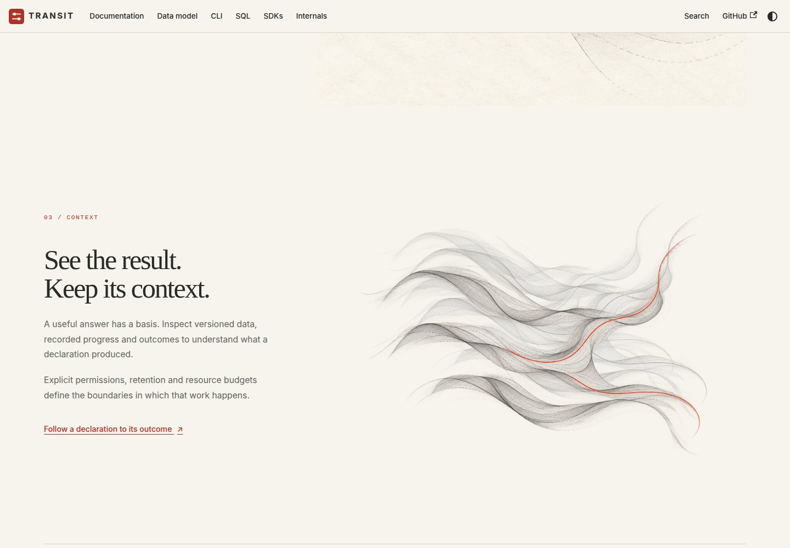
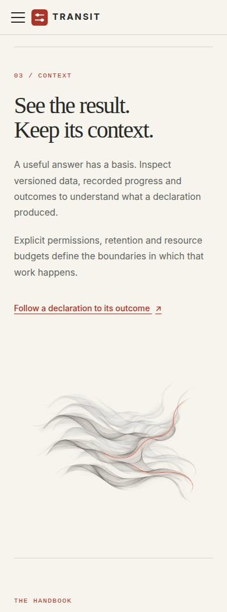
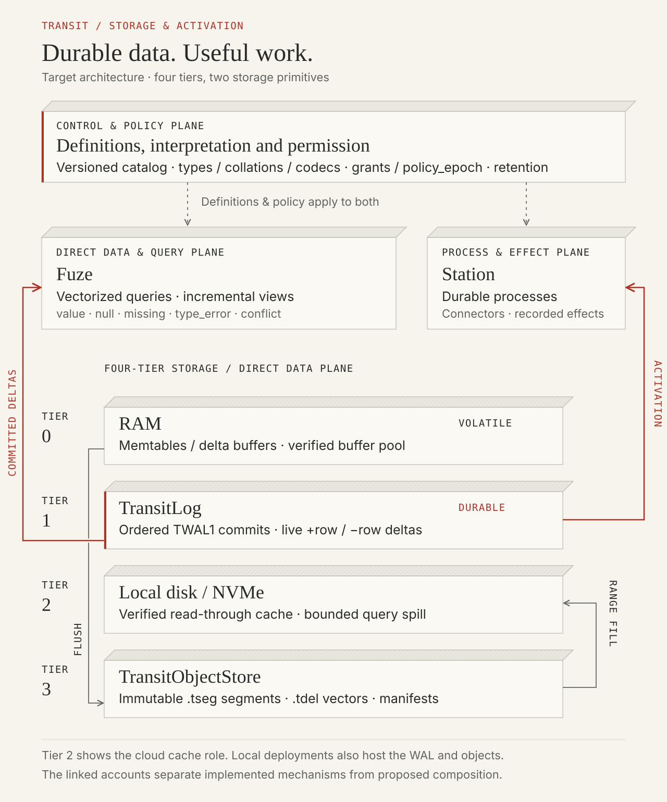
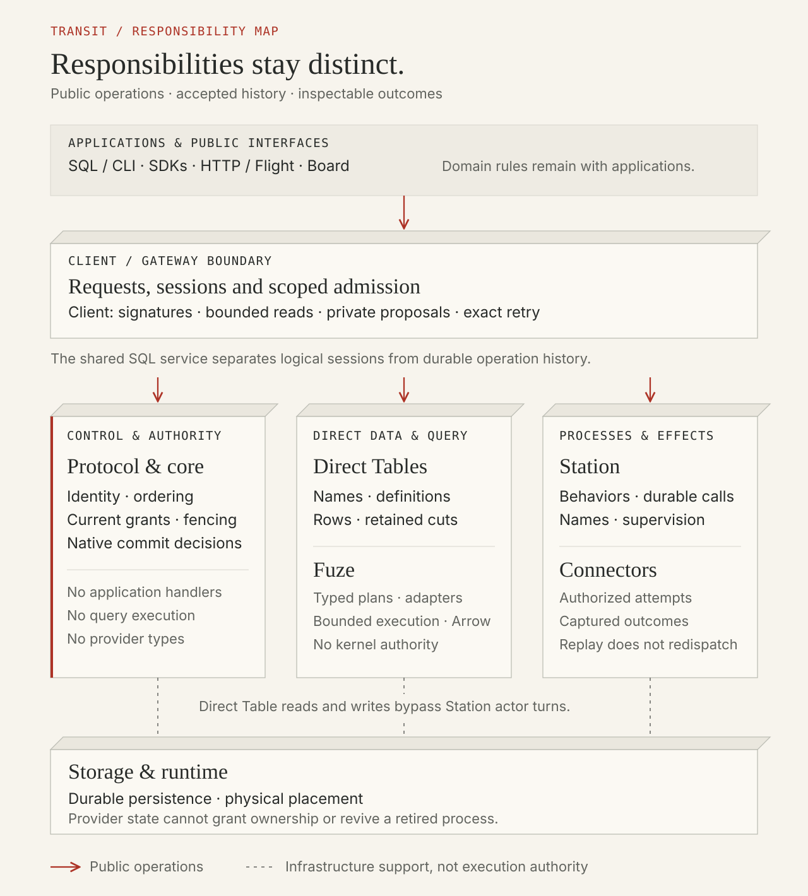

# D4 — Context echoes and graphite diagrams

[Review index](README.md) · [Previous: D3 — Falling waves and lateral resonance](D3.md)

Status: **In review**. Implementation: a dedicated Context scene and two graphite
SVG diagrams are implemented on the review branch. The reviewer selected the
direction; these specific compositions and their rendering remain under review.

## Question

How can “See the result. Keep its context.” gain a dimension beyond topology,
while the handbook's literal diagrams share the same visual grammar?

## Proposal

Let resonance catch memory. Below the selected R1 Activity scene, the landscape
opens into suspended wavefronts. A vermilion foreground trace carries the result;
two quieter graphite echoes retain the forms that shaped it. Scrolling separates
them in depth. All three remain present, making context visible alongside the
result. The chapter's copy is unchanged.

Keep the diagrams literal. Paper faces, graphite edges, shallow perspective and
vermilion operation paths connect them to the introduction's selected three-plane
diagram. Text, geometry and line styles carry meaning independently of color.
Editable SVG keeps the labels crisp and makes future corrections straightforward.

## Visual studies

### Figure 1 — Context

The strong trace sits forward of its paler echoes. The composition uses open
curves and empty space instead of Activity's closed topographic basins.
[Watch the silent scrolling preview](previews/d4-context.webm) from Activity into
Context, captured from the local production build.

### Figure 2 — Static mobile composition

The layers retain their separation without scroll motion. Reduced-motion and
no-JavaScript views use the same complete static arrangement.

### Figure 3 — Internals: storage and activation

The figure distinguishes volatile RAM, durable log history, cache/spill and
immutable segments. Flush and range-fill paths are separate from activation.
It explicitly depicts the **target architecture**, matching the scope of the
[storage account](../../handbook/internals/storage-runtime.md#four-tier-storage-architecture-tseg-segments-and-multi-writer-occ).
It does not turn proposed cache tiering or memtable recovery into installed behavior.

### Figure 4 — Architecture: responsibilities and authority

The figure follows the [reference's responsibility table](../../handbook/reference/architecture.md#responsibilities).
Direct Tables bypass Station turns; provider placement supplies no execution
authority. It omits proposed partition types previously included in the raster
image. The reference table remains the detailed text equivalent.

## Review outcome

- The reviewer requested a distinct Context scene that extends resonance into
  another dimension and authorized the retained-echo direction for implementation.
- The reviewer selected the earlier graphite diagram treatment for both Internals
  and the Architecture reference.
- D1's opening composition, D3's R1 artwork and the selected Activity copy remain
  the accepted references. Figures 1–4 here are available for implementation review.

## Open questions

Does the depth separation read as retained context, and are the two diagram
compositions clear at their full size?

## Evidence and limits

The Context illustration was generated with the built-in image-generation tool,
using R1 as a style reference, then encoded as a lossless 1536 × 1024 WebP with
alpha preserved. One 923,098-byte image supplies all three layers. The two
historical copies are desaturated and translucent; CSS changes scale and position.
This is a visual metaphor, not a display of actual historical records, an audio
feature or a physical resonance simulation.

The diagrams are hand-authored SVGs, based on the public source accounts at
`fdb80fc13`. They summarize responsibilities and design scope; arrows are not a
package dependency graph or mandatory call sequence. The earlier
[Internals raster](../../handbook/static/img/architecture/four-tier-storage-hierarchy.jpg)
and [Architecture raster](../../handbook/static/img/architecture/system-responsibilities.jpg)
remain available as historical comparison sources.

Figure 1 uses Chromium at 1440 × 1000; Figure 2 captures the complete chapter
at a 390-pixel viewport width. The recording scrolls from Activity through Context
over eight seconds. Fresh opening and Activity captures have an ImageMagick
absolute-error pixel count of **0** against the accepted references.

Formatting, lint, strict TypeScript, ten content/link-transform tests and the
production build passed. All eight Chromium browser tests passed at `/transit/`,
including mobile/dark accessibility, distinct scroll transforms, reduced motion,
resize, no-JavaScript navigation and full-size SVG links. A second production
build at `/` passed a focused browser check of Context and both diagram links
with no page or HTTP errors. Repository link/fence checks and diff whitespace
checks also passed. Runtime qualification was not rerun for these site changes.

The [site validation workflow](../../handbook/README.md#validation-and-hosting)
reproduces the local build and browser checks. Local rendering evidence does not
establish live hosting, Safari/Firefox behavior or any new runtime guarantee.

## Supporting material

- [Exact generation prompt, reference role and encoding](d4-prompt.json).
- [Context component](../../handbook/src/components/ContextEchoes.tsx),
  [scroll coordination](../../handbook/src/components/RefractionStory.tsx), and
  [styles](../../handbook/src/css/home.css).
- [Theme, diagram and motion maintenance](../../handbook/README.md#visual-theme-and-homepage).
- [Selected R1 Activity](D3.md#in-the-activity-layout).

[Review index](README.md) · [Previous: D3 — Falling waves and lateral resonance](D3.md)
