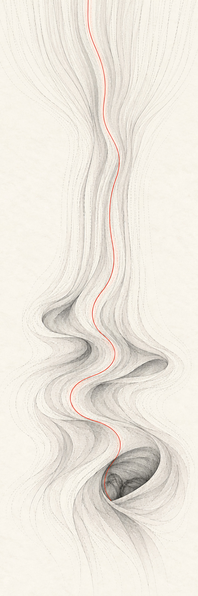
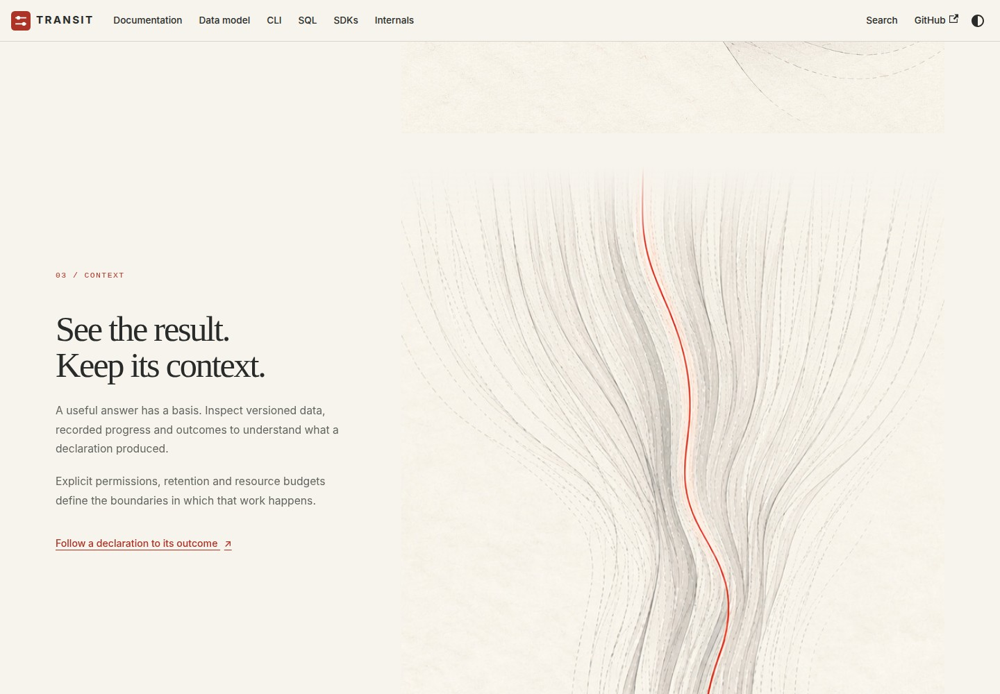
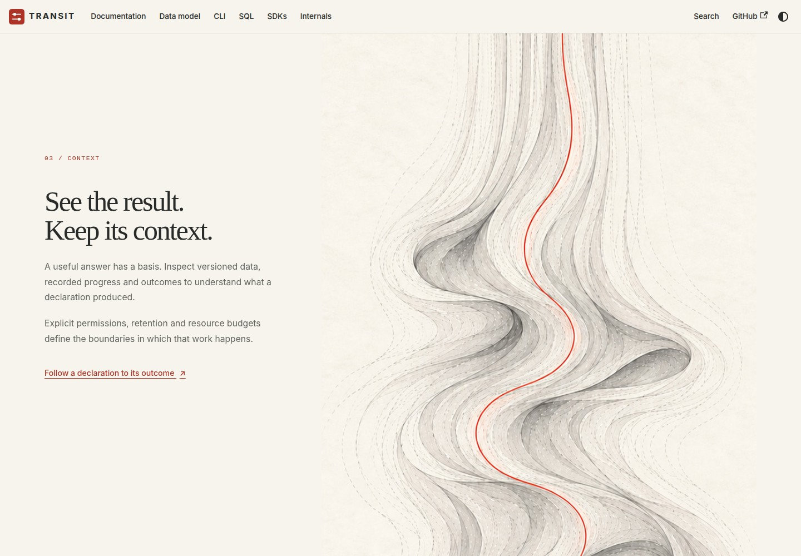
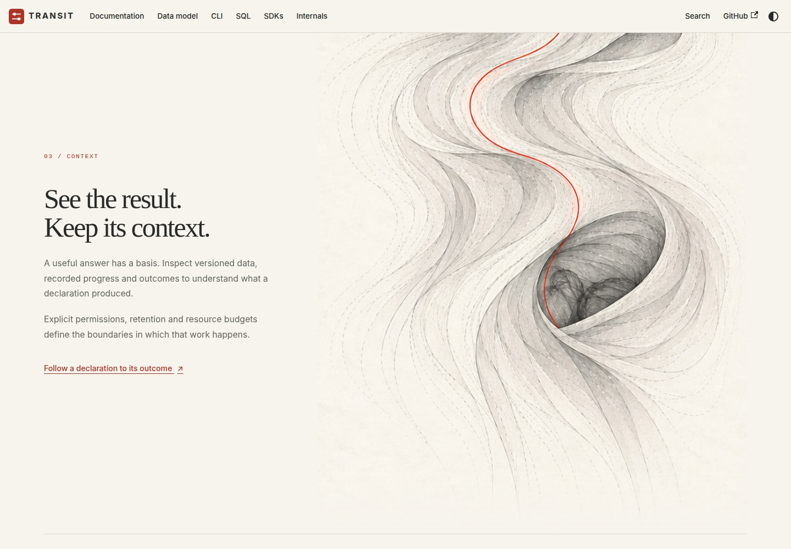

# D5 — Fabric and hidden pockets

[Review index](README.md) · [Previous: D4 — Context echoes and graphite diagrams](D4.md) · [Next: D6 — Through the surface](D6.md)

Status: **Accepted**. The reviewer selected **Figures 3 and 4** and requested
implementation of the oblique pocket as the reader scrolls past. The exact
continuous fabric is on the homepage; the final pocket's brief scroll passage
is implemented on the follow-up branch. D4's selected diagrams remain unchanged.

## Question

How can the scroll continue past the resonance zones into a more abstract sense
of something held within the fabric?

## Proposal

Let the fabric settle into a long, nearly straight passage. Further down, local
folds become small pockets. The last pocket turns toward the reader, revealing
only part of an indistinct form behind its rim. Its identity remains unresolved.
The vermilion thread follows the surface and disappears into the opening.

One continuous drawing supplies the sequence. The reader travels down the fabric
through native scrolling. Tall desktop layouts keep the existing Context copy
beside it. After the smaller pockets pass, the lower edge of the fabric briefly
stays within the viewport, giving the final oblique opening time to register.
It then leaves with the page. Narrow and short layouts, reduced motion and
no-JavaScript rendering retain ordinary document flow. The final pocket appears
only after the reader passes the earlier fabric. No autoplay, scroll locking,
scrubbed timeline or duplicate image layers are involved.

## Visual studies

### Figure 1 — Continuous fabric

The quiet upper interval creates distance between the selected resonance zones
and the pockets below. The final opening has a visible near rim and partially
occluded interior. The ambiguity is intentional; the illustration does not label
or resolve the form inside it.

### Figure 2 — Straightened passage

### Figure 3 — Pockets emerging

### Figure 4 — An oblique glimpse

[Watch the implemented pocket passage](previews/d5-pocket-reveal.webm), from
Activity through the smaller pockets, the final oblique glimpse and its departure
into the handbook. The [original study recording](previews/d5-fabric.webm) remains
available for comparison.

### Selected scroll behavior

The selected image and its drawn perspective are unchanged. On screens at least
997 pixels wide and 760 pixels high, with no reduced-motion preference, the
final pocket stays in view over 45vh of scroll distance. The image's lower edge
sits two rem above the viewport bottom. The page continues scrolling during this interval,
and reversing direction retraces the same sequence without a timed transition.

CSS derives the image's height from its 1:3 aspect ratio and container width.
Browsers without container-relative units retain the complete image in normal
flow. The shorter-screen and no-JavaScript layouts add no holding space. This
keeps navigation and the rest of the handbook immediately reachable.

## Review outcome

The reviewer accepted D4 Figures 3 and 4, but asked for a more abstract Context
experience. Their requested sequence is the basis of this revision: resonance
zones, straightened fabric, pockets, then an angled glimpse of something whose
identity is uncertain. The reviewer then selected **Figure 3 — Pockets emerging**
and **Figure 4 — An oblique glimpse**, merged the study, and asked for the pocket
to appear as the reader scrolls past. The implemented passage retains those
compositions and adds a brief interval to see into the final pocket.

The opening homepage, selected R1 Activity asset and all chapter copy remain
unchanged. D4's echo studies remain available as the earlier review record.

## Open questions

None for the selected composition. The follow-up PR exposes the scroll timing
and departure for implementation review.

## Evidence and limits

The built-in image-generation tool used the selected R1 and original Refraction
artwork as style references. The first result repeated the resonance basins at
its top. A targeted edit replaced that upper region with straightened fabric.
The selected output is 724 × 2172 pixels, encoded as a quality-92 JPEG with 4:4:4
sampling and no compositional change during encoding. The prompt set records
both iterations and their source roles.

The change in form and viewing angle is drawn into the image. Scrolling reveals
the drawing; it does not dynamically deform a mesh or simulate a physical fabric.
This is an abstract visual study and creates no new database or storage semantics.

### Original study

Figures 2–4 and the original 14-second recording come from the local production build in
Chromium at 1440 × 1000. Fresh opening and Activity captures match their accepted
references with an ImageMagick absolute-error pixel count of **0** each. The two
accepted D4 SVG diagrams have no changes.

Formatting, lint, strict TypeScript, ten content tests, the production build,
repository link/fence checks and diff whitespace checks passed. All eight browser
tests passed, including sequential pocket discovery, mobile/dark accessibility,
reduced motion, short-screen link access and no-JavaScript navigation. No browser
page errors were observed during preview capture. These are local implementation
previews, not evidence of live publication, Safari/Firefox behavior or runtime
qualification. The [site workflow](../../handbook/README.md#validation-and-hosting)
owns the build and browser commands.

### Selected implementation

The follow-up production build preserves the exact fabric asset. Fresh opening,
Activity and Figure 3 captures at 1440 × 1000 match the accepted references with
an ImageMagick absolute-error count of **0**. Figure 4's image and copy also match;
the only changed pixels lie at the handbook divider, which now enters later.
The new recording shows 18 seconds of continuous scrolling from Activity through
the final pocket and its departure. It was captured in Chromium at 1440 × 1000
with no page errors.

All eight browser tests passed, including holding the pocket while the page
continues scrolling, releasing it into the handbook, immediately retracing on
reverse scroll, and omitting the hold on mobile, short screens, reduced motion
and no-JavaScript rendering. Formatting/lint, strict TypeScript, ten content tests,
the production build, repository link/fence checks and diff whitespace checks
passed. These checks cover the local implementation; live hosting and other
browser engines were not tested.

## Supporting material

- [Exact prompts, reference roles and encoding](d5-prompts.json).
- [Context fabric component](../../handbook/src/components/ContextFabric.tsx),
  [Activity scroll coordination](../../handbook/src/components/RefractionStory.tsx),
  and [homepage styles](../../handbook/src/css/home.css).
- [Theme maintenance](../../handbook/README.md#visual-theme-and-homepage).
- [Selected diagrams](D4.md#figure-3--internals-storage-and-activation).

[Review index](README.md) · [Previous: D4 — Context echoes and graphite diagrams](D4.md) · [Next: D6 — Through the surface](D6.md)
