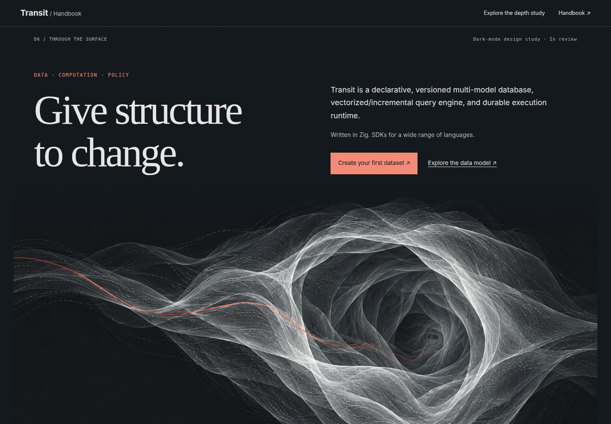
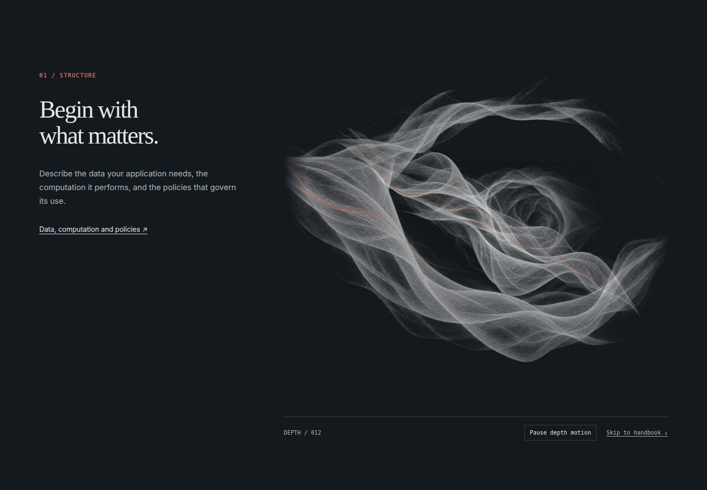
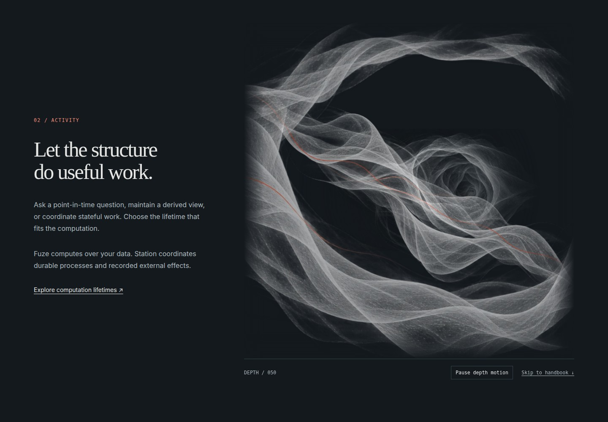
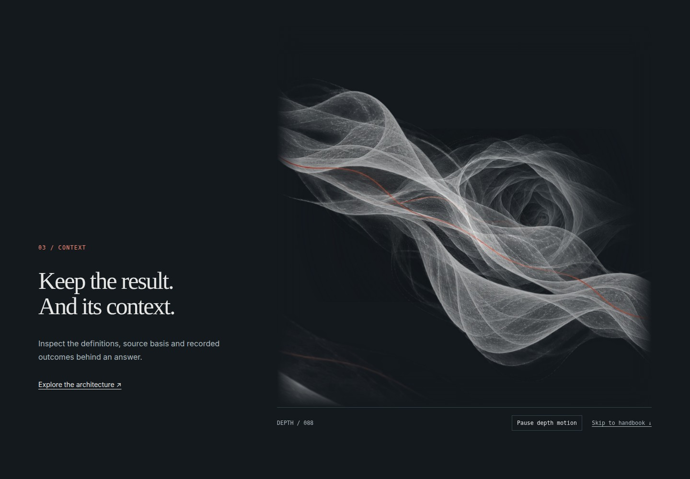
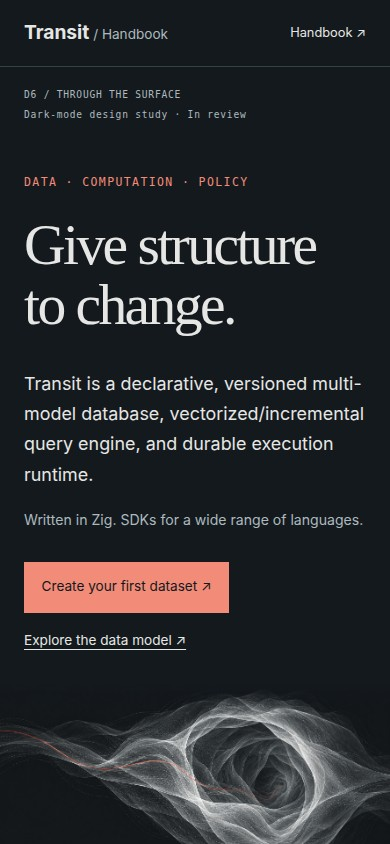
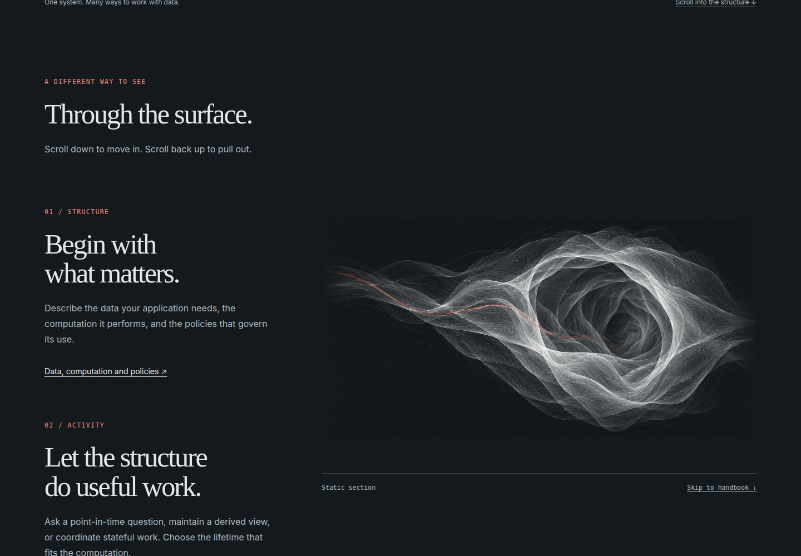
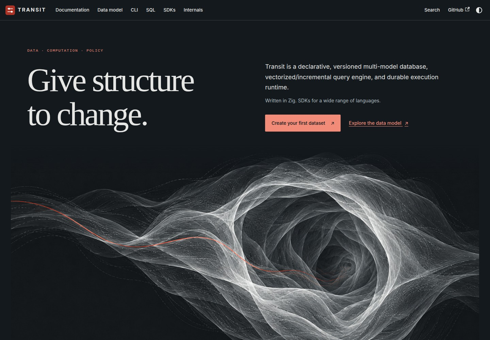
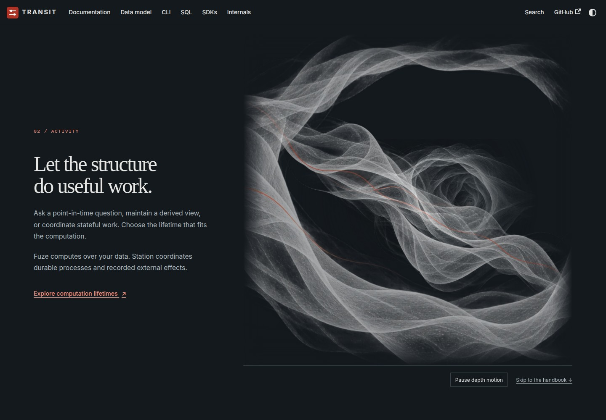

# D6 — Through the surface

[Review index](README.md) · [Previous: D5 — Fabric and hidden pockets](D5.md)

Status: **Accepted**. After merging the study, the reviewer requested implementation.
The selected artwork, palette and reversible z-axis passage are integrated into
the Docusaurus homepage. The original study and its figures remain below;
implementation evidence is recorded separately. The light scenes and factual
reading-page illustrations retain their accepted compositions.

## Question

How can dark mode feel like looking through Transit's structure, with scrolling
moving the viewer into and back out of that structure?

## Proposal

Make dark mode radiographic. Silver filaments describe translucent surfaces on
charcoal; quieter internal folds remain visible through the near membrane. The
vermilion path continues through depth. The same family of forms connects light
and dark, while each mode has its own artwork and dominant axis.

The main interaction is **camera travel along z**. Scroll down to approach the
near membrane and reveal the folds behind it; scroll up to withdraw along exactly
the same path. Perspective makes nearby material enlarge faster than distant
material. Text and links stay at their normal scale and move with the document.

The light-mode baseline in [D3](D3.md) and [D5](D5.md) remains a drawing that unfolds
across and down the page. Dark mode uses a volume the reader looks into. This is
an editorial metaphor for inspection, not a new product operation or an assertion
that the illustration encodes actual Transit data.

## Visual studies

### Figure 1 — A radiographic opening

[](images/d6-opening.jpg)

The opening keeps the title, immediate dataset action and restrained red accent.
The new image establishes depth before motion begins. It contains no ivory panel
or recolored light-mode terrain. [View the complete artwork](images/d6-radiograph.jpg).

### Figure 2 — At the outer membrane

[](images/d6-outer.jpg)

At 12% of the passage, the near opening frames the deeper material. The asymmetric
aperture gives the camera somewhere to travel while preserving dark negative space.

### Figure 3 — Moving inward

[](images/d6-middle.jpg)

At 50%, the foreground expands faster than the middle and far layers. It is the
change in their relative size that carries the movement into depth. The drawings
keep their positions within the volume; the camera has no sideways drift, tilt
or timed orbit.

### Figure 4 — Inside the folds

[](images/d6-inner.jpg)

The near rim leaves the frame through perspective enlargement. It is not faded
out on a timeline. Returning to Figure 2's scroll position restores the same
composition, including the exact pixels of the volume in the local browser check.

[Watch the down-and-back-up camera passage](previews/d6-depth.webm). This recording
is the primary motion evidence; the stills alone cannot establish the zoom feel.

### Figure 5 — Narrow reading layout

[](images/d6-mobile.jpg)

The initial recommendation keeps narrow screens in ordinary document flow with
static depth drawn into the image. There is no oversized scroll track on mobile.
Whether touch scrolling should also drive a shorter z passage remains open.

### Figure 6 — Static depth with reduced motion

[](images/d6-reduced-motion.jpg)

Reduced motion, short screens and no JavaScript retain the complete image and
readable links. They remove the camera travel and its added scroll distance.

### Figure 7 — Integrated handbook opening

[](images/d6-implemented-opening.jpg)

The production Docusaurus page uses the selected material and reading palette.
The native theme control selects its artwork before hydration; light mode keeps
its accepted composition. This capture is separate from the original Figure 1 study.

### Figure 8 — Integrated depth passage

[](images/d6-implemented-middle.jpg)

At 50% of the passage, the illustration stays below the native navbar while the
shared chapter text moves in document flow. The pause and skip controls remain
visible. The prototype's depth instrument is omitted from the handbook.

[Watch the implemented inward and outward passage](previews/d6-implemented-depth.webm).
The recording contains a seven-second inward pass followed by a seven-second
return, driven by native document scrolling.

## Motion and material decisions

| Dimension | Existing light-mode baseline | Proposed dark-mode study |
| --- | --- | --- |
| Dominant axis | Falling waves, lateral resonance, then travel down the fabric | Camera travel through a volume along z |
| Material | Graphite on warm paper, shading conceals the pocket interior | Silver on charcoal, translucency exposes internal folds |
| Depth cue | Perspective and occlusion drawn into one image | Independent near/middle/far planes enlarge at different rates |
| Reverse scroll | Retraces the vertical reveal | Pulls the camera back through the exact same composition |
| Reading surfaces | Warm paper and graphite | Dark reading surface, stable text and controls |

The prototype uses a fixed 900px perspective and three image planes at z = 80,
−240 and −650px. A shared camera transform travels from 0 to 650px across the
sticky passage. Progress is clamped from the track's document position; there is
no easing timer, momentum accumulator, wheel interception or scroll locking.
The camera does not cross the near plane's perspective singularity. These are
review parameters, not a production performance or interaction contract.

Three 110vh text chapters provide the desktop passage, ending at the handbook
links. The static heading and opening artwork establish the composition first;
the zoom begins within the three-chapter passage. The entire page does not zoom.
The small depth readout is a study instrument and is not proposed handbook UI.
A visible pause button freezes the camera; resuming adopts the current scroll
position. The skip link immediately leaves the passage. Native browser zoom
and keyboard navigation are not intercepted.

Only desktop layouts at least 997px wide and 700px high, with no reduced-motion
preference, enable camera travel. The script schedules at most one animation
frame after input and stops painting outside the visible track or hidden tab.
It does not continuously animate an idle page. The three compressed artwork
assets total approximately 1.33 MB; this is not a measured rendering budget.

### Alternatives considered

- **Invert or dim the existing images:** inexpensive, but keeps the same surface,
  composition and vertical reveal that prompted this review.
- **Enlarge one flattened radiograph:** provides zoom, but every feature expands
  at the same rate. The layered study makes the depth separation reviewable.
- **Full mesh and camera:** could connect the thread continuously and expose real
  internal surfaces. It adds rendering and asset work before the visual direction
  is selected. The current study uses three planar illustrations in perspective.

## Review outcome

The reviewer specified the z-axis direction and reversible scroll behavior,
merged [PR #263](https://github.com/spoke-sh/transit/pull/263), then explicitly
requested implementation on a new worktree. That selects the D6 material,
composition, desktop travel and static fallback direction. The implementation
uses the exact three artwork assets and keeps the existing shared chapter copy.
The accepted D1–D5 light scenes and D4 architecture diagrams keep their prior status.

## Open questions

These are possible refinements after the selected implementation, not outstanding
approval gates for the accepted direction.

- Does the opening feel like seeing through a structure, or too much like a tunnel?
  The near aperture is deliberately asymmetric, but the deep pocket is still a
  strong visual center.
- Is 650px of camera travel over this passage the right intensity? The final
  foreground crop makes the depth effect stronger; a shorter passage could be calmer.
- Should narrow touch layouts gain a short z passage, or retain this static view?
- How should one continuous vermilion thread join the three layers? The study's
  independently generated strands are material cues, not a geometrically joined path.

## Evidence and limits

### Original study

Source basis: `54e176fd0` on 2026-10-30. At that revision, the
[homepage](../../handbook/src/pages/index.tsx),
[Activity component](../../handbook/src/components/RefractionStory.tsx),
[Context fabric](../../handbook/src/components/ContextFabric.tsx) and
[theme CSS](../../handbook/src/css/home.css) used the same artwork in both themes.
Activity applied a vertical image translation and Context held the lower image
edge. That was the observed starting point; the radiographic proposal is design
judgment, not a user-study finding.

The new artwork was generated with the built-in image tool using the accepted
light artwork as material references. The two independent near and middle layers
retain generated alpha. Encoding changes format only. The prototype uses strict
TypeScript and Vite+ with the repository's locked tools; it adds no dependency.
It is outside the handbook catalog, search, production bundle and publication.

The local production prototype passed strict TypeScript, Vite+ formatting/lint,
its production build, the repository link/fence check and diff whitespace checks.
Chromium **153.0.8010.12** passed the capture runner's motion and fallback checks:
distinct perspective enlargement, identical volume pixels after reversing scroll,
pause/resume, runtime preference changes and keyboard access to the handbook.
Desktop and reduced-motion captures use 1440 × 1000, mobile uses 390 × 844 and
the short-screen check uses 1440 × 650. The recording is 16.04 seconds, including
a seven-second inward pass and seven-second return.

Automated axe WCAG A/AA checks reported no violations on desktop, reduced-motion,
mobile and short-screen layouts. The no-JavaScript check covers image loading,
static flow, overflow and keyboard skip; axe is not run with scripting disabled.
No browser page errors or failed requests were observed. These automated checks
do not establish subjective comfort or a complete manual accessibility audit.

This work establishes no runtime or live-hosting qualification. Safari, Firefox, low-powered device frame
rates and subjective motion comfort have not been tested. Reading-page diagrams,
theme switching and the production Docusaurus integration were not covered by
the original study. The implementation checks below add that coverage.
The [roadmap sequencing rule](../../roadmap/README.md#maintaining-the-sequence)
keeps a visual review separate from delivery milestones; no milestone status is
changed by this proposal.

### Reproduce the local study

From the repository root, install the locked tools as described in the
[handbook workflow](../../handbook/README.md#validation-and-hosting), then:

```sh
nix develop .#docs --command vp build --config docs/design/handbook-theme/previews/d6-depth/vite.config.ts
nix develop .#docs --command vp preview --config docs/design/handbook-theme/previews/d6-depth/vite.config.ts --host 127.0.0.1 --port 4187 --strictPort
```

Open `http://127.0.0.1:4187/previews/d6-depth/`. In a second terminal:

```sh
nix develop .#docs --command vp exec --filter @transit/docs tsc -p ../design/handbook-theme/previews/d6-depth/tsconfig.json
nix develop .#docs --command node docs/design/handbook-theme/d6-render.mjs
nix develop .#docs --command python3 -B tests/runner/docs.py
```

The capture runner rewrites Figures 1–6 and the recording from the built prototype.
It checks distinct perspective growth, exact visual restoration on reverse scroll,
pause/resume, runtime reduced-motion changes, mobile/short/no-JavaScript flow,
keyboard skip, image loads, overflow and automated WCAG A/AA accessibility.

### Integrated homepage

Implementation starts from `d903d4d3c`, the merge of PR #263. The implementation
source for Figures 7–8 and the checks below is `88473cede`. It reuses the exact
three selected image assets and the existing Structure, Activity and Context copy.
The [homepage guide](../../handbook/README.md#visual-theme-and-homepage) owns the
delivered behavior; [Radiograph](../../handbook/src/components/Radiograph.tsx) and
its [styles](../../handbook/src/css/radiograph.css) own camera travel and layout.
The implementation adds no dependency and changes no content routes.

The camera activates only after all three layers decode. Missing assets retain
the static composition, without the extra scroll distance. Theme changes,
preference changes and route unmount release motion state. Before hydration,
the native inline theme bootstrap can select the static dark composition; with
all JavaScript disabled, Docusaurus defaults to the complete static light page.
This distinction differs from the standalone dark-only prototype.

The [production browser checks](../../handbook/browser/dark-depth.spec.ts) exercise
perspective separation, exact volume pixels after reverse scroll, stable text
scale, pause/resume, stored and system theme choices, route cleanup/re-entry,
live reduced-motion changes, 320px-wide and 650px-high static layouts, a missing
middle layer, pre-hydration dark navigation and automated accessibility checks.
The existing browser suite covers light motion, no-JavaScript navigation,
reading-page diagrams, search and publication assets.

Executed on 2026-10-30 with Chromium **153.0.8010.12**:

- The locked handbook check passed formatting/lint, strict TypeScript, all 10
  content tests and the production build.
- All 12 production browser tests passed at both `/transit/` and `/`, including
  the dark interaction/fallback checks and existing handbook coverage. Automated
  axe checks reported no violations in the tested layouts.
- The opening, Activity and Context-pocket light screenshots at 1440 × 1000
  matched the `d903d4d3c` baseline exactly: zero differing pixels in each capture.
- The repository link/fence check passed 8,717 local links across 692 files.
  The production capture runner reported no page errors or failed requests.

These checks establish the observed browser behavior, not a complete manual
accessibility audit or rendering performance budget.

To reproduce Figures 7–8 and the production recording, build and serve the
handbook using the locked tools:

```sh
nix develop .#docs --command just transit-docs::check
nix develop .#docs --command vp exec --filter @transit/docs docusaurus serve --dir dist --host 127.0.0.1 --port 4188 --no-open
```

In a second terminal:

```sh
nix develop .#docs --command node docs/design/handbook-theme/d6-render-implementation.mjs
nix develop .#docs --command just transit-docs::browser
```

The [capture runner](d6-render-implementation.mjs) records the actual production
page at 1440 × 1000, using the handbook's locked Playwright browser. Set
`TRANSIT_DOCS_CAPTURE_URL` to capture another locally served publication prefix.
These observations do not qualify live hosting, Safari, Firefox, low-powered
device frame rates or subjective motion comfort.

## Supporting material

- [Exact prompts, reference roles and encoding](d6-prompt.json).
- [Near membrane](images/d6-near.webp) and [middle fold](images/d6-middle.webp).
- [Prototype HTML](previews/d6-depth/index.html), [styles](previews/d6-depth/style.css),
  [scroll controller](previews/d6-depth/main.ts) and [Vite+ config](previews/d6-depth/vite.config.ts).
- [Capture and browser checks](d6-render.mjs).

[Review index](README.md) · [Previous: D5 — Fabric and hidden pockets](D5.md)
