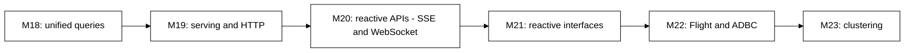
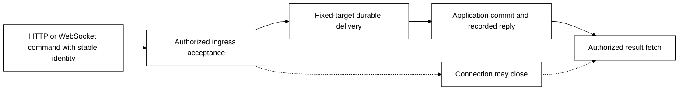

# D1 — Serving, reactive APIs and reactive interfaces

[Review index](README.md)

Status: **In review**. Implementation: **Proposed, not implemented**.

## Question

What common layer should turn Transit services into protocol servers, so HTTP
application APIs and Board can share a foundation, reactive APIs can define
long-lived interactions, and live interfaces and Flight/Flight SQL can consume it?

## Proposal

Make serving an inbound layer above public Transit/Station operations, alongside
outbound connectors. HTTP proves the common contract with two consumers:
application APIs and Board. Serving owns published service bindings, authenticated
context, admission, bounded response delivery and recovery; application services
own domain behavior. Kernel authority remains protocol-neutral.

[The serving design](../../SERVING.md) details the model and its SQL boundaries.
[Reactive APIs](../../REACTIVE_API.md) defines shared sessions, commands, events,
subscriptions and recovery, then binds them to SSE and WebSocket and generates
OpenAPI/AsyncAPI descriptions. [Reactive interfaces](../../REACTIVE.md) consumes
that contract to refresh exact snapshots. Flight later qualifies its specialized
Arrow adapter over the serving foundation.

## Visual studies

### Figure 1: Serving, API contracts, then interface consumers

HTTP first serves an application API and Board. M20 defines reactive API hosting,
including shared lifecycle and generated descriptions. M21 consumes it for live
views and refresh; incremental query maintenance remains later work. M22 adds
Flight, with ADBC as a client API over Flight SQL.

### Figure 2: Accepted work survives a lost connection

An ingress receipt, destination admission, application outcome and socket write are
separate facts. Recovery finds the same operation; it cannot generate a new
command just because a response was lost or the client switched transport.
Source-change notifications likewise
lead to a new explicit snapshot, not a claim that all changes were rendered.

### API ownership

| Milestone | Owns | Produces for the next consumer |
| --- | --- | --- |
| M19 | Published services, HTTP identity/admission and durable operation recovery | Qualified shared serving foundation |
| M20 | SSE/WebSocket bindings, session/subscription lifecycle, commands/events, no-gap handoff and resume/reset | Independently usable reactive API and generated OpenAPI/AsyncAPI contracts |
| M21 | View attachment, refresh scheduling, generation checks and visible freshness | Reactive Board/application experiences |
| M22 | Flight/Flight SQL and independent Arrow/ADBC client compatibility | Qualified Arrow serving adapter |

OpenAPI describes the HTTP/SSE surface; AsyncAPI describes WebSocket messages and
operations. Both derive from shared public definitions. Neither is a new runtime,
configuration authority or permission grant. M20 proves its server independently
of Board; M21 adds the interface behavior.

## Review outcome

The reviewer requested a new serving milestone before Arrow interoperability and
suggested reactive interfaces next. In clarification they selected:

- Application APIs **and** Board as M19's HTTP consumers.
- Live views with resumable change notifications and snapshot refresh for M21.
- Preserve Board's private shared access; scope individual operator sign-in separately.

In follow-up, the reviewer requested a separate **M20 reactive API** milestone
for WebSocket, SSE and API descriptions. The live-interface milestone moves to
**M21**, Flight/ADBC to **M22**, and clustering to **M23**. The earlier consumer,
refresh and private-access choices remain unchanged.

Those scope decisions are recorded. The detailed service/route, identity,
admission and watch contracts in this review remain proposals. No implementation
or complete protocol/SQL syntax is accepted merely by assigning milestone numbers.

## Open questions

- Which provisioned service-caller credential and inbound TLS/termination profile
  should M19 qualify first? It needs one concrete choice before implementation.
- Which public source operation best closes the snapshot/watch race while staying
  compatible with current retained reads and explicit gaps?
- Which pinned OpenAPI/AsyncAPI tools preserve streaming item schemas and shared
  runtime types, and which browser bootstrap fits the selected caller profile?
- What measured concurrency, notification, refresh and retained-result budgets
  fit the first deployment without letting slow clients block control work?

These are entry decisions within the selected milestones, not prerequisites for
renumbering the roadmap or reasons to implement every authentication/protocol family.

## Evidence and limits

The review starts from `e4d6afb`, including merged Board-console D6. Existing
HTTP/Board/public-query and outbound gRPC documentation establishes reusable
pieces and current limitations; it supplies no server/watch qualification.
The linked owner documents cite HTTP, SSE, WebSocket and API-description standards
where applicable and separate
standard framing from proposed Transit semantics. Diagrams are conceptual and
monochrome. Validation here covers documentation and sequence consistency only;
CI/runtime proofs are deferred until implementation, per the reviewer's design-review preference.

## Supporting material

- [Serving model](../../SERVING.md), [reactive API model](../../REACTIVE_API.md)
  and [reactive interface model](../../REACTIVE.md).
- [M19 HTTP serving](../../roadmap/M19.md), [M20 reactive APIs](../../roadmap/M20.md),
  [M21 reactive interfaces](../../roadmap/M21.md),
  [M22 Arrow interoperability](../../roadmap/M22.md), [M23 clustering](../../roadmap/M23.md).
- [Board console D6](../board-console/D6.md) and [D4 Live design](../board-console/LIVE.md).
- [Conformance obligations](../../CONFORMANCE.md), [Security](../../SECURITY.md)
  and [current Board limits](../../../apps/transit-board/README.md#bounds-and-observations).

[Review index](README.md)
