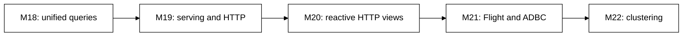
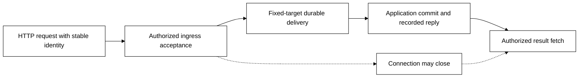

# D1 — HTTP serving before reactive views and Flight

[Review index](README.md)

Status: **In review**. Implementation: **Proposed, not implemented**.

## Question

What common layer should turn Transit services into protocol servers, so HTTP
application APIs and Board can share a foundation before reactive interfaces and
Flight/Flight SQL use it?

## Proposal

Make serving an inbound layer above public Transit/Station operations, alongside
outbound connectors. HTTP proves the common contract with two consumers:
application APIs and Board. Serving owns published service bindings, authenticated
context, admission, bounded response delivery and recovery; application services
own domain behavior. Kernel authority remains protocol-neutral.

[The serving design](../../SERVING.md) details the model and its SQL boundaries.
[Reactive interfaces](../../REACTIVE.md) then uses resumable notifications to
refresh exact snapshots. Flight tests the serving contract as a second protocol.

## Visual studies

### Figure 1: One dependency sequence, two serving protocols

HTTP first serves an application API and Board. M20 deepens HTTP's live-read
contract; M21 is the second protocol profile, not a dependency on incremental
query maintenance. ADBC remains a client API over Flight SQL.

### Figure 2: Accepted work survives a lost connection

An ingress receipt, destination admission, application outcome and HTTP write are
separate facts. Recovery finds the same operation; it cannot generate a new
command just because a response was lost. Source-change notifications likewise
lead to a new explicit snapshot, not a claim that all changes were rendered.

## Review outcome

The reviewer requested a new serving milestone before Arrow interoperability and
suggested reactive interfaces next. In clarification they selected:

- Application APIs **and** Board as M19's HTTP consumers.
- Live views with resumable change notifications and snapshot refresh for M20.
- Preserve Board's private shared access; scope individual operator sign-in separately.

Those scope decisions are recorded. The detailed service/route, identity,
admission and watch contracts in this review remain proposals. No implementation
or complete protocol/SQL syntax is accepted merely by assigning milestone numbers.

## Open questions

- Which provisioned service-caller credential and inbound TLS/termination profile
  should M19 qualify first? It needs one concrete choice before implementation.
- Which public source operation best closes the snapshot/watch race while staying
  compatible with current retained reads and explicit gaps?
- What measured concurrency, notification, refresh and retained-result budgets
  fit the first deployment without letting slow clients block control work?

These are entry decisions within the selected milestones, not prerequisites for
renumbering the roadmap or reasons to implement every authentication/protocol family.

## Evidence and limits

The review starts from `e4d6afb`, including merged Board-console D6. Existing
HTTP/Board/public-query and outbound gRPC documentation establishes reusable
pieces and current limitations; it supplies no server/watch qualification.
The linked owner documents cite HTTP/SSE standards where applicable and separate
standard framing from proposed Transit semantics. Diagrams are conceptual and
monochrome. Validation here covers documentation and sequence consistency only;
CI/runtime proofs are deferred until implementation, per the reviewer's design-review preference.

## Supporting material

- [Serving model](../../SERVING.md) and [reactive interface model](../../REACTIVE.md).
- [M19 HTTP serving](../../roadmap/M19.md), [M20 reactive views](../../roadmap/M20.md),
  [M21 Arrow interoperability](../../roadmap/M21.md), [M22 clustering](../../roadmap/M22.md).
- [Board console D6](../board-console/D6.md) and [D4 Live design](../board-console/LIVE.md).
- [Conformance obligations](../../CONFORMANCE.md), [Security](../../SECURITY.md)
  and [current Board limits](../../../apps/transit-board/README.md#bounds-and-observations).

[Review index](README.md)
