# D1 — Branching directions and color palettes

[Review index](README.md)

Status: **Accepted**. Implementation: the repository README uses **Figure 10,
P4 — Graphite refraction**. The other visual studies remain available for comparison.

## Question

How should one score and wave passage open into two related scenes, and which
palette best preserves the connection between them at README scale?

## Proposal

Keep the measured score, flowing wave passage, upper terrain and shared trace.
Compare two lower scenes: **resonance**, expressed through elliptical interference
patterns, and **refraction**, expressed through translucent planes of color.
The branches suggest different representations of a common source.

Use **P4, Graphite refraction**, for the README. Gray terrain and translucent
planes distinguish the two scenes, while the shared vermilion trace makes their
connection to the score visible.

## Visual studies

Click any image for its full-size asset. Figures 3–10 compare two directions
across the same four palettes. R1–R4 are resonance; P1–P4 are refraction.

### Earlier foundation and original fork

| Earlier linear composition | Original branching preview |
| --- | --- |
| **Figure 1. Score to wave to landscape.** [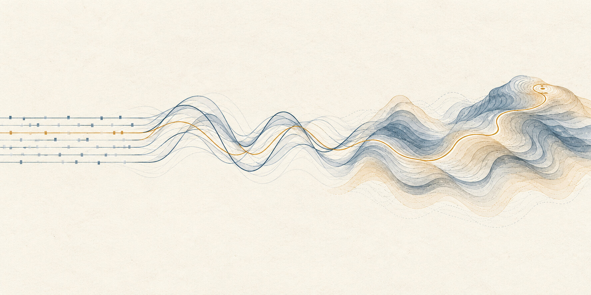](../../handbook/static/img/architecture/transit-score-wave-landscape.jpg) | **Figure 2. B0 — Original resonance fork.** [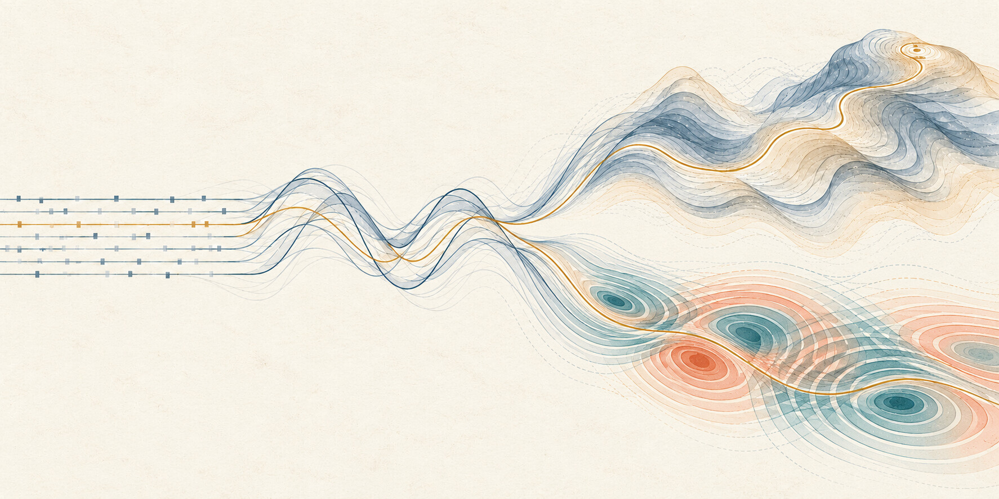](images/d1-resonance-original.jpg) |

Figure 1 establishes the chosen visual foundation. Figure 2 introduces a second
scene; its saturated lower rings compete more strongly with the upper terrain
than the quieter resonance variants below.

### Direction and palette comparison

| Palette | Terrain and resonance | Terrain and refraction |
| --- | --- | --- |
| **Mineral** | **Figure 3. R1 — Resonance.** [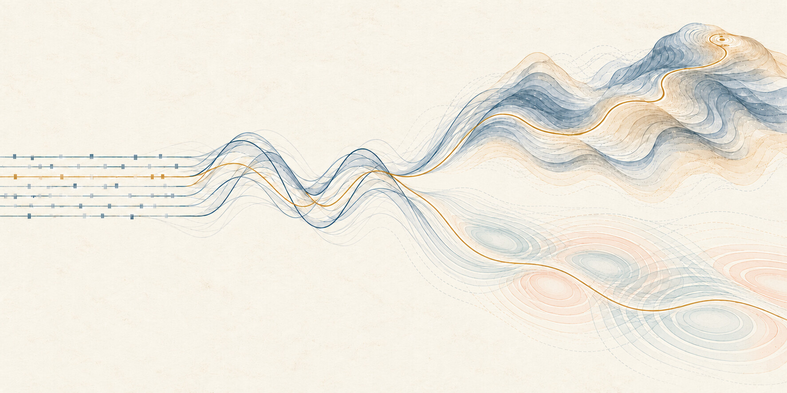](images/d1-resonance-mineral.jpg) | **Figure 4. P1 — Refraction.** [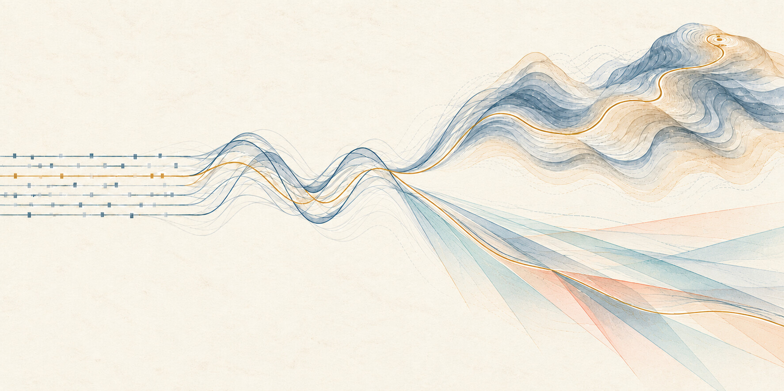](images/d1-refraction-mineral.jpg) |
| **Midnight** | **Figure 5. R2 — Resonance.** [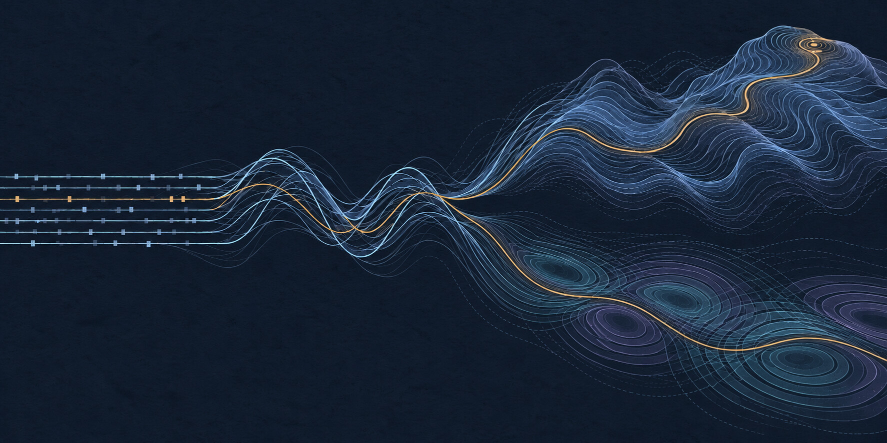](images/d1-resonance-midnight.jpg) | **Figure 6. P2 — Refraction.** [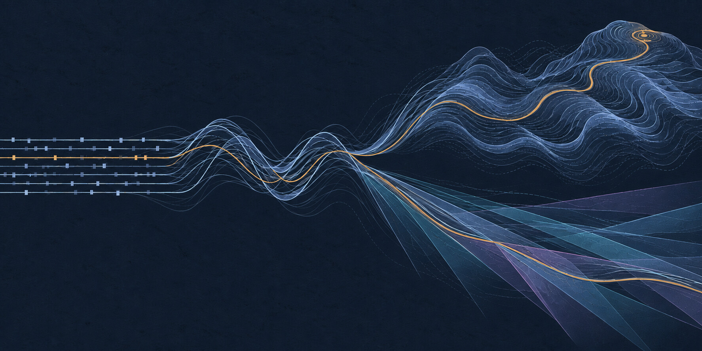](images/d1-refraction-midnight.jpg) |
| **Botanical** | **Figure 7. R3 — Resonance.** [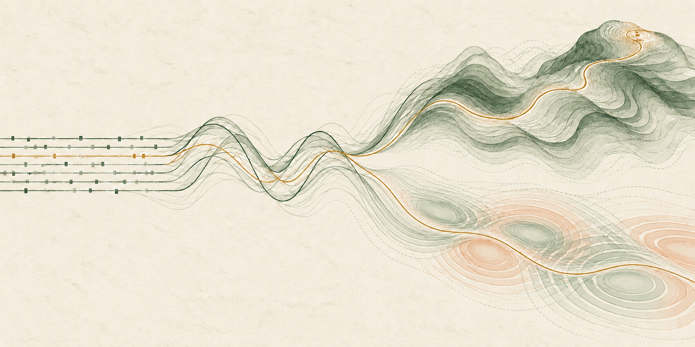](images/d1-resonance-botanical.jpg) | **Figure 8. P3 — Refraction.** [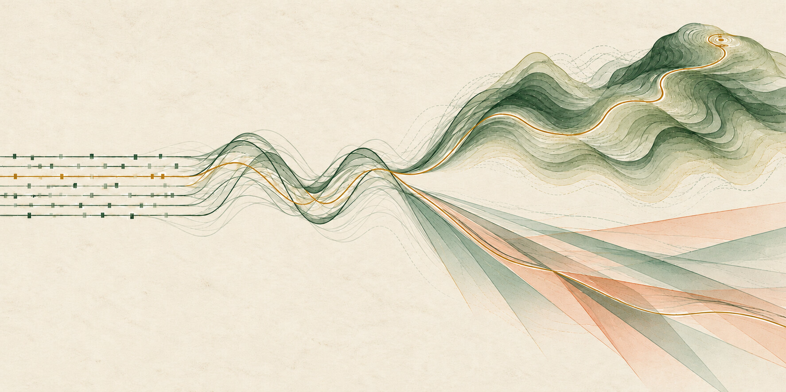](images/d1-refraction-botanical.jpg) |
| **Graphite** | **Figure 9. R4 — Resonance.** [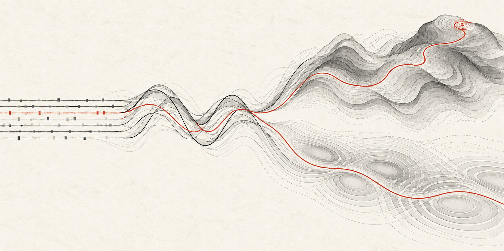](images/d1-resonance-graphite.jpg) | **Figure 10. P4 — Refraction.** [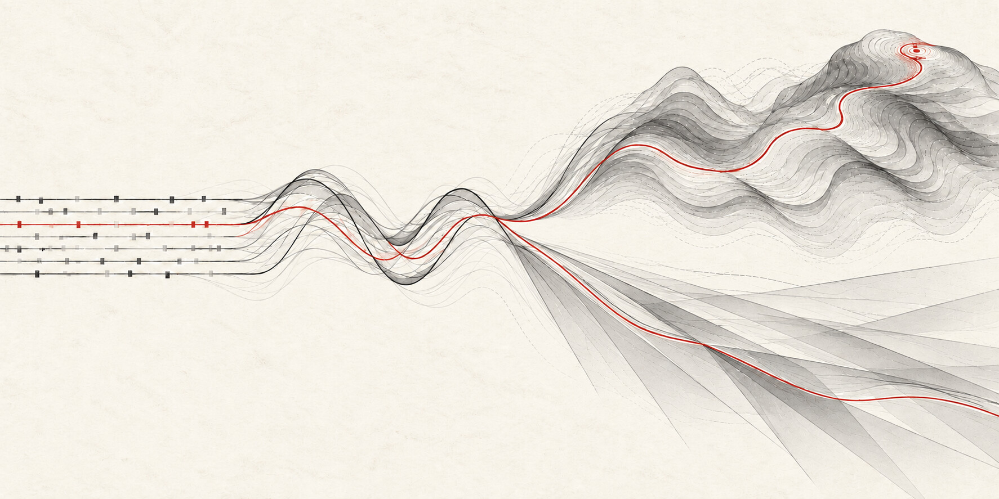](images/d1-refraction-graphite.jpg) |

- **Mineral, R1/P1:** ivory, slate blue and ochre retain the original printmaking
  character. R1's lower rings recede strongly at thumbnail size; P1 uses open
  planes and transparent overlaps.
- **Midnight, R2/P2:** ink navy, ice blue, lavender and amber emphasize the contour
  linework. The paper background becomes a dark field while the shared trace
  stays warm and distinct.
- **Botanical, R3/P3:** forest green, sage, terracotta and ochre make a warmer,
  earthier comparison. R3's ring shapes remain more apparent than in R1; P3
  distinguishes the two scenes through contour geometry and intersecting planes.
- **Graphite, R4/P4:** gray structure and a vermilion trace put the strongest
  emphasis on continuity. Geometry carries the difference between the two scenes
  with only one accent color.

### Earlier concepts

| Living weave | Evolving landscape | Score becoming a wave |
| --- | --- | --- |
| **Figure 11. Living weave.** [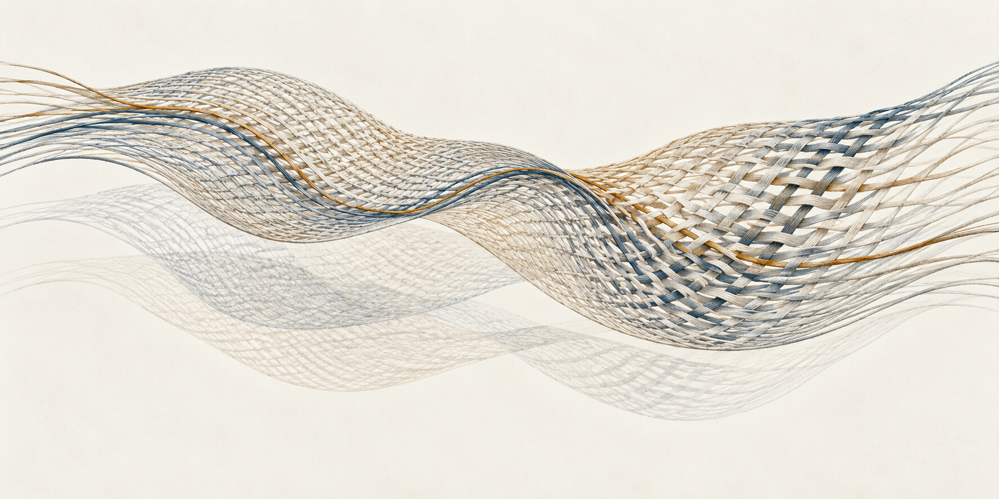](../../handbook/static/img/architecture/transit-living-weave.jpg) | **Figure 12. Evolving landscape.** [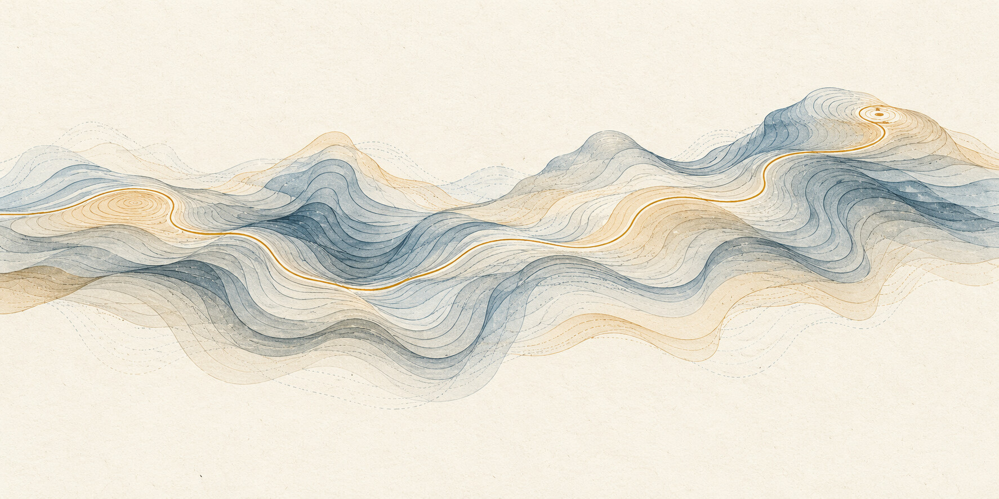](../../handbook/static/img/architecture/transit-evolving-landscape.jpg) | **Figure 13. Score becoming a wave.** [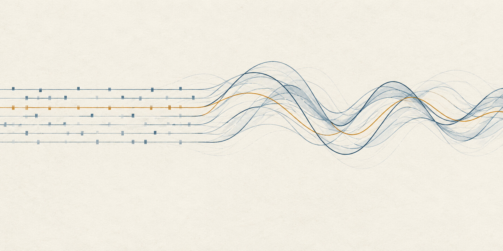](../../handbook/static/img/architecture/transit-score-to-wave.jpg) |

These earlier studies establish the alternatives explored before the combined
composition: woven relationships, accumulated contours and declared rhythm
becoming motion.

## Review outcome

The reviewer first selected the score becoming a wave and asked for that wave
to become a landscape. The reviewer then requested an upward terrain branch,
another downward scene, and exploration of color, sound and other abstract
directions.

The reviewer selected **Figure 10, P4 — Refraction**, in the **Graphite** palette
and requested it as the README image. The README now references that exact
gallery asset. The original fork, quieter resonance refinement and other palettes
remain in this review as alternatives.

## Open questions

None for the current README artwork selection.

## Evidence and limits

These are generated visual metaphors, informed by the
[data, computation and policy model](../../handbook/reference/data-model.md).
They establish no runtime behavior or database branching contract. No
implementation milestone is changed by this artwork review.

The images were inspected for the shared score, wave passage, connected fork,
distinct lower geometry and palette differences. Palette edits use their
corresponding Mineral composition as a reference, but generative editing can
change fine linework; this is not a pixel-exact recoloring experiment. The
observations above are design judgments, not usability or accessibility results.

All new studies retain the generated 1774 × 887 dimensions and are stored as
optimized JPEGs. Figure 1 and Figures 11–13 reuse the earlier README assets.

## Supporting material

- [Exact generation prompts, reference roles and encoding settings](prompts.json)
- [Earlier concept prompts](../../handbook/static/img/architecture/transit-concepts.prompts.json)
- [Image assets](images/)

[Review index](README.md)
