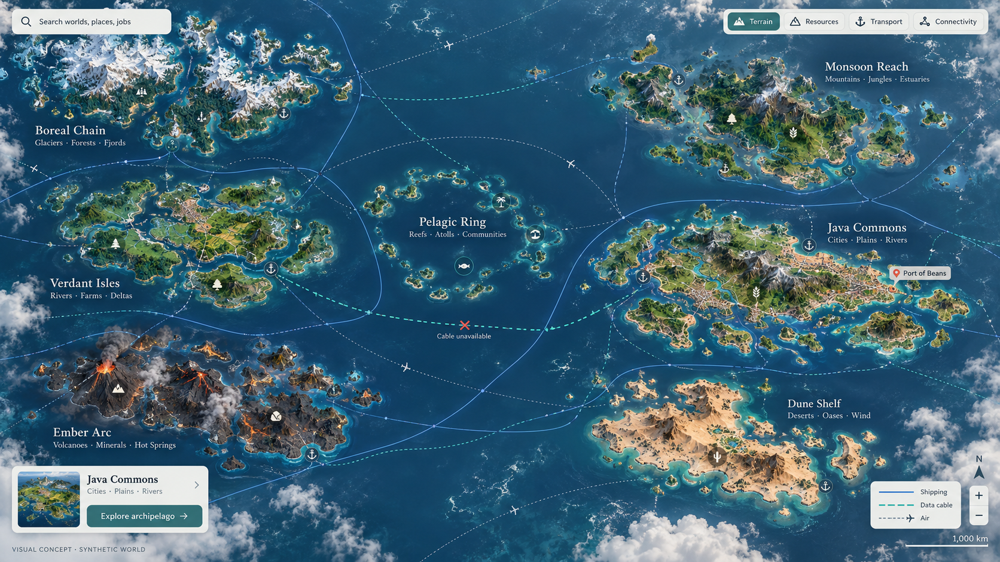
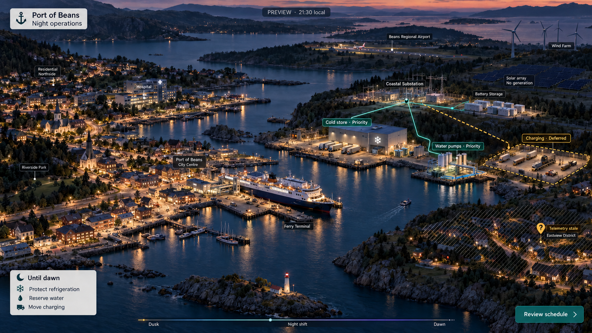
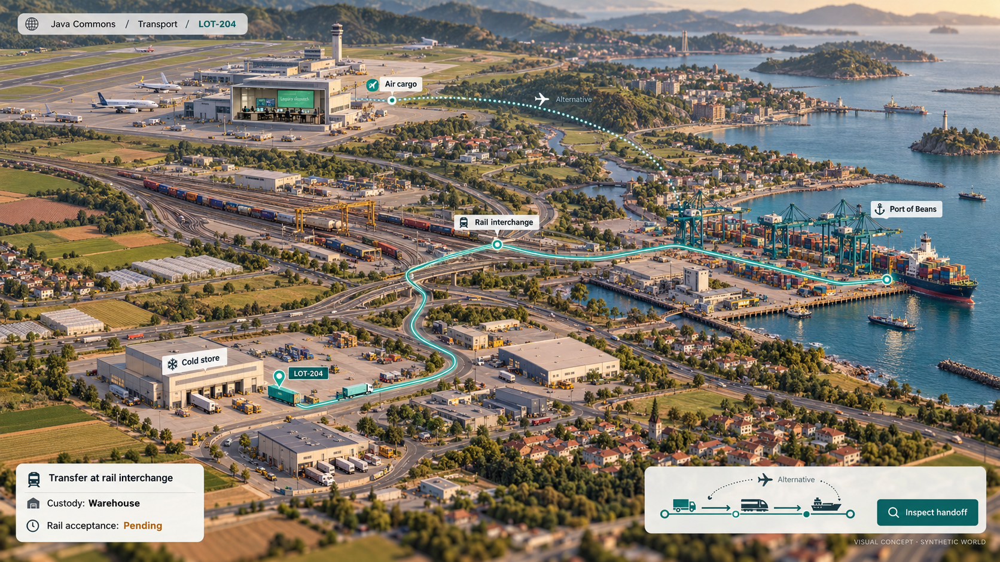
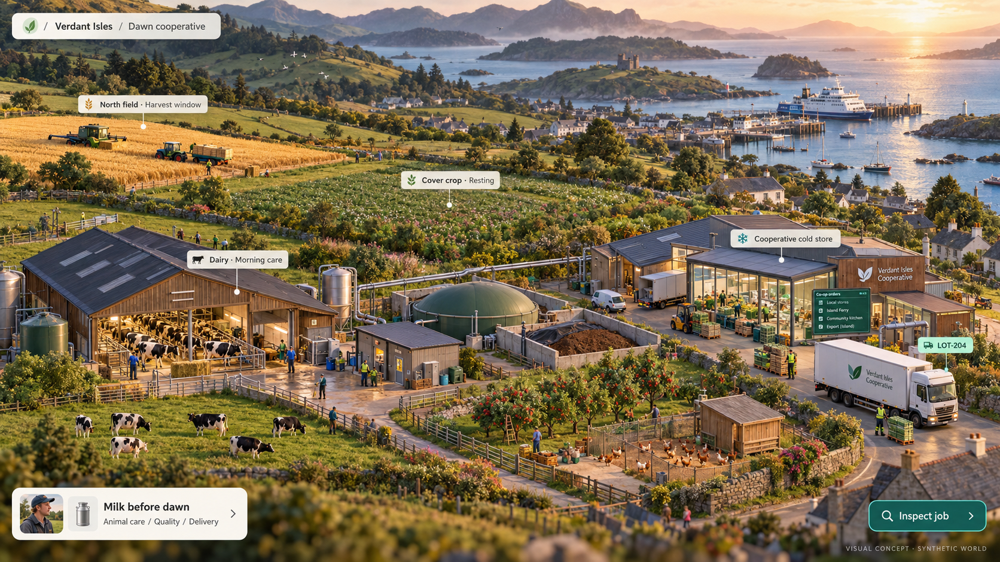
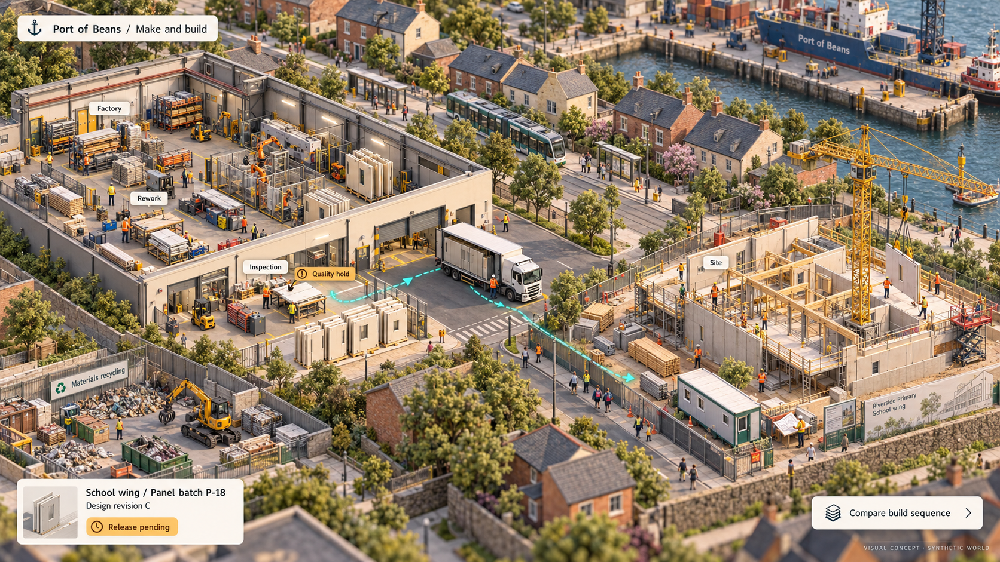
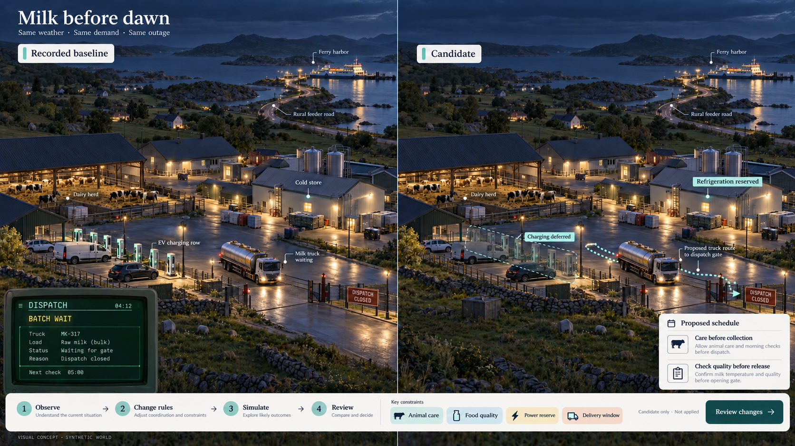

# D1 — A physics-grounded world simulator and spatial Agentic OS surface

[Review index](README.md)

Status: **In review**. Implementation: **Proposed downstream application suite and spatial UI/UX study. Original Argon studies, the compositing prototype and Codex Figures 1B–6B are retained. Figures 7–12 extend D1 with interdependent archipelagos, energy, transport, food, industry and job modernization. No simulator binary, physical control system or new protocol adapter is implemented by this review**.

## Question

How can we evaluate, demonstrate and operate Transit across decades of legacy enterprise software archeology and future physical-world autonomy without relying on sterile synthetic benchmarks—and what should the operator interface of an Agentic OS look like when real applications (`TN3270/ISPF`, `FIX`, `X12 EDI`, `SOAP/XML`, `HTTP`, `gRPC` and SQL), autonomous agents and physical environments (`nvidia/simready-assets`) interact in one continuous world?

The continued D1 question is now more concrete: **can a person enter any job in
this world, understand its existing minigame, and use Transit-backed software
and agents to build a better version while preserving the job's obligations?**

## Proposal

**Continued recommendation, 2026-10-26:** make the world an atlas of
interdependent archipelagos, each full of jobs worth playing and improving.
Keep the large terrain maps and inhabited miniatures, but add meaningful ocean
distance, uneven resources, independent power and communications networks,
seasonal food systems, transport handoffs and industries that build the world.
The objective is to modernize the **work**, not merely its interface: improve
observation, decisions, coordination and verified outcomes under the same
physical, social and policy constraints.

The new reading path is [Figures 7–12](#jobs-in-an-interdependent-world),
[archipelagos](#interdependent-archipelagos),
[night and electricity](#night-electricity-and-an-operating-world),
[transport](#transport-as-a-chain-of-accountable-handoffs),
[food](#food-farming-and-living-systems),
[making and building](#manufacturing-construction-and-maintenance), and the
[job minigame model](#every-job-is-a-minigame). A
[worked campaign](#worked-campaign-milk-before-dawn) connects them.

The earlier recommendation established the atlas-to-miniature experience.
“Higher zoom levels” is interpreted as the higher-altitude overview; close zoom
means greater magnification. Figure 1B now reads as one large inhabited region
within a wider ocean world, rather than the whole world.

The reviewer requested a larger, more Google Maps-like world and new takes on
all six figures. The [Codex alternatives](#map-scale-visual-alternatives) develop
that direction alongside the [original Argon studies](#original-argon-studies).
This remains the same D1 design question. The new images explicitly review
**visual styling**: daylight terrain, quiet map labels, warm miniature materials
and a restrained night atlas. Color supplements labels, outlines and hatching;
it is not the only carrier of state.

Build the **Transit World Simulator & Spatial Agentic OS** as a standalone downstream application ecosystem (hosted in its own repository and GitHub organization outside the Transit kernel and core [roadmap](../../roadmap/README.md)) that consumes Transit strictly through its public client, SQL, [`Fuze`](../../handbook/reference/queries.md), [`Station`](../../handbook/reference/station.md), [connector](../../handbook/reference/connectors.md) and [application installation](../../handbook/reference/applications.md) boundaries:

1. **A continuous spatial operator surface ("Google Maps + Anchored Web Apps + Agent POV"):**
   Extend the original three-tier sketch with regional and city scales,
   as specified in the [camera progression](#camera-progression-and-place-continuity).
   Keep realm, place and observation identities visible across camera changes;
   independent source cuts do not become an atomic world snapshot:
   - **Atlas, region and city:** An overhead terrain map reveals progressively
     finer settlements, corridors, streets and building footprints. Freight,
     software dependencies and policy jurisdictions are separately labeled layers.
   - **Facility cutaway:** A selected building opens into a detailed miniature.
     OpenUSD assets from [`nvidia/simready-assets`](https://huggingface.co/datasets/nvidia/simready-assets)
     are a proposed implementation input requiring asset and physics validation.
     Anchored application views would connect the floor to its customs terminals,
     port portals and separately configured [Board](../../handbook/guides/inspect-board.md) evidence.
   - **Agent POV:** Selecting a robot or software agent opens its observations and
     the proposed [observation and feedback loop](../../handbook/reference/collaborative-decisions.md#the-observation-and-feedback-loop).
     Entering POV changes the camera. A separate request for control must establish
     the human principal's current authority and handoff outcome before enabling
     movement or terminal writes. The original one-key takeover sketch below does
     not define that missing control contract.
2. **Interdependent archipelagos and software archeology:**
   Generate fictional geography with the navigational clarity of a real map,
   organized into the [seven proposed archipelagos](#interdependent-archipelagos).
   **Computing and regional factions** supply industry, software history and
   workload scenarios: **Clearing Spire**, **Java Archipelago**, **Midwest
   Heartland**, **Gopher Burrows**, **Ruby Mines** and **Rust Foundry**. Their
   territories contain many cities, ordinary neighborhoods and open land;
   the faction is not a single oversized building. Java Commons is the home
   archipelago containing the earlier Java Coast and Port of Beans studies.
   The other archipelagos add resources, seasons, institutions and dependencies
   rather than assigning one programming language to an entire civilization. Protocols,
   physical codecs ($\epsilon$) and collations ($\kappa$) remain properties of
   datasets and applications, not permissions or capabilities granted by a biome.
3. **Constraint-driven procedural generation and "Non-Stop Modernization Optimization":**
   Compile each world seed from target workload verification constraints ([workloads reference](../../handbook/reference/workloads.md)): network RTT, packet-loss schedules, arrival rates ($\lambda$) versus service rates ($\mu$) and regulatory boundaries become oceans, mountain passes, loading dock layouts and customs jurisdictions. Players (humans and AI agents) compete in a continuous strangler-fig modernization loop—shadowing legacy tables into Transit `.tseg` segments, replacing overnight batch windows with maintained `Fuze` views and fenced `Station` connectors, and accelerating business cadence from 24-hour batch locks to physical speed-of-light and mass limits.
4. **Dual execution modes — Deterministic Single-Player Seeds and a Persistent MMO "Mainnet":**
   - **Single-Player (Seeded):** Generate synthetic software history and run
     bounded scenarios under an explicit clock and fault schedule. Faster-than-real-time
     headless execution is a goal to measure; the original acceleration factors
     below are fixture values.
   - **MMO "Mainnet":** A proposed persistent shared world where NPC backbones
     and player enterprises continue across compatible application replacements.
     Keep installation identity, artifact revision, ownership generation, data
     epoch and interface revision separate as defined in
     [Application installation](../../handbook/reference/applications.md#installation-and-bootstrap).
     Persistence is not a promise of uninterrupted upgrades across incompatible
     Transit definitions or automatic data migrations.
5. **Jobs as the playable unit:** A farm round, dispatch shift, quality release
   or construction lift has inputs, constraints, choices, actions and evidence
   of completion. Humans, deterministic software and reasoning agents may occupy
   different roles in the same job. The modernization game changes their tools
   and coordination, then compares outcomes without changing the scoring rules,
   hiding failed work or granting agents new authority implicitly.

## Visual studies

### Jobs in an interdependent world

Figures **7–12** continue D1's explicit visual-styling review. They add world
dimensions and playable jobs while retaining all earlier figure IDs. These are
synthetic illustrations with baked-in interface text, not new screens in the
original HTML prototype. [Exact prompts and asset metadata](d1-job-world-prompts.json)
record the six new images. The detailed job rules below remain proposals.

### Figure 7: Ocean-separated worlds

**Figure 7 — distance creates dependencies** ([full image](images/d1-07-archipelago-world.png)).
There is room for a ship to be days away while an observation is seconds old.
An archipelago contains many towns, industries and local games; the ocean is
part of the operating problem. Cable routes, energy connections and physical
transport are separate selectable networks. A cable break does not erase a
ship, create a power outage automatically or make two owners legitimate.
The map's distances and fault labels are visual fixtures, not measured latency.

### Figure 8: Night as an operating condition

**Figure 8 — keep the right work alive until dawn** ([full image](images/d1-08-night-energy.png)).
The player chooses a schedule among competing needs: refrigeration, water,
charging, maintenance and tomorrow's dispatch. A bright window is not a meter
reading; darkness, unavailable power and missing telemetry remain different
states. The world view shows local darkness while a forecast and reserve view
supports planning. “Review schedule” opens a candidate; it does not switch a
breaker. The grid dispatcher is a proposed job, not an implemented controller.

### Figure 9: One shipment, many custodians

**Figure 9 — transport is a sequence of agreements** ([full image](images/d1-09-transport-handoffs.png)).
Trace LOT-204 through a warehouse, vehicle, interchange and receiving facility.
The alternate air route is a proposal with different constraints, not a faster
button. An arrival, a custody receipt, a route reservation and permission to
move are different facts. Zooming into the operations office reveals its legacy
dispatch minigame; entering a vehicle reveals a different embodied task.

### Figure 10: Food has a lifecycle

**Figure 10 — care, grow, harvest, preserve, deliver** ([full image](images/d1-10-food-and-farming.png)).
The field that rests, the animal that needs care and the lot awaiting a quality
check all belong in the game. Milk collection competes with charging and cold
storage; a harvest needs labor, machinery, water and a place to go. A farm is
both a producer and a living system whose state persists between shifts.
The digester is a proposed resource-conversion path with inputs and losses,
not unlimited power from waste.

### Figure 11: Making parts and building places

**Figure 11 — a building inherits its parts' history** ([full image](images/d1-11-making-and-building.png)).
Follow a design revision into a bill of materials, production batch, inspection,
truck and installation. Rework is visible work. A delayed release changes the
crane and crew schedule, while the site can expose a demand change back to the
factory. The optimized game reduces avoidable waiting and defects; it cannot
skip an inspection, curing interval or commissioning condition to win.

### Figure 12: Improve the minigame itself

**Figure 12 — same job, better coordination** ([full image](images/d1-12-job-modernization.png)).
The baseline asks a dispatcher to reconcile batch paperwork, a waiting truck
and overnight energy use. The candidate changes charging, collection and release
rules while preserving the farm and its obligations. Both runs must face the
same exogenous conditions and receive only observations available at their own
decision time. Their outcomes may diverge because their actions differ.
The image sketches the comparison; it is not executed evidence of improvement.

### Map-scale visual alternatives

Figures **1B–6B** are Codex's alternatives to the corresponding original
Figures **1–6**, attributed to Gemini Argon by the reviewer. Original figure IDs,
images and prototype files remain available below. The new images are generated
visual concepts, not captures of that prototype. Their labels, scale bars,
historical dates and status badges are illustrative. Exact generation prompts
and saved asset names live in [the prompt manifest](d1-codex-prompts.json).

| Original theme | New interpretation | Design decision to inspect |
| --- | --- | --- |
| Figure 1: macro world | [Figure 1B: continental atlas](#figure-1b-continental-atlas) | Does the world feel large enough to explore for hours? |
| Figure 2: software archeology | [Figure 2B: city strata](#figure-2b-a-city-with-software-strata) | Does history belong to a recognizable place? |
| Figure 3: dock miniature | [Figure 3B: living port](#figure-3b-a-facility-inside-a-living-port) | Can we follow a shipment from street to rack to quay? |
| Figure 4: agent POV | [Figure 4B: embodied viewpoint](#figure-4b-an-embodied-view-with-deliberate-control) | Can we understand what the agent sees without losing place or mode? |
| Figure 5: modernization | [Figure 5B: corridor comparison](#figure-5b-modernization-as-a-comparable-experiment) | Can we compare a proposed change without confusing it with an applied one? |
| Figure 6: persistent world | [Figure 6B: night atlas](#figure-6b-a-persistent-world-with-local-change) | Can the world feel alive while rollout evidence stays local and inspectable? |

### Figure 1B: Continental atlas

**Figure 1B — a world with distance** ([full image](images/d1-01b-continental-atlas.png)).
The continent extends beyond the viewport. Mountain systems, watersheds,
agricultural plains and the spaces between settlements establish scale before
any application panel appears. Clearing Coast and Rust Peninsula are regions
with many places inside them. A port is a pin at this altitude.

The map borrows familiar navigation ideas from Google Maps: place search,
progressive labels, a north reference, a scale bar, selectable layers and a
selected route. It proposes fictional terrain, not Google map data or an
integration. Freight corridors are an optional layer; latency and policy
boundaries need their own legends and do not replace physical distance.
Selecting the route should reveal its stops and source basis in one compact
card. Terminal windows belong to a selected place further down the journey.

### Figure 2B: A city with software strata

**Figure 2B — history under an ordinary street** ([full image](images/d1-02b-city-strata.png)).
The four isolated monuments of Figure 2 become a neighborhood: offices, homes,
tram routes, trees, waterfront and a customs house with a software history.
Only the selected block opens. This makes archeology a lens on a place the
operator can return to, rather than a separate world made of server cabinets.

The excavation is a visual metaphor for dependency and definition history.
A lower floor does not mean a dataset is physically stored there, older data
is more authoritative, or an old protocol grants access. Selecting a layer
would show the immutable definition, dependencies and attributable observation.
The separate history control chooses recorded time; moving the camera underground
does not silently rewind the simulation.

### Figure 3B: A facility inside a living port

**Figure 3B — the miniature is a destination** ([full image](images/d1-03b-living-port.png)).
Keep the pleasure of discovering small activities: a clerk's green terminal,
a waiting truck, a crossing, a cart turning toward a rack. The surrounding
streets, quay and neighboring warehouses make Sector 04 part of a city. The
roof opens locally while the rest of the port remains a useful orientation cue.

Bay B's waiting queue and Bay A's activity are conditions to inspect, not a
universal comparison between old software and modern robots. Selecting a
shipment should connect its physical location, declared destination, customs
data and original operation outcome. The small pinned customs card is a proposed
application read view; it is not a new Board decoder or a live terminal.
Selecting Forklift-07 retains the facility breadcrumb and offers **Enter POV**.
The scene's vehicles are concept art, not verified SimReady assets or collision
geometry.

### Figure 4B: An embodied view with deliberate control

**Figure 4B — see through the agent's eyes** ([full image](images/d1-04b-embodied-agent.png)).
The warehouse has weight and texture, and the open loading door reconnects the
camera to the quay outside. A floor plan and breadcrumb answer “where am I?”;
the explicit observation mode answers “am I driving?”. Only the selected pallet
and candidate path receive overlays. The target remains recognizable without
a full-screen collision lattice.

Candidate routes remain previews. The image's paused state refers to this
synthetic scenario; opening a camera in a persistent shared world cannot pause
everyone else's work. **Request control** begins a separate proposed handoff
flow, with requested, granted, denied and uncertain outcomes. It must not imply
that a keypress acquired authority, cancelled an in-flight action or stopped a
physical machine. Current connector semantics preserve unknown remote outcomes;
the simulator still needs its own control and reconciliation contract.

### Figure 5B: Modernization as a comparable experiment

**Figure 5B — change the system while keeping the place** ([full image](images/d1-05b-corridor-comparison.png)).
Both views represent the Heartland-to-port corridor. The proposed interaction
locks camera position, geography, source vector and fault schedule across the
comparison; a sweep divider or synchronized panes exposes where queues move.
The generated illustration only sketches that alignment. It does not establish
pixel-identical geometry or a repeatable simulation.

The candidate retains a quay bottleneck. Clearing customs faster can move a queue
downstream, so the review should show backlog, waiting time, incomplete evidence
and unresolved effects together. Inspecting a candidate opens its changes,
assumptions and budgets. **Review proposed changes** does not apply them. General
world branches and merges remain proposed; today's supported query and
application operations keep their existing boundaries. Avoid a single score or
a futuristic building upgrade that purports to prove correctness.

### Figure 6B: A persistent world with local change

**Figure 6B — many places continue living** ([full image](images/d1-06b-persistent-world.png)).
The night atlas gives the world breadth through settlement density, dark
mountain ranges and routes extending out of view. Application changes occupy
small selected footprints. Solid, hatched and dashed outlines accompany status
labels. Illumination is scenery, not evidence of health, current ownership or
uptime. An upgrade has no physical energy wave.

A rollout footprint is a navigational grouping, not an atomic commit boundary.
Its inspection view keeps installation identity, artifact revision, ownership
generation, data epoch and published interface revision separate. Missing
observations remain unknown, and a failed local handoff need not recolor a
whole continent. Compatible replacement and a possible future application
migration must not imply coexistence of incompatible Transit contract definitions.
The current [v1 cutover policy](../../handbook/reference/versioning.md) still applies.

### Original Argon studies

The original Figures 1–6 and their captions below preserve the initial visual
proposal and its synthetic scenarios. Present-tense descriptions of terminals,
physics, branches, performance and upgrades describe those mockups, not delivered
behavior. In particular, the originals' “verified” counters, `DefinitionId v12/v13`
coexistence and automatic takeover labels do not establish current support.
The recommendations above and the authority boundaries below qualify their use.

Figures 1–6 use a **2560 × 1600 CSS-pixel workbench**, captured at **2×** via [`d1-render.mjs`](d1-render.mjs) to produce **5120 × 3200 PNGs**. Each composition frames an unobstructed 16:9 world viewport ([`images/raw/`](images/raw)) inside a high-density spatial workbench with coordinate-pinned callouts, live `TN3270/ISPF` green-screen emulators, `FIX 4.2` streams, OpenUSD physics manifests and Transit provenance panels. Follow either the composite link or the base-art link below each figure to inspect full-resolution details.

### Figure 1: Macro cartographic OS, faction archipelago and anchored protocol apps

**Figure 1** ([full `5120 × 3200` workbench](images/d1-01-macro-world-map.png) · [unobstructed 16:9 world map](images/raw/raw-01-macro-world-map.png)).
At the **Macro (`1.0×`)** zoom level, the operator views the procedural archipelago for `Seed #8841-IRON-TIDE` at `Manifest v1,420` under `policy_epoch 24`:

- **Constraint-compiled geography (Center Viewport):** Five interlinked regions are visible with submarine fiber cables, suspension rail bridges and shipping lanes: **The Clearing Spire** at top-left (`1.2 ms` microwave relays over stone vaults), **The Java Archipelago · Port of Beans** at mid-left (container ships and cranes backed up `11.4 hours` on a 14-hop `SOAP/XML` customs queue), **Ruby Canyon Mines & Gopher Bio-Domes** at bottom-left (`124,000 events/s` `gRPC` sensor fan-in), **The Midwest Mutual Rail Heartland** at center (grain silos, underwriting tower and 18 freight trains staged at Junction 9 awaiting a `03h 14m` batch cutoff), and **The Rust Foundry & Shipyards** at bottom-right (volcanic smelter peninsula with `SimReady` automated cranes).
- **Anchored live protocol applications (Bottom & Right Docks):** Selecting nodes on the map opens their real application endpoints in place:
  - **Anchored App #1 (`TN3270 / ISPF` Terminal `LU2: CICS-INV-04`):** Displays the live `24×80` green-screen COBOL/VSAM ledger (`MW.RAIL.MANIFEST.COBOL`), showing waybill `WB-90411` held in `LOCKED-BATCH-T1`, `WB-90415` failing with `ABEND-S0C7-DEC` on corrupted hex byte `0x1A`, and `WB-90419` actively `BRIDGED-TRANSIT`.
  - **Anchored App #2 (Transit `Fuze` Strangler-Fig Overlay):** Executes a zero-ETL equijoin across the mainframe `EBCDIC`/`COMP-3` copybook table (`midwest_rail_ledger`) and the modern Java Port table (`port_beans_berths`), cutting settlement latency from `14h 22m` to `18.4 ms`.
  - **Anchored App #3 & #4 (`FIX 4.2` Feed & Port `HTTP/OpenAPI` Portal):** Stream live commodity hedges (`35=8` execution reports for `COFFEE.DEC26` and `STEEL.COIL.Q4`) alongside vessel berth clearance states and frontier partition catch-up math ($\lambda = 1,000\text{/s}$, $\mu = 1,500\text{/s}$).

### Figure 2: Computing factions and software archeology across geological strata

**Figure 2** ([full `5120 × 3200` workbench](images/d1-02-faction-archeology.png) · [unobstructed 16:9 cutaway art](images/raw/raw-02-faction-archeology.png)).
Switching to the **Cross-Sectional Archeology Lens** visualizes why legacy modernization resembles geological excavation:

- **Four exposed computing civilizations (Center Viewport):**
  1. **Clearing Spire Vault (Column 1):** A classical stone financial clearinghouse with a rooftop microwave tower sitting above four subterranean stories of 1970s magnetic tape drives, punch-card cabinets and copper busbars.
  2. **Java Customs House (Column 2):** A brick port authority building sitting above tangled pneumatic tubes and multi-tier `SOAP/XML` enterprise service bus racks.
  3. **Gopher Bio-Dome & Ruby Quarry (Column 3):** A glowing geodesic hydroponic dome perched above stepped red-rock crystal mines, rail ore carts and dense fiber-optic telemetry bundles.
  4. **The Rust Foundry (Column 4):** Articulated yellow industrial robotic arms and molten metal channels anchored directly into columnar basalt bedrock.
- **Orthogonal $(\tau, \epsilon, \kappa)$ and 5-state cell fidelity (Left & Bottom Docks):**
  When Transit mounts datasets across these four strata into `.tseg` hybrid segments ([query engine reference](../../handbook/internals/query-engine.md#logical-types-and-physical-codecs-and-collation-semantics)), it preserves all five cell states (`942 value`, `28 null`, `14 missing`, `9 type_error`, `7 conflict` across `1,000` sampled cells) and evaluates `.tseg` zone-map `min`/`max` bounds under the declared column collation (`EBCDIC_CP037`, where digits `0xF0..0xF9` sort after uppercase letters `0xC1..0xE9`), preventing the `14%` false block pruning that occurs when mainframe keys are naively sorted as ASCII.

### Figure 3: Meso isometric intermodal dock with `nvidia/simready-assets` and live terminals

**Figure 3** ([full `5120 × 3200` workbench](images/d1-03-isometric-simready-dock.png) · [unobstructed 16:9 isometric dock](images/raw/raw-03-isometric-simready-dock.png)).
Clicking **Port of Beans · Sector 04** enters the **Meso (`12×`) Isometric Facility View**, where software latency becomes directly visible as physical friction:

- **Left Bay B (Unmodernized Legacy Dock):** Three diesel semi-trucks idle in an exterior queue belching exhaust while wooden pallets pile up haphazardly across the floor (`Backlog: 42 pallets · Turn time: 47m 12s`). At the bottom-left glass office, clerks sit in front of green-phosphor `TN3270` CRT terminals locked by `DFH0912E DATASET HELD BY JOB 'NIGHTCLR'`, illustrating $\lambda = 18\text{/min} > \mu = 6\text{/min}$.
- **Right Bay A (Transit-Activated Autonomous Dock):** Populated with physics-validated [`nvidia/simready-assets`](https://huggingface.co/datasets/nvidia/simready-assets) (`forklift_counterbalance_01.usd` at `4,120 kg`, `amr_industrial_cart_02.usd` at `380 kg`, and `pallet_euro_stacked_04.usd` at `620 kg`, $\mu_f = 0.64$). An overhead optical/LiDAR gantry streams `250 Hz` telemetry into Transit's direct data plane while three [`Station`](../../handbook/reference/station.md) processes (`PID 204..206`) coordinate loading in `14.2 s`—bounded only by the physical `4.2 m/s` max speed of the forklift.
- **Fenced physical actuation (Bottom-Right Panel):** Shows how `PID 204` commits its state mutation and records connector intent `#effect-814` *before* dispatching `simready.Forklift/LiftPallet`. When a simulated Wi-Fi fade drops the gRPC acknowledgement, worker replay inspects `#effect-814 (UNCERTAIN)` and reconciles against the LiDAR gantry watermark (`LSN 44,910`) rather than re-dispatching a duplicate lift command.

### Figure 4: Micro first-person agent POV, counterfactual branch review and manual takeover

**Figure 4** ([full `5120 × 3200` workbench](images/d1-04-agent-pov-control.png) · [unobstructed 16:9 first-person POV](images/raw/raw-04-agent-pov-control.png)).
Clicking **`Forklift-07 (PID 204)`** in Bay A drops the operator into the **Micro (`100×`) First-Person Agent POV**:

- **Embodied optical + OpenUSD wireframe view (Center Viewport):** The camera looks directly over the forklift's twin steel forks down Aisle 04. Projected on the concrete floor and high-bay racking are the trajectory splines and cyan `convexDecomposition` collision bounds from the OpenUSD scene graph, targeting `pallet_euro_stacked_04.usd` (`620 kg · Cold-Chain · Alignment ±1.4 mm`).
- **Picture-in-Picture software POV (Left Dock):** Displays the exact dual software context bound to `PID 204`'s current turn (`Cut: orders@v1420, dock@v891`): the released `3270` cold-chain customs screen (`+2.4°C`) and the outbound `HTTP POST /v1/bay-a/slot-02/load` payload.
- **Counterfactual branch evaluation before physical movement (Bottom-Left Panel):** Grounding the [Elena branching story](../../handbook/reference/collaborative-decisions.md#elena-compares-alternatives-without-changing-operations), `PID 204` evaluates two candidate branches against thermal decay physics before moving the 620 kg pallet: `branch/reroute-berth-2` (`142 m @ 3.8 m/s = 37.4 s`, `0.0%` spoilage, **Selected**) versus `branch/wait-bay-1-batch` (`3h 14m` wait, `64.2%` spoilage / `$48k` loss, **Rejected**).
- **Event time vs. observation time and manual takeover (Bottom-Right & Right Docks):** Tracks the exact millisecond offset between physical warehouse events (`14:22:07.110`) and Transit commit cuts (`14:22:07.118`) so historical `AS OF` queries never leak future knowledge. Pressing `SPACE` or `T` hands physical steering or terminal input to the human operator under their own authenticated principal.

### Figure 5: Non-stop modernization optimization workbench and fault-injection proof

**Figure 5** ([full `5120 × 3200` workbench](images/d1-05-modernization-loop.png) · [unobstructed 16:9 transformation diorama](images/raw/raw-05-modernization-loop.png)).
Figure 5 illustrates the core gameplay and engineering verification loop—**Non-Stop Modernization Optimization**:

- **Left-to-Right architectural transformation (Center Viewport):** The diorama contrasts the unmodernized left sector (vintage tape mainframes, dot-matrix manifest printers and congested rail sidings) with the central **Transit Host Layer Nexus** (`.tseg` + `Fuze` + `Station`), which activates the synchronized right sector (high-speed intermodal bullet trains, automated AGV loops and container ship cranes).
- **Adversarial fault injection comparison (Bottom-Left Panel):** Demonstrates why migrating off a mainframe into a naive cloud "Frankenstack" fails under real-world network physics. When `Packet Loss Fault #F-19` drops an HTTP response after pallet dispatch, a stateless retry loop double-ships 20 pallets (`-$140k` penalty), whereas Transit reconciles saved operation `#op-7741` and guarantees exact single loading.
- **Decoupled $100\times$ Headless CI Engine (Right Dock):** Because the deterministic world tick and rigid-body math run headless independently of the WebGPU/Three.js viewport, the exact same world seeds execute at `142,000 ticks/sec` in automated CI to qualify Transit throughput and recovery invariants.

### Figure 6: Persistent MMO Mainnet and five-axis rolling live upgrades

**Figure 6** ([full `5120 × 3200` workbench](images/d1-06-mmo-mainnet-epochs.png) · [unobstructed 16:9 MMO Mainnet panorama](images/raw/raw-06-mmo-mainnet-epochs.png)).
While Single-Player seeds test deterministic scenarios, the **Persistent MMO "Mainnet"** proves the hardest operational invariant in enterprise infrastructure—**continuous multi-version operation and live rolling upgrades over months and years without stopping the world**:

- **Live cutover wavefront (Center Viewport):** Across `412 days` of continuous operation (`0 world resets`, `48.4 TiB` accumulated `.tseg` history, `284,000` active `PID`s), a rolling upgrade (`Epoch 31 -> Epoch 32`, `transit-worker-v1.0.14 -> v1.0.15`) sweeps from the upgraded western metropolis across the central intermodal port toward the eastern harbor while ships, trains and cranes continue transacting across the boundary.
- **Five-axis upgrade separation (Left Dock):** Maps the live wavefront directly to the five independent identities in [Application installation](../../handbook/reference/applications.md#installation-and-bootstrap):
  1. **Installation identity** (`app/clearing-backbone`) retains durable scope and grants.
  2. **Artifact revision** swaps the compiled Zig worker binary (`v1.0.14 -> v1.0.15`).
  3. **Ownership generation** fences `Gen 88` independently of binary selection before activating `Gen 89`.
  4. **Data epoch** (`Epoch 31 -> 32`) advances via bounded table migration steps with durable receipt `#r-884`.
  5. **Published interface revision** (`rev 19 -> 20`) activates conditionally only after target verification.
- **Pinned neighborhood coexistence (Bottom-Left Panel):** During the cutover, the **Rust Foundry Guild** writes new `DefinitionId v13` segments (`Epoch 32`), **Heartland Rail NPCs** continue ingesting `X12 EDI` under `DefinitionId v12` (`Epoch 31`), and a **Washington Audit Job** inspects retained snapshot `Manifest v1,042,100`—all concurrently with `0 duplicate effects` and `0 dropped sessions`.

## Interdependent archipelagos

An archipelago is a large set of places with a distinctive combination of
resources, climate, built infrastructure and institutions. It is not a realm,
a database partition, a power island or a political faction by definition.
Those boundaries can overlap and should be inspectable as separate layers.

The following **fictional seed palette** creates tradeoffs rather than assigning
every essential resource to exactly one island. Give each region several viable
paths, alternate suppliers and local substitutes. Surveyed reserves, extraction
capacity, processing capacity and transport access are separate data.

| Archipelago | Endowments and character | What it needs from others | Jobs and disruptions that make it distinctive |
| --- | --- | --- | --- |
| **Java Commons** | The earlier Heartland, Clearing Coast and Port of Beans region; dense cities, fertile interior, established factories, clearing services and old enterprise systems | Specialized minerals, replacement equipment and seasonal energy or food imports | Intermodal dispatch, customs, manufacturing and retrofit; dense dependencies make a small software outage propagate into many queues |
| **Boreal Chain** | Fjords, timber, iron/copper/nickel deposits, reservoirs and long seasonal changes in daylight | Some fresh produce, precision components and specialist maintenance | Forestry, hydro scheduling, metal processing and cold-weather transport; constrained harbor access and winter demand challenge reserves |
| **Ember Arc** | Volcanic islands with geothermal prospects, copper, sulfur and construction aggregate | Some food, machinery and emergency replacement parts | Drilling, maintenance, aggregate delivery and rebuilding; correlated physical damage can affect roads, cables and power |
| **Dune Shelf** | Oil and natural-gas deposits, strong solar resource, salt and large open industrial sites; scarce freshwater | Food, equipment and water-treatment inputs | Extraction, gas processing, fuel shipment and desalination; fuel availability, power capacity and usable water are different bottlenecks |
| **Verdant Isles** | Productive soils, freshwater, grains, pulses, orchards, pasture and mixed crop/livestock cooperatives | Machinery, selected nutrients, packaging and some energy | Care rounds, crop rotation, irrigation, harvest and cold-chain dispatch; floods, disease and spoilage change what can be promised |
| **Monsoon Reach** | Rare-earth-bearing deposits, graphite, wet mountain catchments and skilled processing/electronics clusters | Some energy, reagents, food and transport capacity | Assay, separation, parts manufacture and port coordination; wet-season access, water quality and processing yields matter as much as ore volume |
| **Pelagic Ring** | Dispersed ocean islands, fisheries, offshore wind prospects, cable landings and air/sea waystations | Most heavy equipment, some food and fuel, replacement cable and storage | Vessel servicing, catch handling, cable repair and remote maintenance; long replenishment and narrow access windows reward robust local plans |

These are authored distributions, not claims that a geology guarantees an
economy. Rare-earth resources are especially useful because the material is a
group of distinct elements and deposits, not one interchangeable “rare mineral”
token. The [USGS account of rare-earth deposits](https://www.usgs.gov/publications/conventional-rare-earth-element-mineral-deposits-global-landscape)
describes varying compositions and applications; the simulator should separately
represent assay, recoverable yield, processing inputs and qualified output.

A region's editable dimensions should include:

- **Stocks and flows:** ore grades and recoverability; oil/gas reserves and
  processing; freshwater, soil nutrients, fish populations, timber regrowth,
  electricity capacity and storage. Track withdrawals, regeneration, losses,
  waste and reclamation rather than spawning resources indefinitely.
- **Access:** harbor depth, airfields, rail gauge/interchanges, roads, pipelines,
  cable landing sites and equipment needed to reach them. A deposit with no
  processing or transport is not available inventory.
- **Time and environment:** latitude, local daylight, seasons, weather exposure,
  tides, temperature and replenishment lead times. Scenarios choose which
  mechanisms they model and disclose the approximations.
- **Institutions and people:** skills, staffing, shift calendars, ownership,
  language, supplier relationships, maintenance practices and explicit
  application policies. Technology choice is historical and changeable;
  geography does not predetermine culture or authority.
- **Externalities and resilience:** emissions, water use, runoff, habitat effects,
  repairability, spare parts, alternate routes and concentration of suppliers.
  An apparent local improvement can make another region worse.

### Distance, connectivity and attempted split brain

Maintain three networks: **movement of goods/people**, **energy distribution**
and **communication**. They have different edges, capacity, direction, status
and recovery evidence. A storm may correlate their failures through an explicit
hazard footprint; the simulator should also be able to fail just one.

A communication edge specifies route length, propagation model, bandwidth,
queueing, jitter, loss, asymmetric reachability and failure schedule. Physical
distance contributes a lower bound, not a complete RTT. A shipping route instead
has travel and handling time, weather access, fuel, capacity and custody.
An energy cable has capacity and electrical constraints, not a message RTT.
The UI should let a reader follow a late observation to its actual path.

| Proposed experiment | What the operator sees | Required distinction |
| --- | --- | --- |
| Long path with healthy links | Old but attributable observations, planned replenishment in transit | Distance is not failure; timestamps and uncertainty remain visible |
| One-way partition after a command | Receiver may have acted; sender has no result | Preserve the original operation as unknown; no new dispatch disguised as a retry |
| Two controllers contend after isolation | Two proposals for one resource or actuator | “Split brain” is a forbidden competing-authority outcome to test, not permission for both to succeed |
| Power loss at a cable landing | Separate power and communications faults, missing observations | Lack of telemetry is not proof of zero generation, empty inventory or a stopped vehicle |
| Reconnection after prolonged isolation | Backlog, rejected stale proposals, physical reconciliation still pending | Recovered connectivity does not make cached policy current or establish that external actions were undone |

The current [deployment profile](../../handbook/reference/deployment.md) does
not provide distributed recovery across authorities, and
[security](../../handbook/reference/security.md) does not supply cross-realm
federation. The first scenario can use one current authority with faulted clients
and connectors. A multi-authority simulator profile needs additional contracts
and proof; merely drawing separate islands does not deliver it.

An isolated component cannot promote itself using an old snapshot. It may
continue only work whose current authority and domain control conditions can
still be established. Otherwise it preserves pending intent and exposes the
blocked boundary. A local physical controller's already configured fallback is
a separate simulator behavior, not a new Transit grant. Restoring the network
must reconcile original identities, current rights and external observations
before treating work as complete.

## Night, electricity and an operating world

Night has two independent controls: **view styling** and **simulated local
time**. A dark palette must not advance the world clock. Replay must say which
recorded time it shows. Daylight follows the selected geography and calendar;
one archipelago can be working in daylight while another is approaching dawn.

Electricity becomes first-class application data: generators, fuel, buses,
feeders, storage, loads, maintenance and measured observations. Their
definitions name units, limits and dependencies. A dispatch plan is a candidate
computation; a switching intent, acknowledged command and actual energized
state are separate outcomes. The [DOE microgrid example](https://www.energy.gov/cmei/femp/articles/islanding-microgrid)
illustrates the distinction between grid-connected and islanded operation and
the role of critical loads. It informs the scenario, not a control algorithm.

At minimum, an authored energy scenario conserves power across generation,
imports, discharge, served load, charging, exports and losses. Storage energy
changes over elapsed time with declared efficiency and capacity constraints.
**MW is a rate; MWh is stored or delivered energy.** Load priority alone cannot
overcome a feeder limit, missing fuel, unavailable equipment or an infeasible
dispatch. A coarse energy-balance game does not claim voltage, frequency,
protection, black-start or power-quality fidelity. Those require additional
models and independently validated controllers.

| Night dimension | New job or constraint | What the Agent OS should show |
| --- | --- | --- |
| Solar production and reserves | Schedule charging, processing and storage through darkness | Forecast versus observed supply; feasible reserve horizon and uncertainty |
| Lighting and perception | Inspect, navigate or pick under reduced visibility | Sensor age, confidence and occlusion; lighting is an energy-consuming intervention |
| Human shifts and fatigue | Hand over an unresolved incident; cover maintenance and care rounds | Named responsible role, next availability and acknowledged handoff; agent availability does not manufacture a human crew |
| Animals and crops | Night care, greenhouse lighting, ventilation, frost/heat scenarios | Species/crop-specific declared care and rest constraints; growth and welfare are not a throughput counter |
| Food and temperature | Keep refrigeration and time-sensitive processing supplied | Lot temperature history, sensor gaps, quality hold and remaining inspection work |
| Quiet periods and ecological limits | Reschedule loud construction, delivery or artificial lighting | Scenario-authored noise/light rules, affected neighbors and permitted work windows |
| Tides, weather and dawn deadlines | Coordinate harbor access, fishing, harvest and departure | Tides and weather on their own clocks; neither is automatically caused by darkness |
| Maintenance and unattended work | Repair a device while fewer staff are present | Isolation and release evidence, escalation path, unavailable capabilities |
| Regional time differences | Coordinate a supplier's day shift with a receiver's overnight demand | Shared event time plus local calendars; authority deadlines never derive from an untrusted display clock |

Night is therefore a **scheduling and observability problem**. Protect a cold
store and animal ventilation before advancing a deferrable charge; explain whose
policy set that priority and which work becomes late. Keep unknown, disconnected,
curtailed and unpowered distinct. The OS should wake an agent for a material
change in a job's evidence or feasibility, coalesce repeated updates and retain
a bounded work budget. Automatic governed activation is a proposed integration,
not a claim that every meter update already triggers a durable agent.

## Transport as a chain of accountable handoffs

Transport supplies distinct minigames at planning, dispatch, vehicle and receiving
scales. An intermodal shipment has a stable lot/order identity, packaging and
quality constraints, legs, reservations, a current custodian and observed
receipts. Reservations, physical occupancy and custody are different objects.
An assigned vehicle or route is not a movement clearance.

Mainframes are useful historical software strata here. The
[2009 Senate hearing](https://www.govinfo.gov/content/pkg/CHRG-111shrg52164/html/CHRG-111shrg52164.htm)
describes the FAA Host mainframe, and the
[FAA's 2015 ERAM account](https://www.faa.gov/speeches/en-route-automation-modernization)
records its modernization context. Use a historical or fictional legacy profile
alongside modern systems; do not imply that every present-day ATC system is a
mainframe, or that airline reservations and aircraft separation share one system.

| Mode | Existing minigame to enter | Proposed modernized coordination | Embodied boundary and evidence |
| --- | --- | --- | --- |
| **Air** | Reconcile flight data, weather, crew, gates, maintenance and cargo readiness across separate desks | Agents compare routings and turnaround dependencies; authorized roles review sector/ground handoffs | Pilot/local controller and airport equipment retain their distinct control scopes; filed plan, clearance, movement and arrival are separately observed |
| **Rail** | Build a consist, stage wagons, schedule junctions and reconcile paper/batch waybills | Coordinate yard, timetable, cargo and maintenance agents around versioned reservations | Local signaling/interlocking and train control remain separate; reservation, track occupancy and receipt cannot be inferred from each other |
| **Trucking** | Assign a driver/vehicle, pack a load, find a slot and reconcile proof of delivery | Jointly plan route, charging/fuel, rest, warehouse windows and recipient availability | Vehicle controller handles local movement; dispatcher cannot remotely solve a blocked road by overwriting position; custody needs receiving evidence |
| **Shipping** | Match cargo and vessel capacity, berth, pilots/tugs, customs and onward transport | Compare departures with tides/weather and receiving capacity across archipelagos | Vessel/port control and crane work have separate ownership; departure, berth access, unloading and accepted delivery are distinct |

A fleet coordinator proposes assignments; a dispatch owner accepts a bounded
reservation; a vehicle or workcell controller carries out its local task; a
receiver records the handoff; an investigator reconciles uncertainty. Multiple
agents can negotiate proposals but cannot negotiate away current authorization,
exclusive physical occupancy or a required human decision. A vehicle is not
necessarily one durable process, and every sensor sample need not be an actor
message.

The Agent OS offers three connected views: a **route map**, a **handoff queue**
and an **embodied view**. Selecting “pending rail acceptance” should open the
original handoff and the missing evidence, not teleport into a reassuring train
animation. When communications fail, the interface reports the configured local
control policy and last observation. A moving aircraft, ship, train and truck
cannot all share a generic “freeze safely” behavior.

## Food, farming and living systems

A farm job starts with land and living state: field identity, soil observations,
water access, crop/variety, sowing and care history, weather knowledge, animal or
herd identity, health observations, feed, shelter and human responsibilities.
A crop plan and an animal care plan are distinct definitions with different
lifetimes. Declaring either does not make it executed.

The playable crop loop is **prepare → sow → care → harvest → grade → store →
deliver → restore**. Its choices include rotations and fallow, machinery and
labor allocation, water budgets, weather windows and storage destinations.
The animal loop is **observe → care → feed/water → rest → collect permitted
products → verify welfare/quality**. Individual exceptions must remain visible
within a herd aggregate. A missing health or temperature observation is not a
healthy animal or a safe lot.

Crops, animals and food processing share material flows: residues can become
feed, manure can supply nutrients or a modeled digester, and recovered nutrients
can return to fields. [FAO's integrated crop/livestock account](https://www.fao.org/agriculture/crops/thematic-sitemap/theme/spi/scpi-home/managing-ecosystems/integrated-crop-livestock-systems/icls-how/en/)
provides examples of those links and their losses. The scenario must account for
inputs, conversion, waste and time; recycling is not a source of free mass,
energy or unlimited soil fertility.

Food keeps identity through split/merge and transformation: harvest lot,
processed batch, packaging, cold-room residence, transport and receipt.
A recall or quality hold follows affected descendants without pretending a
later database edit can unmake consumed food. Fisheries add catch provenance,
stock renewal and landing windows; greenhouses add energy, water and light.
The intended optimized minigame reduces spoilage and avoidable work while
preserving welfare, soil and water obligations across many seasons.

## Manufacturing, construction and maintenance

Manufacturing turns a versioned design and bill of materials into identifiable
parts and qualified batches. The game includes sourcing, scheduling, setup,
tool wear, material conversion, inspection, rework, scrap, packaging and
maintenance. A quality agent can recommend release; the configured release
owner and its evidence determine whether a batch becomes available.

Construction transforms those parts into a place. Track site and design
revisions, dependency plans, deliveries, crews, equipment, temporary access,
inspection, curing or settling intervals and commissioning. A crane reservation
cannot prove a lift occurred. A delivered panel cannot prove installation.
A completed digital drawing cannot prove the building is ready to occupy.

The manufacturing and building games meet at the **released part**: a drawing
change after production can produce rework and a site delay; a failed inspection
must block downstream claims without deleting the batch history. Infrastructure
projects then change the wider game's constraints: a new cold store, feeder,
bridge or port berth becomes capacity only after its declared acceptance and
activation conditions. Maintenance and eventual deconstruction return materials
and obligations to the world.

A digital twin is a model with a scope and uncertainty, not the physical object.
[NIST's manufacturing work](https://www.nist.gov/programs-projects/digital-twins-advanced-manufacturing)
emphasizes validation and quantified uncertainty. Here, that means showing
design intent, measured state, predicted outcome and accepted release separately.
Manufacturing software, sensing and embodied robot control remain distinct jobs
even when one interface connects them.

## Every job is a minigame

“Every job is a minigame” is the organizing design lens: a recurring situation
with observations, choices, obligations and consequences. It does not mean a
real profession is reducible to one score, or that its judgment has already
been automated. A job can be a clerk's screen, a dispatch desk, an inspection
bench, a care round or a robot's local task. The world connects their outputs.

There are **two linked games**. In the operating game, fulfill the job with the
tools and evidence currently available. In the modernization game, change its
definitions, integrations, decision rules or role allocation and compare the
result. A better UI alone does not establish a better job. The target is less
avoidable delay, waste and uncertainty while preserving the obligations that
made the work useful.

### A common job card

The Agent OS should let the player select a person, machine, place or pending
order and open the same conceptual job card. This is a proposed application
model, not a new Transit wire contract or executable SQL declaration.

| Field | Meaning in the interface |
| --- | --- |
| **Identity and definition** | Stable job/run ID and immutable recipe revision; changing a recipe creates a candidate, not a reinterpretation of accepted work |
| **Desired outcome** | What must exist or be observed at completion, who receives it and which quality/coverage conditions apply |
| **Data and dependencies** | Exact objects, definitions, source vector, units, availability times and upstream commitments; independent cuts stay independent |
| **Participants** | Human role, software service, planning agent and local controller; their current scopes and responsibility boundaries |
| **Choices** | Proposed schedule, assignment, route, inspection or release; alternatives with assumptions and compute/time budgets |
| **Constraints** | Material/energy/time limits, care and quality rules, current authorization and required review; infeasible proposals remain visible |
| **Execution** | Original accepted operations, local progress, reservations, external intents and outcomes; no single “running” badge hides uncertainty |
| **Completion evidence** | Domain receipts and later observations, including gaps; a command acknowledgement is not the receiver's fulfilled need |
| **Learning** | Prediction versus consequence and the proposed next revision, without rewriting the earlier prediction |

The playful interaction is concrete: drag a **proposed** departure window,
allocate a crew, inspect a lot, compare a route, change a charging policy or
follow an unexplained hold back to a source. Every edit marks the candidate
dirty and invalidates dependent previews. A simulation run freezes its candidate
and basis. The screen distinguishes **Draft**, **Simulating**, **Compared**,
**Submitted**, **Unresolved** and **Verified outcome** conceptually; exact
application lifecycle contracts still need definition before implementation.

### The verticals and their modernized games

The “existing” column describes authored scenario archetypes, not an allegation
that every real organization operates this way. The proposed game preserves the
work while changing observation and coordination. Transport responsibilities are
expanded in the [handoff model](#transport-as-a-chain-of-accountable-handoffs).

| Job | Existing minigame: what the player does | Envisioned minigame with software and agents | Evidence and challenge to keep |
| --- | --- | --- | --- |
| **Mineral extraction and processing** | Reconcile assay sheets, ore piles, blend plans and truck tickets | Compare recoverable output, processing inputs, water/power and shipment commitments; coordinate mine, plant and haulage roles | Lot composition, yield, waste and actual receipt; a high-grade map pin does not create qualified inventory |
| **Oil and gas operations** | Balance production reports, storage, maintenance and dispatch windows | Plan compatible production, processing, fuel demand and transport with explicit holds | Measured quantities, equipment condition and transfer evidence; no invented reserves or bypassed isolation |
| **Power and water dispatch** | Watch meters, answer competing requests and manually revise a shift plan | Compare demand response, charging, refrigeration, pumping and storage through dawn | Capacity/energy balance, actual service and sensor gaps; power and water scarcity cannot be erased by a priority label |
| **Air operations** | Reconcile flight/crew/maintenance records and a changing turnaround board | Coordinate proposed schedules across cargo, airport and airspace roles with reviewed handoffs | Required independent authorizations and movement evidence; optimize within constraints, not by removing them |
| **Rail yard and timetable** | Sort wagons, key waybills and recover missed interchange slots | Compare consist, junction and receiving-yard plans across agents | Exclusive occupancy and actual handoff; a delayed acknowledgement must not double-book a resource |
| **Truck dispatch and delivery** | Phone drivers, rekey orders and chase signatures | Coordinate load readiness, route, energy/rest and recipient windows | Original delivery identity, custody and receipt; a map arrival is not proof of delivery |
| **Vessel and port operations** | Match manifests, berth slots, customs and onward vehicles | Compare sea/port/land plans with weather, tide and capacity dependencies | Customs release, berth access and accepted unloading remain distinct |
| **Crop management** | Reconcile field notes, forecast, machinery and harvest commitments | Compare rotations, irrigation and harvest windows; agents surface exceptions before assigning work | Soil/water history, crop condition and graded output across seasons; no winning by exhausting the next crop |
| **Animal care and dairy** | Complete rounds, reconcile feed/health notes and time collection | Coordinate care, staffing, sensing, collection and quality release with visible exceptions | Care/welfare observations and qualified product; fewer interventions is not success if animals are neglected |
| **Fishery and aquaculture** | Choose trips or care rounds, track catch/feed and find a landing slot | Coordinate resource limits, weather, handling and receiving cold capacity | Provenance, modeled stock/care limits and landing quality; capacity cannot stand in for renewable supply |
| **Food processing and cold chain** | Reconcile batch sheets, quality holds and warehouse dispatch | Follow ingredient-to-product lineage; compare processing, refrigeration and delivery schedules | Batch release, temperature coverage and descendant holds/recalls; missing evidence stays missing |
| **Factory production and quality** | Sequence orders, chase parts and manage rework at the bench | Compare setups, tools, energy, staffing and qualified materials across cells | Exact design/material revision, inspection and released quantity; scrap and rework remain in the outcome |
| **Construction and commissioning** | Coordinate drawings, deliveries, crews, inspections and a crane calendar | Compare build sequences and changes against released parts and site readiness | Installed/inspected/commissioned states are separate; a schedule cannot compress physical curing or erase an inspection |
| **Maintenance and repair** | Diagnose an incident, find a part and arrange a shutdown | Compare repair/replace plans, reserve crew/parts and coordinate affected jobs | Isolation, repair evidence and release to service; “agent finished” does not mean equipment is usable |
| **Customs, clearing and administration** | Inspect terminals/documents, reconcile discrepancies and clear a queue | Assemble attributable evidence, propose a resolution and route it to the authorized decision owner | Same original operation, explicit reasons and receipt; an agent's confidence is not an approval |

Each job supports human play, deterministic automation, agent-assisted play and
a mixed team using the **same** observation rules and action semantics. A planner
should earn its advantage by choosing better under uncertainty, not by receiving
the hidden true state or future fault schedule. A human may expose evidence or
approve an action only through a recorded, scoped interaction.

### Transit activation and embodied responsibility

The proposed chain is **observe → assess → propose → authorize → execute →
verify → revise**. Its owning pieces are deliberately separate:

| Layer | Responsibility |
| --- | --- |
| **Application data** | Tables for lots, observations and schedules; Documents for collaborative plans; KV for selected job/controller state. Use owning public operations and preserve their separate commit boundaries. |
| **Computation** | Qualified finite queries and application simulations bind definitions and source vectors. A future maintained assessment or governed activation must use its owning contract. |
| **Station coordination** | Durable job progress, calls and recorded destinations where ordering/recovery requires them. A worker's local memory is not the job ledger. |
| **Reasoning and tools** | Application policy chooses models and plans; external model/tool calls use connector intent, authorization, finite budgets and outcomes. No LLM, trading policy or job-specific optimizer enters the kernel. |
| **Physical execution** | Domain controllers own bounded local tasks, interlocks and fallback behavior. Transit records authorized work and observations; it is not assumed to run a robot servo, train interlocking or flight-control loop. |
| **Agent OS** | Presents world, job, candidate and evidence views; applies current disclosure rights and makes requested versus observed state legible. |

Give the domain actuator an explicit command identity, exclusive control epoch
and acknowledgement/reconciliation contract. Native PID fencing protects
Transit commits; it alone cannot prevent an already dispatched physical action
from continuing. A new human or agent controller needs an observed handoff,
not merely a new avatar. “Stop” must distinguish a request from confirmed physical
state. Continuous control protocols and offline authority require their own
contracts; current finite HTTP/gRPC connectors do not supply them implicitly.

For shared constraints, a proposal, reservation, commitment, release and
expiration are separate events. Two agents must not reserve the same indivisible
slot by reading an old free-space view and independently declaring success.
The domain owner must conditionally accept the reservation and define recovery.
One native turn can mutate one KV resource; multiple job owners do not acquire
a global transaction because they share a map. Use explicit recoverable
coordination and preserve partial progress when a later step cannot proceed.

High-rate sensing and bulk material observations belong on the direct data path
when they require no custom actor logic. Aggregate changes into meaningful,
bounded decision opportunities rather than invoking a model on each sample.
Retain durable backlog independently of active agents and keep control capacity
available when simulations or reasoning exhaust their budgets.

The current [Station](../../handbook/reference/station.md),
[process](../../handbook/reference/processes.md),
[query](../../handbook/reference/queries.md) and
[connector](../../handbook/reference/connectors.md) owners provide the implemented
pieces. Integrated governed activation is still tracked in the planned
[reactive context and agent activation milestone](../../roadmap/30-reactive-context-and-agent-activation.md).
This downstream design does not advance that milestone's status.

### Modernize without moving the goalposts

Let the player progress from **understand the job**, through **instrument**,
**compare**, **assist**, **coordinate**, to **delegate bounded work**.
Any level can be a useful stopping point; full autonomy is not the win condition.
An old mainframe can remain the authoritative source while a better observation
or handoff removes a queue.

Freeze the job's hard constraints before comparing candidates. Report a vector
of outcomes: fulfilled demand, late/unfulfilled work, quality loss, material and
energy/water use, uncertainty duration, recovery work and human interventions.
A faster result that violates a constraint is infeasible; it cannot buy that
violation away with points. Policies choose among feasible tradeoffs and name
the affected participants. “Optimized” means better against the declared
objective and tested scenarios, not a claim of global optimality.

Compare complete runs or explicitly incomplete prefixes. Pin the baseline and
candidate recipe revisions, and identify the intended differences. Hold the
world version, exogenous weather/demand/fault schedules, observation rules and
budgets constant. Keep endogenous consequences free to differ. Record delayed data,
model calls and accepted decisions; never leak the true future into either
planner. Require unseen scenarios and adverse cases before claiming improvement.
Determinism depends on the chosen engine and recorded inputs; external timing
and model responses cannot be assumed reproducible without capture.

Mass, energy, time, quantity and any later monetary state need explicit numeric
representation, unit, rounding and tolerance rules before implementation.
This design selects no prices, trading strategy or monetary precision.

## Worked campaign: Milk before dawn

This is a **proposed scenario**, with Figure 12 as its visual entry point.
The near-term obligation is local collection and qualified receipt within the
Verdant Isles before the scenario's dawn deadline. Subsequent processing and
ocean export are later jobs; fresh milk does not cross the world instantly.
LOT-204 in the wider transport study can represent a later processed descendant,
with a separate lifetime and delivery obligation.

The starting data names the cooperative, animal-care plan, collected batch,
cold room, feeder, vehicle, driver shift, route and receiving processor. Each
has its own definition and observations. The current recipe waits for a batch
dispatch screen while charging competes with refrigeration. The candidate
reserves essential service, changes a charging window and coordinates collection,
quality release and the receiver's readiness.

| Step | Player/agent choice | Evidence or failure that matters |
| --- | --- | --- |
| **Observe** | Inspect the existing shift and its holds from the dairy miniature or terminal | Care records, energy state, quality observations and receiver availability have independent ages; a missing observation blocks a confident promise |
| **Propose** | Defer selected charging while protecting refrigeration and care | The vehicle must still have enough energy for its task; a schedule that strands it is infeasible |
| **Simulate** | Run baseline and candidate against the same weather, demand and feeder fault | No later weather report or unseen future outage is revealed to the planner; report late work and unmet demand |
| **Coordinate** | Care, quality, energy and dispatch roles exchange proposals and accepted commitments | No release before its conditions; no two owners allocate the same exclusive vehicle or slot |
| **Execute** | Authorized owners carry out accepted local actions | If a gate command's reply is lost, preserve its identity and unknown outcome; do not issue a fresh “open and dispatch” to make the UI progress |
| **Verify** | Inspect care, quality, departure, temperature coverage and receiver receipt | A departed truck or successful API call is insufficient; unavailable receiving evidence leaves delivery unresolved |
| **Revise** | Compare consequences with the prediction and change the next recipe candidate | Preserve the old run and its limits; a new policy does not rewrite a missed delivery |

The campaign then grows through **infrastructure dependencies**: repair a cold
store with a qualified compressor, manufacture a replacement part, ship it from
Java Commons, schedule an installer and commission a larger cooperative building.
A minerals or energy disruption can affect that supply chain. The farm's next
season, the factory's next order and the receiving community remain in the world,
so an improvement cannot discard the consequences beyond one score screen.

## Camera progression and place continuity

The wide map and the close miniature should be two ways of reading the same
place. The original `1× / 12× / 100×` labels are presentation shorthand, not a
camera or metric specification. Use meaningful scale and place names:

| Camera scale | Visible world | Selection and next step |
| --- | --- | --- |
| Ocean world | Multiple large archipelagos, ocean routes and independent networks; roughly a `1,000 km` scale bar | Select an archipelago, route, resource dependency or fault |
| Archipelago atlas | Terrain, regions, city clusters and major corridors; roughly a `200 km` scale bar | Search or select a place; zoom toward its region |
| Region and corridor | Towns, rivers, rail junctions, ports and route alternatives; roughly `20 km` | Follow a shipment or compare a corridor; zoom toward its city |
| City and district | Streets, blocks, building footprints and public space; roughly `100 m` | Select the customs house or a facility; optionally open the strata lens |
| Facility miniature | Rooms, loading bays, people, machines and traversable lanes; roughly `20 m` | Inspect a shipment or agent; open its observation view |
| Agent viewpoint | Local line of sight, selected target and small orientation map | Observe, return to facility, or separately request authorized control |

These distances are composition targets, not simulator measurements or required
LOD thresholds. Pan and wheel/pinch zoom preserve the selected place. The map
starts north-up; tilt becomes available around district scale. **Enter facility**
and **Enter POV** make viewpoint transitions explicit, with a return breadcrumb
that restores the previous camera. Reduced-motion navigation should jump to the
same destination without an animated flight. Search and a text place list should
offer the same destinations without requiring precision map gestures.

The proposed identity chain is **World Commons → Java Commons → Java Coast →
Port of Beans → Sector 04 → Forklift-07**, with shipment **WB-90411** as a separate selected data
object. A place ID, agent identity and data-object identity are not interchangeable.
Camera changes do not alter their definition, source vector, principal or selected
recorded time. New observations must identify their new basis. The generated
images reuse these names as an art brief; they are not georegistered tiles from
one scene graph.

At each scale, show only the appropriate geometry and labels. A continental
city marker aggregates places; it does not claim to show every agent. The
proposed renderer loads bounded visible tiles, labels and nearby detail, with
explicit loading, stale and unavailable states. Panning into an unloaded area
must not imply that nothing is there. Rendering less detail cannot remove
accepted work or make hidden activity stop. Exact tile budgets, simulation
fidelity outside the camera and disclosure filtering remain design work.

## Interaction and authority boundaries

The desired experience starts with application data (places, shipments,
facilities and their definitions), computations (routes, queues and comparisons)
and policies (who may inspect or control them). Those are proposed downstream
objects; the map does not create another Transit catalog or permission authority.

| Proposed gesture | Owning meaning and current limit |
| --- | --- |
| Pan, zoom, tilt, open a cutaway or enter POV | Local presentation changes. No mutation, control handoff or effect dispatch. The map/POV renderer is proposed. |
| Inspect a shipment, source or operation | Authorized public client reads, or a qualified finite query through the shared SQL client. Preserve original identity, source evidence, freshness and incomplete coverage. Application payload interpretation belongs to the simulator. |
| Open Board evidence | Read-only inspection within Board's private deployment boundary and configured upstream grant. Reachability is not per-viewer authentication; embedding needs a deployment/access design. |
| Compare candidate routes or modernization changes | Explicit bounded simulation over a declared source vector and fault schedule. General world branches, merges and their execution model are proposed; the image is not executable SQL. |
| Request control or submit a terminal write | Separate downstream action under the caller's current rights, recorded intent and explicit handoff/outcome. Current [HTTP](../../../contracts/STATION_HTTP_V1.md) and [gRPC](../../../contracts/STATION_GRPC_V1.md) connector contracts do not supply a continuous driving protocol or prove external cancellation. |
| Review an application rollout | Inspect the original management operation and separate identities through the [installation contract](../../../contracts/APPLICATION_INSTALLATION_V1.md). A staged artifact, ready process, completed migration and active interface are distinct. |

If a reply or observation is lost, show pending or unknown against the original
operation. Never turn a visually empty queue into a completion receipt or
automatically retry a physical action. The [Board guide](../../handbook/guides/inspect-board.md),
[SQL reference](../../handbook/reference/sql.md), [connectors](../../handbook/reference/connectors.md)
and [application reference](../../handbook/reference/applications.md) own current
semantics. This visual revision changes none of those contracts.

## Alternatives and review method

The original archipelago made faction distinctions immediate, while its giant
landmarks and short bridges compressed the whole world into a small set of
exhibits. Figures 1B–6B added map scale and inhabited places. The current
recommendation retains that cartographic scale within **multiple** large island
groups, using ocean distance to create dependencies and failure experiments.
Landmarks belong to city/facility views; world-scale navigation emphasizes routes,
resources and the limits of what the operator can currently observe.

A permanent dashboard of terminals makes technical relationships explicit but
shrinks every view. The alternative uses one selected-place card and optional
pinned applications. Dense evidence remains available on demand. This is a visual
judgment; neither layout has undergone a usability study. Light/dark styling and
simulated day/night are now separate controls. Neither changes authority.

A useful next review would ask a reader to locate Port of Beans, follow
WB-90411 into Sector 04, open Forklift-07's view, compare a candidate route and
return to the continental context. Check whether they can identify place, scale,
observation time, selected data and control mode at every step, and distinguish
candidate changes from applied outcomes without relying on color. These are
proposed evaluation tasks, not executed tests. Inability to preserve orientation
would be evidence to simplify the transitions or retain more map context.

The new review task is to play **Milk before dawn**, explain why the baseline
waits, propose one improvement, and identify its downstream cost. Then introduce
a missing sensor observation, one-way link failure and unavailable receiver.
Check whether the reader can distinguish an infeasible plan, unresolved action
and verified outcome. Repeat the interaction with a factory quality hold or a
rail handoff to test whether the common job card preserves domain differences.
No such user study or executable campaign has been run.

## Architectural and packaging boundaries

To keep the Transit kernel generic, Zig-native and focused on its core milestones, the simulator follows strict repository and authority boundaries:

| Boundary | Rule and rationale |
| --- | --- |
| **Separate repository and GitHub organization** | The world simulator, faction applications (`TN3270/ISPF` apps, `FIX` matching engines, `SOAP/HTTP` portals), procedural map generator and OpenUSD `SimReady` web client live outside the `spoke-sh/transit` repository and outside the [Transit roadmap](../../roadmap/README.md). |
| **Zero simulation logic in the Transit kernel** | Transit knows nothing about forklifts, rail switching, factions or 3D scene graphs. To Transit, the simulator is an ordinary set of authenticated callers, tables, documents, KV resources, `Fuze` queries, `Station` workers and recorded HTTP/gRPC connectors. |
| **Real application code over standard wire protocols** | The proposed legacy and modern applications use standard protocols (`TN3270`, `FIX`, `HTTP`, `gRPC`, PostgreSQL/MySQL wire and Transit native v1). Each adapter needs its own implementation and conformance evidence. Success in a synthetic scenario does not establish transfer to a different workload or deployment. |
| **Headless simulation and an independent viewer** | A proposed bounded tick server evaluates physics, arrival queues and fault schedules independently of the map/facility/POV renderer. Determinism, fidelity and acceleration require measured evidence for the selected engine, assets and execution profile. |

## How world mechanics map to Transit invariants

| Simulator mechanic | Transit foundation exercised | Reference owner |
| --- | --- | --- |
| **Clearing Spire & Heartland legacy ledgers** (`COMP-3`, `ZONED`, `IBM_HFP`, `EBCDIC_CP037`) | Orthogonal logical types ($\tau$), physical codecs ($\epsilon$) and collations ($\kappa$) in `.tseg` segments; collation-ordered zone maps and B-tree sort keys | [Query engine](../../handbook/internals/query-engine.md#logical-types-and-physical-codecs-and-collation-semantics), [Data types](../../handbook/reference/sql/types.md) |
| **Cross-stratum software archeology scans** (corrupted copybook nibbles, omitted webhook keys, concurrent XML/Document edits) | Five-state cell model (`value`, `null`, `missing`, `type_error`, `conflict`) preserved through scans and projections without aborting queries | [Data model](../../handbook/reference/data-model.md#choose-a-data-representation), [Documents](../../handbook/reference/documents.md) |
| **Meso facility `SimReady` forklifts & actuators** under Wi-Fi/network packet loss | `Station` durable turns, `PID` ownership generation fencing and recorded connector intents/outcomes where replay never re-dispatches uncertain physical actions | [Processes](../../handbook/reference/processes.md), [Connectors](../../handbook/reference/connectors.md) |
| **Micro Agent POV counterfactual path & allocation planning** | Realm-scoped branches, comparable scenario computations over a shared snapshot basis and human-principal merge approval | [Collaborative decisions](../../handbook/reference/collaborative-decisions.md), [State model](../../handbook/internals/state-model.md#schema-history-and-branches) |
| **Frontier satellite partitions & Gopher telemetry bursts** | Separation of event time vs. observation time, bounded resident memory independent of durable history and catch-up arithmetic $\text{backlog} / (\mu - \lambda)$ | [Workloads and architectural priorities](../../handbook/reference/workloads.md#size-history-state-and-active-work-separately) |
| **Washington Audit & European Sovereign borders** | Scoped role graphs, `policy_epoch` revocation at disclosure boundaries, unlimited default retention and derived-summary publication policies | [Security](../../handbook/reference/security.md), [Retention](../../handbook/reference/retention.md) |
| **Persistent MMO Mainnet rolling cutovers** | Five-axis separation of installation identity, artifact revision, ownership generation, data epoch and conditional interface publication | [Application installation, definitions and migration](../../handbook/reference/applications.md) |

## Review outcome

The first reviewer feedback on **2026-10-26** requested a larger, Google
Maps-like world and retained the miniature feel of Figures 3 and 4. Figures
1B–6B developed that direction. The follow-up endorsed that work and explicitly
requested continued iteration in **D1**: multiple archipelagos, electricity and
night operations, air/rail/truck/sea transport, food and animals, manufacturing
and construction, unified around modernizing each job's minigame.

Figures 7–12 and the job model respond to that follow-up. The particular seed
palette, job rules, control contracts and evaluation method remain proposals.
D1 remains **In review**; positive visual feedback does not establish an
implemented simulator, accepted domain rules or runtime qualification.

## Open questions

The central decisions are now:

- Does the seven-archipelago palette create enough substitution and dependency
  without making each resource a compulsory single point of failure?
- Is Milk before dawn the right first connected job, or should the first
  campaign center on intermodal custody or manufacturing quality release?
- Which minimum energy, biological and transport models make the first job
  meaningful, and which fidelity limits must be displayed?
- Which decisions belong to humans, deterministic software, reasoning agents
  and local controllers in each authored scenario?
- Which obligations are hard constraints, and who selects the tradeoff among
  feasible outcomes? Which evidence can establish job completion?

The earlier application-scope questions are retained below. Their Triad is the
initial proposal; the worked food/energy/transport campaign is a new alternative.

1. **Starter seed composition ("The Triad"):** Should the first playable vertical slice start with a three-faction seed—pairing **The Clearing Spire** (`FIX 4.2` + `COBOL/COMP-3`), **The Java Archipelago** (`SOAP/HTTP` port customs) and **The Rust Foundry / Intermodal Dock** (`nvidia/simready-assets` forklifts driven by `Station` workers)—before adding the Gopher, Ruby and Regional governance zones?
2. **Browser rendering pipeline for `nvidia/simready-assets`:** In the interactive web client, should the Meso (`12×`) and Micro POV (`100×`) views stream converted `glTF/KTX2` meshes alongside the original OpenUSD physics sidecar metadata for lightweight WebGPU browser rendering, while the headless simulation server evaluates the canonical OpenUSD collision/mass properties directly?
3. **Organization and repository naming:** When spinning up the standalone GitHub organization/repository for the simulator and its faction applications, what name should own the public MMO Mainnet and open-source faction packs?
4. **Board embedding vs. linked evidence:** Should a selected-place card link to
   separately configured [`transit-board`](../board-data/README.md) inspection,
   or embed it within the private deployment boundary? The simulator owns its
   application decoding and control UI in either case; Board inspection remains
   read-only and supplies no human-control credential.

## Evidence and limits

The original study records repository revision `a610ecd5d`. The Codex visual
revision starts from `a8a84cdfe` and responds to reviewer feedback dated
2026-10-26. The archipelago/job continuation starts from `61b2c76b3`, after the
first Codex iteration merged. It modifies no Zig runtime code, wire contract, SQL grammar or
`transit-board` bundle. The simulator remains outside the core
[Transit roadmap](../../roadmap/README.md); this review completes no milestone.

- **Archipelago/job artwork:** Figures 7–12 use the built-in image generation
  tool and [d1-job-world-prompts.json](d1-job-world-prompts.json), which records
  exact generation/edit prompts, saved filenames, dimensions and SHA-256 hashes.
  They are illustrative styling studies with baked-in text, not calibrated
  maps, physically validated models or rendered states of an executed campaign.
  Paired images do not prove identical geometry, weather or source data.
- **Domain grounding:** The linked FAA/Senate, DOE, USGS, FAO and NIST sources
  were consulted on 2026-10-26 for historical or domain context. The archipelago
  distributions, job taxonomy and cross-industry campaign are design proposals,
  not conclusions established by those sources. No aviation, power, biological
  or industrial control qualification is claimed.
- **Scope and fidelity:** There is no new job API, world compiler, automatic
  activation, multi-authority recovery or domain controller in this change.
  The simulator's proposed clocks, conservation models, observation channels,
  physical safety envelopes and comparison oracle still require implementation
  and independent validation. The current Transit authority and recovery gates
  remain unchanged.
- **Earlier Codex artwork:** Figures 1B–6B use the built-in image generation
  tool and the exact prompts in [d1-codex-prompts.json](d1-codex-prompts.json).
  They are `1672 × 941` PNGs (`1672 × 940` for Figure 5B), saved alongside the
  originals in `images/`; the manifest records dimensions and SHA-256 hashes.
  UI text is baked into the artwork; controls do not work. Independent generations
  do not establish
  shared geometry, accurate cartographic distances, physics, temporal continuity
  or a deterministic world seed. Scale bars and names communicate the intended
  experience. Regeneration is nondeterministic; the saved files are the reviewed
  artifacts.
- **Review scope:** The new studies explicitly examine color and visual styling.
  Labels, solid/dashed boundaries and hatching supplement color. This does not
  establish contrast, keyboard accessibility, responsive layouts or usability
  of an implemented interface. The original HTML prototype still presents only
  Figures 1–6; it has not been retrofitted with the new images.

- **Synthetic world fixture and hybrid `5120 × 3200` renders:** Figures 1–6 (`d1-01` through `d1-06`) are `5120 × 3200` PNGs captured by [`d1-render.mjs`](d1-render.mjs) from [`d1.html`](d1.html) at `2560 × 1600` (`deviceScaleFactor: 2`), compositing vector UI, terminals and telemetry over 16:9 base world illustrations ([`images/raw/`](images/raw)) governed by [`d1-fixture.json`](d1-fixture.json) and [`d1-prompts.json`](d1-prompts.json). All throughput figures (`48,200 msg/s`, `142,000 ticks/sec`), latencies (`18.4 ms`, `1.2 ms`) and Mainnet uptime counters (`412 days`) are illustrative design fixture values, not measured execution evidence.
- **Separation from Transit roadmap and current implementation:** The simulator, `TN3270`/`FIX` faction applications, procedural world compiler and OpenUSD `SimReady` viewport are proposed downstream applications and do not belong to the [Transit roadmap](../../roadmap/README.md). Within Transit itself, foreign mainframe tables, general writable branches, reviewed merges and pinned neighborhood upgrades remain governed by their respective handbook references and roadmap milestones ([data model capability map](../../handbook/reference/data-model.md#declarations-and-current-interfaces), [applications reference](../../handbook/reference/applications.md)).
- **Original validation record:** The original review reports Playwright layout
  and zero-overflow verification (`node docs/design/world-simulator/d1-render.mjs`),
  Markdown link/fence checks and `git diff --check`. That historical record does
  not validate the new generated images or their proposed interactions. The
  current repository link-check entry point is `python3 -B tests/docs.py` inside
  `nix develop`; validation of this revision is reported in its pull request.

## Supporting material

- [Archipelago and job studies, Figures 7–12](#jobs-in-an-interdependent-world),
  [their generation/edit prompts and asset manifest](d1-job-world-prompts.json),
  [job catalog](#the-verticals-and-their-modernized-games) and
  [Milk before dawn campaign](#worked-campaign-milk-before-dawn).
- [Codex visual alternatives, Figures 1B–6B](#map-scale-visual-alternatives) and
  [exact built-in image generation prompts](d1-codex-prompts.json). Each figure
  links its saved PNG; the prompt manifest maps all six IDs to asset filenames.
- [D1 synthetic world, faction, `SimReady` physics and Mainnet fixture](d1-fixture.json).
- [D1 hybrid generation and `5120 × 3200` compositing specification](d1-prompts.json).
- [Interactive spatial workbench prototype](d1.html), [styles](d1.css), [screen controller](d1.js) and [Playwright 5K capture script](d1-render.mjs).
- High-resolution `5120 × 3200` composite visual studies in [`images/`](images) and unobstructed 16:9 base world renders in [`images/raw/`](images/raw):
  - [Figure 1 — Macro cartographic OS, faction archipelago and anchored protocol apps](images/d1-01-macro-world-map.png) ([base art](images/raw/raw-01-macro-world-map.png))
  - [Figure 2 — Computing factions and software archeology across geological strata](images/d1-02-faction-archeology.png) ([base art](images/raw/raw-02-faction-archeology.png))
  - [Figure 3 — Meso isometric intermodal dock with `nvidia/simready-assets` and live terminals](images/d1-03-isometric-simready-dock.png) ([base art](images/raw/raw-03-isometric-simready-dock.png))
  - [Figure 4 — Micro first-person agent POV, counterfactual branch review and manual takeover](images/d1-04-agent-pov-control.png) ([base art](images/raw/raw-04-agent-pov-control.png))
  - [Figure 5 — Non-stop modernization optimization workbench and fault-injection proof](images/d1-05-modernization-loop.png) ([base art](images/raw/raw-05-modernization-loop.png))
  - [Figure 6 — Persistent MMO Mainnet and five-axis rolling live upgrades](images/d1-06-mmo-mainnet-epochs.png) ([base art](images/raw/raw-06-mmo-mainnet-epochs.png))
- External dataset reference: [`nvidia/simready-assets` on Hugging Face](https://huggingface.co/datasets/nvidia/simready-assets).
- Related Board design items: [board-atlas](../board-atlas/README.md), [board-console](../board-console/README.md), [board-grammar](../board-grammar/README.md) and [board-data](../board-data/README.md).

[Review index](README.md)
