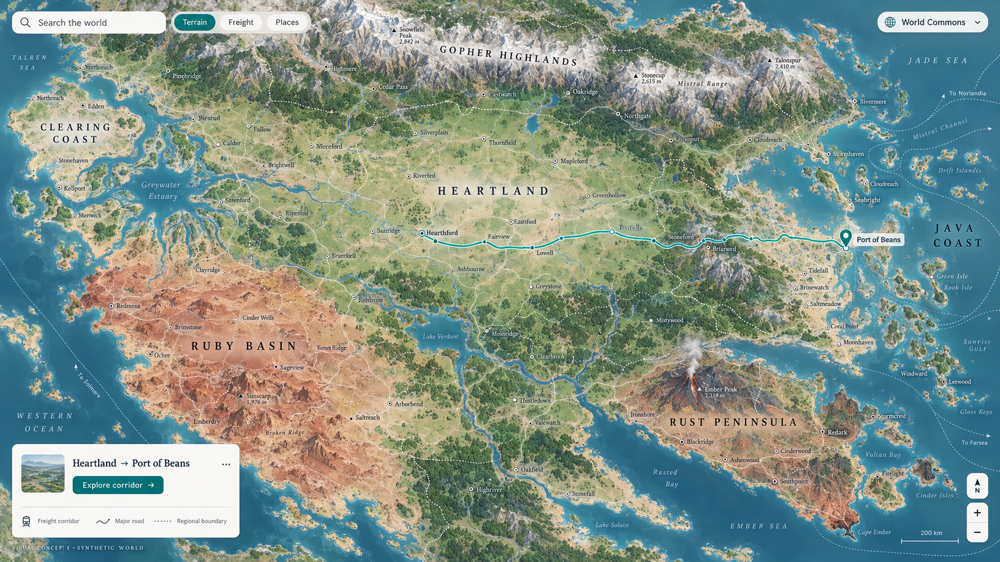
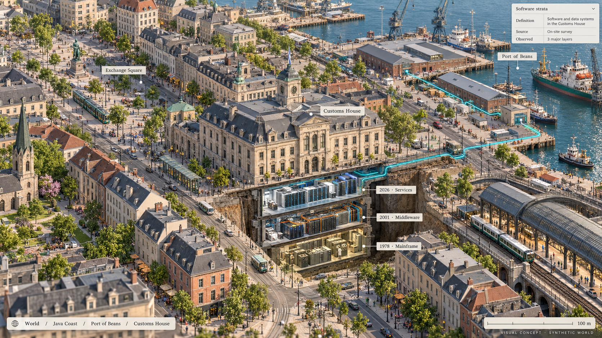
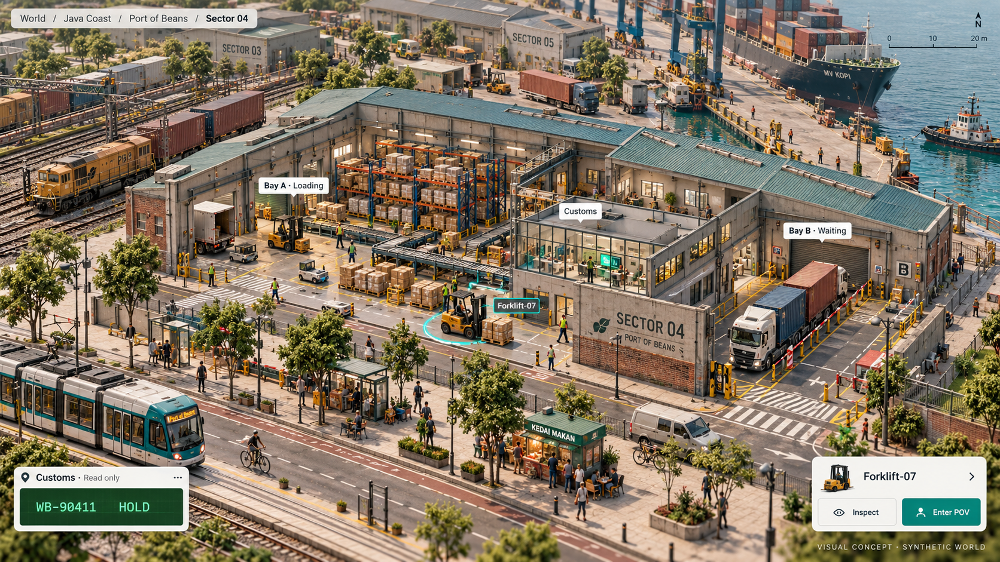
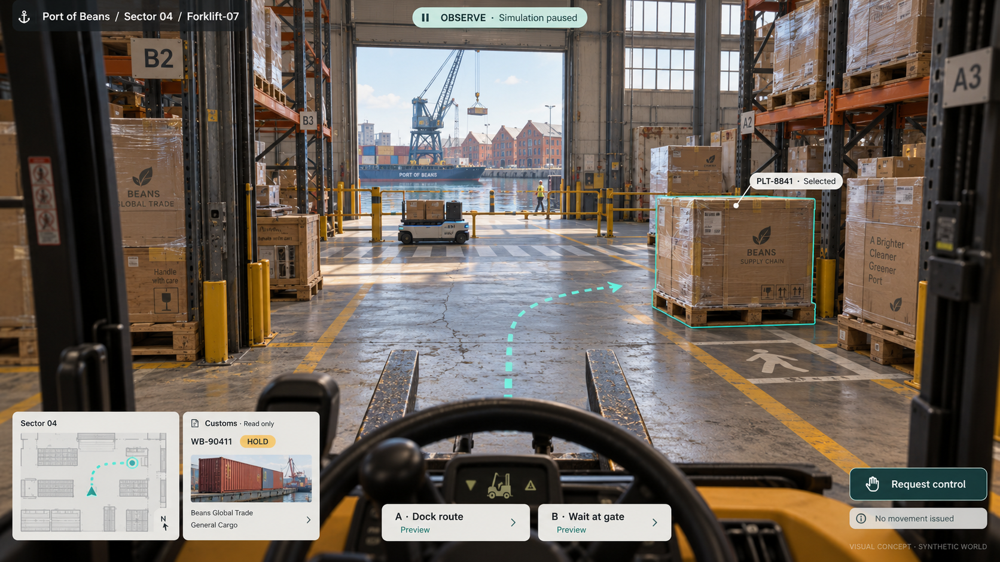
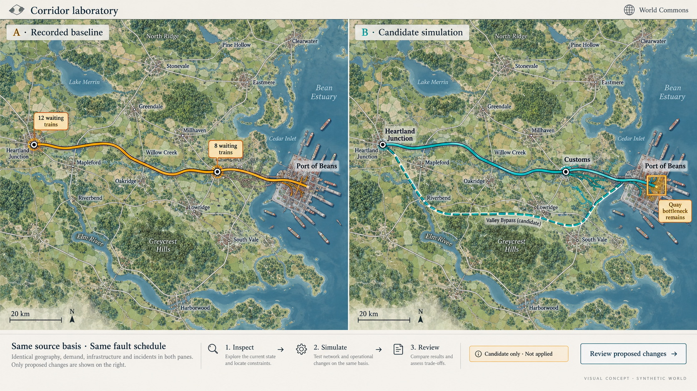
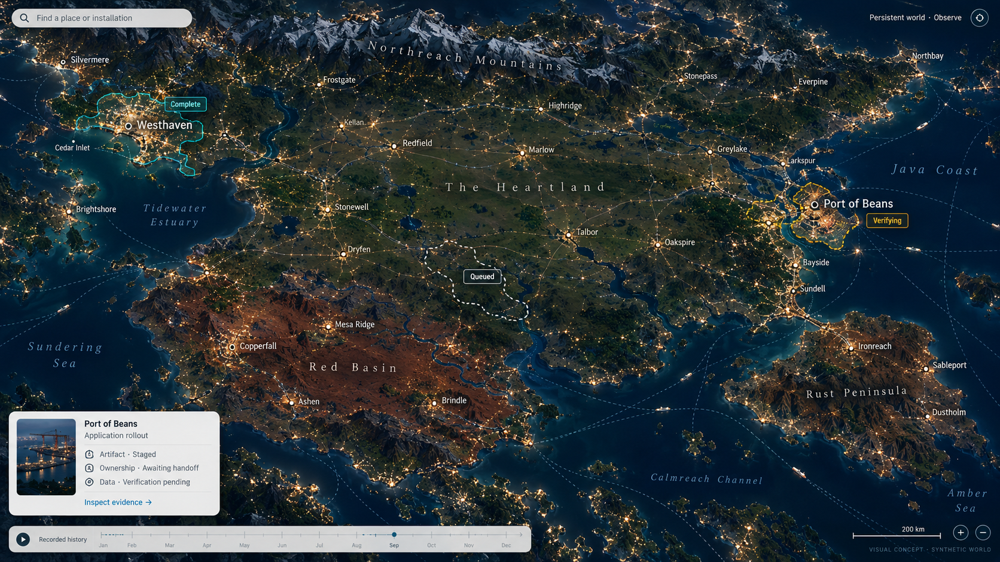

# D1 — A physics-grounded world simulator and spatial Agentic OS surface

[Review index](README.md)

Status: **In review**. Implementation: **Proposed downstream application suite and spatial UI/UX study. Original Argon studies and repository compositing prototype are retained; six Codex visual-styling alternatives explore a larger map and its inhabited places. No simulator binary, OpenUSD physics runtime or `TN3270`/`FIX` protocol adapter is implemented in Transit**.

## Question

How can we evaluate, demonstrate and operate Transit across decades of legacy enterprise software archeology and future physical-world autonomy without relying on sterile synthetic benchmarks—and what should the operator interface of an Agentic OS look like when real applications (`TN3270/ISPF`, `FIX`, `X12 EDI`, `SOAP/XML`, `HTTP`, `gRPC` and SQL), autonomous agents and physical environments (`nvidia/simready-assets`) interact in one continuous world?

## Proposal

**Updated visual recommendation, 2026-10-26:** make the world an atlas you can
inhabit. At wide zooms, use continuous continental geography, restrained terrain
cartography, settlements and transport networks. Descend through regions and
city streets before opening a facility cutaway or an agent camera. Keep the
miniature detail of the original Figures 3 and 4, but make each place belong to
a much larger landscape. “Higher zoom levels” in the feedback is interpreted
here as the higher-altitude overview; close zoom means greater magnification.

The reviewer requested a larger, more Google Maps-like world and new takes on
all six figures. The [Codex alternatives](#map-scale-visual-alternatives) develop
that direction alongside the [original Argon studies](#original-argon-studies).
This remains the same D1 design question. The new images explicitly review
**visual styling**: daylight terrain, quiet map labels, warm miniature materials
and a restrained night atlas. Color supplements labels, outlines and hatching;
it is not the only carrier of state.

Build the **Transit World Simulator & Spatial Agentic OS** as a standalone downstream application ecosystem (hosted in its own repository and GitHub organization outside the Transit kernel and core [roadmap](../../roadmap/README.md)) that consumes Transit strictly through its public client, SQL, [`Fuze`](../../handbook/reference/queries.md), [`Station`](../../handbook/reference/station.md), [connector](../../handbook/reference/connectors.md) and [application installation](../../handbook/reference/applications.md) boundaries:

1. **A continuous spatial operator surface ("Google Maps + Anchored Web Apps + Agent POV"):**
   Extend the original three-tier sketch with regional and city scales,
   as specified in the [camera progression](#camera-progression-and-place-continuity).
   Keep realm, place and observation identities visible across camera changes;
   independent source cuts do not become an atomic world snapshot:
   - **Atlas, region and city:** An overhead terrain map reveals progressively
     finer settlements, corridors, streets and building footprints. Freight,
     software dependencies and policy jurisdictions are separately labeled layers.
   - **Facility cutaway:** A selected building opens into a detailed miniature.
     OpenUSD assets from [`nvidia/simready-assets`](https://huggingface.co/datasets/nvidia/simready-assets)
     are a proposed implementation input requiring asset and physics validation.
     Anchored application views would connect the floor to its customs terminals,
     port portals and separately configured [Board](../../handbook/guides/inspect-board.md) evidence.
   - **Agent POV:** Selecting a robot or software agent opens its observations and
     the proposed [observation and feedback loop](../../handbook/reference/collaborative-decisions.md#the-observation-and-feedback-loop).
     Entering POV changes the camera. A separate request for control must establish
     the human principal's current authority and handoff outcome before enabling
     movement or terminal writes. The original one-key takeover sketch below does
     not define that missing control contract.
2. **Computing and regional factions as organic software archeology:**
   Generate fictional geography with the navigational clarity of a real map.
   **Computing and regional factions** supply industry, software history and
   workload scenarios: **Clearing Spire**, **Java Archipelago**, **Midwest
   Heartland**, **Gopher Burrows**, **Ruby Mines** and **Rust Foundry**. Their
   territories contain many cities, ordinary neighborhoods and open land;
   the faction is not a single oversized building. The Java Coast in the new
   studies contains the Java Archipelago and its Port of Beans. Protocols,
   physical codecs ($\epsilon$) and collations ($\kappa$) remain properties of
   datasets and applications, not permissions or capabilities granted by a biome.
3. **Constraint-driven procedural generation and "Non-Stop Modernization Optimization":**
   Compile each world seed from target workload verification constraints ([workloads reference](../../handbook/reference/workloads.md)): network RTT, packet-loss schedules, arrival rates ($\lambda$) versus service rates ($\mu$) and regulatory boundaries become oceans, mountain passes, loading dock layouts and customs jurisdictions. Players (humans and AI agents) compete in a continuous strangler-fig modernization loop—shadowing legacy tables into Transit `.tseg` segments, replacing overnight batch windows with maintained `Fuze` views and fenced `Station` connectors, and accelerating business cadence from 24-hour batch locks to physical speed-of-light and mass limits.
4. **Dual execution modes — Deterministic Single-Player Seeds and a Persistent MMO "Mainnet":**
   - **Single-Player (Seeded):** Generate synthetic software history and run
     bounded scenarios under an explicit clock and fault schedule. Faster-than-real-time
     headless execution is a goal to measure; the original acceleration factors
     below are fixture values.
   - **MMO "Mainnet":** A proposed persistent shared world where NPC backbones
     and player enterprises continue across compatible application replacements.
     Keep installation identity, artifact revision, ownership generation, data
     epoch and interface revision separate as defined in
     [Application installation](../../handbook/reference/applications.md#installation-and-bootstrap).
     Persistence is not a promise of uninterrupted upgrades across incompatible
     Transit definitions or automatic data migrations.

## Visual studies

### Map-scale visual alternatives

Figures **1B–6B** are Codex's alternatives to the corresponding original
Figures **1–6**, attributed to Gemini Argon by the reviewer. Original figure IDs,
images and prototype files remain available below. The new images are generated
visual concepts, not captures of that prototype. Their labels, scale bars,
historical dates and status badges are illustrative. Exact generation prompts
and saved asset names live in [the prompt manifest](d1-codex-prompts.json).

| Original theme | New interpretation | Design decision to inspect |
| --- | --- | --- |
| Figure 1: macro world | [Figure 1B: continental atlas](#figure-1b-continental-atlas) | Does the world feel large enough to explore for hours? |
| Figure 2: software archeology | [Figure 2B: city strata](#figure-2b-a-city-with-software-strata) | Does history belong to a recognizable place? |
| Figure 3: dock miniature | [Figure 3B: living port](#figure-3b-a-facility-inside-a-living-port) | Can we follow a shipment from street to rack to quay? |
| Figure 4: agent POV | [Figure 4B: embodied viewpoint](#figure-4b-an-embodied-view-with-deliberate-control) | Can we understand what the agent sees without losing place or mode? |
| Figure 5: modernization | [Figure 5B: corridor comparison](#figure-5b-modernization-as-a-comparable-experiment) | Can we compare a proposed change without confusing it with an applied one? |
| Figure 6: persistent world | [Figure 6B: night atlas](#figure-6b-a-persistent-world-with-local-change) | Can the world feel alive while rollout evidence stays local and inspectable? |

### Figure 1B: Continental atlas

**Figure 1B — a world with distance** ([full image](images/d1-01b-continental-atlas.png)).
The continent extends beyond the viewport. Mountain systems, watersheds,
agricultural plains and the spaces between settlements establish scale before
any application panel appears. Clearing Coast and Rust Peninsula are regions
with many places inside them. A port is a pin at this altitude.

The map borrows familiar navigation ideas from Google Maps: place search,
progressive labels, a north reference, a scale bar, selectable layers and a
selected route. It proposes fictional terrain, not Google map data or an
integration. Freight corridors are an optional layer; latency and policy
boundaries need their own legends and do not replace physical distance.
Selecting the route should reveal its stops and source basis in one compact
card. Terminal windows belong to a selected place further down the journey.

### Figure 2B: A city with software strata

**Figure 2B — history under an ordinary street** ([full image](images/d1-02b-city-strata.png)).
The four isolated monuments of Figure 2 become a neighborhood: offices, homes,
tram routes, trees, waterfront and a customs house with a software history.
Only the selected block opens. This makes archeology a lens on a place the
operator can return to, rather than a separate world made of server cabinets.

The excavation is a visual metaphor for dependency and definition history.
A lower floor does not mean a dataset is physically stored there, older data
is more authoritative, or an old protocol grants access. Selecting a layer
would show the immutable definition, dependencies and attributable observation.
The separate history control chooses recorded time; moving the camera underground
does not silently rewind the simulation.

### Figure 3B: A facility inside a living port

**Figure 3B — the miniature is a destination** ([full image](images/d1-03b-living-port.png)).
Keep the pleasure of discovering small activities: a clerk's green terminal,
a waiting truck, a crossing, a cart turning toward a rack. The surrounding
streets, quay and neighboring warehouses make Sector 04 part of a city. The
roof opens locally while the rest of the port remains a useful orientation cue.

Bay B's waiting queue and Bay A's activity are conditions to inspect, not a
universal comparison between old software and modern robots. Selecting a
shipment should connect its physical location, declared destination, customs
data and original operation outcome. The small pinned customs card is a proposed
application read view; it is not a new Board decoder or a live terminal.
Selecting Forklift-07 retains the facility breadcrumb and offers **Enter POV**.
The scene's vehicles are concept art, not verified SimReady assets or collision
geometry.

### Figure 4B: An embodied view with deliberate control

**Figure 4B — see through the agent's eyes** ([full image](images/d1-04b-embodied-agent.png)).
The warehouse has weight and texture, and the open loading door reconnects the
camera to the quay outside. A floor plan and breadcrumb answer “where am I?”;
the explicit observation mode answers “am I driving?”. Only the selected pallet
and candidate path receive overlays. The target remains recognizable without
a full-screen collision lattice.

Candidate routes remain previews. The image's paused state refers to this
synthetic scenario; opening a camera in a persistent shared world cannot pause
everyone else's work. **Request control** begins a separate proposed handoff
flow, with requested, granted, denied and uncertain outcomes. It must not imply
that a keypress acquired authority, cancelled an in-flight action or stopped a
physical machine. Current connector semantics preserve unknown remote outcomes;
the simulator still needs its own control and reconciliation contract.

### Figure 5B: Modernization as a comparable experiment

**Figure 5B — change the system while keeping the place** ([full image](images/d1-05b-corridor-comparison.png)).
Both views represent the Heartland-to-port corridor. The proposed interaction
locks camera position, geography, source vector and fault schedule across the
comparison; a sweep divider or synchronized panes exposes where queues move.
The generated illustration only sketches that alignment. It does not establish
pixel-identical geometry or a repeatable simulation.

The candidate retains a quay bottleneck. Clearing customs faster can move a queue
downstream, so the review should show backlog, waiting time, incomplete evidence
and unresolved effects together. Inspecting a candidate opens its changes,
assumptions and budgets. **Review proposed changes** does not apply them. General
world branches and merges remain proposed; today's supported query and
application operations keep their existing boundaries. Avoid a single score or
a futuristic building upgrade that purports to prove correctness.

### Figure 6B: A persistent world with local change

**Figure 6B — many places continue living** ([full image](images/d1-06b-persistent-world.png)).
The night atlas gives the world breadth through settlement density, dark
mountain ranges and routes extending out of view. Application changes occupy
small selected footprints. Solid, hatched and dashed outlines accompany status
labels. Illumination is scenery, not evidence of health, current ownership or
uptime. An upgrade has no physical energy wave.

A rollout footprint is a navigational grouping, not an atomic commit boundary.
Its inspection view keeps installation identity, artifact revision, ownership
generation, data epoch and published interface revision separate. Missing
observations remain unknown, and a failed local handoff need not recolor a
whole continent. Compatible replacement and a possible future application
migration must not imply coexistence of incompatible Transit contract definitions.
The current [v1 cutover policy](../../handbook/reference/versioning.md) still applies.

### Original Argon studies

The original Figures 1–6 and their captions below preserve the initial visual
proposal and its synthetic scenarios. Present-tense descriptions of terminals,
physics, branches, performance and upgrades describe those mockups, not delivered
behavior. In particular, the originals' “verified” counters, `DefinitionId v12/v13`
coexistence and automatic takeover labels do not establish current support.
The recommendations above and the authority boundaries below qualify their use.

Figures 1–6 use a **2560 × 1600 CSS-pixel workbench**, captured at **2×** via [`d1-render.mjs`](d1-render.mjs) to produce **5120 × 3200 PNGs**. Each composition frames an unobstructed 16:9 world viewport ([`images/raw/`](images/raw)) inside a high-density spatial workbench with coordinate-pinned callouts, live `TN3270/ISPF` green-screen emulators, `FIX 4.2` streams, OpenUSD physics manifests and Transit provenance panels. Follow either the composite link or the base-art link below each figure to inspect full-resolution details.

### Figure 1: Macro cartographic OS, faction archipelago and anchored protocol apps

**Figure 1** ([full `5120 × 3200` workbench](images/d1-01-macro-world-map.png) · [unobstructed 16:9 world map](images/raw/raw-01-macro-world-map.png)).
At the **Macro (`1.0×`)** zoom level, the operator views the procedural archipelago for `Seed #8841-IRON-TIDE` at `Manifest v1,420` under `policy_epoch 24`:

- **Constraint-compiled geography (Center Viewport):** Five interlinked regions are visible with submarine fiber cables, suspension rail bridges and shipping lanes: **The Clearing Spire** at top-left (`1.2 ms` microwave relays over stone vaults), **The Java Archipelago · Port of Beans** at mid-left (container ships and cranes backed up `11.4 hours` on a 14-hop `SOAP/XML` customs queue), **Ruby Canyon Mines & Gopher Bio-Domes** at bottom-left (`124,000 events/s` `gRPC` sensor fan-in), **The Midwest Mutual Rail Heartland** at center (grain silos, underwriting tower and 18 freight trains staged at Junction 9 awaiting a `03h 14m` batch cutoff), and **The Rust Foundry & Shipyards** at bottom-right (volcanic smelter peninsula with `SimReady` automated cranes).
- **Anchored live protocol applications (Bottom & Right Docks):** Selecting nodes on the map opens their real application endpoints in place:
  - **Anchored App #1 (`TN3270 / ISPF` Terminal `LU2: CICS-INV-04`):** Displays the live `24×80` green-screen COBOL/VSAM ledger (`MW.RAIL.MANIFEST.COBOL`), showing waybill `WB-90411` held in `LOCKED-BATCH-T1`, `WB-90415` failing with `ABEND-S0C7-DEC` on corrupted hex byte `0x1A`, and `WB-90419` actively `BRIDGED-TRANSIT`.
  - **Anchored App #2 (Transit `Fuze` Strangler-Fig Overlay):** Executes a zero-ETL equijoin across the mainframe `EBCDIC`/`COMP-3` copybook table (`midwest_rail_ledger`) and the modern Java Port table (`port_beans_berths`), cutting settlement latency from `14h 22m` to `18.4 ms`.
  - **Anchored App #3 & #4 (`FIX 4.2` Feed & Port `HTTP/OpenAPI` Portal):** Stream live commodity hedges (`35=8` execution reports for `COFFEE.DEC26` and `STEEL.COIL.Q4`) alongside vessel berth clearance states and frontier partition catch-up math ($\lambda = 1,000\text{/s}$, $\mu = 1,500\text{/s}$).

### Figure 2: Computing factions and software archeology across geological strata

**Figure 2** ([full `5120 × 3200` workbench](images/d1-02-faction-archeology.png) · [unobstructed 16:9 cutaway art](images/raw/raw-02-faction-archeology.png)).
Switching to the **Cross-Sectional Archeology Lens** visualizes why legacy modernization resembles geological excavation:

- **Four exposed computing civilizations (Center Viewport):**
  1. **Clearing Spire Vault (Column 1):** A classical stone financial clearinghouse with a rooftop microwave tower sitting above four subterranean stories of 1970s magnetic tape drives, punch-card cabinets and copper busbars.
  2. **Java Customs House (Column 2):** A brick port authority building sitting above tangled pneumatic tubes and multi-tier `SOAP/XML` enterprise service bus racks.
  3. **Gopher Bio-Dome & Ruby Quarry (Column 3):** A glowing geodesic hydroponic dome perched above stepped red-rock crystal mines, rail ore carts and dense fiber-optic telemetry bundles.
  4. **The Rust Foundry (Column 4):** Articulated yellow industrial robotic arms and molten metal channels anchored directly into columnar basalt bedrock.
- **Orthogonal $(\tau, \epsilon, \kappa)$ and 5-state cell fidelity (Left & Bottom Docks):**
  When Transit mounts datasets across these four strata into `.tseg` hybrid segments ([query engine reference](../../handbook/internals/query-engine.md#logical-types-and-physical-codecs-and-collation-semantics)), it preserves all five cell states (`942 value`, `28 null`, `14 missing`, `9 type_error`, `7 conflict` across `1,000` sampled cells) and evaluates `.tseg` zone-map `min`/`max` bounds under the declared column collation (`EBCDIC_CP037`, where digits `0xF0..0xF9` sort after uppercase letters `0xC1..0xE9`), preventing the `14%` false block pruning that occurs when mainframe keys are naively sorted as ASCII.

### Figure 3: Meso isometric intermodal dock with `nvidia/simready-assets` and live terminals

**Figure 3** ([full `5120 × 3200` workbench](images/d1-03-isometric-simready-dock.png) · [unobstructed 16:9 isometric dock](images/raw/raw-03-isometric-simready-dock.png)).
Clicking **Port of Beans · Sector 04** enters the **Meso (`12×`) Isometric Facility View**, where software latency becomes directly visible as physical friction:

- **Left Bay B (Unmodernized Legacy Dock):** Three diesel semi-trucks idle in an exterior queue belching exhaust while wooden pallets pile up haphazardly across the floor (`Backlog: 42 pallets · Turn time: 47m 12s`). At the bottom-left glass office, clerks sit in front of green-phosphor `TN3270` CRT terminals locked by `DFH0912E DATASET HELD BY JOB 'NIGHTCLR'`, illustrating $\lambda = 18\text{/min} > \mu = 6\text{/min}$.
- **Right Bay A (Transit-Activated Autonomous Dock):** Populated with physics-validated [`nvidia/simready-assets`](https://huggingface.co/datasets/nvidia/simready-assets) (`forklift_counterbalance_01.usd` at `4,120 kg`, `amr_industrial_cart_02.usd` at `380 kg`, and `pallet_euro_stacked_04.usd` at `620 kg`, $\mu_f = 0.64$). An overhead optical/LiDAR gantry streams `250 Hz` telemetry into Transit's direct data plane while three [`Station`](../../handbook/reference/station.md) processes (`PID 204..206`) coordinate loading in `14.2 s`—bounded only by the physical `4.2 m/s` max speed of the forklift.
- **Fenced physical actuation (Bottom-Right Panel):** Shows how `PID 204` commits its state mutation and records connector intent `#effect-814` *before* dispatching `simready.Forklift/LiftPallet`. When a simulated Wi-Fi fade drops the gRPC acknowledgement, worker replay inspects `#effect-814 (UNCERTAIN)` and reconciles against the LiDAR gantry watermark (`LSN 44,910`) rather than re-dispatching a duplicate lift command.

### Figure 4: Micro first-person agent POV, counterfactual branch review and manual takeover

**Figure 4** ([full `5120 × 3200` workbench](images/d1-04-agent-pov-control.png) · [unobstructed 16:9 first-person POV](images/raw/raw-04-agent-pov-control.png)).
Clicking **`Forklift-07 (PID 204)`** in Bay A drops the operator into the **Micro (`100×`) First-Person Agent POV**:

- **Embodied optical + OpenUSD wireframe view (Center Viewport):** The camera looks directly over the forklift's twin steel forks down Aisle 04. Projected on the concrete floor and high-bay racking are the trajectory splines and cyan `convexDecomposition` collision bounds from the OpenUSD scene graph, targeting `pallet_euro_stacked_04.usd` (`620 kg · Cold-Chain · Alignment ±1.4 mm`).
- **Picture-in-Picture software POV (Left Dock):** Displays the exact dual software context bound to `PID 204`'s current turn (`Cut: orders@v1420, dock@v891`): the released `3270` cold-chain customs screen (`+2.4°C`) and the outbound `HTTP POST /v1/bay-a/slot-02/load` payload.
- **Counterfactual branch evaluation before physical movement (Bottom-Left Panel):** Grounding the [Elena branching story](../../handbook/reference/collaborative-decisions.md#elena-compares-alternatives-without-changing-operations), `PID 204` evaluates two candidate branches against thermal decay physics before moving the 620 kg pallet: `branch/reroute-berth-2` (`142 m @ 3.8 m/s = 37.4 s`, `0.0%` spoilage, **Selected**) versus `branch/wait-bay-1-batch` (`3h 14m` wait, `64.2%` spoilage / `$48k` loss, **Rejected**).
- **Event time vs. observation time and manual takeover (Bottom-Right & Right Docks):** Tracks the exact millisecond offset between physical warehouse events (`14:22:07.110`) and Transit commit cuts (`14:22:07.118`) so historical `AS OF` queries never leak future knowledge. Pressing `SPACE` or `T` hands physical steering or terminal input to the human operator under their own authenticated principal.

### Figure 5: Non-stop modernization optimization workbench and fault-injection proof

**Figure 5** ([full `5120 × 3200` workbench](images/d1-05-modernization-loop.png) · [unobstructed 16:9 transformation diorama](images/raw/raw-05-modernization-loop.png)).
Figure 5 illustrates the core gameplay and engineering verification loop—**Non-Stop Modernization Optimization**:

- **Left-to-Right architectural transformation (Center Viewport):** The diorama contrasts the unmodernized left sector (vintage tape mainframes, dot-matrix manifest printers and congested rail sidings) with the central **Transit Host Layer Nexus** (`.tseg` + `Fuze` + `Station`), which activates the synchronized right sector (high-speed intermodal bullet trains, automated AGV loops and container ship cranes).
- **Adversarial fault injection comparison (Bottom-Left Panel):** Demonstrates why migrating off a mainframe into a naive cloud "Frankenstack" fails under real-world network physics. When `Packet Loss Fault #F-19` drops an HTTP response after pallet dispatch, a stateless retry loop double-ships 20 pallets (`-$140k` penalty), whereas Transit reconciles saved operation `#op-7741` and guarantees exact single loading.
- **Decoupled $100\times$ Headless CI Engine (Right Dock):** Because the deterministic world tick and rigid-body math run headless independently of the WebGPU/Three.js viewport, the exact same world seeds execute at `142,000 ticks/sec` in automated CI to qualify Transit throughput and recovery invariants.

### Figure 6: Persistent MMO Mainnet and five-axis rolling live upgrades

**Figure 6** ([full `5120 × 3200` workbench](images/d1-06-mmo-mainnet-epochs.png) · [unobstructed 16:9 MMO Mainnet panorama](images/raw/raw-06-mmo-mainnet-epochs.png)).
While Single-Player seeds test deterministic scenarios, the **Persistent MMO "Mainnet"** proves the hardest operational invariant in enterprise infrastructure—**continuous multi-version operation and live rolling upgrades over months and years without stopping the world**:

- **Live cutover wavefront (Center Viewport):** Across `412 days` of continuous operation (`0 world resets`, `48.4 TiB` accumulated `.tseg` history, `284,000` active `PID`s), a rolling upgrade (`Epoch 31 -> Epoch 32`, `transit-worker-v1.0.14 -> v1.0.15`) sweeps from the upgraded western metropolis across the central intermodal port toward the eastern harbor while ships, trains and cranes continue transacting across the boundary.
- **Five-axis upgrade separation (Left Dock):** Maps the live wavefront directly to the five independent identities in [Application installation](../../handbook/reference/applications.md#installation-and-bootstrap):
  1. **Installation identity** (`app/clearing-backbone`) retains durable scope and grants.
  2. **Artifact revision** swaps the compiled Zig worker binary (`v1.0.14 -> v1.0.15`).
  3. **Ownership generation** fences `Gen 88` independently of binary selection before activating `Gen 89`.
  4. **Data epoch** (`Epoch 31 -> 32`) advances via bounded table migration steps with durable receipt `#r-884`.
  5. **Published interface revision** (`rev 19 -> 20`) activates conditionally only after target verification.
- **Pinned neighborhood coexistence (Bottom-Left Panel):** During the cutover, the **Rust Foundry Guild** writes new `DefinitionId v13` segments (`Epoch 32`), **Heartland Rail NPCs** continue ingesting `X12 EDI` under `DefinitionId v12` (`Epoch 31`), and a **Washington Audit Job** inspects retained snapshot `Manifest v1,042,100`—all concurrently with `0 duplicate effects` and `0 dropped sessions`.

## Camera progression and place continuity

The wide map and the close miniature should be two ways of reading the same
place. The original `1× / 12× / 100×` labels are presentation shorthand, not a
camera or metric specification. Use meaningful scale and place names:

| Camera scale | Visible world | Selection and next step |
| --- | --- | --- |
| Continental atlas | Terrain, regions, city clusters and major corridors; roughly a `200 km` scale bar | Search or select a place; zoom toward its region |
| Region and corridor | Towns, rivers, rail junctions, ports and route alternatives; roughly `20 km` | Follow a shipment or compare a corridor; zoom toward its city |
| City and district | Streets, blocks, building footprints and public space; roughly `100 m` | Select the customs house or a facility; optionally open the strata lens |
| Facility miniature | Rooms, loading bays, people, machines and traversable lanes; roughly `20 m` | Inspect a shipment or agent; open its observation view |
| Agent viewpoint | Local line of sight, selected target and small orientation map | Observe, return to facility, or separately request authorized control |

These distances are composition targets, not simulator measurements or required
LOD thresholds. Pan and wheel/pinch zoom preserve the selected place. The map
starts north-up; tilt becomes available around district scale. **Enter facility**
and **Enter POV** make viewpoint transitions explicit, with a return breadcrumb
that restores the previous camera. Reduced-motion navigation should jump to the
same destination without an animated flight. Search and a text place list should
offer the same destinations without requiring precision map gestures.

The proposed identity chain is **World Commons → Java Coast → Port of Beans →
Sector 04 → Forklift-07**, with shipment **WB-90411** as a separate selected data
object. A place ID, agent identity and data-object identity are not interchangeable.
Camera changes do not alter their definition, source vector, principal or selected
recorded time. New observations must identify their new basis. The generated
images reuse these names as an art brief; they are not georegistered tiles from
one scene graph.

At each scale, show only the appropriate geometry and labels. A continental
city marker aggregates places; it does not claim to show every agent. The
proposed renderer loads bounded visible tiles, labels and nearby detail, with
explicit loading, stale and unavailable states. Panning into an unloaded area
must not imply that nothing is there. Rendering less detail cannot remove
accepted work or make hidden activity stop. Exact tile budgets, simulation
fidelity outside the camera and disclosure filtering remain design work.

## Interaction and authority boundaries

The desired experience starts with application data (places, shipments,
facilities and their definitions), computations (routes, queues and comparisons)
and policies (who may inspect or control them). Those are proposed downstream
objects; the map does not create another Transit catalog or permission authority.

| Proposed gesture | Owning meaning and current limit |
| --- | --- |
| Pan, zoom, tilt, open a cutaway or enter POV | Local presentation changes. No mutation, control handoff or effect dispatch. The map/POV renderer is proposed. |
| Inspect a shipment, source or operation | Authorized public client reads, or a qualified finite query through the shared SQL client. Preserve original identity, source evidence, freshness and incomplete coverage. Application payload interpretation belongs to the simulator. |
| Open Board evidence | Read-only inspection within Board's private deployment boundary and configured upstream grant. Reachability is not per-viewer authentication; embedding needs a deployment/access design. |
| Compare candidate routes or modernization changes | Explicit bounded simulation over a declared source vector and fault schedule. General world branches, merges and their execution model are proposed; the image is not executable SQL. |
| Request control or submit a terminal write | Separate downstream action under the caller's current rights, recorded intent and explicit handoff/outcome. Current [HTTP](../../../contracts/STATION_HTTP_V1.md) and [gRPC](../../../contracts/STATION_GRPC_V1.md) connector contracts do not supply a continuous driving protocol or prove external cancellation. |
| Review an application rollout | Inspect the original management operation and separate identities through the [installation contract](../../../contracts/APPLICATION_INSTALLATION_V1.md). A staged artifact, ready process, completed migration and active interface are distinct. |

If a reply or observation is lost, show pending or unknown against the original
operation. Never turn a visually empty queue into a completion receipt or
automatically retry a physical action. The [Board guide](../../handbook/guides/inspect-board.md),
[SQL reference](../../handbook/reference/sql.md), [connectors](../../handbook/reference/connectors.md)
and [application reference](../../handbook/reference/applications.md) own current
semantics. This visual revision changes none of those contracts.

## Alternatives and review method

The original archipelago is memorable and makes faction distinctions immediate,
but its giant landmarks and short bridges compress the whole world into a small
set of exhibits. A continuous atlas supports exploration and meaningful distance,
at the cost of less spectacle at the widest zoom. The recommendation keeps
landmarks for city and facility views and gives the atlas strong geography and
clear place hierarchy.

A permanent dashboard of terminals makes technical relationships explicit but
shrinks every view. The alternative uses one selected-place card and optional
pinned applications. Dense evidence remains available on demand. This is a visual
judgment; neither layout has undergone a usability study. The light terrain map
and dark night layer are styling alternatives, not distinct authority modes.

A useful next review would ask a reader to locate Port of Beans, follow
WB-90411 into Sector 04, open Forklift-07's view, compare a candidate route and
return to the continental context. Check whether they can identify place, scale,
observation time, selected data and control mode at every step, and distinguish
candidate changes from applied outcomes without relying on color. These are
proposed evaluation tasks, not executed tests. Inability to preserve orientation
would be evidence to simplify the transitions or retain more map context.

## Architectural and packaging boundaries

To keep the Transit kernel generic, Zig-native and focused on its core milestones, the simulator follows strict repository and authority boundaries:

| Boundary | Rule and rationale |
| --- | --- |
| **Separate repository and GitHub organization** | The world simulator, faction applications (`TN3270/ISPF` apps, `FIX` matching engines, `SOAP/HTTP` portals), procedural map generator and OpenUSD `SimReady` web client live outside the `spoke-sh/transit` repository and outside the [Transit roadmap](../../roadmap/README.md). |
| **Zero simulation logic in the Transit kernel** | Transit knows nothing about forklifts, rail switching, factions or 3D scene graphs. To Transit, the simulator is an ordinary set of authenticated callers, tables, documents, KV resources, `Fuze` queries, `Station` workers and recorded HTTP/gRPC connectors. |
| **Real application code over standard wire protocols** | The proposed legacy and modern applications use standard protocols (`TN3270`, `FIX`, `HTTP`, `gRPC`, PostgreSQL/MySQL wire and Transit native v1). Each adapter needs its own implementation and conformance evidence. Success in a synthetic scenario does not establish transfer to a different workload or deployment. |
| **Headless simulation and an independent viewer** | A proposed bounded tick server evaluates physics, arrival queues and fault schedules independently of the map/facility/POV renderer. Determinism, fidelity and acceleration require measured evidence for the selected engine, assets and execution profile. |

## How world mechanics map to Transit invariants

| Simulator mechanic | Transit foundation exercised | Reference owner |
| --- | --- | --- |
| **Clearing Spire & Heartland legacy ledgers** (`COMP-3`, `ZONED`, `IBM_HFP`, `EBCDIC_CP037`) | Orthogonal logical types ($\tau$), physical codecs ($\epsilon$) and collations ($\kappa$) in `.tseg` segments; collation-ordered zone maps and B-tree sort keys | [Query engine](../../handbook/internals/query-engine.md#logical-types-and-physical-codecs-and-collation-semantics), [Data types](../../handbook/reference/sql/types.md) |
| **Cross-stratum software archeology scans** (corrupted copybook nibbles, omitted webhook keys, concurrent XML/Document edits) | Five-state cell model (`value`, `null`, `missing`, `type_error`, `conflict`) preserved through scans and projections without aborting queries | [Data model](../../handbook/reference/data-model.md#choose-a-data-representation), [Documents](../../handbook/reference/documents.md) |
| **Meso facility `SimReady` forklifts & actuators** under Wi-Fi/network packet loss | `Station` durable turns, `PID` ownership generation fencing and recorded connector intents/outcomes where replay never re-dispatches uncertain physical actions | [Processes](../../handbook/reference/processes.md), [Connectors](../../handbook/reference/connectors.md) |
| **Micro Agent POV counterfactual path & allocation planning** | Realm-scoped branches, comparable scenario computations over a shared snapshot basis and human-principal merge approval | [Collaborative decisions](../../handbook/reference/collaborative-decisions.md), [State model](../../handbook/internals/state-model.md#schema-history-and-branches) |
| **Frontier satellite partitions & Gopher telemetry bursts** | Separation of event time vs. observation time, bounded resident memory independent of durable history and catch-up arithmetic $\text{backlog} / (\mu - \lambda)$ | [Workloads and architectural priorities](../../handbook/reference/workloads.md#size-history-state-and-active-work-separately) |
| **Washington Audit & European Sovereign borders** | Scoped role graphs, `policy_epoch` revocation at disclosure boundaries, unlimited default retention and derived-summary publication policies | [Security](../../handbook/reference/security.md), [Retention](../../handbook/reference/retention.md) |
| **Persistent MMO Mainnet rolling cutovers** | Five-axis separation of installation identity, artifact revision, ownership generation, data epoch and conditional interface publication | [Application installation, definitions and migration](../../handbook/reference/applications.md) |

## Review outcome

Reviewer feedback on **2026-10-26** requested a substantially larger, more
Google Maps-like world at wide zoom and expressed a preference for the miniature
feel of the original Figures 3 and 4. Figures 1B–6B respond to that feedback while
preserving the original proposal. The atlas-to-inhabited-place direction is the
recommendation; the six new compositions, their styling and the detailed
interaction choices have not been accepted. D1 remains **In review**. This
feedback establishes no simulator implementation or runtime qualification.

## Open questions

The visual decisions for this revision are whether the continental atlas feels
large enough, whether the city scale makes the warehouse feel connected, and
whether the quieter HUD preserves enough context. The strata cutaway also needs
review for confusion between software history, physical location and recorded
time. The original application-scope questions remain below.

1. **Starter seed composition ("The Triad"):** Should the first playable vertical slice start with a three-faction seed—pairing **The Clearing Spire** (`FIX 4.2` + `COBOL/COMP-3`), **The Java Archipelago** (`SOAP/HTTP` port customs) and **The Rust Foundry / Intermodal Dock** (`nvidia/simready-assets` forklifts driven by `Station` workers)—before adding the Gopher, Ruby and Regional governance zones?
2. **Browser rendering pipeline for `nvidia/simready-assets`:** In the interactive web client, should the Meso (`12×`) and Micro POV (`100×`) views stream converted `glTF/KTX2` meshes alongside the original OpenUSD physics sidecar metadata for lightweight WebGPU browser rendering, while the headless simulation server evaluates the canonical OpenUSD collision/mass properties directly?
3. **Organization and repository naming:** When spinning up the standalone GitHub organization/repository for the simulator and its faction applications, what name should own the public MMO Mainnet and open-source faction packs?
4. **Board embedding vs. linked evidence:** Should a selected-place card link to
   separately configured [`transit-board`](../board-data/README.md) inspection,
   or embed it within the private deployment boundary? The simulator owns its
   application decoding and control UI in either case; Board inspection remains
   read-only and supplies no human-control credential.

## Evidence and limits

The original study records repository revision `a610ecd5d`. The Codex visual
revision starts from `a8a84cdfe` and responds to reviewer feedback dated
2026-10-26. It modifies no Zig runtime code, wire contract, SQL grammar or
`transit-board` bundle. The simulator remains outside the core
[Transit roadmap](../../roadmap/README.md); this review completes no milestone.

- **New generated artwork:** Figures 1B–6B use the built-in image generation
  tool and the exact prompts in [d1-codex-prompts.json](d1-codex-prompts.json).
  They are `1672 × 941` PNGs (`1672 × 940` for Figure 5B), saved alongside the
  originals in `images/`; the manifest records dimensions and SHA-256 hashes.
  UI text is baked into the artwork; controls do not work. Independent generations
  do not establish
  shared geometry, accurate cartographic distances, physics, temporal continuity
  or a deterministic world seed. Scale bars and names communicate the intended
  experience. Regeneration is nondeterministic; the saved files are the reviewed
  artifacts.
- **Review scope:** The new studies explicitly examine color and visual styling.
  Labels, solid/dashed boundaries and hatching supplement color. This does not
  establish contrast, keyboard accessibility, responsive layouts or usability
  of an implemented interface. The original HTML prototype still presents only
  Figures 1–6; it has not been retrofitted with the new images.

- **Synthetic world fixture and hybrid `5120 × 3200` renders:** Figures 1–6 (`d1-01` through `d1-06`) are `5120 × 3200` PNGs captured by [`d1-render.mjs`](d1-render.mjs) from [`d1.html`](d1.html) at `2560 × 1600` (`deviceScaleFactor: 2`), compositing vector UI, terminals and telemetry over 16:9 base world illustrations ([`images/raw/`](images/raw)) governed by [`d1-fixture.json`](d1-fixture.json) and [`d1-prompts.json`](d1-prompts.json). All throughput figures (`48,200 msg/s`, `142,000 ticks/sec`), latencies (`18.4 ms`, `1.2 ms`) and Mainnet uptime counters (`412 days`) are illustrative design fixture values, not measured execution evidence.
- **Separation from Transit roadmap and current implementation:** The simulator, `TN3270`/`FIX` faction applications, procedural world compiler and OpenUSD `SimReady` viewport are proposed downstream applications and do not belong to the [Transit roadmap](../../roadmap/README.md). Within Transit itself, foreign mainframe tables, general writable branches, reviewed merges and pinned neighborhood upgrades remain governed by their respective handbook references and roadmap milestones ([data model capability map](../../handbook/reference/data-model.md#declarations-and-current-interfaces), [applications reference](../../handbook/reference/applications.md)).
- **Original validation record:** The original review reports Playwright layout
  and zero-overflow verification (`node docs/design/world-simulator/d1-render.mjs`),
  Markdown link/fence checks and `git diff --check`. That historical record does
  not validate the new generated images or their proposed interactions. The
  current repository link-check entry point is `python3 -B tests/docs.py` inside
  `nix develop`; validation of this revision is reported in its pull request.

## Supporting material

- [Codex visual alternatives, Figures 1B–6B](#map-scale-visual-alternatives) and
  [exact built-in image generation prompts](d1-codex-prompts.json). Each figure
  links its saved PNG; the prompt manifest maps all six IDs to asset filenames.
- [D1 synthetic world, faction, `SimReady` physics and Mainnet fixture](d1-fixture.json).
- [D1 hybrid generation and `5120 × 3200` compositing specification](d1-prompts.json).
- [Interactive spatial workbench prototype](d1.html), [styles](d1.css), [screen controller](d1.js) and [Playwright 5K capture script](d1-render.mjs).
- High-resolution `5120 × 3200` composite visual studies in [`images/`](images) and unobstructed 16:9 base world renders in [`images/raw/`](images/raw):
  - [Figure 1 — Macro cartographic OS, faction archipelago and anchored protocol apps](images/d1-01-macro-world-map.png) ([base art](images/raw/raw-01-macro-world-map.png))
  - [Figure 2 — Computing factions and software archeology across geological strata](images/d1-02-faction-archeology.png) ([base art](images/raw/raw-02-faction-archeology.png))
  - [Figure 3 — Meso isometric intermodal dock with `nvidia/simready-assets` and live terminals](images/d1-03-isometric-simready-dock.png) ([base art](images/raw/raw-03-isometric-simready-dock.png))
  - [Figure 4 — Micro first-person agent POV, counterfactual branch review and manual takeover](images/d1-04-agent-pov-control.png) ([base art](images/raw/raw-04-agent-pov-control.png))
  - [Figure 5 — Non-stop modernization optimization workbench and fault-injection proof](images/d1-05-modernization-loop.png) ([base art](images/raw/raw-05-modernization-loop.png))
  - [Figure 6 — Persistent MMO Mainnet and five-axis rolling live upgrades](images/d1-06-mmo-mainnet-epochs.png) ([base art](images/raw/raw-06-mmo-mainnet-epochs.png))
- External dataset reference: [`nvidia/simready-assets` on Hugging Face](https://huggingface.co/datasets/nvidia/simready-assets).
- Related Board design items: [board-atlas](../board-atlas/README.md), [board-console](../board-console/README.md), [board-grammar](../board-grammar/README.md) and [board-data](../board-data/README.md).

[Review index](README.md)
