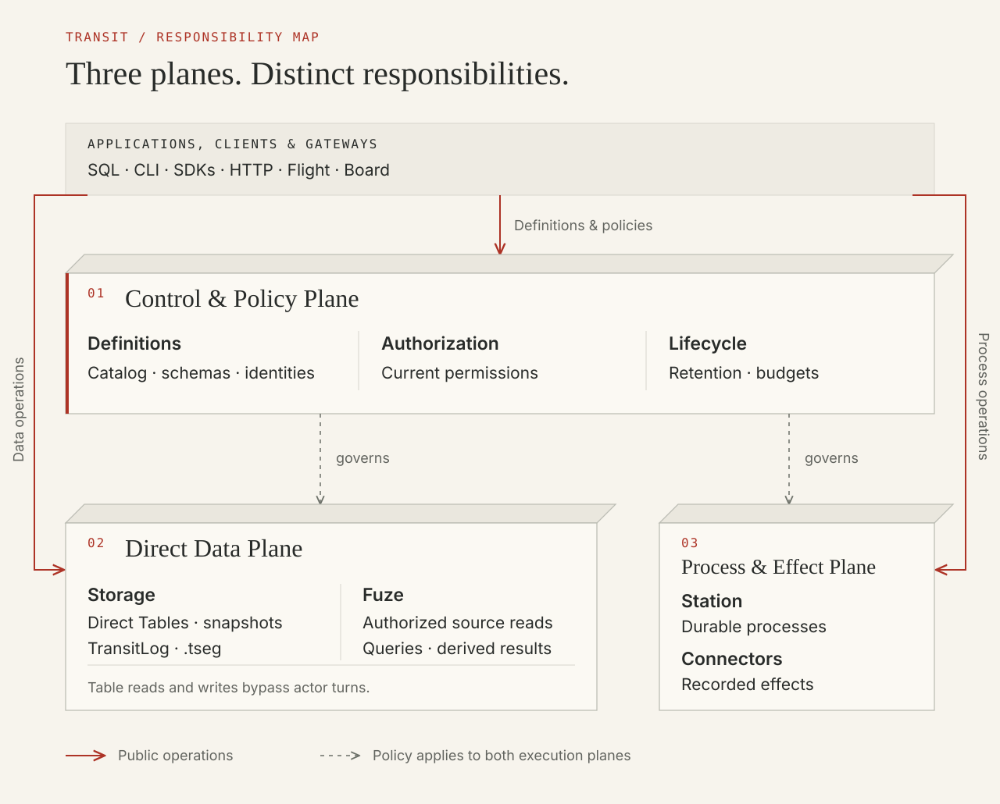

# What is Transit?

Build applications that can work with changing information, explain their answers
and carry work through failure. Transit brings versioned data, queries and durable
execution into the same system, with explicit policies for who may use them.

A record changes. An answer needs refreshing. A worker restarts halfway through a
request. These are connected parts of an application's life. Transit gives each
part an inspectable basis: accepted data, the source versions behind a result,
and the original outcome of an operation.

**Transit is a declarative, versioned multi-model database, a query engine called
Fuze, and a durable execution runtime called Station.** It is written in Zig,
with SQL, language SDKs and protocol gateways for its supported operations.

Start by [creating your first dataset](quickstart.md), or follow the
[data model](../reference/data-model.md) from data and computation to policy.

## See what you could build

An operations desk combines changing records with queries and leased work. A
reproducible investigation keeps the basis of an answer inspectable. A recoverable
integration preserves the original request and its observed outcome. These are
application patterns built from Transit's documented interfaces, with application
logic connecting the pieces.

The [workload examples](workload-examples.md) provide complete executable callers.
The [business stories](../reference/collaborative-decisions.md) explore the broader
proposed experience: people and agents sharing evidence, comparing alternatives
and reviewing changes before publication. Their availability table separates
those integrated experiences from the building blocks available today.

## Work with data

Start with the information your application needs to preserve, then choose how
it changes and what you want to learn from it.

| You want to… | Transit gives you… | Explore |
| --- | --- | --- |
| Keep operational records and evolve their shape | Typed Tables, keys, defaults, queries and schema changes | [Tables](../reference/tables.md) |
| Preserve events and coordinate work | Partitioned Streams and Queues with explicit progress and leases | [Streams and Queues](../reference/streams.md) |
| Keep structured context and shared edits | Documents with accepted revisions, collaborative text and explicit conflicts | [Documents](../reference/documents.md) |
| Store application-selected values by key | KV objects with explicit types, encodings and retained versions | [KV resources](../reference/state.md) |
| Ask a question now or retain its answer | Interactive, captured and maintained computation lifetimes with different interfaces | [Query lifetimes](../reference/data-model.md#choose-a-computation-lifetime) |
| Govern who may use data and how long it remains | Current authorization, retention and bounded execution budgets | [Permissions](../reference/security.md) and [retention](../reference/retention.md) |

SQL, SDKs, HTTP APIs and Board expose different portions of this lifecycle. Use
[Choose an interface](choose-interface.md) to find the path that supports the
operation you need. A source's representation, its computation lifetime and the
interface you use are separate choices.

## Describe intent and inspect the result

The question that organizes Transit is:

> Can someone describe the data, computation and policies they need, then inspect
> whether Transit is fulfilling that declaration?

For a Table, that means defining columns, keys, encodings, collations and defaults, then inspecting its published schema and committed rows. For a query, it means identifying its inputs and computation, then observing a complete five-state result against a specific data basis. For a maintained result, it also means knowing which input changes it includes and whether processing has stopped or is still catching up.

These observations have different meanings. A valid definition may still need publication or activation. An accepted operation may still be running. A complete result describes the source versions it read; newer input can exist. Current permissions (`policy_epoch`) govern both execution and inspection.

The product direction is:

> Declare your data, the computations that derive from it, and the policies
> governing its use. Transit manages the storage hierarchy, delta activation and
> durable execution lifecycle needed to keep those definitions useful.

The supported path is most complete for Tables: create and evolve their schemas, read and change rows independently of actor turns, and inspect outcomes through a configured catalog. KV and Documents have client/service APIs, while their SQL declarations compile offline without creating objects. Named captured and maintained relational queries have typed Zig interfaces with explicit host activation and scheduling; SQL view and subscription declarations are unavailable. See the [capability map](../reference/data-model.md#declarations-and-current-interfaces) for the boundary between the direction and today's operations.

## Understand the machinery

Three architectural planes connect the user-facing model to its implementation.

- **Control & Policy Plane:** Catalog identities and definitions, current
  authorization, retention and resource budgets govern data access and execution.
- **Direct Data Plane:** Direct storage preserves accepted data and snapshots.
  Fuze executes queries over authorized sources, including supported Table, KV
  and Document adapters.
- **Process & Effect Plane:** Station coordinates stateful durable processes.
  Connectors record authorized external attempts and outcomes, keeping replay
  distinct from dispatching an effect.

The [architecture reference](../reference/architecture.md) explains the owners and
boundaries. [Internals](../internals/README.md) develops the storage, query and
execution mechanisms with their assumptions and evidence. A data request need
not pass through a process mailbox, and a protocol gateway creates no separate
policy authority.

## Durable execution supports the data lifecycle

In Transit, data and computation are the primary user-facing declarations, while durable processes (`Station`), write-ahead streams (`TransitLog`) and connectors are the mechanisms that activate changes and preserve progress across failures:

1. **Snapshot isolation and atomic publication:** Transit records accepted mutations and keeps partially staged data private until its complete successor is published. A reader retains its selected data version while later writes proceed. After an uncertain write, the original operation's recorded outcome tells the caller whether it applied. Repeating SQL creates new work; a lost connection alone does not establish failure.
2. **Change capture and derived views:** Committed Table transitions preserve ordered row deltas (`+row`/`-row`) and schema provenance so change readers, reactive watches and maintained computations can advance from exact source watermarks without polling or losing intermediate transactions.
3. **Stateful workflows and external effects:** Custom `Station` workers extend this model with application-defined validation, orchestration and connector calls. A durable process gives that work an identity (`PID`), ordered input and recoverable progress; its worker can restart without replacing accepted work or re-dispatching an external HTTP/gRPC effect. [Processes and turns](../reference/processes.md) explain the commit mechanism; [build an application](applications.md) explains how to supply your own worker.

Station provides application behaviors and data owners above the generic kernel. Fuze executes vectorized and relational queries over authorized sources. Board presents observed state, and connectors record external attempts and outcomes. These components support the same data and execution boundaries; their [architecture](../reference/architecture.md) and [system model](../internals/system-model.md) explain the division of responsibilities.

## Continue from a working dataset

1. [Run Transit locally](quickstart.md), define a Table and inspect its schema.
2. Read and change its rows from independent console sessions.
3. Use the [data model](../reference/data-model.md) to choose representations, computation lifetimes and policies for your application.
4. Explore [workload recipes across languages](workload-examples.md), then add custom execution or connectors where the application needs them.

Retention defaults to unlimited and requires explicit opt-in to expiry. A name, resource reference or retained snapshot never grants access. The [verification reference](../reference/verification.md) explains the guarantees and limits behind the supported operations.
