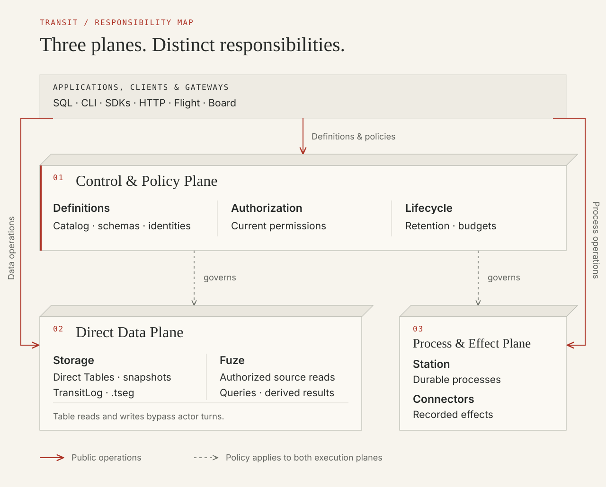

# What is Transit?

**Transit is a declarative, versioned multi-model database, vectorized/incremental query engine, and durable execution runtime written in Zig.**

Transit separates responsibility into three architectural planes.

- **Control & Policy Plane:** Catalog identities and definitions, current authorization, retention and resource budgets govern data access and execution.
- **Direct Data Plane:** Direct Table storage preserves accepted rows and snapshots. Fuze executes queries over authorized sources, including supported Table, KV and Document adapters.
- **Process & Effect Plane:** Station coordinates stateful durable processes. Connectors record authorized external attempts and outcomes, preserving the distinction between replaying history and dispatching an effect.

SQL, CLI, SDKs and protocol gateways are entry points to these operations. A gateway does not create a separate policy authority, and data requests need not pass through a process mailbox. The [architecture reference](../reference/architecture.md) explains the owners and boundaries; the [capability map](../reference/data-model.md#declarations-and-current-interfaces) identifies the operations available for each data kind.

Start with the data your application needs: its logical schema, physical encoding and collation, how it changes, what computations derive from it, and which policies govern its use. The [data model](../reference/data-model.md) connects these concerns to their supported interfaces, and [Internals](../internals/README.md) formalizes the underlying storage, query and execution mechanisms. The [local quickstart](quickstart.md) takes you from an empty installation to a Table you define, query and evolve through the console.

## Describe intent and inspect the result

The question that organizes Transit is:

> Can someone describe the data, computation and policies they need, then inspect
> whether Transit is fulfilling that declaration?

For a Table, that means defining columns, keys, encodings, collations and defaults, then inspecting its published schema and committed rows. For a query, it means identifying its inputs and computation, then observing a complete five-state result against a specific data basis. For a maintained result, it also means knowing which input changes it includes and whether processing has stopped or is still catching up.

These observations have different meanings. A valid definition may still need publication or activation. An accepted operation may still be running. A complete result describes the source versions it read; newer input can exist. Current permissions (`policy_epoch`) govern both execution and inspection.

The product direction is:

> Declare your data, the computations that derive from it, and the policies
> governing its use. Transit manages the storage hierarchy, delta activation and
> durable execution lifecycle needed to keep those definitions useful.

The supported path is most complete for Tables: create and evolve their schemas, read and change rows independently of actor turns, and inspect outcomes through a configured catalog. KV and Documents have client/service APIs, while their SQL declarations compile offline without creating objects. Named captured and maintained relational queries have typed Zig interfaces with explicit host activation and scheduling; SQL view and subscription declarations are unavailable. See the [capability map](../reference/data-model.md#declarations-and-current-interfaces) for the boundary between the direction and today's operations.

## Work with data

The [business stories](../reference/collaborative-decisions.md) follow a delivery manager, a reviewer and an operations lead using shared evidence to answer questions, compare branch proposals and respond to meaningful changes. They describe the proposed human/agent collaboration experience and identify its available building blocks separately from capabilities still to be implemented.

| Need | Start here |
| --- | --- |
| Store records with typed columns, keys, physical codecs and collations | [Tables and materialization](../reference/tables.md) and [data types and cell states](../reference/sql/types.md) |
| Store keys and values under an explicit encoding | [KV resources](../reference/state.md) |
| Accept structured edits and collaborative text with explicit conflicts | [Documents](../reference/documents.md) |
| Read, filter, join or aggregate supported sources with `Fuze` | [SQL](../reference/sql.md), [queries](../reference/queries.md) and [query lifetimes](../reference/data-model.md#choose-a-computation-lifetime) |
| Control access, retention and resource budgets | [Permissions](../reference/security.md) and [retention](../reference/retention.md) |
| Inspect definitions, results and progress | [Observe the lifecycle](../reference/data-model.md#inspect-whether-a-declaration-is-being-fulfilled) and [Board](inspect-board.md) |
| Capture external observations or coordinate external actions | [Connectors and recorded outcomes](../reference/connectors.md) |

SQL, language SDKs, HTTP APIs and Board expose different operations over shared owners and contracts. [Choose an interface](choose-interface.md) for the data kind, computation lifetime and operations you need. An interface that reads a source does not necessarily create it or maintain a derived result.

## Durable execution supports the data lifecycle

In Transit, data and computation are the primary user-facing declarations, while durable processes (`Station`), write-ahead streams (`TransitLog`) and connectors are the mechanisms that activate changes and preserve progress across failures:

1. **Snapshot isolation and atomic publication:** Transit records accepted mutations and keeps partially staged data private until its complete successor is published. A reader retains its selected data version while later writes proceed. After an uncertain write, the original operation's recorded outcome tells the caller whether it applied. Repeating SQL creates new work; a lost connection alone does not establish failure.
2. **Change capture and derived views:** Committed Table transitions preserve ordered row deltas (`+row`/`-row`) and schema provenance so change readers, reactive watches and maintained computations can advance from exact source watermarks without polling or losing intermediate transactions.
3. **Stateful workflows and external effects:** Custom `Station` workers extend this model with application-defined validation, orchestration and connector calls. A durable process gives that work an identity (`PID`), ordered input and recoverable progress; its worker can restart without replacing accepted work or re-dispatching an external HTTP/gRPC effect. [Processes and turns](../reference/processes.md) explain the commit mechanism; [build an application](applications.md) explains how to supply your own worker.

Station provides application behaviors and data owners above the generic kernel. Fuze executes vectorized and relational queries over authorized sources. Board presents observed state, and connectors record external attempts and outcomes. These components support the same data and execution boundaries; their [architecture](../reference/architecture.md) and [system model](../internals/system-model.md) explain the division of responsibilities.

## Continue from a working dataset

1. [Run Transit locally](quickstart.md), define a Table and inspect its schema.
2. Read and change its rows from independent console sessions.
3. Use the [data model](../reference/data-model.md) to choose representations, computation lifetimes and policies for your application.
4. Explore [workload recipes across languages](workload-examples.md), then add custom execution or connectors where the application needs them.

Retention defaults to unlimited and requires explicit opt-in to expiry. A name, resource reference or retained snapshot never grants access. The [verification reference](../reference/verification.md) explains the guarantees and limits behind the supported operations.
