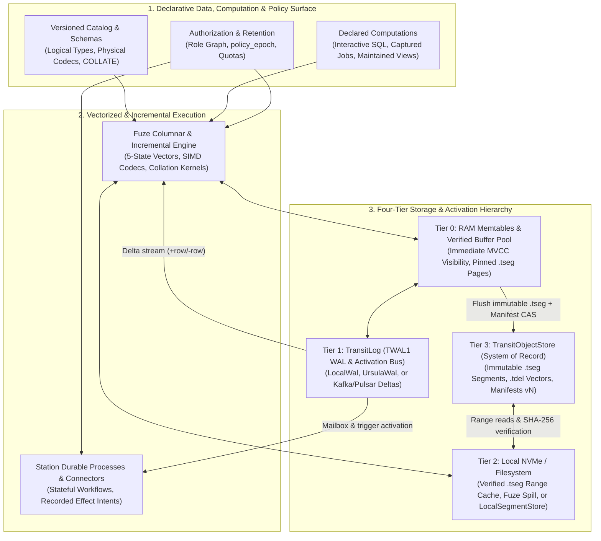

# Internals

Internals explains the computer-science models, storage and query mechanisms,
formal invariants, tradeoffs and empirical evidence behind Transit. Start with
the [data model](../reference/data-model.md), then trace how declarative schemas,
versioned catalogs, vectorized and incremental computations, and security/retention
policies map onto Transit's storage hierarchy and durable execution engine.

Transit's architecture rests on a single unifying thesis: **data, schemas and
derived computations are the primary declarative model; durable processes
(`Station`), write-ahead delta streams (`TransitLog`) and connectors are the
mechanisms that activate data, maintain derived views and coordinate external
effects.**

These nine accounts explain those mechanisms. The [guides and reference](../../README.md)
own usage and supported behavior; exact interface and wire definitions remain
with their owners. A shared way to reason about declarations does not imply
that every data kind already has the same executable lifecycle; each account
explicitly separates implemented mechanisms from target design analysis.

## Data and computation

| Account | Question |
| --- | --- |
| [System model and authority boundaries](system-model.md) | How do declarative schemas, versioned data manifests, WAL-driven activation and durable execution compose, and which owners establish each fact? |
| [State, publication and lifetime](state-model.md) | How do atomic visibility, complete table history, retention and manifest-based zero-copy branching/merging fit the same authority boundary? |
| [Query planning, snapshots and results](query-engine.md) | How do 5-state vectorized execution, composable physical codecs (`FSST`, `COMP-3`, `EBCDIC`), collations (`COLLATE`) and incremental maintenance produce attributable results? |

## Execution and interfaces

| Account | Question |
| --- | --- |
| [Execution, authorization and recovery](execution-model.md) | What permits a data operation, fenced partition lease or worker to advance after concurrency, `policy_epoch` revocation or failure? |
| [Clients, SDKs and Station](client-framework.md) | How do language APIs preserve shared protocol and ownership semantics? |
| [External effects and uncertain outcomes](effect-lifecycle.md) | What can durable execution establish about an external operation? |
| [SQL sessions, serving and operator interfaces](service-interfaces.md) | How do network and visual interfaces preserve authority and result truth, and how do shared SQL sessions separate connections from durable work? |

## Runtime and evidence

| Account | Question |
| --- | --- |
| [Storage, placement and observation](storage-runtime.md) | How do the four-tier storage hierarchy (`TransitLog` + `TransitObjectStore`), `.tseg` hybrid segments, multi-writer OCC and storage-disaggregated placement work alongside current B-tree page storage? |
| [Verification and the limits of evidence](verification-method.md) | Which methods support a claim, and what do they leave unproved? |

## Scientific standard and source basis

Internals and architecture explanations follow the [scientific standard](standard.md):
explicit questions and assumptions, precise claims, inspectable reasoning,
traceable evidence, reproducible methods, alternatives and limits. The
[technical account template](template.md) supports new and substantive revisions.

The declaration/observation framing uses the implemented owners at source
`5c1099f7`; it adds no common catalog, scheduler or runtime guarantee. These
accounts began by consolidating the repository's documented mechanisms at
source revision `b79a8a8`; revised sections identify their own source basis and
distinguish design analysis from implementation. They add no runtime qualification.
Each links current interface and implementation owners, the relevant recorded
proof and earlier reasoning.
Use the revision, configuration and limits attached to each experiment when
reproducing it; a documentation build does not rerun those experiments.

[Engineering history](../../history/README.md) preserves the detailed source records.
[Roadmap](../../roadmap/README.md) owns delivery plans; [Design](../../design/README.md)
owns UI/UX proposals and review outcomes. Those records are separate from these
accounts of system behavior and remain available through repository links.
