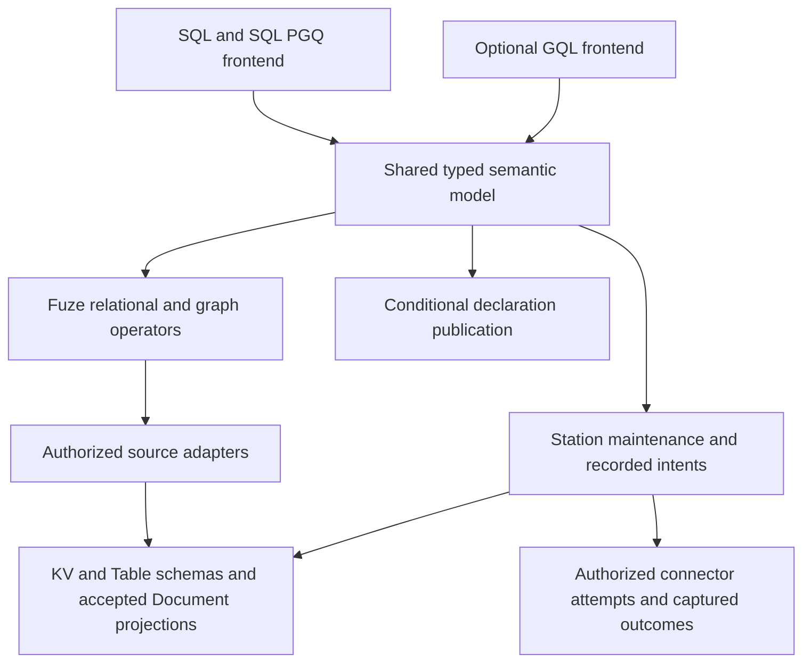
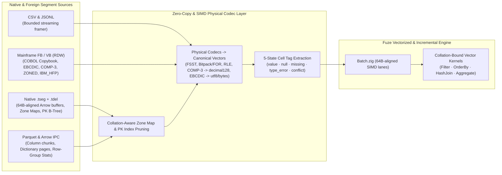

# Query planning, snapshots and results

This account asks how a declared computation produces a result that can be
attributed to its definition and source data, and what establishes completeness.
It connects the [data model's computation lifetimes](../reference/data-model.md#choose-a-computation-lifetime)
to SQL, Fuze, query ownership and Arrow. The [SQL](../reference/sql.md),
[query](../reference/queries.md), [Arrow](../reference/arrow.md) and
[Flight](../reference/flight.md) references own supported syntax, types and interfaces.

Read [model and dependencies](#model-and-dependencies) for how definitions bind
data, [execution lifetimes](#native-execution-lifetimes) for interactive and
captured work, and [maintained revisions](#complete-revisions-from-retained-table-transactions)
for successive complete results. The physical mechanisms below preserve those
semantics. Typed maintained owners require explicit host activation and wakeups;
they do not establish an automatic SQL materialized-view service.

## Direct Table snapshots and interrupted SQL reads

The question is how a finite SQL result retains its exact source when accepted
rows still live in the WAL, storage maintenance moves rows into segments, or a
gateway loses the acquisition reply. This account covers the direct Table
adapter and its local gateway recovery journal. It assumes the Table owner keeps
its append-only history and immutable snapshot objects, the local journal's file
and directory syncs establish durability, and native generation checks fence a
replaced SQL coordinator. It does not establish storage garbage collection or
resumption of an ordinary SELECT after session loss.

A retained Table basis names the object and immutable definition, the partition's
accepted frontier and logical-change frontier, the schema and snapshot content.
The snapshot root covers both WAL and segment locators. The paged row-identity
index orders rows independently of their physical location. A flush changes
locators while preserving this index and logical-change evidence. Repeated
relational scans therefore retain canonical contribution order across WAL and
segment sources. The [storage owner](../../../packages/zig/transit-storage/src/TablePartition.zig)
checks identity uniqueness before publishing the complete root.

[`DirectRelationalCompilation`](../../../packages/zig/transit-query-direct/src/DirectRelationalCompilation.zig)
binds current definitions without acquiring data. Execution supplies retained
pins and verifies the prepared interpretations. A cut explicitly identifies a
native resource or a Table partition. Separate Tables have independent frontiers
even when their catalog resource is the same; aliases of one Table reuse its
pin. A single resource revision would erase that distinction and incorrectly
promise consistency. Final batched authorization covers every input, including
an empty input that contributes no row. This check establishes current disclosure
rights, not a common data frontier.

The difficult interruption lies between remote pin acceptance and receiving its
handle. [`ReadCache`](../../../packages/zig/transit-sql/src/ReadCache.zig) stores
the original principal, acquisition identity and expected frontier in a Catalog
record before the first request. The returned handle stays in the resident cache;
recovery resolves the recorded owner and expected cut through `pin_status`, as it
does for a lost acquisition reply. Each account route has 64 durable slots; the
account shares 64 resident entries across routes. Concurrent statements borrow
an entry for the same Table definition and changed
LSN. A warm hit checks current metadata and authority without a new durable pin
or a per-query filesystem sync. Borrow counts protect in-flight cursors during
eviction; closing a cursor releases its borrow, not the cache's durable pin.

Eviction records closure before release. Recovery observes the original pin and
releases it or records its absence after a qualified original-frontier check.
It never chooses a fresh identity to resolve uncertainty. One pass reconciles at
most one slot. Current-generation cached entries stay protected; earlier-generation
and closing records are eligible. Denial or unavailable evidence retains the
record and reports a cleanup error without authorizing expiry. A disabled account
keeps its recovery binding until outstanding work and cache pins close.

The tradeoff is a bounded number of long-lived pins and cold-cache control writes
instead of per-query flushed local journals. The cache does not grant access or
make independent Table frontiers an atomic multi-source snapshot. All source
rights are rechecked before disclosure. Interactive transaction cuts require their
own database commit and retention contract.

The mechanism is falsified by an accepted acquisition with no recoverable original
request, cleanup of a current-generation active pin, changed interpretation under
a prepared handle, unstable row order after flush, or output disclosure after
rights are revoked. The direct Table service proof recorded in the [proof ledger](../../history/qualification/README.md)
exercises corrupted acquisition replies, node restart, generation replacement,
retained joins and revocation. Storage and SQL package tests cover root atomicity
and dispatch/terminal binding. The [proof ledger](../../history/qualification/README.md) records
executions and limits. These component/HTTP checks do not by themselves qualify
the default launcher or every installed SQL transport.

## Durable capture across the native and direct owners

The question is how a native computation can retain direct Table data without
claiming a transaction across its progress resource and the Table owner. This
account covers `UnifiedCapture` and the finite `RelationalCapture` adapter. It assumes native
commit fencing, the direct owner's durable idempotency and pin records, current
authorization checks, and preservation of accepted storage history. It does not
establish garbage collection or automatic computation scheduling.

The model has three separate identities: the immutable query bundle, the
worker-owned native job, and the original caller's Table pin operation. The
[source declaration](../../../packages/zig/transit-query/src/TableSource.zig)
binds the direct service audience and immutable interpretation. The
[bundle](../../../packages/zig/transit-query/src/Bundle.zig) binds a signed Table
grant to that description and the native execution route. A native resource
revision cannot stand in for the Table cut: independently accepted Table writes
advance their partition frontiers without changing the worker's progress state.

The worker first admits a job, then commits acquisition eligibility and a
permanent pin-owner claim. Only committed eligibility permits the direct pin
request. A lost reply therefore leaves an original operation to reconcile;
absence of the native handle is not evidence that no remote pin exists. The
claim rejects another job's attempt to reuse the same pin owner. The recorded
source evidence covers interpretation, immutable pin content, accepted and
logical-change frontiers, row count and native authority references. Bounded
pages reopen this pin and validate the complete evidence before returning rows.
Complete primary-key equality can instead seek the retained physical key index;
the reader verifies the returned row's actual key and exact basis. Absence is
evidence for that selection, not full-Table traversal. Both paths recheck current
rights before returning owned output, including empty output.
Native progress publication repeats the original caller's source guard, closing
the gap between a successful direct read and a later native commit.

Traversal completion and release have separate commit boundaries. A final Arrow
segment, checkpoint and job can consume all four native metadata mutations, so
the next turn records closure eligibility. Subsequent work cannot return to
source traversal. A later turn attempts direct release and records its observed
completion. The [retention owner](../../../packages/zig/transit-query/src/CapturedTablePin.zig)
keeps the original grant and evidence after closure. Result reads check that
evidence under a fresh disclosure subject; reopening a released pin would both
impede completed results and risk confusing cleanup with read authority.

Credential rotation illustrates why execution and cleanup use separate proofs.
Replacing a saved execution proof could restart revoked work. Keeping only that
proof could strand a pin indefinitely after rotation. An explicit closure proof
instead commits to the exact original grant, authorizes only pin reconciliation
and release, and is stored separately before use. Every remote attempt still
checks current caller and executor credentials and source rights. This preserves
the original execution epoch while permitting authorized cleanup. Unavailability
or continued denial leaves a visible pending obligation; liveness assumes a
future authorized retry and available storage.

The alternative of acquiring a pin before recording native eligibility would
leave unowned remote work after a crash. Combining both owners into one global
commit would introduce a transaction domain beyond the existing authority model.
The chosen protocol costs additional bounded control turns and stores permanent
operation identities. Source traversal owns at most eight decoded rows per page;
the number of durable jobs does not set resident collection size.

Allocation failure also needs an owner. A direct page read combines local schema
and row decoding with HTTP work using the client's separate allocator. The
[capture allocator](../../../packages/zig/transit-query/src/CaptureMemory.zig)
records failed allocations from the fixed adapter buffer. Only that evidence
allows `OutOfMemory`, or the allocating JSON writer's `WriteFailed`, to become a
durable adapter-budget failure. A
declined resize or remap can fall back to another allocation and is not such
evidence. Native read poisoning and external allocation errors preserve the
original attempt error, rolling back the proposed query progress. Inferring
local exhaustion from every unpoisoned page error would incorrectly close work
after a transient client failure.

Captured relational execution applies this protocol independently to each
distinct Table. Aliases of one exact declaration share a pin and cut; Tables in
one catalog can still have different frontiers. The coordinator records the full
vector only after all handles commit and all source guards pass. A revoked first
source cannot authorize output merely because a later source was acquired.
Partial acquisition therefore creates cleanup obligations, without establishing
a usable vector or an atomic catalog observation. Relational resume seeks one
ordered row after its accepted identity on the original pin; that suffix lookup
does not claim complete sequential consumption or change another reader's cursor.

The [direct captured-query proof](../../history/qualification/query.md#direct-captured-table-queries-and-separate-cleanup-authority--2026-10-23) exercises the public
signed service and real native hosts with independent progress storage, unflushed
rows, worker/node replacement and corrupted successful pin/release replies.
Its assertions distinguish the original cut from a renamed current definition,
and result disclosure from access revocation. The
[fixture](../../../tests/query/execution/direct_captured_query.zig) also exercises cancellation
and separately authorized cleanup after credential rotation. Its scoped relational
schedule covers a two-row self-join and two separate two-row Tables, including
replacement between acquisitions and result revocation/restoration. Installed
language consumers exercise single-source declaration, authorization, result
reading and cleanup preparation over the shared fault schedule. The
[proof ledger](../../history/qualification/README.md) records those outcomes and bounds; this
does not establish exhaustive interleavings, maintained-source migration,
independent language execution hosts or storage GC safety.

## Column execution and ordered failure frontiers

The question is whether private column computation can remove repeated dynamic
operator dispatch without changing accepted progress or disclosure. The model
has a serial source owner, a validated immutable plan, provisional lane outcomes
and one ordered consumer. Compute vectors are private and are not storage pages,
Arrow segments or committed work.

[`Batch`](../../../packages/zig/transit-fuze/src/Batch.zig) owns the bound plan,
fixed-width words, five-state tags, retained recursive payloads, selections and
original source locations in a byte-capped arena. Payload liveness is derived
from projection, comparison and aggregate dependencies. State-only predicates
and COUNT need tags; projection and comparison retain values. Source validation
precedes this specialization, so an unused field does not escape validation.

[`VectorKernel`](../../../packages/zig/transit-fuze/src/VectorKernel.zig) binds typed
comparison functions once and evaluates eager programs by instruction across
lanes. Each lane retains its first failing instruction. The ordered consumer
then visits original source positions, applies LIMIT, and checks every SUM
prefix. Consequently a later predicate error or decoding error cannot replace
an earlier aggregate error. A read-ahead failure is held behind its acquired
prefix. Original file position and native identity remain attached to the lane.
A valid row too large for the physical arena is evaluated under the existing
decoder owner rather than changing admission or increasing the compute cap.

SIMD comparison writes private masks; state tags determine truth, unknown or
failure afterward. The separate AVX2 object is reachable only after CPUID and
XSAVE/XCR0 checks. This guards that object, not unrelated native-target code;
a portable executable must itself be built with `-Dcpu=baseline`. Generic rich
values retain their logical comparison and ownership rules.

[`ComputePool`](../../../packages/zig/transit-query-direct/src/ComputePool.zig) belongs to
the host. One admitted batch is partitioned into disjoint lane and scratch ranges
across at most four workers. There is no queued backlog. Other queries compute
locally; the host must still bound query concurrency and decoder/output owners.
Cancellation joins all writes before releasing the private candidate. Sources,
current-right checks, ordered aggregation and publication never run on workers.
This construction bounds compute storage independently of durable cardinality;
it does not claim a whole-process RSS bound or parallel speedup for short work.

Relational [`RelationalKernel`](../../../packages/zig/transit-fuze/src/RelationalKernel.zig)
resolves stable IDs and binds comparisons at initialization or restore. Its
constant views have one lane because one step retains at most one source read
and group update. Bulk lookahead would need additional failure, budget and
checkpoint reasoning; preserving the existing quantum is the chosen tradeoff.
FZS1/FQS1 and relational checkpoints contain none of this private metadata.

The mechanism is falsified by any difference in ordered outputs, first failure,
checkpoint bytes, current-denial behavior or resident accounting under rebatching
and worker schedules. The [batch tests](../../../packages/zig/transit-fuze/src/batch_execution_test.zig),
worker tests and existing independent relational/source/Arrow proofs exercise
those observations. The [measurement guide](../../../tests/performance/query/README.md)
separates decoded kernels from owned-row and real file pipelines. The
[proof ledger](../../history/qualification/README.md) records which commands actually ran;
synthetic gains do not establish storage-bound or universal query speedup.

### Measured alternatives and limits

At `5b3d1ba6`, the [paired measurements](https://github.com/spoke-sh/transit/blob/a610ecd5dcff22f2d0177b61b905a8e985252c13/tests/fuze_benchmarks/results/2026-10-13-pipelines/README.md)
compare the frozen scalar semantic path, portable columns, guarded AVX2 and
one/two/four host workers. Owned-row workloads improve substantially, but
capture/decode and native controls change much less. Before temporary row-cache
reuse, ordered SUM misses its precommitted improvement threshold; the final
implementation meets it without reassociating contributions. This observation
supports reducing transient allocation as a useful mechanism, not a claim that
SIMD caused the whole-pipeline gain.

A stable 4 KiB cache owns at most one reusable decoder allocation. Larger or
simultaneous allocations use the original allocator. Public projected rows copy
into independent arenas, including when a valid input exceeds the physical
batch. This trades an additional bounded source allocation for less allocator
traffic; it does not remove decoder validation or bound caller-retained output.
Allocation-failure and output-after-executor-release fixtures challenge that
ownership argument directly.

AVX2 is slightly slower than the portable decoded loop on the measured host;
extra workers are inconsistent or slower on the selected complete pipelines.
The chosen defaults therefore keep portable computation and one worker. Explicit
host policies can select other qualified configurations. Different workloads or
CPUs could reverse that choice. The retained measurement summary describes
target-mismatch failures and shared-host confounders; archived raw samples remain
in repository history. Unavailable hardware counters prevent a
cycle-level attribution. Relational constant views retain the existing work
quantum, so this evidence establishes no multilane join acceleration.

## Model and dependencies

SQL lowers to a typed finite plan. A declared source fixes identity, schema or
decoder and supported access. A source adapter obtains authorized data at an
explicit basis; Fuze performs bounded computation outside kernel authority.
Arrow represents batches and interchange. None of those representations supplies
permission, persistence, a global snapshot or an execution guarantee by itself.

KV requires an explicit decoder; Table requires its declared schema; Document
queries use accepted projections. Missing, null, conflict, type error and ordinary
value remain distinct. Replacing any of them with an empty successful answer would
change the source's meaning.

## Native execution lifetimes

| Profile | Recovery evidence | Completion and cleanup |
| --- | --- | --- |
| Interactive session | Fresh leased source snapshot and bounded service execution | Complete/failed/cancelled result framing; release or lease expiry; a new logical session starts new work |
| Durable captured query | Frozen query identity, captured basis, recorded progress and immutable result publication | Verified complete manifest and ordered segment coverage; recovery follows the original identity |

Durability of application state does not require every read computation to become
a durable job. Interactive execution avoids recorded upload/progress/result turns
and gives up resumption of that computation after logical session loss or expiry. Captured queries
pay for durable bookkeeping in exchange for their specified result recovery.
These are distinct contracts, not interchangeable optimization settings.

The [shared SQL session boundary](service-interfaces.md#shared-sql-sessions-ownership-and-recovery)
moves ordinary console execution into the same service runtime as database wire
sessions. It preserves the distinction above: a service-hosted interactive read
still uses a temporary snapshot and does not become a durable query job. Replacing
an HTTP connection preserves its logical session; losing that session cannot
reopen the result. Explicit captured queries retain their original domain identity
across SQL service replacement. The [proof ledger](../../history/qualification/README.md)
records the executed session and source recovery schedules and measurement limits.

## Frozen file interpretation

The local CSV/JSONL implementation adds an ephemeral host-capture profile. This
section describes the mechanism at `073b6f9b` (2026-09-30), with contracts and
correctness evidence linked below. Its question is whether bounded discovery can
produce a stable interpretation without retaining the input in memory. It does
not describe durable file-job acceptance or a distributed snapshot.

Let B contain ordered content lengths/hashes, decoder options, discovery evidence
and a recursive schema. The host owns immutable seekable captures and current
access/cancellation callbacks; Fuze owns pure framing, discovery and execution.
The CLI writes private, unlinked disk captures under separate encoded/expanded
quotas. The source reference is the captured bytes, not the original pathname.
The argument assumes the host honors immutable handles and reports current
authority correctly; hashing cannot establish that a host is honest.

Discovery retains a bounded type tree and coverage counters. Explicit schemas
avoid inference; sampled schemas describe only their bounded prefix; full
discovery deliberately reads all selected content. Unresolved or heterogeneous
observations retain text/JSON according to the format contract. The binding
fingerprint commits B before typed rows are exposed. Execution checks every row
under that same schema and rejects late unknown fields or incompatible values
according to the selected policy. No emitted schema widens.

Each scan retains an 8 KiB input chunk, one at-most-64-KiB record and bounded
schema/header metadata. Each returned row owns its arena; the caller must release
rows instead of accumulating the result. Arrow adds a fixed 4 MiB workspace and
at-most-64-KiB output segment, containing at most eight rows. Thus engine resident
work is bounded by metadata, one record/row and output buffers rather than total
input length. Disk spooling still scales with captured bytes and remains quota
limited. This is a structural bound, not an RSS measurement; host allocators,
kernel caches and I/O machinery require separate measurement.

Source checks occur before reads and buffered disclosure, independently of
content hashes. Actual length/hash verification at EOF is the completion gate.
A malicious or changed source may therefore expose an incorrect provisional
prefix before detection; consumers cannot treat that prefix as a complete result.
Saved bindings require already acquired matching handles and fresh access checks.
They do not reopen a pathname, dispatch effects or authorize recovery.

Converting only projected fields would reduce work, but would suppress errors in
unselected input. Early success after LIMIT would similarly hide a malformed
tail or changed source. The selected contract validates full rows through EOF;
projection changes output without changing that obligation. Typed batches and
metadata reuse can reduce overhead only while preserving these checks. Their
performance is an experimental question owned by the
[measurement reference](../reference/performance.md), not a consequence of the
memory argument.

The [type](../../../contracts/FUZE_TYPES_V1.md) and
[source](../../../contracts/FUZE_SOURCE_V1.md) contracts define the exact model;
[FileSource](../../../packages/zig/transit-fuze/src/FileSource.zig) and
[FileQuery](../../../packages/zig/transit-fuze/src/FileQuery.zig) implement it.
Reproduce the independent numeric/framing/schema/ownership checks with the
pinned-toolchain commands in the
[proof ledger](../../history/qualification/query.md#fuze-bounded-file-sources), which records
results and scope. These schedules cover source replacement, denial/cancellation, allocation
failure and failed-prefix completion; they do not prove every parser input or
durable crash recovery. Broader native/Flight/Table admission remains separately
specified in the [capability matrix](../reference/sql/types.md#surface-capability-matrix).

## Correctness of a displayed result

Each page must belong to the same declared result and source basis. A transport
write or decoded first batch establishes neither completeness nor permission to
disclose later batches. Ordered coverage and the owning completion checks must
succeed before a consumer presents a complete answer. Current authorization still
applies to rereads of immutable bytes.

For interactive reads, a lease bounds snapshot ownership and cleanup after client
loss. A retained cache entry cannot extend the lease or retain permission. For
captured delivery, receiver-issued segment credit bounds active transport work;
retained result cardinality remains a different quantity.

An index access path must preserve the original predicate's meaning. A primary-key
seek may reduce visited rows, while predicate evaluation still determines matches.
The current [Table access paths](../reference/tables.md) do not establish generic
columnar storage merely because output is Arrow.

### Finite result transition models

The formal question is whether a result can retain truthful progress and
completion while consumption and session disclosure evolve independently. The
[logical result contract](../../../contracts/SQL_RESULTS_V1.md) supplies the
state tuple: immutable attribution, received/delivered counts, outcome,
consumption and release. The implemented
[Progress owner](../../../packages/zig/transit-sql-results/src/Progress.zig)
checks those transitions independently of transport. Two finite TLA+ models
make the safety obligations executable; their
[method and bounds](../../../tests/verification/models/README.md#finite-sql-result-models)
and [executed evidence](../../history/qualification/verification.md#sql-result-progress-and-session-models--2026-10-27)
remain separately attributable.

The progress model checks counter bounds, identity admission, terminal evidence,
exhaustion and independent release. Its runner compares every exported edge from
a representative path with the actual Zig owner, including rejected operations.
This correspondence covers the selected finite state abstraction; payload types,
unsigned-counter overflow and host memory ownership remain implementation tests.

The session model begins after a successful initial execute response and holds
one retained server batch and one in-flight response. It separates materialization,
disclosure and receipt, permitting lost/repeated replies, revocation/restoration,
expiry and early close. An independent sequence of row occurrences prevents
matching counters alone from legitimizing duplicate or missing rows. Completion
requires the original sequence and terminal count. Occurrence identity does not
require distinct SQL values or add an ordering clause.

Authorization is checked at server disclosure, including cached and empty
terminal replies. A response disclosed before revocation may arrive afterward;
local delivery of already received rows does not constitute a new server
response. The model represents current rights as one atomic predicate and does
not establish the implementation of credential, role or per-source checks.
Its protocol transitions have model negative controls but no native adapter/server
replay. Initial-response loss, durable write settlement and transaction decisions
are outside this session abstraction.

Separating the small progress owner from the protocol model keeps the executable
correspondence precise and the state space reviewable. A combined model of all
SQL execution and storage would require additional abstractions and proof
obligations. Both current models check safety without fairness or liveness:
unbounded loss or stalled cleanup need not resolve. Physical codecs, allocation,
network faults and retained-pin recovery continue to require their owning tests.

## Relational correctness and data movement

This section analyzes finite relational correctness and the additional
obligations for maintained and distributed execution. The original single-source
analysis uses revision `2c1a9d2d`; the implemented finite extension is scoped by
the [current query boundary](../reference/queries.md#relational-boundary).

The local [relational contract](../../../contracts/RELATIONAL_V1.md) now implements
plan/basis validation, shared SQL lowering and bounded execution for a finite int64/UTF-8
profile. It uses stable Table row IDs rather than assuming primary keys identify
every row: general Tables also allow duplicate rows without a declared key.
Its [independent oracle](../../../tests/query/execution/relational.py) materializes small relations
and compares the overlapping subset with SQLite; separate prefix arithmetic
fixes the ordered-overflow counterexample below. The
[intake evidence](../../history/qualification/query.md#relational-contract-and-oracle-intake)
distinguishes local checks, private-disk group growth, native interactive
source capture, maintained publication and manual exchange recovery. Those
profiles share one native authority; they do not establish distributed write
authority. Agreement on small finite relations alone does not
establish bounded execution over growing retained data.

The finite physical model uses ordered nested loops and an external AVL group
map. For L selected left rows, R right rows and G groups, the join can read
O(LR) right rows; group operations use O(log G) record reads/writes with a fixed number of
variable-sized record buffers and an index path bounded by the height possible for uint64
cardinality. Explicit work and disk quotas stop expensive executions. This
choice preserves canonical pair/error order directly and avoids a resident hash
table proportional to R or G. A partitioned hash join may reduce repeated reads,
but must restore canonical contributors before checked SUM; no such optimizer
is enabled here. Private spill is unlinked and cannot recover a captured job.
The heap accounting and bounded working buffers describe query-owned memory,
not process RSS or the transport client's separate allocations.

Variable-width values make the ownership bound separate from the row-count
bound. Each row or group-key vector admits at most 1 MiB of cumulative TEXT.
The operator retains owned join and group cursors; a checkpoint borrows those
cursors only until the next operator mutation, while restore copies them into
the host's allocator. The host charges live candidate encodings and retained
payloads against its resident budget before publication. Returned result rows
own their text and remain valid across later reads, but must be released before
the reader that supplies their budget allocator. Exchange routing hashes
canonical collation keys through a fixed scratch buffer rather than allocating
an expanded sort key. Ordered group iteration uses the external index; there
is no total-result sort array. The [TEXT and spill evidence](../../history/qualification/query.md#collated-text-relational-execution-and-owned-results--2026-10-26)
checks these lifetimes, growing private state and independent comparison/routing
oracles. It establishes the selected execution profile, not an optimized hash
join or a process-wide memory ceiling.

For resumable operator state, the question is how to advance a cursor without
modifying the previous accepted group map. The implemented
[immutable index](../../../packages/zig/transit-fuze/src/RelationalIndex.zig) copies
the search path and rotated nodes, then assigns the new root only after every
candidate save succeeds. Under the host's fresh monotone-ID and immutable-read
contract, failure cannot alter the old root's reachable records. Work is
O(log G) new records per update; retaining all versions increases durable bytes
with updates, while the resident path remains bounded. This trades write/storage
amplification for a small atomic root publication. An in-place map would need a
separate undo/WAL protocol to preserve that property; no comparative performance
claim is made for either design.

The [operator checkpoint](../../../packages/zig/transit-fuze/src/RelationalCheckpoint.zig)
binds this root to the exact source vector, join and output cursors, counters and
failure witness. Query-side Publication staging reconstructs candidate bytes from
the previous accepted state with the same reserved IDs. This establishes a useful
local invariant: incomplete staging cannot advance the accepted root.
The [captured owner](../../../packages/zig/transit-query/src/RelationalCapture.zig)
commits the checkpoint reference together with consumed input and output
coverage. Admission retains the exact request as well as data cuts: retaining
only a result's sources would leave restart dependent on a mutable or retired
request publication. Direct Table acquisition follows committed native eligibility;
each recovered handle records the source's exact authority objects. Native
authorization guards fence the turn that accepts a checkpoint against those
objects, independently of the query's own progress resource. They do not turn
the separately acquired source cuts into a cross-owner transaction.

Each candidate is reconstructed from the previous checkpoint and receives the
same reserved record IDs. Consequently a restart during staging can validate and
continue existing bytes before exposing any new output. A completed manifest
binds the accepted job, source vector, checkpoint and ordered output digest
chain. The public reader verifies that coverage and checks all source rights,
including sources that contributed no rows. Compared with retaining a mutable
cursor alone, this design incurs additional immutable records and native turns;
it makes the acceptance boundary independently inspectable.

Closure and collection have separate authority requirements. Releasing a pin
uses recorded identities and needs no read of its protected bytes. Direct pin
settlement still needs current permission; credential rotation can leave closure
pending until a separate fresh cleanup proof commits. That proof cannot replace
the accepted execution grant. Collection
walks contiguous private publication IDs and removes a bounded number of chunks
per turn, keeping permanent descriptors and failure evidence. A host that insists
on opening every foreign dependency before any handler can still starve closure
after revocation; the host must provide a fresh proposal using only its own
resource. The [checkpoint evidence](../../history/qualification/query.md#immutable-group-checkpoints-and-bounded-publication-staging)
and [captured lifecycle evidence](../../history/qualification/query.md#captured-relational-owner-and-results)
separate deterministic/reference-store schedules from native fault execution.
Neither immutable storage nor byte round trips alone establish worker
reassignment or distributed authority.

Interactive response recovery asks a narrower question: did this same host
already produce the requested page? The
[caller session](../../../packages/zig/transit-query/src/RelationalBridge.zig) retains
one native row before allocating a foreign response. An explicit ordinal can
repeat that row or advance by one; it cannot skip or replay an arbitrarily old
prefix. Resident response state therefore does not grow with result length.
The [owned caller](../../../packages/zig/transit-query/src/RelationalCaller.zig)
can inspect the active reference and current ordinal without executing another
step. Board uses this observation after a lost open response or browser reload.
All disclosures, including current-page retries and terminal coverage, validate
every source's current rights. Host replacement discards this state and rejects
the old reference. This mechanism solves response uncertainty within one host;
it supplies neither a durable checkpoint nor permission to recompute a lost query.
The [caller evidence](../../history/qualification/query.md#neutral-relational-caller-pages) and
[installed SDK evidence](../../history/qualification/sdk.md#installed-interactive-relational-sdks)
separate this boundary from captured execution and maintenance.

The relevant question is whether changing data placement could change a query's
meaning. In a conceptual multi-source model, let Q denote a typed logical query
and B a vector of exact source revisions. An attributable result would need to
identify both Q and B. Independently sampled source snapshots establish a vector
of observations; they do not establish a common instant or a cross-resource
transaction. A snapshot alone also says nothing about future input completeness.

There are two different movements. An **exchange** routes records by the key
needed by an operator, for example from source partitions to join-key partitions.
A **rebalance** changes which worker handles a logical partition. Either can
change arrival order, batch boundaries and retry schedules. Existing durable
PIDs and source identities separate logical work from a worker; they do not
specify relational equivalence across those physical changes.

### Counterexamples that constrain an extension

| Situation | Consequence for a declarative guarantee |
| --- | --- |
| Two left and three right rows share a matching value | A bag join has six row pairs; deduplication by projected value would change the answer |
| No right row has arrived yet | A left-join unmatched row needs evidence that the right input is complete at the stated basis |
| One source changes between two snapshot acquisitions | A reproducible vector can still describe a combination that never existed at one instant |
| A retry contributes one row twice | Counts and sums change even if transport eventually delivers every packet |
| A materialized source grant is revoked | A derived result's storage reference cannot replace current source disclosure authority |

Checked arithmetic adds an existing, concrete constraint. Fuze's int64 sum folds
in source order and fails on an overflowing prefix. For `[MAX_I64, 1, -1]`, the
second addition fails; `[MAX_I64, -1, 1]` succeeds. Summing the final mathematical
total with a wider accumulator or combining arbitrary partial sums changes that
observable failure behavior. Thus a relational specification has to include
order and errors as well as successful row values. The current implementation
is [UnifiedStream.step](../../../packages/zig/transit-fuze/src/UnifiedStream.zig);
the [rewrite proof scope](../../../contracts/sql/README.md#lean-scope) explicitly
excludes general reassociation of checked sums.

A maintained relation introduces another observation boundary. If a source
update removes one value and inserts another, publishing only half the update
exposes a result for a source state that was never committed. Operator state,
consumed input coverage and published output therefore need a shared visibility
decision. The existing native one-resource turn and immutable publication provide
building blocks; they do not already define this multi-source maintenance ledger.
Similarly, coalesced Table invalidations cannot reconstruct every intermediate
row change. Finite refresh and complete change maintenance have different
observable histories.

### Resource costs and limits of the argument

Hash placement can colocate equal keys, but it cannot remove join fanout: L left
rows and R right rows for one key can produce L × R pairs. More workers also do
not make an order-sensitive hot group freely reducible. Resident memory must be
bounded separately from retained operator state, output and recovery evidence.
Spill, backpressure or explicit quota failure preserve the possibility of an
exact answer; silently evicting live join state changes its meaning. Default
unlimited [retention](../reference/retention.md) supplies no implicit state TTL.

These are deductions and small counterexamples, not runtime proofs or measured
performance claims. They assume exact source identities and declared relational
semantics; they establish neither a distributed snapshot nor liveness under
partition. Reproduction of the arithmetic counterexample follows the checked
fold above; independent page/order/failure fixtures are needed before any new
operator or rewrite can claim equivalence. Existing
[verification limits](../reference/verification.md) still apply.

### Complete revisions from retained Table transactions

The implementation question is whether a consumer can keep an exact relation
while a query restarts between small native writes and its inputs continue to
change. The selected model is `R_k = Q(B_k)`: each basis contains one complete
logical direct Table position per distinct Table, each result uses the same
canonical finite semantics, and each delta is the ordered difference from
`R_(k-1)` to `R_k`. Aliases of one Table share a cut; two Tables in one catalog
remain independent. This scope excludes event-time finality, a catalog-wide
transaction and distributed write authority.

[RelationalHistory](../../../packages/zig/transit-query/src/RelationalHistory.zig)
obtains each logical Table root through an original-caller history lease and
exact WAL record commitment. The complete source record also binds its physical
schema, declaration, row count, last logical row-change position and native
authority references. Query progress lives in an independent native resource.
A recorded choice between Tables establishes processing order without a global
snapshot. The argument assumes the Table owner preserves complete predecessor
records and accepted immutable objects; gaps fail explicitly. A stored hash is
evidence to validate, not authority to read it.

Physical history and logical revisions have separate coordinates. A wake records
an upper bound for each Table and starts a bounded scan after the preceding
logical cut. Admission, cancellation, flush and other storage records may produce
an empty page. Persisting that page's cursor permits replacement to continue
without rescanning the same prefix. Selecting a logical acceptance records a new
full source vector before computation. An accepted no-op has its own WAL
commitment even when its rows and last row-change coordinate are unchanged.
Treating all physical records as results would invent revisions; collapsing
unchanged logical acceptances would lose the selected transaction granularity.

[RelationalMaintenance](../../../packages/zig/transit-query/src/RelationalMaintenance.zig)
first records a successor basis, then reconstructs bounded finite work from its
last accepted checkpoint. Immutable candidate nodes, output rows and delta pages
remain private until one root publication binds their complete coverage. By
induction over that root publication, the visible result is either the prior
complete `R_(k-1)` or the complete `Q(B_k)`. Losing a proposal does not change the
root. Losing a receipt requires the original native retry; regenerating a new
submission is not part of this argument. Direct reads check the original
caller's current rights; native authorization guards fence subsequent progress
and result publication. A lease preserves data, never continuing permission.

The delta merge compares stable identities, then values. A changed output ordinal
without changed values creates no logical delta. A same-identity value change is
one before/after pair. First/last outer matches change the set of pair identities;
all their removals/insertions belong to one complete transaction. A consumer
applies a private candidate and advances its saved position only after complete
coverage. [RelationalRevision](../../../packages/zig/transit-query/src/RelationalRevision.zig)
checks the exact predecessor, both bindings, ordinals, digests and chain; partial
replay cannot silently select a newer baseline.

The initial implementation recomputes each exact basis, including no-op bases.
This preserves the existing ordered SUM witness without a second aggregate
algorithm. It costs a full canonical nested-loop scan and immutable group build
per transaction: for two unfiltered inputs, up to `L × R` pair visits, with
bounded tree work per aggregate update. It retains older checkpoints and output
versions, so state grows with accepted work until an explicit quota stops it.
Resident buffers depend on source/schema limits and tree height, not that retained
cardinality. This is a correctness construction, not evidence of sustainable
catch-up or an incremental speedup.

Updating only affected join-key ranges/groups could avoid unchanged work. That
alternative needs ordered contributor indexes, exact both-side cross terms,
canonical error preservation after deletion, and a checked way to reuse state
across different bound fingerprints. Reusing a stored group total alone fails the
ordered-overflow counterexample above. Those optimizations must agree with this
complete-basis construction; they cannot coalesce logical revisions or skip an
earlier failure whose arithmetic would fit at a later basis.

The [proof ledger](../../history/qualification/README.md) records executed schedules and their
source definitions and reproduction commands. The
[direct query runner](../../../tests/query/execution/direct_captured_query.py) starts private
local nodes and drives the signed direct service with native computation progress; its
maintained cases cover aliases and independent Tables. Pure source/vector record
checks cover interpretation, full-width coordinates and malformed bytes.
The direct failure schedule covers work/spill limits, ordered overflow, a
service-reported history gap and a separately accepted rebuild. The failed
identity stays closed and its last complete result remains unchanged. Direct
exchange checks cover initial and successor attachment with one producer and
one/seven partitions. Earlier actor-backed schedules establish their recorded
profile only. Cleanup rotation, multiple workers, lag/state and broader fault
schedules require their own direct evidence. Finite small-row checks
establish neither sustainable catch-up nor performance at large cardinalities.

### Immutable names and query attribution

Named query attribution asks a separate question: how can an accepted query
retain its definition when a mutable name later points elsewhere? The
application owner stores immutable definition revisions and a conditional name
head. Publishing validates the frozen bundle and retains its native request cut;
it neither captures source data nor activates execution. Current native and
catalog policies remain assumptions of each operation.

An explicit policy operation atomically writes the current query policy and an
immutable archive keyed by publishing peer and policy revision. Existing query
roots already retain both fields and their original request. They therefore join
to a permanent named definition without adding a fifth admission mutation. A
name replacement changes only the name head; policy replacement does not rewrite
the archive or an earlier root. The archive supplies attribution, while the
current policy supplies authority. Confusing those two would let an old allowed
record bypass revocation.

Dependency preparation raises a second question: how can the caller register an
exact definition before its native publisher chooses a retained read version?
The logical reference hashes the namespace/object/revision, immutable publication,
full bundle fingerprint, original peer and lifetime. The retained native version
is a physical locator in the stored definition, outside that logical digest. The
publisher verifies the actual bundle against the prepared digest; native history
authenticates the locator. Hashing the later locator would prevent preparing an
exact graph edge before publication without a separate reservation protocol.

The saved publication plan binds each distinct source to that logical reference.
Its source catalog accepts registration under the caller's source SELECT and
computation metadata WRITE rights. A point inspection verifies current membership
before the caller dispatches the separate native publication. Checking only the
registration receipt would be unsound after explicit removal: receipts remain
immutable while graph membership changes. Catalog and native acceptances are not
one transaction, so authorized removal can race publication. The application must
preserve protection across uncertain native acceptance and resolve or fence
pending work before abandoning its registrations. This workflow does not supply
automatic reconciliation or prevent an authorized administrator from removing an
edge.

Exact definition retirement records a permanent marker. New authorization and
activation reject it; the immutable definition, attribution and existing query
work remain. A retired head frees only the name for a fresh object. Graph removal
is separately authorized, and data retention remains with accepted query pins and
history leases. Thus freeing a name cannot relabel an old result, and replaying an
old publication or registration receipt cannot revive the name or edge.

This design uses another retained record and explicit authorization step instead
of enlarging the query root or introducing a separate execution engine. It
preserves the existing one-resource atomic boundary and current-policy revision
checks. Logical namespace quotas include immutable records and declared bundle
bytes; they do not measure the complete physical retained resource cuts. History
has no implicit expiry. The [naming contract](../../../contracts/NAMED_RELATIONAL_V1.md)
and [implementation](../../../packages/zig/transit-station-app/src/NamedRelational.zig)
specify the current definition and its coordinated stored-format cutover. The
[saved publication owner](../../../packages/zig/transit-station-app/src/NamedRelationalPublication.zig)
implements the explicit cross-owner workflow. Independent record bytes, conditional-retry tests
and disk recovery are reproducible through the [proof ledger](../../history/qualification/query.md#named-relational-definitions).
This mechanism does not establish SQL view syntax, network subscription delivery
or effect dispatch.

### Durable acceptance and canonical source order

The exchange implementation asks how partitioned delivery can preserve the
finite executor's original source order without retaining all partitions in
memory. Its scope is explicit worker placement under one growing authority,
with immutable bound inputs and current source authorization. It assumes the
producer implementation reads the declared basis honestly; native admission
does not certify its computation. The exact model is in the
[exchange contract](../../../contracts/RELATIONAL_EXCHANGE_V1.md).

For each source/partition pair, let A be the number of consecutively accepted
segments and C the number consumed, with `0 <= C <= A`. Acceptance copies verified
bytes into receiver-owned storage before advancing A. Consumption inserts one
source-qualified row-index entry with its cursor atomically and advances C only
after the complete segment. Credit is charged at A and returned at C, so an
acknowledgement retry changes neither backlog nor credit. A producer can retire
its copy after acceptance without invalidating the receiver's evidence.

The receiver admits no acceptance gap. Otherwise several future segments could
fill all shared credit while their missing predecessors remain unaccepted,
preventing any consumption. Reordered notices instead retain their producer
identity and wait for the missing sequence. This is a scheduling choice, not
loss of accepted work. Hosts must service consumption and exact-notice retries.

Completion requires every registered source/partition to consume its explicit
terminal segment. Stable row identities are unique within each source and form
native ordered KV keys. Therefore the resulting index enumerates exactly the
accepted bag in original source order, irrespective of arrival or partition
layout. The unchanged finite executor sees the same contributor sequence and
thus the same first checked-arithmetic failure. This avoids assuming associative
int64 SUM or prematurely declaring an unmatched-left row.

The tradeoff is an extra durable copy and source-order index, followed by central
operator evaluation. It distributes source delivery but does not establish
parallel aggregate throughput. A k-way merge would avoid some indexing but needs
bounded multi-pass fan-in and retained run coverage; partial sums additionally
need an error-preserving algebra. Neither alternative is assumed by this profile.
One staging record, four-row segments and native eight-entry reads bound resident
work independently of total partitions. Retained state grows with accepted rows
and segments; conservative logical quotas and physical deployment quotas remain
separate. No pressure-based expiry is allowed.

Reproduce the [executed checks](../../history/qualification/query.md#relational-exchange-transitions)
with pinned Fuze/query package tests and the independent Python exchange fixture
checker. Rebatched finite cases preserve all 315 oracle answers and witnesses;
the reference-store schedule exercises nine partition/batch combinations,
duplicate acknowledgement, denied producer rereads, credit and quota pressure.
The historical native exchange task ran producer and receiver hosts against
disk Ursula with bounded hot/cache storage and a local cold store.
It loses accepted staging/acceptance replies, reconstructs workers, restarts the
node/store and publishes the maintained result for two partition/worker layouts.
The four-row-per-source input establishes those recovery and semantic cases; it
does not establish cardinality scaling or sustainable throughput. Native
generation replacement with the same credential is also distinct from recorded
handoff and credential retirement. The ledger retains the precise measurements,
failed host attempts and each separate fault/capacity schedule.

The direct-source implementation separates the receiver PID/resource from Table
ownership. Its signed assignment includes that destination, and both producer
retry and receiver acceptance check the recorded destination. Each producer
borrows only the assignment's exact direct cut. The caller signs the original
lease grant plus the worker, target and assignment commitment; the data owner
checks current caller/executor authority before and after reading. Workers cannot
release the coordinator's lease or select later history through this permission.
This separates read distribution from retention ownership without sharing the
coordinator's credential. It adds one explicit caller signature per source and
worker assignment. The public direct schedule changes live data before the first
scan, preserves that scan's selected cut and requires a fresh attachment for the
successor. It also retires the live request while the accepted computation keeps
its retained request version. This tests separation of publication lifetime from
computation lifetime. The earlier native host must be migrated before its
historical fault evidence qualifies the direct-source implementation.

### Boundary for historical and shared execution

Which evidence can the current plan safely carry into future historical or
shared dataflows? The implemented bound plan contains exact source identities,
schemas, explicit native or Table-partition cuts and a definition fingerprint.
Same-Table aliases must share one cut. The maintained vector records complete
logical Table acceptances,
including no-output progress. These facts let the present two-input executor
distinguish a completed result from an observed prefix. The
[relational contract](../../../contracts/RELATIONAL_V1.md#source-basis-and-lifetime)
and [history record checks](../../../packages/zig/transit-query/src/RelationalHistoryRecord.zig)
are the implementation evidence for that boundary.

A future join of two versions of one resource needs two explicitly qualified
bindings and identities; removing today's equal-cut check would make an old
accepted plan mean something different. A future fan-out/rejoin needs per-edge
coverage of the common basis. Its fast path at basis 11 and slow path at basis
10 cannot establish completion of basis 11. Empty filtered paths must still
publish progress. The present executor has no general dataflow DAG, historical
namespace selector or branch resolution operation, so it cannot infer any of
this evidence from resource revisions, branch names or arrival order.

Sharing an immutable index is a physical optimization only when source,
interpretation, key order and change coverage match and current rights still
hold. Each query must retain its own publication, progress, cancellation and
recovery identity. Current maintenance deliberately recomputes each complete
basis; it does not reuse another query's group totals. That choice preserves
canonical checked-SUM failures but incurs full-input work on every successor.
The alternatives are an ordered contributor index or another summary proved
equivalent for both results and first errors; neither follows merely from equal
SQL text. Historical selectors, shared arrangements, multi-model adapters and
temporal operators therefore require explicit additional contracts. The
[historical binding model](#historical-schemas-and-query-binding) and
[state ownership model](state-model.md#schema-history-and-branches) develop those
proposals separately from current execution.

## Tradeoffs and evidence

Materializing an entire result simplifies presentation but makes memory scale
with answer size. Bounded batch verification and paging require explicit identity,
completion and ownership handling. Sharing typed plans avoids separate SQL and
SDK execution semantics, while parser acceptance alone cannot establish that a
statement has an executable owner.

The [Fuze package](../../../packages/zig/transit-fuze/README.md),
[interactive contract](../../../contracts/INTERACTIVE_QUERY_V1.md),
[compatibility matrix](../../../packages/zig/transit-query/docs/compatibility.md) and
[query evidence](../../history/qualification/runtime.md#m18-qualification) connect these claims
to implementation, commands and source-specific limits. The
[SQL proof program](../../../contracts/sql/README.md) states the assumptions of its
selected rewrite results; it does not prove the whole engine. Performance claims
must use the [measurement record](../reference/performance.md).

General continuous SQL, arbitrary joins/sorting and cross-resource transactions
are not implied. Historical details remain in the [Fuze](../../history/FUZE.md),
[query-language](../../history/QUERY_LANGUAGE.md), [Arrow](../../history/ARROW.md) and
[flow-control](../../history/FLOW_CONTROL.md) records.

## Standards and multiple data models

The following is design analysis, researched on 2026-09-29 against source
`113588b6`, rather than an account of implemented graph or continuous execution.
It asks which language boundaries let relational, document and graph computations
share Transit without adding a storage primitive for every notation. The
[SQL reference](../reference/sql.md) remains the authority for executable syntax.
No conformance, performance or recovery result is established by this analysis.

### Standards provide several targets

SQL/PGQ and GQL already have published editions. The relevant distinction is
between standardized query semantics and the additional lifecycle needed to
maintain a computation and dispatch external effects.

| Reference | Role in the design | Limit of the reference |
| --- | --- | --- |
| [ISO/IEC 9075-2:2023, SQL/Foundation](https://www.iso.org/standard/76584.html) | Relational expressions, types and query composition; SQL/JSON for relational access to structured values | Selecting features does not establish SQL Core or whole-standard conformance |
| [ISO/IEC 9075-16:2023, SQL/PGQ](https://www.iso.org/standard/79473.html) | Property graph mappings and graph pattern queries within SQL | Does not establish Transit snapshot, mutation or continuous-maintenance guarantees |
| [ISO/IEC 39075:2024, GQL](https://www.iso.org/standard/76120.html) | A graph language with its own types, queries and data-management semantics | A second language frontend needs its own conformance evidence |
| [ISO/IEC 9075-9:2023, SQL/MED](https://www.iso.org/standard/84804.html) | Foreign-data integration and separation of logical tables from external access | Provider options and Transit's capture/replay rules need their own contracts |
| [PGQL 1.5](https://pgql-lang.org/spec/1.5/) and [openCypher resources](https://opencypher.org/resources/) | Named dialect specifications, grammar and test inputs for comparison | Neither dialect is interchangeable with SQL/PGQ or GQL |
| [Streaming SQL expert-group report](https://arxiv.org/abs/2311.03476) | Primary account of attempts to reconcile streaming models | Describes work through summer 2023, not a published universal streaming contract |

The ISO catalog pages also list 2026 corrigenda for the four cited standards and
successor committee drafts. Pin the edition and reviewed corrections when
qualifying a feature; a draft is not a replacement standard. This review used
public catalog records and implementation/specification documentation, not a
clause-by-clause audit of the full normative texts.

SQL/Foundation supplies much of a declarative computation: expressions, joins,
grouping, common table expressions and recursion describe derived relations.
Analytic windows and row pattern recognition are useful feature targets, but
neither alone defines an unbounded event-time computation. Durable activation,
snapshot-to-change handoff, progress frontiers, retractions, finality and external
outcomes require additional semantics. The standards reviewed here do not supply
a complete portable contract for that combination. This is a scoped finding,
not a claim that no other streaming standardization work exists.

The proposed primary surface is SQL with selected SQL/PGQ features. GQL is the
secondary graph-language target. Cypher and PGQL are useful comparison and import
targets only when a named subset can be lowered without changing its meaning.
For example, [Cypher's GQL conformance account](https://neo4j.com/docs/cypher-manual/current/appendix/gql-conformance/)
explicitly distinguishes shared, unsupported and additional features. Familiar
`MATCH` syntax alone cannot settle path multiplicity or update semantics.

### Separate shape, access and execution

The proposed model separates five independent facts:

| Fact | Examples | Owner |
| --- | --- | --- |
| Durable state | Resource identity, revision, accepted head, current grants | Native state and Station |
| Logical shape | Relation, accepted structured document, property graph | Typed declarations and Fuze operators |
| Access binding | Local state, captured input, foreign object manifest | Authorized source/connector adapter |
| Evaluation | Finite snapshot, maintained result, observed change stream | Query and maintenance lifecycle |
| Effects and traits | Source reads, local writes, external attempts; determinism, boundedness, change mode | Shared compiler plus runtime admission |

A graph definition is a catalog object with identity and dependencies. It need
not be a new native storage kind. A materialized view is a query plus maintained
state and progress. A subscription observes results. A connection describes
external access; source and sink bindings describe input and output roles.
These distinctions prevent catalog names from becoming new execution authorities.

This diagram is a proposed decomposition. The existing shared finite plan is its
starting point, not an implemented graph/dataflow intermediate representation.
SQL, visual editing, CLI and SDKs must produce the same typed objects. Query
nodes, declaration commands and effect activation remain distinct variants;
parsing a definition cannot start a job or an external attempt.

### What the existing resources buy

KV supplies general keyed state and explicit codecs. Tables supply typed rows
and keys over that state. Documents supply structured identity, causal edits,
accepted revisions and conflict semantics. They are already different framework
contracts over the native resource boundary, not three unrelated storage engines.

| Computation | Proposed representation | Additional semantics needed |
| --- | --- | --- |
| Relational dataflow | Table or explicitly decoded KV relation | Richer row schemas, joins and maintained-query progress |
| Document analysis | Relation projected from an accepted Document basis | Explicit path expansion, stable row identity and conflict handling |
| Property graph | Vertex and edge relations plus a graph mapping | Element identity, endpoint mappings, labels, paths and graph operators |
| Time-series analysis | Relation with declared event-time column and change contract | Timestamp/interval rules, windows, watermarks and late-data policy |
| Image/audio/video processing | Metadata relation referencing immutable captured/publication bytes | Media types, bounded decoding, provenance and recorded model/tool outcomes |
| Vector search | Typed vector values/projections and derived index | Dimension, metric, exact/approximate result contract and index basis |

SQL/JSON is useful for relationalizing JSON values; see the
[PostgreSQL SQL/JSON implementation reference](https://www.postgresql.org/docs/17/functions-json.html).
A Transit Document is not merely a JSON blob: it also carries causal identity
and explicit conflicts. A JSON projection must define missing-path, explicit
null, type-error and conflict treatment. Preserve the native five-state result;
an explicitly requested SQL-value conversion may reject unresolved states or
apply a declared policy, never silently select a conflict winner. Such conversion
is a future typed operator, not a second permissive decoder for old data.

The same principle applies to graph properties and vector inputs. Binary data
can be referenced through bounded immutable publication; placing a URI in a row
does not retain the object or authorize fetching it. Embeddings and remote model
responses require recorded provenance and outcomes. A model name or a seed does
not establish replay determinism.

The design judgment is to add no native Graph, Stream, Vector or Media resource
kind initially. Add logical types, catalog definitions and specialized indexes
when required. Reconsider a native primitive only for a demonstrated authority,
atomicity, lifetime or storage obligation that cannot be met above the existing
boundary. KV can encode a graph, but that fact alone proves neither adequate
traversal performance nor correct graph updates.

### Graphs require identities and a consistency policy

A directed property multigraph can be modeled as `G = (V, E, src, dst, labels,
properties)`. Vertex identity includes its graph mapping, element-table identity
and declared key. Edges have their own identities: two edges with identical
endpoints can be distinct. Labels and typed properties are independent of those
identities. Reusing a SQL alias must not silently change durable identity.

A graph mapping over separately captured resources has a basis vector
`B = (b_vertices, b_edges, ...)`. That vector describes observations; it does not
establish one transactionally consistent cut. Capturing vertices before an update
and edges after it can expose a missing endpoint even when the writer's intended
graph was valid. The first proposed profile uses finite reads over an explicit
validated basis. It rejects duplicate/null identities and invalid endpoint
mappings under its declared constraints. It must not silently omit invalid edges.

A coherent publication can instead stage immutable vertex/edge partitions and
publish one validated graph manifest through an existing atomic head. This is a
possible Station composition requiring its own contract and recovery evidence.
It is not supplied by two ordinary Table handles today. Multi-resource graph
updates, cascading deletes and general GQL transactions remain separate work;
do not split a promised atomic graph mutation into unrelated turns.

Fixed-length patterns can often lower to relational joins. Variable-length paths
also need graph-aware operations and explicit walk/trail/simple-path, zero-length,
direction, multiplicity and shortest-path tie rules. Preserve these in the typed
model rather than flattening every pattern immediately into joins. Recursion
and cyclic graphs can yield huge or infinite answers. Bound active traversal,
spill, steps and output; reject or report incomplete execution when a budget
ends. A hidden depth cap cannot turn a prefix into a complete result.

### External is an access qualifier and multi-format `SegmentReader` boundary

`CREATE EXTERNAL TABLE` is a useful user-facing idea, but its spelling does not
establish SQL-standard conformance. Prefer the SQL/MED foreign-table vocabulary
as the canonical target. [PostgreSQL's CREATE FOREIGN TABLE reference](https://www.postgresql.org/docs/17/sql-createforeigntable.html)
identifies its SQL/MED alignment and its extensions. S3 bucket, file format and
capture options remain typed Transit/connector options.

A foreign table is a relation with an external read binding. It does not imply
ingestion, a continuous watcher, writable remote storage or external transactions.
Use a source binding for captured ingestion and a sink binding for recorded
output. An S3 table source is unrelated to Ursula's use of S3 as cold storage;
query adapters never receive backend authority.

In the target storage and query architecture, native tables and foreign tables
share a single vectorized **`SegmentReader`** boundary into `Fuze`'s
`Batch.zig`:

For a replayable computation over foreign files (`PARQUET`, `ARROW_IPC`, `CSV`,
`JSONL`, or mainframe `FIXED_RECORD`/`VARIABLE_RECORD`), capture freezes a paged
manifest and its exact object versions/content commitments (`SHA-256`), schema,
physical encodings, collations and capture identity. Missing or changed bytes
fail explicitly. Credentials remain references and every disclosure rechecks
current policy (`policy_epoch`).

### Logical types and physical codecs and collation semantics

The question is whether a Table value keeps its meaning when WAL rows become
column pages or an index compares text. The model separates logical type
$\tau$, physical encoding $\epsilon$ and collation $\kappa$. Encoding changes
bytes; it must not change the accepted logical value. Collation determines
ordering and equality; it is independent of whether the text is stored as UTF-8,
CP037 or a compressed symbol stream. The
[representation contract](../../../contracts/TABLE_SCHEMA_V1.md#physical-representation-and-collation)
owns admitted combinations and value limits.

`TableSchema` validates both descriptors and value-dependent representability
before a row can enter the Table WAL. This is necessary because postponing an
encoding error until flush would leave accepted rows permanently unflushable.
Packed/zoned decimal therefore admits at most 31 decimal digits, and binary
COMP admits signed integers through 64 bits. HFP accepts only its normalized
range, converts the binary significand exactly and preserves signed zero.
Out-of-range values reject instead of rounding or underflowing to zero. RLE and
dictionary distinguish floating zero signs because compression must preserve
stored bytes even though SQL equality treats those zeros as equal.

[`Ebcdic037`](../../../packages/zig/transit-fuze/src/Ebcdic037.zig) uses the full
[Unicode-hosted CP037 table 2.00](https://www.unicode.org/Public/MAPPINGS/VENDORS/MICSFT/EBCDIC/CP037.TXT),
including controls and Latin-1 scalars. Encoding iterates UTF-8 codepoints;
reinterpreting UTF-8 bytes as Latin-1 would corrupt accented text. CP037 has a
256-scalar repertoire; unrepresentable characters reject. Decoding may expand
each physical byte to two UTF-8 bytes. `icu_root` rejects: a byte-weight
approximation cannot establish a Unicode collation version or locale contract.
Other codepages, PAD SPACE and versioned Unicode collation need explicit
contracts before admission.

[`PhysicalCodecs`](../../../packages/zig/transit-fuze/src/PhysicalCodecs.zig)
writes bounded `TCP1` pages with the shared definition identifier. Decoding
checks complete framing and codec identity. Foreign mainframe decoders expose
invalid or inexact values as `type_error`; they do not silently substitute a
number. General pages retain five-state cells, while ordinary Table acceptance
rejects stored error/conflict states. These are different input profiles.
Qualified plain pages use aligned Arrow value buffers with separate five-state
metadata. The verified segment reader retains encoded pages while borrowing
compatible payloads; compressed and unsupported layouts use bounded decoding.
The [reader contract](../../../contracts/TRANSIT_STORAGE_V1.md) defines those
layouts and ownership limits. The symbol-table codec is Transit-owned and does
not claim upstream FSST format compatibility. SIMD mainframe conversion is a
separate extension, not a consequence of an encoding name.

For valid text in an admitted collation, the implementation must establish
$u \preceq_\kappa v$ if and only if
`memcmp(sort_key(u, κ), sort_key(v, κ)) <= 0`. `Collation` uses the same CP037
mapping for comparisons and keys, and folds only ASCII A–Z for `ascii_ci`.
Zone maps and primary-key indexes consume these keys. A predicate can use their
bounds only when it has the same collation. Finite SQL plans carry a value-owned
128-column collation workspace; only the input fields are serialized, and unused
slots must be none. FQP1 fingerprints and TQS1 source commitments include the
complete vector. The retained source checks it against the exact Table schema,
so a caller cannot substitute binary comparison while retaining the same source
identity. Scalar predicates, decoded vector/page kernels, oversized-row fallback
and Table UPDATE/DELETE share the declared comparison semantics. Prepared
parameters acquire the vector from their original declaration at binding.
Relational join/group/order operators use the same collation descriptors.
Join columns must have matching types and collations. Group equality and order
use canonical sort bytes while output retains the first contributor's spelling.
Exchange hashing streams those same sort bytes, so equivalent keys colocate
even when their original bytes differ. The [text checks](../../../packages/zig/transit-fuze/src/relational_text_test.zig)
cover NULL, ASCII-only case folding, CP037 order and retained cursor ownership;
[exchange fixtures](../../../tests/query/execution/relational_exchange.py) derive
CP037 weights independently with Python's codec. These finite checks do not
establish an optimized hash join or distributed write authority.
The neutral JSON schema requires explicit encoding and collation fields and
preserves them through SDK conversion. The shared schema validator admits the
type/codec/collation combination; the direct Table interface retains complete
schema bytes. Carrying descriptors does not establish query support.

The independent [fixture generator](../../../tests/storage/codecs/column_codecs.py) uses
Python's CP037 codec for all 256 scalars and rational arithmetic for HFP.
[Column tests](../../../packages/zig/transit-fuze/src/column_codec_test.zig)
compare exact page bytes, every CP037 scalar pair, floating bit patterns and
malformed inputs. The [disk test](../../../packages/zig/transit-storage/src/table_partition_test.zig)
checks rejection before WAL acceptance and compares retained WAL rows with
flushed segment rows after reopen. The [proof ledger](../../history/qualification/README.md)
records the reproduction commands, pinned development environment and executed
results for the schema, Fuze and storage checks.
These selected fixtures establish no universal SQL collation or foreign-record
import profile.

### Function coloring is an effect and trait system

The useful interpretation of coloring is checked semantic information. A single
`pure` versus `impure` bit cannot express all relevant restrictions:

| Dimension | Proposed facts | Consequence |
| --- | --- | --- |
| Effects | Read declared source, write local state, capture external observation, dispatch external intent | Determines required runtime owners and authority |
| Determinism | Pure, stable at captured basis, volatile unless recorded | Determines replay and reuse eligibility |
| Failure | Total or fallible with specified error behavior | Constrains predicate movement and evaluation order |
| Change behavior | Append, keyed upsert, general retractable changes | Determines legal maintenance and sink strategies |
| Work | Finite/unbounded input; resident, spill and total-work budgets | Determines admission and bounded execution |

Effects propagate through expression and dependency composition. Determinism,
monotonicity and change behavior need operator-specific transfer rules; they
cannot be inferred from the word `SELECT` or from an append-only source alone.
Grouping over inserts, for example, changes an existing aggregate result.

A trusted function descriptor and implementation determine these facts. A user
annotation cannot bless arbitrary network code as pure. Pure Fuze operators get
no connector handles. `EXPLAIN` may display required effects and budgets, but
must not resolve secrets, acquire query snapshots or dispatch work. Optimizers
must preserve error behavior as well as successful values; determinism alone
does not permit reordering checked arithmetic or fallible projections.

### Continuous computation and WAL-driven delta maintenance

The logical model of a maintained view or continuous dataflow is a relation
changing over recorded progress:
$$R[B] \;=\; Q(S_1[b_1], \dots, S_n[b_n])$$
Maintenance consumes source changes and publishes changes to $R$, preserving
equality with finite evaluation at each declared completed basis:
$$R[B'] \;=\; R[B] \oplus \Delta Q\big(L_1(b_1..b_1'), \dots, L_n(b_n..b_n')\big) \;=\; Q(S_1[b_1'], \dots, S_n[b_n'])$$

In the four-tier storage architecture, **`TransitLog` (`TWAL1`)** and
**`TransitObjectStore` Manifests (`manifest/v{N}`)** work together to make
maintained computation both low-latency and bounded in memory:

1. **Live WAL tailing (`Tier 1`):** When source tables accept writes, their
   `TransitLog` partition emits ordered `TWAL1` frames containing columnar
   `+row`/`-row` delta vectors and `lsn` coordinates. Active `Fuze` maintained
   views, reactive session watches and `Station` processes subscribe directly to
   the `TransitLog` tail from their last checkpointed `(manifest_version, lsn)`
   watermark.
2. **Seamless `.tseg` manifest catch-up (`Tier 3`) after WAL trim:** If a
   maintained computation is paused or newly created after old `TransitLog`
   segments have been trimmed, the service compares the computation's prior
   `manifest/v{K}` against the current `manifest/v{N}`, reads only the added
   `.tseg` segments and `.tdel` deletion bitmaps in `v{K+1}..v{N}`, and then
   hands off seamlessly to live `TransitLog` tailing from `v{N}.flushed_lsn`.

[Flink's dynamic-table explanation](https://flink.apache.org/2017/03/30/continuous-queries-on-dynamic-tables/)
provides a related relational model; [Beam's model](https://beam.apache.org/documentation/basics/)
separates event time, watermarks and triggers. Neither supplies Transit authority.

For multiple inputs, progress is a vector/frontier, not a wall-clock
timestamp or a single resource revision. A complete contract specifies keys,
insert/update/delete multiplicity, snapshot-to-change coverage, resumable backfill,
checkpoints, retained history, late events, corrections and terminal conditions.
Finite input, bounded resident state and bounded total work are distinct facts.
Stateful joins and aggregations spill intermediate partitions to Tier 2 local
NVMe and checkpoint committed operator state into Tier 3 segments. Unlimited
retention remains the default; a watermark is not permission to delete accepted
history.

External effects must consume a deliberate trigger contract, not arbitrary
intermediate rows. A changed aggregate can retract yesterday's answer; it cannot
retract yesterday's HTTP request. Atomically bind input progress to stable intent
identity, then use connector authorization and captured outcomes. Replay reads
the outcome. A correction, retry or compensation is a separately authorized
operation. No relational equivalence establishes external exactly-once delivery.

### Evolution and falsifiable checks

Keep standard syntax, named dialect syntax and Transit extensions identifiable
in a feature ledger, while lowering them into shared semantic operators. A ledger
needs the standard edition/correction and clause or verified feature identifier,
parse status, typed lowering, finite/maintained execution, transport exposure,
known deviations and independent fixtures. Parser agreement is evidence for one
column only. PostgreSQL is a useful oracle for its overlapping dialect, not the
normative definition of SQL/PGQ or all SQL semantics.

Current differences already matter: lowercase unquoted identifier folding,
PostgreSQL-style bytea literals, nonstandard scalar names, five-state cells,
checked int64 sums, and an integer-revision fragment spelled
`FOR SYSTEM_TIME AS OF`. Reserve SQL system-time forms for their standard meaning;
the familiar shorter AS OF can still introduce an explicitly typed Transit
snapshot or branch selector. The [schema-history model](state-model.md#schema-history-and-branches)
extends revision selection to include definitions, not only journal positions.
The existing fragment remains documented as such until a deliberate cutover;
this analysis does not change accepted syntax.

Separate language frontend evolution from canonical plans and stored execution
semantics, but do not promise that every new standard maps to the existing model.
Change that model when necessary. Follow the single-current-v1
[hard-cutover policy](../reference/versioning.md): replace incompatible definitions,
migrate consumers together, reject foreign/missing definition identifiers, and
preserve accepted work for matching-build reconciliation or explicit conversion.
Do not automatically recompile accepted jobs under new semantics. Multiple source
languages are possible; multiple historical meanings of one saved plan are not.

The central claims can be challenged with small independent models: compare
fixed-edge graph patterns with relational joins; test parallel edges, self-loops,
missing endpoints and ties; compare incrementally maintained bags with full
recomputation at every basis; replace an external object between pages; and
revoke a grant after a returned prefix. Check error and incomplete outcomes as
well as rows. Larger-than-cache traversal and recovery experiments are needed
before concluding that the resource composition performs adequately.

These are proposed evaluation methods. No graph, foreign-table, SQL/JSON or
continuous-query experiment was executed for this analysis. Reproduction begins
with the cited source revision, its pinned toolchain, the existing
[grammar corpus and proof commands](../../../contracts/sql/README.md), and the
[executed evidence ledger](../../history/qualification/README.md). Those existing finite-query
proofs do not validate the proposed extensions. Remaining uncertainties include
exact standard feature dependencies, coherent graph publication cost, document
conversion ergonomics and the recoverable state required by each graph operator.

## Historical schemas and query binding

This is a proposed extension to the analysis above, with the same research date
and Transit source basis. A historical query should select an immutable logical
snapshot before resolving table/column names and compiling expressions. The
snapshot binds data and its catalog: schema, constraints, views, Document/KV
decoders and graph mappings. The [state model](state-model.md#schema-history-and-branches)
owns branch publication, storage, authority and merge reasoning.

Three operations must remain distinguishable:

| Question | Proposed binding |
| --- | --- |
| What did this database mean at that revision? | Data and definitions from the same snapshot |
| What does that old data look like under another schema? | Historical data plus an explicit validated projection to the selected schema |
| Which rows were valid at a system/application time? | The specified temporal-table semantics, separate from snapshot/branch selection |

Use a typed selector for immutable snapshot identity, branch head or tag; keep
resource journal revision selection separately scoped to its resource/definition.
Branch names and tags are resolved before compilation and their concrete basis
appears in the result. One statement captures the required namespace heads once;
reading a view must not re-resolve its branch independently for every dependency.
A session default may choose a branch, but accepted work freezes the branch ID,
generation, snapshot and definition instead of consulting mutable session state
after reconnect. Cross-branch joins are explicit multi-basis queries and do not
establish a global transaction.

An old snapshot with column `name` continues to expose `name` after a later
snapshot renames it `display_name`. Historical views retain their old definitions.
Historical DESCRIBE/SHOW expose that catalog, and a prepared plan is bound to its
exact schema/basis. A schema-only inspection needs current metadata rights; row
disclosure additionally requires the relevant current data/history access. Names
and saved plans cannot retain revoked permission.

Projection through a newer schema is explicit, typed and pure. Match stable
column IDs or reviewed mappings, not similar names; validate conversions; retain
missing as distinct from NULL; and require an explicit policy for defaults and
Document conflicts. The conversion does not rewrite historical data or mutate
the source. This is useful for stable client result schemas without making a
historical query silently mean something different after today's DDL changes.

Schema publication revalidates dependent views, graph mappings and stored query
definitions by stable IDs. It records any new binding/definition revisions in
the same catalog candidate, with source text retained as provenance and displayed
SQL matching that catalog. It cannot silently rewrite an already accepted job or
recompile its text under new names. A dependency that cannot be rebound is an
explicit publication conflict or inactive definition under a declared policy.

Definition, data and result diffs are separate typed operations. A schema diff
must identify stable object/column IDs, old/new names and types, constraints and
dependency changes; a data diff must identify both input schemas and its alignment
policy. A query-result diff includes both source bases and query definitions.
Missing columns, deleted rows and null values are distinct. Cross-schema union,
comparison and aggregation require an explicit compatible result type.

Timestamp-to-snapshot convenience also needs a contract. A future selector must
name the branch/history, select the last accepted publication at or before the
requested authority time under a defined tie/order rule, and return the resolved
ID. Client timestamps, event-time columns and user-supplied commit dates are not
substitutes. No wall-clock ordering across independent authorities is implied.
Until this is defined, reject that selector instead of treating timestamps as
integer revisions. Unavailable retained history is an error, never a nearby basis.

Reproducibility is scoped to compatible query semantics and available inputs.
Historical application schemas can coexist as typed data within the current
schema-descriptor language. Incompatible Transit wire/ABI/stored definitions still
require the matching build or an explicit conversion. A snapshot must not cause
automatic fallback loading, execute an obsolete decoder or fetch historical code
with ambient authority. Tests need rename, drop/recreate, changed views, defaults,
type conversion failures, moved branch heads and current revocation. These are
proposed cases, not additions to the executed finite-query evidence.
