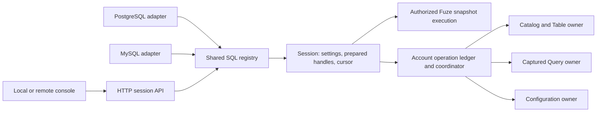

# SQL sessions, serving and operator interfaces

This account explains how network and visual interfaces expose data operations
and their outcomes while preserving the underlying authority model. A shared
[data lifecycle](../reference/data-model.md) needs consistent definition, result
and progress semantics across adapters. Current adapters expose different
portions of that lifecycle. This account consolidates SQL session, serving,
reactive and Board reasoning. Usage
belongs to the [SQL session](../reference/sql-sessions.md),
[database protocol](../reference/database-protocols.md),
[serving](../reference/serving.md), [reactive](../reference/reactive.md),
[application](../reference/applications.md) and [Board](../guides/inspect-board.md) references.

## Model and trust boundary

A gateway adapts an inbound protocol to public Transit operations. A service has
durable identity and policy; a socket is a temporary attachment. A durable command
has an admission identity and an application outcome. A status read is a bounded
observation. These objects have different lifetimes and evidence requirements.

Caller authentication and current native/service/source authorization remain
separate from TLS, Host/Origin checks and the gateway's own credentials. A stronger
gateway credential cannot substitute for a caller's missing access. Board's
private deployment boundary admits viewers to a shared configured scope, while
its upstream identity still needs a read-only grant; it is not a per-viewer
authentication system.

## Admission and observation

A connection can fail after a command was admitted. The HTTP response therefore
cannot be the sole recovery identity. Preserve the original command and reconcile
its recorded outcome. Socket deadlines stop observation work but do not undo
accepted commands. Once a streaming response has begun, failure is interruption,
not a second success/error object appended as if the stream were complete.

Bounded concurrency, chunks and joined cancellation protect ownership when a
peer stalls. Protected disclosure must recheck current policy, including on later
pages or attachments. Transport liveness establishes neither durable application
progress nor a complete answer.

## Database sockets and durable Table writes

The database adapter asks a narrower question: how can an autocommit PostgreSQL
or MySQL execution retain its accepted write when the client supplies no stable
Transit operation identity? This section describes the implementation introduced
after source `24a91402` and the native v1 definition named by the
[SQL gateway contract](../../../contracts/SQL_GATEWAY_V1.md). It assumes one current
native authority, its qualified durable storage, honest gateway/Catalog code and
an explicitly provisioned account. Protocol validation does not prove honest
computation. Interactive transactions and automatic cross-build history migration
are excluded.

The actors are a transient database session, an account worker, a fenced
coordinator and a Catalog worker. The account has a paged private ledger and a
dedicated sequenced Table principal. Before dispatch, it freezes the operation's
bound Table intent and then the exact signed native step. Native receipt,
processed input and attributed Table terminal outcome are distinct observations.
The [ledger](../../../packages/zig/transit-sql/docs/ledger.md) defines the
records and transition bounds; [AccountRuntime](../../../packages/zig/transit-sql/src/AccountRuntime.zig)
owns progress outside socket tasks.

```mermaid
flowchart LR
    Socket[Authenticated SQL execution] --> Reserve[Reserve durable operation]
    Reserve --> Intent[Persist bound Table intent]
    Intent --> Saved[Persist exact signed step]
    Saved --> Send[Submit or reconcile identical step]
    Send --> Evidence[Observe original Table outcome]
    Evidence --> Rights[Recheck current disclosure rights]
    Rights --> Reply[CommandComplete or OK]
```

Three invariants explain the ordering. First, a native dispatch has an earlier
durable saved step, so losing a transport reply does not require inventing a new
sequence or reconstructing SQL. Second, only one eligible native generation can
advance an account; a local process or provider restart cannot establish that
eligibility. Third, a wire completion requires the original Table terminal
evidence and current permission to disclose it. Losing permission can therefore
hide a committed result without undoing the commit. The implementation would
violate these claims if it dispatched before saving, replaced an unresolved
signed request, or disclosed cached counts without authorization.

The protocol cycle has a separate admission boundary. PostgreSQL buffers one
write execution through a valid Sync and rejects a second execution or write
Flush before dispatch. Read suspension retains the same cut until completion,
Close, error or Sync. MySQL admits one complete supported command with autocommit
status. Neither path accepts transaction syntax as a harmless no-op. Preparing
freezes descriptors and object/schema identity; executing acquires a fresh read
cut or bound write intent. Pure current-metadata retries cannot reopen a partly
disclosed result or repeat a mutation.

This design chooses explicit durable quotas and one serialized principal over
per-socket write lanes. Retained history grows on disk; bounded indexes select
active work without scanning all terminal operations. The tradeoff is native
publication/read amplification and serialization within one account. A local
recovery file per connection would be simpler but would not provide discovery
after the connection disappears or fenced sequence ownership. Replaying SQL on
reconnect would hide ambiguity by creating new work.

The [retained experiment](../../../tests/verification/results/sql-wire-2026-10-14.json)
measures that cost with eight resident pages, 8 MiB hot storage and an 8 MiB cold
cache. It separates framed-row encoding from verified connection startup,
preparation, read/write completion and native/provider request windows. Native
read samples start a fresh helper and compile; wire samples retain connections
and preparations. Request windows include concurrent account maintenance, so
they do not attribute every request to the foreground query. A single 40 KiB row
outlives its 270-second SQL wait and reaches its original terminal outcome after
965 seconds. This establishes eventual completion in that schedule and exposes
the cost of the chosen durable path. It supplies neither a latency bound nor an
isolated estimate of storage or coordinator cost. Further attribution requires
controlled changes to those components, with the same authority and durability
checks preserved.

The [proof ledger](../../../tests/README.md#database-wire-gateway) and its linked
native recovery tests separate executable observations from these design
arguments. It records the pinned toolchain and reproduction commands for native
recovery, independent wire contracts and actual clients; deployment commands are
in the [example](../../../examples/sql-wire/README.md). Selected fault
schedules establish their asserted outcomes, not exhaustive correctness or a
throughput guarantee. Progress additionally requires available native storage,
current permissions, an eligible worker, finite admitted work and sufficient
quota. Socket timeout or successful shutdown alone establishes none of those
conditions and cannot promise rollback.

## Configured local SQL admission

The local placement asks a second question: how can configuration disable a
database socket without discarding work accepted through it? The implementation
introduced on 2026-10-17 composes the existing native authorization, Catalog and
account-ledger owners. Its scope is the trusted local Linux placement and one
current contract definition. It assumes durable local checkpoints and the native
storage/ownership conditions above; remote exposure and cross-build migration
are excluded. The [local SQL guide](../../../apps/transit-cli/docs/sql.md) owns usage.

The model separates desired listeners, retained enrollment and native authority.
Enrollment fixes an account's identities, catalog binding, credentials and finite
setup journal. Configuration chooses which enrolled accounts admit new sessions.
The native ledger determines accepted work and the current generation allowed to
advance it. None of these three states substitutes for another.

[SqlJournal](../../../apps/transit-cli/server/SqlJournal.zig) checkpoints an exact
signed setup request before submission and its receipt before advancing. A shared
installation reservation excludes competing root-sequence writers while its
outcome is unknown. A negative retry resolves the exact native receipt before
releasing that reservation. Preparing a request must succeed before publishing
it into retained state; a partially initialized request is not recovery evidence.
Account creation publishes a private directory atomically, so a resumed setup
finds the same keys and identities. An operator separately publishes the logical
role, credential binding and data grants through public authorization commands.
Completed setup receipts prevent restart from restoring a revoked credential or
grant. These orderings would be falsified by a second allocation after lost
receipt, reuse of an unresolved sequence, or a restored data privilege on restart.

[Sql](../../../apps/transit-cli/server/Sql.zig) separates ledger initialization,
fresh fenced activation and socket admission. Disabled listeners do not load
PEMs. Removed accounts with unsettled operations retain a worker; settled removed
accounts retain their control profile without a resident worker. Historical
accounts are scanned individually, while an explicit bound limits simultaneous
active/recovering accounts. Failed setup attempts release their preparation
arena before reconstructing retained requests; an unavailable dependency does
not extend the lifetime of discarded setup allocations. Idle workers back off
their native polling; this reduces competition with current authorization reads without increasing native
admission limits. Progress still requires available storage, current worker
rights and eventual scheduling. Backoff supplies no latency guarantee.

This design chooses retained enrollment over deleting accounts on configuration
removal, and explicit authorization over reconciling desired grants on every
start. The costs are additional private recovery records, visible enrollment
steps and operator intervention after revocation. Local TLS trust has its own
checkpoint and lifecycle; replacing or expiring a certificate changes admission,
not the identity or outcome of a recorded operation.

The executable schedules are [public client onboarding](../../../tests/server_sql.py)
and [interrupted enrollment](../../../tests/server_sql_faults.py). They check selected
disconnect, restart, revocation and trust failures on disk-backed Ursula. The
[proof ledger](../../../tests/README.md) supplies reproduction commands and
distinguishes executed results from this reasoning. These schedules do not cover every interruption point, sustained
maximum-account load or arbitrary filesystem/storage corruption.

## Shared SQL sessions: ownership and recovery

### Question, scope and model

How can independent local and remote consoles share SQL execution with database
wire adapters without sharing a client signing sequence or private recovery file?
The implementation separates an ephemeral session from an accepted operation.
The public owner is the [console guide](../../../apps/transit-cli/docs/console.md);
the exact envelope, authentication and result rules belong to the
[SQL session contract](../../../contracts/SQL_SESSION_V1.md). This account describes
the implementation developed on 2026-10-20. Executed verification is tracked in
the [proof ledger](../../../tests/README.md); source inspection is not deployment proof.

Let `S` denote a service instance, `A` an enrolled SQL account, `H` an expiring
session handle, `T` a client admission token and `O` an accepted domain operation.
An authenticated `H` identifies one `(S,A,database,source)` context. It does not
create a native principal or a durable PID. The account has independent native
identities for its ledger, ingress, controls, Table coordination and reads.
Explicit source bindings have dedicated caller sequences. Kernel authority and
the existing Catalog, Query and configuration owners decide permission and
completion; the registry cannot grant rights by remembering a session.

Assumptions are trusted service code and protected service credentials; verified
TLS for remote clients or a private Linux Unix socket with `SO_PEERCRED`; current
native authorization; and the existing durable-publication and fencing contracts.
Network replies can be lost, clients can disappear and the service can be
replaced. Progress requires available storage, surviving grants and scheduled
owner/recovery tasks. No bounded latency or arbitrary power-loss guarantee is
inferred from this architecture.

### Placement, sessions and adapters

`transit-sql-gateway` composes one
[Registry](../../../packages/zig/transit-sql/src/Registry.zig) with bounded
[Session](../../../packages/zig/transit-sql/src/Session.zig) objects. PostgreSQL and
MySQL adapters obtain sessions from that registry and retain their own dialect,
codec and execution-cycle restrictions. Native HTTP/TLS and Unix HTTP call the
same owner. One account's [AccountRuntime](../../../packages/zig/transit-sql/src/AccountRuntime.zig)
coordinates accepted writes independently of connected sockets.

The console uses the installation path only to choose a nonsecret rendezvous
record under an owner-checked runtime directory. It never loads installation
history or signing seeds. Local enrollment binds the reserved peer account to
the original owner once; startup does not restore revoked credentials or grants.
Remote clients need only an HTTPS endpoint, SQL login/database and authentication
references. PostgreSQL/MySQL listeners are optional. Optional wire TLS setup
failure does not withdraw a working local socket.

Native SCRAM binds its challenge to the current definition, instance and requested
account/database/source. The session secret is returned only after authentication.
Every protected request rechecks the live credential and scope. Requests for other
accounts' operations reject. Prepared metadata and cached result batches remain
subject to current authorization. Authentication has one shared budget across
adapters. Control transport has reserved request capacity and does not wait for
the session's data borrower before signalling cancellation.

### HTTP API design and the Quack comparison

DuckDB's [Quack overview](https://duckdb.org/docs/current/quack/overview), read on
2026-10-20, describes its DuckDB 1.5.3 profile: client-initiated HTTP messages,
DuckDB-specific typed serialization, a short query request path and additional
fetches for larger results. Its client supports both direct remote queries and
remote catalog attachment. It also documents HTTP connection caching. These
features are a reference for transport design, not evidence for Transit recovery
or a commitment to Quack compatibility.

The [Quack reference](https://duckdb.org/docs/current/quack/reference#fetch-batching-server-side)
documents batching several data chunks into a fetch response. For Transit, the
corresponding design question is how much useful work one bounded network
exchange can perform without losing cancellation, result order or backpressure.
The following choices are Transit design deductions and require measurement:

- Treat a logical SQL session separately from an HTTP connection. A bounded
  connection pool can serve multiple requests without repeating the TLS handshake
  or resetting session settings. Neither a pooled socket nor a session handle
  supplies permission; each request binds the authenticated account and instance.
- Allow a simple execute request to carry SQL and typed parameters and return
  schema plus an initial bounded result batch, or an accepted operation handle.
  Separate prepare/bind operations remain available when useful. A short public
  request path must not skip internal durable write admission or claim a write
  finishes in one round trip.
- Fetch ordered batches under byte, row, time and retained-buffer bounds.
  Preserve a bounded retry window for an unacknowledged batch. Losing the fetch
  response must not skip rows, silently restart the query or change its source
  cut. A new logical session or service restart cannot resume an interactive read.
- Specify a public typed codec using Transit's existing logical definitions;
  preserve wide integers, decimals, nested values and distinct cell states for
  supported sources. HTTP does not imply JSON rows or conversion to wire-gateway
  scalar types. Physical storage pages and WAL records are not the public result
  format. Generate schemas and endpoint documentation from the owning types.
- Make HTTP intermediaries part of the protocol tests: sensitive responses are
  not cacheable, redirects cannot forward credentials, cancelled responses remain
  incomplete, and an intermediary retry cannot manufacture a new mutation.
  Stateful sessions bind to the owning service instance. Ordinary HTTP routing
  does not establish interchangeable replicas or distributed session ownership.

Quack's [security reference](https://duckdb.org/docs/current/quack/security)
describes a default shared-token check, replaceable authentication/authorization
hooks and TLS termination at a reverse proxy. Transit retains its own account,
current-grant and object-disclosure model and the direct TLS endpoint.
The session service must preserve admission-token recovery and saved native
steps even when an HTTP response disappears. Neither a successful HTTP exchange
nor a freshly authenticated session establishes a durable SQL outcome.

This boundary can support future SDK, notebook, browser and Board consumers
without another execution authority. Browser admission would additionally need
an explicit origin/credential policy; HTTP availability alone does not establish
that support. Remote catalog attachment would need separately defined source
identity, permissions and consistency. Those consumers and federation remain
future scope; the initial native client and gateways exercise the shared boundary.
Compare cold and reused connections, request counts, first-batch and completion
latency, wire bytes and bounded resident memory before claiming an improvement.

### Distinct lifetimes and result disclosure

| Object | Owner and lifetime | Connection loss |
| --- | --- | --- |
| Authentication | Bounded challenge or adapter task | Transient secret expires |
| SQL session | Registry; finite native lease or wire connection, independent settings and handles | Native HTTP can reconnect to a live handle; wire disconnect closes its session |
| Interactive read | Session; one iterator, leased cuts and bounded buffers/spill | Same live cursor can retry its last batch; session loss makes the prefix incomplete |
| Captured query | Query owner plus account recovery index | Original bundle, signed steps and retained result remain discoverable |
| Table mutation | Account ledger and Catalog owner | Exact identity and outcome survive |
| Configuration reload | Account index and configuration journal | Original expected generation and operation ID survive |

Idle duration and incomplete-request duration have different costs. An idle
wire connection consumes its bounded session and connection slot; it does not
hold an executing command. The default therefore leaves it open, following
[PostgreSQL's idle-session policy](https://www.postgresql.org/docs/18/runtime-config-client.html#GUC-IDLE-SESSION-TIMEOUT).
The [wire contract](../../../contracts/SQL_GATEWAY_V1.md) defines optional idle
expiry and its protocol errors. Native HTTP handles instead outlive sockets and
need a finite renewable lease to reclaim abandoned state. Separating these
settings prevents extending a wire client's think time from extending native
handle retention.

The [TLS transport](../../../packages/zig/transit-tls-server/src/root.zig) arms a
frame deadline on the first network bytes, before TLS decoding can complete;
the [connection adapter](../../../apps/transit-sql-gateway/src/Connection.zig)
handles already buffered TLS bytes too. Thus disabling idle expiry does not
permit an indefinitely incomplete frame or TLS record. Connection and memory
quotas still bound resident state. The [lifetime proof](../../../tests/server_sql_lifetimes.py)
checks idle sockets, independent native expiry and partial records over real
plaintext and TLS sockets; the [proof ledger](../../../tests/README.md) records
execution results and limits.

Native result cells carry canonical descriptors and schema-bound bytes. This
preserves wide/nested types and distinguishes missing, null, type error and
conflict. JSON is the bounded envelope, not a numeric conversion layer. PG/MySQL
continue to reject types outside their own representable profile before streaming.
A batch contains at most 32 rows and 1 MiB of canonical payload. Only the most
recent batch is cached; requesting its ordinal reauthorizes and returns it.
The next ordinal acknowledges it and advances the same iterator. A gap or an
expired handle cannot silently open a fresh snapshot. Final coverage includes the
actual Table/source basis or independent relational resource-cut vector.

### Admission and exact recovery

The service hashes `(definition,instance,account,database,source,SQL,parameters,
captured)` and records that fingerprint with `T`. Lookup precedes compilation
for an existing token. Equal input returns `O`; different input rejects. This is
a deduction from the lookup/validation ordering, tested with repeated CREATE and
source queries across replacement. SQL text alone is not an idempotency key.
A new console can page authorized operations if it has lost its token, but must
not silently select one of several similar accepted operations.

[SessionOperations](../../../packages/zig/transit-sql/src/SessionOperations.zig)
indexes typed operation references in the existing paged account ledger.
Configuration operations retain the original reload request and expected
generation; a partial owner result remains partial. Table operations retain the
existing frozen intent and signed-step machinery. Neither index claims an atomic
transaction across its domain and the SQL account.

Captured queries publish the compiled bundle before dispatch. Each subsequent
native request is serialized by
[SavedSubmission](../../../packages/zig/transit-query/src/SavedSubmission.zig) and
published through [CapturedLedger](../../../packages/zig/transit-sql/src/CapturedLedger.zig)
before it can be sent. Generation checks fence publication. One unresolved step
holds its source caller lane, preventing another operation from assigning that
sequence. Recovery settles that exact signed request, records its receipt and
processed disposition, then releases the lane. It never recompiles SQL or reopens
a parameter file. A stale dispatcher can at most resend a previously published
request; it cannot authorize a new sequence through a foreign generation.

An unpublished proposed step may be abandoned because it was never eligible for
dispatch. A published uncertain step must settle before cancellation proceeds.
An incomplete initial bundle can be explicitly cancelled without submitting a
query. Complete captured results are disclosed only through the Query manifest's
ordered coverage and current rights. Changed source connection, key, declaration
or budget changes the binding fingerprint and cannot reinterpret old operations.

### Bounds, alternatives and evidence

Session arrays bound active work only. Durable operation history remains paged
and quota-accounted. Captured operations reserve 1 MiB and permit at most 1024
published signed attempts; exhaustion blocks visibly without discarding accepted
work. Terminal reservations remain charged until an explicit reclamation policy
exists. Retention is not implied by disconnect, quota pressure or cancellation.
A recovery task advances bounded pending pages; its per-account capture lock
covers submission steps, not waiting for query completion or rendering results.

Per-console keys would require ephemeral provisioning without solving durable
operation discovery. File locks around writes would still require remote clients
to access server files. Using only PostgreSQL would couple native capabilities to
that adapter's type and command restrictions. A library instantiated separately
in every console would not serialize shared native sequences. A shared service
adds protocol/authentication work and moves compute into its explicit memory
budget; it does not remove the cost of durable publication.

Reproduce deterministic publication, quota and saved-step checks with
the SQL wire contract suite in the pinned development shell. The native SQL
session deployment fixture uses disk-backed Ursula, an independent Python
HTTPS/SCRAM client, PG readback, process replacement, source workers and actual
console binaries. The local server deployment suite covers default local discovery
and retained installation behavior. The console history suite is editor-only evidence with
a small session peer, not a SQL execution proof. Failed or incomplete runs remain
distinct in the proof ledger. These schedules do not establish every crash point,
constant latency, distributed SQL placement, transactions, browser admission,
Board/Flight migration or resumable interactive queries.

At implementation source `74c18c41`, the completed native-session fixture
measures 1.55–1.63 seconds to the first one-row batch over a new TLS
connection and 1.61–1.64 seconds over a reused connection (three samples each).
Each uses one SQL request but observes 183–191 internal native requests,
including background recovery. Two simultaneous sessions finish in
2.63 seconds including result closure; their observation windows overlap
and cannot be added as independent request counts. The service high-water mark
at this observation is 116,236 KiB. The
[measurement implementation](../../../tests/sql_sessions/measurements.py) records
body bytes, timings and process memory. The [evidence record](../../../tests/verification/results/sql-sessions-2026-10-21.json)
preserves exact source/binary hashes, structured observations and failed runs.

The full wire fixture uses eight resident pages and 8 MiB hot/cache budgets.
It submits one row containing ten 4096-byte variable-size cells. Its original
operation completes after 2,427.679 seconds, after the
client's wait has ended. Operator discovery verifies the original identity and
affected counts; PostgreSQL and MySQL both read back all ten cells. SQL is
submitted once. This observation exposes a substantial remaining write cost;
the session cutover does not establish a throughput improvement.
In the subsequent phase sample from that same constrained fixture, five measured
single-row writes per adapter (after one warmup) have median completion times of
19.51 seconds for PostgreSQL and 18.93 seconds for MySQL. The respective ranges
are 18.36–20.45 and 18.37–19.25 seconds.
These observations include durable admission and completion under the fixture's
retained history; they do not isolate wire encoding costs.

The [resource sampler](../../../tests/sql_sessions/resources.py) samples the
native fixture during provisioning, execution and process replacement. Its largest
sampled sum of direct child RSS is 884,404 KiB; the largest SQL-process
high-water mark across incarnations is 126,612 KiB. WAL file capacity peaks
at 105,259,960 bytes. RSS sums can count shared pages repeatedly and exclude
subprocess descendants. WAL capacity includes allocated segments, excludes cold
storage, and does not isolate retained operation bytes. To repeat that observer,
run `python3 tests/sql_sessions/resources.py PID FIXTURE OUTPUT.json` while the
source-session fixture's Python process is alive; use its PID and owned fixture
directory. The integration fixture itself owns process cleanup.

These are same-host observations with other proofs/builds running, no matched
baseline and no throughput target. The native-session samples have no warmup;
the wire phase samples exclude one warmup each. One public HTTP exchange still
performs substantial native authority and snapshot work. Acquisition may retry
transient unavailable observations within the request deadline before publishing
a cursor; advancing a disclosed interactive iterator never reopens a new snapshot.
A retained captured result can repeat reads of the same immutable manifest/page,
with current authorization and failed-attempt allocation cleanup; its cursor
advances only after page validation succeeds. Readiness remains fenced during
an authority outage: the fault schedule observes a three-second outage and a
3.290-second successful login, preserving the account's readiness gate.

### Console interaction transitions

The console lets a caller edit declarations and queries before explicitly
submitting them to the shared SQL service. How do history previews and asynchronous
metadata requests preserve that draft without acquiring execution authority?
The [CLI contract](../../../contracts/TRANSIT_CLI_V1.md#shared-incomplete-input-assistance)
owns the interaction semantics. The editor implementation introduced on
2026-10-24 separates deterministic decisions from terminal and client I/O;
[executed evidence](../../../tests/README.md#console-interaction-state-machine--2026-10-24)
records its qualification and limits.

[EditorState](../../../apps/transit-cli/EditorState.zig) owns volatile draft,
cursor, saved history draft, search filter, undo journal and the transition
function. [Terminal](../../../apps/transit-cli/Terminal.zig) retains key/escape
and paste decoding, text-edit algorithms, history-file scans, grammar payload
arenas, monotonic deadlines and rendering. Its semantic events produce a new
editor state and an ordered set of effects. No transition performs I/O or
submits SQL directly.

| State dimension | Values and meaning |
| --- | --- |
| Interaction | Editing a draft, searching history, or using completion |
| Client ownership | Idle; fetching; validating acceptance; obsolete request awaiting settlement; cancellation awaiting join; foreground execution |
| Completion evidence | Pending, current, or unavailable; local vocabulary or remote metadata; explicit selection or initial unique-match intent |
| Presentation | The terminal retains the candidate preview, selected spelling/kind and viewport independently of request ownership |

A text or cursor change makes an outstanding fetch/validation obsolete. A
successful obsolete reply cannot install candidates or insert text, even if the
wrapping draft generation counter later repeats. A delivered denial, expired
session or changed instance still erases protected editor state. Current replies
pass their complete/ready uniqueness and full metadata-basis comparison through
pure helpers in the same owner. The terminal applies an approved candidate with
the existing shared token edit helper and one undo checkpoint.

The adapter interprets cancellation before clearing suggestions or performing a
follow-up action. [AssistanceRequest](../../../apps/transit-cli/AssistanceRequest.zig)
joins the single future and releases its buffers before the reducer receives
`joined`. Foreground execution and cancellation are synchronous at the terminal
input boundary. Assertions compare logical ownership with the actual future;
keepalive runs only while the client is idle. Request cancellation does not
cancel or roll back a previously submitted SQL operation.

History entry captures the draft and cursor separately from the filter. Filter
edits and history previews cannot replace that snapshot. Cancellation restores
it; acceptance installs a draft and records the snapshot for undo. Clear and
protected failure have distinct transitions: ordinary clear remains undoable,
while protected failure zeros draft/search/saved buffers and clears the journal.
Only Enter from ordinary editing emits a submission effect. Actual statement
completeness, submission, settlement and recovery retain their existing owners.

The [finite TLA+ model](../../../tests/verification/models/Console.tla) abstracts
text into empty/draft/history-match classes, filters into four classes, cursors
into start/end positions and metadata into uniqueness/equality outcomes. It
checks restoration, stale/interrupted reply rejection, uniqueness, validation
basis, client ownership, explicit submission and private-state clearing. A
separate temporal check assumes weak fairness of response failure/timeout,
cancellation join and foreground completion, then checks eventual borrower
release. It cannot establish those environment assumptions or a latency bound.

The [model guide](../../../tests/verification/models/README.md#finite-console-interaction-model)
provides the pinned reproduction command. The
[runner](../../../tests/verification/console_model.py) exhausts the finite graph
and replays every exported edge against the production Zig reducer from a
shortest representative path. It compares state projections and effects, and
requires six removed model guards to expose named violations whose schedules
remain safe in Zig. Missing tools, unmapped records, timeouts and incomplete
exploration fail. The [model guide](../../../tests/verification/models/README.md#finite-console-interaction-model)
details bounds, artifacts and interpretation.

Separate state dimensions preserve visible previews during background work;
one combined menu/request state would couple those independent lifetimes. The
explicit transition owner reduces scattered flag updates. Maintaining a separate
specification still costs review effort, so edge replay checks correspondence
on every modeled transition. This is a bounded conformance check, not a proof of
all Zig histories or arbitrary buffer contents. Generation arithmetic, undo
contents, allocation/arena lifetimes, grammar, terminal framing and the effect
interpreter remain separate unit and real-PTY obligations. The model gives no
new SQL, authorization, persistence or performance guarantee.

## Reactive consistency

The implemented reactive profile combines int64 Table notifications with exact
finite snapshot refresh. It does not supply every intermediate revision or
continuous SQL. The snapshot/watch handoff must bind compatible source evidence;
reading latest state and subscribing later leaves a change window.

A refresh generation fixes its submitted plan/schema/source. Each refresh obtains
its own finite query identity and verifies complete ordered results before
replacing displayed rows and summaries together. While it runs, a bounded pending
invalidation can record further dirty progress. A late response cannot replace a
newer generation, and insufficient retained coverage requires reset or interruption.

This makes freshness explicit rather than equating the latest arriving packet
with truth. On denial, protected displayed and candidate state are cleared.
Temporary unavailability cannot be rendered as a successful empty result.

## Declarations and controls

SQL declarations, visual editors and generated modules use the same typed model
and owning validation. Parsing or editing a definition is not publication,
administration or external dispatch. Conditional activation applies a reviewed
definition; data migration has its own owner, ledger and acceptance boundary.
Installing compatible code, publishing an interface and activating a data epoch
are independent operations.

An alternate UI configuration database would create a second semantic authority.
Sharing contracts avoids that divergence but requires interfaces to display
definitions, proposed changes and observed state distinctly.

## Evidence and limits

The [serving contract](../../../contracts/SERVING_V1.md),
[reactive contract](../../../contracts/REACTIVE_V1.md) and
[application definition contract](../../../contracts/APPLICATION_V1.md) define the
boundary. [Serving](../../../tests/README.md#m19-qualification),
[reactive API](../../../tests/README.md#m20-qualification) and
[refresh evidence](../../../tests/README.md#m21-qualification) supply commands,
fault schedules and qualified source/deployment combinations.

The evidence does not establish arbitrary live queries, speculative execution
while editing or public per-user Board admission. Historical proposals remain in
the [serving](../../history/SERVING.md), [reactive API](../../history/REACTIVE_API.md),
[reactive interface](../../history/REACTIVE.md),
[declarative application](../../history/REACTIVE_APPLICATIONS.md) and
[Board](../../history/BOARD.md) records. UI/UX review outcomes belong in
[Design](../../design/README.md), where acceptance remains distinct from implementation.
