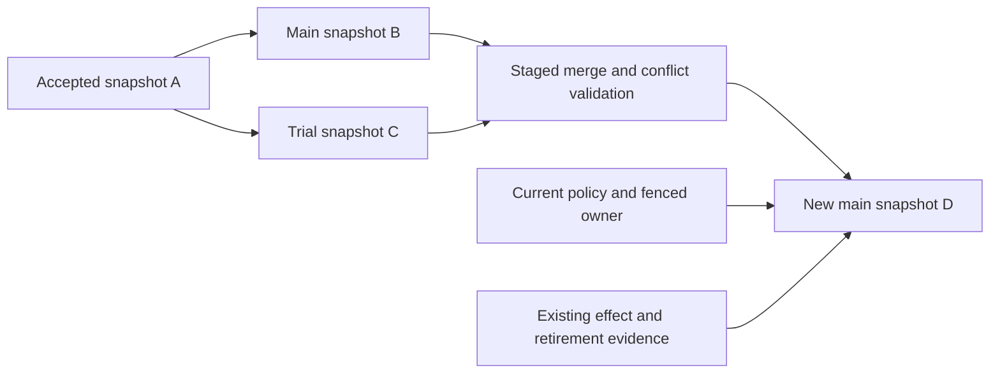

# State, publication and lifetime

This account explains how durable state, bounded resident work and recovery
evidence fit together. It consolidates resource, Table, Document and retention
reasoning. The [state](../reference/state.md), [Table](../reference/tables.md),
[Document](../reference/documents.md) and [retention](../reference/retention.md)
references own APIs, supported types and numeric bounds.

## Model

A resource has a realm-qualified identity and immutable committed revisions.
An association records a process's declared access/dependency relationship.
Writer identity, lifetime ownership and permission remain independent facts.
The supported turn boundary mutates one resource with input progress and outputs;
reading other resources does not create a global snapshot or transaction.

The paged representation separates retained data from the pages, operation
batches and active views held in memory. This distinction depends on bounded
access at every layer; placing a paged backend beneath a caller that loads the
entire collection would not establish a bounded working set.

## Visibility and publication

Larger logical values are staged as bounded immutable pieces. Staging establishes
the existence of those bytes, while a final validated head/root establishes their
logical visibility. A crash before that decision can leave staged data but must
not expose a partially accepted value. A crash after acceptance must recover the
same head and required dependencies.

This separates byte completeness from semantic validity. Publication can verify
pieces and commitments; a Document owner must still validate change dependencies,
merge rules and the accepted index. The
[publication contract](../../../contracts/STATION_PUBLICATION_V1.md) and
[Document contract](../../../contracts/STATION_DOCUMENT_V1.md) own those different checks.

## Typed state and causality

### Complete Table history under a bounded turn

The question is how a reader can finish a frozen backfill and later recover
every intervening Table transaction without adding an unbounded resident log
or exceeding the native metadata and block budgets. The implemented Table history applies
to one stable Table object; it is separate from the proposed branch mechanisms
below and from a global snapshot.

Let `H_n` be committed head revision `n`, and `c_n` the native revision of the
entry that published it. Before accepting `H_(n+1)`, `TableHead.replace` preserves
`(H_n, c_n)` under immutable key `j/n`. The current head is the upper bound on
accepted revisions. This construction assumes one fenced resource writer,
conditional native commit, immutable row/index records and current scoped read
permission. [The codec and transition checks](../../../contracts/TABLE_DATA_V1.md#complete-committed-head-history)
specify those records precisely.

Staging `j/n` early cannot falsely admit a successor: it contains only the
already accepted predecessor, and the current head still names `n`. Conditional
replacement either accepts the next head with its outcome and input progress,
or leaves the previous root visible. Induction from the creation head therefore
gives consecutive predecessor coverage for every accepted head. A retained
reader finishing at `H_n` resumes at `n+1`, even if many writes completed while
it was paused. A gap or conflicting predecessor falsifies the coverage premise
and causes an error. Coalesced invalidation alone cannot provide this property.

The native coordinate must be the head entry's own revision. Using the resource
revision at the later archive read would move the old Table state forward in
time; using the archive commit would be wrong for the same reason. The reader
therefore obtains the head and entry revision together in one bounded native
page. Reconstructing a Table head at a coordinate does not reconstruct native
authority, grants or a resource-wide historical view.

Diff traversal merges immutable row identities with at most two owned rows and
two schemas. It pairs updates, preserves inserts/deletes, and exposes a complete
transaction boundary even when no row changes. Equal schema/index roots permit
constant-work no-op completion; other differences can require a full traversal.
Each replaced head adds one retained block. The small head and receipt mutations
can share a turn with that block and row/index blocks; candidates beyond the
separate block-count/byte budget need additional staging. This favors exact
history and bounded memory without making each predecessor consume a metadata
write slot. It does not imply sublinear change extraction or a measured catch-up
rate for large changing relations.

The [proof ledger](../../../tests/README.md#complete-table-history-and-snapshot-tail)
records the pinned toolchain commands for the reference-store, codec and signed
snapshot/tail schedules. The
[reference-store tests](../../../packages/zig/transit-station/src/table_pages_test.zig)
exercise missing/corrupt predecessors and allocation failures; the
[native schedule](../../../tests/typed_table_native.py) uses disk-backed Ursula.
[Executed results](../../../tests/README.md#complete-table-history-and-snapshot-tail)
state which revisions and schedules passed. These observations do not establish
distributed history availability, automatic retention collection or maintained
query semantics.

| Representation | Additional meaning | Boundary it does not remove |
| --- | --- | --- |
| KV | Explicit opaque keys and values | Current access and revision basis |
| Table | Declared schema, primary keys and typed row encoding | One-resource turn atomicity |
| Document | Stable object/operation identities, observed dependencies and explicit conflicts | Fenced acceptance and current write permission |

Document mergeability is a property of changes under declared rules, not
permission to publish them. Visible values alone are insufficient recovery state:
causal dependencies, deletions and history floors prevent stale changes from
resurrecting removed content. Missing, null and conflict therefore remain distinct
through reads and query projections.

## Retention argument

Checkpoint publication must precede trimming the history it replaces. The
checkpoint and retained tail must preserve the specified recovery projection,
including unfinished work and identity/rejection evidence. Once that prefix is
removed, the checkpoint is essential data rather than an optional cache.

Logical expiry, terminal closure and physical cleanup have separate conditions.
A late physical delete must not target a replacement identity. An old reference
must not renew permission, revive a retired resource or pin arbitrary history.
Unlimited retention is the default; capacity pressure can refuse new admission
but cannot supply application consent to expiry.

## Tradeoffs, evidence and limits

Keeping every retained value resident would make memory proportional to durable
cardinality. Bounded pages avoid that dependency but introduce indirection,
cache misses and staging/cleanup work. The
[storage account](storage-runtime.md) and [measured costs](../reference/performance.md)
explain those costs without treating configured cache size as measured peak RSS.

[State-resource evidence](../../../tests/README.md#m7-state-resources),
[publication evidence](../../../tests/README.md#m14-immutable-publication) and
[Document qualification](../../../tests/README.md#m17-qualification) record the
applicable contracts, crash schedules, commands and limits. They do not establish
arbitrary multi-resource transactions, generic dependency deletion or erasure
from every external copy. Historical details remain in the
[state](../../history/STATE.md), [Tables](../../history/TABLES.md),
[Documents](../../history/DOCUMENTS.md) and [retention](../../history/RETENTION.md) records.

## Schema history and branches

This section is design analysis, researched on 2026-09-29 against Transit
`113588b6`. It asks how application data and its interpretation can branch without
forking execution authority. Historical catalogs, writable branches and generic
merge are not implemented. The analysis extends the existing state/publication
model; it does not qualify a new storage or recovery capability.

### Lessons from Dolt and Neon

The two systems offer complementary reference models:

| Source | Observed semantics | Implication for Transit |
| --- | --- | --- |
| [Dolt history queries](https://www.dolthub.com/docs/sql-reference/version-control/querying-history/) | AS OF accepts commit/branch/ancestry references or timestamps; historical SHOW/DESCRIBE are available. Its unit is a Dolt commit, separate from SQL transaction commit by default | Name the exact unit of history and resolve a mutable reference once |
| [Dolt branch selection](https://www.dolthub.com/docs/sql-reference/version-control/branches/) | Branch-qualified databases can expose a working set, while commit-qualified databases are read-only | Do not hide committed-head versus working-state differences behind one selector |
| [Dolt schema override](https://www.dolthub.com/docs/sql-reference/version-control/dolt-sysvars/#dolt_override_schema) | An explicit session setting maps data through another revision's schema, including NULL for absent columns | Separate historical interpretation from schema projection; preserve Transit's missing/null distinction |
| [Dolt merges](https://www.dolthub.com/docs/sql-reference/version-control/merges/) | Merges expose schema/data conflicts and constraint violations for resolution | A merge needs semantic validation and a durable conflict model |
| [Neon branching](https://github.com/neondatabase/website/blob/69b85134dbf7aa8154ee69e655452f2e29856b8a/content/docs/introduction/branching.md) | Copy-on-write child branches diverge from a selected current or retained historical state | Share immutable data where possible while creating independent branch state |
| [Neon schema-only branches](https://github.com/neondatabase/website/blob/69b85134dbf7aa8154ee69e655452f2e29856b8a/content/docs/handbook/guides/branching-schema-only.md) | Copy definitions without rows into an independent root | Make data inclusion and provenance explicit |
| [Neon Schema Diff](https://github.com/neondatabase/website/blob/69b85134dbf7aa8154ee69e655452f2e29856b8a/content/docs/handbook/guides/schema-diff.md) | Compares branch schemas, including historical bases | Definition differences need a public typed inspection surface |

There are useful limits to examine. Dolt documents that AS OF on a view uses
the current view definition over historical rows; a commit-qualified database
can select the historical definition instead. Transit should choose historical
definitions by default when selecting a snapshot. This is a proposed behavioral
choice, not a claim that Dolt cannot query historical views.

Neon's [promotion workflow](https://neon.com/blog/promoting-postgres-changes-safely-production)
describes snapshot replacement separately from Git-like merging and warns that
intervening target writes can be lost. Its
[backend branching account](https://github.com/neondatabase/website/blob/69b85134dbf7aa8154ee69e655452f2e29856b8a/content/docs/concepts/branch-your-backend.md)
also covers Auth, Object Storage, Functions and AI Gateway. That account says
database restore restores Postgres/Auth but not objects or deployed functions.
It would be inaccurate to characterize current Neon as only branching tables.
For Transit, the design question is the explicit closure of data, definitions,
captured inputs and execution evidence, rather than an unqualified product-parity
or superiority claim.

The Neon documentation basis is website commit `69b85134`; the reviewed
[storage account](https://github.com/neondatabase/neon/blob/fa504217c61bbcaf5c512d75830564541f917f8f/docs/pageserver-storage.md)
is from Neon commit `fa504217`. It explains immutable layers, timeline ancestry
and historical page reads, but marks portions obsolete. Use it for the mechanism,
not current limits or performance numbers. No peer database was run for this study.

### A snapshot includes interpretation

The proposed logical snapshot is an immutable manifest for an explicit
application namespace. Its ID identifies an accepted publication, not a raw
journal offset or just a hash of row contents. Content commitments remain useful
for verification and sharing; parentage and publication identity remain distinct.

| Manifest component | Required meaning |
| --- | --- |
| Scope and ancestry | Namespace, snapshot ID, parent snapshot IDs and publication provenance |
| Catalog | Stable object/column identities, names at that snapshot, schemas, constraints, views and graph mappings |
| Data | Exact resource roots/accepted Document bases and schema/codec commitments |
| Dependencies | Explicit captured-source manifests, immutable payload/artifact references and availability policy |
| Computation evidence | Query/transform definitions and compatible implementation commitments; optional captured outcomes as input evidence |
| Consistency | Single-owner atomic publication or an explicitly described source basis vector |

These are conceptual fields, not a new wire schema. Only existing records and
declared dependencies belong in a snapshot. An external URI is not an immutable
input; missing content, old artifacts or unavailable history are explicit failures.
Artifact references can document provenance without promising executable replay.
Current rights and compatible code remain required for every execution/disclosure.

A branch adds an immutable branch identity, a human name, current head, generation
and policy/lifetime metadata. Publishing a successor compares the expected head
and generation, then advances them through accepted history. Branch movement is
auditable; restoring a name never erases earlier head transitions. A tag is an
optional immutable name for a snapshot. None requires a new KV/Table/Document
kind: they are catalog objects and generic state/publication operations above
the resource boundary. Efficient branching may still require new native operations.

There is no separate Git-style staging index or shared uncommitted working set in
the first proposal. Each accepted branch publication advances its durable head;
an incomplete schema migration or merge candidate stays private staging. Naming
a snapshot creates a reference to that accepted state, not another SQL transaction
commit. A mutable branch selector resolves once to a concrete head per statement;
continuations and accepted operations retain that exact identity.

### Coherent catalogs require a publication boundary

The existing one-resource turn can atomically accept a branch head and its staged
data/catalog manifest under one writer. This is the proposed first coherent
scope, requiring its own framework layout and validation. It does not make all
existing Tables or independent writers part of a global database transaction.

For broader snapshots, a manifest of independently captured revisions is only a
basis vector. A coherent application checkpoint needs a proven owner/barrier
protocol, such as pausing participating writes and validating the entire closure
before publication. It must account for pending inputs and dependencies where
reproducible computation is promised. Do not label a convenient collection of
latest references transactionally consistent.

Schema and data activate together at the owning head. Renames preserve stable
column identity; dropping then recreating a spelling creates a different column.
Type changes need declared conversions with explicit overflow, precision and
failure behavior. Defaults do not retroactively populate historical rows. A
schema-only branch contains empty data by construction; its omitted rows do not
mean that all parent rows were deleted during a later schema merge. Its data
lineage and schema lineage therefore need separate inclusion metadata.

### A cheap fork still needs a resource contract

Transit already uses immutable pages, but that is insufficient for cheap writable
forks. The [retained-version contract](../../../contracts/READ_VERSIONS_V1.md) binds
reads to current owners, grants and source lifetimes. Its captured root covers a
shared catalog and can retain unrelated pages. It neither grants another writer
access to that root nor exposes selective resource cloning and page reclamation.

Start by defining a generic data export/fork operation: frozen source snapshot,
destination scope, current source-read and branch/export policy, new resource
and writer identity, independent destination permissions, quotas and an exact
receipt. A bounded materialized copy can establish its semantics first. A
copy-on-write implementation must prove the same result while sharing only
eligible immutable data pages. It must not copy the global authority catalog,
grants, principal sequences, retired identities or pending control records.

Export declarations must identify application data separately from framework
records sharing its KV resource. An opaque byte copy cannot establish that an
arbitrary application's continuation is safe to execute. Such state remains
read-only evidence unless its owner supplies a validated branch initializer and
explicit fresh runtime bindings. The kernel checks generic authority and
publication rules; it does not infer application behavior from stored bytes.

Distinguish a borrowed historical reference from a published independent copy.
Borrowed reads keep the source's current permission and lifetime constraints.
An explicitly authorized independent export gives the destination its own data
ownership: later source revocation does not erase that copy, and source retirement
does not authorize deleting pages it still owns. Physical sharing must preserve
this same declared logical-copy contract. It cannot silently convert a borrowed
reference into an independent copy or extend the original resource's hard expiry.
The current API implements retained reads, not this independent fork operation.

Copy-on-write needs deletion markers, correct source/child overlays or resource
roots, bounded ancestry lookup, durable page ownership and race-safe reclamation.
Branch deletion cannot remove pages reachable by another live owner. Logical
expiry, reference release and physical reclamation stay separate; retention is
unlimited unless explicitly opted into. Resident memory must remain independent
of retained branch count and data size. A claim of fast branching requires
measuring creation latency, bytes copied, ancestor read cost and reclamation under
failure, not merely observing shared hashes.

### Merge, restore and execution are different operations

A three-way merge compares a common base and both immutable heads. It produces a
staged candidate plus typed conflicts before any destination changes. KV can use
per-key three-way comparison; Tables additionally need stable schema/row identity,
constraint validation and explicit key-change semantics. Opaque values cannot
silently acquire field-level merge semantics. Document changes can use the
Document algebra only with compatible causal history, epochs and fresh replica
identities; a generic row merge is not a substitute. Graph mappings and endpoints
must be validated against the candidate, and derived indexes/results must be
rebuilt or verified against that same basis.

Conflict-free edits can still violate a cross-row uniqueness or graph constraint.
Never infer domain validity from disjoint keys. Conflicts between branch versions
are durable merge-review records; they are not automatically the existing
Document conflict cell state. Resolve them with explicit policy or reviewed
changes, and conditionally publish against the unchanged destination head. If it
moved, replan; never overwrite intervening work as an optimization. Ambiguous
merge bases need a specified policy or rejection, not an arbitrary ancestor.

Restore publishes a new successor whose selected application data/definitions
come from an old snapshot. It retains the prior head, provenance and all current
authority/effect-control evidence. It is not a rollback of the native realm.
Schema-only promotion applies a validated migration to current destination data;
it does not replace that data with the branch's empty tables. An inverse data
migration must be defined rather than assumed.

The diagram describes a proposed publication, not concurrent multi-resource
transactions. Existing processes, accepted mailbox progress, call identities,
outboxes and potentially in-flight effects cannot be copied into newly executable
work. Branch execution starts with fresh identities and explicit input bindings.
Past captures can be replay inputs; a missing outcome remains unavailable/unknown,
not permission to redispatch. New branches default to external effects disabled.
Running new I/O requires explicit destination/credential/activation policy.

Merging or restoring data can change a maintained query's results. Activation must
specify whether to backfill, recompute or emit new deltas, with stable identities
for any newly authorized intents. Replacing data cannot undo an external payment,
HTTP request or published message. Application-owned security state also needs
review: copying an old access-control table cannot revive Transit permissions.
A restore that would contradict irreversible domain outcomes needs reconciliation
or refusal; retaining the effect ledger alone does not repair the domain state.

### What would establish the design

The desired improvement is a declared, inspectable closure across schema, data,
graphs, Documents and captured computations, with explicit merge and effect
boundaries. This is a testable target, not measured superiority over Dolt or Neon.
Full snapshots must reproduce their historical names/types/view definitions;
forks must isolate writes and deletes; schema-only promotion must preserve target
rows; stale merges must reject; and revocation, expiry and retirement must never
be undone by selecting old application data.

Independent small models should enumerate base/left/right edits, renames,
drop/recreate, conflicting conversions and Document tombstones. Compare the
published result with an independent merge oracle and recompute all derived
results. Inject loss before/after publication, concurrent head changes and page-GC
races. Grow data and branch counts beyond resident caches while recording actual
memory, copied bytes and retained reachability. Use disk-backed recovery and
fresh callers, not only an in-memory manifest test.

No such branch proof or benchmark ran for this analysis. Reproduction begins at
the stated Transit/peer revisions and the existing state, retained-read,
publication and migration proofs linked above; those prove only their existing
profiles. Open questions are per-resource fork/storage interfaces, catalog
closure across independent owners, typed merge coverage and retained artifact
availability. Supporting application schema revisions within the current
descriptor format is compatible with a single current v1 contract; it does not
authorize fallback decoding of incompatible historical Transit formats.
