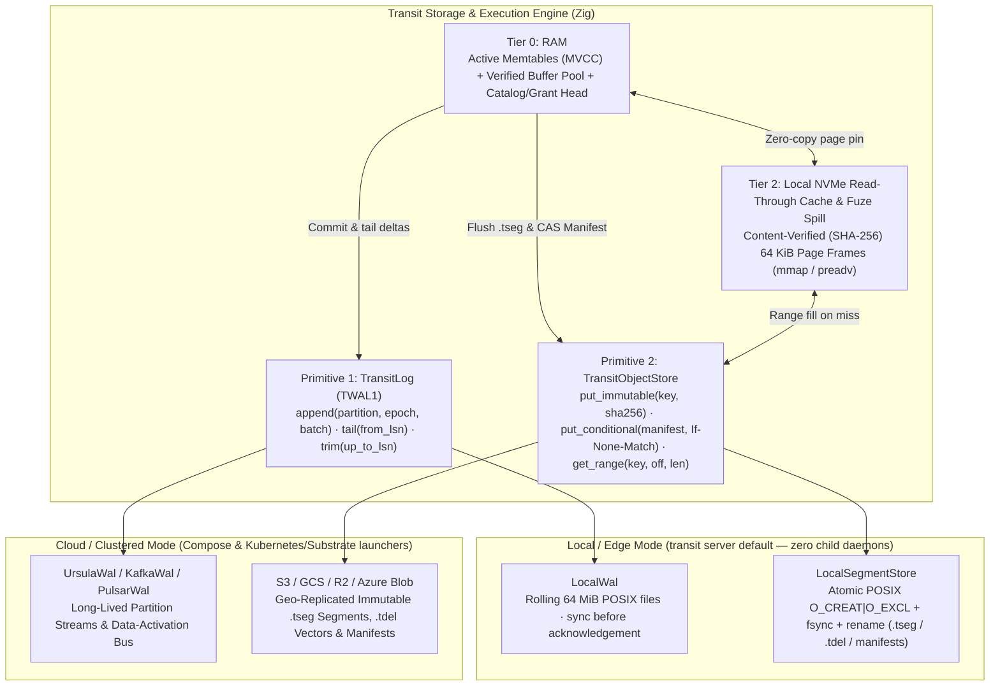
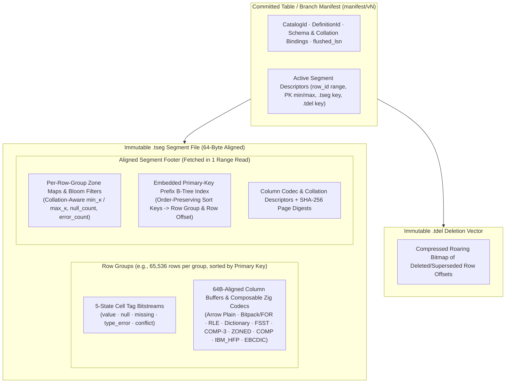

# Storage, placement and observation

This account explains why durable authority, physical execution and telemetry
remain separate, while accounting for the resource costs of that separation.
It covers both the implemented copy-on-write B-tree page storage baseline and
the target **Four-Tier Storage Architecture (`TransitLog` + `TransitObjectStore`)**,
**`.tseg` hybrid OLTP/OLAP segment format**, and **Partitioned / Multi-Writer OCC
concurrency model**.
The [storage](../reference/storage.md), [deployment](../reference/deployment.md)
and [observability](../reference/observability.md) references own configuration
and operational behavior.

## Persistence model

The local server supplies conditional native durability through its exclusive
[local backend](../../../packages/zig/transit-backend-local/README.md), a
partition-zero WAL and immutable page/block objects. Ursula deployments retain
their backend mapping. The local path preserves the existing native root model. The
[native persistence proofs](../../history/qualification/storage.md#native-authority-over-local-storage--2026-10-22)
cover restart and lost replies, with the physical collection and power-loss
limits stated there. Transit owns logical identities, accepted transitions, retained
boundaries and retirement. Recovery uses validated history/checkpoints; indexes
and resident caches accelerate access without becoming an independent source of
permission or execution rights.

Immutable catalog/resource roots permit bounded page reads at a stable basis.
The current realm journal remains a serialization point. Separating durable
cardinality from cache size therefore does not establish horizontal authority
throughput. It answers a memory-growth question, not every scaling question.

### Synchronous local acknowledgement

Why does the local owner sync each accepted record instead of collecting a queue
of independent appends? Its caller serializes validation, immutable preparation,
log publication and receipt observation. `DiskWal.append` syncs the written frame
and any new segment directory entry, then publishes a synced frontier before
returning. A post-write failure poisons the owner until recovery establishes the
original outcome. Multi-row Table operations share that one accepted record;
separate operations do not share a deferred acknowledgement.

The [disk ingestion controls](../reference/performance.md#local-ingestion-and-bounded-growth-measurements)
attribute about 0.5–1.2% of owner ingestion medians to the final WAL append in
their selected Table workloads. This source-specific observation favors retaining
the simple acknowledgement boundary while addressing measured staging/read
costs. It is not a throughput comparison: group commit can amortize syncs under
concurrent load, and these controls do not measure that regime. Such a design
needs bounded queued ownership, original per-command receipts, explicit uncertain
prefixes and control progress under saturation. Deferring a sync in the current
serialized API does not establish those properties.

### Sharing a content-directory barrier

Can an immutable object's payload and checksum file share a synchronization
barrier without changing when its descriptor becomes visible? Both files live
in the same `objects/` directory, and neither has independent public visibility:
readers enter through the descriptor in `keys/`.

[`DiskObjects.stage`](../../../packages/zig/transit-storage/src/DiskObjects.zig)
syncs each file's bytes before linking its content-addressed name. It then syncs
`objects/` once for both names before allowing descriptor publication. The
descriptor still receives its own file sync, atomic replacement and `keys/`
directory sync. A new object therefore requires three file and two directory
sync calls, compared with three of each when each content name was published
separately. These are application I/O barriers, not measured device commands.
The fixed pair requires no queue, retained allocation, timer or second writer.
The physical object stage call remains individually durable. A page owner may
buffer private candidate pages only behind its explicit preparation barrier.

The reasoning assumes truthful successful file/directory synchronization,
atomic descriptor replacement, the existing per-key lock and exclusion of
concurrent reclamation by the owning backend. A crash between content links
can leave private files. A retry verifies an existing file and syncs its bytes;
the shared directory barrier still runs before a descriptor can reference it.
Failure after descriptor replacement remains uncertain. A successful physical
put supplies neither SQL acceptance nor permission to remove retained history.

The [finite object model](../../../tests/verification/models/README.md#finite-object-publication-model)
separates visible/durable bytes and names, including independent writeback and
modeled power loss. Five removed-barrier controls check the required ordering.
The real disk sync-order probe, injected write/sync errors and process-death
schedules independently exercise the implementation; none proves a filesystem's
power-loss behavior or complete implementation refinement. The
[storage evidence account](../../history/qualification/storage.md) records
executed commands and their scope.

The same ordering now applies to bounded groups of up to eight immutable
objects. The caller owns the input bytes until return; ordered per-key locks
exclude competing publication until the final barrier. All payload/checksum
files and their names become durable before any descriptor is replaced. Each
descriptor file is synced separately, and one final directory barrier covers
their names. For `n` new objects this requires `3n + 2` sync calls instead of
`5n`; eight objects use 26 instead of 40. These counts exclude allocation
inventory and accepted WAL publication. The single-object ordering is unchanged.
Independent file syncs within a group use a bounded set of eight futures. Every
started future is joined before success or failure returns, so stack buffers and
file handles outlive the work. All content syncs finish before content links;
the content-directory barrier still precedes descriptor replacement, and all
descriptor syncs finish before their names are replaced. Failure cannot skip a
required barrier or report a partial output as complete. Concurrency changes the
scheduling of independent barriers, not their durability requirements.

Native and direct index owners use already available page groups rather than
waiting for another command. Multi-tree candidate mutations in
[`TablePartition`](../../../packages/zig/transit-storage/src/TablePartition.zig)
and [`DirectCatalogStore`](../../../packages/zig/transit-catalog/src/DirectCatalogStore.zig)
coalesce candidate index pages across B-trees through
[`TreeStore.Batch`](../../../packages/zig/transit-storage/src/TreeStore.zig),
serving staged pages from the batch buffer during multi-row mutations and
flushing deduplicated groups of up to eight pages before candidate publication.
[`DataAllocations`](../../../packages/zig/transit-backend-local/src/DataAllocations.zig)
and [`NativeAllocations`](../../../packages/zig/transit-backend-local/src/NativeAllocations.zig)
record missing inventory entries for a batch in one
[`DiskWal.appendFrames`](../../../packages/zig/transit-storage/src/DiskWal.zig)
segment append and one `head.json` plus directory sync before creating any
group content, while holding their shared reclamation fence until completion. A failed
group can leave a visible subset of complete private objects; it returns no page
references and installs no new publication confirmations. Exact retries repeat
the required barriers, and quota reservations remain charged after uncertainty.
This grouping changes neither stored bytes nor the accepting owner or decision.
[`AllocationJournal`](../../../packages/zig/transit-backend-local/src/AllocationJournal.zig)
checks cancellation before the inventory append, then protects that single
bounded WAL batch through its durability barriers. Protection ends before
per-object marker and content work. A pending maintenance cancellation is
delivered at the next safe point, preserving the accepted inventory prefix
without forcing replacement of the shared foreground owner. Genuine write/sync
failures retain the WAL's uncertainty and reopen requirement. Joining a timed-out
step may wait for this durability boundary; device I/O supplies no hard latency
bound. The [allocation cancellation test](../../../packages/zig/transit-backend-local/src/data_allocations_test.zig)
delivers a real task cancellation at a gated file sync, then verifies the complete
inventory prefix, same-owner retry and disk reopen for native/direct single and
batched records. Existing sync-failure schedules separately exercise storage
errors.
Bounded stack buffers hold encoded pages. The native
[`PageStore`](../../../packages/zig/transit-backend-local/src/PageStore.zig)
preallocates an additional eight-page private buffer per owner and coalesces
successive tree/path stages across one candidate. Its own reads resolve buffered
children independently of read-cache capacity. It flushes when full and in
`finish`, which native preparation calls before returning a publishable candidate.
No timer or later command completes this work. Discard may drop unflushed pages;
flushed private objects remain inventoried until ordinary reclamation. A sync,
quota or encoding failure prevents preparation from returning a candidate for
WAL acceptance. The buffer does not grow with retained history and its memory is
included in the owner's resident accounting.
The finite model checks one- and two-object groups; disk tests
cover the eight-object bound, overlapping groups, partial failures and restart.
These checks do not prove arbitrary batch sizes or physical power-loss behavior.

Deferring indexes would require
reconstruction from accepted WAL records. Those alternatives can remove more
foreground work but are not established by directory-barrier sharing. End-to-end
console latency also includes gateway admission, recovery polling and execution
RPCs; reducing one storage barrier does not establish a proportional statement
speedup or global optimality.

### Private object staging and native progress

Can a private direct-data write block unrelated native reads and control publication?
The exclusive local backend uses one mutex for WAL access, accepted-head state
and quota reservations. Direct-data object publication needs neither a new native
root nor that mutex while its files are written and synced. Each disk object key
has its own publication lock; readers capture an atomic descriptor and verify
the requested content. A separate shared creator fence protects direct-data
publication against exclusive reclamation; neither path holds the native journal
mutex through direct object I/O.
Native pages and blocks have a separate allocation mutex and shared creation
fence. `Backend.putNative` holds that fence until immutable publication finishes;
native reclamation acquires its exclusive side before consuming an allocation.
This joins a delayed creator before deletion can remove its marker. Private
native allocation/object syncs release the journal mutex, while epoch checks and
quota reservations still take it briefly.
[`StorageCollection`](../../../packages/zig/transit-backend-local/src/StorageCollection.zig)
also releases the journal mutex during progress-file publication and physical
reclamation. Its collection lock serializes the progress record, while the
exclusive creator fence and inventory lock protect the selected allocation
through deletion and queue consumption. Accepted storage epochs cannot retreat;
rechecking the epoch before deletion therefore preserves the fence without
holding the journal mutex through the unlink. Quota reservation and confirmed
byte release still use that mutex. Slow deletion delays native creators through
their fence, but does not require unrelated direct acceptance or native reads
to wait on the deletion's disk I/O.

The [paused collection regression](../../../packages/zig/transit-backend-local/src/collection_test.zig)
tests progress publication and deletion with independent data acceptance. It
checks lock independence, not freedom from device contention or a latency bound;
the local backend check runs it through the pinned package test target.

[`Backend.put`](../../../packages/zig/transit-backend-local/src/Backend.zig)
checks for an existing descriptor, reserves encoded bytes under the shared
mutex when needed, then stages outside it. Final native publication still takes
the authority fence and journal mutex; direct acceptance still checks current
storage and policy epochs. Private bytes cannot publish a stale candidate.
[`LocalSegmentStore`](../../../packages/zig/transit-storage/src/LocalSegmentStore.zig)
protects completed-attempt counters with a separate short mutex. Callers must
join operations before inspecting counters or closing the owner.

Two attempts can observe the same missing key and both reserve it. Keeping
both reservations until exclusive reopen conservatively overcounts bytes;
refunding after an uncertain write could undercount retained files. Serializing
the entire object operation under the journal mutex avoids that overcount but
couples every disk sync to unrelated control work. The selected separation
preserves the quota ceiling and makes that tradeoff explicit. Memory fixtures
retain their caller-serialization requirement.

The [native component regression](../../../packages/zig/transit-backend-local/src/native_test.zig)
pauses an actual private object file sync, completes immutable reads and a
quota-reserved checkpoint before releasing it, then reopens to verify both
outcomes. Disk object tests share one facade across concurrent immutable and
conditional writers and inspect counters after joining them. These schedules
test lock independence and publication safety, not a wall-clock guarantee:
device contention and the serialized WAL can still delay progress.

The corresponding native-allocation schedule pauses an inventory sync while
another lane reads native state and accepts independent data. A
[collection schedule](../../../packages/zig/transit-backend-local/src/collection_test.zig)
pauses creation after its inventory entry but before its object lock; reclamation
must join that creator before removing its bytes and marker. These tests reject
the earlier shared-journal staging lock and an unprotected creator respectively.

### Sequencing local native candidates

Can concurrent native preparation increase disk work without increasing accepted
throughput? Native candidates share one accepted catalog frontier. Two candidates
prepared from that frontier cannot both publish: one conditional append loses,
even if both already synced private pages. Repeated retries can consume a request
deadline and leave more unreachable allocations. This argument concerns native
control/process state; direct Tables have their own acceptance frontiers.

The local [Store](../../../packages/zig/transit-backend-local/src/Store.zig)
sequences complete native submissions before refresh and preparation through
the generic engine's paired journal hooks. A waiting submission reauthenticates
and checks original receipts against the then-current authority. It still uses
the same conditional append. Explicit prepared candidates do not hold this
sequencer and can cause a conflict; native reads and direct data acceptance do
not acquire it. This trades parallel native staging for less speculative disk
work, without asserting that physical I/O or authorization waits are bounded in
wall-clock time.

The native submission regression pauses one principal before object publication,
queues another principal and verifies independent native reads and direct data
acceptance. Both native submissions then complete in order and recover their
original receipts after reopen without staging again. The schedule fails with
sequencing disabled and passes with it enabled. Run the package's `zig build test`
with `-Dtest-filter='local native submissions'` inside the pinned development
shell. This is a contention and recovery check; a matched installed SQL run is
still needed to establish any latency improvement from the scheduling change.

### Local WAL publication and recovery model

When may a recovered local owner acknowledge new work or delete a retained
prefix? The [local storage contract](../../../contracts/TRANSIT_STORAGE_V1.md#local-wal-persistence)
and [DiskWal](../../../packages/zig/transit-storage/src/DiskWal.zig) require durable
support for every published frontier and a durable floor before deletion. A
complete file or renamed metadata visible to a replacement process can still be
unsynced. Process replacement alone does not establish either requirement.

The finite [TLA+ model](../../../tests/verification/models/Wal.tla), introduced
2026-10-26, represents one exclusive owner and partition, two LSNs and two values
of each epoch. Each segment holds one frame, classified as empty, torn or
complete. Separate state records visible and durable data, directory names and
metadata, cached frontiers, operation phases and acknowledgements. Atomic
metadata replacement and truthful successful file/directory syncs are explicit
assumptions. Unrequested persistence may occur independently. Process death
preserves the visible image; power loss discards state that has not persisted.
These assumptions do not certify a particular filesystem or device.

Append syncs the frame and its new name before replacing metadata; metadata's
file and directory are synced before acknowledgement. Recovery validates the
retained sequence and syncs complete frames beyond the observed metadata frontier.
After validating every partition, opening syncs the WAL directory before exposing
the owner. The first barrier prevents a later fence or append from publishing a
frontier over unsynced recovered bytes. The second stabilizes recovered names and
visible metadata replacements: an equal-floor trim retry must not delete history
on the strength of a rename that has not become durable. Interrupted cleanup
still requires repeating the authorized trim; opening does not itself delete
eligible prefix segments.

TLC checks preservation of acknowledged and published history, epoch admission,
acknowledged fences, deletion authority, completed cleanup and contiguous usable
recovery. Removing ordering guards produces counterexamples. The model identified
recovery barriers that mere frame validation did not provide; independent disk
I/O regressions require failed barriers to reject opening. The
[model guide](../../../tests/verification/models/README.md#finite-local-wal-model)
defines reproduction, exact assumptions and negative controls; the
[proof ledger](../../history/qualification/verification.md#local-wal-model-and-recovery-barriers--2026-10-26)
records execution and its limits. No automatically checked Zig refinement or
hardware power-loss experiment is claimed.

This model targets ordering decisions before group commit or checkpoint-driven
trimming introduces additional choices. Modeling every byte, directory iterator
or partition would increase the state space without replacing implementation
regressions for those mechanisms. Their exclusion is a scope choice, not proof
that they cannot fail. The caller must separately establish checkpoint, receipt,
pin and logical-history coverage before trim. No liveness or wall-clock guarantee
follows under indefinite faults, and distributed ownership remains outside this
exclusive-owner model. Recovery adds file syncs for uncertain complete segments
and one directory sync before open returns; these costs need separate measurement.

### Direct Table acceptance alongside native resources

The local SQL service uses a separate direct Table owner. Its control catalog
reserves names and records frozen DDL work; each Table's acceptance log determines
whether the new definition or row state is visible. Immutable operation bindings
prevent a retry from changing its target or intent. Native authorization supplies
the current permission fence, while direct row bytes bypass actor turn limits.
See the [direct contract](../../../contracts/DIRECT_TABLE_V1.md) and
[catalog implementation](../../../packages/zig/transit-catalog/src/DirectCatalog.zig).

This separation answers an acceptance and recovery question, not a claim of
distributed write throughput. The installed local owner has exclusive storage
ownership. Point writes may remain in retained WAL records, while bulk ingestion
publishes `.tseg` data before its atomic acceptance. Durable pins preserve the
original definition and unflushed frontier; separate Tables retain independent
cuts. The [installed execution proof](../../history/qualification/runtime.md#installed-direct-execution-recovery--2026-10-23)
and [direct CRUD/DDL proof](../../history/qualification/catalog.md#direct-table-crudddl-recovery--2026-10-23)
record exact-retry, restart, revocation and name-replacement schedules and their
reproduction commands. Those runs do not establish arbitrary power-loss safety,
cloud storage placement or physical Table collection. The current local server
also schedules [bounded automatic point flushing](../reference/storage.md#direct-table-data);
that later behavior is outside the scope of those historical runs. Cache tiering
and distributed OCC remain design work in the model below.

### Reusing validated catalog history within a live owner

How can repeated catalog requests avoid replaying all earlier declarations
while preserving their accepted state and current authorization? The local
owner assumes exclusive backend ownership, immutable accepted log frames and
collision-resistant record commitments. Its startup still performs complete
catalog recovery. Within that lifetime, a validated prefix is represented by
one fixed-size directory root and the hash of its final record. It contains no
borrowed allocations, grants, native execution lane or caller response.

[`LocalTableHost`](../../../apps/transit-node/LocalTableHost.zig) copies that
value under a short mutex into each request. The existing directory lock
excludes catalog writers from other requests; Table operations retain their
separate lock stripes. [`DirectCatalogStore.recoverSince`](../../../packages/zig/transit-catalog/src/DirectCatalogStore.zig)
checks the configuration, nondecreasing log tail, exact boundary record/hash
and current directory roots. Every suffix record still passes the ordinary
chain, successor and operation-transition checks. Successful publication or
recovery can advance the shared prefix; a failed uncertain append cannot export
newer state. The next request resolves that suffix from the last validated
prefix. Final native authorization remains independent of catalog recovery.

A cold request workspace reads one log boundary instead of the complete prefix
and its referenced operations. A retained `DirectCatalogStore` checks its live
log tail; when unchanged, it preserves its verified root and index pages without
reading that boundary again. A changed tail uses `recoverSince` before the next
operation. Directory-root checks on recovery and the requested operation still
require storage work. Constant retained cache
size does not establish constant operation cost, Table recovery cost or restart
time. A replacement owner always replays the full retained catalog. Reuse trusts
previously validated interior frames during the live owner's lifetime; it is
not continuous historical-corruption detection, a persisted checkpoint or
permission to trim history.

Replaying the entire catalog per request avoids retaining this process-local
evidence, but its repeated validation work grows with accepted history. Raising
page-cache capacity would retain more pages without removing that replay.
Persisted checkpoints would also reduce replacement cost, but require separate
coverage and recovery contracts. The selected cache addresses request reuse
within the existing exclusive owner. The
[catalog tests](../../../packages/zig/transit-catalog/src/direct_catalog_test.zig)
compare full and cached log reads, destroy the original request allocator,
recover an accepted append with a lost reply, and reject altered boundaries,
missing roots and invalid successors. The
[proof ledger](../../history/qualification/catalog.md#catalog-prefix-reuse--2026-10-26)
records execution and the separate resource-growth schedule; these checks do
not establish distributed ownership or a latency guarantee.

The same local ownership assumptions permit bounded Table history hints.
[`TablePartition.recoverSince`](../../../packages/zig/transit-storage/src/TablePartition.zig)
rechecks a previously validated root/chain against its accepted WAL or archive
boundary, then validates every newer transition. The latest accepted recovery
capsule and current top-level roots are still read and verified. A newer
checkpoint supersedes an older hint through the normal checkpoint-publication
proof, so legitimately released older anchors need not remain available merely
for a cache entry. An unchanged Table replays zero successor records; that does
not eliminate declaration, boundary or index-root reads.

`LocalTableHost` retains at most 64 owned Table hints, one per serialized lock
stripe, for object-scoped requests, name resolution and automatic flushing.
Name-only lookups hash the requested namespace/name into a stripe; this selects
only a disposable hint, not the object's identity or rights. Catalog changes
remain excluded by the directory lock. The actual resolved object and partition
must match the hint before reuse. Name lookup can observe concurrent row
acceptance as before; its stripe serializes the cache slot, while row mutations
still use their object stripe. Directory scans open Tables without these hints.
Collision discards only volatile history evidence. The next open either validates a matching hint or
performs ordinary recovery; no pin, pending statement or durable Table is evicted.
An uncertain append cannot export a hint, and the service clears the selected
slot after a failed request, including denied final disclosure. Replacement
discards all hints. Permission checks remain independent and current.

The [`Table live recovery prefix` tests](../../../packages/zig/transit-storage/src/table_partition_test.zig)
compare suffix replay with the accepted root, reload a changed declaration, reject
forged boundaries and shortened history, and exercise checkpoint supersession
and missing capsules on disk. The
[catalog hint test](../../../packages/zig/transit-catalog/src/direct_catalog_test.zig)
forces eviction and name changes; the
[native policy schedule](../../../apps/transit-node/local_catalog_policy_test.zig)
checks revocation after buffering with a warm hint, and compares cold/warm name
lookups through the host before replacing the native object's owner. These are component and
composition checks, not a measured end-to-end speedup. Prefix hints retain no
request allocator or provider handle.

The host also owns ten ordinary and two reserved control workspaces. Each
[`LocalTableService.Resident`](../../../apps/transit-node/LocalTableService.zig)
retains one catalog and at most one Table, including owned declaration, index
pages and segment buffers. A free workspace is borrowed exclusively; the
existing directory and Table locks still order operations. Its stable allocator
and provider contexts outlive every borrowed view. Matching the complete original
seed and partition permits Table reuse. `TablePartition.refresh` checks the live
log tail and validates a changed suffix before serving; changing Tables evicts
only volatile state. Nested views move their owners out of the slot, so they
cannot alias a mutable cached Table. Workspace destruction releases all retained
allocations before backend replacement.

Retained and temporary workspace allocations share an explicit budget: 256 MiB
in aggregate for ordinary work, 64 MiB for control, and 128/64 MiB respectively
per workspace. These bounds are separate from parsed request/response budgets.
They cover dynamic workspace allocations; fixed host/owner structures, native
provider page caches and I/O buffers have separate bounds and are excluded.
Exhaustion refuses the request and discards its workspace; it cannot discard
accepted data or consume the other pool's reserve. Failed requests, including
uncertain publication and denied final disclosure, also discard the borrowed
workspace. Every request obtains fresh native policy guards. The native policy
schedule compares warm/cold lookups, observes externally appended pin/release
records, reads a retained cut, and exercises control capacity after data quota
exhaustion. Optional `owner_memory` diagnostics distinguish workspace allocation
and retained bytes from request/response allocation.

This reuse assumes accepted immutable content remains unchanged within the
exclusive storage lifetime. It does not continuously rescan historical bytes.
Full replacement recovery, suffix integrity checks and current authorization
remain separate obligations. Persisted checkpoints can reduce replacement cost;
retained owners reduce repeated live reads and allocation. Neither mechanism
reduces the number of durable publications required by a new mutation.

### Optimistic current reads and retained cuts

SQL's cold read preparation first observes a frontier and records an exact pin
request. A concurrent row, pin or physical publication can advance that frontier
before acquisition. [`ReadCache`](../../../packages/zig/transit-sql/src/ReadCache.zig)
allows at most four preparation attempts, with a separate safety gate after a
conflict: current `pin_status` must report no pin for the original owner and a
strictly later frontier in the same partition. Monotonicity and exact pin matching
then exclude both an earlier successful acquisition and any delayed future one.
The service records closure before preparing another identity, and validates
the original object and definition again. A retained pin, missing observation,
changed definition or exhausted bound fails preparation. No iterator has opened
at this point; an existing result never restarts or changes its cut.

The [session fault schedule](../../../tests/interfaces/sql_sessions/faults.py)
places a real concurrent INSERT between discovery and pinning, then checks the
absence proof and exact result. Its complementary schedule replaces a successful
pin reply with a conflict: inspection finds that original pin, and preparation
must fail without substituting another identity. These schedules distinguish
proven failed acquisition from an error response that follows acceptance.

Can a caller read one row or traverse a stable Table without creating durable
retention work? In the serialized local-owner model, `read_current` uses an
optimistic logical-change fence. Let `e` be the caller's original exclusive
accepted frontier, `a` the current frontier and `c` the most recent logical
change frontier. A request requires the same partition, the exact original
definition, and `c <= e <= a`. A no-op or physical publication advances `a`
without advancing `c`; a row mutation advances both. Even changing a value back
cannot make an older basis valid again. Definition equality separately prevents
reinterpretation after schema or name changes.

[`TablePartition`](../../../packages/zig/transit-storage/src/TablePartition.zig)
checks that condition before reading the current immutable root. Ordered suffixes
use stable row identities and bounded row/byte budgets. The service's Table lock
excludes publication during each call, while its final native authorization fence
protects already-buffered rows, absence and completion metadata. Across calls,
the unchanged original expectation detects logical drift; a caller must reject
its incomplete prefix on failure rather than splice in a newer basis. Checking
strict identity order and the original row count is necessary for a consumer
claiming complete coverage. A supplied seek key alone does not establish that
earlier rows were consumed.

This trades read availability during mutation for avoiding durable pin acquisition
and release. It suits conditional application reads and migrations whose source
is expected to remain unchanged. Retained queries use explicit pins instead,
because they need the original data after writes. Neither mechanism provides a
cross-Table atomic cut. The
[request contract](../../../contracts/DIRECT_TABLE_V1.md#current-observations)
and [`DirectTableResponse`](../../../packages/zig/transit-catalog/src/DirectTableResponse.zig)
define wire attribution and consumer checks. The
[scoped proof](../../history/qualification/catalog.md#optimistic-current-table-reads--2026-10-23)
records disk-reopen, physical-progress, logical-drift and disclosure schedules;
it does not establish distributed read locking or physical collection safety.

### Namespace retirement and retained authority

Namespace retirement must exclude live or admitted Table declarations without
loading the catalog into memory. In the exclusive local-owner model,
[`LocalTableHost`](../../../apps/transit-node/LocalTableHost.zig) serializes catalog
mutations. Namespace admission records a durable fence against new Table DDL;
[`DirectCatalog`](../../../packages/zig/transit-catalog/src/DirectCatalog.zig)
then scans one object-directory page per explicit execution. Existing Table
admissions either still block retirement or have an authoritative terminal
Table outcome. A committed DROP with unsettled catalog bookkeeping is therefore
distinct from an uncommitted declaration.

The fence makes the saved scan cursor sound across requests and recovery: a new
declaration cannot appear behind an already examined cursor. Each scan is
bounded by eight object entries, although validating a Table's retained history
has its own recovery cost. Scanning the shared object directory costs work
proportional to total catalog objects; a namespace membership index could reduce
that work but would add another index to maintain through Table acceptance and
recovery. The implemented choice bounds resident directory state and preserves
one Table acceptance authority. It does not establish distributed namespace
locking or discover external consumers.

Logical retirement retains the original native permission object. Otherwise
retiring an empty namespace after its Tables were dropped would strand their
still-pinned snapshots, operation receipts and result evidence. Names control
new admissions; current native references control disclosure of retained data.
The [namespace request contract](../../../contracts/DIRECT_TABLE_V1.md#namespace-lifecycle)
defines those separate lifetimes. Catalog, signed native and HTTP evidence is
recorded in the [proof ledger](../../history/qualification/catalog.md#direct-namespace-lifecycle--2026-10-23).

## Complete Table history with bounded archive publication

The local Table maintenance question is whether WAL files can be removed while
preserving the original accepted changes, retry receipts and retained unflushed
rows. The implemented archive profile assumes a serialized Table owner, durable
immutable object publication, an exclusive local WAL, and the current authority
check at publication/trimming. Archival preserves unlimited logical history by
default. Explicit logical expiry is a separate transition described below;
immutable Table-object collection remains unimplemented.

Let `A` be the exclusive archived LSN and `N` the accepted frontier. A nonempty
archive satisfies `0 < A < N`; its paged directory maps every LSN in `[0,A)` to
one complete original TWAL frame. Archiving stages a bounded contiguous extension
and its immutable directory before publishing `A` in a Table acceptance record.
That transition preserves all logical row, definition, receipt, pin and operation
roots. Trimming can remove only `[0,A)`, so at least the latest acceptance record
remains in WAL. An interrupted copy leaves unreachable candidates; an interrupted
publication is resolved from accepted history; an interrupted trim resumes at
the same accepted coverage. None of these events grants logical expiry.

Recovery uses the latest accepted WAL record to locate candidate archive coverage
and an optional accepted recovery baseline. Without a baseline it verifies the
complete hash-linked chain from zero before serving; the baseline case is defined
below.
It checks archive object hashes and original frame coordinates as well as the
normal Table transition rules. This avoids treating an independently discovered
manifest or an object's existence as acceptance. Missing or substituted frames
fail closed. A retained root keeps its original LSNs and commitments while reads
resolve physical placement through the latest accepted archive directory.
Consequently a slow consumer and a snapshot containing unflushed rows require no
cursor rewrite or synthesized changefeed event.

`TableArchive` holds one input/output frame pair at a time. Archive calls admit at
most eight frames, explicit encoded-byte work and the owner's index work/cache
bounds. This bounds resident work independently of retained history. Complete
replay without a recovery checkpoint costs time proportional to accepted history
plus index lookups; archival alone is not a constant-time restart mechanism or a
compression claim. Archive copies also need physical space
before WAL removal; reserved control capacity supports this ordering without
using disk pressure as retention authority.

The exact layout and transitions are in the
[storage contract](../../../contracts/TRANSIT_STORAGE_V1.md#table-history-archives),
with implementation in `TableArchive`, `TablePartition` and the local `DataStore`.
The [proof ledger](../../history/qualification/README.md) separates disk/restart and process-death
checks from power-loss behavior, automatic scheduling and future collection.

## Accepted Table recovery baselines

The restart question differs from historical retention: can a Table recover its
current accepted state without revalidating every archived logical transaction?
The model assumes the same serialized owner, current authorization fence and
immutable publication guarantees as archival. A ready owner has already
validated its accepted state; the checkpoint operation records that state,
including pending work, exact receipts and pins, rather than deriving a
latest-value projection from rows.

Let `C` be the exclusive frontier of the saved root, `H` the last accepted record
payload hash there, and `N` the current frontier. A bounded capsule stores the
root and `H`. The WAL transition at `C` publishes its content hash and advances
only the physical recovery reference and accepted frontier. Consequently an
unpublished capsule cannot authorize restart. Recovery checks the capsule's exact
identity, then verifies that transition against both the saved root and `H`.
Every later record must retain the selected reference and extend the normal
hash-linked chain. Any accepted newer checkpoint would instead be selected from
the latest record. This reduces Table transition replay from `[0,N)` to `[C,N)`;
it does not bypass the exclusive WAL owner's retained-file validation.

The capsule is at most 16,424 encoded bytes and contains directory roots rather
than arrays of rows or receipts. Replay keeps one bounded frame at a time; current
top-level directories and the declaration load before readiness. Admitted-work
transitions may still consult compact original operation evidence. The dependency
on that evidence is retained independently of the restart baseline. A superseded
capsule is not recursively loaded: its root is already contained in the newer
baseline. This avoids a checkpoint chain whose restart cost grows with the
number of previous checkpoints.

An alternative is replay from creation on every reopen. That gives an eager
integrity check of all accepted record bytes but makes reopen proportional to
retained history even after archival. The implemented baseline instead checks
older history and descendant objects when accessed; corruption there can fail a
later historical read or original-operation retry even when current state opens.
No failure becomes an empty table, a fresh retry identity or a skipped prefix.
A missing selected capsule always fails readiness, even if older WAL files remain.
Neither approach establishes correctness after losing the only durable disk or
arbitrary rollback of accepted storage.

The [checkpoint contract](../../../contracts/TRANSIT_STORAGE_V1.md#table-recovery-checkpoints)
and `TableRecovery`/`TablePartition` define the bytes and transition checks.
The focused `test::table-checkpoints` recipe exercises retained disk reads,
publication uncertainty and bounded replay; executed results belong in the
[proof ledger](../../history/qualification/README.md). Its replay counters exclude provider and
index I/O, and do not establish a latency or whole-process RSS bound. Logical
expiry, object collection and automatic scheduling remain separate mechanisms.

## Logical expiry and original outcome retention

The retention question is which obligations can release historical row payloads
without losing an accepted result or an offline consumer's position. The model
uses the same exclusive Table owner and immutable publication assumptions as
recovery. Logical history, exact snapshots, current state, operation outcomes and
recovery are distinct obligations. A logical floor changes only the first;
storage pressure grants no authority to change any of them.

Let `F` be the logical floor, `A` the archive frontier, `C` the published recovery
baseline and `L` the oldest live history lease's exclusive frontier. An explicitly
requested advance `F'` requires `F < F' <= min(A,C,N)` and, when a live lease
exists, `F' <= L`. Zero is the unlimited default. A paged index ordered by
`(frontier, principal, operation)` supplies the minimum through a bounded tree
path. Acquisition/release publishes that entry with the owner-keyed pin record;
recovery validates the same transition. History reads below the accepted floor
fail after checking current authorization, including empty intervals. Ordinary
snapshot pins retain their exact data independently of this logical floor.
A live history lease also retains its anchor frame at `L - 1`: reopening the
exclusive position `L` verifies that frame's commitment. Thus `F = L` does not
make every physical frame below `F` disposable.

Original receipts could instead continue pointing to complete accepting frames.
That representation makes an outcome lookup depend on the old row payload and
embeds row-root references in evidence retained for unrelated purposes. The
implemented `TableEvidence` representation stores bounded outcome/control
metadata separately. The accepting WAL transition publishes its content reference
in the same paged receipt or operation directory. Recomputing that reference from
the acceptance binds the object to its original result, identity and position.
The evidence retains the original declaration or frozen intent, with no old row,
archive, recovery or pin roots. This costs one immutable evidence staging call
per accepted mutation/control plus hashing its bounded metadata; its latency
effect requires measurement and is not implied by reduced retention dependencies.

These mechanisms establish a logical read boundary and remove one physical
dependency. They are not a collector: current/unflushed rows, snapshots, complete
unexpired history, checkpoints and other owners still require a complete retained
graph before deleting any shared object. Missing evidence fails even when its
old WAL frame happens to remain. An alternative fallback would obscure corruption
and make physical retention depend on which observation path executes.

The [floor contract](../../../contracts/TRANSIT_STORAGE_V1.md#table-logical-history-floors)
and [evidence contract](../../../contracts/TRANSIT_STORAGE_V1.md#compact-table-outcome-and-operation-evidence)
own exact bytes and transitions. Implementation is in
[`TablePartition`](../../../packages/zig/transit-storage/src/TablePartition.zig)
and [`TableEvidence`](../../../packages/zig/transit-storage/src/TableEvidence.zig).
The disk and negative cases in
[`table_partition_test.zig`](../../../packages/zig/transit-storage/src/table_partition_test.zig)
exercise lease blocking, lost replies, restart, missing/corrupt evidence and
original outcomes after test-only removal of expired payload frames. The
`test::table-checkpoints` recipe groups these checks; the [proof ledger](../../history/qualification/README.md)
records reproduction commands, executed results and source limits. This does not prove a deletion
algorithm, automatic service retention or recovery after disk loss.

## Four-tier storage architecture, `.tseg` segments and multi-writer OCC

This section is architectural design analysis anchored against the measured
write-amplification and latency baseline at `5c1099f7`
([performance reference](../reference/performance.md)). It asks how Transit can
eliminate orders-of-magnitude storage indirection and single-sequencer contention
while preserving verifiable authority, exact crash recovery, immediate permission
revocation (`policy_epoch`), and deployment portability across single-binary
local development (`transit server`) and disaggregated cloud/Kubernetes topologies.

The tier diagram and hierarchy below describe proposed profiles. They do not
establish installed memtable recovery, group commit, remote caching, automatic
trimming or compaction. The current direct Table owner uses paged indexes and
retains complete logical history through WAL plus accepted archives and keeps
immutable objects; it does not recover through the
standalone memtable/manifest composition. Its
[partition contract](../../../packages/zig/transit-storage/docs/table-partitions.md)
owns the implemented acceptance, read-pin and recovery boundaries.

### Diagnosis: quadruple B-tree indirection over an HTTP stream store

In the measured earlier baseline, inserting a single Table row incurred `806 ms` from
the local console (`13,238 ms` over PostgreSQL wire), staging `29` immutable
pages and issuing `1,072` HTTP requests to Ursula. Formalizing the storage stack
explains why:

$$\text{Row}(\text{FTR1}) \;\hookrightarrow\; \text{StationIndex}(\text{SBR1}) \;\hookrightarrow\; \text{Resource B-Tree}(\text{TPG1}) \;\hookrightarrow\; \text{Realm Catalog B-Tree}(\text{TPG1}) \;\hookrightarrow\; \text{PackedPageStore}(\text{Base64 JSON over Ursula HTTP})$$

1. **Four nested copy-on-write trees:** A single logical row (`FTR1`) and its
   primary-key index entry are packed into `StationIndex` (`SBR1`) blocks (`64 KiB`
   envelopes), which are indexed by the resource's block B-tree (`TPG1`), whose
   root is stored inside the global realm catalog B-tree (`TPG1`, 8-entry leaves,
   32-child branches). Every path copy from leaf to root across all four layers
   allocates new immutable pages.
2. **Per-turn base64 HTTP stream framing:** `PackedPageStore` serializes each
   modified `TPG1` page into a base64-encoded JSON string, creates a brand-new
   Ursula stream `p/<realm>/c/<id>` for the candidate turn, appends frames over
   HTTP, reads back the entire candidate stream in `192 KiB` windows to verify
   hashes, seals the stream, and only then conditionally appends to the realm
   journal `j`.
3. **Actor-turn wire fragmentation:** Because data operations are funneled
   through `send_input -> open_view -> read_blocks -> commit_turn` with a
   `128 KiB` per-turn block ceiling, multi-row writes and schema changes must
   checkpoint intermediate staging state machines (`STW1`, `STC1`, `STG1`, `STX1`)
   across multiple sequential turns.

### Two pluggable storage primitives: `TransitLog` and `TransitObjectStore`

A database storage engine requires two fundamentally different physical access
patterns that should not be conflated into a single base64 page-stream API:

1. **Sequential, low-latency, ordered append and tailing** for commit durability
   and live change-data activation (**`TransitLog`**).
2. **High-bandwidth, immutable bulk object storage and byte-range reads** with
   conditional manifest publication for compacted datasets, indexes and snapshots
   (**`TransitObjectStore`**).

#### Primitive 1: `TransitLog` (`TWAL1` WAL and Data-Activation Bus)

`TransitLog` defines Transit's canonical binary frame format (`TWAL1`): a
64-byte-aligned header carrying a `CRC32C`/`xxHash64` payload digest,
`partition_id`, `writer_epoch`, `policy_epoch`, monotonic `lsn`, and typed delta
records (`+row`/`-row` columnar batches, catalog DDL transitions, process mailbox
admissions, and recorded effect intents).

- **Native Zig `LocalWal` (`transit server` default):** Appends `TWAL1` frames
  incrementally to rolling `64 MiB` local segment files. It syncs each accepted
  append and its required metadata before acknowledgement. The local owner
  requires no Ursula child daemon. Its measured costs depend on the owner
  workload and filesystem; the interface does not promise a latency bound.
- **`UrsulaWal` (Distributed Stream Backbone):** Repositions Ursula from a
  per-turn B-tree page store to its natural role: a durable, replicated stream
  log that sequences `TWAL1` frames per partition and streams live deltas to
  downstream `Fuze` maintained views, reactive watches and `Station` processes.
- **`KafkaWal` / `PulsarWal` (External Log Adapters):** Maps each `TransitLog`
  partition to a partitioned topic, enforcing `writer_epoch` fencing via
  idempotent producer epochs or partition-leader CAS and tying log retention
  watermarks to `TransitObjectStore` manifest checkpoints.

#### Primitive 2: `TransitObjectStore` (Immutable Segments and Manifests)

`TransitObjectStore` stores immutable **Data Segments (`.tseg`)**, **Deletion
Vectors (`.tdel`)**, and versioned **Table / Partition / Branch Manifests
(`manifest/v{N}`)** using three operations:

- `put_immutable(key, bytes, sha256)`: Writes a content-verified `.tseg` or
  `.tdel` object under a unique UUIDv7/hash key before it is referenced by any
  manifest.
- `put_conditional(key, expected_etag_or_if_none_match, bytes)`: Atomically
  publishes `manifest/v{N+1}` using HTTP `If-None-Match: "*"` / `If-Match` in
  cloud object stores (S3, GCS, R2, Azure Blob) or `linkat`/`renameat2(RENAME_NOREPLACE)`
  on POSIX filesystems.
- `get_range(key, offset, length)`: Fetches aligned footer indexes, zone maps or
  column pages on demand.

### The four-tier memory hierarchy and durability invariants

| Tier | Physical medium | State held | Eviction & crash-recovery invariant |
| --- | --- | --- | --- |
| **Tier 0: RAM** | Bounded Zig arenas (`64 B` aligned) | Active **Memtables / Delta Buffers** (providing immediate MVCC read-your-writes visibility for committed `TWAL1` frames), **Catalog & Grant Head (`policy_epoch`)**, and the **Verified Buffer Pool** (pinned `.tseg` column pages, zone maps and B-tree index nodes). | Volatile; holds zero durability authority. Reconstructed on startup by loading the latest `manifest/v{N}` and replaying `TransitLog` from the manifest's `flushed_lsn` watermark. |
| **Tier 1: WAL (`TransitLog`)** | `LocalWal`, `UrsulaWal`, or `Kafka`/`Pulsar` | Ordered `TWAL1` commit frames since `flushed_lsn`; live change-data activation stream (`+row`/`-row`) feeding `Fuze` maintained views, reactive watches, `TableChangeReader` and `Station` actors. | Durable before any write receipt is returned. Prefix $\le \text{flushed\_lsn}$ is eligible for `trim` only after the referencing `.tseg` segments and `manifest/v{N}` are durable in Tier 3. |
| **Tier 2: Local Disk / NVMe** | Local POSIX filesystem | In cloud mode: stateless, content-verified (`SHA-256`) read-through cache of `.tseg`/`.tdel` `64 KiB` frames (`mmap`/`preadv`) plus bounded `Fuze` query spill. In local mode (`transit server`): primary `LocalWal` + `LocalSegmentStore`. | In cloud mode, losing a node or wiping NVMe loses zero committed data; cold nodes warm pages lazily via `get_range`. Eviction drops clean cached frames under W-TinyLFU/clock policy without touching Tier 3. |
| **Tier 3: Object Storage (`TransitObjectStore`)** | S3 / GCS / R2 / Azure Blob or `LocalSegmentStore` | Immutable **`.tseg` Data Segments**, **`.tdel` Deletion Vectors**, and versioned **Snapshot / Branch Manifests (`manifest/v{N}`)**. | System of record for all compacted data, historical `AS OF` snapshots and branches. Orphaned unreferenced `.tseg` files from aborted staging are swept after lease/epoch expiration. |

### The `.tseg` hybrid OLTP/OLAP segment format and `.tdel` deletion vectors

Pure analytical file formats (such as standard Parquet) optimize for wide scans
but penalize point lookups, primary-key uniqueness checks, low-latency row
deletes, and 5-state cell semantics (`missing`, `type_error`, `conflict`). Pure
row-oriented B-trees optimize for point updates but suffer high write/read
amplification on analytical scans and object storage.

Transit's native **`.tseg` (`Transit Segment v1`)** format—inspired by Vortex and
Apache Arrow—combines zero-copy columnar vector execution with embedded
primary-key indexing and external deletion vectors:

1. **Zero-copy Arrow-compatible physical buffers:** Uncompressed or decoded
   column pages use 64-byte alignment matching `Fuze`'s `Batch.zig` SIMD lanes,
   allowing Tier 2 NVMe pages to be mapped (`mmap` or `preadv`) directly into
   `Fuze` without row-by-row `FTR1` deserialization.
2. **Native 5-state cell tag streams:** Every column stores compact bitmasks/tags
   distinguishing `value`, `null`, `missing`, `type_error` and `conflict`.
3. **Composable Zig physical codecs and collations:** Columns can be encoded with
   analytical codecs (**Bitpacking/FOR**, **RLE**, **Dictionary**, **FSST**) or
   enterprise/mainframe codecs (**`COMP-3`**, **`ZONED`**, **`COMP`/`COMP-4`**,
   **`IBM_HFP`**, **`EBCDIC`**) with explicit **Collation (`COLLATE`)** sort-key
   bindings (detailed in [Query planning, snapshots and results](query-engine.md#logical-types-and-physical-codecs-and-collation-semantics)).
4. **$O(\log N)$ point lookups and $O(1)$ row-group pruning:** Rows within a
   `.tseg` file are sorted by primary key (or clustering key). The footer embeds
   both **Collation-Aware Zone Maps (`min` / `max`)** for analytical scan
   pruning and a compact **Primary-Key Prefix B-Tree Index** over order-preserving
   sort keys so point queries (`WHERE pk = $1`) require at most two range reads
   (footer index $\to$ target row-group slice).
5. **Fast point deletes and updates via `.tdel` Deletion Vectors:** `DELETE` and
   `UPDATE` statements never rewrite an immutable `.tseg` file in the foreground.
   Instead, the mutation appends to `TransitLog` + Tier 0 Memtable, and on flush
   writes a compact `.tdel` bitmap marking superseded row offsets in the old
   `.tseg` segment while writing updated rows into a new delta `.tseg` segment.
   Background compaction later merges `.tseg` + `.tdel` files asynchronously.

The implemented `.tdel` codec uses the shared `transit-bitmap` array, bitmap and
run containers. Its sparse prefix directory and mutation workspace are bounded
by a 512 KiB sidecar allowance, independently of the segment's row count.
Mutations and unions reuse reserved storage; capacity refusal preserves existing
deletions. The definition-bound envelope rejects the previous sorted-offset
encoding. This codec does not itself authorize reclamation or retain a snapshot.

### De-monolithing authority: partitioned logs, fenced leases and multi-writer OCC

The question is how separate writers can preserve one acceptance boundary and
current permissions. The installed answer is the exclusive local owner described
above; distributed leases and optimistic manifest rebasing are separate component
experiments. Their records do not establish a distributed authorization service.

| Boundary | Implemented model | Limit of the inference |
| --- | --- | --- |
| Native authority | Partition zero preserves native history, including control, process and resource transitions. Immutable roots and bounded caches serve current authorization. | The entire policy graph need not fit in RAM. Separate Table partitions do not remove the native journal's serialization point. |
| Direct Table acceptance | The owner stages immutable bytes, validates the original expected definition/head and current native fence, then conditionally appends the Table acceptance record. Point and bulk writes use that same authority. | A staged `.tseg` or component manifest is not an accepted Table operation. The local host serializes publication; this does not qualify independent distributed writers. |
| Lease and manifest components | `PartitionLease` encodes epoch/expiry fields; `OccCoordinator` retries conditional manifest publication and checks overlapping primary keys. | Those mechanisms do not establish current grants, immediate revoke/append ordering, predicate isolation or native turn atomicity. |

The [direct Table contract](../../../contracts/DIRECT_TABLE_V1.md) and
[partition caller contract](../../../packages/zig/transit-storage/docs/table-partitions.md)
identify the acceptance and recovery transitions. A future independent-writer
profile must retain one decision that governs visibility and exact outcomes.
Treating both a WAL append and a later competing manifest CAS as independent
acceptance points would leave conflict and crash recovery ambiguous. Broadcasting
a new policy epoch alone is also insufficient: a disconnected writer must not
continue accepting under an obsolete grant. The acceptance owner needs an
explicit current-authority fence or a separately specified revocation protocol.

The [manifest coordinator](../../../packages/zig/transit-storage/src/PartitionLease.zig)
is an alternative component path, not that installed protocol. It copies the
manifest's segment descriptors and can read complete overlapping segments to
compare primary keys. Rebase work therefore depends on manifest and conflict
size; avoiding a rewrite of immutable segments does not make metadata work
constant-time. It bounds retries at eight, but neither bounded retries nor an
optimistic algorithm establishes lock-free progress when provider operations
use locks or blocking I/O. Read-set, predicate and absence conflicts require
additional transaction semantics beyond disjoint write keys.

These deductions follow from the component's allocation, object-read and
conditional-publication paths. Its unit checks and the separate local public
[CRUD/DDL recovery schedule](../../history/qualification/catalog.md#direct-table-crudddl-recovery--2026-10-23)
are reproducible through the pinned tasks recorded in the proof ledger. They
qualify their respective component and local failure domains. No independent
writer, distributed revocation, fairness or throughput result follows from
those passes; such claims require an implemented protocol and adversarial
concurrent-provider histories.

### Live catalog, query and authority cache integration

The installed local owner is [`TablePartition`](../../../packages/zig/transit-storage/src/TablePartition.zig),
composed by `DirectCatalog` and the node's `LocalTableService`. Its acceptance
records govern visibility, original outcomes and retained cuts. Point data can
remain accepted in the WAL without a `.tseg`; explicit bounded flush and bulk
publication create segments. A durable pin includes accepted unflushed data.

The direct owner uses paged indexes for row locations and retained roots, so
recovery does not reconstruct a resident collection of every live row. This
choice avoids the cardinality-dependent memory of a whole-table memtable and
manifest scan, at the cost of immutable index I/O. The removed standalone
composition is not an alternative Table owner. The
[partition contract](../../../packages/zig/transit-storage/docs/table-partitions.md)
defines the budgets and recovery gates; the
[executed proof ledger](../../history/qualification/README.md) distinguishes component results
from direct public operation and restart schedules. Neither establishes
multi-writer or provider safety.

- **Verified candidate write-through and epoch-tracked cross-lane cache sharing:**
  In [`PackedPageStore`](../../../packages/zig/transit-backend-ursula/src/PackedPageStore.zig),
  `finish()` populates the verified resident page cache (`rememberCandidate`) as
  soon as the candidate segment stream is read back, verified and sealed. In
  [`NativeServer.zig`](../../../apps/transit-node/NativeServer.zig), all 10 request lanes
  synchronize their verified page caches and journal head entries through an
  epoch-tracked shared cache (`shared_pages_epoch`), propagating newly staged or
  fetched pages across lanes without copying unchanged 17 KiB page slots on every
  request.

- **Immutable native control metadata:** each engine has separate 16-record
  native and policy caches at their exact Catalog roots. Known owned record
  types retain their decoded form, including domain lifetime bindings. Separate
  eight-page caches retain policy and required-dependency scan pages, including
  empty ranges, at the exact root/range/cursor. Evaluators still validate records,
  check current rights and sample lifetime time; these caches store no allow or
  usability decision. Private candidate records take precedence over cached
  published records, and a root change invalidates reuse.

## Resource costs and failure (implemented baseline)

| Mechanism | Benefit | Cost or obligation |
| --- | --- | --- |
| Immutable pages and roots | Attributable read bases and conditional publication | Page lookup, copying/staging and dependency-aware cleanup |
| Bounded caches | Resident work independent of total retained data | Misses and explicit admission/read budgets |
| Checkpoint before trim | Recovery after old history is reclaimed | Checkpoint validation and retention of all required evidence |
| Admission/control reserve | Capacity for specified control work under pressure | Explicit quotas; no guarantee that all application backlog can drain |

Cache eviction must not delete accepted work. Failed staging may leave orphaned
bytes, but only final authority acceptance may publish a new logical root.
Storage unavailability does not establish empty state, expiry or rejection of
an uncertain mutation. Reinitializing on a failed read would silently replace
the authority being recovered.

Actual latency and memory conclusions need measurements. The
[performance reference](../reference/performance.md) records workloads and
read/write amplification; a configured cache budget is not an observed RSS
bound, and retained storage bytes are not resident memory.

## Concurrent immutable work and conditional publication

The question is whether one slow storage operation must block unrelated reads
and controls. The model retains one conditional realm journal, immutable pages,
bounded admitted requests and a trusted clock for expiring read pins. It assumes
the provider implements atomic conditional append and does not roll back
acknowledged history. Parallel preparation does not create another authority.

The [native host](../../../apps/transit-node/NativeServer.zig) assigns each admitted
request an exclusively owned execution lane: engine head, verified caches,
transport client, working buffers and observation counters. Provider I/O runs
without the host's shared registry mutex. Preparation validates at a published
basis and stages a private successor. Core's conditional append requires that
same position. Therefore any intervening grant, owner, resource or sequence
change prevents acceptance of that candidate. Rejected candidates can leave
unpublished bytes; parallelism does not itself reclaim them. Unknown append
outcomes retain the original signed request identity.

[Snapshot reservations](../../../packages/zig/transit-core/src/SnapshotLeases.zig)
solve a separate problem: independent engines cannot independently allocate all
64 global pins. Under a short host mutex, an authenticated request reserves one
slot and a unique ticket. Pending opens count toward both global and per-principal
quotas. The engine borrows that slot while it materializes data and rechecks
current authority. Only success installs a renewal/open/close; cancellation or
failure releases the reservation while preserving the preceding pin. Conflicting
operations on one pin fail explicitly. Stale releases cannot overwrite a newer
reservation, and a fresh startup epoch prevents reuse after node restart.

The [disk barrier proof](../../../tests/storage/providers/node_concurrency.py) holds a provider
response while requiring an independent signed read and commit to complete
before release. A second schedule holds old evidence across revocation; a third
races identical signed writes and checks exact receipt reconciliation. The
[proof ledger](../../history/qualification/README.md) provides its reproduction command. Core schedules
exercise global/per-principal pending quotas, failed renewals, stale release and
shared pins across independently owned engines. The proof ledger records runs.
These finite schedules establish overlap and the checked authority outcomes,
not throughput, fairness or a latency guarantee.

The previous single-engine mutex made ownership simple but coupled unrelated
provider delays. Per-request creation would discard useful caches after every
operation. Bounded reusable lanes avoid both costs, at the expense of a cache
budget per lane and potentially conflicting prepared candidates. The
[node configuration](../../../apps/transit-node/docs/growing.md) gives those bounds.
Horizontal write partitioning remains a separate contract; physical reclamation
uses the root and epoch model below.

## Complete blocks beneath Table records

The question is whether immutable Table data must pay the control record's
256-byte mutation cost. In the current native-v1 implementation, a resource has
separate metadata and block indexes under the same accepted catalog root.
Assume authenticated requests, collision-resistant digests, verified immutable
storage and conditional authority publication. A prepared root is private until
that conditional append accepts it. Bytes can survive a failed append without
becoming accepted Table data.

[Native blocks](../../../contracts/BLOCK_V1.md) bind key, length and content digest
in the signed logical request. Their body is separate from the authority journal
record. The core checks the entire body before staging, and the backend reads
back staged bytes before the complete candidate becomes publishable. One resource root change
then accepts metadata, block edges, input progress and outputs together. Lost
replies preserve the exact logical identity and owned bytes; an accepted receipt
can reconcile without staging them again. This argument depends on the existing
authority CAS and current-grant checks, not on the location of provider bytes.

[BlockRecord](../../../packages/zig/transit-station/src/BlockRecord.zig) maps typed
Table records to these blocks. One envelope has 44 bytes of spec plus at most
65,280 payload bytes. This makes its payload an integral number of the existing
256-byte logical digest units. Larger rows retain quota-accounted descriptors
and resume in complete blocks, so the row codec's larger value limit is preserved.
Metadata definitions, index nodes and most schemas/rows fit one block. Predecessor
history is another immutable block. Small point writes consequently need only
head/outcome metadata mutations; they no longer stage a predecessor merely to
free a control slot. This is a statement about operation structure, not measured
end-to-end latency.

The resident batch is bounded at sixteen mutations and 128 KiB. Reads acquire
at most eight blocks with the same byte bound. Table lookahead combines known
single-block row references; multi-block records fetch at most two parts per
request. Eight verified index nodes can be cached at one exact cut. Cached bytes
have no authority: hosts bind the source identity, propagate read failures and
validate current rights before disclosure or commit.

The private Station Table block path retains these bounded publication and
read rules. Direct Tables instead read their accepted `TablePartition` state
through `DirectTableReader`; their row data does not travel through native
small-value mutations. Each owner supplies its own current-authority checks.

The alternative of increasing small-value size would enlarge every control
record and authority journal entry. Sending each 256-byte part independently
keeps messages small but couples logical record size to control transactions.
The separate block index preserves small metadata while admitting bounded bulk
I/O. Its costs are another resource index, larger bounded request buffers and
an explicit ownership/reclamation obligation for staged bytes. Accepted history
and failed candidate bytes still need distinct physical-liveness decisions.

Reference-store checks in
[Table tests](../../../packages/zig/transit-station/src/table_pages_test.zig) cover
lost private proposals, larger-record resumption, exact quota release, corrupted
record envelopes, retained schemas and current read failures. Run
`cd packages/zig/transit-station && zig build test` in the pinned shell. Native
authority/storage schedules are recorded separately in the
[proof ledger](../../history/qualification/README.md). These checks do not establish scan pruning,
columnar storage, horizontal write scaling or a latency improvement. The
[matched service campaign](https://github.com/spoke-sh/transit/blob/a610ecd5dcff22f2d0177b61b905a8e985252c13/tests/mutation_latency/results/2026-10-19/README.md)
measures the combined implementation separately: narrow INSERT/UPDATE and
range/full scans improve, while empty and LIMIT 0 console reads regress. Its
single instrumented INSERT uses one accepted turn instead of two, with fewer
staged pages and provider attempts. This supports reduced publication work, but
does not isolate batching from layout, cache capacity or concurrent ownership.
The same configured page budget is now per lane; node HWM is higher. Retained
raw reports include the earlier prefetch regression and failed baseline reader,
and keep ordinary timings separate from instrumented attempt counts.

## Physical ownership, uncertainty and collection

The question is how to reclaim unreachable bytes while readers and candidate
writers overlap, without making retained cardinality a resident-memory budget.
The model assumes collision-resistant identities, atomic provider/authority
conditional appends, durable non-rollback history, trusted bounded-error UTC and
private provider credentials. It distinguishes accepted root ownership from
physical allocation and from permission to disclose a value.

[Candidate segments](../../../packages/zig/transit-backend-ursula/src/PackedPageStore.zig)
assign private frame addresses before network I/O. The
[allocation queue](../../../packages/zig/transit-backend-ursula/src/AllocationQueue.zig)
reserves the known normalized size before creation. Verification and a closing
seal precede authority CAS. The seal matters beyond immutability: the creator
has completed its single create attempt before issuing it. A collector may
therefore delete a sealed orphan after fencing old publication. It cannot infer
the same fact from absence after an unacknowledged create. Such allocations get
a permanent closed-name fence, followed by data trimming. Releasing their name
would allow a delayed create to resurrect unaccounted bytes.

The queue's state transition consumes one item, carries a live item forward or
releases a deleted item's charge, and advances its cursor in one conditional
append. This makes repeated recovery idempotent without an in-memory allocation
set. The consumed prefix can be checkpointed and trimmed. Mark pages themselves
are accounted control allocations; a later completed pass can collect them.
The queues and catalogs are durable state, while their operation buffers remain
bounded independently of retained cardinality.

Control eligibility grants access to recovery capacity; it does not select a
separate allocation partition. The reservation CAS charges ordinary capacity
first, falling back to the control reserve only for eligible work that cannot fit.
The queued allocation records the actual charged class, so carry and reclamation
release the same budget after restart or a quota change. This distinction matters
because an ordinary turn with no new output or effect is recovery-eligible.
Charging every such turn to the reserve exhausts recovery capacity during normal
traffic even when the ordinary budget is mostly unused. The allocation unit test
checks primary admission, fallback, reserve exhaustion and lowered quotas; the
disk collection schedule checks refusal of new ordinary work alongside an
accepted checkpoint charged to the reserve.

[Root enumeration](../../../packages/zig/transit-core/src/StorageRoots.zig) selects
retained journal roots and current live captured roots.
[Traversal](../../../packages/zig/transit-core/src/StorageWalk.zig) follows typed
catalog-to-block-index edges and verifies pages. Closed view records in old
catalogs remain history rather than renewed ownership. A resource or read
version's own root preserves data independently of another owner's lifetime.
The [collector](../../../packages/zig/transit-backend-ursula/src/StorageCollection.zig)
records its exact cut, traversal cursor, verified mark index and delete intent.
An epoch fence makes pre-cut candidates fail ordinary publication CAS. Later
candidates either use protected accepted data or allocate in the new epoch.
Incomplete root enumeration, including a racing trim, cannot authorize sweep.

Volatile snapshots on other hosts are protected by their maximum lifetime plus
the native request bound. After that grace, a durable authority time fence makes
older clock observations fail. This does not replace the trusted-time assumption
or grant new access. Deletion is separate from mark completion and quota release;
a lost delete reply resumes the same intent and requires confirmed absence.

[Relocation](../../../packages/zig/transit-core/src/StorageCompact.zig) copies one
block or one leaf/path per accepted command. Logical values and resource
revisions stay unchanged, while physical root references change. Old captured
roots and unlimited history continue owning their original placement. Thus
compaction can free a partially live segment only after its last old ownership
edge is released. It cannot manufacture permission to expire history.

Alternatives have different costs. A single append-only page stream minimizes
stream identities but cannot reclaim isolated orphans. One stream per page
allows finer deletion but multiplies metadata and requests. Candidate segments
amortize writes and account failures, while partly live segments can require
relocation. Ursula still keeps stream metadata and record indexes in memory;
these Transit bounds do not prove whole-provider resident independence. Physical
segment quotas also exclude provider WAL, snapshots and work-ledger overhead.
Those are explicit deployment and measurement obligations.

The [proof ledger](../../history/qualification/README.md) provides reproduction commands for the
storage collection and native block schedules, with executed revisions and limits.
The collection fixture injects trusted time,
restarts processes/provider between phases, loses a deletion acknowledgement,
corrupts a reachable block and checks retained read versions after relocation.
These finite schedules do not prove arbitrary provider rollback safety, immediate
filesystem/cold-object space return, distributed clock correctness or throughput.

### Local immutable-object collection

The local implementation asks the same ownership question at individual object
granularity: which native pages and blocks can be removed without invalidating
accepted history, a current root or a live capture? The
[local collector](../../../packages/zig/transit-backend-local/src/StorageCollection.zig)
uses the same typed root enumeration and graph traversal. It assumes exclusive
directory ownership, durable local sync, the native request/snapshot bounds and
trusted time. It excludes Table objects and standalone payload publication.

An [allocation FIFO](../../../packages/zig/transit-backend-local/src/NativeAllocations.zig)
records intent before the exact marker and content can become visible. Carrying
a retained item and advancing the consumed prefix use one WAL append. Thus a
crash after physical deletion but before private progress publication leaves
either the original intent or an already consumed item; recovery cannot invent
a new deletion target. Duplicate uncertain creation intents refer to the same
immutable identity. The accepted storage epoch rejects delayed old creators,
so the local owner does not require Ursula's permanent closed-stream fence.

The mark index distinguishes traversal kind and captured-resource scope before
reusing a visited subtree. A separate physical-object mark protects its bytes.
History and current live captures are independent root sources; historical closed
capture metadata is not recursive ownership. An incomplete mark set, including
one interrupted by an authorized history trim, never reaches sweep. After the
snapshot/request grace and a persisted time floor, the exact pending allocation
authorizes descriptor, payload, checksum and marker removal in that order.

Each step visits at most four graph edges, one allocation, or 64 empty FIFO
records. Tree height, private metadata size and cache budgets bound resident
work independently of retained cardinality. A directory-search cursor would
also bound memory but would repeatedly enumerate the inventory; the FIFO avoids
that scan. It adds durable writes and inherits WAL recovery/trim I/O. Control
capacity must cover its progress and mark pages. File-length accounting remains
conservative after uncertainty and does not measure filesystem blocks or inodes.

Automatic scheduling must distinguish new allocation activity from the work of
collection itself. Let `A` be the persisted count of source allocation intents,
and `C` the activity target captured before a pass's accepted storage fence.
The [native](../../../packages/zig/transit-backend-local/src/NativeAllocations.zig)
and [direct](../../../packages/zig/transit-backend-local/src/DataAllocations.zig)
FIFO records carry `A` with each append. Mark allocations, retained-item carries
and empty-prefix progress preserve it. Using the FIFO tail instead would count
those writes as fresh work and could keep collection running after sources stop.
The [local scheduler](../../../apps/transit-node/LocalCollection.zig) also excludes
its own fence candidates from source activity while preserving their allocation
inventory and ordinary epoch checks.

Each pass persists `C` independently of the later observed inventory end. This
is conservative: arrivals after `C` can trigger another pass even if this pass
already retained them. Capturing activity after the fence would instead risk
counting protected new-epoch allocations as completed work. A new pass requires
the configured difference between `A` and the completed target, or an aborted
mark. Incomplete work resumes first; completed graph work finishes physical FIFO
cleanup before replacement. Assuming finite source activity, successful bounded
units, sufficient quota and available trusted time, bookkeeping alone cannot
restart a settled pass. Its last work/mark objects remain inventoried for a later
eligible pass; this rule does not promise immediate reclamation of its own marks.

The source-activity tests in the
[allocation owner](../../../packages/zig/transit-backend-local/src/data_allocations_test.zig)
and native/direct collection owners below exercise carry, trim, reopen, excluded
marks and later arrivals. The
[node schedule](../../../apps/transit-node/local_collection_test.zig) exercises
both owners, restart, revocation and idle convergence; the
[storage test guide](../../../tests/storage/README.md) owns its reproduction
command. These finite controls do not establish a maximum
installed completion time; graph size, interval, I/O and foreground work remain
independent costs.

The [native disk tests](../../../packages/zig/transit-backend-local/src/collection_test.zig)
and [process-death harness](../../../tests/storage/local/local_native_collection_faults.py)
check current and retained values, relocation, old creators, corrupt metadata,
FIFO sync uncertainty and resumed deletion. Reproduction and executed outcomes
are recorded in the [proof ledger](../../history/qualification/README.md). These finite controls
do not prove arbitrary filesystem rollback or power-loss behavior. Automatic
node scheduling composes this component mechanism and needs its own controls. No latency or
throughput claim follows from its bounded resident state.

Direct Table and catalog objects pose an additional ownership problem: their
content-addressed keys can be reused after a storage fence. A creation-only FIFO
would let an older allocation stand for bytes newly needed by a later candidate.
The [direct-data inventory](../../../packages/zig/transit-backend-local/src/DataAllocations.zig)
therefore appends each newer epoch's reuse and replaces a latest-per-key marker
before creating or confirming the object. Exact metadata and key hashes bind the
marker to the immutable content. An older allocation cannot remove that marker.
Creation holds a shared reclamation fence through both inventory publication
and object staging; the direct collector takes the exclusive side before
checking the marker and removing bytes. This prevents a paused creator from
finishing inside a deletion interval.

The inventory has a constant-size record and a durable consumed-prefix cursor;
retained cardinality does not determine resident memory. Its disk syncs use a
separate mutex from native journal publication, with short native locking for
quota and accepted-epoch observation. This preserves independent native control
progress but serializes direct inventory publication and adds durability work.
The [disk schedules](../../../packages/zig/transit-backend-local/src/data_test.zig)
check reuse across a native fence, quota exhaustion, exact recount on reopen,
creation sync failures and a paused creator alongside native progress. The
[inventory tests](../../../packages/zig/transit-backend-local/src/data_allocations_test.zig)
check bounded growth, corrupt metadata and interrupted reuse. Executed results
belong to the [qualification record](../../history/qualification/storage.md#direct-data-allocation-and-content-reuse-inventory--2026-10-26).
Inventory tracking establishes no ingestion performance bound.

The local owner's [cut cursor](../../../packages/zig/transit-backend-local/src/DataCuts.zig)
discovers nonzero partitions and selects their last acceptance before a native
storage fence. Its numeric directory cursor retains no filename array. Each
partition's initially observed tail bounds the backward walk, so later appends
cannot extend it. A trim that removes a required frame stops this traversal;
absence cannot establish completed marking. Direct publication's native epoch
check prevents a newly discovered or delayed owner from accepting older work
after the fence. Directory scanning still costs work proportional to its files.

Catalog recovery has a different retained-root rule from Table history expiry.
It validates transitions using earlier control directories and retains the full
control chain. The [catalog root walk](../../../packages/zig/transit-catalog/src/DirectCatalogRoots.zig)
therefore emits every accepted control root and action through a fixed cut,
validates that chain, and checks its final root and digest. Selecting only its
latest root could discard pages needed on restart.

### Retained direct-data graph and physical collection

What permits deleting a shared database object after logical history
expiry? The [graph owner](../../../packages/zig/transit-catalog/src/DirectStorageGraph.zig)
interprets accepted catalog, Table and Stream records; the
[local collection adapter](../../../packages/zig/transit-backend-local/src/DataCollection.zig)
owns private progress, epochs, time fences and exact deletion. This separation
keeps the backend independent of catalog semantics. The model assumes one local
physical owner, validated accepted WAL records, immutable objects, native epoch
checks on direct publication, and a trusted bounded-error clock. Distributed
collection and filesystem rollback are outside this profile.

Let `E` be the accepted collection epoch and `R` the selected owner cuts before
`E`. Marking computes the retained closure of `R`: full catalog control history;
current Table roots, selected recovery baseline/replay, unexpired data history,
live snapshots/history anchors, declarations and original operation evidence.
Each typed traversal context has a paged visited mark, separately from the
physical key/metadata mark. Sharing bytes does not imply sharing interpretation.
An unflushed row retains its exact frame, while a frame used only as a row
container does not recursively retain its obsolete roots. Current archive
placement resolves old row locators. After logical expiry, an archive directory
entry alone does not own the frame's bytes.

Stream traversal uses the same separation of physical marks and typed contexts.
Its selected checkpoint and hash-linked replay retain paged batch, producer,
group, receipt and pin directories. A finite read owns its exact basis and batch
cut. Released read bases stay retained if replay still needs them; a newer
checkpoint can remove that dependency. Archive transitions retain the frames
needed for readback verification. Unpublished checkpoints and read bases confer
no ownership. Native trimming verifies both archive coverage and the accepted
checkpoint frontier, preserving the record that publishes recovery authority.

Queue traversal retains the same payload and receipt directories plus scheduling
metadata, full FIFO keys, original claim selections and all four `.tack` bitmap
sets. Visibility and lease schedules retain active delta bytes, paged pending
chunks and sorted-run directories. An unfinished merge owns both complete input
runs, its partial output and the frozen item/sidecar basis used for filtering.
Traversal audits each run's exact chunk and row coverage and verifies bounded
chunk contents before marking them. Physical timer namespaces become collectible
only through this complete closure; a sweep's change-detection hash is not a
dereferenced ownership edge. A declaration or exhausted item's recorded DLQ destination owns the exact
historical declaration identified by object, revision and digest. Resolution
verifies its immutable bytes and Queue kind before enqueuing its declaration
dependencies. One bounded work item follows each edge; typed visited marks avoid
repeating the same interpretation. A later rename, policy edit or retirement
cannot substitute a different definition. Missing or invalid destinations stop
closure. This is a retention dependency, not append authority or proof of an
atomic transfer. A paired native transaction keeps the source nonterminal until
one decision accepts its archived successor and the exact destination append.
The retained graph follows pending transfer payloads and both owners' preparation
graphs. Automatic scheduling of blocked transfers remains separate work.

The mark frontier is a durable paged FIFO plus one owned active item. A checkpoint
publishes those coordinates with all changed mark roots. A failed step discards
its unpublished coordinates; any staged pages remain new-epoch allocations.
Missing dependencies and quota failures cannot establish closure. Required
history trimmed during traversal aborts the pass. Sweep starts only after every
owner and queued dependency is complete, snapshot/request grace has elapsed, and
native authority has persisted a later time floor.

For an allocation older than `E`, deletion requires absence from the completed
physical marks and membership in an explicitly collectible namespace. Permanent
operation identity reservations, saved direct-intent references and unknown
namespaces remain retained: accepted WAL roots cannot enumerate these independent
lifetimes. A pending exact allocation is checkpointed before unlink. Under the
exclusive creator lock, a different latest-marker epoch causes this queue intent
to be skipped. A newer marker owns newer reuse; an older marker means the attempted
newer marker was never published. Neither permits deleting another epoch's
ownership. Completed FIFO consumption is authoritative after a lost reply, so a
stale deletion checkpoint cannot repeat progress against a replacement intent.

These rules explain safety under the stated assumptions. A later accepted root
either depends on retained pre-cut data or newly staged/reused objects protected
by epoch. An old paused publisher cannot accept across the native fence, and the
exclusive creator lock prevents its physical publication from racing unlink.
History expiry alone never authorizes deletion. An incomplete cut or mark set
cannot silently reduce the retained closure. Progress additionally requires
available quota for private indexes/work, successful I/O, an advancing trusted
clock and repeated maintenance calls; unlimited history can prevent reclamation.

Resident graph/index allocation is capped at 64 MiB per step, with one cached
page and an 8 MiB per-transition index-work budget. A step advances at most four
graph transitions, each emitting at most three children. The private checkpoint
and work objects are bounded to 256 KiB and 128 KiB. Provider WAL buffers and
fixed stack decoding buffers have separate bounds. Paged durable work avoids a
retained-cardinality array but adds copy-on-write pages, FIFO traffic and syncs;
later passes reclaim obsolete maintenance objects. A full in-memory graph would
reduce that I/O but violate the cardinality-independent resident requirement.
Directory enumeration and whole-segment streaming verification remain I/O costs,
so the memory bound does not prove bounded latency or throughput improvement.

The [disk Table schedule](../../../tests/storage/local/direct_collection.zig)
checks expired archive removal, unflushed/segment snapshot retention, subsequent
pin release, original receipts, pending work and cold reopen. The
[component faults](../../../packages/zig/transit-backend-local/src/data_collection_test.zig)
exercise trim abort, quota/corrupt progress, incomplete reuse and sync uncertainty.
The shared [process-death harness](../../../tests/storage/local/local_native_collection_faults.py)
has independent native/direct profiles. The
[maintenance guide](../../../packages/zig/transit-backend-local/docs/maintenance.md#direct-table-and-catalog-collection)
owns reproduction commands, including signed policy composition. The
[executed account](../../history/qualification/storage.md#retained-direct-data-graph-and-physical-collection--2026-10-27)
records the integrated disk and failure outcomes. These finite schedules do not
prove arbitrary power loss or qualify every installed scheduling/failure combination. Exact formats and
retention roots are owned by the
[storage contract](../../../contracts/TRANSIT_STORAGE_V1.md#local-direct-data-collection).

Standalone payloads have a separate question: after losing a creation reply,
what evidence permits the publisher to declare the original bytes ready? The
[local payload adapter](../../../packages/zig/transit-backend-local/src/PayloadStore.zig)
keeps a permanent attempt marker and verifies the current accepted declaration.
It never retries creation during recovery. A readable descriptor can have survived
process death before its directory sync, so read-and-hash alone would let a later
`payload_ready` outlive that publication after a subsequent power failure. The
[confirmation primitive](../../../packages/zig/transit-storage/src/DiskObjects.zig)
verifies complete content and syncs content/checksum files, their directory,
the descriptor and its directory. The marker has its own file/directory barriers.
Only successful verification permits the trusted caller to publish readiness.
Native authentication and payload phase transitions remain independent checks.

The [payload tests](../../../packages/zig/transit-backend-local/src/payload_test.zig)
inject all creation and verification sync failures, race independent creator
lanes, corrupt markers/content and resume deletion while preserving native
retirement. The [disk-object control](../../../packages/zig/transit-storage/src/disk_objects_test.zig)
checks confirmation barrier order and empty-object corruption. These establish
the observed local syscall boundaries; they do not model every filesystem's
power-loss behavior. The alternative of repeating an immutable PUT is unsuitable
for this owner because its contract preserves one uncertain creation attempt.

## Reducing durable mutation work

The question is which work a short Table mutation can share or avoid while
preserving admission, a frozen execution basis, and atomic rows/outcome/input
progress. The model here is one serialized realm authority, immutable retained
pages, authorized external workers and conditional durable publication. Provider
errors can leave staged or accepted bytes without a receipt. Notifications and
telemetry are volatile; neither establishes the mutation outcome.

The implementation combines three independent mechanisms:

- The [direct mutation caller](../../../packages/zig/transit-catalog/src/DirectTableBridge.zig)
  saves immutable work before staging and a complete reference before admission.
  Table acceptance records supply its original result; native SQL progress and
  response publication remain separate commits. A failed response preserves the
  original operation for inspection. The caller does not regenerate SQL or
  substitute a new native send after uncertainty.
- The [catalog candidate](../../../packages/zig/transit-core/src/catalog.zig)
  overlays a command-bounded set of changed records, including receipts/control
  state. Repeated keys collapse before one tree rewrite. Reads see pending
  changes; scans reject an unflushed overlay. Immutable staging can leave
  unreachable pages on failure, but only the final conditional append changes
  the published root. The private bound follows command quotas, never retained
  resource cardinality.
- [Worker notifications](../../../apps/transit-node/Notifications.zig) register under
  the same short mutex used to publish local commit hints, then release it while waiting.
  Publication scopes reduce unrelated wakeups. Every wake or bounded timeout
  repeats current authorization and authority reads. Cancellation releases the
  slot; a different node's publication is found on timeout. Coalescing is safe
  for this scheduling hint because the subsequent read establishes state. It
  cannot supply complete change coverage for joins or maintained derivations.

The [tree builder](../../../packages/zig/transit-core/src/pages.zig) also collects
independent leaf rewrites under one parent into batches of at most eight pages.
Previously each affected leaf was staged before visiting its sibling, even when
their writes had no dependency. Only the parent needs those persisted locators.
The buffer lives at the leaf frontier, so its page count does not multiply with
recursive height or the command's larger private metadata budget. A failed or
partial acknowledgement returns no candidate root; already accepted pages can
remain unreachable. The [fault tests](../../../packages/zig/transit-core/src/pages_test.zig)
exercise real opaque locators and lose each leaf/parent acknowledgement while
checking all values at the retained root.

The [compact page codec](../../../packages/zig/transit-core/src/PageCodec.zig) uses
8-entry leaves and 32-child branches. The
[backend mapping](../../../packages/zig/transit-backend-ursula/docs/pages.md)
wraps those bytes in canonical base64 JSON records for pinned Ursula record
coordinates. Binary encoding removes generic JSON page parsing and shallow
branches reduce path copies. The cost is a larger decoded page/cache slot and
base64 framing. These are separate from compute vector widths, Arrow batches
and application publication segments; the native mutation quota is unchanged.
A current-definition cutover prevents old stored pages from being reinterpreted.

The [layout experiment](https://github.com/spoke-sh/transit/blob/a610ecd5dcff22f2d0177b61b905a8e985252c13/tests/mutation_latency/results/2026-10-04/page-layout.json)
counts actual operations in the production tree with an in-memory measurement
store, 50 synthetic turns, retained roots, 64/1,024 rows and matching receipt
populations. At 1,024 rows, compact 8/32 monolithic roots used 782 reads and 468
stages versus 1,790 and 1,391 for JSON 4/5 roots. Raw encoded bytes decreased
from 1,403,546 to 613,884; these counts exclude the provider envelope. Decoded
page size increases from 8,480 to 16,952 bytes. The
[proof ledger](../../history/qualification/performance.md#durable-table-mutation-latency) separately
records native disk restart, acknowledgement faults, cold-tier persistence,
latency controls and incomplete runs. The experiment alone proves no latency or
provider-memory bound. The [proof ledger](../../history/qualification/performance.md#durable-table-mutation-latency)
owns the reproducible command and its pinned development environment.

The native instrumented idle control completes 21 cases. Its first INSERT stages
20 pages and makes 22 provider POSTs, versus 61/59 in the matched frozen idle
control; both include background work. Across the retained successful native
attempts, median send/view-open/turn work is 43.01/36.86/76.79 ms and provider I/O
is 39.43/34.29/70.54 ms. Median lock wait rounds to zero in that idle control.
These are overlapping phase measurements under proxies, not isolated disk-fsync
costs or sums that predict the ordinary console latency. They favor reducing
provider work before introducing concurrent authority execution. The
[raw campaign](https://github.com/spoke-sh/transit/blob/a610ecd5dcff22f2d0177b61b905a8e985252c13/tests/mutation_latency/results/2026-10-04/README.md)
records the matched controls and failed attempts.

An unproxied 280-case control with 120 retained rows samples slow requests
separately. One request spends 1,891 of 1,900 ms in provider I/O across 86 attempts;
another read waits 1,879 ms before doing 4 ms of work. The
[bounded slow samples](https://github.com/spoke-sh/transit/blob/a610ecd5dcff22f2d0177b61b905a8e985252c13/tests/mutation_latency/results/2026-10-04/slow-diagnostic-events.json)
retain 64 of 77 events meeting a 500 ms wait/work threshold or reporting failure.
They establish that long provider work can occupy serialized access and delay
other requests. The threshold sample is not an all-request distribution, and
that control does not reproduce the authority-timeout restarts observed in other
loaded runs. Short idle lock waits therefore do not establish negligible
queueing under load. Moving preparation out of serialized access remains subject
to the publication contracts below.

### Cold-flush budget starvation

The unproxied mutation campaign also asks whether reducing foreground latency
exposes provider backpressure. A diagnostic build observes Ursula
`ColdBackpressure`; bounded provider samples show the hot backlog approaching
its 8 MiB admission limit with no cold-write errors. This distinguishes that
failure from a gateway socket close. Proxies slow the workload and can conceal
the pressure, so their completed runs cannot resolve the unproxied failure.

In the pinned provider's flush planner, let the batch target be `B`, the first
stream's eligible bytes `a` with `0 < a < B`, and the next stream's backlog at
least `B`. Planning the next chunk at size `B` then rejecting `a + B > B` leaves
`B - a` unused. If the first stream receives more bytes between every pass, the
second stream can remain unflushed until admission fails. The
[provider patch](../../../nix/ursula-cold-flush.patch) caps subsequent candidates at
the remaining batch budget. It preserves immutable chunk publication, the
existing first-candidate policy and the hot-memory limit. A repeated two-stream
regression checks progress, exact offsets, bounded aggregate bytes and the
separation between planning and publication. This corrects avoidable starvation;
it does not promise admission when incoming bytes exceed durable drain capacity.

The local Nix package owns this correction. Official pinned container images
remain a separate provider profile. The [campaign evidence](https://github.com/spoke-sh/transit/blob/a610ecd5dcff22f2d0177b61b905a8e985252c13/tests/mutation_latency/results/2026-10-04/README.md)
records diagnostic-only build patches and failed runs; a provider category never
authorizes a fresh retry of an uncertain Transit command.

Corrected-provider controls complete 700-case default and fixed-poll workloads
without uncertain writes. A separate combined direct-client/history/reader
repeat completes 700 cases and 5,729 reads without a restart. Other completed
controls still observe authority-timeout restarts, and the first combined
control loses its reader. The correction addresses the diagnosed flush-budget
starvation; it does not establish bounded queueing or uninterrupted availability.

### Alternatives and contract boundaries

Separate data/control roots used 938 reads and 550 stages in the same 8/32
experiment, more than the monolithic candidate. That result rejects root
partitioning as this workload's point-write optimization. Independent schema
and branch lifetimes can still justify resource roots; global permissions,
process ownership and effect histories must keep their own authority. A broader
scan/branch workload could change the storage choice.

Small writes still require send, durable view capture and a turn commit. Removing
view capture would change recovery and source-basis validation, not merely
remove a redundant request. An ephemeral execution lease would need a defined
commit witness, fencing, revocation, resource retention and crash reconstruction
contract. No such bypass is enabled. Derived query maintenance remains outside
this synchronous mutation path.

Moving immutable preparation outside serialized engine access would require a
frozen validated basis and owned storage clients/buffers. Before publication the
operation must recheck grants, ownership, expected versions, receipts and the
conditional predecessor. Conflict handling must preserve the original request
identity and bound both discarded candidates and queued work. These obligations
remain even though the candidate's pages are immutable. The current shared
engine/client ownership therefore remains serialized.

Group commit could amortize provider flushes across independent operations, but
adds queueing to an isolated write and changes per-command acknowledgement and
failure behavior. It is not enabled by page batching. A throughput experiment
must distinguish offered load, admission, queue residence, individual receipts
and uncertain batch outcomes. The current evidence does not establish a safe
single-write improvement from group commit or horizontal authority execution.

The [completion campaign](https://github.com/spoke-sh/transit/blob/a610ecd5dcff22f2d0177b61b905a8e985252c13/tests/mutation_latency/results/2026-10-05/README.md)
separates these costs empirically. Bounded caller waits and leaf-frontier batches
reduce console INSERT/UPDATE/DELETE medians from 142/153/138 ms to 113/130/112 ms
in fresh 140-case controls. Separate instrumented controls reduce median provider
requests for admission/view/turn from 16/11/29 to 14/8/22. The post-turn-receipt
observation tail is about 5 ms, followed by about 9 ms for outcome acquisition and
caller completion. Proxies affect these times; receipts do not timestamp fsync.
This favors further measured storage work over treating caller polling as the
whole remaining cost. It does not justify dropping the durable view contract.

The finite overload control offers 48 independently scheduled native sends at
1 ms intervals with four generator workers: four are admitted and 44 receive
explicit pre-admission capacity refusal. At 50 ms intervals all 48 are admitted.
Both controls verify exact accepted receipts and resulting rows after restart;
refused sends are not retried. The first control also refuses the control command,
which succeeds after the burst. These observations expose admission contention
and distinguish refusal from lost accepted work. They are short experiments on
one serialized authority, with qualification running concurrently, not a
sustainable SQL throughput or control-latency guarantee. Any concurrent
preparation or group-commit implementation must preserve those distinctions.

## Placement and recovery

A provider binding maps a logical PID to physical execution. Provider readiness,
pod creation and a restored worker snapshot cannot confer current ownership.
A replacement worker must recover against current authority and acquire eligible
ownership. Station supervision records logical intent; runtime reconciliation
performs physical lifecycle operations.

An old backup can omit revocation, retirement or a remotely completed effect.
Treating it as an ordinary current restart would invalidate the authority model.
Automatic live recovery from rolled-back history is outside the supported
deployment boundary. SIGKILL recovery against current disk state supplies no
proof of arbitrary corruption or host power-loss behavior.

### Checking state across manual worker handoff

The question is how a trusted manager can replace an unbound worker while
detecting changed recovery state and excluding the old credential. The
[handoff contract](../../../contracts/WORKER_HANDOFF_V1.md) selects one native
authority, one writer-owned application resource, no outstanding finite turn
permit and a durably serialized manager. The manager's private phase record is
recovery evidence; it cannot grant execution. Provider-bound processes and
rollback of authority history are excluded from this model.

Let the original generation be `g`. Native suspension removes ownership at
`g+1`, allowing a complete resource scan while ordinary worker writes are fenced.
The checkpoint binds every ordered key/value and its revision, plus native
execution progress. Conditional resume requires `g+1` and establishes an unowned
ready process at `g+2`. If another manager intervenes, a different generation
rejects this transition. A second complete scan must equal the checkpoint before
credential rotation requires `g+2` and activates at `g+3`. Changed resources or
process progress fail restoration; a competing owner after the scan fails the
activation generation condition. The
[client state machine](../../../packages/zig/transit-client/src/WorkerHandoff.zig)
implements these checks outside the kernel.

The native mailbox can admit inputs while the writer is stopped. Requiring exact
equality of its earlier admitted count would unnecessarily block recovery;
rolling it back would lose accepted work. The checkpoint therefore requires
unchanged consumed/cancelled progress and a nondecreasing admitted count. Native
history keeps output destinations and delivery outcomes. The application
resource retains operator roots, exchange deduplication and pending notices.
Restoration reads that current authority state and never writes an earlier copy
over it. Current dependencies remain separate: the manager checks them for
restore, and subsequent turns and reads still enforce current grants. A saved
checkpoint is neither a permission cache nor proof against later revocation.

Changing only a generation excludes a stale session but leaves its credential
valid. This protocol additionally rotates to a distinct key. Authentication
precedes duplicate receipt lookup, so known old-key proposals must be settled
first; the replacement recovers unknown accepted work from authority rather than
re-signing an invented retry. Manager control requests use their original root
signature through lost receipts. The manager retains each exact pending request
until the successor phase record is durable. Missing manager history blocks
recovery instead of authorizing fresh initialization.

Two whole-resource scans cost linear reads in retained entries with constant
resident memory. They favor a simple auditable manual transfer over a faster
native immutable-root attestation, which this public profile does not expose.
Copying a provider snapshot would also require historical permission and
rollback checks and is not an alternative source of authority. Liveness requires
available storage/grants and completion before native lifetime gates; the finite
suspension deadline is not renewed by a failed scan. The pinned client package
tests, independent Python handoff fixtures and native exchange task reproduce
the selected checks. The [proof ledger](../../history/qualification/query.md#relational-exchange-faults-and-checkpoint-growth)
records their exact commands and artifacts, separating executed cases,
resource sizes, lost receipts and remaining fault boundaries.

## Observation without authority

Logs and traces describe attempts and observations. Durable receipts establish
accepted outcomes. A retry may add a transport event without adding accepted
work; missing metrics are not zero. Readiness, liveness and application progress
must be interpreted separately.

Keeping bounded telemetry outside deterministic core prevents a slow or failed
sink from altering protocol decisions. The tradeoff is lossy diagnostic evidence;
operators must consult authorized durable state for exact execution facts.

### Presenting observations consistently

The logging boundary asks how a readable local server can share instrumentation
with standalone services and collectors without making terminal I/O a condition
of progress. In the implementation at this source revision,
[`telemetry.Runtime`](../../../packages/zig/telemetry/src/root.zig) formats each event
into an owned buffer of at most 2 KiB and attempts a nonblocking enqueue. A
separate cancelable writer drains the bounded 128-record queue; ordinary records
use at most 112 slots, reserving capacity for warnings/errors. Shutdown attempts
at most 200 ms of flushing before cancellation and join. These bounds assume
the pinned I/O implementation supplies cancelable sink writes. They do not
promise delivery of any particular diagnostic record.

The same event has two projections: text renders a UTC timestamp, service,
severity, stable name, message and fields; JSON preserves the full schema-v1
resource envelope and optional span context. Both escape control characters.
Formatting failure, filtering, queue contention and rate limits can lose events;
metrics are updated independently. A service boundary logs an expected failure
once, flushes and joins logging and returns a failure exit status. Returning that
error again to Zig would produce a second, incompatible terminal format.

The [local supervisor](../../../apps/transit-cli/server/Server.zig) owns one runtime
and lends it to the [SQL manager](../../../apps/transit-cli/server/Sql.zig). Its
[logging settings](../../../apps/transit-cli/server/Logging.zig) translate explicitly
into isolated child environments. Raw child stdout and provider stderr are not
relayed: they may contain bootstrap records, payloads or upstream formats, and a
blocked terminal must not backpressure child progress. Their finite capture
remains disposable. This is an operational visibility tradeoff; adding a child
log relay would require a bounded, validated event boundary of its own.

SQL status persistence and log suppression have different purposes. The status
file tracks all account observations; a bounded fingerprint of the service
report suppresses unchanged notices, and per-active-account flags suppress
connection hints for the same listener process. This is best-effort presentation,
not deduplication of accepted work. Native `HttpCapacity` produces `busy`: the
account observation is deferred, so readiness remains unconfirmed, but the
supervisor retains the process and exact pending work. The specific rejection
is preserved instead of being flattened to `AuthorityUnavailable`. The
[logging proof](../../../tests/interfaces/installation/server_logging.py) fills native data admission,
observes this state, and checks that recovery changes neither process IDs nor
connection-hint counts. Initial health polling remains `starting`; losing previously
observed health becomes `unavailable`, retaining the same timeout/recovery gates.
Admission pressure uses warning severity; other error causes use error severity.
Both carry a failed observation outcome. Wall-clock timestamps help reading but do not establish causal order.

Terminal detection changes presentation only: a TTY gets readiness events on
stderr, while non-TTY stdout retains machine readiness receipts. Filtering can
hide a human notice; scripts use the stdout record or probes. A synchronous
terminal renderer would be simpler but could stall supervision. A separate
handwritten server formatter would reintroduce format drift. Sharing bounded
rendering preserves those constraints at the cost of lossy operational logs.

The executable [pipe fixture](../../../tests/interfaces/inspection/telemetry.py) checks both formats
under drained, blocked and closed pipes on one CPU. The
[server fixture](../../../tests/interfaces/installation/server_logging.py) uses a real PTY, a piped server,
disk-backed providers, SQL settings and standalone executable failures. The
[correlation fixture](../../../tests/interfaces/inspection/observability.py) checks span parentage and
exclusion of credentials/payloads. Reproduction commands use the pinned
development shell and are recorded with the executed results below. The [proof ledger](../../history/qualification/interfaces.md#unified-service-logging)
records actual executions. These schedules do not prove arbitrary sinks, panics,
crashes or lossless collection, and do not qualify provider log formats.

## Evidence and limits

The [backend mapping](../../../packages/zig/transit-backend-ursula/docs/storage.md),
[runtime contract](../../../contracts/RUNTIME_SUBSTRATE_V1.md) and
[controller](../../../apps/transit-runtime-controller/README.md) identify implementation
owners. [Capacity/deletion](../../history/qualification/runtime.md#capacity-and-deletion-evidence),
[service/reference](../../history/qualification/runtime.md#service-and-reference-evidence) and
[instrumentation evidence](../../history/qualification/interfaces.md#service-instrumentation-qualification)
record reproducible schedules and limits. Local, Compose and Kubernetes/Substrate
results cannot be substituted for one another's isolation guarantees.

Earlier rationale remains in the [Ursula](../../history/URSULA.md),
[deployment](../../history/DEPLOYMENT.md) and [observability](../../history/OBSERVABILITY.md)
records. They supply historical context, not additional provider guarantees.

## Configuration generations and installation identity

This section describes the local configuration-v1 mechanism introduced on
2026-10-16. Its question is how a file-driven server can change operational
settings without treating mutable configuration as either installation identity
or authorization. The [configuration reference](../reference/configuration.md)
and [exact contract](../../../contracts/CONFIGURATION_V1.md) own supported usage.
The source basis is the linked implementations in this revision, rather than
an older milestone's whole-configuration identity model.

Let I be immutable installation inputs and executable compatibility identities,
C the last accepted complete candidate, A the active values, g its generation,
and r the ordinal of the last reload outcome. Startup validates the selected
file and environment, checks I against the installation record, then establishes
A=C before services become ready. The local owner stores one bounded checkpoint;
history cardinality grows on disk independently of resident memory.
Installation completion is recorded only after the first checkpoint is durable.
A completed installation checks the retained checkpoint before starting child
processes and requires it again at publication. Missing completion evidence or
checkpoint data therefore fails closed; restart cannot reset g or r and
reinterpret an old operation identity as new. A crash before the completion
record is saved can resume first bootstrap because no gateway has served it.

Reload reads the pinned filename with captured startup overrides. It rejects
invalid candidates and changes to initialization-only fields. For a valid
candidate, live gateway policy and new-session defaults replace their active
values together. Restart-required values remain in C while A retains the prior
values. A normal server restart validates and applies them. The model has one
live application owner: it does not claim atomic rollout across independent
processes. Other components explicitly report pending restart.

The safety argument depends on three separate boundaries:

1. The native authority evaluates the original caller's signed, action-bound
   domain requirement. The configuration service has no administrator signing
   key. It checks current rights before preparation, immediately before accepted
   publication, and before disclosure. The accepted configuration never supplies
   grants. Permission changes remain ordered by the independent native authority;
   a successful check admits the subsequent bounded publication, rather than
   claiming a distributed transaction with revocation.
2. The owner serializes operations, checks the expected generation, prepares the
   complete bounded candidate, and atomically replaces/fsyncs the checkpoint.
   That checkpoint contains both active/configured values and the pending exact
   operation outcome. A lost acknowledgement therefore leaves either the prior
   checkpoint or a recoverable accepted operation, subject to filesystem atomic
   rename and fsync guarantees. It cannot leave a persisted value change without
   an attributable operation.
3. History indexing is idempotent. The owner writes operation-ID and ordinal
   records, then clears the pending slot. Recovery finishes this indexing before
   another acceptance. Repeating the original request reads the retained outcome
   without reopening the source file. Reusing its ID with different request
   content rejects. File edits between acceptance and retry cannot redefine the
   accepted operation.

These claims can be falsified by an accepted checkpoint lacking its outcome,
retry dispatching a changed file, an immutable edit changing A, or a current
unauthorized caller receiving protected metadata. The implementation owners are
[Configuration](../../../apps/transit-cli/server/Configuration.zig),
[Config](../../../apps/transit-cli/server/Config.zig), the
[signed contract](../../../packages/zig/transit-config/src/Contract.zig), and the
[session owner](../../../packages/zig/transit-query/src/SettingsSession.zig).
The installed [server proof](../../../tests/interfaces/installation/server_configuration.py) and
[TLS adapter proof](../../../tests/interfaces/sql_wire/settings.py) exercise the public routes;
[executed evidence](../../history/qualification/README.md) distinguishes completed runs from
planned checks. Reproduce with the pinned development shell and the server and database-wire
recipes named in the proof ledger; both use disposable installation state.

A settings page contains at most eight rows and binds its continuation to g;
history uses r. A changed basis stops the read instead of combining generations.
Ordered history keeps at most 256 candidate rows; traversal has a separate work
budget. The checkpoint and each history record are limited to 256 KiB. This
bounds resident work independently of retained operation count, but does not
bound disk growth or establish latency. Checkpoint reads and authority-floor
writes incur filesystem work on management requests; no performance measurement
is inferred from the bounds.

Keeping the former whole-config identity hash would make ordinary port or
operational edits require installation replacement. Treating every setting as
live would instead require owners capable of safely replacing listeners, child
processes and artifact state. The chosen classification preserves explicit
identity checks while admitting only implemented live appliers. Capturing session
defaults makes RESET deterministic during concurrent reload; the cost is that
existing sessions retain the earlier ceiling until reconnecting. A live global
ceiling would need an additional per-statement authority contract.

Filesystem rollback, loss of acknowledged durable storage, malicious replacement
of the trusted local installation, multi-manager shared-directory use and
cluster-wide rollout are outside this model. Storage errors make the manager
unavailable; they do not reset history or restore defaults. Native authority
checks still govern every later disclosure/retry. The mechanism requires one
installation manager and the existing installation lock, and does not make a
restored local checkpoint proof of native permission.

## Write lifecycle model boundary

The question is whether a frozen Table mutation can preserve its original
meaning and outcome when delivery, execution rights and ownership change. The
[SQL session contract](../../../contracts/SQL_SESSION_V1.md) distinguishes token
acceptance from completion; the [DML contract](../../../contracts/TABLE_DML_V1.md)
requires a complete successor and exact counts. A reply disappearing does not
undo either durable boundary.

The [finite lifecycle and token models](../../../tests/verification/models/README.md#finite-sql-write-lifecycle-models)
represent those dimensions separately. Frozen intent corresponds to
`DatabaseRuntime.admit` and `TableDmlIntent`; account/token ownership corresponds
to `DirectClientToken` and `DirectCatalogStore`. `TablePartition.commit` or
`admit`/`perform` establish the data outcome. `operationState` and SQL status
observe that outcome under current rights. Cancellation preserves an existing
terminal decision. Retained snapshot roots remain valid after logical row removal.
The separate token model captures first-reference wins across Tables; the row
model captures selection conflicts and original-count recovery after later writes.

Foreground `DatabaseRuntime.submit`/`execute` and background `advance` use the
same `commit_saved` owner operation for non-cancelled DML. Scheduling that call
inside the submitting request changes neither the split acceptance/commit model
nor its original-identity guard. A foreground result is projected only from the
owner's newly authorized terminal response. Pending accounting can settle later;
interrupted submission always wakes recovery. Concurrent foreground/background
attempts resolve the same receipt. The real native-session schedule checks direct
terminal counts and a deleted operation retried after reinsertion; the lifecycle
model abstracts scheduling and does not establish that request's latency.

Atomic durable publication is an explicit assumption of this abstraction. For
its use in an implementation, every published root must have either durable
immutable dependencies or enough retained WAL information to reconstruct them.
The local WAL's file/name/metadata barriers and immutable-object publication
establish different parts of that obligation. Moving index materialization after
acknowledgement is therefore a storage-format/recovery change, not a consequence
of a lifecycle model passing. A token directory and a Table log cannot be treated
as one atomic domain merely because both use WAL.

Separate-acceptance and candidate combined-acceptance profiles check the same
finite safety predicates. The latter models an atomic acceptance/decision action;
it does not prove refinement of the installed multi-step path or implementation
of transaction coordination. The modeled TRUNCATE action is a proposed empty
successor, distinct from executable DELETE and from physical reclamation.

The executable model guide records bounds, fairness, removed-guard controls and
selected production Table replay. Fixed row/count oracles and disk-reopen tests
supply independent checks; the [qualification ledger](../../history/qualification/verification.md)
records executed evidence. These checks can falsify the stated finite claims,
but do not establish arbitrary-size correctness, filesystem power-loss behavior,
quota consistency or latency improvements. Retaining current barriers costs
writes and syncs; replacing them requires evidence for the new recovery boundary.

## Atomic Table preparation and recovery

The component question is how several Table owners can accept private changes
without exposing a successful partial observation after a coordinator crash.
The implemented local mechanism assumes a host that serializes database
publication during common-cut acquisition and coordinator calls, atomic fenced
`TransitLog` append, and immutable object storage. It does not assume that a SQL
session or operation timeout determines the transaction outcome.

The catalog freezes a paged participant directory and original attempt. Each
written Table then accepts a preparation reference while preserving its public
data root. This barrier prevents competing writes and ordinary reads. Commit
checks all serializable read/write logical guards, current permissions under one
unchanged policy epoch, actual Table preparation acceptance and immutable data
availability. A single coordination-log append decides the attempt. Read-only
transactions retain their common cut without requiring current data versions.

Table resolution reopens the actual journal and checks prepared-directory
membership before accepting private data roots. Abort clears the barrier without
publishing those roots. A crash between participant finalizations leaves a
resolved Table readable and unresolved Tables blocked. An unresolved participant
refuses a current read instead of supplying its predecessor. Explicit transaction
reads acquire a common cut; independent reads made at different times outside a
transaction do not acquire atomic multi-Table observation semantics.
This is an availability cost of the blocking design; successful ordinary reads
do not resolve barriers implicitly. Whole-Table validation also admits false
conflicts between disjoint logical writes. Physical flush, archive and pin
bookkeeping do not change the logical conflict frontier.

Cleanup releases original pins and account reservations only after a terminal
decision. The retained graph follows latest accepted transaction progress for
private data, and coordination history for original decision/preparation evidence.
Historical catalog roots still retain their structural replay dependencies;
they do not independently grant historical access to discarded private data.
Aborted data can therefore become collectible without making original-outcome
inspection or Table replay depend on it.

Primary implementation evidence is the [catalog coordinator](../../../packages/zig/transit-catalog/src/DirectCatalog.zig),
[Table acceptance owner](../../../packages/zig/transit-storage/src/TablePartition.zig),
[preparation graph checks](../../../packages/zig/transit-storage/src/TableTransaction.zig)
and [retained graph](../../../packages/zig/transit-catalog/src/DirectStorageGraph.zig).
The package-local `transaction coordinator` tests exercise disk reopen at lost
freeze, prepare, decision and publication reply boundaries; independent row
values, logical/policy conflicts and missing successor data are their oracles.
The separate storage `transaction preparation barrier` test includes a public
flush between evaluation and preparation. These methods distinguish disk reopen
and injected lost replies from process death or power loss. The SQL runtime now schedules these exact caller commands from the Catalog pending
directory, including decision cleanup after connection loss. Its independent
installed histories are recorded in the [transaction qualification](../../history/qualification/transactions.md).
Cross-provider atomicity, host power loss and implementation refinement remain
outside these methods.

### SQL attachment and private-result correspondence

A temporary SQL session holds a versioned transaction handle, a failed-state bit
and at most one uncertain frozen caller command. The Catalog holds the acquired
cut, private roots, original statement/control outcomes and common decision.
`SessionTransaction` installs a private read context only after inspecting that
original owner. `TransactionWork` lowers a control or private DML through the
existing client-token directory; no Station actor supplies admission or recovery.

The command record is frozen before its first possible bind. A lost reply can
therefore repeat the exact native child request without compiling SQL again or
choosing new IDs. Status reads observe only. Explicit execution/reconciliation
may attach a completed BEGIN or clear an attachment after a confirmed decision.
Closing a session cannot settle the parent transaction. This deliberately trades
automatic abandoned-transaction expiry for explicit recovery and bounded aggregate
reservations; capacity pressure supplies no authority to erase accepted work.

Private reads commit their source guards and private roots to one acquired cut
and workspace revision. Both query compilation and bounded disclosure require
that revision. A savepoint rollback publishes a new head only after its paged
restoration completes, so buffered data from earlier heads cannot become a result
at the restored head. Whole-Table dependency validation includes the original
selected set, even when rollback removes private mutations. This costs concurrency
but preserves the serializable conflict frontier without per-predicate tracking.

The finite Table model expresses acquisition, private reads, rollback, preparation
and common-decision visibility. Component disk schedules and installed SQL histories
check the corresponding owners with independent value/decision oracles. They are
selected implementation histories, not automatic replay of every TLC state or a
refinement proof; the model's finite programs, symbolic values and truthful-storage
assumptions remain explicit in the [model guide](../../../tests/verification/models/README.md#finite-local-table-transaction-model).

### Retained interpretation artifacts

The [direct storage graph](../../../packages/zig/transit-catalog/src/DirectStorageGraph.zig)
walks the accepted catalog revision index as well as historical selections.
An interpretation artifact retains its exact source declarations and any captured
foreign input. Source traversal advances one dependency per work step, preserving
the collector's existing bounded fan-out. Queued input work owns the fixed content
identity; it cannot borrow a provenance string from a descriptor already freed.

The catalog's disk retention tests verify that an old decoder and its captured
bytes survive replacement and collection while an unaccepted staged input is
deleted. Corruption or unavailable required bytes fail verification; they cannot
be converted to an empty historical result or a normal decoded error cell.
These checks cover process-local disk reopen and collection, not host power loss.
The [interpretation contract](../../../contracts/CATALOG_DEFINITIONS_V1.md)
owns artifact limits and availability semantics.
