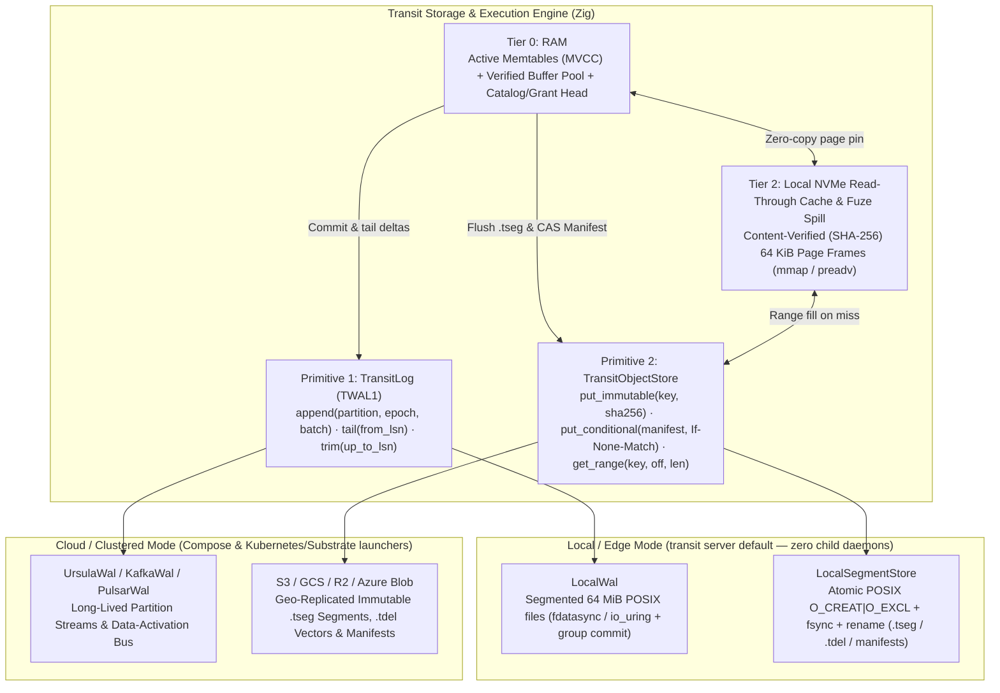
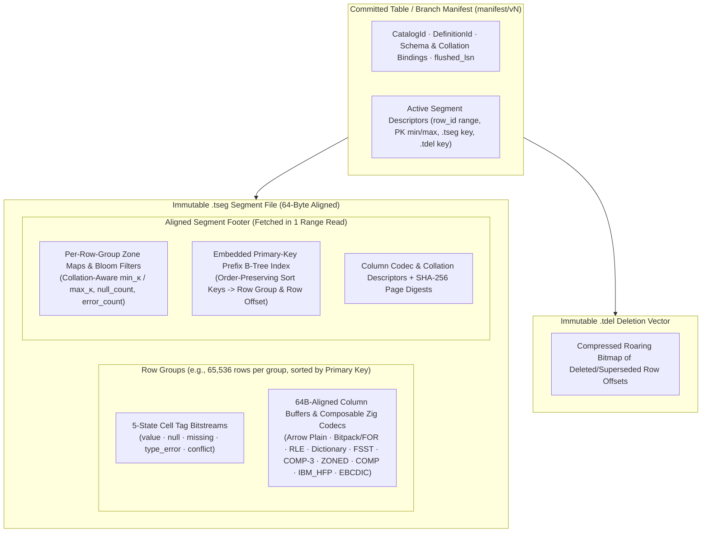
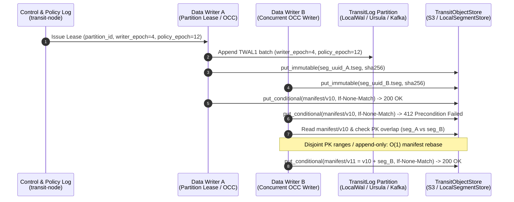

# Storage, placement and observation

This account explains why durable authority, physical execution and telemetry
remain separate, while accounting for the resource costs of that separation.
It covers both the implemented copy-on-write B-tree page storage baseline and
the target **Four-Tier Storage Architecture (`TransitLog` + `TransitObjectStore`)**,
**`.tseg` hybrid OLTP/OLAP segment format**, and **Partitioned / Multi-Writer OCC
concurrency model**.
The [storage](../reference/storage.md), [deployment](../reference/deployment.md)
and [observability](../reference/observability.md) references own configuration
and operational behavior.

## Persistence model

The local server supplies conditional native durability through its exclusive
[local backend](../../../packages/zig/transit-backend-local/README.md), a
partition-zero WAL and immutable page/block objects. Ursula deployments retain
their backend mapping. The local path preserves the existing native root model. The
[native persistence proofs](../../../tests/README.md#native-authority-over-local-storage--2026-10-22)
cover restart and lost replies, with the physical collection and power-loss
limits stated there. Transit owns logical identities, accepted transitions, retained
boundaries and retirement. Recovery uses validated history/checkpoints; indexes
and resident caches accelerate access without becoming an independent source of
permission or execution rights.

Immutable catalog/resource roots permit bounded page reads at a stable basis.
The current realm journal remains a serialization point. Separating durable
cardinality from cache size therefore does not establish horizontal authority
throughput. It answers a memory-growth question, not every scaling question.

### Direct Table acceptance alongside native resources

The local SQL service uses a separate direct Table owner. Its control catalog
reserves names and records frozen DDL work; each Table's acceptance log determines
whether the new definition or row state is visible. Immutable operation bindings
prevent a retry from changing its target or intent. Native authorization supplies
the current permission fence, while direct row bytes bypass actor turn limits.
See the [direct contract](../../../contracts/DIRECT_TABLE_V1.md) and
[catalog implementation](../../../packages/zig/transit-catalog/src/DirectCatalog.zig).

This separation answers an acceptance and recovery question, not a claim of
distributed write throughput. The installed local owner has exclusive storage
ownership. Point writes may remain in retained WAL records, while bulk ingestion
publishes `.tseg` data before its atomic acceptance. Durable pins preserve the
original definition and unflushed frontier; separate Tables retain independent
cuts. The [installed execution proof](../../../tests/README.md#installed-direct-execution-recovery--2026-10-23)
and [direct CRUD/DDL proof](../../../tests/README.md#direct-table-crudddl-recovery--2026-10-23)
record exact-retry, restart, revocation and name-replacement schedules and their
reproduction commands. Those runs do not establish arbitrary power-loss safety,
cloud storage placement or physical Table collection. Automatic point flushing,
cache tiering and distributed OCC remain design work in the model below.

### Optimistic current reads and retained cuts

Can a caller read one row or traverse a stable Table without creating durable
retention work? In the serialized local-owner model, `read_current` uses an
optimistic logical-change fence. Let `e` be the caller's original exclusive
accepted frontier, `a` the current frontier and `c` the most recent logical
change frontier. A request requires the same partition, the exact original
definition, and `c <= e <= a`. A no-op or physical publication advances `a`
without advancing `c`; a row mutation advances both. Even changing a value back
cannot make an older basis valid again. Definition equality separately prevents
reinterpretation after schema or name changes.

[`TablePartition`](../../../packages/zig/transit-storage/src/TablePartition.zig)
checks that condition before reading the current immutable root. Ordered suffixes
use stable row identities and bounded row/byte budgets. The service's Table lock
excludes publication during each call, while its final native authorization fence
protects already-buffered rows, absence and completion metadata. Across calls,
the unchanged original expectation detects logical drift; a caller must reject
its incomplete prefix on failure rather than splice in a newer basis. Checking
strict identity order and the original row count is necessary for a consumer
claiming complete coverage. A supplied seek key alone does not establish that
earlier rows were consumed.

This trades read availability during mutation for avoiding durable pin acquisition
and release. It suits conditional application reads and migrations whose source
is expected to remain unchanged. Retained queries use explicit pins instead,
because they need the original data after writes. Neither mechanism provides a
cross-Table atomic cut. The
[request contract](../../../contracts/DIRECT_TABLE_V1.md#current-observations)
and [`DirectTableResponse`](../../../packages/zig/transit-catalog/src/DirectTableResponse.zig)
define wire attribution and consumer checks. The
[scoped proof](../../../tests/README.md#optimistic-current-table-reads--2026-10-23)
records disk-reopen, physical-progress, logical-drift and disclosure schedules;
it does not establish distributed read locking or physical collection safety.

### Namespace retirement and retained authority

Namespace retirement must exclude live or admitted Table declarations without
loading the catalog into memory. In the exclusive local-owner model,
[`LocalTableHost`](../../../apps/transit-node/LocalTableHost.zig) serializes catalog
mutations. Namespace admission records a durable fence against new Table DDL;
[`DirectCatalog`](../../../packages/zig/transit-catalog/src/DirectCatalog.zig)
then scans one object-directory page per explicit execution. Existing Table
admissions either still block retirement or have an authoritative terminal
Table outcome. A committed DROP with unsettled catalog bookkeeping is therefore
distinct from an uncommitted declaration.

The fence makes the saved scan cursor sound across requests and recovery: a new
declaration cannot appear behind an already examined cursor. Each scan is
bounded by eight object entries, although validating a Table's retained history
has its own recovery cost. Scanning the shared object directory costs work
proportional to total catalog objects; a namespace membership index could reduce
that work but would add another index to maintain through Table acceptance and
recovery. The implemented choice bounds resident directory state and preserves
one Table acceptance authority. It does not establish distributed namespace
locking or discover external consumers.

Logical retirement retains the original native permission object. Otherwise
retiring an empty namespace after its Tables were dropped would strand their
still-pinned snapshots, operation receipts and result evidence. Names control
new admissions; current native references control disclosure of retained data.
The [namespace request contract](../../../contracts/DIRECT_TABLE_V1.md#namespace-lifecycle)
defines those separate lifetimes. Catalog, signed native and HTTP evidence is
recorded in the [proof ledger](../../../tests/README.md#direct-namespace-lifecycle--2026-10-23).

## Four-tier storage architecture, `.tseg` segments and multi-writer OCC

This section is architectural design analysis anchored against the measured
write-amplification and latency baseline at `5c1099f7`
([performance reference](../reference/performance.md)). It asks how Transit can
eliminate orders-of-magnitude storage indirection and single-sequencer contention
while preserving verifiable authority, exact crash recovery, immediate permission
revocation (`policy_epoch`), and deployment portability across single-binary
local development (`transit server`) and disaggregated cloud/Kubernetes topologies.

### Diagnosis: quadruple B-tree indirection over an HTTP stream store

In the measured earlier baseline, inserting a single Table row incurred `806 ms` from
the local console (`13,238 ms` over PostgreSQL wire), staging `29` immutable
pages and issuing `1,072` HTTP requests to Ursula. Formalizing the storage stack
explains why:

$$\text{Row}(\text{FTR1}) \;\hookrightarrow\; \text{StationIndex}(\text{SBR1}) \;\hookrightarrow\; \text{Resource B-Tree}(\text{TPG1}) \;\hookrightarrow\; \text{Realm Catalog B-Tree}(\text{TPG1}) \;\hookrightarrow\; \text{PackedPageStore}(\text{Base64 JSON over Ursula HTTP})$$

1. **Four nested copy-on-write trees:** A single logical row (`FTR1`) and its
   primary-key index entry are packed into `StationIndex` (`SBR1`) blocks (`64 KiB`
   envelopes), which are indexed by the resource's block B-tree (`TPG1`), whose
   root is stored inside the global realm catalog B-tree (`TPG1`, 8-entry leaves,
   32-child branches). Every path copy from leaf to root across all four layers
   allocates new immutable pages.
2. **Per-turn base64 HTTP stream framing:** `PackedPageStore` serializes each
   modified `TPG1` page into a base64-encoded JSON string, creates a brand-new
   Ursula stream `p/<realm>/c/<id>` for the candidate turn, appends frames over
   HTTP, reads back the entire candidate stream in `192 KiB` windows to verify
   hashes, seals the stream, and only then conditionally appends to the realm
   journal `j`.
3. **Actor-turn wire fragmentation:** Because data operations are funneled
   through `send_input -> open_view -> read_blocks -> commit_turn` with a
   `128 KiB` per-turn block ceiling, multi-row writes and schema changes must
   checkpoint intermediate staging state machines (`STW1`, `STC1`, `STG1`, `STX1`)
   across multiple sequential turns.

### Two pluggable storage primitives: `TransitLog` and `TransitObjectStore`

A database storage engine requires two fundamentally different physical access
patterns that should not be conflated into a single base64 page-stream API:

1. **Sequential, low-latency, ordered append and tailing** for commit durability
   and live change-data activation (**`TransitLog`**).
2. **High-bandwidth, immutable bulk object storage and byte-range reads** with
   conditional manifest publication for compacted datasets, indexes and snapshots
   (**`TransitObjectStore`**).

#### Primitive 1: `TransitLog` (`TWAL1` WAL and Data-Activation Bus)

`TransitLog` defines Transit's canonical binary frame format (`TWAL1`): a
64-byte-aligned header carrying a `CRC32C`/`xxHash64` payload digest,
`partition_id`, `writer_epoch`, `policy_epoch`, monotonic `lsn`, and typed delta
records (`+row`/`-row` columnar batches, catalog DDL transitions, process mailbox
admissions, and recorded effect intents).

- **Native Zig `LocalWal` (`transit server` default):** Writes `TWAL1` frames
  directly to pre-allocated `64 MiB` local segment files using `fdatasync` or
  `io_uring` with group commit. This removes the external Ursula child daemon
  from `transit server`, cutting single-write commit latency to sub-millisecond
  local disk flush times.
- **`UrsulaWal` (Distributed Stream Backbone):** Repositions Ursula from a
  per-turn B-tree page store to its natural role: a durable, replicated stream
  log that sequences `TWAL1` frames per partition and streams live deltas to
  downstream `Fuze` maintained views, reactive watches and `Station` processes.
- **`KafkaWal` / `PulsarWal` (External Log Adapters):** Maps each `TransitLog`
  partition to a partitioned topic, enforcing `writer_epoch` fencing via
  idempotent producer epochs or partition-leader CAS and tying log retention
  watermarks to `TransitObjectStore` manifest checkpoints.

#### Primitive 2: `TransitObjectStore` (Immutable Segments and Manifests)

`TransitObjectStore` stores immutable **Data Segments (`.tseg`)**, **Deletion
Vectors (`.tdel`)**, and versioned **Table / Partition / Branch Manifests
(`manifest/v{N}`)** using three operations:

- `put_immutable(key, bytes, sha256)`: Writes a content-verified `.tseg` or
  `.tdel` object under a unique UUIDv7/hash key before it is referenced by any
  manifest.
- `put_conditional(key, expected_etag_or_if_none_match, bytes)`: Atomically
  publishes `manifest/v{N+1}` using HTTP `If-None-Match: "*"` / `If-Match` in
  cloud object stores (S3, GCS, R2, Azure Blob) or `linkat`/`renameat2(RENAME_NOREPLACE)`
  on POSIX filesystems.
- `get_range(key, offset, length)`: Fetches aligned footer indexes, zone maps or
  column pages on demand.

### The four-tier memory hierarchy and durability invariants

| Tier | Physical medium | State held | Eviction & crash-recovery invariant |
| --- | --- | --- | --- |
| **Tier 0: RAM** | Bounded Zig arenas (`64 B` aligned) | Active **Memtables / Delta Buffers** (providing immediate MVCC read-your-writes visibility for committed `TWAL1` frames), **Catalog & Grant Head (`policy_epoch`)**, and the **Verified Buffer Pool** (pinned `.tseg` column pages, zone maps and B-tree index nodes). | Volatile; holds zero durability authority. Reconstructed on startup by loading the latest `manifest/v{N}` and replaying `TransitLog` from the manifest's `flushed_lsn` watermark. |
| **Tier 1: WAL (`TransitLog`)** | `LocalWal`, `UrsulaWal`, or `Kafka`/`Pulsar` | Ordered `TWAL1` commit frames since `flushed_lsn`; live change-data activation stream (`+row`/`-row`) feeding `Fuze` maintained views, reactive watches, `TableChangeReader` and `Station` actors. | Durable before any write receipt is returned. Prefix $\le \text{flushed\_lsn}$ is eligible for `trim` only after the referencing `.tseg` segments and `manifest/v{N}` are durable in Tier 3. |
| **Tier 2: Local Disk / NVMe** | Local POSIX filesystem | In cloud mode: stateless, content-verified (`SHA-256`) read-through cache of `.tseg`/`.tdel` `64 KiB` frames (`mmap`/`preadv`) plus bounded `Fuze` query spill. In local mode (`transit server`): primary `LocalWal` + `LocalSegmentStore`. | In cloud mode, losing a node or wiping NVMe loses zero committed data; cold nodes warm pages lazily via `get_range`. Eviction drops clean cached frames under W-TinyLFU/clock policy without touching Tier 3. |
| **Tier 3: Object Storage (`TransitObjectStore`)** | S3 / GCS / R2 / Azure Blob or `LocalSegmentStore` | Immutable **`.tseg` Data Segments**, **`.tdel` Deletion Vectors**, and versioned **Snapshot / Branch Manifests (`manifest/v{N}`)**. | System of record for all compacted data, historical `AS OF` snapshots and branches. Orphaned unreferenced `.tseg` files from aborted staging are swept after lease/epoch expiration. |

### The `.tseg` hybrid OLTP/OLAP segment format and `.tdel` deletion vectors

Pure analytical file formats (such as standard Parquet) optimize for wide scans
but penalize point lookups, primary-key uniqueness checks, low-latency row
deletes, and 5-state cell semantics (`missing`, `type_error`, `conflict`). Pure
row-oriented B-trees optimize for point updates but suffer high write/read
amplification on analytical scans and object storage.

Transit's native **`.tseg` (`Transit Segment v1`)** format—inspired by Vortex and
Apache Arrow—combines zero-copy columnar vector execution with embedded
primary-key indexing and external deletion vectors:

1. **Zero-copy Arrow-compatible physical buffers:** Uncompressed or decoded
   column pages use 64-byte alignment matching `Fuze`'s `Batch.zig` SIMD lanes,
   allowing Tier 2 NVMe pages to be mapped (`mmap` or `preadv`) directly into
   `Fuze` without row-by-row `FTR1` deserialization.
2. **Native 5-state cell tag streams:** Every column stores compact bitmasks/tags
   distinguishing `value`, `null`, `missing`, `type_error` and `conflict`.
3. **Composable Zig physical codecs and collations:** Columns can be encoded with
   analytical codecs (**Bitpacking/FOR**, **RLE**, **Dictionary**, **FSST**) or
   enterprise/mainframe codecs (**`COMP-3`**, **`ZONED`**, **`COMP`/`COMP-4`**,
   **`IBM_HFP`**, **`EBCDIC`**) with explicit **Collation (`COLLATE`)** sort-key
   bindings (detailed in [Query planning, snapshots and results](query-engine.md#logical-types-and-physical-codecs-and-collation-semantics)).
4. **$O(\log N)$ point lookups and $O(1)$ row-group pruning:** Rows within a
   `.tseg` file are sorted by primary key (or clustering key). The footer embeds
   both **Collation-Aware Zone Maps (`min` / `max`)** for analytical scan
   pruning and a compact **Primary-Key Prefix B-Tree Index** over order-preserving
   sort keys so point queries (`WHERE pk = $1`) require at most two range reads
   (footer index $\to$ target row-group slice).
5. **Fast point deletes and updates via `.tdel` Deletion Vectors:** `DELETE` and
   `UPDATE` statements never rewrite an immutable `.tseg` file in the foreground.
   Instead, the mutation appends to `TransitLog` + Tier 0 Memtable, and on flush
   writes a compact `.tdel` bitmap marking superseded row offsets in the old
   `.tseg` segment while writing updated rows into a new delta `.tseg` segment.
   Background compaction later merges `.tseg` + `.tdel` files asynchronously.

### De-monolithing authority: partitioned logs, fenced leases and multi-writer OCC

To eliminate the single global realm B-tree sequencer without losing immediate
permission revocation or conflict detection, concurrency progresses through three
composable levels:

1. **Level 1 — Partitioned Authority (Control Log vs. Data/Process Partitions):**
   - The **Control & Policy Log** holds only principals, role memberships, grants,
     the monotonic `policy_epoch` counter, the catalog directory (`CatalogId`,
     `DefinitionId`), and partition lease assignments. Because control plane
     mutations (`GRANT`, `REVOKE`, `CREATE TABLE`) are low-frequency and small,
     the entire policy graph stays pinned in Tier 0 RAM on every node.
   - Each Table partition and each `Station` process group owns an independent
     **`TransitLog` partition** and **`Manifest` chain**. Writes to Table A and
     Table B never contend on a shared B-tree root.
2. **Level 2 — Epoch-Fenced Partition Leases for Direct Data-Plane Writes:**
   - `transit-node` issues a scoped **Partition Lease**
     `(partition_id, writer_epoch, policy_epoch)` to an authorized writer.
   - While `policy_epoch` remains current, the writer appends `TWAL1` batches
     directly to the partition's `TransitLog` and flushes `.tseg` segments and
     `manifest/v{N}` directly to `TransitObjectStore` without proxying row bytes
     through `transit-node`.
   - If a privilege is revoked (`REVOKE`), the Control Log increments
     `policy_epoch` and broadcasts the invalidation; any in-flight write or
     manifest commit carrying a stale `policy_epoch` or superseded `writer_epoch`
     is rejected before acceptance.
3. **Level 3 — Lock-Free Multi-Writer Optimistic Concurrency Control (OCC):**
   - Multiple writers on the same table stage immutable `.tseg` files in parallel
     to `TransitObjectStore` under collision-free UUIDv7 keys (`put_immutable`).
   - Each writer attempts to publish `manifest/v{N+1}` via conditional CAS
     (`If-None-Match` on `manifest/v{N+1}`).
   - If Writer B loses the CAS race to `manifest/v{N+1}` committed by Writer A:
     - **Pure append or disjoint primary-key ranges:** Writer B verifies via the
       manifest's segment PK `min`/`max` bounds and embedded B-tree footer
       indexes that $\text{keys}(\text{seg}_A) \cap \text{keys}(\text{seg}_B) = \emptyset$,
       and rebases its manifest commit to `manifest/v{N+2}` in $O(1)$ metadata
       work without rewriting `.tseg` data bytes.
     - **Overlapping primary-key mutation / serializable conflict:** Writer B
       detects the intersecting key in $\text{seg}_A$'s PK B-tree index and
       either regenerates its `.tdel` bitmap against `v{N+1}` or returns a
       deterministic serialization conflict.

### Live catalog, query and authority cache integration

The installed local owner is [`TablePartition`](../../../packages/zig/transit-storage/src/TablePartition.zig),
composed by `DirectCatalog` and the node's `LocalTableService`. Its acceptance
records govern visibility, original outcomes and retained cuts. Point data can
remain accepted in the WAL without a `.tseg`; explicit bounded flush and bulk
publication create segments. A durable pin includes accepted unflushed data.

`TableStorageEngine` and `TableSegmentScan` are separate composition helpers.
Their tests exercise memtables, manifests, segment pruning and cache mechanisms;
they are not the installed caller path and do not establish multi-writer or
provider safety. The [executed proof ledger](../../../tests/README.md) separates
these component results from direct public operation and restart schedules.

- **Verified candidate write-through and epoch-tracked cross-lane cache sharing:**
  In [`PackedPageStore`](../../../packages/zig/transit-backend-ursula/src/PackedPageStore.zig),
  `finish()` populates the verified resident page cache (`rememberCandidate`) as
  soon as the candidate segment stream is read back, verified and sealed. In
  [`NativeServer.zig`](../../../apps/transit-node/NativeServer.zig), all 10 request lanes
  synchronize their verified page caches and journal head entries through an
  epoch-tracked shared cache (`shared_pages_epoch`), propagating newly staged or
  fetched pages across lanes without copying unchanged 17 KiB page slots on every
  request.

## Resource costs and failure (implemented baseline)

| Mechanism | Benefit | Cost or obligation |
| --- | --- | --- |
| Immutable pages and roots | Attributable read bases and conditional publication | Page lookup, copying/staging and dependency-aware cleanup |
| Bounded caches | Resident work independent of total retained data | Misses and explicit admission/read budgets |
| Checkpoint before trim | Recovery after old history is reclaimed | Checkpoint validation and retention of all required evidence |
| Admission/control reserve | Capacity for specified control work under pressure | Explicit quotas; no guarantee that all application backlog can drain |

Cache eviction must not delete accepted work. Failed staging may leave orphaned
bytes, but only final authority acceptance may publish a new logical root.
Storage unavailability does not establish empty state, expiry or rejection of
an uncertain mutation. Reinitializing on a failed read would silently replace
the authority being recovered.

Actual latency and memory conclusions need measurements. The
[performance reference](../reference/performance.md) records workloads and
read/write amplification; a configured cache budget is not an observed RSS
bound, and retained storage bytes are not resident memory.

## Concurrent immutable work and conditional publication

The question is whether one slow storage operation must block unrelated reads
and controls. The model retains one conditional realm journal, immutable pages,
bounded admitted requests and a trusted clock for expiring read pins. It assumes
the provider implements atomic conditional append and does not roll back
acknowledged history. Parallel preparation does not create another authority.

The [native host](../../../apps/transit-node/NativeServer.zig) assigns each admitted
request an exclusively owned execution lane: engine head, verified caches,
transport client, working buffers and observation counters. Provider I/O runs
without the host's shared registry mutex. Preparation validates at a published
basis and stages a private successor. Core's conditional append requires that
same position. Therefore any intervening grant, owner, resource or sequence
change prevents acceptance of that candidate. Rejected candidates can leave
unpublished bytes; parallelism does not itself reclaim them. Unknown append
outcomes retain the original signed request identity.

[Snapshot reservations](../../../packages/zig/transit-core/src/SnapshotLeases.zig)
solve a separate problem: independent engines cannot independently allocate all
64 global pins. Under a short host mutex, an authenticated request reserves one
slot and a unique ticket. Pending opens count toward both global and per-principal
quotas. The engine borrows that slot while it materializes data and rechecks
current authority. Only success installs a renewal/open/close; cancellation or
failure releases the reservation while preserving the preceding pin. Conflicting
operations on one pin fail explicitly. Stale releases cannot overwrite a newer
reservation, and a fresh startup epoch prevents reuse after node restart.

The [disk barrier proof](../../../tests/node_concurrency.py) holds a provider
response while requiring an independent signed read and commit to complete
before release. A second schedule holds old evidence across revocation; a third
races identical signed writes and checks exact receipt reconciliation. The
[proof ledger](../../../tests/README.md) provides its reproduction command. Core schedules
exercise global/per-principal pending quotas, failed renewals, stale release and
shared pins across independently owned engines. The proof ledger records runs.
These finite schedules establish overlap and the checked authority outcomes,
not throughput, fairness or a latency guarantee.

The previous single-engine mutex made ownership simple but coupled unrelated
provider delays. Per-request creation would discard useful caches after every
operation. Bounded reusable lanes avoid both costs, at the expense of a cache
budget per lane and potentially conflicting prepared candidates. The
[node configuration](../../../apps/transit-node/docs/growing.md) gives those bounds.
Horizontal write partitioning remains a separate contract; physical reclamation
uses the root and epoch model below.

## Complete blocks beneath Table records

The question is whether immutable Table data must pay the control record's
256-byte mutation cost. In the current native-v1 implementation, a resource has
separate metadata and block indexes under the same accepted catalog root.
Assume authenticated requests, collision-resistant digests, verified immutable
storage and conditional authority publication. A prepared root is private until
that conditional append accepts it. Bytes can survive a failed append without
becoming accepted Table data.

[Native blocks](../../../contracts/BLOCK_V1.md) bind key, length and content digest
in the signed logical request. Their body is separate from the authority journal
record. The core checks the entire body before staging, and the backend reads
back staged bytes before the complete candidate becomes publishable. One resource root change
then accepts metadata, block edges, input progress and outputs together. Lost
replies preserve the exact logical identity and owned bytes; an accepted receipt
can reconcile without staging them again. This argument depends on the existing
authority CAS and current-grant checks, not on the location of provider bytes.

[BlockRecord](../../../packages/zig/transit-station/src/BlockRecord.zig) maps typed
Table records to these blocks. One envelope has 44 bytes of spec plus at most
65,280 payload bytes. This makes its payload an integral number of the existing
256-byte logical digest units. Larger rows retain quota-accounted descriptors
and resume in complete blocks, so the row codec's larger value limit is preserved.
Metadata definitions, index nodes and most schemas/rows fit one block. Predecessor
history is another immutable block. Small point writes consequently need only
head/outcome metadata mutations; they no longer stage a predecessor merely to
free a control slot. This is a statement about operation structure, not measured
end-to-end latency.

The resident batch is bounded at sixteen mutations and 128 KiB. Reads acquire
at most eight blocks with the same byte bound. Table lookahead combines known
single-block row references; multi-block records fetch at most two parts per
request. Eight verified index nodes can be cached at one exact cut. Cached bytes
have no authority: hosts bind the source identity, propagate read failures and
validate current rights before disclosure or commit.

The private Station Table block path retains these bounded publication and
read rules. Direct Tables instead read their accepted `TablePartition` state
through `DirectTableReader`; their row data does not travel through native
small-value mutations. Each owner supplies its own current-authority checks.

The alternative of increasing small-value size would enlarge every control
record and authority journal entry. Sending each 256-byte part independently
keeps messages small but couples logical record size to control transactions.
The separate block index preserves small metadata while admitting bounded bulk
I/O. Its costs are another resource index, larger bounded request buffers and
an explicit ownership/reclamation obligation for staged bytes. Accepted history
and failed candidate bytes still need distinct physical-liveness decisions.

Reference-store checks in
[Table tests](../../../packages/zig/transit-station/src/table_pages_test.zig) cover
lost private proposals, larger-record resumption, exact quota release, corrupted
record envelopes, retained schemas and current read failures. Run
`cd packages/zig/transit-station && zig build test` in the pinned shell. Native
authority/storage schedules are recorded separately in the
[proof ledger](../../../tests/README.md). These checks do not establish scan pruning,
columnar storage, horizontal write scaling or a latency improvement. The
[matched service campaign](../../../tests/mutation_latency/results/2026-10-19/README.md)
measures the combined implementation separately: narrow INSERT/UPDATE and
range/full scans improve, while empty and LIMIT 0 console reads regress. Its
single instrumented INSERT uses one accepted turn instead of two, with fewer
staged pages and provider attempts. This supports reduced publication work, but
does not isolate batching from layout, cache capacity or concurrent ownership.
The same configured page budget is now per lane; node HWM is higher. Retained
raw reports include the earlier prefetch regression and failed baseline reader,
and keep ordinary timings separate from instrumented attempt counts.

## Physical ownership, uncertainty and collection

The question is how to reclaim unreachable bytes while readers and candidate
writers overlap, without making retained cardinality a resident-memory budget.
The model assumes collision-resistant identities, atomic provider/authority
conditional appends, durable non-rollback history, trusted bounded-error UTC and
private provider credentials. It distinguishes accepted root ownership from
physical allocation and from permission to disclose a value.

[Candidate segments](../../../packages/zig/transit-backend-ursula/src/PackedPageStore.zig)
assign private frame addresses before network I/O. The
[allocation queue](../../../packages/zig/transit-backend-ursula/src/AllocationQueue.zig)
reserves the known normalized size before creation. Verification and a closing
seal precede authority CAS. The seal matters beyond immutability: the creator
has completed its single create attempt before issuing it. A collector may
therefore delete a sealed orphan after fencing old publication. It cannot infer
the same fact from absence after an unacknowledged create. Such allocations get
a permanent closed-name fence, followed by data trimming. Releasing their name
would allow a delayed create to resurrect unaccounted bytes.

The queue's state transition consumes one item, carries a live item forward or
releases a deleted item's charge, and advances its cursor in one conditional
append. This makes repeated recovery idempotent without an in-memory allocation
set. The consumed prefix can be checkpointed and trimmed. Mark pages themselves
are accounted control allocations; a later completed pass can collect them.
The queues and catalogs are durable state, while their operation buffers remain
bounded independently of retained cardinality.

Control eligibility grants access to recovery capacity; it does not select a
separate allocation partition. The reservation CAS charges ordinary capacity
first, falling back to the control reserve only for eligible work that cannot fit.
The queued allocation records the actual charged class, so carry and reclamation
release the same budget after restart or a quota change. This distinction matters
because an ordinary turn with no new output or effect is recovery-eligible.
Charging every such turn to the reserve exhausts recovery capacity during normal
traffic even when the ordinary budget is mostly unused. The allocation unit test
checks primary admission, fallback, reserve exhaustion and lowered quotas; the
disk collection schedule checks refusal of new ordinary work alongside an
accepted checkpoint charged to the reserve.

[Root enumeration](../../../packages/zig/transit-core/src/StorageRoots.zig) selects
retained journal roots and current live captured roots.
[Traversal](../../../packages/zig/transit-core/src/StorageWalk.zig) follows typed
catalog-to-block-index edges and verifies pages. Closed view records in old
catalogs remain history rather than renewed ownership. A resource or read
version's own root preserves data independently of another owner's lifetime.
The [collector](../../../packages/zig/transit-backend-ursula/src/StorageCollection.zig)
records its exact cut, traversal cursor, verified mark index and delete intent.
An epoch fence makes pre-cut candidates fail ordinary publication CAS. Later
candidates either use protected accepted data or allocate in the new epoch.
Incomplete root enumeration, including a racing trim, cannot authorize sweep.

Volatile snapshots on other hosts are protected by their maximum lifetime plus
the native request bound. After that grace, a durable authority time fence makes
older clock observations fail. This does not replace the trusted-time assumption
or grant new access. Deletion is separate from mark completion and quota release;
a lost delete reply resumes the same intent and requires confirmed absence.

[Relocation](../../../packages/zig/transit-core/src/StorageCompact.zig) copies one
block or one leaf/path per accepted command. Logical values and resource
revisions stay unchanged, while physical root references change. Old captured
roots and unlimited history continue owning their original placement. Thus
compaction can free a partially live segment only after its last old ownership
edge is released. It cannot manufacture permission to expire history.

Alternatives have different costs. A single append-only page stream minimizes
stream identities but cannot reclaim isolated orphans. One stream per page
allows finer deletion but multiplies metadata and requests. Candidate segments
amortize writes and account failures, while partly live segments can require
relocation. Ursula still keeps stream metadata and record indexes in memory;
these Transit bounds do not prove whole-provider resident independence. Physical
segment quotas also exclude provider WAL, snapshots and work-ledger overhead.
Those are explicit deployment and measurement obligations.

The [proof ledger](../../../tests/README.md) provides reproduction commands for the
storage collection and native block schedules, with executed revisions and limits.
The collection fixture injects trusted time,
restarts processes/provider between phases, loses a deletion acknowledgement,
corrupts a reachable block and checks retained read versions after relocation.
These finite schedules do not prove arbitrary provider rollback safety, immediate
filesystem/cold-object space return, distributed clock correctness or throughput.

## Reducing durable mutation work

The question is which work a short Table mutation can share or avoid while
preserving admission, a frozen execution basis, and atomic rows/outcome/input
progress. The model here is one serialized realm authority, immutable retained
pages, authorized external workers and conditional durable publication. Provider
errors can leave staged or accepted bytes without a receipt. Notifications and
telemetry are volatile; neither establishes the mutation outcome.

The implementation combines three independent mechanisms:

- The [direct mutation caller](../../../packages/zig/transit-catalog/src/DirectTableBridge.zig)
  saves immutable work before staging and a complete reference before admission.
  Table acceptance records supply its original result; native SQL progress and
  response publication remain separate commits. A failed response preserves the
  original operation for inspection. The caller does not regenerate SQL or
  substitute a new native send after uncertainty.
- The [catalog candidate](../../../packages/zig/transit-core/src/catalog.zig)
  overlays a command-bounded set of changed records, including receipts/control
  state. Repeated keys collapse before one tree rewrite. Reads see pending
  changes; scans reject an unflushed overlay. Immutable staging can leave
  unreachable pages on failure, but only the final conditional append changes
  the published root. The private bound follows command quotas, never retained
  resource cardinality.
- [Worker notifications](../../../apps/transit-node/Notifications.zig) register under
  the same short mutex used to publish local commit hints, then release it while waiting.
  Publication scopes reduce unrelated wakeups. Every wake or bounded timeout
  repeats current authorization and authority reads. Cancellation releases the
  slot; a different node's publication is found on timeout. Coalescing is safe
  for this scheduling hint because the subsequent read establishes state. It
  cannot supply complete change coverage for joins or maintained derivations.

The [tree builder](../../../packages/zig/transit-core/src/pages.zig) also collects
independent leaf rewrites under one parent into batches of at most eight pages.
Previously each affected leaf was staged before visiting its sibling, even when
their writes had no dependency. Only the parent needs those persisted locators.
The buffer lives at the leaf frontier, so its page count does not multiply with
recursive height or the command's larger private metadata budget. A failed or
partial acknowledgement returns no candidate root; already accepted pages can
remain unreachable. The [fault tests](../../../packages/zig/transit-core/src/pages_test.zig)
exercise real opaque locators and lose each leaf/parent acknowledgement while
checking all values at the retained root.

The [compact page codec](../../../packages/zig/transit-core/src/PageCodec.zig) uses
8-entry leaves and 32-child branches. The
[backend mapping](../../../packages/zig/transit-backend-ursula/docs/pages.md)
wraps those bytes in canonical base64 JSON records for pinned Ursula record
coordinates. Binary encoding removes generic JSON page parsing and shallow
branches reduce path copies. The cost is a larger decoded page/cache slot and
base64 framing. These are separate from compute vector widths, Arrow batches
and application publication segments; the native mutation quota is unchanged.
A current-definition cutover prevents old stored pages from being reinterpreted.

The [layout experiment](../../../tests/mutation_latency/results/2026-10-04/page-layout.json)
counts actual operations in the production tree with an in-memory measurement
store, 50 synthetic turns, retained roots, 64/1,024 rows and matching receipt
populations. At 1,024 rows, compact 8/32 monolithic roots used 782 reads and 468
stages versus 1,790 and 1,391 for JSON 4/5 roots. Raw encoded bytes decreased
from 1,403,546 to 613,884; these counts exclude the provider envelope. Decoded
page size increases from 8,480 to 16,952 bytes. The
[proof ledger](../../../tests/README.md#durable-table-mutation-latency) separately
records native disk restart, acknowledgement faults, cold-tier persistence,
latency controls and incomplete runs. The experiment alone proves no latency or
provider-memory bound. The [proof ledger](../../../tests/README.md#durable-table-mutation-latency)
owns the reproducible command and its pinned development environment.

The native instrumented idle control completes 21 cases. Its first INSERT stages
20 pages and makes 22 provider POSTs, versus 61/59 in the matched frozen idle
control; both include background work. Across the retained successful native
attempts, median send/view-open/turn work is 43.01/36.86/76.79 ms and provider I/O
is 39.43/34.29/70.54 ms. Median lock wait rounds to zero in that idle control.
These are overlapping phase measurements under proxies, not isolated disk-fsync
costs or sums that predict the ordinary console latency. They favor reducing
provider work before introducing concurrent authority execution. The
[raw campaign](../../../tests/mutation_latency/results/2026-10-04/README.md)
records the matched controls and failed attempts.

An unproxied 280-case control with 120 retained rows samples slow requests
separately. One request spends 1,891 of 1,900 ms in provider I/O across 86 attempts;
another read waits 1,879 ms before doing 4 ms of work. The
[bounded slow samples](../../../tests/mutation_latency/results/2026-10-04/slow-diagnostic-events.json)
retain 64 of 77 events meeting a 500 ms wait/work threshold or reporting failure.
They establish that long provider work can occupy serialized access and delay
other requests. The threshold sample is not an all-request distribution, and
that control does not reproduce the authority-timeout restarts observed in other
loaded runs. Short idle lock waits therefore do not establish negligible
queueing under load. Moving preparation out of serialized access remains subject
to the publication contracts below.

### Cold-flush budget starvation

The unproxied mutation campaign also asks whether reducing foreground latency
exposes provider backpressure. A diagnostic build observes Ursula
`ColdBackpressure`; bounded provider samples show the hot backlog approaching
its 8 MiB admission limit with no cold-write errors. This distinguishes that
failure from a gateway socket close. Proxies slow the workload and can conceal
the pressure, so their completed runs cannot resolve the unproxied failure.

In the pinned provider's flush planner, let the batch target be `B`, the first
stream's eligible bytes `a` with `0 < a < B`, and the next stream's backlog at
least `B`. Planning the next chunk at size `B` then rejecting `a + B > B` leaves
`B - a` unused. If the first stream receives more bytes between every pass, the
second stream can remain unflushed until admission fails. The
[provider patch](../../../nix/ursula-cold-flush.patch) caps subsequent candidates at
the remaining batch budget. It preserves immutable chunk publication, the
existing first-candidate policy and the hot-memory limit. A repeated two-stream
regression checks progress, exact offsets, bounded aggregate bytes and the
separation between planning and publication. This corrects avoidable starvation;
it does not promise admission when incoming bytes exceed durable drain capacity.

The local Nix package owns this correction. Official pinned container images
remain a separate provider profile. The [campaign evidence](../../../tests/mutation_latency/results/2026-10-04/README.md)
records diagnostic-only build patches and failed runs; a provider category never
authorizes a fresh retry of an uncertain Transit command.

Corrected-provider controls complete 700-case default and fixed-poll workloads
without uncertain writes. A separate combined direct-client/history/reader
repeat completes 700 cases and 5,729 reads without a restart. Other completed
controls still observe authority-timeout restarts, and the first combined
control loses its reader. The correction addresses the diagnosed flush-budget
starvation; it does not establish bounded queueing or uninterrupted availability.

### Alternatives and contract boundaries

Separate data/control roots used 938 reads and 550 stages in the same 8/32
experiment, more than the monolithic candidate. That result rejects root
partitioning as this workload's point-write optimization. Independent schema
and branch lifetimes can still justify resource roots; global permissions,
process ownership and effect histories must keep their own authority. A broader
scan/branch workload could change the storage choice.

Small writes still require send, durable view capture and a turn commit. Removing
view capture would change recovery and source-basis validation, not merely
remove a redundant request. An ephemeral execution lease would need a defined
commit witness, fencing, revocation, resource retention and crash reconstruction
contract. No such bypass is enabled. Derived query maintenance remains outside
this synchronous mutation path.

Moving immutable preparation outside serialized engine access would require a
frozen validated basis and owned storage clients/buffers. Before publication the
operation must recheck grants, ownership, expected versions, receipts and the
conditional predecessor. Conflict handling must preserve the original request
identity and bound both discarded candidates and queued work. These obligations
remain even though the candidate's pages are immutable. The current shared
engine/client ownership therefore remains serialized.

Group commit could amortize provider flushes across independent operations, but
adds queueing to an isolated write and changes per-command acknowledgement and
failure behavior. It is not enabled by page batching. A throughput experiment
must distinguish offered load, admission, queue residence, individual receipts
and uncertain batch outcomes. The current evidence does not establish a safe
single-write improvement from group commit or horizontal authority execution.

The [completion campaign](../../../tests/mutation_latency/results/2026-10-05/README.md)
separates these costs empirically. Bounded caller waits and leaf-frontier batches
reduce console INSERT/UPDATE/DELETE medians from 142/153/138 ms to 113/130/112 ms
in fresh 140-case controls. Separate instrumented controls reduce median provider
requests for admission/view/turn from 16/11/29 to 14/8/22. The post-turn-receipt
observation tail is about 5 ms, followed by about 9 ms for outcome acquisition and
caller completion. Proxies affect these times; receipts do not timestamp fsync.
This favors further measured storage work over treating caller polling as the
whole remaining cost. It does not justify dropping the durable view contract.

The finite overload control offers 48 independently scheduled native sends at
1 ms intervals with four generator workers: four are admitted and 44 receive
explicit pre-admission capacity refusal. At 50 ms intervals all 48 are admitted.
Both controls verify exact accepted receipts and resulting rows after restart;
refused sends are not retried. The first control also refuses the control command,
which succeeds after the burst. These observations expose admission contention
and distinguish refusal from lost accepted work. They are short experiments on
one serialized authority, with qualification running concurrently, not a
sustainable SQL throughput or control-latency guarantee. Any concurrent
preparation or group-commit implementation must preserve those distinctions.

## Placement and recovery

A provider binding maps a logical PID to physical execution. Provider readiness,
pod creation and a restored worker snapshot cannot confer current ownership.
A replacement worker must recover against current authority and acquire eligible
ownership. Station supervision records logical intent; runtime reconciliation
performs physical lifecycle operations.

An old backup can omit revocation, retirement or a remotely completed effect.
Treating it as an ordinary current restart would invalidate the authority model.
Automatic live recovery from rolled-back history is outside the supported
deployment boundary. SIGKILL recovery against current disk state supplies no
proof of arbitrary corruption or host power-loss behavior.

### Checking state across manual worker handoff

The question is how a trusted manager can replace an unbound worker while
detecting changed recovery state and excluding the old credential. The
[handoff contract](../../../contracts/WORKER_HANDOFF_V1.md) selects one native
authority, one writer-owned application resource, no outstanding finite turn
permit and a durably serialized manager. The manager's private phase record is
recovery evidence; it cannot grant execution. Provider-bound processes and
rollback of authority history are excluded from this model.

Let the original generation be `g`. Native suspension removes ownership at
`g+1`, allowing a complete resource scan while ordinary worker writes are fenced.
The checkpoint binds every ordered key/value and its revision, plus native
execution progress. Conditional resume requires `g+1` and establishes an unowned
ready process at `g+2`. If another manager intervenes, a different generation
rejects this transition. A second complete scan must equal the checkpoint before
credential rotation requires `g+2` and activates at `g+3`. Changed resources or
process progress fail restoration; a competing owner after the scan fails the
activation generation condition. The
[client state machine](../../../packages/zig/transit-client/src/WorkerHandoff.zig)
implements these checks outside the kernel.

The native mailbox can admit inputs while the writer is stopped. Requiring exact
equality of its earlier admitted count would unnecessarily block recovery;
rolling it back would lose accepted work. The checkpoint therefore requires
unchanged consumed/cancelled progress and a nondecreasing admitted count. Native
history keeps output destinations and delivery outcomes. The application
resource retains operator roots, exchange deduplication and pending notices.
Restoration reads that current authority state and never writes an earlier copy
over it. Current dependencies remain separate: the manager checks them for
restore, and subsequent turns and reads still enforce current grants. A saved
checkpoint is neither a permission cache nor proof against later revocation.

Changing only a generation excludes a stale session but leaves its credential
valid. This protocol additionally rotates to a distinct key. Authentication
precedes duplicate receipt lookup, so known old-key proposals must be settled
first; the replacement recovers unknown accepted work from authority rather than
re-signing an invented retry. Manager control requests use their original root
signature through lost receipts. The manager retains each exact pending request
until the successor phase record is durable. Missing manager history blocks
recovery instead of authorizing fresh initialization.

Two whole-resource scans cost linear reads in retained entries with constant
resident memory. They favor a simple auditable manual transfer over a faster
native immutable-root attestation, which this public profile does not expose.
Copying a provider snapshot would also require historical permission and
rollback checks and is not an alternative source of authority. Liveness requires
available storage/grants and completion before native lifetime gates; the finite
suspension deadline is not renewed by a failed scan. The pinned client package
tests, independent Python handoff fixtures and native exchange task reproduce
the selected checks. The [proof ledger](../../../tests/README.md#relational-exchange-faults-and-checkpoint-growth)
records their exact commands and artifacts, separating executed cases,
resource sizes, lost receipts and remaining fault boundaries.

## Observation without authority

Logs and traces describe attempts and observations. Durable receipts establish
accepted outcomes. A retry may add a transport event without adding accepted
work; missing metrics are not zero. Readiness, liveness and application progress
must be interpreted separately.

Keeping bounded telemetry outside deterministic core prevents a slow or failed
sink from altering protocol decisions. The tradeoff is lossy diagnostic evidence;
operators must consult authorized durable state for exact execution facts.

### Presenting observations consistently

The logging boundary asks how a readable local server can share instrumentation
with standalone services and collectors without making terminal I/O a condition
of progress. In the implementation at this source revision,
[`telemetry.Runtime`](../../../packages/zig/telemetry/src/root.zig) formats each event
into an owned buffer of at most 2 KiB and attempts a nonblocking enqueue. A
separate cancelable writer drains the bounded 128-record queue; ordinary records
use at most 112 slots, reserving capacity for warnings/errors. Shutdown attempts
at most 200 ms of flushing before cancellation and join. These bounds assume
the pinned I/O implementation supplies cancelable sink writes. They do not
promise delivery of any particular diagnostic record.

The same event has two projections: text renders a UTC timestamp, service,
severity, stable name, message and fields; JSON preserves the full schema-v1
resource envelope and optional span context. Both escape control characters.
Formatting failure, filtering, queue contention and rate limits can lose events;
metrics are updated independently. A service boundary logs an expected failure
once, flushes and joins logging and returns a failure exit status. Returning that
error again to Zig would produce a second, incompatible terminal format.

The [local supervisor](../../../apps/transit-cli/server/Server.zig) owns one runtime
and lends it to the [SQL manager](../../../apps/transit-cli/server/Sql.zig). Its
[logging settings](../../../apps/transit-cli/server/Logging.zig) translate explicitly
into isolated child environments. Raw child stdout and provider stderr are not
relayed: they may contain bootstrap records, payloads or upstream formats, and a
blocked terminal must not backpressure child progress. Their finite capture
remains disposable. This is an operational visibility tradeoff; adding a child
log relay would require a bounded, validated event boundary of its own.

SQL status persistence and log suppression have different purposes. The status
file tracks all account observations; a bounded fingerprint of the service
report suppresses unchanged notices, and per-active-account flags suppress
connection hints for the same listener process. This is best-effort presentation,
not deduplication of accepted work. Native `HttpCapacity` produces `busy`: the
account observation is deferred, so readiness remains unconfirmed, but the
supervisor retains the process and exact pending work. The specific rejection
is preserved instead of being flattened to `AuthorityUnavailable`. The
[logging proof](../../../tests/server_logging.py) fills native data admission,
observes this state, and checks that recovery changes neither process IDs nor
connection-hint counts. Initial health polling remains `starting`; losing previously
observed health becomes `unavailable`, retaining the same timeout/recovery gates.
Admission pressure uses warning severity; other error causes use error severity.
Both carry a failed observation outcome. Wall-clock timestamps help reading but do not establish causal order.

Terminal detection changes presentation only: a TTY gets readiness events on
stderr, while non-TTY stdout retains machine readiness receipts. Filtering can
hide a human notice; scripts use the stdout record or probes. A synchronous
terminal renderer would be simpler but could stall supervision. A separate
handwritten server formatter would reintroduce format drift. Sharing bounded
rendering preserves those constraints at the cost of lossy operational logs.

The executable [pipe fixture](../../../tests/telemetry.py) checks both formats
under drained, blocked and closed pipes on one CPU. The
[server fixture](../../../tests/server_logging.py) uses a real PTY, a piped server,
disk-backed providers, SQL settings and standalone executable failures. The
[correlation fixture](../../../tests/observability.py) checks span parentage and
exclusion of credentials/payloads. Reproduction commands use the pinned
development shell and are recorded with the executed results below. The [proof ledger](../../../tests/README.md#unified-service-logging)
records actual executions. These schedules do not prove arbitrary sinks, panics,
crashes or lossless collection, and do not qualify provider log formats.

## Evidence and limits

The [backend mapping](../../../packages/zig/transit-backend-ursula/docs/storage.md),
[runtime contract](../../../contracts/RUNTIME_SUBSTRATE_V1.md) and
[controller](../../../apps/transit-runtime-controller/README.md) identify implementation
owners. [Capacity/deletion](../../../tests/README.md#capacity-and-deletion-evidence),
[service/reference](../../../tests/README.md#service-and-reference-evidence) and
[instrumentation evidence](../../../tests/README.md#service-instrumentation-qualification)
record reproducible schedules and limits. Local, Compose and Kubernetes/Substrate
results cannot be substituted for one another's isolation guarantees.

Earlier rationale remains in the [Ursula](../../history/URSULA.md),
[deployment](../../history/DEPLOYMENT.md) and [observability](../../history/OBSERVABILITY.md)
records. They supply historical context, not additional provider guarantees.

## Configuration generations and installation identity

This section describes the local configuration-v1 mechanism introduced on
2026-10-16. Its question is how a file-driven server can change operational
settings without treating mutable configuration as either installation identity
or authorization. The [configuration reference](../reference/configuration.md)
and [exact contract](../../../contracts/CONFIGURATION_V1.md) own supported usage.
The source basis is the linked implementations in this revision, rather than
an older milestone's whole-configuration identity model.

Let I be immutable installation inputs and executable compatibility identities,
C the last accepted complete candidate, A the active values, g its generation,
and r the ordinal of the last reload outcome. Startup validates the selected
file and environment, checks I against the installation record, then establishes
A=C before services become ready. The local owner stores one bounded checkpoint;
history cardinality grows on disk independently of resident memory.
Installation completion is recorded only after the first checkpoint is durable.
A completed installation checks the retained checkpoint before starting child
processes and requires it again at publication. Missing completion evidence or
checkpoint data therefore fails closed; restart cannot reset g or r and
reinterpret an old operation identity as new. A crash before the completion
record is saved can resume first bootstrap because no gateway has served it.

Reload reads the pinned filename with captured startup overrides. It rejects
invalid candidates and changes to initialization-only fields. For a valid
candidate, live gateway policy and new-session defaults replace their active
values together. Restart-required values remain in C while A retains the prior
values. A normal server restart validates and applies them. The model has one
live application owner: it does not claim atomic rollout across independent
processes. Other components explicitly report pending restart.

The safety argument depends on three separate boundaries:

1. The native authority evaluates the original caller's signed, action-bound
   domain requirement. The configuration service has no administrator signing
   key. It checks current rights before preparation, immediately before accepted
   publication, and before disclosure. The accepted configuration never supplies
   grants. Permission changes remain ordered by the independent native authority;
   a successful check admits the subsequent bounded publication, rather than
   claiming a distributed transaction with revocation.
2. The owner serializes operations, checks the expected generation, prepares the
   complete bounded candidate, and atomically replaces/fsyncs the checkpoint.
   That checkpoint contains both active/configured values and the pending exact
   operation outcome. A lost acknowledgement therefore leaves either the prior
   checkpoint or a recoverable accepted operation, subject to filesystem atomic
   rename and fsync guarantees. It cannot leave a persisted value change without
   an attributable operation.
3. History indexing is idempotent. The owner writes operation-ID and ordinal
   records, then clears the pending slot. Recovery finishes this indexing before
   another acceptance. Repeating the original request reads the retained outcome
   without reopening the source file. Reusing its ID with different request
   content rejects. File edits between acceptance and retry cannot redefine the
   accepted operation.

These claims can be falsified by an accepted checkpoint lacking its outcome,
retry dispatching a changed file, an immutable edit changing A, or a current
unauthorized caller receiving protected metadata. The implementation owners are
[Configuration](../../../apps/transit-cli/server/Configuration.zig),
[Config](../../../apps/transit-cli/server/Config.zig), the
[signed contract](../../../packages/zig/transit-config/src/Contract.zig), and the
[session owner](../../../packages/zig/transit-query/src/SettingsSession.zig).
The installed [server proof](../../../tests/server_configuration.py) and
[TLS adapter proof](../../../tests/sql_wire/settings.py) exercise the public routes;
[executed evidence](../../../tests/README.md) distinguishes completed runs from
planned checks. Reproduce with the pinned development shell and the server and database-wire
recipes named in the proof ledger; both use disposable installation state.

A settings page contains at most eight rows and binds its continuation to g;
history uses r. A changed basis stops the read instead of combining generations.
Ordered history keeps at most 256 candidate rows; traversal has a separate work
budget. The checkpoint and each history record are limited to 256 KiB. This
bounds resident work independently of retained operation count, but does not
bound disk growth or establish latency. Checkpoint reads and authority-floor
writes incur filesystem work on management requests; no performance measurement
is inferred from the bounds.

Keeping the former whole-config identity hash would make ordinary port or
operational edits require installation replacement. Treating every setting as
live would instead require owners capable of safely replacing listeners, child
processes and artifact state. The chosen classification preserves explicit
identity checks while admitting only implemented live appliers. Capturing session
defaults makes RESET deterministic during concurrent reload; the cost is that
existing sessions retain the earlier ceiling until reconnecting. A live global
ceiling would need an additional per-statement authority contract.

Filesystem rollback, loss of acknowledged durable storage, malicious replacement
of the trusted local installation, multi-manager shared-directory use and
cluster-wide rollout are outside this model. Storage errors make the manager
unavailable; they do not reset history or restore defaults. Native authority
checks still govern every later disclosure/retry. The mechanism requires one
installation manager and the existing installation lock, and does not make a
restored local checkpoint proof of native permission.
