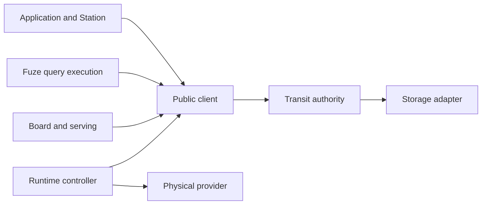

# System model and authority boundaries

Transit's user-facing model is data, computation and policies. This account asks
how a declaration relates to accepted data and observable outcomes, and which
components can establish each fact. Durable execution authority is separate from
the code and infrastructure that perform work.

The [data model](../reference/data-model.md) and
[architecture reference](../reference/architecture.md) own supported behavior;
the [glossary](../reference/glossary.md) defines names. The model below draws on
the implemented owners at `5c1099f7`. It is an architectural interpretation of
those contracts, not a new common catalog, wire format or scheduler.

## Declarations and observations

A declaration describes intended data, computation or policy. Its accepted
definition, the data it produces, and an observation of progress are distinct.
The relevant identity and revision must accompany each fact: a visible name can
refer to a replacement object, and a complete result can precede newer input.

| Concern | Model | Current owner and evidence |
| --- | --- | --- |
| Data | Object identity, interpretation and accepted revisions | [Catalog](../../../packages/zig/transit-catalog/README.md) and [state owners](state-model.md) bind Table definitions, resource roots and Document revisions |
| Computation | Definition, bound inputs, execution lifetime and result | [Query owners](query-engine.md) retain source bases and distinguish interactive execution, captured jobs and maintained revisions |
| Policy | Current permission, supported lifetime rules and work bounds | [Authorization](execution-model.md) and [retention](state-model.md#retention-argument) constrain work and disclosure |
| Observation | An attributed definition, outcome or progress position with coverage and failure meaning | [Public service interfaces](service-interfaces.md) expose evidence from their owners; transport or worker liveness is insufficient |

For a Table, publication establishes an immutable schema and accepted head under
one catalog owner. A prepared mutation retains its original binding; a later
name or schema change cannot silently retarget it. For a maintained relation, a
complete revision establishes the result for its recorded source vector. It
does not establish that the vector includes every currently available change.
These claims follow the [catalog lifecycle](../../../packages/zig/transit-catalog/docs/table-metadata.md)
and [maintained-query mechanism](query-engine.md#complete-revisions-from-retained-table-transactions).

The distinctions are observable: a compiled but unpublished definition is not
an active data object; an admitted operation can remain unresolved; denied access
can prevent inspection of an already applied result. A generic "ready" flag
would collapse these different facts. Current inspection remains specific to
each owner; catalog-wide desired/observed reconciliation is future work.

The useful abstraction is therefore the data lifecycle, with execution identities
and storage coordinates explaining its implementation. A row need not be a
process. A computation can be interactive without a durable job. An interface
definition does not imply permission or automatically dispatch external work.

## Model and assumptions

A data owner supplies interpretation and validates its domain transitions above
the generic authority. This model assumes compatible definitions and current
rights, as well as the storage and execution assumptions below. Combining
independent resource versions does not establish a global atomic snapshot.

A logical process has a durable identity, an ordered mailbox and committed
control state. A worker computes proposals outside the authority. The authority
validates those proposals against current grants, ownership and retained history.
Storage supplies the conditional durability on which acceptance depends.

The trusted boundary includes authority validation, credential handling and the
selected storage/runtime adapters. Application computation is trusted for its
domain meaning: valid protocol bytes do not establish a correct business result.
An authenticated worker is not necessarily an honest or deterministic program.

Arrows denote dependency or access direction, not equivalence of authority.
The node composes core with storage; deterministic core does not import a
provider, application handler or query engine. The
[component directory](../reference/components.md) identifies the concrete owners.

## Why these boundaries matter

| Separation | Reasoning | Failure if collapsed |
| --- | --- | --- |
| Definition and observed state | Validation, publication and completed work establish different facts | A valid declaration or healthy worker could be mistaken for fulfilled data intent |
| Data object and executor | Object identity and accepted revisions outlive individual workers | Placement changes could rename data or lose the original operation binding |
| PID and worker | Replacing an executor need not replace accepted work | A restart could create a second logical history |
| Permission and ownership | A current owner can lose permission; a reader need not own execution | An old activation or retained handle could bypass revocation |
| History and provider state | Placement reports where work can run, while accepted history determines what may run | An old snapshot could revive a retired identity |
| Kernel and application | Generic validation can enforce commit legality without understanding arbitrary values | Handler correctness could be falsely attributed to protocol validation |
| Query execution and authority | Authorized source reads can support computation without granting mutation authority | A query engine could become an alternate storage or permission path |

These are architectural arguments, not a proof that every implementation path
enforces them. Each claim requires evidence at the boundary where it can fail.

## Alternatives and tradeoffs

A process-first API makes ordering and recovery explicit, but requires callers
to assemble those mechanisms before they can express a data operation. Existing
Table and query owners raise that boundary while retaining inspectable execution
evidence. Generalizing their lifecycle is a design direction; it must preserve
each data kind's interpretation, current permissions and completion semantics.
This is an API design judgment, not a measured usability result.

Running application code inside the authority would combine computation with
commit validation and expand the authority's dependency and failure surface.
Keeping them separate requires explicit proposal, ownership and recovery APIs.
Similarly, direct backend access could avoid a public read hop but would bypass
the shared checks on authorization, lifetime and source identity. Transit accepts
those interface costs to retain one execution authority.

This choice does not establish throughput or latency superiority. The current
[storage model](storage-runtime.md) still has a serialization boundary, and
[performance evidence](../reference/performance.md) must be evaluated separately.

## Evidence and limits

The [core package](../../../packages/zig/transit-core/README.md),
[public client](../../../packages/zig/transit-client/README.md) and
[invariant inventory](../../../tests/verification/invariants.json) connect the model
to implementation and executable checks. The
[authority and outbox evidence](../../../tests/README.md#authority-effects-and-outbox-evidence)
records tested forbidden outcomes. Reproduction uses the commands and profiles
in that ledger; this consolidation adds no new runtime proof.

The data-level correspondence is challenged by stale prepared bindings, partial
publication, lost receipts, revocation and incomplete query results. The
[Table catalog](../../../packages/zig/transit-catalog/README.md),
[Table history](state-model.md#complete-table-history-under-a-bounded-turn) and
[query evidence](query-engine.md#tradeoffs-and-evidence) link their contracts,
implementation and executed schedules. A check that a worker is alive cannot
substitute for those observations; no universal declaration health view is
qualified by these tests.

The model establishes no global message order, cross-process transaction,
Byzantine tolerance or automatic recovery from rolled-back storage. The
[execution account](execution-model.md) develops the commit argument, and the
[historical architecture](../../history/ARCHITECTURE.md) preserves earlier proposals
and decomposition decisions with their original limits.
