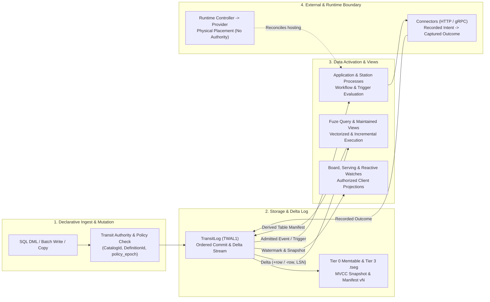

# System model and authority boundaries

Transit's user-facing model is programmable, versioned data, computation and
policies. This account asks how a declaration relates to accepted data, how
committed data activates downstream computations and processes, and which
components can establish each fact. Durable execution authority is separate from
the code and infrastructure that perform work.

The [data model](../reference/data-model.md) and
[architecture reference](../reference/architecture.md) own supported behavior;
the [glossary](../reference/glossary.md) defines names. The model below draws on
the implemented owners at `5c1099f7` and formalizes the separation between the
control/policy plane, the data plane and the process/effect activation plane.
Where it describes target storage/activation decomposition beyond the current
single-root implementation, those sections are explicitly marked as architectural
design analysis.

## Declarations and observations

A declaration describes intended data, computation or policy. Its accepted
definition, the data it produces, and an observation of progress are distinct
mathematical objects. The relevant identity and revision must accompany each
fact: a visible name can refer to a replacement object, and a complete result
can precede newer input.

Formally, at any authority cut, a Transit namespace is governed by four
orthogonal state components:

1. **Catalog and Interpretation State ($\mathcal{C}$):** Maps stable object
   identities (`CatalogId`) and immutable definition revisions (`DefinitionId`)
   to structural schemas, column identities (`ColumnId`), **Logical Types**
   ($\tau$), **Physical Encodings** ($\epsilon$), **Collations** ($\kappa$),
   and dependency edges.
2. **Committed Data State ($\mathcal{D}$):** Maps each stateful object to its
   accepted revision history—in the current implementation, a resource root in
   the catalog B-tree; in the target four-tier storage architecture, an
   immutable **Manifest ($M_v$)** referencing immutable columnar/hybrid data
   segments ($\{\text{tseg}_i\}$) and deletion vectors ($\{\text{tdel}_j\}$)
   plus a bounded write-ahead log prefix $L(v..\ell)$ in `TransitLog`.
3. **Policy and Lease State ($P_e$):** A monotonically versioned authorization
   graph (`policy_epoch`) of principals, roles, grants, retention rules and
   fenced writer leases.
4. **Derived Computation and Activation State ($\mathcal{Q}, \mathcal{S}$):**
   Binds finite queries $R = Q(\mathcal{D}[B])$, incrementally maintained views
   $R_{k} = R_{k-1} \oplus \Delta Q(L(b_{k-1}..b_k))$, and stateful `Station`
   processes/connectors to exact source watermarks $B$ and recorded effect
   intents.

| Concern | Model | Current owner and evidence |
| --- | --- | --- |
| Data | Object identity (`CatalogId`), interpretation (`DefinitionId`, types, codecs, collations) and accepted revisions | [Catalog](../../../packages/zig/transit-catalog/README.md) and [state owners](state-model.md) bind Table definitions, resource roots and Document revisions |
| Computation | Definition, bound inputs, execution lifetime and result | [Query owners](query-engine.md) retain source bases and distinguish interactive execution, captured jobs and maintained revisions |
| Policy | Current permission (`policy_epoch`), supported lifetime rules and work bounds | [Authorization](execution-model.md) and [retention](state-model.md#retention-argument) constrain work and disclosure |
| Activation & Effects | Ordered change delivery (`+row`/`-row`), process turns and recorded external intents | [Streams](../../../packages/zig/transit-core/README.md), [Station](client-framework.md) and [connectors](effect-lifecycle.md) activate work and capture external outcomes |
| Observation | An attributed definition, outcome or progress position with coverage and failure meaning | [Public service interfaces](service-interfaces.md) expose evidence from their owners; transport or worker liveness is insufficient |

For a Table, publication establishes an immutable schema and accepted head under
one catalog owner. A prepared mutation retains its original binding; a later
name or schema change cannot silently retarget it. For a maintained relation, a
complete revision establishes the result for its recorded source vector. It
does not establish that the vector includes every currently available change.
These claims follow the [catalog lifecycle](../../../packages/zig/transit-catalog/docs/table-metadata.md)
and [maintained-query mechanism](query-engine.md#complete-revisions-from-retained-table-transactions).

The distinctions are observable: a compiled but unpublished definition is not
an active data object; an admitted operation can remain unresolved; denied access
can prevent inspection of an already applied result. A generic "ready" flag
would collapse these different facts. Current inspection remains specific to
each owner; catalog-wide desired/observed reconciliation is future work.

### How durable execution activates data

In a traditional database, applications poll tables or bolt on external message
brokers and workflow engines that do not share the database's snapshot, schema
or authorization model. In a pure actor/workflow system, every datum is forced
into an actor mailbox, sacrificing relational layouts, vectorized scans and
columnar storage.

Transit unifies both by treating **data as the primary declaration** and
**durable execution as the activation mechanism**:

1. **Mutations commit to the log and become immediately readable:** A data write
   validates against `DefinitionId` and `policy_epoch`, commits to the write-ahead
   log (`TransitLog`), updates the in-memory MVCC view, and flushes into
   immutable segments (`.tseg`) referenced by a versioned Manifest ($M_v$).
2. **The log activates downstream consumers without polling:** The same committed
   log entry supplies an ordered delta (`+row`/`-row` at LSN $\ell$) to `Fuze`
   maintained views, reactive session watches, and `Station` durable processes.
3. **Processes coordinate workflows and external effects safely:** When a change
   requires external action (calling an HTTP/gRPC service or LLM tool), a
   `Station` process records a durable effect intent before dispatch and folds
   the captured outcome back into declared state. Replay reads the recorded
   outcome and never re-dispatches the external call.

## Separating the Control Plane, Data Plane and Process Plane

A critical architectural lesson from Transit's initial implementation is that
**data-plane operations must not be funneled through the actor mailbox and
per-turn block budget**.

In the current native-v1 baseline (`5c1099f7`), a logical process has a durable
identity (`PID`), an ordered mailbox and committed control state, and each native
turn is bounded to `4 × 256B` metadata keys and `16 × 64KiB` (`128 KiB` total)
blocks. While those tight bounds are well-suited for small actor control steps,
routing Table DML, schema evolution (`ALTER TABLE`), and query result publication
through `send_input -> open_view -> read_blocks -> commit_turn` forced the
implementation to split single logical data operations into multi-turn resumable
staging state machines (`STW1`, `STC1`, `STG1`, `STX1`) and serialize every
table write through one global realm root.

The architectural decomposition therefore separates three planes while sharing
one authorization (`policy_epoch`) and catalog (`CatalogId`, `DefinitionId`)
authority:

| Plane | Responsibility | Execution unit & wire profile | Authority & fencing invariant |
| --- | --- | --- | --- |
| **Control & Policy Plane** | Principals, role graph, grants (`policy_epoch`), catalog directory (`CatalogId`, `DefinitionId`) and partition lease assignment | Low-frequency atomic control transitions | Serialized per realm/namespace; bumping `policy_epoch` immediately fences stale data-plane and process leases |
| **Data Plane** | Bulk and point `INSERT`/`UPDATE`/`DELETE`/`COPY`, MVCC snapshot reads, vectorized `Fuze` scans, and `.tseg` segment/Manifest publication | Direct streaming/batch ingestion into `TransitLog` + Tier 0 Memtables and immutable `.tseg` segments in `TransitObjectStore` | Governed by epoch-fenced **Partition Leases** `(partition_id, writer_epoch, policy_epoch)` and conditional Manifest CAS (`Multi-Writer OCC`) |
| **Process & Effect Plane** | Stateful `Station` actors, supervision trees, timers, long-lived workflow orchestration and connector effect intents/outcomes | Bounded actor turns over process mailboxes and recorded effect transcripts | Governed by `PID` ownership generation (`g`) and current `policy_epoch` checks before commit and dispatch |

## Model and assumptions

A data owner supplies interpretation and validates its domain transitions above
the generic authority. This model assumes compatible definitions and current
rights, as well as the storage and execution assumptions below. Combining
independent resource versions does not establish a global atomic snapshot.

The trusted boundary includes authority validation, credential handling and the
selected storage/runtime adapters. Application computation is trusted for its
domain meaning: valid protocol bytes do not establish a correct business result.
An authenticated worker is not necessarily an honest or deterministic program.

Arrows in the system diagram above denote dependency, data-flow or access
direction, not equivalence of authority.
The node composes core with storage; deterministic core does not import a
provider, application handler or query engine. The
[component directory](../reference/components.md) identifies the concrete owners.

## Why these boundaries matter

| Separation | Reasoning | Failure if collapsed |
| --- | --- | --- |
| Definition and observed state | Validation, publication and completed work establish different facts | A valid declaration or healthy worker could be mistaken for fulfilled data intent |
| Data plane and actor mailbox turn | Relational batches and columnar scans operate on megabytes of typed vectors, whereas actor turns coordinate control state | Funneling rows through `128 KiB` actor turns causes multi-turn staging state machines and severe write amplification |
| Data object and executor | Object identity and accepted revisions outlive individual workers | Placement changes could rename data or lose the original operation binding |
| PID and worker | Replacing an executor need not replace accepted work | A restart could create a second logical history |
| Permission and ownership | A current owner can lose permission; a reader need not own execution | An old activation or retained handle could bypass revocation |
| History and provider state | Placement reports where work can run, while accepted history determines what may run | An old snapshot could revive a retired identity |
| Kernel and application | Generic validation can enforce commit legality without understanding arbitrary values | Handler correctness could be falsely attributed to protocol validation |
| Query execution and authority | Authorized source reads can support computation without granting mutation authority | A query engine could become an alternate storage or permission path |

These are architectural arguments, not a proof that every implementation path
enforces them. Each claim requires evidence at the boundary where it can fail.

## Alternatives and tradeoffs

A process-first API makes ordering and recovery explicit, but requires callers
to assemble those mechanisms before they can express a data operation. Existing
Table and query owners raise that boundary while retaining inspectable execution
evidence. Generalizing their lifecycle is a design direction; it must preserve
each data kind's interpretation, current permissions and completion semantics.
This is an API design judgment, not a measured usability result.

Running application code inside the authority would combine computation with
commit validation and expand the authority's dependency and failure surface.
Keeping them separate requires explicit proposal, ownership and recovery APIs.
Similarly, direct backend access without a fenced lease and `policy_epoch`
verification would bypass the shared checks on authorization, lifetime and
source identity. Transit uses epoch-fenced leases and conditional manifest
publication so data-plane writers achieve direct storage throughput without
sacrificing single-authority revocation and auditability.

This choice does not establish throughput or latency superiority by assertion.
The current [storage model](storage-runtime.md) still has a single-root
serialization boundary, and [performance evidence](../reference/performance.md)
must be evaluated empirically as the four-tier storage architecture lands.

## Evidence and limits

The [core package](../../../packages/zig/transit-core/README.md),
[public client](../../../packages/zig/transit-client/README.md) and
[invariant inventory](../../../tests/verification/invariants.json) connect the model
to implementation and executable checks. The
[authority and outbox evidence](../../../tests/README.md#authority-effects-and-outbox-evidence)
records tested forbidden outcomes. Reproduction uses the commands and profiles
in that ledger; this consolidation adds no new runtime proof.

The data-level correspondence is challenged by stale prepared bindings, partial
publication, lost receipts, revocation and incomplete query results. The
[Table catalog](../../../packages/zig/transit-catalog/README.md),
[Table history](state-model.md#complete-table-history-under-a-bounded-turn) and
[query evidence](query-engine.md#tradeoffs-and-evidence) link their contracts,
implementation and executed schedules. A check that a worker is alive cannot
substitute for those observations; no universal declaration health view is
qualified by these tests.

The model establishes no global message order, cross-process transaction,
Byzantine tolerance or automatic recovery from rolled-back storage. The
[execution account](execution-model.md) develops the commit argument, and the
[historical architecture](../../history/ARCHITECTURE.md) preserves earlier proposals
and decomposition decisions with their original limits.
